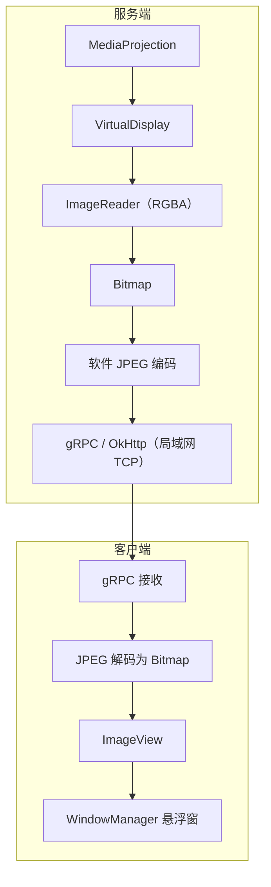

# LocalScreenShareAndroid

一个面向 **Android 设备之间局域网屏幕共享** 的应用。服务端与客户端集成在同一个 App 中：服务端共享屏幕，客户端通过可拖拽、可调整大小的悬浮窗观看，无需账号或云端中继。

> 项目仍处于早期迭代阶段。本文区分“当前功能”和“规划方向”；设计文档中的目标架构不代表已经全部实现。

## 当前功能

- 基于 MediaProjection 的屏幕采集与共享。
- 基于 NSD 的局域网服务发现。
- 同一个 App 支持服务端和客户端。
- 客户端以系统悬浮窗显示，支持拖动、调整大小、不透明度、圆角和保持亮屏等设置。
- 服务端支持调整采集画面比例、最大帧率和 JPEG 画质。
- 使用前台 Service 维持服务端与客户端会话。
- 服务端可开启“画面私密”，使客户端悬浮窗禁止截屏或录屏；该功能不代表传输加密。

当前暂不支持系统音频传输、远程反控、互联网中继和硬件视频编解码。

## 使用场景

- 在同一局域网内，用一台 Android 设备查看另一台设备的屏幕。
- 将手机画面作为可调整位置的窗口显示在另一台 Android 设备上。
- 在支持普通 Android App 和悬浮窗权限的大屏设备、平板或后装安卓车机上进行悬浮监看。

车机只是潜在应用场景之一，当前项目并非车机专用实现；手机、平板、大屏设备与车机都只是场景示例，不是能力边界。设备形态和 API 等级都不能单独决定编解码能力：低版本或车机可能只走 H.264 兼容档，旗舰手机或平板也可能在同为 API 25 的系统上具备更强的编码能力。具体档位以运行时探测结果为准。仍需针对具体系统验证悬浮窗权限、网络发现、横屏适配和性能。

## 环境要求

- 最低系统：Android 7.1（API 25）。这是兼容下限与回退基线，不是能力上限；更高版本或高性能设备可按运行时探测使用更高编码档位。
- 当前编译与目标版本：API 35。
- 构建 JDK：JDK 17；项目源码目标为 Java 11。
- 服务端与客户端通常需要处于同一局域网，并且网络允许 NSD/mDNS 发现。
- 按系统提示完成屏幕采集授权，并授予通知、悬浮窗等所需权限。

部分系统、热点或企业网络可能限制设备发现；某些设备也可能限制悬浮窗和后台运行。

## 构建

使用 Android Studio 打开项目，或在已配置 Android SDK 的环境中执行：

```bash
./gradlew assembleDebug
```

Windows 环境可使用：

```bash
gradlew.bat assembleDebug
```

Debug APK 默认生成在 `app/build/outputs/apk/debug/`。

## 基本使用

1. 在两台 Android 设备上安装并打开应用，接入同一局域网。
2. 在服务端启动屏幕共享，并按系统提示完成授权。
3. 在客户端启动服务发现和连接功能，选择目标设备。
4. 按系统提示授予悬浮窗权限。
5. 客户端可拖动悬浮窗、调整窗口大小和相关显示设置。

## 当前服务端参数

| 参数 | 范围 | 默认值 | 说明 |
|---|---:|---:|---|
| 画面比例 | 5%–100% | 100% | 按服务端屏幕窗口边界缩放，所有客户端共用 |
| 最大帧率 | 1–120 fps | 60 fps | 实际帧率还受采集、编码和设备性能影响 |
| JPEG 质量 | 0–100 | 85 | 仅影响当前 JPEG 图像编码，不是视频码率 |

客户端的“显示大小”只改变悬浮窗尺寸，目前不会降低网络码流分辨率，也不会通知服务端调整采集参数。

## 当前实现架构



这条路径实现直接，但默认 100% 画面比例下的全分辨率 CPU 拷贝、软件 JPEG 编解码和 Bitmap 渲染会带来较高的 CPU、内存与功耗开销。建议的硬件编解码演进方案见 [媒体架构设计](docs/media-architecture.md)。

## 安全与隐私

- 当前屏幕流没有连接认证和传输加密，**仅建议在可信局域网中测试或使用**。
- 同一网络中的其他设备可能尝试连接或读取未受保护的流量；离开可信网络前应停止共享。
- “画面私密”只用于限制客户端截屏或录屏，不会加密网络数据。
- 发布构建应使用独立、私有的签名配置，不要将真实签名材料或口令提交到仓库。

后续安全改造和反控设计必须以配对认证、权限隔离和服务端明确授权为前提。

## 文档

- [文档索引](docs/README.md)
- [任务看板](docs/task-board.md)
- [决策看板](docs/decision-board.md)
- [项目现状与技术审查](docs/project-assessment.md)
- [产品背景与场景分析](docs/product-context.md)
- [媒体架构设计](docs/media-architecture.md)
- [窗口化与会话设计](docs/windowing-session-design.md)
- [渐进优化路线](docs/optimization-roadmap.md)

涉及功能、架构或使用方式变更时，应同步更新本 README 和相关文档。

## 优化方向

1. 解耦会话与显示界面，完善队列、锁和资源释放，补充关键指标与测试。
2. 使用 MediaCodec Surface 输入/输出替换软件 JPEG 主链路，降低功耗和卡顿；H.264 作为兼容基线与回退档，按服务端/客户端能力探测协商 HEVC 等更高档位。
3. 支持悬浮窗与客户端全屏 Activity 之间不断连切换，并允许小窗与全屏按能力选择不同媒体档位。
4. 按系统版本增加音频、单客户端反控和能力协商；能力协商以运行时探测为准，不按 API 等级或设备形态推断。
5. 根据实测结果决定是否引入 RTP/UDP 或 WebRTC。

详细取舍和验证标准见 [渐进优化路线](docs/optimization-roadmap.md)。

## 测试

```bash
./gradlew testDebugUnitTest lintDebug
```

当前业务自动化测试覆盖有限，媒体链路、服务生命周期、网络异常和多客户端场景仍需补充测试与实机验证。

## License

当前仓库尚未提供 `LICENSE` 文件。
