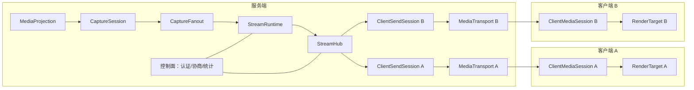
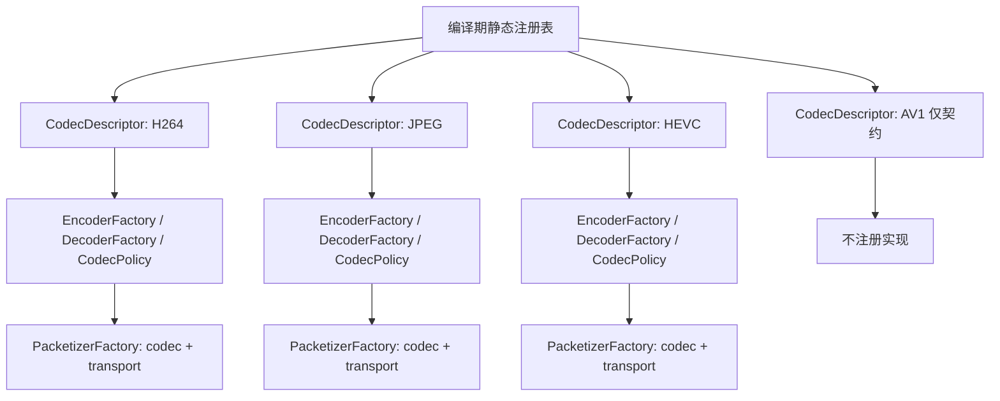
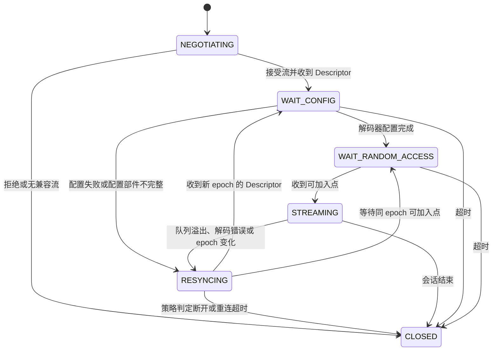
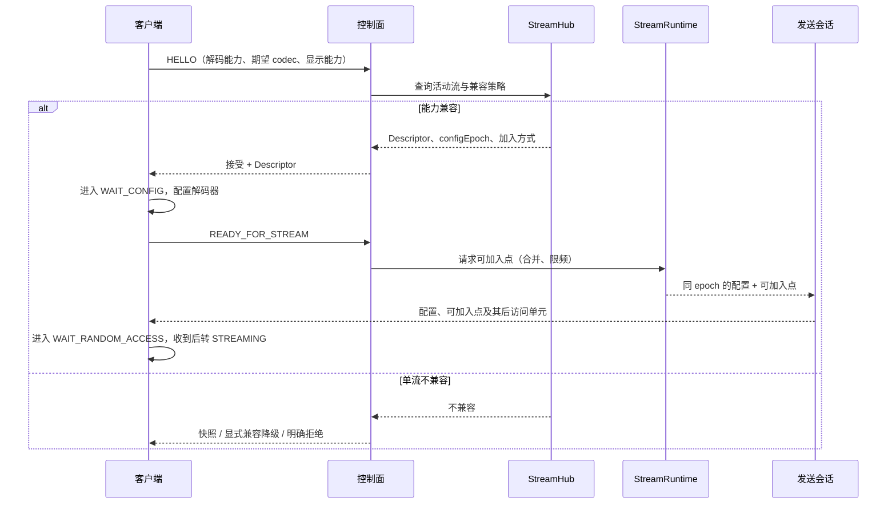
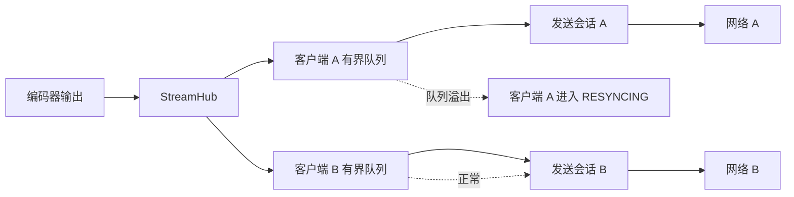
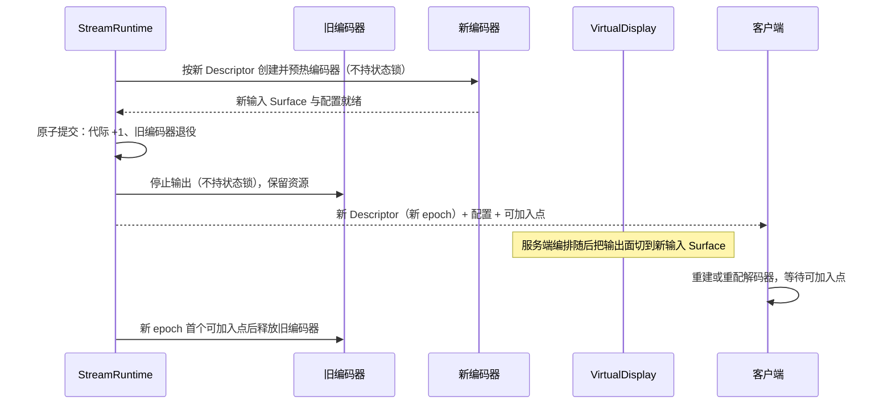

# 可扩展编码框架设计

> 状态：**隔离核心、H.264 适配器与媒体路径生产接线（批次 A–H）已在代码层面落地，仅经 JVM/fake 及编译验证；未做设备/真机/模拟器验证**。静态 Codec SPI、单活动流 Runtime、StreamHub、每客户端有界队列、客户端六状态机、JPEG 独立帧参考适配与 H.264 适配器已在 `core` 落地，并已接入 `ScreenShareService`/`ScreenShareServer`/`ScreenShareClient`；H.264、JPEG 与接线路径均通过 JVM 单元测试，androidTest 仅编译未运行。HEVC/AV1、RTP/Packetizer 与真实设备验证均未实现或未执行。本文是设计契约，不能当作设备验证通过的证据。
> 适用范围：一个 `MediaProjection` 与一个 `VirtualDisplay` 的采集结果，第一版只跑一条活动流。多流、GPU 分发、RTP 与 WebRTC 只描述扩展位置与触发条件。
> 相关文档：[媒体链路目标架构](media-architecture.md) · [渐进优化路线图](optimization-roadmap.md) · [窗口与会话设计](windowing-session-design.md) · [决策看板](decision-board.md) · [任务看板](task-board.md)

## 1. 结论摘要

| 议题 | 已批准裁决 | 状态 |
| --- | --- | --- |
| 总体结构 | 静态 Codec SPI + 单活动流核心 + 可扩展 StreamHub；不引入动态插件或通用多媒体引擎 | 隔离核心与 H.264 适配器已落地，JVM/fake 及编译验证 |
| 第一版验证方式 | 用 H.264 与 JPEG 两条差异最大的实现验证同一契约；HEVC 用于验证 `MediaCodec` 骨架复用 | JPEG 参考适配、隔离 H.264 适配器与生产接线已落地（批次 B/D）；HEVC 未实现 |
| 第一版范围 | 单采集会话、单 VirtualDisplay、单 Surface、单活动流；不做 GPU Fanout、多流与每客户端转码 | 隔离核心与采集/VirtualDisplay 接线已落地（批次 B）；多流与 GPU Fanout 未实现 |
| 契约边界 | 公共层只处理描述符、参数、访问单元、状态与队列；不解析 NAL/OBU/JPEG 负载 | 已落地，JVM 验证 |
| 解码配置 | `StreamDescriptor` 与 `StreamParameters` 分离，只有解码关键变化才推进 `configEpoch` | 已落地，JVM 验证 |
| 新客户端加入 | 不假设所有关键帧/RAP 都可加入；按 codec 策略等待明确可加入点 | 已落地，JVM 验证 |
| 编码切换 | 第一版单 VirtualDisplay、无 GPU Fanout，不能保证零间隙；只保证会话不重建、画面不花屏 | Runtime 预热/切换/旧 encoder 释放与服务端切换编排已落地（批次 F），客户端重配与 Surface 恢复已落地（批次 C/H），仅 JVM/fake 验证；黑帧时长未实测 |
| 传输 | 第一版媒体为统一 gRPC 双向流承载完整访问单元（已实现接线）；RTP 由 `(codec, transport)` 封包器处理；WebRTC 作为独立媒体栈 | 传输接口与 gRPC 双向流接线已落地；RTP Packetizer 未实现 |
| 高级能力 | AV1、HDR、B 帧、时域层只预留契约，不在本阶段实现 | 未实现 |

本文中的“已批准”只表示设计获得用户确认；当前证据为隔离核心、隔离 H.264 适配器与 gRPC 双向流媒体接线（批次 A `4ceab10`）的 JVM/fake 及编译验证；未做 RTP 接线或设备/性能验证。

## 2. 设计目标与不变量

目标：

1. **同一契约容纳差异很大的编码实现。** 参考帧视频（H.264/HEVC/AV1）与非参考帧图像（JPEG）走同一套流生命周期、描述符、访问单元与客户端状态，差异收敛在 codec 实现与策略中。
2. **扩展新 codec 不改公共层。** 新增 codec 只注册描述符、编解码工厂、策略与必要的封包器；公共层不出现 `if (codec == ...)` 分支。
3. **第一版保持最小。** 单采集、单活动流、单 Surface，先把契约跑通，再按证据扩展到多流与多传输。
4. **不把“可扩展”做成通用引擎。** 不实现滤镜图、转码管线、动态发现或设备能力数据库。

不变量：

- 采集、编码、发送、接收、解码、渲染分属不同责任对象；任何一层都不能在采集或编码线程上同步等待网络。
- 所有发送队列有界；丢弃策略由 codec 策略决定，不能套用同一种“丢最新帧”规则。
- 解码关键配置与运行参数分离；配置变化必须走新 epoch，参数变化不得隐式重建解码器。
- 访问单元按解码顺序编号；公共层不重排、不解析负载、不推断帧类型。
- 新客户端加入不得让已有客户端静默降级，也不得重建已有客户端的网络、认证或控制会话。

## 3. 总体结构

图中的两个客户端只表示扇出关系，不表示第一版支持多档编码。第一版所有客户端共享同一条活动流。

### 3.1 责任边界

| 组件 | 负责 | 不负责 | 第一版边界 |
| --- | --- | --- | --- |
| `CaptureSession` | 持有 `MediaProjection` 与 `VirtualDisplay`，管理采集输出 Surface、采集尺寸与旋转、采集生命周期 | 编码、客户端管理、网络 | 一个采集会话，一个输出 Surface |
| `CaptureFanout` | 把采集输出按需分发给一个或多个编码输入 | 修改画面、缩放、像素格式转换 | 单输出直通，不复制帧、不做 GPU 分发 |
| `StreamRuntime` | 一条活动流的编码器实例、描述符与参数、`configEpoch`、访问单元生产、可加入点与关键帧请求、编码切换、配置缓存 | 客户端网络会话、慢客户端队列、渲染 | 一条活动流、一个编码器 |
| `StreamHub` | 按 `streamKey` 注册与查找流，管理客户端订阅关系与流生命周期 | 编码、解码、封包 | 单活动流核心；接口按多流预留，但不实现多流调度 |
| `ClientSendSession` | 每个客户端的发送路径：有界队列、序号、背压状态、重同步、绑定传输 | 解析码流、判断帧类型、重建解码器 | 每客户端一条，互相隔离 |
| `MediaTransport` | 帧或字节的收发、长度前缀、协议版本、连接生命周期 | 解析负载、判断可加入点、选择 codec | 第一版媒体为 gRPC 双向流承载完整访问单元（已实现接线）；独立 TCP 帧协议为备选方案 |
| `ClientMediaSession` | 协商、应用描述符、管理解码器与状态机、把帧送到渲染目标、上报统计 | 采集、编码、队列扇出 | 每客户端一个 |
| `RenderTarget` | 提供显示 Surface/View，处理 attach/detach 与尺寸变化 | 网络、解码器、状态机 | 只做显示，不拥有媒体生命周期 |

### 3.2 第一版单流拓扑

- 只有一份采集与一份编码；不同窗口尺寸由客户端渲染缩放解决。
- 第一版不做每客户端转码，也不为每档清晰度创建新的采集会话。

### 3.3 多流与 GPU Fanout（未来，不在第一版）

只有在确认多档需求、编码器实例、功耗与热预算并完成实测后，才启用该拓扑。第一版不得预先实现 GPU Fanout，也不得为它引入额外的公共层抽象。

## 4. 静态 Codec SPI 与扩展点

### 4.1 扩展点

| 扩展点 | 输入 | 职责 | 公共层如何使用 |
| --- | --- | --- | --- |
| `CodecDescriptor` | 无（静态声明） | 声明 `codecId`、MIME、码流格式、配置部件种类、是否需要 Surface 输入/输出等静态事实 | 用于协商、日志与工厂查找；不包含运行参数，不包含设备能力 |
| `EncoderFactory` | 描述符、初始参数 | 创建并预热编码器，输出访问单元与配置部件；编码输入 Surface 由 `Encoder.getInputSurface()` 暴露（可为 null） | 由 `StreamRuntime` 调用并获取输入 Surface；公共层不接触 `MediaCodec` 细节 |
| `DecoderFactory` | 描述符、`RenderTarget`、配置部件 | 创建或重建解码器，接收访问单元；MediaCodec 类解码器输出到 `RenderTarget` 的 Surface，JPEG 类通过 `RenderTarget.renderEncodedImage(EncodedImageFrame)` 输出压缩图像帧；解码/渲染错误统一为 `DecoderException` | 由 `ClientMediaSession` 调用；公共层不接触解码器细节，也不把访问单元当作解码帧；显示侧负责解码压缩帧 |
| `CodecPolicy` | 描述符、访问单元元数据 | 判定可加入点、关键帧请求语义、队列溢出后的重同步方式、epoch 推进条件 | 发送会话与客户端状态机按策略执行，不硬编码 codec 规则 |
| `PacketizerFactory(codec, transport)` | `codecId`、传输类型 | 为需要封包的传输生成封包器，例如 RTP 分片与时间戳 | 只有需要分片的传输才解析负载；gRPC 双向流与 TCP 完整访问单元路径不使用 |

### 4.2 静态注册

规则：

- 注册表在编译期固定，按 `codecId` 与传输类型查找；不使用反射扫描、`ServiceLoader`、动态加载 APK 或远程下发。
- 查找失败必须显式失败或降级到兼容实现，不能静默回退到“猜测 codec”。兼容降级的选择使用 `CodecRegistration` 的 `fallbackPriority` 等通用元数据，公共层不得硬编码具体 codec 名称（例如 JPEG）。
- 新增 codec 只新增描述符、工厂、策略与封包器；若需要修改公共层分支才能接入，说明契约不完整，应先修订契约。
- `PacketizerFactory` 与 `(codec, transport)` 封包器只在 RTP 批次实现；在此之前不得预先冻结其签名。

### 4.3 实现路径与第一版验证目的

| codecId | 实现路径 | 第一版状态 | 验证目的 |
| --- | --- | --- | --- |
| H.264/AVC | `MediaCodec` 骨架，Surface 输入与输出，明确 IDR 才可加入 | 已接线（批次 B `c027651` 采集直通；JVM/fake 及编译验证） | 验证参考帧视频的描述符、epoch、可加入点、队列与重同步 |
| JPEG/MJPEG | 独立像素路径：自行从采集 Surface 取像素并压缩，每帧独立 | 实现 | 验证非参考帧路径、每帧可加入、不同丢弃策略能否共用同一契约 |
| HEVC | 复用 `MediaCodec` 骨架，只从明确安全 IDR 加入 | 扩展验证 | 验证新增 codec 不需要改公共层；CRA/RASL 不作为可加入点 |
| AV1 | 复用 `MediaCodec` 骨架，加入规则由未来策略决定 | 仅契约 | 验证描述符与策略字段足够表达，不写实现 |
| HDR / B 帧 / 时域层 | 仅字段与策略位置 | 仅契约 | 不实现调度、重排或分层丢弃 |

- 所有 `MediaCodec` 系 codec 共用一个骨架：输入 Surface、输出访问单元、配置部件、同步点标记。差异放在描述符、工厂参数与策略中。
- JPEG 不经过 `MediaCodec` 骨架，公共层也不为它引入第二套流模型；完整实现中像素获取与压缩封装在 JPEG 适配器内部。实施可分批：在不重写现有 JPEG 路径的批次中，参考适配器先接收已压缩的完整帧；像素获取迁移到适配器属于接线批次。
- 编码输入的最小公共接口是 Surface；`Encoder.getInputSurface()` 暴露该 Surface（可为 null），供 `StreamRuntime` 接线。像素型 codec 若需要 `ImageReader` 或 Bitmap，必须在其实现内部完成，不把像素类型暴露给 `StreamRuntime`。

### 4.4 公共层不做什么

- 不解析 NAL 单元、OBU、JPEG 段或任何码流语法。
- 不从负载推断关键帧、IDR、CRA、RASL、参考帧依赖或时域层。
- 不提取 SPS/PPS/VPS；配置部件由编码器适配器以不透明字节给出。
- 不实现码流重写、转码、滤镜、缩放或像素格式转换。
- 不做动态插件发现与加载，不建设通用多媒体引擎、滤镜图或跨平台媒体抽象。

## 5. 描述符与运行参数

### 5.1 `StreamDescriptor`

描述符描述“解码这条流需要什么”，在同一个 `configEpoch` 内不可变。

| 字段 | 含义 | 变化是否推进 epoch |
| --- | --- | --- |
| `sessionInstanceId` | 一次服务端会话实例的标识，重连或重启后变化 | 是（属于新会话） |
| `streamId` | 会话内的流标识，单流第一版固定为一个值 | 是（流身份变化） |
| `configEpoch` | 解码配置代次，单调递增 | 本身即代次 |
| `mime` | 编码格式，例如 H.264、HEVC、JPEG | 是 |
| `profile` / `level` | 视频 profile 与 level；JPEG 可缺省 | 是 |
| `codedWidth` / `codedHeight` | 编码器实际输出尺寸，含对齐填充 | 是 |
| `visibleWidth` / `visibleHeight` | 可见画面尺寸，用于裁剪与显示 | 本阶段保守处理：变化生成新描述符并推进 epoch；后续实测确认只做渲染变换后才放宽 |
| `rotation` | 画面旋转角度 | 第一版按解码/显示重配处理，推进 epoch |
| `bitstreamFormat` | 码流封装格式，例如 Annex-B、AVCC、JPEG 帧 | 是 |
| `CodecConfigPart` | 不透明配置部件列表，例如 csd-0/csd-1；公共层不解析 | 是 |
| `ColorInfo` | 色彩空间、范围、传递函数；影响解码或显示时使用 | 影响解码时是，仅显示元数据时否 |
| `configHash` | 对解码关键字段的摘要，用于快速比对与日志核对 | 随关键字段变化 |

约束：

- 描述符必须是纯数据；不得持有编码器、解码器、Surface 或线程。
- 客户端只按描述符配置解码器；不得从 MIME 猜测 profile/level，也不得从分辨率猜测对齐。
- 描述符与配置部件必须成组缓存、成组发送；不能让客户端拿到新描述符却配旧配置。
- 本阶段 `visible size` 变化也生成新描述符并推进 `configEpoch`，可能触发客户端重配；**不增加同 epoch 的显示参数更新通道**。是否放宽为纯显示变化，必须由后续实测与 `CodecPolicy` 显式裁决。

### 5.2 `StreamParameters`

运行参数描述“编码器当前怎么跑”，变化不要求客户端重建解码器。

| 参数 | 含义 | 是否推进 epoch | 生效方式 |
| --- | --- | --- | --- |
| 目标码率 | 编码器目标码率 | 否 | 运行时重配或下一关键帧生效 |
| 帧率提示 | 目标帧率，不是严格上限 | 否 | 编码器提示；实际帧率仍由系统与内容决定 |
| 关键帧间隔 | 期望的关键帧间距 | 否 | 编码器设置；同步请求仍需合并限频 |
| 码率控制模式等运行档位 | 不改变解码配置的编码选项 | 否 | 编码器运行时调整 |

明确不属于运行参数、必须进入描述符的内容：MIME、profile/level、编码尺寸、码流格式、配置部件、影响解码的色彩信息。

## 6. 编码访问单元

### 6.1 `EncodedAccessUnit`

| 字段 | 必需 | 语义 |
| --- | --- | --- |
| `streamKey` | 是 | `sessionInstanceId` 与 `streamId` 的组合，用于路由与缓存归属 |
| `configEpoch` | 是 | 该访问单元所属的解码配置代次；接收端必须对**每个 AU**（不仅是可加入点）校验它 |
| `sequence` | 是 | 在 `(streamKey, configEpoch)` 内单调递增序号，在编码器输出时分配，按解码顺序增长；新 epoch 重新从 0 开始 |
| `ptsUs` | 是 | 显示时间戳，微秒，使用会话单调时钟 |
| `dtsUs` | 否 | 解码时间戳；第一版可缺省，只为未来 B 帧预留 |
| `flags` | 是 | 同步点、可加入点、配置等布尔标记；标记由 codec 实现给出 |
| `joinInfo` | 否 | 可加入点附加信息：所属 `configEpoch`、所需配置部件、可选的前置条件；若存在，其 epoch 必须等于 AU 的 `configEpoch` |
| `temporalLayerId` | 否 | 时域层标识；第一版不使用，缺省视为单层 |
| `payload` | 是 | 不透明字节；公共层不解析、不改写 |

约束：

- 访问单元按**解码顺序**排列；第一版没有 B 帧，显示顺序与解码顺序一致，不实现重排缓冲。
- `sequence` 在编码器输出时分配，不按客户端发送时分配；它只在当前 epoch 内单调递增，新 epoch 从 0 重新开始。慢客户端丢帧后序号出现空洞是正常现象，只用于诊断与重同步判断。
- 每个访问单元携带 `configEpoch`；旧 epoch 的普通访问单元也不能被新 epoch 的会话接受，不能只校验可加入点。
- `flags` 中的同步点与可加入点是两个独立概念；同步点不自动等于可加入点。
- 第一版只保证字段存在与传递，不实现 B 帧调度、时域层丢弃或 SVC 分层发送。
- 配置部件可以随访问单元携带，也可以走独立配置消息；无论哪种方式，客户端都必须先拿到与访问单元同 epoch 的配置。

### 6.2 可加入点信息

可加入点不是“关键帧”的同义词。它表示：从该访问单元开始，一个新解码器在不依赖此前参考帧的情况下可以进入 `STREAMING`。

- 可加入点必须属于确定的 `configEpoch`，并声明所需配置部件。
- 可加入点由 codec 策略判定，公共层只读取布尔结果与附加信息。
- 若缓存中没有与当前 epoch 匹配的可加入点，服务端应等待或请求编码器产生一个，而不是发送半截 GOP。
- 可加入点的产生请求必须合并并限频，不能每个新客户端各触发一次。

## 7. 可加入点规则与客户端状态

### 7.1 不假设所有关键帧都可加入

H.264 的关键帧通常是 IDR，但编码器标记、封装与设备实现存在差异；HEVC 的 IRAP 包含 IDR、CRA、BLA 等，CRA 之后可能存在 RASL/RADL 前导图像；AV1 的关键帧与显示帧组语义更复杂。因此：

| codec | 第一版可加入点 | 明确不作为可加入点 | 说明 |
| --- | --- | --- | --- |
| H.264 | 明确的 IDR | 无法确认类型的同步标记、普通 I 帧 | 编码器适配器必须给出明确 IDR 依据，不能只看“关键帧”布尔值 |
| HEVC | 明确的安全 IDR | CRA、BLA、RASL、RADL 及依赖前导图像的接入点 | 第一版不提前支持 CRA 加入；未来由策略扩展 |
| AV1 | 暂不实现，由未来策略判断 | 关键帧不等于可加入点 | 只保留描述符与策略位置 |
| JPEG/MJPEG | 每个完整帧 | 不完整的帧、被截断的帧 | 帧独立，可任意从完整帧开始 |

- 上述规则属于 `CodecPolicy`，不写进 `StreamHub` 或发送会话。
- 若某设备编码器的同步标记不可靠，策略应降级为“等待下一个明确可加入点”或拒绝该 codec，而不是放宽判定导致花屏。

### 7.2 客户端状态

| 状态 | 含义 | 允许的输入 |
| --- | --- | --- |
| `NEGOTIATING` | 交换能力、选择流、确认是否兼容 | 能力消息、接受/拒绝结果 |
| `WAIT_CONFIG` | 已拿到描述符，正在配置或重建解码器 | 同 epoch 的配置部件 |
| `WAIT_RANDOM_ACCESS` | 解码器就绪，等待可加入点 | 同 epoch 的可加入点；其他帧丢弃 |
| `STREAMING` | 正常解码与渲染 | 同 epoch 的访问单元；新 epoch 触发重同步 |
| `RESYNCING` | 已失去连续解码条件，等待恢复或断开 | 新描述符、可加入点、断开指令 |
| `CLOSED` | 会话终止，资源释放 | 无 |

与既有术语的关系：此前的 `WAIT_IDR` 在本框架中拆成 `WAIT_CONFIG` 与 `WAIT_RANDOM_ACCESS`，以覆盖 JPEG 等非 IDR 路径。旧状态名保留在决策看板的历史记录中，新实现以本表为准。

### 7.3 新客户端加入

规则：

- 新客户端先协商再订阅；不得直接接入媒体流从任意帧开始。
- 新客户端加入不改变已有客户端的描述符、epoch、队列或解码器；已有客户端不因新加入者断开或重新认证。
- 多个新客户端同时加入时，可加入点请求合并；一个可加入点可服务多个客户端。
- 单流与某新客户端不兼容时，只有三种处理：发送快照、经用户可见提示后做全局兼容降级、明确拒绝。不能静默把已有客户端降档。多流方案在后续阶段解决，不在第一版伪造。

## 8. 多客户端、慢客户端与重同步

### 8.1 异构客户端

- 第一版只有一条活动流，取所有已连接客户端的共同兼容能力；H.264 为保底，JPEG 为降级与快照路径。
- 新客户端能力更高时，不因此自动提升全局档位；是否提升按媒体架构的多档策略单独评估。
- 新客户端能力不足时，不得让已有客户端静默降级；只能快照、显式兼容降级或拒绝。
- 多流以后由 `StreamHub` 注册多条流并按客户端能力路由；第一版不实现该调度。

### 8.2 慢客户端

每个客户端有独立的有界发送队列，队列只保存该客户端尚未发送的访问单元与必要配置。

溢出处理：

| codec 类型 | 溢出后的允许动作 | 禁止动作 |
| --- | --- | --- |
| 参考帧编码（H.264/HEVC/AV1） | 队列溢出、单个 AU 超限或过期导致可解码性破坏时，清空队列并进入 `RESYNCING`；只从下一个同 epoch 可加入点恢复；按策略等待或断开重连 | 任意丢中间 P/B 帧后继续发送；无限缓存；阻塞编码器 |
| 非参考帧编码（JPEG） | 只保留最新完整帧；丢弃旧帧与不完整帧；溢出或过期后继续发送最新完整帧，**不进入无意义的 `RESYNCING`** | 发送截断帧；为慢客户端积压大量旧帧；把参考帧的 `RESYNCING` 规则套到 JPEG |

- 队列上限按字节数与时间共同约束，具体阈值需实测后确定，本文不预设数值。
- 客户端从 `RESYNCING` 恢复到 `STREAMING` 必须经过同 epoch 的可加入点；跨 epoch 时必须先进入 `WAIT_CONFIG`。
- 慢客户端的统计至少包括队列深度、丢弃段数、重同步次数与最近可加入点等待时长；指标定义在实施阶段补充。

## 9. 编码切换

### 9.1 第一版不保证零间隙

第一版是单 VirtualDisplay、单采集 Surface、单活动编码器。切换编码器时，旧编码器已经停止输出，新编码器尚未稳定，因此：

- 不能保证画面零间隙或零黑帧。
- 可以保证网络连接、认证、控制会话与客户端会话不重建。
- 客户端在切换窗口内保持最后一帧，减少闪黑；新可加入点到达后恢复。
- 真正的无缝切换需要 GPU Fanout：两路编码器同时运行，客户端在可加入点切换。该能力不在第一版。

### 9.2 切换流程

约束：

- 切换只发生在明确的解码关键变化或编码器故障时；码率、帧率提示与关键帧间隔变化不触发切换。
- 切换前必须完成新编码器预热；预热失败则保留旧编码器并明确报错，不能让会话进入无编码器状态。
- 切换期间不得在持有运行时状态锁时创建、启动、停止或关闭编码器：旧编码器的 drain 线程在 `onAccessUnit` 中需要同一把锁，持锁 join 会让双方互等到 1 s 超时。切换由独立的 switch 锁串行化，锁序固定为 switch 锁 → 状态锁（2026-10-21 真机回归，见 [TB-ENG-012](task-board.md#tb-eng-012)）。
- 旧编码器停止失败不视为切换失败：该编码器已被要求停止，继续当作活动编码器会把运行时与采集输出面绑在死编码器上；切换照常提交，旧编码器走退役关闭路径。
- 新描述符与新可加入点必须同 epoch；客户端不得用旧 epoch 的配置解新帧。
- 旧编码器在新可加入点发布且客户端恢复后再释放；若客户端超时，按策略断开该客户端，不无限保留旧编码器。
- 网络、认证、控制面与客户端会话对象在切换期间保持不变；只重建媒体解码路径。

## 10. 传输映射

| 传输 | 承载单位 | 是否需要封包器 | 公共层职责 |
| --- | --- | --- | --- |
| 独立 TCP 帧协议（备选，未采用） | 完整访问单元 + 长度前缀 + 固定头 | 否 | 若启用：排队、发送、背压、重同步；不解析负载 |
| gRPC 双向流（第一版媒体，已实现接线） | 完整访问单元；一个访问单元一条消息，不拆逐帧字段 | 否 | 排队、发送、背压、重同步；不解析负载；控制消息仍走控制面 |
| RTP/UDP（按需） | RTP 包 | 是，`PacketizerFactory(codec, transport)` | 只传访问单元与元数据；分片、时间戳、负载类型由封包器处理 |
| WebRTC（按需） | 独立媒体栈 | 不套用自定义访问单元管线 | 可共享控制面与能力协商；不强行把自定义 AU 管线塞进 WebRTC |

- gRPC 媒体承载与独立 TCP 备选方案都以完整访问单元为最小媒体单位，天然保持解码顺序；第一版不实现应用层重排，也不把访问单元拆成逐帧 protobuf 字段。
- 媒体传输必须提供描述符下发能力。同一客户端、同一 `configEpoch` 内，描述符必须先于该 epoch 的首个访问单元；实现可以立即发送描述符，或在首个 AU 前缓冲。切换时必须先发布新描述符或缓冲新 AU，禁止首帧先于描述符。
- RTP 封包器需要理解 codec 码流语法，因此必须位于 codec/transport 适配层，不能上移到公共层。
- WebRTC 作为独立媒体栈评估：浏览器互操作、跨网与完整音视频栈由它自己解决；本框架不为它改造访问单元契约。
- 传输切换不改变描述符与访问单元的语义；协议版本必须在握手时协商，旧客户端不支持的版本应被明确拒绝或降级。

## 11. 落地顺序

| 阶段 | 范围 | 交付物 | 退出条件 | 回退与协议兼容 |
| --- | --- | --- | --- | --- |
| 1. 契约 + JPEG 适配 | 定义 SPI、描述符、参数、访问单元、状态机与静态注册；把现有 JPEG 路径接入框架 | 契约代码、JPEG 编解码适配、单流发送、状态机 | JPEG 端到端可用；每帧可加入；描述符与参数分离生效；公共层无负载解析 | 保留旧 JPEG 路径开关；协议版本从第一版开始协商 |
| 2. H.264 单流接入（gRPC 双向流） | `MediaCodec` 骨架、Surface 输入、明确 IDR 加入、`configEpoch`、有界队列与重同步 | H.264 编解码、gRPC 双向流访问单元传输、客户端解码状态机 | 单客户端稳定观看；分辨率/旋转切换可恢复；慢客户端不阻塞编码器 | 可回退到 JPEG 适配；旧客户端按协议版本降级 |
| 3. HEVC 扩展验证 | 复用 `MediaCodec` 骨架，只接受明确安全 IDR | HEVC 描述符、工厂与策略 | 新增 HEVC 不改公共层；CRA/RASL 不被当作可加入点 | 回退 H.264；HEVC 未验证时不默认启用 |
| 4. 切换与多客户端 | 编码切换流程、多客户端扇出、异构客户端策略、慢客户端重同步 | 切换编排、客户端策略、队列与统计 | 切换不重建网络/认证；已有客户端不被静默降级；慢客户端隔离 | 保留单客户端单 codec 模式；切换失败保留旧编码器 |
| 5. 按需扩展 | RTP、GPU 多流、AV1、HDR、时域层 | 各自独立的封包器、策略与验证 | 每项都有独立实测证据与明确回退 | 每项都必须可在不改公共契约的前提下关闭 |

每个阶段结束都应更新 [任务看板](task-board.md) 与 [决策看板](decision-board.md)，并记录实际验证范围。阶段之间不跳步：没有第 1 阶段的契约验证，不进入 H.264；没有 H.264 的稳定性数据，不评估 HEVC 默认启用。

**实施批次拆分：** 第 1 阶段可先落地“隔离核心框架 + JPEG 独立帧参考适配 + fake/JVM 契约测试”子集；该子集不接线现有投屏，不代表第 1 阶段完成。JPEG 只验证独立帧语义，参考帧语义由 fake contract tests 验证；真实 H.264/MediaCodec 验证仍属于第 2 阶段，HEVC/AV1/RTP 不因该子集提前冻结接口。

## 12. 验收标准

| 维度 | 通过条件 |
| --- | --- |
| 契约一致性 | JPEG 与 H.264 使用同一套描述符、参数、访问单元与状态机；公共层没有 codec 特判分支 |
| 负载隔离 | 代码审查确认公共层不解析 NAL/OBU/JPEG，不提取 SPS/PPS，不从负载推断帧类型 |
| 描述符与参数 | 码率、帧率提示、关键帧间隔变化不推进 epoch；MIME、profile/level、编码尺寸、visible size、旋转、码流格式、配置部件变化推进 epoch |
| 可加入点 | H.264 只从明确 IDR 加入；HEVC 只从明确安全 IDR 加入；CRA/RASL 不被接受；JPEG 每个完整帧可加入；非可加入点不会被当作接入点，客户端不会从 GOP 中间开始解码 |
| 客户端状态 | 六个状态转换完整；`RESYNCING` 只能通过同 epoch 可加入点或在 `WAIT_CONFIG` 后恢复；每个 AU（含普通 AU）校验 `configEpoch`；客户端超时在本阶段明确延后 |
| 多客户端 | 新客户端加入不影响已有客户端的描述符、epoch 与队列；关键帧请求合并；不兼容时按通用元数据显式降级或拒绝，不静默降级 |
| 慢客户端 | 有界队列生效；参考帧溢出、单个 AU 超限或过期进入 `RESYNCING`；JPEG 只保留最新完整帧并继续；编码器不被阻塞 |
| 编码切换 | 网络、认证、控制会话不重建；客户端保持最后一帧；新 epoch 描述符先于新 AU；可加入点到达前不显示新流；旧编码器在恢复后释放 |
| 传输解耦 | 第一版 gRPC 双向流承载完整访问单元（独立 TCP 帧协议为备选）；媒体传输能下发描述符，且同 epoch 描述符先于首个 AU；RTP 封包器只在 `(codec, transport)` 适配层；WebRTC 不被强行套入自定义管线 |
| 回退 | 每个阶段都有可用的上一阶段回退路径；协议版本不兼容时明确拒绝或降级，不静默失败 |
| 证据边界 | 未执行的构建、设备、网络与性能验证不得写成已通过；不写没有实测支撑的延迟、功耗或画质数字 |

## 13. 明确非目标

本阶段不做以下事项：

- 不实现 AV1、HDR、B 帧调度、时域层丢弃或 SVC 分层发送；只保留字段与策略位置。
- 不做动态插件加载、反射扫描、`ServiceLoader`、远程下发 codec 或通用多媒体引擎。
- 不做滤镜图、转码、缩放、像素格式转换或每客户端转码。
- 不建立第二个 `MediaProjection` 或第二个 `VirtualDisplay` 来解决多客户端或多档问题。
- 不承诺第一版编码切换零间隙；无缝切换依赖 GPU Fanout，属于后续阶段。
- 不实现 RTP 的拥塞控制、NACK、PLI、jitter buffer 或 SRTP；这些在触发条件满足后单独设计。
- 不把 WebRTC 强行接入自定义访问单元管线。
- 不在公共层解析任何码流语法，也不从负载推断参考帧依赖。
- 不假设所有关键帧、IRAP 或 RAP 都能让新解码器加入。
- 不定义音频、反控、安全认证的具体实现；它们由对应文档与阶段负责。

## 14. 不过度抽象清单

| 风险 | 约束 |
| --- | --- |
| 为每个 codec 建独立框架 | 只允许描述符、工厂、策略与封包器四类扩展；不建 codec 继承树 |
| 描述符变成大杂烩 | 描述符只放解码配置；运行参数一律放 `StreamParameters` |
| 预留字段变成死代码 | 第一版不实现的字段必须缺省或为零，不写不可达分支 |
| 提前实现多流 | `StreamHub` 只保留注册与查找；第一版一条活动流，不做调度器 |
| 通用引擎化 | 不做滤镜图、通用管线、能力数据库或设备型号表 |
| 动态发现 | 静态注册表固定，查不到就失败或降级 |
| 复制队列逻辑 | 每客户端一个有界队列，策略通过 `CodecPolicy` 注入，不为 codec 复制队列实现 |
| 过早优化传输 | 第一版 gRPC 双向流完整访问单元；独立 TCP 帧协议与 RTP 只在实测触发后引入 |
| 抽象无法验证 | 若新增一个 codec 必须修改公共层才能接入，停止扩展并先修订契约 |

判断框架是否成立的标准：新增 HEVC 时，公共层代码不因 codec 名称或码流语法产生分支；新增 JPEG 时，公共层不因“每帧可加入”而修改状态机；新增 RTP 时，公共层不解析 NAL/OBU。

## 15. 与既有裁决的关系

- 本文细化 [DB-SESSION-002](decision-board.md) 的 `WAIT_IDR`：拆为 `WAIT_CONFIG` 与 `WAIT_RANDOM_ACCESS`，以覆盖非 IDR 编码；旧术语只保留在历史记录中。
- 本文为 [DB-CODEC-005](decision-board.md) 的关键帧请求合并、[DB-MULTI-003](decision-board.md) / [DB-MULTI-004](decision-board.md) 的兼容单流与多档策略提供实现契约，但不改变其裁决。
- 本文为 [DB-NET-001](decision-board.md) 的传输分工提供解耦方式：第一版媒体由 gRPC 双向流承载完整访问单元，独立 TCP 帧协议为备选，RTP 按 `(codec, transport)` 封包，WebRTC 独立媒体栈。
- 本文不改变 H.264 兼容基线、HEVC 可选、AV1 后续选项的既有边界；也不把任何未实测能力写成已实现。

## 16. 开放问题

以下问题不影响本设计的批准，但会影响实施顺序与验收细节，需在对应阶段用证据回答：

1. 目标设备上 H.264 编码器的同步标记是否可靠到足以判定“明确 IDR”；不可靠时的降级路径是否可接受。
2. HEVC 的 IDR 判定在不同厂商实现上是否一致；CRA 加入是否永远不开放，还是在后续阶段按策略开放。
3. 有界队列的字节与时间上限、可加入点等待超时、切换确认超时的具体阈值。
4. 描述符中 `visible size` 与 `rotation` 能否只做渲染变换而不升 epoch；本阶段两者都保守地生成新描述符并推进 epoch。后续只有拿到设备裁剪/旋转与解码器行为的实测证据，才评估是否放宽。
5. 多客户端场景下，全局兼容降级的用户可见提示与确认方式。
6. RTP 与 GPU Fanout 的触发条件、验证指标与回退粒度。
