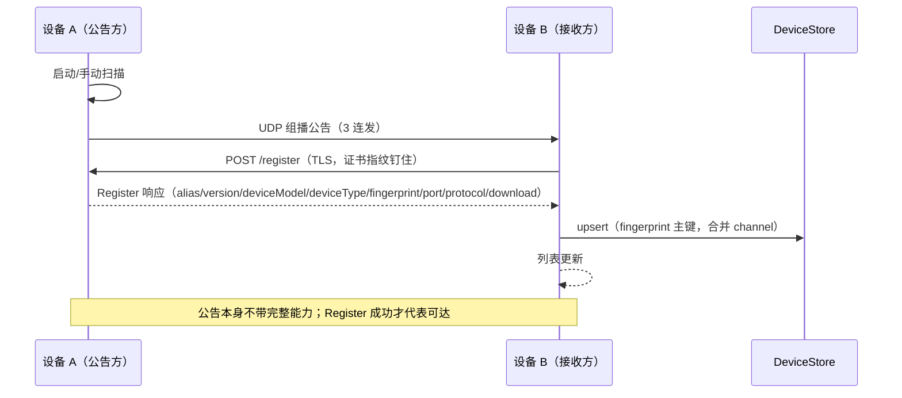
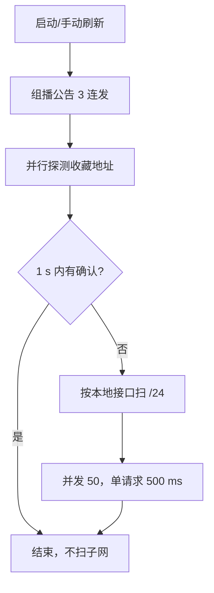
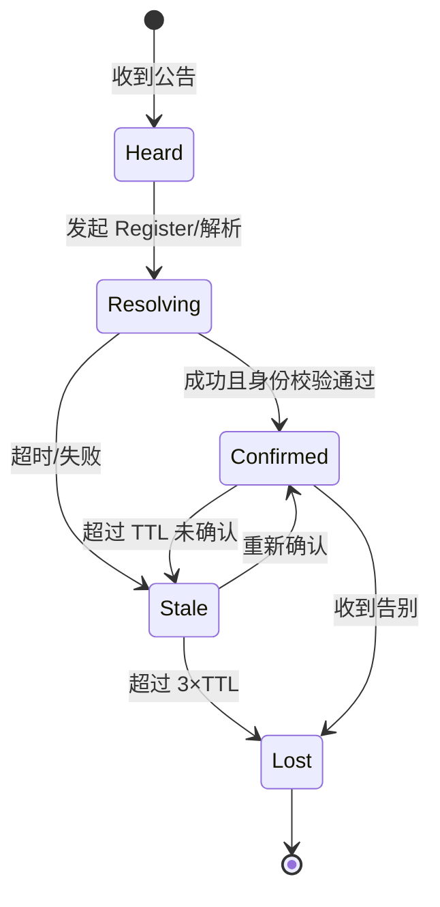
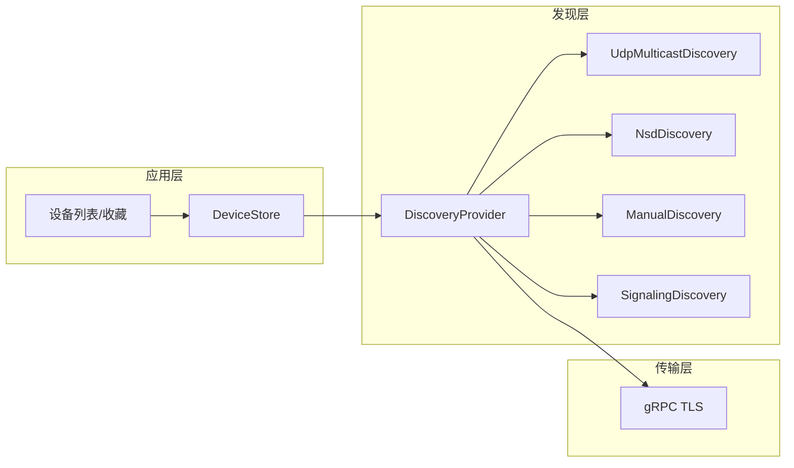

# 局域网设备发现调研

> 状态：已实施（TB-DISC-001..009 已完成代码实现，待设备验证）；调研日期 2026-10-20
> 证据边界：本文综合三轮调研（业界机制、LocalSend 源码、身份与字段）。源码与协议文档结论标记为"已验证证据"；文中"建议"指调研时的设计或参数建议，落地状态以任务看板为准；对产品意图的判断标记为"推测"。未做设备/网络实测。
> 相关文档：[项目现状与技术审查](project-assessment.md) · [媒体链路目标架构](media-architecture.md) · [决策看板](decision-board.md) · [任务看板](task-board.md)

## 0. 阅读约定

| 标记 | 含义 |
| --- | --- |
| 当前实现 | 可在当前仓库代码中直接核对 |
| 已验证证据 | 来自源码、协议文档或可复核的上游实现 |
| 建议 | 调研时给出的设计或参数建议；是否落地与实测见任务看板 |
| 推测 | 对产品意图或外部行为的判断 |

## 1. 背景与问题

### 1.1 当前实现

> 本节原记录调研启动时的单通道基线；TB-DISC-001..009 已按本文方案改造，下表按落地后的代码更新。原单通道基线对应的痛点保留在 §1.2，作为方案来源。

| 事实 | 证据 |
| --- | --- |
| 发现由 NSD、UDP 组播与手动地址/收藏三条通道并行汇入同一 `DeviceStore` | `DiscoveryManager` 组装 `NsdDiscoveryProvider`、`UdpMulticastDiscoveryProvider` 与 `ManualAddressProvider` |
| 主服务类型为 `_lss._tcp`，过渡期并行注册与发现 legacy `_localscreenshare._udp` | `NsdConstants.NSD_SERVICE_TYPE`、`NsdConstants.NSD_SERVICE_TYPE_LEGACY`；`ScreenShareServer` 同时注册两种类型 |
| 组播公告 TTL=1，每个可用接口一个 socket，启动 3 连发并以默认 5/15 s 心跳维持（随刷新档位调整），停止时发送告别 | `MulticastConstants`、`MulticastAnnouncer` |
| 只有 Register 确认成功才把设备提升为 `CONFIRMED`，仅收到公告只算 `HEARD` | `DeviceStore.confirm`、`RegisterClient` |
| NSD 实例名是 `LSS-<短 ID 前 8 位>`，不使用设备名 | `ScreenShareServer.buildNsdServiceInfo` 调用 `setServiceName(DeviceInfo.NAME_PREFIX + advertisement.shortId())` |
| 当前命名空间的 TXT 只广播最小字段，设备名默认不广播（legacy 类型使用 `LSS-<短 ID>`） | `NsdTxtRecord`、`DiscoverySettings` 的可见性策略 |
| resolve 有 2 s 超时，不会因单个服务卡住 resolver | `NsdResolver.DEFAULT_RESOLVE_TIMEOUT_MS`、`NsdDiscoveryProvider.RESOLVE_TIMEOUT_MS` |
| 发现启动失败按退避重试，网络变化后自动重启 | `NsdDiscoveryProvider` 使用 `BackoffPolicy` |
| 应用层 TTL：`HEARD` 15 s、`CONFIRMED` 45 s 过期；收藏降级为 `UNREACHABLE`，告别立即移除 | `DeviceStore.HEARD_TTL_MS`、`DeviceStore.CONFIRMED_TTL_MS` |
| gRPC 仍为明文、无认证（TLS 与身份 pinning 见 TB-DISC-010） | `InsecureServerCredentials` / `InsecureChannelCredentials` |

### 1.2 调研时识别的痛点

> 以下为单通道基线下的问题清单，用于说明方案来源。多通道、Register 确认、TTL/心跳/告别与分级扫描已由 TB-DISC-001..009 落地；认证与 TLS pinning 仍待 TB-DISC-010。

1. **单通道脆弱**：mDNS 在 Android 厂商实现、Windows 防火墙、AP 隔离、跨 VLAN 下表现不一致；浏览器完全不能做 mDNS。
2. **服务类型错误且超长**：`_udp` 与 TCP gRPC 不符；`localscreenshare` 16 字符超过 15 字符上限。
3. **隐私**：TXT `name` 默认广播系统设备名；设备名常含人名/房间名/型号。
4. **解析队头阻塞**：一个 resolve 永不回调，会卡住单线程 resolver，后续服务全部排队。
5. **失败不恢复**：启动/解析失败后没有退避重试，网络变化后也不会自动重启发现。
6. **僵尸条目**：没有 TTL/告别；服务端异常退出时，客户端可能长时间保留旧条目。
7. **信息太薄**：无法区分"服务端/客户端""直播中/空闲""是否接受新观众""是否需要认证""协议版本/能力"。
8. **无身份**：明文 gRPC 下，发现结果可以被任意主机冒充；没有 pinning/favorites。

### 1.3 目标与非目标

目标：

- 多通道：UDP 组播为主，mDNS 为辅，手动 IP/扫码兜底。
- 可达性即真值：收到公告后必须用 unicast Register 确认，确认成功才进列表。
- 身份可验证：SPKI 派生 ID + TLS pinning；发现数据只当提示。
- 生命周期完整：TTL、心跳、告别、重发现、退避。
- 为 Windows/Web 预留：发现层与传输层解耦。

非目标（本轮）：

- 不做云端账号/会合服务。
- 不做跨公网发现。
- 不把 mDNS 当唯一通道。
- 不在发现阶段传输会话内容或详细 codec 矩阵。

## 2. 业界主流发现机制

### 2.1 机制×平台矩阵

| 机制 | Android | Windows | Web | 备注 |
| --- | --- | --- | --- | --- |
| mDNS / DNS-SD | `NsdManager` 原生 | Windows 10+ DNS-SD API | 不可用 | 浏览器不能发 mDNS 查询；WebRTC 还会用 mDNS 隐藏本地 IP |
| SSDP / UPnP | 可用（第三方库） | UPnP/DLNA API | 不可用 | 适合媒体设备，报文偏大 |
| UDP 广播/组播 | 可用，需 `MulticastLock` | 可用 | 不可用 | 最通用；受 AP 隔离/VLAN 影响 |
| BLE | Android 12+ 需 `BLUETOOTH_ADVERTISE/SCAN/CONNECT` | Windows BLE API | Web Bluetooth 只能中心角色 | 不能后台广告；不适合作为主通道 |
| Wi-Fi Direct | 可用 | 支持有限 | 不可用 | 可绕过 AP 隔离，但连接管理复杂 |
| 二维码/手动 IP | 可用 | 可用 | 可用 | 三端通用兜底 |
| 云端会合 | 可用 | 可用 | 可用 | 需要账号/服务；违背"无云端"前提 |
| WebRTC | 可用 | 可用 | 可用 | 发现靠信令，不是 LAN 发现 |

> 机制能力为平台文档与工程经验综合；Android NSD 见 [S23]，Web 不能做 LAN 发现见 [S13]。

### 2.2 机制取舍

- **mDNS 不是银弹**：跨平台可用，但 Android 厂商实现差异、Windows 防火墙、AP 隔离、跨 VLAN 都会让"有时看得到、有时看不到"。
- **UDP 组播最通用**：只要能收组播就能发现；TTL=1 限制在本链路，适合 LAN。
- **广播/组播都需要确认**：UDP 本身不可靠，且可伪造；必须用 unicast 请求确认可达性和身份。
- **手动/扫码是必备兜底**：AP 隔离、跨 VLAN、企业网络下，任何自动发现都可能失效。
- **Web 只能会合**：浏览器没有 LAN 发现能力；Web 端要么扫码/URL，要么走云端信令 + WebRTC。

## 3. 代表性产品做法

### 3.1 Chromecast / AirPlay

- 两者都以 mDNS/DNS-SD 为主。Cast 用 `_googlecast._tcp`，TXT 带 `id/md/fn/ve/ca/rs`；AirPlay 用 `_airplay._tcp` + `_raop._tcp`，TXT 带 `deviceid/features/model/pk/pi/srcvers`。[S26][S22]
- 发现信息足以渲染列表和判断基本兼容，详细能力在 TLS/RTSP 之后交换。
- 隐私反例：AirPlay 的 `deviceid` 常用 MAC，RAOP 实例名还包含 MAC；Cast 的 `id` 是稳定不透明 ID，可被长期追踪。[S22][S26]

### 3.2 KDE Connect

- UDP 1716 广播为主，mDNS 为辅；当前 UDP 只带 `deviceId/protocolVersion/tcpPort`，名称/类型/能力在 TLS 后交换。[S15]
- `deviceId` 是 UUIDv4 去掉连字符，写入自签证书 CN；证书/密钥重建会换 ID，并清空已配对设备。[S15][S16]
- 2020 年安全审查发现默认 `deviceName` 为 `user@host`，泄露用户名/主机名；还发现 deviceId 可伪造导致配对劫持。这是"发现最小化 + 连接后验证"的重要教训。[S17]

### 3.3 Syncthing

- 分层：本地广播 → 全局发现 → 中继 → 手动配置。[S14]
- 本地广播只带 Device ID、地址、端口；全局发现只上报 Device ID 和外部端口，不上报内网地址。[S14]
- Device ID 是证书 DER 的 SHA-256，base32 + Luhn 校验；换密钥/证书就换 ID，旧对端必须重新添加。[S14]
- 文档明确承认本地发现可被冒充；身份验证在 TLS 握手时用证书重算 Device ID。[S14]

### 3.4 Snapdrop / PairDrop

- 浏览器之间通过信令服务器会合，再用 WebRTC 传输；不是 LAN 发现。
- 适合说明"Web 端没有发现能力"，不能作为 Android/Windows 原生发现的主方案。

### 3.5 scrcpy

- 手动 IP/ADB 是一等公民；不依赖自动发现。
- 说明"手动兜底"不是退而求其次，而是很多工程工具的默认路径。

### 3.6 向日葵 / ToDesk

- 云端账号/会合为主，LAN 直连作为加速路径。
- 与本项目"无账号、无云端"的前提不同；只借鉴"多路径 + 自动降级"。

### 3.7 Quick Share

- BLE + mDNS + 热点等多介质；可见性分为 `Your devices / Contacts / Hidden / Everyone 10 min`，锁屏/熄屏自动降级。[S25]
- 说明发现不仅是技术问题，也是隐私/可见性产品问题。

### 3.8 小结

| 结论 | 说明 |
| --- | --- |
| 主流是组合拳 | 没有单一机制覆盖 Android/Windows/Web |
| 发现与连接分离 | 发现只负责"找到"，身份/能力在连接后确认 |
| 手动兜底必备 | AP 隔离/跨 VLAN 下自动发现会失效 |
| 隐私是产品能力 | 可见性分级、默认随机名、最小字段 |

## 4. LocalSend 机制深挖

### 4.1 全流程



### 4.2 常量表

| 常量/行为 | 值 | 证据 |
| --- | --- | --- |
| 组播组 | `224.0.0.167` | [S2] |
| 端口 | `53317` | [S2] |
| 选组原因 | 在 `224.0.0.0/24` 内，部分 Android 只放行该段 | [S2] |
| TTL / hops | 1 | [S3] |
| socket 粒度 | 每个可用网卡一个 socket | [S3] |
| 启动连发 | 100 / 500 / 2000 ms，共 3 次 | [S2] |
| 周期心跳 | 源码中未见周期重发 | [S2] |
| 离开通知 | 源码中未见 byebye/离开报文 | [S2] |
| 接收缓冲 | 65536 bytes | [S2] |
| 连续接收错误上限 | 10 次后放弃该 socket | [S2] |
| 单请求超时 | 500 ms | [S4] |
| 子网扫描并发 | 50 | [S4] |
| 分级扫描 grace | 1 s | [S6] |

### 4.3 双向 Register 与单一 DeviceStore

- 收公告 → 向来源 `POST /register`；HTTPS 模式下钉住公告里的证书指纹，响应里的 fingerprint 只作为参考；HTTP 模式下信任响应体声明值（无密码学绑定）。[S4]
- Register 成功才写入 `DeviceStore`；因此"可达性"是列表的真值，而不是"听到过公告"。[S4]
- `DeviceStore` 以 `fingerprint` 为主键；同一设备的多地址/多协议合并为 `channels`，按 `Available` 优先、IPv4 优先、最近确认优先排序。[S5]
- 收藏模型 `{id, fingerprint, ip, port, alias, customAlias}`；`customAlias=false` 时远端改名自动更新。[S8]

### 4.4 分级扫描



- 先便宜后昂贵：公告 + 收藏探测；只有零确认才升级到子网扫描。[S6]
- 扫描按接口进行，避免 VPN/虚拟网卡误扫；LocalSend 当前按 `/24` 假设，已知在非常见掩码下失效（#2395）。[S4][S10]

### 4.5 收藏与 v1→v2

- v1 用 `/info` 查询；v2 改成 `/register` 双向发现，公告 + 回应一次往返双方互学；发现机制整体未变。[S1]
- 收藏是"跨会话记忆"的核心：没有收藏，每次都要等公告/扫描；有收藏，可以先 unicast 探测，减少对组播的依赖。

### 4.6 多端与 Web 边界

- 官方原生端覆盖 Android/iOS/Windows/macOS/Linux，另有 CLI；官方 Web 端独立仓库（localsend/web）。[S13]
- Web 端走 WebRTC + 信令，不是 LAN 发现；原生端与 Web 端的互通边界在第二轮调研中记录为未打通，本文按"待复核"处理。
- 对本项目的含义：Web 只能做"扫码/URL/会合"，不要指望浏览器参与 UDP/mDNS 发现。

### 4.7 已知缺口与 issue

| 缺口 | 说明 | 证据 |
| --- | --- | --- |
| 无周期心跳 | 设备启动后只发一轮；后续依赖扫描/手动 | [S2] |
| 无离开通知 | 异常退出时对端只能等超时/NSD 丢失 | [S2] |
| 扫描竞态 | 子网扫描可能早于组播响应到达 | [S9] |
| `/24` 假设 | 非常见掩码（如 `/22`）下漏设备 | [S10] |
| 跨 VLAN | 组播不跨 VLAN，需手动/收藏 | [S11] |
| 后台丢发现 | 移动端后台/解锁后可能丢失 | [S12] |

### 4.8 可抄与必改

| 可抄 | 必改 |
| --- | --- |
| 多通道写同一 store | 用 gRPC unary `Register` 替代 HTTP `/register` |
| 公告 + unicast 确认 | 补 TTL/心跳/告别，解决僵尸条目 |
| 收藏优先探测 + 分级扫描 | 补 TLS/身份 pinning，不能明文信任公告 |
| 单 fingerprint 主键、多 channel 合并 | 扫描按接口 prefix，不写死 `/24` |
| 默认随机别名 | 不要把设备名放进广播 |

## 5. 身份与元数据字段设计

### 5.1 身份方案对比

| 方案 | 代表 | 生成 | 持久化 | 轮换/重装 | 结论 |
| --- | --- | --- | --- | --- | --- |
| 整张证书哈希 | Syncthing、LocalSend HTTPS [S14] | SHA-256(DER cert) | key/cert 文件或 SharedPreferences | 换证书即换身份 | 可用，但轮换会破坏收藏 |
| SPKI 哈希 | OSP、RFC 7469 pinning [S18][S20] | SHA-256(SPKI) | 密钥/证书 | 同密钥续签不变；换密钥才变 | 推荐 |
| 随机 UUID | KDE、UPnP [S15][S21] | UUIDv4/v1 | 配置/非易失存储 | 重建即换；可重置 | 可读，但需额外绑定证书 |
| 硬件标识 | AirPlay MAC [S22] | 硬件 | 硬件 | 不可重置 | 不推荐 |

- **推荐**：EC P-256 密钥对；`fp = base64url(SHA-256(SPKI))`；`id = base32(SHA-256(SPKI)[0..16])`（26 字符）。展示用短 ID，连接用完整 `fp` pinning。[S18][S20]
- **不要**用 `ANDROID_ID`、MAC、序列号、IMEI、广告 ID。`ANDROID_ID` 是 64-bit、按签名密钥+用户作用域、恢复出厂/换签名会变。[S24][S28]
- **重装**：Android Keystore 密钥随卸载/清数据消失，重装即新身份；这是安全默认。[S27]
- **轮换**：保留密钥续签证书 → 身份不变；换密钥 → 新身份，收藏方必须显式重新确认。

### 5.2 字段三层分配

| 字段 | 广播公告 | Register 响应 | HELLO | 理由 |
| --- | --- | --- | --- | --- |
| `id` | 是 | 是 | 是 | 列表/收藏主键 |
| `fp` | 否 | 是 | 是 | 太长；TLS 可推导，用于 pin |
| 显示名 | 可选 | 是 | 是 | 隐私；连接后才算已验证 |
| 精确型号/OS | 否 | 否 | 是 | fingerprinting |
| `role` | 是 | 是 | 是 | 服务端/客户端分区 |
| `state` | 是 | 是 | 是 | 直播中/空闲 |
| `join` | 是 | 是 | 是 | 可直接加入/需确认/关闭 |
| `viewers` | 否 | 是 | 是 | 活动隐私；unicast 足够 |
| codec 位图 | 是 | 是 | 是 | 兼容性提示 |
| codec profile/分辨率/fps | 否 | 否 | 是 | 太大；连接后协商 |
| `sec`/`auth` | 是 | 是 | 是 | 决定 TLS/认证 |
| `pv`/`mv` | 是 | 是 | 是 | 兼容性/缓存失效 |
| 会话标题 | 否 | 可选 | 是 | 隐私 |
| PIN/challenge | 否 | 否 | 是 | 秘密 |
| 多地址 | 否 | 是 | 是 | 源 IP 不够时补充 |
| `boot`/`seq`/`ttl` | 是 | 否 | 否 | 去重/过期 |

### 5.3 发现报文草案（建议）

```json
{
  "v": 1,
  "id": "L7Q3K9M2F4X8B6N1C5V0Z3T7R2",
  "role": "server",
  "state": "live",
  "join": "approval",
  "sec": true,
  "auth": "mtls",
  "pv": "1.0",
  "mv": 12,
  "caps": 3,
  "port": 50051,
  "plat": "android",
  "boot": "b7f3c2a1d4e59608",
  "seq": 42,
  "ttl": 30,
  "name": "客厅电视"
}
```

mDNS TXT 子集（约 100–150 bytes）：

```text
v=1
id=L7Q3K9M2F4X8B6N1C5V0Z3T7R2
r=server
s=live
j=approval
sec=1
auth=mtls
pv=1.0
mv=12
caps=3
```

- 服务类型定为 `_lss._tcp`（已落地，legacy `_localscreenshare._udp` 并行保留）；实例名 `LSS-<id 前 8 位>`，不要用设备名。
- `port` 由 SRV 提供；`name` 默认不进 TXT，用户显式开启才加 `n=<name>`。
- 完整 `fp` 不进广播；Register/HELLO 再带。

### 5.4 隐私实践

- 默认随机别名，不默认广播系统设备名；用户可改。
- 可见性分级：`hidden / favorites / visible / visible-10min`；锁屏/熄屏停止接受新观众。[S25]
- 不广播 MAC、序列号、主机名、用户名、精确型号、SSID/BSSID、会话标题、观众身份。
- 发现数据一律"未验证"；连接后确认名称/身份再展示。[S18]
- 不备份身份密钥，避免克隆；重装 = 新身份。
- 限速、限包长、限并发；KDE 的 CVE 说明无上限会带来 DoS/放大风险。[S17]

### 5.5 mDNS TXT 预算

| 限制 | 值 | 依据 |
| --- | --- | --- |
| 典型 TXT | ≤200 bytes | [S19] |
| 单个 512-byte DNS 报文 | ≤400 bytes | [S19] |
| 单个 Ethernet 包 | ≤1300 bytes；超过不推荐 | [S19] |
| 单个 TXT string | ≤255 bytes | [S19] |
| key 建议长度 | ≤9 字符 | [S19] |
| 实例名 | ≤63 bytes | [S19] |

### 5.6 `DeviceInfo` 建议模型

```kotlin
data class DeviceInfo(
    val id: String,
    val fp: String,
    val name: String?,
    val role: Role,
    val state: ShareState,
    val join: JoinPolicy,
    val secure: Boolean,
    val auth: AuthMode,
    val protocolVersion: String,
    val metadataVersion: Int,
    val capabilities: Int,
    val addresses: List<Address>,
    val lastSeen: Long
)
```

- `serverId` 可保留为 `id` 的别名一个版本，后续废弃。
- `host/port` 变成 `addresses[]` 的一项，支持 IPv4/IPv6/多网卡。

## 6. 可靠性工程模式

### 6.1 参数建议

> 下表是调研参数建议；多数已落地到 `MulticastConstants`、`RegisterConstants`、`ScanConstants` 与 `DeviceStore`，具体取值以代码为准。

| 参数 | 建议 | 依据/说明 |
| --- | --- | --- |
| 启动公告 | 3 连发，100/500/2000 ms | LocalSend 已验证做法 [S2] |
| 周期公告 | 活跃 5 s，空闲 15 s | 建议；需实测权衡功耗 |
| TTL | 15–30 s | 建议；至少 3 个公告周期 |
| 离开通知 | 停止时发 1 次 + mDNS TTL=0 | 建议；补 LocalSend 缺口 |
| Register 超时 | 500 ms | LocalSend [S4] |
| Register 重试 | 2 次，0.2/0.5 s + jitter | 建议 |
| 分级扫描 grace | 1 s | LocalSend [S6] |
| 扫描并发 | 32–50 | LocalSend 50 [S4] |
| 单主机超时 | 300–500 ms | 建议 |
| 扫描范围 | 仅本接口 prefix，不扫 VPN/蜂窝 | 修正 `/24` 假设 [S10] |
| 缓存上限 | 256 台 | 建议；防 DoS |
| 过期 | 3×TTL 未确认则 stale/lost | 建议 |
| 启动失败退避 | 1/2/4/8/16/30 s | 建议；重置于网络变化 |
| resolve 超时 | 2 s | 已实现 2 s（`NsdResolver.DEFAULT_RESOLVE_TIMEOUT_MS`）[S23] |

### 6.2 设备状态机



### 6.3 失败处理

- **网络变化**：`ConnectivityManager` 回调、Wi-Fi AP 状态、应用回前台时，重启发现并重新公告。
- **组播 socket 失效**：按退避重建；移动端后台被系统回收后，回前台必须重绑。
- **resolve 卡死**：加超时；超时后释放 resolver，不能让一个服务卡住全部。
- **扫描失败**：只对失败接口退避，不影响其他接口；不要全局关闭发现。
- **重复/乱序**：用 `(id, boot, seq)` 去重；忽略同一 `boot` 下更旧的 `seq`。
- **自我发现**：按 `id` 过滤；不要只按 IP（多网卡/回环会漏）。

## 7. 对本项目的适配结论

### 7.1 方案 A/B/C/D

| 方案 | 组成 | Android | Windows | Web | AP 隔离 | 成本 | 结论 |
| --- | --- | --- | --- | --- | --- | --- | --- |
| A | mDNS 为主 + UDP 组播 + 手动/扫码 | 好 | 好 | 无 | 差 | 中 | 可作为过渡 |
| B | UDP 组播为主 + gRPC Register + mDNS 辅 + 分级扫描 + 收藏 | 好 | 好 | 无 | 中（收藏/手动兜底） | 中高 | **推荐** |
| C | 纯 mDNS + 手动 IP | 中 | 中 | 无 | 差 | 低 | 只适合最小修复 |
| D | 云端会合 + WebRTC | 好 | 好 | 好 | 好 | 高 | 仅未来 Web/跨网 |

**推荐 B**：以 LocalSend 的"公告 + unicast 确认 + 分级扫描 + 收藏"为骨架；保留 mDNS 作为补充通道；手动 IP/扫码作为兜底；Web 端后续走 D，不参与 LAN 发现。

### 7.2 推荐架构



- `DiscoveryProvider` 只产出 `DeviceInfo`，不持有 socket/传输细节。
- `DeviceStore` 负责去重、TTL、收藏、排序；所有通道写同一 store。
- `Transport` 负责 TLS、Register/HELLO、pin 校验；发现层不信任公告。

### 7.3 分阶段落地

| 阶段 | 内容 | 验收 |
| --- | --- | --- |
| P0 | 修正 NSD：`_lss._tcp`、TXT 最小化、resolve 超时、失败退避 | 两台 Android 可发现；抓包无设备名 |
| P1 | UDP 组播公告 + gRPC Register + TTL/告别 | 5 s 内发现；停服 10 s 内消失 |
| P2 | 收藏 + 分级扫描 + 手动/扫码 | AP 隔离下收藏/手动可连 |
| P3 | 身份 pinning + 多地址 + Windows | 身份变更提示；Windows 可发现 |
| P4 | Web 会合/WebRTC | 浏览器可看；不参与 LAN 发现 |

> 落地状态：P0–P2 已由 TB-DISC-001..009 完成代码实现，待设备验证；P3 的身份派生已由 TB-DISC-004 落地，TLS pinning 与 Windows 端未实现；P4 未实现。

### 7.4 验收标准

- 同一 LAN 两台 Android，5 s 内互相发现；停服 10 s 内从列表消失。
- AP 隔离时，收藏探测或手动 IP 仍可连接。
- 扫描不跨 VPN/蜂窝；不扫非本地接口。
- 身份变更时 UI 明确提示，不自动覆盖收藏。
- 发现阶段抓包无设备名、MAC、序列号、精确型号。
- `python scripts/checks/check_docs.py` 全绿。

### 7.5 风险与待定

- Android `NsdManager` 的 SRV target 可能仍含系统 hostname；要彻底控制需自建 mDNS responder。
- Android Keystore 自签证书的续签能力有限；可能需要自定义 TrustManager 或软件密钥。**已由 [TB-DISC-010](task-board.md#tb-disc-010) 给出方案**：复用身份密钥、自签字段受控证书、自定义 KeyManager/TrustManager；证书只是容器，身份取 SPKI 哈希，因此不需要续签协议（设备端可用性仍待验证）。
- Web 端无稳定身份；只能 guest/ephemeral。
- 身份密钥若被备份/克隆，会出现同一 `id` 多实例；需检测并警告。
- 组播在部分企业网络被禁用；必须保留手动/扫码。

## 8. 引用来源

### 一手（源码、协议、官方文档）

- [S1] LocalSend Protocol v2.2: https://github.com/localsend/protocol
- [S2] LocalSend multicast 模块（组播组、端口、3 连发、TTL）: https://github.com/localsend/localsend/blob/main/packages/core/src/multicast/mod.rs
- [S3] LocalSend multicast socket（每网卡一 socket、TTL=1）: https://github.com/localsend/localsend/blob/main/packages/core/src/multicast/socket.rs
- [S4] LocalSend discovery（Register、500 ms、并发 50）: https://github.com/localsend/localsend/blob/main/packages/core/src/discovery/mod.rs
- [S5] LocalSend DeviceStore（fingerprint 主键、channel 合并、排序）: https://github.com/localsend/localsend/blob/main/packages/core/src/discovery/store.rs
- [S6] LocalSend scan facade（1 s grace）: https://github.com/localsend/localsend/blob/main/app/lib/provider/network/scan_facade.dart
- [S7] LocalSend Device 模型（channels）: https://github.com/localsend/localsend/blob/main/packages/localsend_isolates/lib/model/device.dart
- [S8] LocalSend 收藏模型: https://github.com/localsend/localsend/blob/main/app/lib/model/persistence/favorite_device.dart
- [S9] LocalSend issue #2780（扫描竞态）: https://github.com/localsend/localsend/issues/2780
- [S10] LocalSend issue #2395（/24 假设）: https://github.com/localsend/localsend/issues/2395
- [S11] LocalSend issue #1840（跨 VLAN）: https://github.com/localsend/localsend/issues/1840
- [S12] LocalSend issue #2422（后台丢发现）: https://github.com/localsend/localsend/issues/2422
- [S13] LocalSend Web 仓库: https://github.com/localsend/web
- [S14] Syncthing Device IDs: https://docs.syncthing.net/dev/device-ids.html
- [S15] KDE Connect Protocol: https://invent.kde.org/network/kdeconnect-meta/-/blob/master/protocol.md
- [S16] KDE Connect `kdeconnectconfig.cpp`: https://raw.githubusercontent.com/KDE/kdeconnect-kde/master/core/kdeconnectconfig.cpp
- [S17] KDE Connect CVE-2020-26164 安全审查: https://seclists.org/oss-sec/2020/q4/56
- [S18] W3C Open Screen Protocol: https://w3c.github.io/openscreenprotocol/
- [S19] RFC 6763 DNS-SD: https://www.rfc-editor.org/rfc/rfc6763
- [S20] RFC 7469 Public Key Pinning: https://www.rfc-editor.org/rfc/rfc7469
- [S21] UPnP Device Architecture 2.0: https://openconnectivity.org/upnp-specs/UPnP-arch-DeviceArchitecture-v2.0-20200417.pdf
- [S22] Unofficial AirPlay Specification: https://openairplay.github.io/airplay-spec/service_discovery.html
- [S23] Android `NsdManager`: https://developer.android.com/reference/android/net/nsd/NsdManager
- [S24] Android unique identifiers: https://developer.android.com/identity/user-data-ids
- [S25] Quick Share 可见性: https://support.google.com/chromebook/answer/10751738

### 二手（逆向工程、社区记录、工程观察）

- [S26] OakBits Google Cast discovery: https://oakbits.com/google-cast-protocol-discovery-and-connection.html（Cast TXT 的 `ca/rm/cd/nf/bs` 语义未公开，本文只使用 `id/md/fn/ve/rs/st` 等有共识字段；`ca` 解释与其他实现存在分歧）
- [S27] Ping Identity Android Keystore 行为: https://developer.pingidentity.com/orchsdks/journey/use-cases/device-profiling/react-native-device-ids.html
- [S28] pub.dev `android_id`（引用官方说明）: https://pub.dev/documentation/android_id/latest/
- AirPlay 字段来自社区逆向规范 [S22]，不是 Apple 官方文档。
- Snapdrop/PairDrop、scrcpy、向日葵/ToDesk 的机制为产品观察，本文只用于说明"多路径 + 手动兜底"，不作为协议依据。
