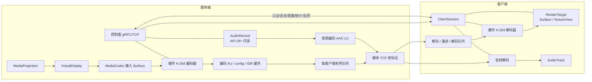
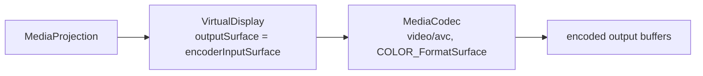
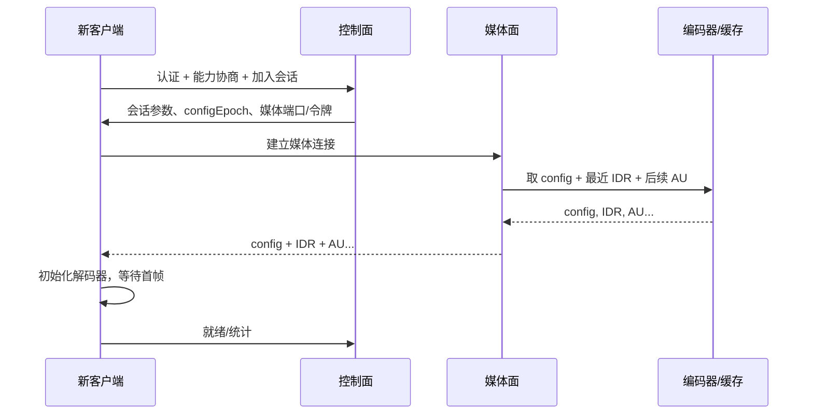
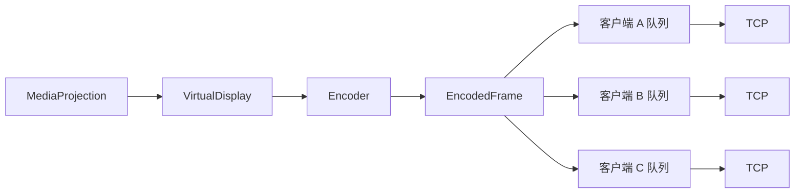

# 媒体链路目标架构

> 状态：设计裁决与技术目标，尚未实现，也未在设备或网络上实测。
> 当前实现的事实与风险见 [project-assessment.md](project-assessment.md)；本文只描述“应该怎么改”和“为什么这样裁决”。
> 相关文档：[窗口与会话](windowing-session-design.md) · [路线图](optimization-roadmap.md)

## 1. 裁决摘要

| 领域 | 当前实现 | 目标裁决 | 理由 |
| --- | --- | --- | --- |
| 屏幕采集 | MediaProjection 经 VirtualDisplay 到 ImageReader（RGBA_8888） | 继续使用 MediaProjection；VirtualDisplay 直接输出到 MediaCodec 输入 Surface | 普通 App 没有更合规的屏幕采集入口；去掉从 RGBA 到 Bitmap 的 CPU 路径 |
| 视频编码 | 软件 JPEG，每帧压缩 | 硬件 H.264/AVC 为基线；HEVC 可选；稳态不经过 Bitmap/JPEG | 硬件编码器通常比软件 JPEG 更省 CPU；H.264 兼容性最好 |
| 编码缓存 | 无编码帧缓存；JPEG 即帧 | 缓存 config、最近 IDR 与其后 AU；不缓存大量 RGBA | 新客户端快速加入、重连、Surface 切换都从 config+IDR 开始 |
| 控制面 | gRPC/OkHttp，明文，无认证 | 保留 gRPC/TCP 作为控制面；增加认证、能力协商、配置、统计、反控消息 | 控制消息量小，gRPC 的流和超时语义合适 |
| 媒体面 | 每帧 protobuf `ScreenFrame` + gRPC stream | 第一版独立 TCP 帧协议；实测 TCP 重传拖尾后再评估 RTP/UDP；WebRTC 按场景引入 | 降低每帧封装开销，便于分片、背压和慢客户端隔离 |
| 音频 | 无 | API 29+ AudioPlaybackCapture + AudioRecord；API 25–28 降级无声或显式麦克风模式 | 系统内录受版本和 App 策略限制；不能假装所有版本都能内录 |
| 反控 | 无 | 普通 App 用 AccessibilityService.dispatchGesture；单客户端控制租约；InputManager 注入不作为普通方案 | MediaProjection 只能采集，不能注入输入 |
| 多客户端 | 每客户端最新 JPEG 帧 | 一次采集、通常一次编码、按客户端扇出；独立有界队列；GOP 感知丢弃 | 慢客户端不能阻塞别人；H.264 不能随意丢中间 P 帧 |
| 安全 | 无认证、明文 | 配对/令牌、TLS/DTLS、最小权限、可见的控制授权 | 当前只适合可信局域网；`FLAG_SECURE` 不是加密 |

## 2. 设计原则

1. **稳态路径不经过 Bitmap/JPEG。** 从采集 Surface 到编码器、网络、解码器、显示 Surface，应尽量是一条 GPU/硬件路径。Bitmap 只用于快照、缩略图、过渡帧或降级。
2. **一次采集，通常一次编码，按客户端扇出。** 第一版不做每客户端转码；不同显示尺寸由客户端渲染缩放解决。需要不同清晰度时，再评估 simulcast 或转码。
3. **采集、编码、传输、渲染解耦。** 任何一层都不能在采集线程上做网络写、磁盘 I/O 或等待慢客户端。
4. **所有队列有界，丢弃策略明确。** 慢客户端隔离；媒体路径不使用 `CallerRunsPolicy`；丢弃必须 GOP 感知。
5. **单一单调时钟。** 视频 PTS、音频采集时间、网络到达时间、渲染时间统一映射到会话单调时钟；不要混用墙钟。
6. **能力协商与降级。** 编码器、分辨率、帧率、码率、音频、HDR、反控都要先查询能力，再决定；失败要可见地降级。
7. **控制面与媒体面分离。** 控制面可以重试、加密、鉴权；媒体面追求吞吐和低延迟，不被控制消息阻塞。
8. **不牺牲 minSdk 25。** 新能力用版本门控；API 25 设备可以没有音频、没有 PiP、没有部分编码器，但基本监看要可用。

## 3. 目标拓扑

控制面和媒体面可以共用一条物理连接，也可以分开；第一版建议分开，原因是：

- 控制面需要可靠、可重试、可加密、可鉴权；媒体面需要低延迟、可丢弃、可背压。
- 分开后，慢客户端只影响自己的媒体队列，不会阻塞控制消息或别的客户端。
- 分开后，媒体协议可以更紧凑，不必每帧套 protobuf。

## 4. 采集与编码

### 4.1 VirtualDisplay 直接输出到 MediaCodec 输入 Surface

建议方案的核心是把当前 `ImageReader` 替换为 `MediaCodec.createInputSurface()`：

实现要点：

1. 先查询编码器能力：`MediaCodecList`、`MediaCodecInfo`、`VideoCapabilities`，确认支持的分辨率、帧率、码率范围和 `COLOR_FormatSurface`。
2. 配置 `MediaFormat`：MIME 为 `video/avc`；设置 width/height、bitrate、frame-rate、I-frame interval；不依赖 B 帧。
3. `configure(format, null, null, CONFIGURE_FLAG_ENCODE)`，然后 `createInputSurface()`，再 `start()`。
4. 用 `MediaProjection.createVirtualDisplay` 把输出指向该 Surface；VirtualDisplay 的尺寸应与编码器配置尺寸一致，避免系统隐式缩放。
5. 编码器输出通过 `dequeueOutputBuffer` 或异步 callback 读取；处理 `INFO_OUTPUT_FORMAT_CHANGED`、`BUFFER_FLAG_CODEC_CONFIG`、`BUFFER_FLAG_KEY_FRAME` 和 PTS。
6. 停止时先调用 `stop`，再调用 `release` 释放编码器，然后释放 VirtualDisplay 和 MediaProjection；顺序要稳定，避免 Surface 已释放但编码器仍在写。
7. 尺寸/方向变化时，不要只改 VirtualDisplay；要显式重建编码器或重新配置，并提升 `configEpoch`。第一版可以固定采集尺寸，客户端只做显示缩放，减少重配置。

这样做的直接效果是：

- 去掉从 RGBA plane 到 Bitmap 的逐像素拷贝。
- 去掉全尺寸 ARGB_8888 Bitmap 的分配与回收。
- 去掉软件 JPEG 压缩。
- 编码器可以直接消费 GPU/显示管线的 Surface，通常比 CPU 路径更省电。

> 注意：这只是“普通 App 的合规采集路径”，不代表所有设备都支持相同编码器、分辨率或帧率。必须用能力查询和降级处理覆盖厂商差异。

### 4.2 编码格式选择

| 格式 | 何时使用 | 优点 | 代价/限制 | 裁决 |
| --- | --- | --- | --- | --- |
| H.264/AVC | 默认 | 硬件支持最广；浏览器/播放器兼容性好；工具链成熟 | 同画质下码率高于 HEVC/AV1 | **基线** |
| HEVC/H.265 | 双方都声明支持，且实测收益明确 | 同画质通常更省码率 | 专利/授权、设备支持不均、部分浏览器不支持 | 可选，不作为默认 |
| AV1 | 未来 | 更高压缩效率 | 实时硬件编码支持不均；复杂度高 | 暂不纳入第一版 |
| JPEG | 快照、缩略图、编码器不可用时的降级 | 实现简单；单帧独立 | CPU 高、码率大、无帧间预测 | 仅快照/降级 |
| PNG | 无损快照 | 无损 | 体积大、CPU 高 | 仅按需快照 |

H.264 的具体建议：

- 优先 Baseline/Constrained Baseline，保证老设备和浏览器兼容；能力允许时再协商 Main/High。
- 不依赖 B 帧，降低乱序、延迟和解码器依赖；PTS 与 DTS 可以简化。
- 关键帧间隔按场景和实测设置；太短浪费码率，太长导致新客户端等待和错误恢复慢。
- 码率控制模式（CBR/VBR/CQ）因厂商而异；第一版用设备支持的稳定模式，不要假设某个模式一定更好。
- 分辨率必须是编码器支持的尺寸，必要时对齐到厂商要求；不要假设 1080p/4K/60fps 一定可用。

### 4.3 帧率、码率与分辨率

第一版建议把“采集参数”和“显示参数”分开：

| 参数 | 服务端职责 | 客户端职责 |
| --- | --- | --- |
| 采集分辨率 | 由 VirtualDisplay + 编码器配置决定 | 只请求档位，不直接改服务端 Surface |
| 编码分辨率 | 与采集一致或按能力缩放 | 解码后按窗口缩放 |
| 帧率 | 编码器/采集限帧 | 可请求上限，但不强制服务端超能力 |
| 码率 | 编码器码率控制 | 可根据队列/丢帧反馈请求调整 |
| 显示尺寸 | 不感知 | 悬浮窗/全屏自行缩放 |
| 旋转 | 采集方向与 configEpoch | 渲染方向与容器变换 |

这意味着：

- 客户端“显示大小”不再等于“采集分辨率”。当前实现把两者混在一起，导致全尺寸解码但小窗显示，浪费 CPU 和内存。
- 客户端可以选择“省流模式”（请求更低分辨率/帧率/码率），但最终由服务端能力与多客户端策略决定。
- 多客户端场景下，第一版共享同一编码；不同客户端只做显示缩放。不要为了一个小窗客户端单独转码。

### 4.4 编码器输出与时间戳

- 使用编码器输出的 PTS 作为视频时间轴；单位统一为微秒或纳秒，并在会话内固定。
- 如果编码器不提供可靠 PTS，使用采集侧单调时钟打点，但要保持单调递增。
- 记录 `configEpoch`：编码器重建、分辨率变化、方向变化、编解码配置变化时递增；客户端用它拒绝旧配置的帧。
- 首帧、关键帧、配置帧要能被客户端识别；新客户端必须从 config + IDR 开始。

## 5. 编码帧缓存与 GOP 语义

### 5.1 缓存什么

建议缓存：

- **CodecConfig**：MIME、profile/level、width/height、csd-0/csd-1、configEpoch。
- **最近 IDR**：完整的关键帧 AU。
- **最近 IDR 之后的 AU**：按字节数和时间上限保留，供新客户端从最近 IDR 追到当前。
- **最后渲染帧/快照**：只保留一份，用于窗口切换或占位；不是 RGBA 环形缓冲。

不建议缓存：

- 大量 RGBA/Bitmap 帧。
- 多个完整 GOP 的原始帧。
- 每客户端的独立解码帧历史。

### 5.2 新客户端加入

原则：

- 新客户端从 **config + IDR** 开始；不能从任意 P 帧开始。
- 如果缓存里没有可用 IDR，控制面请求编码器产生 IDR；客户端等待，不要发送半截 GOP。
- 多个客户端同时请求 IDR 时，合并请求并限流；IDR 会增大码率，不能每个客户端随意触发。
- 如果客户端在 GOP 中间加入，且缓存不足，宁可等待下一个 IDR，也不要发送无法解码的 P 帧。

### 5.3 为什么不能随意丢中间 P 帧

H.264 的 P 帧依赖前面的参考帧。丢弃一个中间 P 帧后，后续 P 帧可能继续引用它，导致：

- 解码器报错或花屏。
- 误差扩散到后续帧，直到下一个 IDR。
- 客户端继续收到“看似有数据但画面错误”的流。

因此慢客户端的丢弃策略必须是：

1. **优先降低码率/帧率/分辨率**，让客户端跟上。
2. **如果必须丢弃，丢到下一个 IDR 重新开始**，不要只丢一帧 P。
3. **或者直接断开慢客户端**，让它重连后从 config+IDR 加入。
4. 如果编码器支持时间分层/SVC，可以按层丢弃；第一版不依赖这个能力。

这与当前 JPEG 的“每帧独立、可只保留最新帧”不同。H.264 的多客户端队列必须理解 GOP，不能简单复用“最新帧覆盖”策略。

## 6. 传输

### 6.1 控制面：保留 gRPC/TCP

控制面继续使用 gRPC/TCP，负责：

- 认证/配对、会话建立、能力协商。
- 媒体参数下发（codec、分辨率、帧率、码率、音频开关）。
- 关键帧请求、码率调整、统计上报。
- 反控事件与租约管理。
- 错误、重连、会话恢复。

控制消息量小，gRPC 的 protobuf、超时、流和拦截器机制合适。需要补的是：

- TLS 或至少应用层认证；不能继续 `InsecureServerCredentials`。
- 会话令牌与过期时间；默认拒绝未配对客户端。
- 能力字段与版本字段，支持新旧客户端共存。
- 控制面限流，避免关键帧请求或统计消息被滥用。

### 6.2 媒体第一版：独立 TCP 帧协议

第一版建议媒体走独立 TCP 连接，而不是每帧塞进 protobuf/gRPC：

| 区域 | 内容 |
| --- | --- |
| 长度前缀 | 后续帧的总长度，用于 TCP 分帧 |
| 固定头 | `magic/version`、`headerLen`、`frameType`、`codec`、`configEpoch`、`ptsUs`、`flags`、`payloadLen`、可选 CRC |
| payload | 编码帧、音频帧或控制确认的负载 |
| frameType | `CONFIG` / `KEY` / `DELTA` / `AUDIO` / `CONTROL_ACK` |

理由：

- 避免每帧 protobuf 字段名和封装开销。
- 方便分片、拼接、背压和每客户端独立队列。
- 方便在 TCP 上做明确的“config + IDR”语义。
- 方便后续替换为 RTP/UDP，而不改上层帧模型。

TCP 的已知问题：

- 队头阻塞：一个丢包会阻塞后续已到达的数据。
- 重传拖尾：尾包丢失会让帧到达时间出现尖峰。
- 不适合无序/高丢包网络。

因此第一版必须测量：

- RTT 的 p50/p95。
- 重传率、重传超时次数。
- 帧到达间隔的 p95/p99。
- 解码截止时间错过的比例。
- 队列深度与丢弃次数。

如果这些指标在目标网络上可接受，TCP 就是更简单、更稳的选择；如果重传拖尾明显影响交互，再评估 RTP/UDP。**不能先验地宣称 UDP 一定更好。**

### 6.3 RTP/UDP 的引入条件

只有在实测表明 TCP 重传拖尾不可接受，且产品需要更低延迟时，才引入 RTP/UDP。需要同时具备：

- RTP 封装：H.264 使用合适的 RTP payload format；HEVC 同理。
- 抖动缓冲：自适应 jitter buffer，权衡延迟与连续播放。
- 丢包恢复：NACK、重传缓存；关键帧请求 PLI/FIR。
- 发送 pacing：按目标码率平滑发送，避免突发。
- 拥塞控制：基于延迟/丢包的码率自适应；不能只靠固定码率。
- 安全：SRTP/DTLS 或等价方案。
- 统计：丢包、乱序、jitter、NACK、PLI、RTT、码率。

UDP 不是“更快”的同义词：它把可靠性责任转移给应用；没有 jitter/NACK/PLI/pacing/拥塞控制，体验可能比 TCP 更差。

### 6.4 WebRTC 的适用条件

WebRTC 适合：

- 需要浏览器作为客户端。
- 需要跨网络/NAT 穿透，或需要标准信令/ICE/TURN。
- 需要完整的音视频栈（jitter buffer、NACK、PLI、拥塞控制、回声消除、NetEQ）。
- 团队愿意承担依赖、信令、调试和互操作成本。

不适合作为第一版默认方案的理由：

- 局域网直连场景下，WebRTC 的复杂度可能大于收益。
- 需要额外的信令、ICE/TURN、DTLS-SRTP、SDP 协商。
- 现有 gRPC/NSD/悬浮窗体系需要重做连接模型。
- 音频在 WebRTC 中通常用 Opus，和 AAC-LC 的兼容策略不同。

裁决：**先把 TCP + H.264 做稳，用测量决定是否需要 RTP/UDP；WebRTC 作为浏览器/跨网/完整栈需求的可选路径，不作为默认基线。**

## 7. 音频

### 7.1 API 29+：AudioPlaybackCapture

Android 10（API 29）起可以用 `AudioPlaybackCaptureConfiguration` + `AudioRecord` 捕获其他 App 的播放音频：

- 需要 `RECORD_AUDIO` 运行时权限。
- 需要 `MediaProjection` 授权；播放捕获配置以 MediaProjection 为基础。
- 被采集 App 必须允许 playback capture；应用可以通过 manifest 的 `allowAudioPlaybackCapture` 选择退出。
- 受 `AudioAttributes` usage 限制；不是所有系统声音/受保护内容都能采。
- 需要正确的前台服务类型与通知；目标版本要复核 FGS 类型要求。

建议：

- 默认关闭音频；用户显式开启。
- 开启时展示“正在捕获设备播放音频”的可见指示。
- 被采集 App 禁止捕获时，显示“该应用不允许内录”，不要静默失败。
- 不采集麦克风，除非用户明确选择麦克风模式。

### 7.2 API 25–28：降级

API 25–28 没有 AudioPlaybackCapture。可选策略：

1. **默认无声**：只传屏幕，UI 明确显示“当前系统版本不支持内录”。这是最安全的默认。
2. **显式麦克风模式**：用户明确选择“用麦克风采集环境声”，申请 `RECORD_AUDIO`，显示持续指示；这不是系统内录，音质、隐私和回声都不同。
3. **不做音频**：如果产品不接受麦克风替代，保持无声。

不能把麦克风模式伪装成“内录”，也不能在用户不知情时开启麦克风。

### 7.3 编码与音画同步

- 兼容优先：AAC-LC，常见采样率/声道配置；适合本地播放器和大多数设备。
- WebRTC 路径：Opus；如果同时支持 AAC 和 Opus，需要明确的协商与转码策略。
- 时间轴：视频 PTS、音频采集时间、网络到达时间、渲染时间统一映射到会话单调时钟；使用 `System.nanoTime()` 或等价的单调源，不使用墙钟。
- 音频缓冲：客户端需要 jitter buffer 与漂移校正；音频太超前/落后时，优先调整缓冲或轻微重采样，不要频繁跳帧。
- 音画同步：以视频为主时钟或音频为主时钟要明确；第一版建议音频跟随视频，或使用共享会话时钟，避免两端各自为政。
- 丢包/丢帧：音频可以做 PLC/静音填充，但不能无界累积；视频仍按 GOP 语义处理。

## 8. 反控

### 8.1 能力边界

| 方案 | 可用性 | 能力 | 限制 |
| --- | --- | --- | --- |
| `AccessibilityService.dispatchGesture` | API 24+，用户手动开启无障碍服务 | 注入手势（点击、滑动、多指路径） | 不是普通运行时权限；受系统/目标 App 限制；键盘注入能力有限；安全窗口/系统 UI 可能不可用 |
| `AccessibilityService` 节点操作 | API 24+ | 对可访问节点执行 `ACTION_SET_TEXT`、点击等 | 依赖无障碍树；不是所有 App/控件暴露；不能替代完整键鼠 |
| `InputManager.injectInputEvent` | 仅 root/shell/system 或持有签名级 `INJECT_EVENTS` | 更底层的事件注入 | 普通 App 不可用；不适合作为产品方案 |
| MediaProjection | 普通 App | 仅屏幕采集 | **不能注入输入** |

裁决：

- 普通 App 的反控基线是 `AccessibilityService.dispatchGesture`，并且必须由用户在系统设置中手动开启。
- 键盘/文本输入优先用无障碍节点操作（例如对焦点输入框设置文本），不要承诺完整键盘注入。
- 不把 root、shell、系统签名或 `INJECT_EVENTS` 作为普通版本的前提。
- MediaProjection 只负责采集，不负责控制；两者在协议和权限上分开。

### 8.2 单客户端控制租约

反控默认只允许一个客户端持有控制租约，避免多人同时操作造成冲突。建议协议字段：

| 字段 | 含义 |
| --- | --- |
| `clientId` | 持有控制权的客户端随机标识，不是账号 |
| `leaseEpoch` | 每次授予/收回递增 |
| `expiresAt` | 单调时钟 |
| `displayWidth/Height` | 服务端当前显示尺寸 |
| `rotation` | 当前旋转 |
| `configEpoch` | 编码配置代次 |

规则：

- 服务端授予租约；同一时刻只有一个客户端持有有效控制租约。
- 持有租约的客户端定期心跳（heartbeat）；超时自动失效。
- 服务端可以随时收回；收回后旧 epoch 的事件一律拒绝（epoch fencing）。
- 旋转/分辨率变化时提升 `configEpoch`，旧坐标事件拒绝或重新映射。
- 坐标使用归一化坐标（normalized coordinates，0..1）和显示尺寸/旋转，避免不同分辨率直接套像素。
- 事件带序号与时间戳；客户端去重、限速；服务端再次校验边界。
- 所有控制操作有可见指示；默认关闭；服务端可审计最近操作。

### 8.3 安全与隐私

- 反控是高危能力：默认关闭，首次开启需要服务端明确确认。
- 不在锁屏、系统设置、安全窗口等敏感界面注入；具体限制以系统和无障碍能力为准。
- 不记录用户输入内容；日志只记录事件类型、时间和结果，不记录文本。
- 控制通道必须与观看权限分离：客户端不一定有控制权。
- 多客户端时，观看可以多人，控制默认只授予一个客户端；服务端可转移或收回控制权。

## 9. 多客户端

### 9.1 一路采集、一路编码、扇出

目标模型：

- 采集和编码只有一份；每个客户端有自己的有界队列和发送状态。
- 第一版不做每客户端转码；客户端按自己的窗口缩放解码画面。
- 如果某客户端需要更低码率/分辨率，优先请求服务端调整全局编码参数，或后续引入 simulcast/转码；不要偷偷为每个客户端跑一套软件编码。
- 每个客户端有独立统计：队列深度、发送速率、丢弃 GOP 数、RTT、解码/渲染反馈。

### 9.2 慢客户端隔离

慢客户端的处理顺序：

1. 降低该客户端的发送速率/队列水位，优先发送关键帧和最新 GOP。
2. 如果仍然跟不上，丢弃到下一个 IDR，从新 GOP 开始。
3. 如果持续跟不上，断开该客户端，让它在网络恢复后重新加入。
4. 任何情况下都不能阻塞编码器、采集线程或其他客户端。

禁止：

- 在采集/编码线程上同步写 socket。
- 使用 `CallerRunsPolicy` 把网络任务压回采集线程。
- 为慢客户端无限缓存 P 帧。
- 让一个客户端的 PLI/NACK 风暴触发全局频繁 IDR。

### 9.3 新客户端与重连

- 新客户端先完成认证和能力协商，再订阅媒体；收到 config + IDR 后，从后续 AU 继续。
- 重连时，如果产品允许会话恢复令牌，就重新协商，并从 config + IDR 开始；不要假设断点前的 P 帧还有效。
- IDR 请求合并：多个客户端同时加入时，只触发一次编码器 IDR；其余客户端复用同一个 IDR。
- 记录每个客户端的 `configEpoch`；配置变化后，旧 epoch 的帧丢弃。

## 10. Android 权限与能力边界

| 能力 | 权限/API | 用户动作 | 边界 |
| --- | --- | --- | --- |
| 屏幕采集 | `MediaProjectionManager.createScreenCaptureIntent`；`FOREGROUND_SERVICE_MEDIA_PROJECTION`；前台服务类型 `mediaProjection` | 每次会话确认捕获；通知常驻 | 不能静默采集；安全窗口可能黑屏；Android 14+ 有默认显示/单应用配置差异 |
| 跨应用悬浮窗 | `SYSTEM_ALERT_WINDOW`；API 26+ `TYPE_APPLICATION_OVERLAY`；API 25 `TYPE_SYSTEM_ALERT` | 到系统设置授予“显示在其他应用上层” | OEM 可能限制；权限可被撤销；不是普通运行时权限 |
| 通知 | `POST_NOTIFICATIONS`（API 33+） | 运行时授权 | 前台服务需要通知；被拒绝会影响启动引导 |
| 网络 | `INTERNET`、`ACCESS_NETWORK_STATE`、`ACCESS_WIFI_STATE` | 安装时授权 | 局域网发现/连接；不保证所有网络可达 |
| NSD 发现 | `NsdManager` | 无额外运行时权限（以系统版本为准） | 受 Wi-Fi/多播/AP 隔离影响；服务类型要语义正确 |
| 内录音频 | `RECORD_AUDIO` + MediaProjection；`AudioPlaybackCaptureConfiguration` | 运行时授权 + 捕获确认 | API 29+；被采集 App 可拒绝；受 usage/政策限制 |
| 麦克风降级 | `RECORD_AUDIO`；前台服务类型 `microphone` | 运行时授权 + 明确模式 | API 25+；采集环境声，不是系统内录；隐私与回声问题 |
| 反控手势 | `AccessibilityService` + `dispatchGesture`（API 24+） | 用户在系统设置手动开启无障碍服务 | 受目标 App/系统 UI 限制；不是运行时权限；需要持续可见指示 |
| 底层输入注入 | `INJECT_EVENTS`（签名级）或 root/shell/system | 不适用于普通用户 | 不作为产品基线 |
| 前台服务 | `FOREGROUND_SERVICE` + 具体类型 | 启动前台服务；通知 | Android 14+ 类型与启动限制；后台启动受限 |
| 屏幕防截取 | `FLAG_SECURE` | 应用设置窗口标志 | 防止窗口被截屏/录屏；**不是加密**，不保护网络传输 |
| 保持唤醒/网络 | `WAKE_LOCK`、Wi-Fi lock（如需要） | 安装时授权（部分） | 耗电；需谨慎；不是默认必需 |

### 10.1 minSdk 25 的版本门控

| 能力 | API 25 | API 26+ | API 29+ | API 33+ | API 34+ |
| --- | --- | --- | --- | --- | --- |
| 跨应用悬浮窗 | `TYPE_SYSTEM_ALERT` | `TYPE_APPLICATION_OVERLAY` | 同左 | 同左 | 同左，OEM 限制可能更多 |
| PiP | 不可用 | 可用（可选增强） | 同左 | 同左 | 同左 |
| 内录音频 | 不可用 | 不可用 | 可用（受 App 策略） | 同左 | 同左 |
| 通知运行时权限 | 不需要 | 不需要 | 不需要 | 需要 | 需要 |
| MediaProjection 默认显示配置 | 旧 API | 旧 API | 旧 API | 旧 API | `MediaProjectionConfig` 可用 |
| `MediaCodec.setOutputSurface` | 可用（API 23+） | 可用 | 可用 | 可用 | 可用 |
| `PixelCopy` | 可用（API 24+） | 可用 | 可用 | 可用 | 可用 |
| `dispatchGesture` | 可用（API 24+） | 可用 | 可用 | 可用 | 可用 |

结论：minSdk 25 不会阻止核心改造；阻止的是音频内录、PiP 等增强能力。用能力门控和明确降级即可。

## 11. 安全模型

当前“无认证、明文、仅可信局域网”的边界必须显式化。建议目标：

- **配对**：首次连接由服务端确认（PIN/二维码/按钮），生成设备级凭据。
- **认证**：控制面和媒体面都要验证会话令牌；默认拒绝未配对客户端。
- **加密**：控制面 TLS；媒体面 TLS 或 DTLS-SRTP；不要自创加密。
- **授权**：观看、音频、反控分开授权；反控默认关闭，单客户端控制租约。
- **发现隐私**：NSD 默认不广播设备名；使用用户别名/随机 ID；可关闭发现，改手动地址。
- **最小权限**：不需要的权限不申请；麦克风/无障碍必须显式说明用途。
- **日志**：不记录画面内容、输入文本、密钥、令牌；连接元数据按需脱敏。
- **窗口保护**：`FLAG_SECURE` 只用于防止窗口被截取，不能替代传输加密。

## 12. 失败模式与降级

| 失败 | 行为 | 用户可见结果 |
| --- | --- | --- |
| 硬件 H.264 编码器不可用 | 尝试其他编码器/Profile；仍失败则 JPEG 快照/低帧率降级 | 提示“当前设备使用兼容模式” |
| 编码器配置失败 | 降低分辨率/帧率/码率重试；记录能力 | 提示画质降级，不静默黑屏 |
| 解码器初始化失败 | 重建解码器；换 Profile/分辨率；失败则断开并提示 | 明确错误，不无限重试 |
| Surface 切换失败 | 重建解码器，从 config+IDR 开始；保持网络连接 | 短暂黑屏/占位，不重连 |
| TCP 重传拖尾严重 | 降低码率/帧率；评估 RTP/UDP | 统计可见；不在未测量前切换 |
| 慢客户端 | 丢到下一个 IDR 或断开 | 该客户端降级/重连，不影响他人 |
| 音频捕获被拒绝 | 静音并显示原因 | 不静默开启麦克风 |
| 无障碍未开启 | 只读模式 | 反控按钮禁用并引导设置 |
| 租约过期/被收回 | 拒绝旧事件，回到只读 | 提示控制权已收回 |
| 投影被系统停止 | 结束会话，清理资源 | 通知用户重新授权 |
| 悬浮窗权限被撤销 | 停止悬浮窗，保留通知/Activity 入口 | 提示重新授权 |
| 热/电策略触发 | 降低 fps/码率/分辨率或暂停 | 明确状态，不偷偷降质 |

## 13. 不建议的做法

- 继续在服务端逐帧 Bitmap + 软件 JPEG，只做参数微调。
- 在客户端继续全尺寸 JPEG 解码，只把悬浮窗改小。
- 把每帧媒体继续塞进 protobuf/gRPC，并长期依赖 `CallerRunsPolicy`。
- 在 H.264 流里随意丢中间 P 帧，期望“最新帧覆盖”能工作。
- 未测量就宣称 UDP/WebRTC 一定更低延迟。
- 用 MediaProjection 做输入注入，或把 root/shell 注入当普通方案。
- 把 `FLAG_SECURE` 当成加密。
- 为了新 API 抬高 minSdk，放弃 API 25 设备。
- 在没有音频授权/可见指示的情况下偷偷开麦克风。

## 14. 验证方式

本文的所有“建议方案”都需要在 [optimization-roadmap.md](optimization-roadmap.md) 的阶段中验证。最低验证项：

- 编码器/解码器能力矩阵：API 25/26/29/33/34/35，目标厂商设备。
- 稳态路径无全尺寸 Bitmap：用内存/CPU profiler 与代码审查确认。
- 新客户端从 config+IDR 加入；慢客户端不影响其他客户端。
- 窗口切换不重连（见 [windowing-session-design.md](windowing-session-design.md)）。
- 音频权限、App 拒绝内录、API 25–28 降级。
- 反控授权、租约、epoch、旋转坐标。
- TCP 重传/延迟指标；只有数据支持时才评估 RTP/UDP。
- 安全：未配对客户端被拒绝；传输加密；日志无敏感内容。

不给出未经验证的性能百分比；所有收益以同设备、同网络、同场景的基线对比为准。
