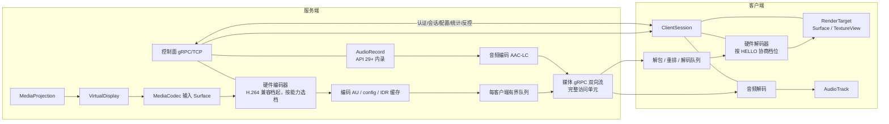
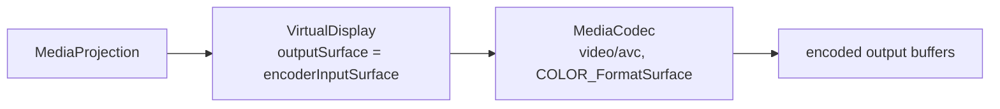
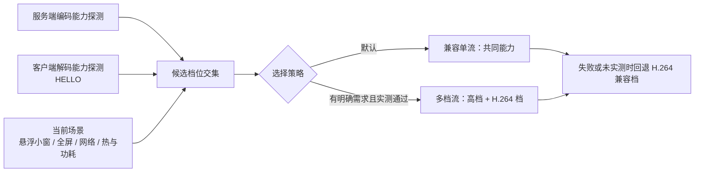
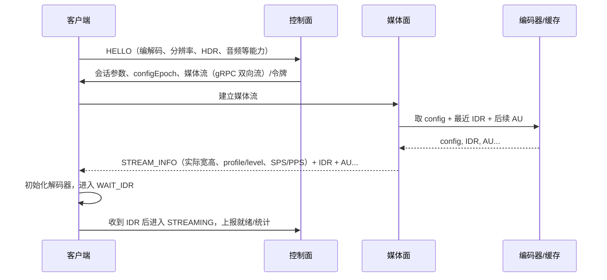
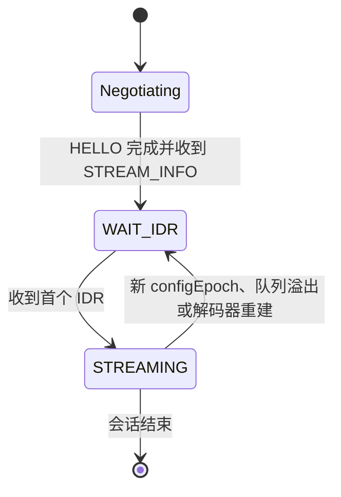
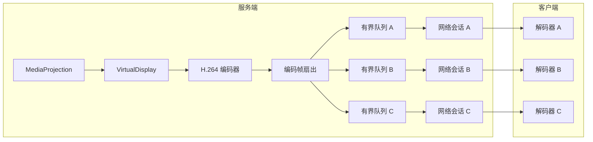
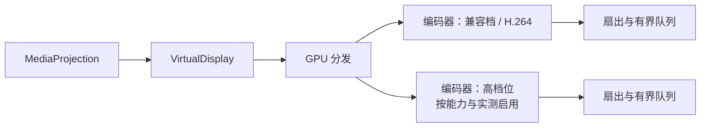

# 媒体链路目标架构

> 状态：设计裁决与技术目标。媒体路径已在代码层面完成接线（批次 A–H，媒体经统一 gRPC 双向流承载完整访问单元，见 [决策看板 DB-NET-001](decision-board.md#db-net-001)），但**未做设备、真机、模拟器或网络实测**，代码接线不等于设备验证通过。
> 当前实现的事实与风险见 [project-assessment.md](project-assessment.md)；本文只描述“应该怎么改”和“为什么这样裁决”。
> **裁决修订（2026-10-19）**：媒体第一版由“独立 TCP 帧协议”修订为“统一 gRPC 双向流承载完整访问单元”；独立 TCP 帧协议降级为备选方案，RTP/UDP 与 WebRTC 的触发条件保持不变。详见 [决策看板 DB-NET-001](decision-board.md#db-net-001)。
> **裁决修订（能力分档）**：此前“自动只选 H.264、按低能力车机限制全产品、API 25 决定能力上限”一类表述过度保守，已修订为“H.264 是兼容基线而非能力上限”。API 25/minSdk 只决定最低兼容与回退路径；服务端与客户端分别做运行时能力探测，按实际能力和当前场景选档。车机只是场景之一，手机、平板与其他高性能设备同样适用。旧表述在决策看板的“裁决演进”中保留，不伪装成从未出现。
> 相关文档：[窗口与会话](windowing-session-design.md) · [路线图](optimization-roadmap.md) · [可扩展编码框架](codec-framework.md)

## 1. 裁决摘要

| 领域 | 当前实现 | 目标裁决 | 理由 |
| --- | --- | --- | --- |
| 屏幕采集 | MediaProjection 经 VirtualDisplay 到 ImageReader（RGBA_8888） | 继续使用 MediaProjection；一个 MediaProjection/VirtualDisplay 采集，VirtualDisplay 直接输出到 MediaCodec 输入 Surface | 普通 App 没有更合规的屏幕采集入口；去掉从 RGBA 到 Bitmap 的 CPU 路径；不建立多个采集会话 |
| 视频编码 | 软件 JPEG，每帧压缩 | 硬件 H.264/AVC 为兼容基线，不是上限；服务端与客户端分别探测编码/解码能力后选档，HEVC 可在双方支持时启用，AV1 等仅作为设备明确支持时的后续高级选项；通常跑一路编码，多档受实例与功耗限制；稳态不经过 Bitmap/JPEG | 硬件编码器通常比软件 JPEG 更省 CPU；H.264 兼容性最好；更高编码的收益依赖双方能力与实测；多档编码的成本高 |
| 编码缓存 | 无编码帧缓存；JPEG 即帧 | 缓存 config、最近 IDR 与其后 AU；不缓存大量 RGBA | 新客户端快速加入、重连、Surface 失效后重建解码器都从 config+IDR 开始 |
| 参数语义 | 帧率、质量参数按固定值使用 | `KEY_FRAME_RATE` 是目标提示，不是严格上限；码率通常可运行时调整；IDR 间隔可配置，同步请求合并限频 | 静态画面/VFR 不保证满帧；minSdk 25 不能依赖高版本参数；频繁 IDR 会放大码率 |
| 配置切换 | resize 只改采集或显示尺寸 | 分辨率或旋转变化通常重建编码器与输入 Surface，发布新 `configEpoch`、SPS/PPS 与 IDR；网络会话不断开 | 只 resize VirtualDisplay 不改变编码输出尺寸，还可能引入隐式缩放 |
| 控制面 | gRPC/OkHttp，明文，无认证 | 保留 gRPC/TCP 作为控制面；增加认证、能力协商、配置、统计、反控消息 | 控制消息量小，gRPC 的流和超时语义合适 |
| 媒体面 | 统一 gRPC 双向流承载完整访问单元（`GrpcMediaTransport`） | 统一 gRPC 双向流承载完整访问单元（已实现）；独立 TCP 帧协议为备选；实测拖尾后再评估 RTP/UDP；WebRTC 按场景引入 | 复用 gRPC 流与现有控制面，第一版少维护一条协议；完整访问单元语义不变，不拆逐帧 protobuf 字段 |
| 音频 | 无 | API 29+ AudioPlaybackCapture + AudioRecord；API 25–28 降级无声或显式麦克风模式 | 系统内录受版本和 App 策略限制；不能假装所有版本都能内录 |
| 反控 | 无 | 普通 App 用 AccessibilityService.dispatchGesture；单客户端控制租约；InputManager 注入不作为普通方案 | MediaProjection 只能采集，不能注入输入 |
| 多客户端 | 每客户端最新 JPEG 帧 | 一次采集、按客户端扇出；默认一条兼容单流，确认需求与能力后可用受限多档流；独立有界队列；GOP 感知丢弃 | 慢客户端不能阻塞别人；兼容单流会限制高能力客户端；多档流受编码器实例与功耗限制；H.264 不能随意丢中间 P 帧 |
| 安全 | 无认证、明文 | 配对/令牌、TLS/DTLS、最小权限、可见的控制授权 | 当前只适合可信局域网；`FLAG_SECURE` 不是加密 |

## 2. 设计原则

1. **稳态路径不经过 Bitmap/JPEG。** 从采集 Surface 到编码器、网络、解码器、显示 Surface，应尽量是一条 GPU/硬件路径。Bitmap 只用于快照、缩略图、过渡帧或降级。
2. **一次采集，通常一次编码，按客户端扇出。** 第一版不做每客户端转码；不同显示尺寸由客户端渲染缩放解决。需要不同清晰度时，按 9.4 评估多档流，而不是复制采集会话。
3. **采集、编码、传输、渲染解耦。** 任何一层都不能在采集线程上做网络写、磁盘 I/O 或等待慢客户端。
4. **所有队列有界，丢弃策略明确。** 慢客户端隔离；媒体路径不使用 `CallerRunsPolicy`；丢弃必须 GOP 感知。
5. **单一单调时钟。** 视频 PTS、音频采集时间、网络到达时间、渲染时间统一映射到会话单调时钟；不要混用墙钟。
6. **能力协商与降级。** 编码器、分辨率、帧率、码率、音频、HDR、反控都要先查询能力，再决定；能力以运行时查询与实测为准，不能从 API 等级或设备形态推断；失败要可见地降级。
7. **控制面与媒体面分离。** 控制面可以重试、加密、鉴权；媒体面追求吞吐和低延迟，不被控制消息阻塞。
8. **不牺牲 minSdk 25，但不把它当上限。** 新能力用版本门控；基本监看必须在 API 25 可用。版本门控只说明某些 API 是否可用，不代表 API 25 设备必然缺少编码能力，也不限制高版本或高性能设备使用更高档位；codec 与参数必须逐设备探测。

## 3. 目标拓扑

第一版媒体为统一 gRPC 双向流，可与控制面共用 gRPC 通道，但每个客户端使用独立媒体流，控制面与媒体面的职责仍分离：

- 控制面需要可靠、可重试、可加密、可鉴权；媒体面需要低延迟、可背压、按完整访问单元承载。
- 每个客户端独立媒体流与有界队列，慢客户端只影响自己的媒体流，不阻塞控制消息或别的客户端。
- 媒体不拆成逐帧 protobuf 字段：一个访问单元作为一条消息，config 与描述符先于同 epoch 的首个 AU。
- 独立 TCP 帧协议只作为备选方案，是否启用由实测数据决定，不在第一版预先实现。

## 4. 采集与编码

### 4.1 VirtualDisplay 直接输出到 MediaCodec 输入 Surface

建议方案的核心是把当前 `ImageReader` 替换为 `MediaCodec.createInputSurface()`：

实现要点：

1. 先查询编码器能力：`MediaCodecList`、`MediaCodecInfo`、`VideoCapabilities`，确认支持的分辨率、帧率、码率范围和 `COLOR_FormatSurface`。
2. 配置 `MediaFormat`：MIME 为 `video/avc`；设置 width/height、bitrate、frame-rate、I-frame interval；不依赖 B 帧。
3. `configure(format, null, null, CONFIGURE_FLAG_ENCODE)`，然后 `createInputSurface()`，再 `start()`。
4. 用 `MediaProjection.createVirtualDisplay` 把输出指向该 Surface；VirtualDisplay 的尺寸应与编码器配置尺寸一致，并按 `VideoCapabilities` 的对齐要求取整，避免系统隐式缩放。
5. 编码器输出通过 `dequeueOutputBuffer` 或异步 callback 读取；处理 `INFO_OUTPUT_FORMAT_CHANGED`、`BUFFER_FLAG_CODEC_CONFIG`、`BUFFER_FLAG_KEY_FRAME` 和 PTS。
6. 停止时先调用 `stop`，再调用 `release` 释放编码器，然后释放 VirtualDisplay 和 MediaProjection；顺序要稳定，避免 Surface 已释放但编码器仍在写。
7. 尺寸/方向变化时，不要只改 VirtualDisplay；只 resize 采集缓冲不会改变编码器输出尺寸，还可能增加一次隐式缩放。通常要重建编码器与输入 Surface，重新对齐到编码器支持的尺寸，提升 `configEpoch`，并向所有客户端发布新的 SPS/PPS 与 IDR。网络会话不因此断开，客户端在同一连接上重新等待 IDR。第一版可以把固定采集尺寸作为可靠回退档；能力探测与分档落地后，再按场景向上选择分辨率，而不是把回退档当成全产品上限。

这样做的直接效果是：

- 去掉从 RGBA plane 到 Bitmap 的逐像素拷贝。
- 去掉全尺寸 ARGB_8888 Bitmap 的分配与回收。
- 去掉软件 JPEG 压缩。
- 编码器可以直接消费 GPU/显示管线的 Surface，通常比 CPU 路径更省电。

> 注意：这只是“普通 App 的合规采集路径”，不代表所有设备都支持相同编码器、分辨率或帧率。必须用能力查询和降级处理覆盖厂商差异。

### 4.2 运行时能力探测与档位选择

H.264 是兼容基线，不是产品上限。API 等级、minSdk 和“手机/平板/车机”形态都不能单独推断编解码能力：同为 API 25 的设备可能只支持 Baseline 编码，也可能支持 HEVC；旗舰平板与车机也可能具备完全不同的编码器。选档必须来自运行时探测。

服务端编码侧至少探测：

- 编码器列表与 MIME；硬件/软件标记与厂商实现差异。
- profile/level 与实测可配置范围。
- 宽高、对齐、帧率、码率范围；横竖屏与旋转后的实际支持。
- 同时可用的硬件编码器实例数量；是否支持 Surface 输入、运行时重配、低延迟或分层编码。
- 当前热状态、电量/充电状态与已有编码负载，作为选档输入，而不是只看静态能力。

客户端解码侧至少探测：

- 可解码 MIME、profile/level、最大宽高与帧率、硬件/软件。
- Surface 输出（`RenderTarget.getSurface()`）的可用性、adaptive playback 与分辨率切换。
- 当前窗口形态（悬浮小窗/全屏）与实际渲染尺寸。
- 当前热/电状态与后台限制。

探测结果通过 HELLO/STREAM_INFO 交换；字段必须可缺省，旧客户端按“仅 H.264 兼容档”处理。服务端把自身可编档位与每个客户端可解档位求交集，得到候选档位，再按场景选择：

选择原则：

1. **先探测，后选择。** 不从 API 等级、设备形态或“车机=低配”的标签预设 codec 与分辨率。
2. **兼容优先，逐级向上。** H.264 Baseline/Constrained Baseline 保底；双方都支持且实测有收益时再选 HEVC Main 等更高档位。AV1 只作为设备明确支持时的后续/高级选项，第一版不实现，也不声称普遍可用。
3. **场景参与选档。** 悬浮小窗与全屏可以使用不同档位；小窗优先码率、功耗与稳定，全屏可请求更高分辨率/帧率。档位切换仍需 `configEpoch` + IDR，且不能破坏已有客户端。
4. **可回退。** 任何高档位失败都要能回到 H.264 兼容档；回退对用户可见，不能静默黑屏或无声降质。
5. **不做盲目自动切换。** “自动”指能力驱动，不是看到高版本 API 就切高档；未实测的组合保持兼容档，切换需有稳定判据与回退开关。

### 4.3 编码格式选择

| 格式 | 何时使用 | 优点 | 代价/限制 | 裁决 |
| --- | --- | --- | --- | --- |
| H.264/AVC | 兼容基线；能力不足、未实测或需要回退时的默认 | 硬件支持最广；浏览器/播放器兼容性好；工具链成熟 | 同画质下码率高于 HEVC/AV1 | **兼容基线，不是上限** |
| HEVC/H.265 | 服务端与客户端均探测支持，且同场景实测收益明确 | 同画质通常更省码率 | 专利/授权、设备支持不均、部分浏览器不支持 | 可选；不是第一版必经路径 |
| AV1 | 设备明确支持时的后续/高级选项 | 更高压缩效率 | 实时硬件编码支持不均；复杂度高；第一版未实现 | 后续评估，不宣称普遍可用 |
| JPEG | 快照、缩略图、编码器不可用时的降级 | 实现简单；单帧独立 | CPU 高、码率大、无帧间预测 | 仅快照/降级 |
| PNG | 无损快照 | 无损 | 体积大、CPU 高 | 仅按需快照 |

H.264 的具体建议：

- 优先 Baseline/Constrained Baseline，保证老设备和浏览器兼容；能力允许时再协商 Main/High。
- 不依赖 B 帧，降低乱序、延迟和解码器依赖；PTS 与 DTS 可以简化。
- 关键帧间隔是配置项，可运行时调整；太短浪费码率，太长导致新客户端等待和错误恢复慢。运行中的同步请求（新客户端加入、错误恢复、慢客户端追帧）必须合并并限频，不能让每个请求都立刻触发一次 IDR。
- 码率是配置项，通常可以在运行时调整；具体生效时机、步进与粒度取决于设备的码率控制实现，不能假设立即生效。
- 码率控制模式（CBR/VBR/CQ）因厂商而异；第一版用设备支持的稳定模式，不要假设某个模式一定更好。
- 分辨率必须是编码器支持的尺寸，必要时对齐到厂商要求；不要假设 1080p/4K/60fps 一定可用，也不要反过来假设高版本设备一定只能跑低档。

HEVC 与 AV1 的边界：

- HEVC 只有在双方 profile/level 匹配、编码器与解码器都实测稳定时启用；任一侧不支持就回退 H.264，不能因为“应该更省码率”而强切。
- AV1 编码或解码任一侧缺失即不启用；第一版没有实现，不能写成已有能力，也不能声称大多数设备支持。
- 同一会话内切换 codec 等同重配编码器与解码器，必须发布新 `configEpoch`、SPS/PPS（或等价配置）与 IDR；不能在 GOP 中间切换。

### 4.4 帧率、码率与分辨率

第一版建议把“采集参数”和“显示参数”分开：

| 参数 | 服务端职责 | 客户端职责 |
| --- | --- | --- |
| 档位 | 按编码能力、当前场景、多客户端策略给出候选；H.264 兼容档保底 | 按窗口形态与网络请求档位，不强制服务端超能力 |
| 采集分辨率 | 由 VirtualDisplay + 编码器配置共同决定，两者尺寸匹配 | 只请求档位，不直接改服务端 Surface |
| 编码分辨率 | 按编码器能力、对齐要求与场景配置 | 解码后按窗口缩放 |
| 帧率 | 编码器/采集限帧，`KEY_FRAME_RATE` 只作目标提示 | 可请求上限，但不强制服务端超能力 |
| 码率 | 编码器码率控制，通常可运行时调整 | 可根据队列/丢帧反馈请求调整 |
| 显示尺寸 | 不感知 | 悬浮窗/全屏自行缩放 |
| 旋转 | 采集方向与 configEpoch | 渲染方向与容器变换 |

分辨率不是只由 VirtualDisplay 决定。VirtualDisplay 决定采集缓冲尺寸，编码器决定输出码流的宽高；两者必须匹配，并按编码器能力对齐。只 resize VirtualDisplay 而不同步编码器，通常只会得到缩放后的采集内容，不会改变码流尺寸。分辨率或旋转变化时，通常需要重建编码器与输入 Surface，发布新的 `configEpoch`、SPS/PPS 与 IDR；网络会话与客户端连接不必断开，客户端收到新配置后重新等待 IDR，而不是继续用旧参数解新码流。

`KEY_FRAME_RATE` 是目标提示，不是严格上限。静态画面、VFR 或编码器内部调度都可能让实际输出低于该值，部分设备也可能短时超过。需要严格限帧时，应在 GPU/采集上游做调度，或按系统版本与设备能力逐项验证；minSdk 25 基线不能依赖高版本才有的参数或行为。

分辨率和帧率的向上扩展规则：

- 不设“全产品统一低档上限”。旗舰手机或平板在编码器、散热、功耗与网络允许时，可以使用高于兼容档的分辨率和帧率。
- 档位由能力交集与当前场景决定，而不是由 API 等级或设备分类决定；同一设备在悬浮小窗与全屏下可以选择不同档位。
- 低端设备、旧系统或编码器异常时回退兼容档；回退是产品行为的一部分，不是失败。
- 第一版可以把固定采集尺寸与 H.264 作为可靠回退档；能力探测与分档落地后，再逐步放开向上选择。任何向上扩展都必须有同设备、同网络的实测依据。

这意味着：

- 客户端“显示大小”不再等于“采集分辨率”。当前实现把两者混在一起，导致全尺寸解码但小窗显示，浪费 CPU 和内存。
- 客户端可以选择“省流模式”（请求更低分辨率/帧率/码率），但最终由服务端能力与多客户端策略决定。
- 高能力客户端可以请求更高档位，但不能迫使服务端跳过能力探测，也不能让其他客户端在无提示的情况下降到无法接受的规格。
- 多客户端场景下，默认使用兼容单流；确认需求与设备能力后，才评估“高档 + H.264 档”的有限多档流（见 9.4）。不要为每个客户端单独转码。

### 4.5 编码器输出与时间戳

- 使用编码器输出的 PTS 作为视频时间轴；单位统一为微秒或纳秒，并在会话内固定。
- 如果编码器不提供可靠 PTS，使用采集侧单调时钟打点，但要保持单调递增。
- 记录 `configEpoch`：编码器重建、分辨率变化、方向变化、编解码配置变化时递增；客户端用它拒绝旧配置的帧。
- 首帧、关键帧、配置帧要能被客户端识别；新客户端必须从 config + IDR 开始。

### 4.6 客户端显示与解码边界

客户端窗口缩放只改变本地渲染尺寸，不减少网络字节数，也不减少解码工作量。客户端即使不渲染某些输出帧，解码器仍然要解码（除非设备与码流明确支持可丢弃的机制）。

- 客户端解码能力可能高于或低于服务端当前档位；服务端必须以 HELLO 声明的解码能力与实测结果为准，不能假设客户端和自己是同一档次。
- 分辨率变化通常需要重配解码器，除非设备明确支持 adaptive playback；是否支持要以解码器能力查询与实测为准。
- 码率或帧率变化通常不需要重配解码器。
- 重配解码器不等于重连网络：保持会话，等待新的 config、SPS/PPS 与 IDR，再回到正常渲染。
- 客户端不能通过缩小悬浮窗来声称“省流”；真正的省流只能来自服务端调整采集/编码参数或减少发送。
- 客户端不能只凭自身支持高档位就要求立即切换；切换要经过能力协商、场景判断与回退预案。

## 5. 编码帧缓存与 GOP 语义

### 5.1 缓存什么

建议缓存：

- **CodecConfig**：MIME、profile/level、width/height、csd-0/csd-1、configEpoch。
- **最近 IDR**：完整的关键帧 AU。
- **最近 IDR 之后的 AU**：按字节数和时间上限保留，供新客户端从最近 IDR 追到当前。
- **最后渲染帧/快照**：只保留一份，用于窗口切换或占位；不是 RGBA 环形缓冲。

不建议缓存：

- 大量 RGBA/Bitmap 帧。
- 多个完整 GOP 的原始帧。
- 每客户端的独立解码帧历史。

### 5.2 新客户端加入

客户端状态：

原则：

- 客户端在 HELLO 中声明能力；服务端据此选择一条兼容单流，并在 STREAM_INFO 中给出实际宽高、profile/level 与 SPS/PPS。能力字段必须允许缺省，旧客户端也能被识别和降级。
- 新客户端从 **config + IDR** 开始；收到 IDR 前处于 WAIT_IDR，不能从任意 P 帧开始。收到 IDR 后才进入 STREAMING。
- 如果缓存里没有可用 IDR，控制面请求编码器产生 IDR；客户端等待，不要发送半截 GOP。
- 多个客户端同时请求 IDR 时，合并请求并限流；IDR 会增大码率，不能每个客户端随意触发。
- 如果客户端在 GOP 中间加入，且缓存不足，宁可等待下一个 IDR，也不要发送无法解码的 P 帧。
- 已有客户端不因新客户端加入而断开或重新授权，也不因新加入者单独改变已接受的参数。若服务端决定全局重配，所有客户端都通过新 `configEpoch`、SPS/PPS 与 IDR 过渡，而不是各自重连。
- 可加入点判定、描述符与客户端状态机的完整契约见 [可扩展编码框架设计](codec-framework.md)；本节及下图中的 `WAIT_IDR` 是该状态机在 H.264 下的特例，框架文档将其拆为 `WAIT_CONFIG` 与 `WAIT_RANDOM_ACCESS`。

### 5.3 为什么不能随意丢中间 P 帧

H.264 的 P 帧依赖前面的参考帧。丢弃一个中间 P 帧后，后续 P 帧可能继续引用它，导致：

- 解码器报错或花屏。
- 误差扩散到后续帧，直到下一个 IDR。
- 客户端继续收到“看似有数据但画面错误”的流。

因此慢客户端的丢弃策略必须是：

1. **优先降低码率/帧率/分辨率**，让客户端跟上。
2. **如果必须丢弃，丢到下一个 IDR 重新开始**，不要只丢一帧 P。
3. **或者直接断开慢客户端**，让它重连后从 config+IDR 加入。
4. 如果编码器支持时间分层/SVC，可以按层丢弃；第一版不依赖这个能力。

这与当前 JPEG 的“每帧独立、可只保留最新帧”不同。H.264 的多客户端队列必须理解 GOP，不能简单复用“最新帧覆盖”策略。

## 6. 传输

### 6.1 控制面：保留 gRPC/TCP

控制面继续使用 gRPC/TCP，负责：

- 认证/配对、会话建立、能力协商。
- 媒体参数下发（codec、分辨率、帧率、码率、音频开关）。
- 关键帧请求、码率调整、统计上报。
- 反控事件与租约管理。
- 错误、重连、会话恢复。

控制消息量小，gRPC 的 protobuf、超时、流和拦截器机制合适。需要补的是：

- TLS 或至少应用层认证；不能继续 `InsecureServerCredentials`。
- 会话令牌与过期时间；默认拒绝未配对客户端。
- 能力字段与版本字段，支持新旧客户端共存。
- 控制面限流，避免关键帧请求或统计消息被滥用。

### 6.2 媒体第一版：统一 gRPC 双向流

第一版媒体使用统一 gRPC 双向流：proto 中单条 `rpc Stream(stream ClientMessage) returns (stream ServerMessage)`，每个访问单元作为一条消息承载，`GrpcMediaTransport` 实现 `MediaTransport`。不把媒体拆成逐帧 protobuf 字段，描述符、config 与可加入点语义保持不变。

采用依据：

- gRPC 媒体变体本属 DB-NET-002 的批准范围：以 gRPC 流承载媒体时，仍按完整访问单元封装。
- 与现有控制面共用 gRPC 通道、认证与运维路径，第一版少维护一条协议。
- 完整访问单元语义不变：同一 `configEpoch` 内描述符先于首个访问单元，接收端逐 AU 校验 `configEpoch`，有界队列与 GOP 感知丢弃仍在传输之上完成。
- 代价必须实测：每帧多一层 protobuf 封装开销，底层 TCP 仍有队头阻塞与重传拖尾；这些由第 14 节验证方式测量，不在文档里先验下结论。

实现状态：批次 A `4ceab10` 已落地双向流协议与 `GrpcMediaTransport`；**仅经 JVM/fake 与编译验证，未做设备、真机、模拟器或网络实测**。

#### 备选方案（未采用）：独立 TCP 帧协议

以下原“独立 TCP 帧协议”设计保留为备选方案：只有在实测表明 gRPC 承载的封装开销或 TCP 拖尾不可接受时，才评估独立 TCP 连接。**第一版未采用。**

原方案建议媒体走独立 TCP 连接，而不是每帧塞进 protobuf/gRPC：

| 区域 | 内容 |
| --- | --- |
| 长度前缀 | 后续帧的总长度，用于 TCP 分帧 |
| 固定头 | `magic/version`、`headerLen`、`frameType`、`codec`、`configEpoch`、`ptsUs`、`flags`、`payloadLen`、可选 CRC |
| payload | 编码帧、音频帧或控制确认的负载 |
| frameType | `CONFIG` / `KEY` / `DELTA` / `AUDIO` / `CONTROL_ACK` |

原方案的理由：

- 避免每帧 protobuf 字段名和封装开销。
- 方便分片、拼接、背压和每客户端独立队列。
- 方便在 TCP 上做明确的“config + IDR”语义。
- 方便后续替换为 RTP/UDP，而不改上层帧模型。

TCP 的已知问题：

- 队头阻塞：一个丢包会阻塞后续已到达的数据。
- 重传拖尾：尾包丢失会让帧到达时间出现尖峰。
- 不适合无序/高丢包网络。

因此无论采用统一 gRPC 双向流还是备选的独立 TCP 帧协议，第一版都必须测量：

- RTT 的 p50/p95。
- 重传率、重传超时次数。
- 帧到达间隔的 p95/p99。
- 解码截止时间错过的比例。
- 队列深度与丢弃次数。

如果这些指标在目标网络上可接受，统一 gRPC 双向流就是更简单、更稳的选择；如果重传拖尾明显影响交互，再评估 RTP/UDP 或独立 TCP 帧协议。**不能先验地宣称 UDP 一定更好。**

### 6.3 RTP/UDP 的引入条件

只有在实测表明 TCP 重传拖尾不可接受，且产品需要更低延迟时，才引入 RTP/UDP。需要同时具备：

- RTP 封装：H.264 使用合适的 RTP payload format；HEVC 同理。
- 抖动缓冲：自适应 jitter buffer，权衡延迟与连续播放。
- 丢包恢复：NACK、重传缓存；关键帧请求 PLI/FIR。
- 发送 pacing：按目标码率平滑发送，避免突发。
- 拥塞控制：基于延迟/丢包的码率自适应；不能只靠固定码率。
- 安全：SRTP/DTLS 或等价方案。
- 统计：丢包、乱序、jitter、NACK、PLI、RTT、码率。

UDP 不是“更快”的同义词：它把可靠性责任转移给应用；没有 jitter/NACK/PLI/pacing/拥塞控制，体验可能比 TCP 更差。

### 6.4 WebRTC 的适用条件

WebRTC 适合：

- 需要浏览器作为客户端。
- 需要跨网络/NAT 穿透，或需要标准信令/ICE/TURN。
- 需要完整的音视频栈（jitter buffer、NACK、PLI、拥塞控制、回声消除、NetEQ）。
- 团队愿意承担依赖、信令、调试和互操作成本。

不适合作为第一版默认方案的理由：

- 局域网直连场景下，WebRTC 的复杂度可能大于收益。
- 需要额外的信令、ICE/TURN、DTLS-SRTP、SDP 协商。
- 现有 gRPC/NSD/悬浮窗体系需要重做连接模型。
- 音频在 WebRTC 中通常用 Opus，和 AAC-LC 的兼容策略不同。

裁决：**先把 TCP + H.264 兼容档做稳，用测量决定是否需要 RTP/UDP；更高编码档位只在能力探测与实测支持后启用。WebRTC 作为浏览器/跨网/完整栈需求的可选路径，不作为默认基线。**

## 7. 音频

### 7.1 API 29+：AudioPlaybackCapture

Android 10（API 29）起可以用 `AudioPlaybackCaptureConfiguration` + `AudioRecord` 捕获其他 App 的播放音频：

- 需要 `RECORD_AUDIO` 运行时权限。
- 需要 `MediaProjection` 授权；播放捕获配置以 MediaProjection 为基础。
- 被采集 App 必须允许 playback capture；应用可以通过 manifest 的 `allowAudioPlaybackCapture` 选择退出。
- 受 `AudioAttributes` usage 限制；不是所有系统声音/受保护内容都能采。
- 需要正确的前台服务类型与通知；目标版本要复核 FGS 类型要求。

建议：

- 默认关闭音频；用户显式开启。
- 开启时展示“正在捕获设备播放音频”的可见指示。
- 被采集 App 禁止捕获时，显示“该应用不允许内录”，不要静默失败。
- 不采集麦克风，除非用户明确选择麦克风模式。

### 7.2 API 25–28：降级

API 25–28 没有 AudioPlaybackCapture。可选策略：

1. **默认无声**：只传屏幕，UI 明确显示“当前系统版本不支持内录”。这是最安全的默认。
2. **显式麦克风模式**：用户明确选择“用麦克风采集环境声”，申请 `RECORD_AUDIO`，显示持续指示；这不是系统内录，音质、隐私和回声都不同。
3. **不做音频**：如果产品不接受麦克风替代，保持无声。

不能把麦克风模式伪装成“内录”，也不能在用户不知情时开启麦克风。

### 7.3 编码与音画同步

- 兼容优先：AAC-LC，常见采样率/声道配置；适合本地播放器和大多数设备。
- WebRTC 路径：Opus；如果同时支持 AAC 和 Opus，需要明确的协商与转码策略。
- 时间轴：视频 PTS、音频采集时间、网络到达时间、渲染时间统一映射到会话单调时钟；使用 `System.nanoTime()` 或等价的单调源，不使用墙钟。
- 音频缓冲：客户端需要 jitter buffer 与漂移校正；音频太超前/落后时，优先调整缓冲或轻微重采样，不要频繁跳帧。
- 音画同步：以视频为主时钟或音频为主时钟要明确；第一版建议音频跟随视频，或使用共享会话时钟，避免两端各自为政。
- 丢包/丢帧：音频可以做 PLC/静音填充，但不能无界累积；视频仍按 GOP 语义处理。

## 8. 反控

### 8.1 能力边界

| 方案 | 可用性 | 能力 | 限制 |
| --- | --- | --- | --- |
| `AccessibilityService.dispatchGesture` | API 24+，用户手动开启无障碍服务 | 注入手势（点击、滑动、多指路径） | 不是普通运行时权限；受系统/目标 App 限制；键盘注入能力有限；安全窗口/系统 UI 可能不可用 |
| `AccessibilityService` 节点操作 | API 24+ | 对可访问节点执行 `ACTION_SET_TEXT`、点击等 | 依赖无障碍树；不是所有 App/控件暴露；不能替代完整键鼠 |
| `InputManager.injectInputEvent` | 仅 root/shell/system 或持有签名级 `INJECT_EVENTS` | 更底层的事件注入 | 普通 App 不可用；不适合作为产品方案 |
| MediaProjection | 普通 App | 仅屏幕采集 | **不能注入输入** |

裁决：

- 普通 App 的反控基线是 `AccessibilityService.dispatchGesture`，并且必须由用户在系统设置中手动开启。
- 键盘/文本输入优先用无障碍节点操作（例如对焦点输入框设置文本），不要承诺完整键盘注入。
- 不把 root、shell、系统签名或 `INJECT_EVENTS` 作为普通版本的前提。
- MediaProjection 只负责采集，不负责控制；两者在协议和权限上分开。

### 8.2 单客户端控制租约

反控默认只允许一个客户端持有控制租约，避免多人同时操作造成冲突。建议协议字段：

| 字段 | 含义 |
| --- | --- |
| `clientId` | 持有控制权的客户端随机标识，不是账号 |
| `leaseEpoch` | 每次授予/收回递增 |
| `expiresAt` | 单调时钟 |
| `displayWidth/Height` | 服务端当前显示尺寸 |
| `rotation` | 当前旋转 |
| `configEpoch` | 编码配置代次 |

规则：

- 服务端授予租约；同一时刻只有一个客户端持有有效控制租约。
- 持有租约的客户端定期心跳（heartbeat）；超时自动失效。
- 服务端可以随时收回；收回后旧 epoch 的事件一律拒绝（epoch fencing）。
- 旋转/分辨率变化时提升 `configEpoch`，旧坐标事件拒绝或重新映射。
- 坐标使用归一化坐标（normalized coordinates，0..1）和显示尺寸/旋转，避免不同分辨率直接套像素。
- 事件带序号与时间戳；客户端去重、限速；服务端再次校验边界。
- 所有控制操作有可见指示；默认关闭；服务端可审计最近操作。

### 8.3 安全与隐私

- 反控是高危能力：默认关闭，首次开启需要服务端明确确认。
- 不在锁屏、系统设置、安全窗口等敏感界面注入；具体限制以系统和无障碍能力为准。
- 不记录用户输入内容；日志只记录事件类型、时间和结果，不记录文本。
- 控制通道必须与观看权限分离：客户端不一定有控制权。
- 多客户端时，观看可以多人，控制默认只授予一个客户端；服务端可转移或收回控制权。

## 9. 多客户端

### 9.1 一路采集、默认一路编码、扇出

目标模型：

- 采集和编码只有一份；每个客户端拥有独立的网络会话、有界队列、发送状态与解码器。
- 不同能力默认选择一条兼容单流：使用所有已连接客户端都能解码的 profile/level、宽高与码率，H.264 为保底。这是兼容策略，不是能力上限；高能力客户端可在 9.4 的多档流中获得更高规格。不能为了个别客户端的更高能力，让低能力客户端无法解码。
- 第一版不做每客户端转码；客户端按自己的窗口缩放解码画面。窗口缩放不减少网络与解码负载。
- 如果某客户端需要更低码率/分辨率，优先请求服务端调整全局编码参数，或按 9.4 评估有限档位；不要偷偷为每个客户端跑一套软件编码。
- 每个客户端有独立统计：队列深度、发送速率、丢弃 GOP 数、RTT、解码/渲染反馈。

### 9.2 慢客户端隔离

慢客户端的处理顺序：

1. 降低该客户端的发送速率/队列水位，优先保留关键帧与最新 GOP。
2. 队列溢出时让该客户端进入 WAIT_IDR，跳到下一个 IDR 恢复；不能丢中间 P 帧后继续发送。
3. 如果持续跟不上，断开该客户端，让它在网络恢复后重新加入。
4. 任何情况下都不能阻塞编码器、采集线程或其他客户端。

禁止：

- 在采集/编码线程上同步写 socket。
- 使用 `CallerRunsPolicy` 把网络任务压回采集线程。
- 为慢客户端无限缓存 P 帧。
- 让一个客户端的 PLI/NACK 风暴触发全局频繁 IDR。

### 9.3 新客户端与重连

- 新客户端先完成 HELLO 能力协商，再订阅媒体；收到 STREAM_INFO 与 config + IDR 后，从后续 AU 继续。
- 已有客户端不因新客户端加入而断开或重新授权；新加入者不能单独改变它们已接受的参数。
- 重连时，如果产品允许会话恢复令牌，就重新协商，并从 config + IDR 开始；不要假设断点前的 P 帧还有效。
- IDR 请求合并：多个客户端同时加入时，只触发一次编码器 IDR；其余客户端复用同一个 IDR。合并后的请求仍要限频。
- 记录每个客户端的 `configEpoch`；配置变化后，旧 epoch 的帧丢弃。

### 9.4 兼容单流与多档编码

多客户端有两种策略，默认是兼容单流；只有在确认需求、设备能力与实测收益后，才考虑多档流。

| 策略 | 选流方式 | 适用 | 优点 | 限制 |
| --- | --- | --- | --- | --- |
| 兼容单流 | 所有已连接客户端解码能力的交集，H.264 为保底 | 默认；客户端能力差异大；功耗/发热敏感 | 实现简单、稳定、编码器实例占用低 | 高能力客户端被限制在共同档，无法发挥旗舰设备 |
| 多档流 | 高能力客户端用高档，其他客户端用 H.264 档 | 明确存在高画质客户端与低能力客户端并存，且实测通过 | 发挥高能力设备，避免所有人被拉低 | 占用多个硬件编码器实例，功耗、发热与带宽上升，实现与回退复杂 |

共同规则：

- 仍只保留一个 MediaProjection 与一个 VirtualDisplay；由 GPU 把同一采集画面分发到有限数量的编码器，不为每档建立新的 MediaProjection 会话。
- 档位数量受设备编码器实例、功耗、热与网络限制，必须逐项实测；没有证据时保持单流 + 客户端本地缩放。
- 兼容单流取共同能力交集，不能为了个别客户端的高能力让低能力客户端无法解码。
- 多档流可以让高能力客户端使用高规格、其他客户端继续 H.264 档；但不能因此把已有客户端无提示降级。增加高档位若需要重配或挤占资源，必须先评估对所有客户端的影响，必要时保持现状并提示。
- 新客户端加入不得迫使已有客户端改变已接受的参数；如果无法在不影响他人的前提下增加档位，新客户端接受兼容档。
- 同一会话的档位变化都要发布新 `configEpoch`、编解码配置与 IDR；不能在一个 GOP 中间切换 codec 或分辨率。

上图的“高档位”不是默认存在：它只在服务端编码能力、对应客户端解码能力、编码器实例与功耗预算都满足，并经过实测后才启用；否则只保留兼容档。多流注册、编码切换与传输映射的契约见 [可扩展编码框架设计](codec-framework.md)，本节只保留策略裁决。

## 10. Android 权限与能力边界

| 能力 | 权限/API | 用户动作 | 边界 |
| --- | --- | --- | --- |
| 屏幕采集 | `MediaProjectionManager.createScreenCaptureIntent`；`FOREGROUND_SERVICE_MEDIA_PROJECTION`；前台服务类型 `mediaProjection` | 每次会话确认捕获；通知常驻 | 不能静默采集；安全窗口可能黑屏；Android 14+ 有默认显示/单应用配置差异 |
| 跨应用悬浮窗 | `SYSTEM_ALERT_WINDOW`；API 26+ `TYPE_APPLICATION_OVERLAY`；API 25 `TYPE_SYSTEM_ALERT` | 到系统设置授予“显示在其他应用上层” | OEM 可能限制；权限可被撤销；不是普通运行时权限 |
| 通知 | `POST_NOTIFICATIONS`（API 33+） | 运行时授权 | 前台服务需要通知；被拒绝会影响启动引导 |
| 网络 | `INTERNET`、`ACCESS_NETWORK_STATE`、`ACCESS_WIFI_STATE` | 安装时授权 | 局域网发现/连接；不保证所有网络可达 |
| NSD 发现 | `NsdManager` | 无额外运行时权限（以系统版本为准） | 受 Wi-Fi/多播/AP 隔离影响；服务类型要语义正确 |
| 内录音频 | `RECORD_AUDIO` + MediaProjection；`AudioPlaybackCaptureConfiguration` | 运行时授权 + 捕获确认 | API 29+；被采集 App 可拒绝；受 usage/政策限制 |
| 麦克风降级 | `RECORD_AUDIO`；前台服务类型 `microphone` | 运行时授权 + 明确模式 | API 25+；采集环境声，不是系统内录；隐私与回声问题 |
| 反控手势 | `AccessibilityService` + `dispatchGesture`（API 24+） | 用户在系统设置手动开启无障碍服务 | 受目标 App/系统 UI 限制；不是运行时权限；需要持续可见指示 |
| 底层输入注入 | `INJECT_EVENTS`（签名级）或 root/shell/system | 不适用于普通用户 | 不作为产品基线 |
| 前台服务 | `FOREGROUND_SERVICE` + 具体类型 | 启动前台服务；通知 | Android 14+ 类型与启动限制；后台启动受限 |
| 屏幕防截取 | `FLAG_SECURE` | 应用设置窗口标志 | 防止窗口被截屏/录屏；**不是加密**，不保护网络传输 |
| 保持唤醒/网络 | `WAKE_LOCK`、Wi-Fi lock（如需要） | 安装时授权（部分） | 耗电；需谨慎；不是默认必需 |

### 10.1 minSdk 25 的版本门控（兼容下限，不代表能力分档）

| 能力 | API 25 | API 26+ | API 29+ | API 33+ | API 34+ |
| --- | --- | --- | --- | --- | --- |
| 跨应用悬浮窗 | `TYPE_SYSTEM_ALERT` | `TYPE_APPLICATION_OVERLAY` | 同左 | 同左 | 同左，OEM 限制可能更多 |
| PiP | 不可用 | 可用（可选增强） | 同左 | 同左 | 同左 |
| 内录音频 | 不可用 | 不可用 | 可用（受 App 策略） | 同左 | 同左 |
| 通知运行时权限 | 不需要 | 不需要 | 不需要 | 需要 | 需要 |
| MediaProjection 默认显示配置 | 旧 API | 旧 API | 旧 API | 旧 API | `MediaProjectionConfig` 可用 |
| 解码器 Surface 输出与重建（`RenderTarget.getSurface()` + `retryConfigure()`） | 可用 | 可用 | 可用 | 可用 | 可用 |
| `PixelCopy` | 可用（API 24+） | 可用 | 可用 | 可用 | 可用 |
| `dispatchGesture` | 可用（API 24+） | 可用 | 可用 | 可用 | 可用 |

上表只说明某项 API 的可用性下限，不表示 API 25 设备性能弱，也不表示高版本设备必然具备更强编码器。结论：minSdk 25 决定最低兼容与回退路径，不限制高版本系统、旗舰手机/平板或其他高性能设备使用高级能力；codec、profile/level、分辨率、帧率与硬件实例必须运行时探测，再按场景选档。

## 11. 安全模型

当前“无认证、明文、仅可信局域网”的边界必须显式化。建议目标：

- **配对**：首次连接由服务端确认（PIN/二维码/按钮），生成设备级凭据。
- **认证**：控制面和媒体面都要验证会话令牌；默认拒绝未配对客户端。
- **加密**：控制面 TLS；媒体面 TLS 或 DTLS-SRTP；不要自创加密。
- **授权**：观看、音频、反控分开授权；反控默认关闭，单客户端控制租约。
- **发现隐私**：NSD 默认不广播设备名；使用用户别名/随机 ID；可关闭发现，改手动地址。
- **最小权限**：不需要的权限不申请；麦克风/无障碍必须显式说明用途。
- **日志**：不记录画面内容、输入文本、密钥、令牌；连接元数据按需脱敏。
- **窗口保护**：`FLAG_SECURE` 只用于防止窗口被截取，不能替代传输加密。

## 12. 失败模式与降级

| 失败 | 行为 | 用户可见结果 |
| --- | --- | --- |
| 硬件 H.264 编码器不可用 | 尝试其他编码器/Profile；仍失败则 JPEG 快照/低帧率降级 | 提示“当前设备使用兼容模式” |
| 编码器配置失败 | 降低分辨率/帧率/码率重试；记录能力；必要时回退 H.264 兼容档 | 提示画质降级，不静默黑屏 |
| 客户端解码能力低于当前档位 | 服务端按共同能力回退到客户端可解码的档位或 H.264 兼容档；不能继续发送无法解码的流 | 客户端恢复画面，并显示当前为兼容档 |
| 高能力客户端请求高档但编码器实例/功耗不足 | 保持兼容单流或现有档位；不牺牲已有客户端，不强行启用第二路编码 | 提示当前无法使用高档位，不静默降级他人 |
| 能力探测失败或字段缺省 | 按旧客户端处理，使用 H.264 兼容档；记录探测失败原因 | 可正常观看，不因探测失败阻断会话 |
| 解码器初始化失败 | 重建解码器；换 Profile/分辨率；失败则断开并提示 | 明确错误，不无限重试 |
| Surface 失效或解码器重建失败 | 进入 `RESYNCING`，唯一恢复入口是 `retryConfigure()`：重建解码器并从 config+IDR 开始；保持网络连接 | 短暂黑屏/占位，不重连 |
| TCP 重传拖尾严重 | 降低码率/帧率；评估 RTP/UDP | 统计可见；不在未测量前切换 |
| 慢客户端 / 客户端队列溢出 | 该客户端进入 WAIT_IDR，跳到下一个 IDR 恢复；持续跟不上则断开；不丢中间 P 帧后继续，不阻塞其他客户端 | 该客户端短暂停帧或重连，不影响他人 |
| 分辨率或旋转变化 | 重建编码器与输入 Surface，提升 `configEpoch`，发布 SPS/PPS 与 IDR；网络会话保持 | 客户端短暂黑屏/占位后恢复，不重连 |
| 实际帧率低于目标提示 | 记录实际输出，不把 `KEY_FRAME_RATE` 当保证；必要时在上游调度 | 帧率低于设置值，不伪装成故障 |
| 音频捕获被拒绝 | 静音并显示原因 | 不静默开启麦克风 |
| 无障碍未开启 | 只读模式 | 反控按钮禁用并引导设置 |
| 租约过期/被收回 | 拒绝旧事件，回到只读 | 提示控制权已收回 |
| 投影被系统停止 | 结束会话，清理资源 | 通知用户重新授权 |
| 悬浮窗权限被撤销 | 停止悬浮窗，保留通知/Activity 入口 | 提示重新授权 |
| 热/电策略触发 | 降低 fps/码率/分辨率或暂停 | 明确状态，不偷偷降质 |

## 13. 不建议的做法

- 继续在服务端逐帧 Bitmap + 软件 JPEG，只做参数微调。
- 在客户端继续全尺寸 JPEG 解码，只把悬浮窗改小。
- 只 resize VirtualDisplay 就宣称分辨率已经切换，而不同步编码器与输入 Surface。
- 把 `KEY_FRAME_RATE` 当严格帧率上限，或用高版本参数实现 minSdk 25 的限帧。
- 把 H.264 兼容基线写成能力上限，或据此拒绝高版本系统、旗舰手机/平板使用更高档位。
- 仅凭 API 等级、手机/Pad/车机形态或“老车机”标签推断 codec、分辨率或帧率能力。
- 为发挥单个高能力客户端，未经协商与实测就切高档，或让已有客户端无提示降级。
- 声称 AV1 等更高级编码已普遍可用或第一版已经实现。
- 为每个客户端建立新的 MediaProjection 会话，或为每个客户端跑一套软件编码。
- 把媒体拆成逐帧 protobuf 字段，并长期依赖 `CallerRunsPolicy`。
- 在 H.264 流里随意丢中间 P 帧，期望“最新帧覆盖”能工作。
- 未测量就宣称 UDP/WebRTC 一定更低延迟。
- 用 MediaProjection 做输入注入，或把 root/shell 注入当普通方案。
- 把 `FLAG_SECURE` 当成加密。
- 为了新 API 抬高 minSdk，放弃 API 25 设备。
- 在没有音频授权/可见指示的情况下偷偷开麦克风。

## 14. 验证方式

本文的所有“建议方案”都需要在 [optimization-roadmap.md](optimization-roadmap.md) 的阶段中验证。最低验证项：

- 编码器/解码器能力矩阵：API 25/26/29/33/34/35，目标厂商设备；同一 API 等级要覆盖不同能力档位，至少包含手机、平板/大屏与车机类别，不能把某一类设备的结果当成全产品结论。
- 能力探测：服务端编码与客户端解码分别探测；记录 codec、profile/level、宽高与对齐、帧率、码率、硬件实例、Surface 输入/输出与热状态；验证旧客户端缺省字段时按 H.264 兼容档处理。
- 档位选择：在悬浮小窗与全屏场景分别验证候选档位；高档位必须有实测依据；失败或未实测组合能可见地回退 H.264，不做盲目自动切换。
- HEVC：双方探测支持且同场景实测有码率/画质收益时才启用；任一侧不支持时回退 H.264。AV1 只做后续评估，不作为第一版验收项。
- 多档流：高能力客户端使用高规格、其他客户端保持 H.264 档；新客户端加入不迫使已有客户端无提示降级；编码器实例、功耗与热在预算内；没有实测收益时保持兼容单流。
- 稳态路径无全尺寸 Bitmap：用内存/CPU profiler 与代码审查确认。
- 新客户端从 config+IDR 加入：HELLO 能力协商、STREAM_INFO、WAIT_IDR → STREAMING 状态正确。
- 慢客户端队列溢出进入 WAIT_IDR，并从下一个 IDR 恢复；其他客户端不受影响。
- 多客户端同时加入只触发合并后的 IDR；已有客户端不被断开或重新授权。
- 分辨率或旋转切换：只重建编码器与输入 Surface，网络会话不断开；客户端经新 `configEpoch`、SPS/PPS 与 IDR 恢复。
- `KEY_FRAME_RATE` 在静态/VFR 场景的实际输出与目标差异；严格限帧方案的设备覆盖。
- 客户端窗口缩放不改变网络与解码负载；分辨率切换的解码器重配与 adaptive playback 支持矩阵。
- 窗口切换 = 同会话内 attach/detach 渲染目标，不重连；Surface 失效经 `retryConfigure()` 重建解码器恢复（见 [windowing-session-design.md](windowing-session-design.md)）。
- 音频权限、App 拒绝内录、API 25–28 降级。
- 反控授权、租约、epoch、旋转坐标。
- TCP 重传/延迟指标；只有数据支持时才评估 RTP/UDP。
- 安全：未配对客户端被拒绝；传输加密；日志无敏感内容。

不给出未经验证的性能百分比；所有收益以同设备、同网络、同场景的基线对比为准。
