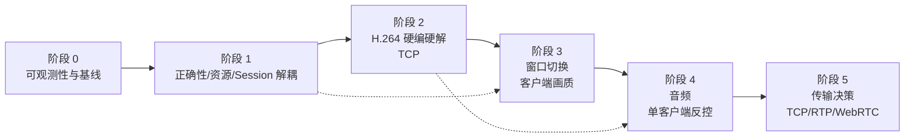

# 渐进优化路线图

> 状态：计划，尚未执行。本文的“验收标准”是待验证的通过条件，不是已经取得的结果。
> 本文不承诺任何性能百分比、帧率提升、发热下降或延迟数字；所有收益必须在目标设备与目标网络上实测。
> 相关文档：[项目现状](project-assessment.md) · [媒体架构](media-architecture.md) · [窗口与会话](windowing-session-design.md) · [产品语境](product-context.md)

## 1. 原则

1. **先测量，再优化。** 没有基线的“优化”无法判断是否真的改善，也无法发现回归。
2. **每阶段可独立发布、可回滚。** 不把所有改造压在一次大版本里。
3. **保持 minSdk 25 作为兼容下限与回退路径。** 新能力按版本门控；API 25 设备至少保留基本监看。下限不是上限：不得仅凭 API 等级、手机/Pad/车机形态推断能力，高版本或高性能设备应按运行时探测使用更高档位。
4. **能力驱动，不做形态推断。** codec、profile/level、宽高、帧率、硬件实例都要在服务端编码侧与客户端解码侧分别探测，再按实际能力和当前场景选档；未实测前保持可回退 H.264。
5. **不推倒重来。** 保留 MediaProjection、NSD、前台 Service、悬浮窗交互；替换稳态媒体路径和会话所有权。
6. **安全与可观测性与性能同等重要。** 无认证/明文的现状不能因为“局域网”而长期忽略。
7. **不做未经验证的承诺。** 文档、发布说明和 UI 都不写没有实测支撑的百分比或“低延迟”断言。

## 2. 阶段依赖

依赖说明：

- 没有阶段 0 的指标，阶段 2 无法证明 H.264 是否真的更好。
- 没有阶段 1 的会话解耦，阶段 3 的窗口切换很容易退化成“重连”。
- 阶段 4 的音频/反控可以在阶段 2 之后并行预研，但产品落地建议在窗口稳定之后。
- 阶段 5 必须以阶段 2/3 的 TCP 实测数据为依据，不能凭直觉切换 UDP/WebRTC。

## 3. 阶段 0：可观测性与基线

### 3.1 范围

不改变用户可见行为，只增加测量能力与基线记录。

### 3.2 改造内容

- 建立统一指标接口，覆盖服务端、客户端、控制面和媒体面。
- 服务端：采集帧率、编码帧率、编码耗时、编码输出队列深度、每客户端发送队列深度、发送字节、丢弃 GOP 数、关键帧请求数。
- 客户端：接收帧率、解码耗时、解码队列深度、渲染帧率、首帧时间、卡顿/丢帧、A/V 同步偏差（音频落地后）。
- 网络：RTT、重传次数/重传率、TCP 队列延迟、连接建立时间、断线次数。
- 设备：热状态、电量/充电状态、内存、线程数、文件描述符数（在可控范围内）。
- 日志：结构化、可分级；随机会话标识只用于关联本次运行，不包含用户身份；不记录画面内容、输入文本、令牌、密钥、设备名。
- 建立测试矩阵：API 25/26/29/33/34/35；至少覆盖低端/中端/高端设备；Wi-Fi 直连、路由器、热点、弱网；服务端/客户端同 App/不同设备。
- 记录“当前实现”的基线：JPEG 路径的 CPU、内存、队列、帧率、发热、电量、重传、首帧时间。基线结果只写实际观测，不写推测。

### 3.3 验证标准

| 项 | 通过条件 |
| --- | --- |
| 指标可用 | 每个指标有定义、单位、采集点、采样周期；可在调试构建中导出 |
| 隐私 | 日志/指标不包含画面、输入文本、账号、口令、密钥、设备名、绝对路径 |
| 开销可控 | 指标采集本身不引入明显卡顿；采样可关闭/降级 |
| 基线完整 | 测试矩阵上的基线记录可复现；设备/系统/网络条件有记录 |
| 无行为变化 | 用户可见功能与当前版本一致；没有因埋点引入新崩溃 |

### 3.4 退出条件与回滚

- 退出：基线报告完成；团队能用同一套指标复现一次测量。
- 回滚：指标代码可通过开关关闭；不改变媒体路径。

## 4. 阶段 1：正确性、资源清理与 Session 解耦

### 4.1 范围

先修“会出错/会泄漏/会卡死”的问题，再把会话从 UI 中拆出来。此阶段可以继续使用 JPEG，避免同时改媒体格式和生命周期。

### 4.2 改造内容

#### 并发与资源

- `LssService`/`LssClientService` 的停止路径做成幂等：重复 stop 不重复释放、不重复 `stopSelf`。
- 明确单一生命周期所有者；`onDestroy` 必须走完整清理，不能只注销广播。
- 线程池 `shutdownNow` 后等待终止；关闭 socket、ImageReader、VirtualDisplay、MediaProjection、HandlerThread 的顺序固定。
- 缩短 `mImageReaderLock` 等临界区：锁内只交换状态/引用，Bitmap 拷贝、JPEG 压缩、网络投递移到锁外。
- 媒体路径移除 `CallerRunsPolicy`；改为有界队列 + 明确的拒绝/丢弃策略 + 指标。
- `resize`/`updateProjectionSize` 与回调并发要有 generation/epoch；旧 ImageReader 的回调必须被忽略。
- 捕获 `addView`/`removeViewImmediate` 的 WindowManager 异常；权限撤销时降级而不是崩溃。
- 重连增加退避与上限；不要无限弹窗/无限重试。
- 修正 IPv6 地址传给 gRPC 的格式；验证 NSD `_tcp` 与旧 `_udp` 的兼容策略。
- 服务名默认改为用户别名/随机名，避免广播设备名。
- 端口修改的生效时机在 UI 中说明；或提供“重启服务后生效”的明确提示。

#### 测试

- 单元测试：状态机、停止幂等、队列拒绝、协议编解码、重连退避、坐标/epoch。
- 仪器测试：启动/停止循环、旋转、后台/前台、权限撤销、网络断开/恢复、悬浮窗添加/移除。
- 压力测试：多客户端、慢客户端、快速重复连接、快速切换设置。
- 内存/线程/文件描述符检查：停止后无持续增长。

#### Session 骨架

- 引入 `ClientSession` 与 `RenderTarget` 抽象（见 [windowing-session-design.md](windowing-session-design.md)）。
- 先把当前 JPEG/ImageView 包装成 `FloatingOverlayHost`；不改变媒体格式。
- 让 `MainActivity`/`ViewerActivity`/悬浮窗只 attach/detach 渲染目标，不直接创建网络。
- 验证“关闭窗口不等于停止会话”。

### 4.3 验证标准

| 项 | 通过条件 |
| --- | --- |
| 停止/启动 | 连续多次启动/停止，无崩溃、无重复通知、无残留线程/Reader/Server |
| 旋转/尺寸 | 旋转、缩放设置变化后画面比例正确；旧回调不写入新 Reader |
| 网络 | 断网/恢复、服务端停止、客户端停止都有确定状态；无无限重试 |
| 慢客户端 | 一个慢客户端不阻塞其他客户端或采集线程；队列有界且可观测 |
| 权限 | 悬浮窗/通知/投影权限被撤销时不崩溃，给出明确提示 |
| 会话 | 悬浮窗 attach/detach 不重建网络；会话状态可查询 |
| 测试 | 新增测试在 CI 中运行；失败会阻断合并（按团队流程） |
| 回归 | 现有 JPEG 功能不退化；画质/延迟没有明显恶化（以基线为准） |

### 4.4 退出条件与回滚

- 退出：已知并发/清理问题关闭；停止后资源无持续增长；Session 骨架可承载后续 H.264。
- 回滚：Session 抽象可通过开关回退到旧显示实现；JPEG 路径保持可用。

## 5. 阶段 2：H.264 硬编硬解与能力探测（先 TCP）

### 5.1 范围

把稳态媒体路径从 JPEG 换成硬件 H.264，同时建立服务端编码与客户端解码的运行时能力探测；控制面继续 gRPC/TCP，媒体面先独立 TCP。JPEG/PNG 保留为快照和降级。H.264 是兼容基线与回退档，不是能力上限。

### 5.2 改造内容

- 服务端：VirtualDisplay 直接输出到 `MediaCodec` 输入 Surface；H.264 Baseline 为兼容基线；查询编码器 codec、profile/level、宽高、帧率、码率、硬件实例与 Surface 支持；分辨率/帧率/码率配置；无客户端时暂停编码或降到极低占空比。
- 能力探测：服务端编码能力与客户端解码能力分别探测，经 HELLO/STREAM_INFO 交换；缺省字段按 H.264 兼容档处理；不在未实测组合上盲目切高档。
- 编码缓存：config、最近 IDR、IDR 后的 AU；按字节/时间设上限；不缓存大量 RGBA。
- 封装：媒体 TCP 帧协议（长度前缀 + 固定头 + payload）；config/key/delta 类型；PTS；configEpoch。
- 客户端：解包、config+IDR 初始化、`MediaCodec` 解码、Surface/TextureView 渲染；首帧占位；解码失败重建；上报可解码 codec/profile/level/宽高/帧率。
- 多客户端：一次采集扇出；每客户端有界队列；慢客户端丢到下一个 IDR 或断开；关键帧请求合并/限流。
- 控制面：能力协商、媒体参数、关键帧请求、统计；保留 gRPC，但不要每帧 protobuf。
- 降级：编码器不可用/配置失败时回退到 H.264 兼容档或 JPEG 快照/低帧率兼容模式；UI 明确提示。
- 安全：至少加入配对/令牌；媒体 TCP 使用 TLS 或明确的“可信局域网”提示；不要把 `FLAG_SECURE` 当加密。

### 5.3 验证标准

| 项 | 通过条件 |
| --- | --- |
| 编码器矩阵 | API 25/26/29/33/34/35 与目标厂商设备上，至少有一个可用 H.264 编码器；不可用时降级可见；同时记录各设备实际支持的 codec/profile/level/宽高/帧率 |
| 解码器矩阵 | 客户端能解码服务端产物；分辨率/旋转/Profile 变化可恢复；客户端解码能力探测结果与实际一致 |
| 能力探测 | 服务端与客户端分别上报能力；旧客户端缺省字段按 H.264 兼容档处理；不因 API 等级或设备形态误判 |
| 兼容档回退 | 高档位不可用、配置失败或未实测时能回到 H.264 兼容档，用户可见且不黑屏 |
| 稳态路径 | 服务端稳态无全尺寸 Bitmap/JPEG；客户端稳态无全尺寸 JPEG 解码（用代码审查 + profiler 确认） |
| 新客户端 | 从 config+IDR 加入；首帧时间可观测；不需要重启服务端 |
| 慢客户端 | 不影响其他客户端/编码器；丢弃策略不产生花屏；重连可从 IDR 恢复 |
| 网络 | TCP 重传/延迟/队列指标可观测；断线重连有退避；无重复流 |
| 画质/性能 | 记录基线与新路径的 CPU、内存、发热、电量、首帧、卡顿；不预设提升百分比；如回归，保留回退 |
| 兼容性 | 老旧设备/厂商编码器异常有日志与降级；不因单个设备崩溃 |
| 安全 | 未配对客户端被拒绝；传输加密或明确风险提示；日志无敏感内容 |

### 5.4 退出条件与回滚

- 退出：H.264 成为兼容基线与默认回退路径；JPEG 仅快照/降级；目标矩阵上可稳定观看；能力探测可用；性能/热/电有真实对比数据。
- 回滚：保留 JPEG 兼容模式开关；媒体协议版本化；客户端可协商回退到 H.264 兼容档。

## 6. 阶段 3：窗口切换与客户端画质

### 6.1 范围

在 Session 解耦和 H.264 稳定后，做悬浮窗与全屏切换、客户端画质请求和多客户端策略。

### 6.2 改造内容

- 方案 A：同一悬浮窗展开/收起；`ValueAnimator` 动画 `WindowManager.LayoutParams`；同一 Surface，不切解码器。
- 方案 B（可选）：`ViewerActivity` + 最后帧快照 + 过渡层 + `MediaCodec.setOutputSurface`；失败只重建解码器，不重建连接。
- 小窗优先 `TextureView`（透明度/圆角/动画）；全屏可用 `SurfaceView`（稳定层）。
- 客户端画质：分辨率/帧率/码率档位；服务端能力探测、客户端解码能力与多客户端策略共同决定；变更时提升 configEpoch 并请求 IDR。
- 场景档位：悬浮小窗与全屏可以选择不同档位；小窗优先码率/功耗，全屏可请求更高分辨率/帧率；不按 API 等级或设备形态预设上限。
- 多客户端：观看可多人，控制默认单人；默认兼容单流，确认需求与能力后评估“高档 + H.264 档”的多档流；新客户端不得迫使已有客户端无提示降级；每客户端统计；慢客户端隔离。
- 旋转：窗口 bounds、视频比例、坐标、configEpoch 一致。
- 权限：悬浮窗/通知/投影撤销的降级路径。

### 6.3 验证标准

| 项 | 通过条件 |
| --- | --- |
| 会话连续 | 悬浮窗与全屏切换前后，网络/会话/认证不重建；Service 不停 |
| 视觉连续 | 最后帧/快照可见；无长时间黑屏/闪烁；首帧后平滑过渡 |
| Surface 切换 | 成功路径正常；强制失败时只重建解码器，网络不断 |
| 旋转/生命周期 | Home/Back/最近任务/旋转/权限撤销行为明确，不崩溃、不泄漏 |
| 客户端画质 | 档位变更生效；configEpoch/IDR 正确；不出现花屏 |
| 场景档位 | 悬浮小窗与全屏可选择不同档位；高档位需要能力探测与实测依据，不能按 API 等级或设备形态预设上限 |
| 多档流 | 高能力客户端可用高规格、其他客户端保持 H.264 档；新客户端不迫使已有客户端无提示降级；编码器实例与功耗在预算内 |
| 多客户端 | 一个慢客户端不影响其他；控制租约不会误授予多人 |
| API 矩阵 | API 25/26/29/33/34/35 上窗口类型/权限/动画可用 |
| 安全 | 两个显示目标都遵守 `FLAG_SECURE`；快照不落盘；日志无画面内容 |

### 6.4 退出条件与回滚

- 退出：A 稳定；B 在需要时可用；窗口切换不重连；客户端画质可控。
- 回滚：A/B 通过开关选择；B 失败时回退 A；JPEG 兼容模式仍可用。

## 7. 阶段 4：音频与单客户端反控

### 7.1 范围

在观看链路稳定后，增加可选音频和默认关闭的单客户端反控。

### 7.2 音频

- API 29+：`AudioPlaybackCaptureConfiguration` + `AudioRecord`；`RECORD_AUDIO` + MediaProjection；尊重被采集 App 的 policy。
- API 25–28：默认无声；可选显式麦克风模式（明确提示，不伪装内录）。
- 编码：AAC-LC 兼容优先；WebRTC 路径用 Opus；协商与降级明确。
- 同步：视频/音频统一单调时钟；客户端 jitter buffer；漂移校正；A/V 偏差可观测。
- UI：音频开关、捕获指示、被拒绝原因、静音状态；不静默开麦克风。
- 前台服务类型与权限按目标版本复核。

### 7.3 反控

- 普通 App 基线：`AccessibilityService.dispatchGesture`（API 24+）；用户手动开启；默认关闭。
- 键盘/文本：优先无障碍节点操作；不承诺完整键盘注入。
- 不使用 root/shell/system 的 `InputManager` 注入作为普通方案。
- 单客户端控制租约：clientId、leaseEpoch、expiresAt、心跳、服务端收回、epoch fencing。
- 坐标：归一化 + 显示尺寸/旋转/configEpoch；拒绝旧 epoch 事件。
- 安全：观看与控制权限分离；控制可见指示；不记录输入内容；敏感界面不注入。
- 多客户端：观看多人，控制单人；可转移/收回。

### 7.4 验证标准

| 项 | 通过条件 |
| --- | --- |
| 音频权限 | 授权/拒绝/撤销路径明确；被采集 App 拒绝时显示原因 |
| 版本降级 | API 25–28 默认无声；麦克风模式显式且可见；不伪装内录 |
| 音画同步 | 统一时钟；偏差可观测；缓冲/漂移策略有效；无持续累积漂移 |
| 音频编码 | AAC-LC 在目标设备可解码；WebRTC 路径 Opus 协商正确（如启用） |
| 反控授权 | 无障碍未开启时只读；开启需用户确认；默认关闭 |
| 租约 | 单客户端控制；心跳/过期/收回生效；旧 epoch 事件被拒绝 |
| 坐标 | 旋转/分辨率变化后坐标正确；边界/多指/滑动可用 |
| 安全 | 不记录输入内容；敏感界面不注入；控制状态可见 |
| 回归 | 音频/反控关闭时，观看链路与阶段 3 一致 |

### 7.5 退出条件与回滚

- 退出：音频为可选增强且有明确降级；反控默认关闭、单客户端控制、可收回；安全审查通过。
- 回滚：音频/反控独立开关；关闭后不影响观看；不引入必须权限。

## 8. 阶段 5：传输决策（TCP / RTP / WebRTC）

### 8.1 范围

用阶段 2/3 的实测数据决定是否需要 RTP/UDP 或 WebRTC；不是“为了新技术而换传输”。

### 8.2 决策输入

- TCP：RTT p50/p95、重传率、重传超时、帧到达间隔 p95/p99、解码截止错过、队列延迟。
- 视频：首帧时间、卡顿、花屏、IDR 恢复时间、码率波动。
- 设备：CPU、内存、发热、电量、Wi-Fi 功率。
- 场景：局域网直连、路由器、热点、弱网、跨网（如果产品需要）。
- 产品：是否需要浏览器、跨网、多人、音频、反控。

### 8.3 改造内容（仅当数据支持）

- RTP/UDP：H.264/HEVC RTP 封装；jitter buffer；NACK/重传缓存；PLI/FIR；pacing；拥塞控制；SRTP/DTLS；统计。
- WebRTC：ICE/STUN/TURN、DTLS-SRTP、SDP、jitter buffer、NACK/PLI、拥塞控制、音频 Opus/NetEQ；浏览器互操作。
- 控制面继续 gRPC/TCP；媒体面可与控制面分离或复用，但要有明确的安全与 NAT 策略。
- 保留 TCP 回退路径；不要删除已验证可用的方案。

### 8.4 验证标准

| 项 | 通过条件 |
| --- | --- |
| 数据充分 | 有同设备/同网络/同场景的 TCP 基线；有明确的触发阈值/决策记录 |
| 弱网 | 丢包/延迟/抖动/乱序下，jitter/NACK/PLI/pacing 生效；无持续花屏 |
| 恢复 | 关键帧恢复时间可观测；慢客户端不影响他人 |
| 安全 | 控制面 TLS；媒体面 SRTP/DTLS 或等价；认证/授权不回退 |
| 互操作 | 如启用 WebRTC，浏览器/目标客户端可连接；SDP/ICE 失败有诊断 |
| 回退 | TCP 路径仍可用；协议/版本可协商 |
| 无绝对化断言 | 文档/UI 不宣称“UDP 一定更低延迟”；以测量为准 |

### 8.5 退出条件与回滚

- 退出：形成决策记录（保留 TCP / 引入 RTP / 引入 WebRTC），并说明证据、代价、风险。
- 回滚：传输层可切换；客户端/服务端版本协商；旧路径保留至少一个发布周期。

## 9. 每阶段通用验证矩阵

| 维度 | 覆盖项 | 状态 |
| --- | --- | --- |
| Android API | 25、26、29、33、34、35 | 待执行 |
| 设备档位 | 低端/中端/高端；不同厂商 | 待执行 |
| 屏幕 | 1080p、2K、折叠屏/异形屏（如可得） | 待执行 |
| 网络 | Wi-Fi 直连、路由器、热点、弱网/丢包/高延迟 | 待执行 |
| 场景 | 单客户端、多客户端、慢客户端、重连、旋转、后台 | 待执行 |
| 权限 | 通知、悬浮窗、投影、音频、无障碍的授予/拒绝/撤销 | 待执行 |
| 安全 | 未配对拒绝、加密、日志脱敏、`FLAG_SECURE` | 待执行 |
| 资源 | 内存、线程、文件描述符、电量、热状态 | 待执行 |

这张表是计划，不是结果。每个阶段结束时，把实际覆盖情况和未覆盖项写回文档。

## 10. 不建议现在做

| 事项 | 原因 |
| --- | --- |
| 全面改写 Kotlin/Compose | 当前代码量小、结构可改；重写会同时引入语言/框架/媒体风险 |
| 第一版就上 WebRTC | 复杂度高；局域网直连未必需要；先证明 TCP 不够 |
| 第一版就上 RTP/UDP | 没有 TCP 基线就切换，无法判断是否更好；UDP 需要 jitter/NACK/PLI/pacing |
| root/shell 输入注入 | 普通 App 不可用；安全与合规风险高 |
| 多客户端并发控制 | 冲突、权限、审计复杂；先做单客户端控制租约 |
| 云端中继/账号体系 | 产品定位未验证；会改变安全与成本模型 |
| 默认 4K/120fps/HDR | 设备能力、带宽、发热不确定；应按能力协商 |
| 微调 JPEG 参数当作“优化” | 不改变 CPU 图像路径的本质；优先级低于 H.264 |
| 未实测就宣称“低延迟/省电/降温” | 违反验证原则；会误导用户 |

## 11. 决策记录模板

每个阶段的重要取舍建议留一条决策记录：

| 字段 | 填写内容 |
| --- | --- |
| 标题 | |
| 背景/问题 | |
| 候选方案 | |
| 决定 | |
| 证据（指标/测试/代码审查） | |
| 代价与风险 | |
| 回滚方式 | |
| 复审时间/触发条件 | |

至少需要记录：

- 为什么继续 MediaProjection，而不是系统/root 方案。
- 为什么 H.264 Baseline 是默认，HEVC 何时启用。
- 为什么媒体第一版用 TCP，什么数据会触发 RTP/UDP。
- 为什么 A 方案优先，B 方案何时需要。
- 为什么反控默认关闭、单客户端控制。
- 为什么音频在 API 25–28 默认无声。

## 12. 文档维护

- 每阶段完成后，更新 [project-assessment.md](project-assessment.md) 的“当前实现”和本页的“状态”。
- 指标定义、测试矩阵、决策记录与代码一起评审。
- 不在文档中写设备名、账号、口令、密钥、绝对路径、日志路径。
- 不把未实测的收益写进发布说明；发布说明只写已验证的行为变化和已知限制。
