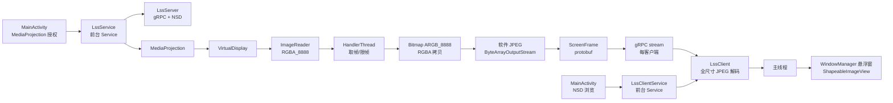

# 项目现状与技术审查

> 状态：基于当前仓库快照的静态代码审查。
> 验证状态：未执行构建、单元测试、仪器测试或实机投屏；以下“当前实现”均指代码可见行为，不代表已在设备上复现。
> 相关文档：[产品语境](product-context.md) · [媒体目标架构](media-architecture.md) · [窗口与会话](windowing-session-design.md) · [路线图](optimization-roadmap.md)

## 1. 结论摘要

- 这是一个约 4,616 行纯 Java 的单模块 Android 应用，代码量不大，职责集中，已经有完整的产品外壳：服务端、客户端、服务发现、设置、悬浮窗、前台 Service 和连接状态展示。
- 技术栈不旧：minSdk 25、compileSdk/targetSdk 35、AGP 8.9.0、Gradle 8.11.1、Java 11、gRPC 1.72.0、protobuf lite、OkHttp transport、AndroidX 与 Material Components。它不是需要推倒重来的遗留项目。
- 当前媒体链路是典型的“CPU 图像路径”：MediaProjection 经 VirtualDisplay、ImageReader（RGBA_8888）、ARGB_8888 Bitmap、软件 JPEG、protobuf `ScreenFrame` 和 gRPC stream 传到客户端；客户端做全尺寸 JPEG 解码，再交给悬浮窗 `ImageView` 显示。
- 服务端没有“无客户端时暂停编码”的逻辑；只要 Service 在运行，ImageReader 回调就会持续取帧、拷贝、压缩并投递。客户端的“显示大小”只改变悬浮窗布局，不改变解码分辨率，也没有真正的客户端帧率设置。
- 主要风险不是“代码老”，而是媒体路径的 CPU 开销、全尺寸 Bitmap、队列与反压、长临界区、生命周期清理不完整，以及无认证/明文的网络安全边界。
- 审查判断：应当渐进改造，而不是重写。保留 MediaProjection、NSD、前台 Service、悬浮窗交互和 minSdk 25；替换稳态图像路径、传输承载、会话所有权和安全模型。

## 2. 技术与构建基线

| 项目 | 当前值 | 依据 |
| --- | --- | --- |
| 语言 | 纯 Java，无 Kotlin | `app/src/main/java/` 下全部为 `.java` |
| 代码规模 | 4,616 行 Java（含测试模板） | 仓库统计 |
| 模块 | 单模块 `app` | `settings.gradle:24-25` |
| minSdk | 25 | `app/build.gradle:21-24` |
| compileSdk / targetSdk | 35 / 35 | `app/build.gradle:19-24` |
| AGP | 8.9.0 | `gradle/libs.versions.toml:2` |
| Gradle Wrapper | 8.11.1 | `gradle/wrapper/gradle-wrapper.properties:4` |
| Java 源码/目标 | 11 | `app/build.gradle:47-51` |
| 核心库脱糖 | 开启 | `app/build.gradle:48` |
| gRPC | 1.72.0，OkHttp transport，protobuf lite | `gradle/libs.versions.toml:13`、`app/build.gradle:54-73`、`:89-91` |
| UI | AppCompat、Material Components、ConstraintLayout、RecyclerView、BottomSheet、Slider | `app/build.gradle:75-97` |
| 其他 | Gson、Guava、Commons Lang、Lombok、CameraX core、SplashScreen | `app/build.gradle:85-96` |
| 前台服务类型 | 服务端 `mediaProjection`；客户端 `remoteMessaging` | `AndroidManifest.xml:38-46` |
| Release 混淆 | `minifyEnabled false` | `app/build.gradle:40-45` |
| 测试 | 仅 JUnit/Espresso 模板 | `app/src/test/java/.../ExampleUnitTest.java:12-16`、`app/src/androidTest/java/.../ExampleInstrumentedTest.java:19-25` |

几点判断：

- targetSdk 35 意味着需要按较新的前台服务、通知权限和 MediaProjection 规则审查行为；当前代码已经处理了 Android 14 的 `FOREGROUND_SERVICE_TYPE_MEDIA_PROJECTION` 和 `MediaProjectionConfig`，说明作者跟进了较新的 API。
- 使用 Java 11 + core library desugaring，`java.time.Duration` 等 API 可以工作；这不是 Java 8 时代的旧工程。
- CameraX 只用于 `androidx.camera.core.ImageProcessingUtil` 的 RGBA 到 Bitmap 拷贝，并带有 `@SuppressLint("RestrictedApi")`（`.../service/LssService.java:195-229`）。这是一个受限 API 依赖，H.264 路径应移除它。
- Release 未裁剪，意味着包体、符号和反射风险都未处理；上线前需要单独评估 ProGuard/R8 与 gRPC/protobuf 的 keep 规则。

## 3. 代码结构与职责

| 区域 | 主要类 | 职责 | 观察 |
| --- | --- | --- | --- |
| 入口与服务端 UI | `MainActivity` | 授权、启动/停止共享、服务端设置、NSD 列表、绑定服务端 Service | 687 行；同时承担权限、设置、列表和状态展示 |
| 服务端 Service | `LssService` | MediaProjection、VirtualDisplay、ImageReader、编码、悬浮 Chip、前台通知 | 907 行；采集、编码、服务生命周期和悬浮 UI 集中在一个类 |
| 服务端网络 | `LssServer` | gRPC server、NSD 注册、每客户端流、统计 | 661 行；媒体编码结果通过 `postScreenFrame` 进入 |
| 协议 | `screen_stream.proto` | `GetScreenStream` 服务端流，`ScreenFrame` 含 timestamp/data/secure | 只有一条流式 RPC，没有认证、能力协商或控制消息 |
| 客户端网络 | `LssClient` | gRPC channel、流回调、JPEG 解码、Bitmap 池、统计 | 292 行；解码在 gRPC 回调线程上同步执行 |
| 客户端 Service/UI | `LssClientService` | 前台 Service、连接状态、悬浮窗、加载框、重连对话框、显示设置 | 845 行；网络、解码结果和 WindowManager UI 集中在一个类 |
| 发现 | `LssServiceDiscoveryManager`、`LssServiceInfo` | NSD 浏览、解析、去重、排序 | 278 + 75 行；服务名默认来自设备名 |
| 设置 | `Preferences` | SharedPreferences、默认值、观察者 | 252 行；大量同步 `commit()` |
| 工具 | `WindowUtils`、`NsdUtils`、`NetUtils`、`ThreadUtils`、`IntentUtils`、`ResourceUtils` | 窗口边界、NSD resolve、IPv6 格式、线程切换、Intent、资源属性 | 体量小，但包含关键边界行为 |

结构上的优点是职责边界清楚：服务端和客户端各自有 Service，网络类不直接操作 UI，设置集中管理。结构上的问题是“大类”明显：`LssService` 与 `LssClientService` 同时承担生命周期、媒体、窗口和用户交互，后续改造需要先把会话与渲染目标拆开。

## 4. 当前端到端流程

当前链路只覆盖“屏幕画面单向传输”：

- 没有音频采集、编码或播放。
- 没有反向控制，也没有 `AccessibilityService` 或输入注入。
- 没有认证、配对、加密或权限分级。
- 没有客户端能力协商；所有客户端接收同一份 JPEG 流。
- 没有“暂停/恢复”媒体路径；停止意味着整个 Service 结束。

## 5. 服务端实现

### 5.1 采集与编码

当前实现的关键路径在 `.../service/LssService.java:191-247`：

1. `ImageReader.newInstance(width, height, PixelFormat.RGBA_8888, 2)` 创建最多 2 张图像的 Reader（`:93`、`:396-397`）。
2. `VirtualDisplay` 以 `PUBLIC | OWN_CONTENT_ONLY` 标志创建，Surface 指向 ImageReader（`:401-404`）。
3. 图像可用回调运行在后台 `HandlerThread`（`:391-399`）。
4. 用 `acquireLatestImage()` 取最新图像（`:207`），按图像时间戳做帧率限制（`:212-215`）。
5. 复用或创建 `ARGB_8888` Bitmap（`:219-224`），把 RGBA plane 拷贝进 Bitmap（`:226-229`）。
6. 用 `Bitmap.compress(JPEG, quality, ByteArrayOutputStream)` 做软件压缩（`:231-237`），再 `ByteString.copyFrom` 放进 `ScreenFrame`（`:239-243`）。
7. `LssServer.postScreenFrame` 把帧交给每个客户端的响应观察者（`.../server/LssServer.java:383-385`、`:461-474`）。

这条路径的 CPU 成本是叠加的：

- 从 RGBA plane 到 Bitmap 的逐行/逐像素拷贝。
- ARGB_8888 全尺寸 Bitmap 的内存带宽与分配/回收。
- 软件 JPEG 压缩，分辨率越高、质量越高，成本越大。
- 从 `ByteArrayOutputStream` 到 `byte[]` 再到 `ByteString` 的多次拷贝。
- gRPC/protobuf 每帧封装与 OkHttp 写出。

代码中没有任何“有客户端才编码”的判断。`onImageAvailable` 在 Service 启动后一直有效，`postScreenFrame` 也会执行；只是没有观察者时不会 `onNext`。因此空闲客户端数量为 0 时，服务端仍承担采集、Bitmap 拷贝和 JPEG 压缩成本。

### 5.2 帧率与尺寸

- 帧率限制使用 `image.getTimestamp()` 与 `mFrameTimestamp` 的差值，目标间隔为 `1 / mProjectionFrameRate` 秒（`:212-215`）。它不是系统级 vsync 控制，也不是编码器码率控制。
- 投影尺寸取 `WindowUtils.getMaximumWindowBounds()` 乘以 scale（`:596-600`）。`getMaximumWindowBounds` 在 API 30+ 使用 `getMaximumWindowMetrics()`，更低版本使用 `getRealSize()`（`.../utils/WindowUtils.java:18-31`）。
- 尺寸变化时 `updateProjectionSize()` 调用 `VirtualDisplay.resize`，关闭旧 ImageReader、创建新 ImageReader、再 `setSurface`（`:494-520`）。这段逻辑在 `mImageReaderLock` 内重建 Reader，存在回调与关闭并发、旧 Surface 回调、尺寸切换瞬间帧丢失等边界。
- `onCapturedContentResize` 只记录日志，没有触发尺寸更新（`:177-181`）；真正的尺寸更新依赖 Service 的 `onConfigurationChanged` 和设置变化。Android 14+ 的捕获内容尺寸变化场景需要单独验证。

### 5.3 服务端与发现

- gRPC server 使用 `OkHttpServerBuilder` 与 `InsecureServerCredentials`（`.../server/LssServer.java:178-186`）；没有 TLS，也没有认证拦截器。
- NSD 注册类型是 `_localscreenshare._udp`（`.../support/Constants.java:16`），但实际 gRPC 是 TCP。客户端使用同一类型所以能互相发现，但 DNS-SD 的协议标签语义不一致，建议改为 `_tcp` 并考虑兼容旧版本。
- 服务名默认取系统设备名：`Preferences.getServiceName()` 读取 `Settings.Global.DEVICE_NAME`（`.../support/Preferences.java:124-132`），并通过 NSD 属性广播（`.../server/LssServer.java:407-415`）。这会把设备名暴露给同一局域网内的发现者；产品上应改为用户可编辑的别名或随机名称。
- 服务端口默认 8080（`Preferences.java:54`），设置范围 1024–65535（`MainActivity.java:105-107`）。`LssServer` 在构造时读取端口（`LssServer.java:178-179`），因此运行中修改端口不会立即重绑，通常要下次启动才生效；UI 没有明确提示这一点。
- 统计每 3 秒收集一次（`LssServer.java:65`、`:199-222`），通过 transport tracer 统计出站字节（`:148-175`），用于通知栏和主界面展示。

### 5.4 每客户端投递

`ScreenStreamService` 为每个 `GetScreenStream` 调用创建一个 `ScreenStreamResponseObserver`（`LssServer.java:417-484`）：

- 每个观察者只保留一个 `mScreenFrame` 槽位（`:487-554`），不是无界队列。
- 只有 `mObserver.isReady()` 时才把帧交给 executor（`:539-554`）。
- `mOnReadyHandler` 比较时间戳后 `onNext`，避免旧帧覆盖新帧（`:508-528`）。
- 释放/取消时清空槽位并移除观察者（`:448-452`、`:556-564`）。

这比“每客户端无界队列”好，但仍有两个问题：

1. `mGrpcServerExecutor` 的队列只有 10，饱和时使用 `CallerRunsPolicy`（`LssServer.java:102-112`）。当 executor 拒绝任务时，`mOnReadyHandler` 可能在调用者线程上执行；而调用者可能正是持有 `mImageReaderLock` 的采集线程。网络写或 gRPC 内部阻塞会把采集线程拖住。
2. `ScreenStreamService.postScreenFrame` 在 `mLock` 内遍历观察者，每个观察者再进入自己的 `mLock`（`:461-474`、`:539-554`）。锁的持有时间与观察者数量、executor 状态相关，采集线程会穿过这层锁。

### 5.5 生命周期与前台服务

- `LssService` 在 `onStartCommand` 中先 `startForeground`，再创建 `LssServer`、注册 MediaProjection 回调、创建 ImageReader 和 VirtualDisplay，最后显示悬浮 Chip（`:346-412`）。
- 停止入口包括：通知栏“停止共享”、悬浮 Chip 单击确认、MediaProjection 回调 `onStop`（`:170-175`、`:267-275`）。它们最终都调用 `stopService()`。
- `stopService()` 依次释放 Chip、VirtualDisplay、ImageReader、HandlerThread、MediaProjection、Server，最后 `stopForeground` + `stopSelf`（`:414-472`）。顺序大体合理，但没有原子化的“已停止”守卫；来自 MediaProjection 回调和广播的并发停止可能重复进入。
- `onDestroy()` 只注销广播和设置观察者（`:323-330`），没有调用 `stopService()`。如果 Service 被系统销毁而不是走 `stopService()`，VirtualDisplay、MediaProjection、Server 和线程的清理依赖进程退出，存在资源泄漏或半关闭风险。
- `START_STICKY` 与“intent 为空返回 `START_NOT_STICKY`”并存（`:346-357`、`:411`）。系统重启 Service 时可能传入空 Intent，此时不会恢复采集，也不会主动清理旧状态。
- `ScreenShareChip.show()` 直接 `addView`（`:729-741`），没有捕获权限被撤销或 WindowManager 拒绝的异常；悬浮窗权限在运行中被收回时可能崩溃。

### 5.6 服务端设置

| 设置 | 范围 | 默认值 | 作用 | 依据 |
| --- | --- | --- | --- | --- |
| 画面大小（scale） | 5–100% | 100% | 改变 VirtualDisplay/ImageReader 尺寸 | `MainActivity.java:93-97`、`Preferences.java:56`、`LssService.java:596-600` |
| 最大帧率 | 1–120 fps | 60 fps | 按图像时间戳限帧 | `MainActivity.java:99-103`、`Preferences.java:60`、`LssService.java:212-215` |
| 画面质量 | 0–100 | 85 | JPEG 压缩质量 | `MainActivity.java:87-91`、`Preferences.java:58`、`LssService.java:231-237` |
| 画面私密 | 开/关 | 关 | 把 `secure` 元数据传给客户端；客户端据此设置 `FLAG_SECURE` | `MainActivity.java:607-612`、`LssService.java:239-243`、`.../service/LssClientService.java:553-560` |
| 服务端口 | 1024–65535 | 8080 | gRPC 监听端口 | `MainActivity.java:105-107`、`Preferences.java:54` |
| 屏幕常亮 | 开/关 | 开 | 服务端悬浮 Chip 的 `FLAG_KEEP_SCREEN_ON` | `Preferences.java:150-156`、`LssService.java:782-787` |

这些设置是“服务端全局设置”，不是“每客户端设置”。因此一个服务端无法同时给不同客户端不同分辨率或帧率；所有客户端共享同一条 JPEG 流。

## 6. 客户端实现

### 6.1 连接与解码

`LssClient` 的关键路径在 `.../client/LssClient.java:150-243`：

1. 用 `OkHttpChannelBuilder` 和 `InsecureChannelCredentials` 建立明文 gRPC channel（`:141-148`）。
2. 调用 `getScreenStream` 建立服务端流（`:150-152`）。
3. `onNext` 中先 `inJustDecodeBounds` 读尺寸（`:158-166`），再从 `Pools.SynchronizedPool<>(4)` 取或创建 Bitmap（`:75`、`:168-177`）。
4. 第二次 `decodeStream` 做全尺寸解码（`:180-190`）。
5. 切到主线程，按时间戳去重后回调 `onScreenFrameReceived`（`:192-219`）。
6. 用 `Reference<Bitmap>` 包装，清空时归还 Bitmap 池（`:203-211`）。

这条路径的问题：

- 每帧做两次 JPEG 解析（一次读 bounds，一次解码），都是 CPU 成本。
- `ARGB_8888` 全尺寸 Bitmap，1080p 约 8 MB/张；池最多 4 张，加上解码临时对象，内存压力明显。
- 解码发生在 gRPC 回调线程；`mGrpcClientExecutor` 也是 `CPU_COUNT..2×CPU_COUNT`、队列 10、`CallerRunsPolicy`（`:78-88`），饱和时可能把任务压到调用线程。
- 解码完成后才切主线程，主线程只做显示；但解码本身没有背压控制，网络快于解码时会持续占用线程和 Bitmap 池。

### 6.2 悬浮窗显示

`ScreenShareViewer` 在 `.../service/LssClientService.java:409-844`：

- 使用 `ShapeableImageView` 作为画面 View，`ScaleType.FIT_XY`（`:794-843`）。
- `WindowManager.LayoutParams` 的类型来自 `Constants.FLOATING_WINDOW_TYPE`：API 25 使用 `TYPE_SYSTEM_ALERT`，API 26+ 使用 `TYPE_APPLICATION_OVERLAY`（`.../support/Constants.java:35-36`）。
- 标志为 `FLAG_NOT_FOCUSABLE | FLAG_HARDWARE_ACCELERATED`，像素格式 `TRANSLUCENT`（`:528-531`）。
- 支持拖动、边缘吸附、透明度、显示比例、圆角、屏幕常亮（`:608-791`、`:794-843`）。
- 显示比例只影响 `mLayoutParams.width/height` 和 `Matrix`（`:649-676`、`:615-626`），不改变收到的 JPEG 分辨率，也不向服务端请求更低分辨率或帧率。
- `setFrame` 每帧 `setImageBitmap`，尺寸变化时更新布局和圆角（`:536-569`）。
- 来源 `secure` 为 true 时，给客户端悬浮窗加 `FLAG_SECURE`（`:553-560`）。这保护的是客户端窗口不被再次截屏/录屏，不是网络传输加密。

### 6.3 客户端设置与重连

- 客户端设置只有不透明度、显示大小、屏幕常亮、圆角（`widget_screen_share_viewer_settings.xml`、`LssClientService.java:707-791`），没有分辨率、帧率、码率、音频或控制选项。
- 断线时弹出“重试/重新连接”对话框（`LssClientService.java:125-168`）；重连会新建 `LssClient`，没有指数退避、没有会话恢复、没有“保持最后一帧”策略。
- 前台通知显示主机地址、端口和入站速率（`:328-346`）；地址来自 NSD 解析结果，日志和界面都会暴露局域网地址。
- 客户端使用 `remoteMessaging` 前台服务类型（`AndroidManifest.xml:43-46`）。它是否能准确表达“长连接媒体查看”的语义，建议在目标版本和分发渠道政策下复核。

## 7. 关键风险清单

下表是静态审查判断，按影响排序；“证据”只给仓库相对位置，不包含运行环境信息。

| 风险 | 级别 | 证据 | 影响 | 建议方向 |
| --- | --- | --- | --- | --- |
| 服务端与客户端的 CPU 图像路径 | 高 | `LssService.java:191-247`、`LssClient.java:158-219` | 服务端 RGBA 拷贝 + JPEG 编码；客户端全尺寸 JPEG 解码；发热、卡顿、电池消耗 | VirtualDisplay 直接到 MediaCodec Surface；H.264 硬编硬解；稳态去掉 Bitmap/JPEG |
| 无客户端仍编码 | 高 | `LssService.java:191-247`、`LssServer.java:461-474` | 空闲时仍消耗采集与编码 CPU | 无订阅者时暂停编码或降到极低占空比；有客户端再启动 |
| 队列与反压 | 高 | `LssServer.java:102-112`、`:539-554`、`LssClient.java:78-88` | `CallerRunsPolicy` 可能在采集/回调线程执行网络或解码任务；长临界区放大卡顿 | 媒体路径不使用 `CallerRunsPolicy`；独立有界队列；慢客户端丢弃到下一个 IDR 或断开 |
| 锁顺序与长临界区 | 中高 | `LssService.java:202-245`、`:494-520`、`LssServer.java:461-474` | 采集锁内做 Bitmap/JPEG/投递；resize/stop 与回调并发；旧 Surface 回调 | 单一所有者线程；锁内只做状态交换；媒体数据走队列 |
| 资源清理不完整 | 中高 | `LssService.java:323-330`、`:414-472` | `onDestroy` 不释放采集/网络；并发 stop 可能重复进入；线程池未 await | 幂等 stop；生命周期所有者；`try/finally`；等待线程池终止 |
| 权限被撤销时崩溃 | 中 | `LssService.java:729-741`、`LssClientService.java:571-581` | `addView` 未捕获 `WindowManager` 异常 | 捕获并提示；监听权限状态；降级到通知/Activity |
| 无认证、明文传输 | 高（不可信网络） | `LssServer.java:178-186`、`LssClient.java:141-148`、`screen_stream.proto:9-16` | 同一网络内可达客户端可直接拉流；内容可被窃听/篡改 | 配对、会话令牌、TLS/DTLS；默认仅可信局域网；明确安全提示 |
| NSD 暴露设备名 | 中 | `Preferences.java:124-132`、`LssServer.java:407-415` | 设备名广播给局域网发现者 | 用户别名/随机名；默认不暴露设备名 |
| 协议语义不一致 | 低中 | `Constants.java:16`、`LssServer.java:178-186` | `_udp` 类型对应 TCP 服务；IPv6 地址带方括号传给 gRPC（`NetUtils.java:13-16`） | 改 `_tcp` 并兼容；host 字符串规范化；补协议测试 |
| 8 MiB 入站限制 | 低中 | `Constants.java:50-52`、`LssClient.java:142-146` | 超大 JPEG 帧可能被客户端拒绝 | 限制分辨率/质量；H.264 分片；明确错误 |
| 测试与发布工程 | 中 | `ExampleUnitTest.java:12-16`、`ExampleInstrumentedTest.java:19-25`、`app/build.gradle:40-45` | 没有回归保护；release 未裁剪；`gradlew build` 会运行当前模板单元测试，但无独立测试/仪器测试步骤 | 单元/集成测试；R8 keep 规则；CI 增加测试与静态检查 |
| 示例签名材料 | 中 | 构建配置与仓库内示例签名材料 | 示例材料不应作为生产签名分发；处理不当会泄露签名相关秘密 | 只在受控环境使用生产签名；文档不复述任何路径或值；轮换并审计 |
| 产品能力缺口 | 中 | 无音频/反控代码与权限 | 与“远程协助/会议”类产品预期不符 | 先确认产品定位；按路线图补音频与单客户端反控 |

### 7.1 关于“发热”的判断边界

代码路径足以支持“CPU 图像路径是主要嫌疑”的判断，但不能据此给出温度、功耗或帧率数字。实际发热还受以下因素影响：

- 屏幕亮度、分辨率、刷新率与设备散热能力。
- JPEG 质量与画面复杂度。
- 网络重传与 Wi-Fi 功率。
- 客户端是否同时做其他工作。
- 设备厂商对 MediaProjection、ImageReader 和后台线程的调度策略。

因此路线图把“基线测量”放在第一段，而不是先承诺某个优化比例。

## 8. 成熟度判断与改造边界

### 8.1 这不是“老项目”

支持“渐进改造”的证据：

- 构建工具链和依赖较新，targetSdk 35。
- 已经处理 Android 14 的 MediaProjection 前台服务类型与默认显示配置。
- 已经有完整的产品交互：发现、连接、悬浮窗、透明度/缩放/圆角/常亮、通知栏控制。
- 代码量小，单模块，没有历史包袱式的大规模自研框架。
- 服务端/客户端/网络类边界基本清楚，适合在现有结构上抽会话层。

### 8.2 需要替换的部分

| 层 | 当前 | 目标 |
| --- | --- | --- |
| 采集输出 | ImageReader RGBA + Bitmap | VirtualDisplay 直接输出到 MediaCodec 输入 Surface |
| 编码 | 软件 JPEG | 硬件 H.264 兼容基线；服务端/客户端能力探测后按档位选择 HEVC 等更高规格，H.264 可回退 |
| 媒体承载 | 每帧 protobuf + gRPC stream | 统一 gRPC 双向流承载完整访问单元（已实现接线）；独立 TCP 帧协议为备选；按实测决定 RTP/UDP/WebRTC |
| 客户端渲染 | 全尺寸 JPEG 解码 + ImageView | MediaCodec 解码 + Surface/TextureView |
| 会话所有权 | Service 同时管网络和悬浮窗 | ClientSession 与 RenderTarget 解耦 |
| 多客户端 | 每客户端最新帧（JPEG 可丢） | 默认一次编码扇出；确认需求与能力后可用受限多档流；每客户端有界队列；GOP 感知 |
| 安全 | 无认证/明文 | 配对、令牌、TLS/DTLS、权限分级 |
| 可观测性 | 速率统计 + 日志 | 结构化指标：队列、丢帧、延迟、重传、热状态 |

### 8.3 不应推翻的部分

- MediaProjection 仍是普通 App 的唯一合规屏幕采集入口；不要为了“低延迟”改成 root/系统权限方案。
- NSD 发现适合局域网零配置；保留，但修正服务类型与隐私默认值。
- 前台 Service + 通知 + 悬浮窗的产品形态应保留；它是当前差异化所在。
- minSdk 25 应保持；新增能力用版本门控和降级，不要为了新 API 抬高门槛。同时要明确：minSdk 25 只是兼容下限与回退路径，不是能力上限；高版本系统、旗舰手机/平板或其他高性能设备可按运行时探测使用更高编码档位，不能仅凭 API 等级或设备形态推断编解码能力。
- 现有设置项可以保留为“服务端质量档位”，但需要与客户端能力协商解耦。

## 9. 安全与隐私边界

当前实现只适合可信局域网：

- gRPC 服务端和客户端都使用 insecure credentials（`LssServer.java:178-186`、`LssClient.java:141-148`），没有 TLS。
- `GetScreenStream` 没有认证、配对或访问控制（`screen_stream.proto:9-16`）；同一网络内能访问端口的客户端可以尝试拉流。
- NSD 广播服务 ID、名称、端口和地址（`LssServer.java:407-415`）；名称默认是设备名。
- 服务端“画面私密”只是把 `secure` 标志传给客户端，客户端据此设置 `FLAG_SECURE`（`LssService.java:239-243`、`LssClientService.java:553-560`）。它不加密传输内容，也不阻止同一网络内的其他客户端连接。
- 日志会记录连接元数据、远端地址和统计信息；生产环境应控制日志级别、保留时间和访问权限。

安全改造的最低方向：

1. 明确“仅可信局域网”的产品边界，并在首次连接时提示风险。
2. 增加配对/授权流程与会话令牌，默认拒绝未配对客户端。
3. 控制面使用 TLS；媒体面使用 TLS 或 DTLS-SRTP；不要自创加密。
4. 服务名改为用户别名，默认不广播设备名。
5. 对输入控制做单独授权、可见指示和单客户端控制租约。

## 10. 工程与发布审查

- 测试：只有模板单元测试和模板仪器测试，没有覆盖采集状态机、协议编解码、重连、权限、窗口生命周期或并发停止。
- Release：`minifyEnabled false`，没有 R8/ProGuard 实践；gRPC、protobuf lite、Lombok 生成代码、反射入口都需要 keep 规则评估。
- CI：构建流程包含 JDK 17、`gradlew build` 和产物上传（`.github/workflows/build.yml`）。`gradlew build` 会运行当前模板单元测试，但没有独立的测试/仪器测试步骤；发布流程通过 secrets 注入签名参数（`.github/workflows/release.yml`）。
- 签名：仓库内存在示例签名材料和配套示例签名参数，release 构建会读取签名配置。这类材料不应作为生产签名随源码分发；生产签名应只在受控构建环境使用，并定期轮换与审计。本文不复述任何路径、口令或密钥细节。
- 依赖：Material 使用 alpha 版本（`gradle/libs.versions.toml:7`），SplashScreen 使用 beta 版本（`:19`）；产品化前应评估稳定性与升级策略。
- 兼容性：没有针对 API 25/26/29/33/34/35 的测试矩阵；MediaProjection、前台服务、通知、悬浮窗和编码器行为在不同版本/厂商上差异较大。

## 11. 审查边界

- 本文只做静态代码与构建配置审查，没有运行应用、抓包、压测、测温或检查内存/线程转储。
- 行号对应本次快照；后续改动可能导致偏移。
- “风险”是代码路径推断，不等于已在所有设备复现；“建议”是目标方向，不等于已经实现或验证。
- 产品意图见 [product-context.md](product-context.md)，媒体目标见 [media-architecture.md](media-architecture.md)，窗口方案见 [windowing-session-design.md](windowing-session-design.md)，落地顺序见 [optimization-roadmap.md](optimization-roadmap.md)。
