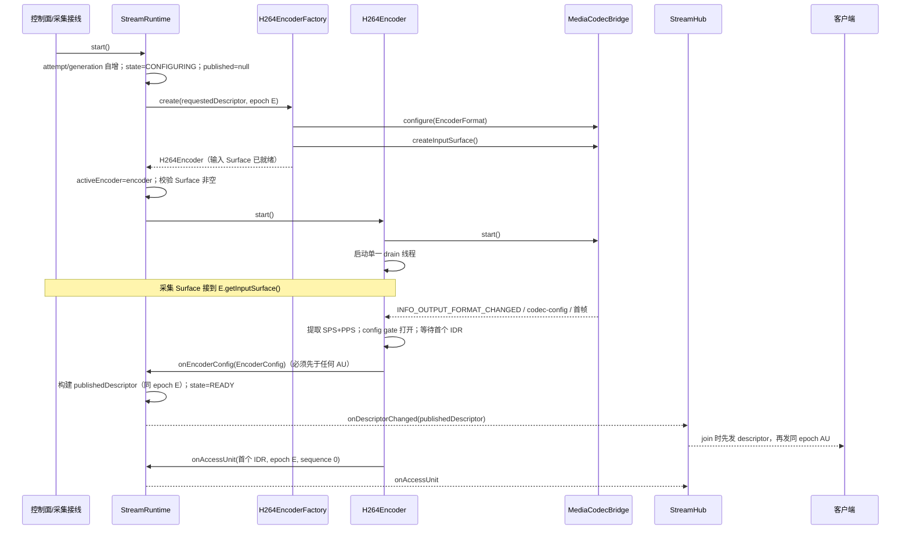
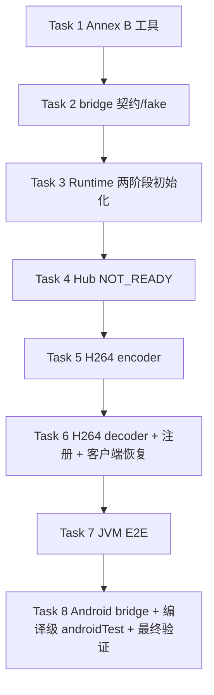

# H.264 适配器与配置生命周期实施计划（收敛版）

> **For agentic workers:** REQUIRED SUB-SKILL: Use superpowers:subagent-driven-development (recommended) or superpowers:executing-plans to implement this plan task-by-task. Steps use checkbox (`- [ ]`) syntax for tracking.

> **状态：H264 适配计划执行中：Task 1–4 已完成，Task 5–8 待执行。** 本文件只定义下一批 H.264 codec 适配器与两阶段配置发布，不写产品代码或测试代码。执行开始时才创建 `.superpowers/sdd/2026-10-18-h264-adapter/` 下的任务 brief、RED/GREEN 日志与 review package。

**Goal:** 在不接线现有 `LssService` / `LssServer` / `LssClient` / proto / UI 的前提下，新增 H.264 Annex B 解析、`MediaCodec` bridge 抽象、H.264 encoder/decoder 适配器，以及“编码器创建时完成 configure 与输入 Surface、启动后拿到 SPS/PPS 再发布最终 `StreamDescriptor`”的配置生命周期。JVM 只用纯 Java 码流工具和 fake bridge/factory 验证；不调用 `android.media`，不执行设备、模拟器或 adb 验证。

**Architecture:** 在现有静态 Codec SPI 与单活动流 Runtime 上保留**两阶段初始化**：`requestedDescriptor`（无 SPS/PPS，`configEpoch=E`）→ `EncoderFactory.create` 完成 bridge configure 与 `createInputSurface` → `StreamRuntime.start` 先落 attempt/generation/state，再调用 `encoder.start`（只 start bridge + 启动 drain）→ H.264 适配器从输出格式或首帧码流提取 SPS/PPS → `EncoderOutput.onEncoderConfig` → Runtime 生成同 epoch 的 `publishedDescriptor`，先于首个 AU 发布。H.264 的 NAL/SPS/PPS/IDR 解析只存在于 `core.codec.h264`；公共层只处理不透明 `CodecConfigPart`、`EncodedAccessUnit` 与 `StreamDescriptor`。`MediaCodec` 通过 JVM 可替换的 bridge 接口隔离，Android 实现单独放在 `AndroidMediaCodec*` 文件。

**Tech Stack:** Java 11 source/target、Android minSdk 25、compileSdk 35、AGP 8.9.0、Gradle 8.11.1、JUnit 4.13.2。仅使用现有依赖；不引入 Mockito、Kotlin、协程、Robolectric 或新测试库。

**Spec:** [可扩展编码框架设计](../../codec-framework.md) · [媒体链路目标架构](../../media-architecture.md) · [任务看板](../../task-board.md)

## Global Constraints

- 源码与目标兼容级别保持 Java 11；`minSdk 25`、`compileSdk 35`、`targetSdk 35` 不变；不新增依赖，`app/build.gradle`、`gradle/libs.versions.toml` 零改动。
- 本批次**不修改** `LssService`、`LssClientService`、`LssServer`、`LssClient`、`MainActivity`、`screen_stream.proto`、布局与任何现有投屏数据路径；不新增生产接线。
- 不实现 HEVC、AV1、RTP、WebRTC、GPU Fanout、多活动流、每客户端转码、B 帧调度、时域层或 HDR。
- **本批次不实现任何编码切换编排**：不新增 prepare/commit/abort 切换 API、不新增 switch handle、不新增显示参数 epoch-only 更新 API、不新增编码器运行时换 epoch 能力。分辨率、旋转、编码格式切换整体留到后续批次；现有非 deferred codec 的 `switchDescriptor` 保持原行为：成功后 requested/published descriptor、`getConfigEpoch()` 与 state 一并切到 `next`，失败保留旧 descriptor/epoch 与切换前 state；对当前或 `next` 为 `hasConfigParts()==true` 的 codec 仍显式拒绝。既有非 deferred switch 的锁内 `newEncoder.start()`、`old.stop()` 以及失败回滚 `newEncoder.close()` 本批保持原样，是锁边界规则的唯一既有例外；`old.stop()` 锁位置优化属延期项，不得顺手实施；新增的 start/close/retry/H.264 路径仍必须遵守锁外规则。
- 不执行 `adb`、emulator、虚拟机、实机、`connectedAndroidTest` 或任何设备验证；不写“设备已通过”“性能已提升”之类未执行结论。
- **JVM 测试禁止实例化或调用 `android.media.*`。** `android.view.Surface` 只允许作为签名/数据字段类型出现；JVM fake 不创建 `Surface`；真实 `MediaCodec` 只允许出现在 `core.codec.h264.AndroidMediaCodec*` 与 androidTest 中。
- 可新增 androidTest，但**不得运行**；若新增，必须能通过 `./gradlew :app:assembleDebugAndroidTest --offline` 单独编译，并明确“无设备证据”。
- H.264 的 NAL 解析、SPS/PPS 提取、IDR/B 帧判定只允许在 `core/codec/h264`。`core/model`、`core/stream`、`core/client` 不得出现码流语法解析或 H.264 名称分支。
- 公共层继续不解析负载、不从 `flags.isSyncPoint()` 单独推断可加入点、不硬编码 codec 名称；`CodecRegistry.withDefaults()` 保持只注册 JPEG。
- **本批不设置 profile/level**：不新增 profile/level 字符串映射，不新增 `EncoderConfig` 的 profile/level 字段，不新增 encoder 运行时 profile 重配。`StreamDescriptor` 的 profile/level 保留既有模型字段，本批 H.264 路径保持 requested 值（通常 null）。
- **禁止新增或保留（当前不存在）dead code**：不新增也不保留 `Encoder.isConfigured`、`supportsConfigEpochUpdate`、`updateConfigEpoch`、`sameEncodeInputConfig`、`SwitchHandle`、`switchDisplayConfig`、`Decoder.setOutputSurface`、`ClientMediaSession.onRenderTargetSurfaceChanged`。
- 保持既有不变量：attempt generation 只增不复用；descriptor 先于同 epoch 首个 AU；每个 AU 带 `configEpoch`；参考帧溢出/超限/过期进入 `RESYNCING` 且只由同 epoch 可加入点恢复；unchecked transport 异常只影响单个客户端。
- 不实现客户端超时定时器、恢复 ack、自动断开或旧 encoder 等待超时；旧 encoder 释放逻辑保持既有非 deferred `switchDescriptor` 行为，本批不扩展。
- Pro（DeepSeek V4 Pro）通过 CU 只写生产/关键框架代码，不编译、不运行 Gradle、不修改测试、不提交；测试、fake、fixtures、验证、审查与提交由其他子 agent 完成。**任务严格串行执行**。
- 文档不得包含本机绝对路径、用户名、账号、令牌、密钥或签名口令；只写仓库相对路径。
- 本批次结束时的正确状态是“H.264 适配器与两阶段配置发布已实现并仅经 JVM/fake 验证；未接现有投屏、未做切换编排、未做设备验证”。

## 当前实现与核心矛盾

已核对的现状（master `53c0be7`，代码基线仍为 `2a95ab2` 系列）：

| 事实 | 位置 | 对本计划的影响 |
| --- | --- | --- |
| `EncoderFactory.create` 接收已构建的 `StreamDescriptor`，`Encoder.start()` 后才可能产出码流 | `core/codec/EncoderFactory.java`、`core/stream/StreamRuntime.java` | H.264 的 SPS/PPS 在 `MediaCodec` start 且首帧输入后才出现，不能在创建前放进 descriptor |
| `StreamDescriptor` 不可变，`configHash` 覆盖 configParts | `core/model/StreamDescriptor.java` | 不能在发布后原地补 SPS/PPS；同 epoch 改 hash 会被发送/客户端会话拒绝 |
| `ClientSendSession.onDescriptor` 拒绝同 epoch 不同 hash | `core/stream/ClientSendSession.java` | 不能用“先发空配置 descriptor、再发同 epoch 带配置 descriptor”的补丁 |
| `ClientMediaSession.onDescriptor` 同样拒绝同 epoch 不同 hash | `core/client/ClientMediaSession.java` | 客户端只接受一次同 epoch 配置；必须保证它第一次看到的就是最终配置 |
| `StreamHub.join` 直接使用 active runtime 的 descriptor | `core/stream/StreamHub.java` | 配置未就绪时必须显式返回 `NOT_READY`，不能给客户端空配置 |
| 当前投屏仍是 ImageReader → Bitmap → 软件 JPEG → `ScreenFrame` | `service/LssService.java`、`app/src/main/proto/screen_stream.proto` | 本批次不接线；后续接线批次才替换采集输出 |

### 必须解决的真实 H.264 难点

1. `MediaCodec` 编码器的 `csd-0`/`csd-1` 通常只在 `start()` 后、首个输出缓冲或 `INFO_OUTPUT_FORMAT_CHANGED` 时出现；不能在 configure 前构造 descriptor。
2. 首个输出缓冲可能就是 IDR；如果先发 AU 再发 descriptor，客户端无法配置解码器；如果在 `start()` 内阻塞等 SPS/PPS，采集 Surface 还没接上，会死锁。
3. 不同设备可能把 SPS/PPS 放在 `csd-0/csd-1`、`BUFFER_FLAG_CODEC_CONFIG` 或首帧码流内；适配器必须统一，但不能把解析上移到公共层。
4. 编码器标记的“关键帧”不一定是 IDR；普通 I 帧不能让新解码器加入。必须解析 NAL type 5、`first_mb_in_slice == 0` 与 slice type。
5. 编码器线程、Runtime 锁与 stop/close 之间存在死锁风险；必须在锁外启动/关闭，且 close 只有确认 drain 终止后才能 release bridge。
6. `MediaCodec` 输入缓冲背压是常态，不能把一次非 join 输入超时升级为永久 `RESYNCING`。

## 初始化与发布裁决（核心）

### 术语

| 名称 | 含义 | 是否对外发布 |
| --- | --- | --- |
| `requestedDescriptor` | 调用方请求的、用于创建 encoder 的描述符；含 streamKey、`configEpoch=E`、codecId/mime、请求的 coded/visible size、rotation、color；`configParts` 为空 | 否 |
| `EncoderConfig` | H.264 适配器从 `MediaCodec` 输出格式或码流提取的配置快照：实际 coded size、color、SPS/PPS `CodecConfigPart` | 由 `EncoderOutput.onEncoderConfig` 交给 Runtime |
| `publishedDescriptor` | Runtime 用 requested + EncoderConfig 构建的最终 descriptor；epoch 仍为 E；含 SPS/PPS；`configHash` 已计入配置 | 是，且只发布一次 |
| config gate | H.264 适配器在拿到 SPS+PPS 前不产生任何显示 AU 的内部状态 | 适配器内部 |

### 两阶段初始化时序



固定规则：

1. `EncoderFactory.create` 对 H.264 必须完成 bridge `configure` 与 `createInputSurface`。`StreamRuntime.start` 在调用 `encoder.start()` 之前，必须已经设置 attempt、generation、state；`encoder.start()` 只做 `bridge.start()` 与启动 drain 线程，不重新 configure、不重新创建 Surface。
2. `StreamRuntime.start()` 对 `CodecDescriptor.hasConfigParts()==false` 的 codec：state 与 deferred 一样先置 `CONFIGURING`；`encoder.start()` 成功后在同一 `start()` 内设置 `publishedDescriptor=requested` 与 `state=READY`。启动完成前到达的 AU 直接丢弃，不改变状态（既有兼容语义）。
3. 对 `hasConfigParts()==true` 的 codec：state 先置 `CONFIGURING`；`encoder.start()` 成功后仍为 `CONFIGURING`，`publishedDescriptor` 保持 null。
4. `getDescriptor()` **只返回 published descriptor**；未发布时返回 `null`。调用方需要 stream 身份时使用新增的 `getStreamKey()`。
5. H.264 适配器必须在同一 drain 线程上先调用 `onEncoderConfig`，再调用任何 `onAccessUnit`；不得在 `start()` 调用栈内同步回调。
6. Runtime 收到 config 后校验 generation、state、`configParts` 非空、coded size 为正；任一不满足（包括 coded size 缺失或非法）即置 `FAILED` 并丢弃该 config，**不定义回退 requested coded size 的路径**，与 `EncoderConfig` 构造约束一致。用 requested 的 streamKey/epoch/codecId/mime/bitstreamFormat/visible size/rotation，加上 config 的 coded size/configParts，并在 config color 非 `UNSPECIFIED` 时用 config color、否则回退 requested color，构建最终 descriptor；profile/level 保持 requested（通常 null）。`publishedDescriptor` 只设置一次；state 变为 `READY`；锁外通知 `onDescriptorChanged`。
7. 对 deferred codec（`registration.getDescriptor().hasConfigParts()==true`），如果 AU 先于 published descriptor：Runtime 只把当前 attempt 置 `FAILED`，丢弃 AU，锁外通知 `onEncoderFailed`；**不得在回调线程内 stop/close/start encoder**，不得发布无配置 descriptor，也不得透传 AU。非 deferred codec 在 `start()` 完成发布前（state 仍为 `CONFIGURING`）到达的 AU 按既有语义直接丢弃，不改变 state、不通知失败。
8. 配置确定**不推进 epoch、不重建 encoder、不重置客户端会话**。客户端第一次收到的就是 E 的最终 descriptor；不存在“同 epoch 空配置 → 同 epoch 带配置”的第二次发布。
9. 没有客户端时也必须完成编码器初始化：采集接线必须把 Surface 接到 encoder，即使当前没有观看者；否则 Runtime 永远停在 `CONFIGURING`，`join` 返回 `NOT_READY`。这是后续接线批次的责任，本批次只用 fake 驱动验证。
10. 现有非 deferred `switchDescriptor` 保持原行为与测试：成功后 requested/published descriptor、`getConfigEpoch()` 与 state 更新为 `next`（`READY`），失败保留旧 descriptor/epoch 与切换前 state；既有锁内 `newEncoder.start()`、`old.stop()` 与失败回滚 `newEncoder.close()` 本批保持原样，新增 start/close/retry/H.264 路径仍锁外。`switchDescriptor` 遇到 `hasConfigParts()==true` 的 codec（当前或 `next`）时抛 `CodecSwitchException`，消息说明切换编排留到后续批次。

### 字段裁决表

| 字段 | 最终 descriptor 取值 |
| --- | --- |
| `streamKey` | requested |
| `configEpoch` | requested（初始化不变） |
| `codecId` / `mime` / `bitstreamFormat` | requested |
| `profile` / `level` | requested（本批通常 null；不做字符串映射） |
| `codedWidth` / `codedHeight` | config 的实际编码尺寸；缺失或非正 -> `FAILED`，不回退 requested |
| `visibleWidth` / `visibleHeight` | requested |
| `rotationDegrees` | requested |
| `configParts` | config 的 SPS/PPS，id 固定为 `sps` / `pps`，payload 为不含起始码的原始 NAL |
| `colorInfo` | config 非 `UNSPECIFIED` 时用 config，否则 requested |
| `configHash` | 由 `StreamDescriptor` 重新计算，包含 configParts；不包含 epoch |

### 为什么不选其他方案

| 方案 | 问题 |
| --- | --- |
| 先发布空配置 descriptor，start 后同 epoch 补配置 | 发送/客户端会话都拒绝同 epoch 不同 hash；放宽会破坏“描述符不可变、配置成组发布” |
| 在 `StreamRuntime.start()` 内阻塞等待 SPS/PPS | 需要采集 Surface 已接上并产生首帧；start 与采集接线互相等待，存在死锁 |
| 用硬编码 SPS/PPS 或从分辨率猜测 | 设备/profile/level/对齐不同，必然错；违反“不从分辨率猜测对齐” |
| 让 `EncoderFactory.create` 返回 descriptor | 工厂创建时 encoder 尚未 start，SPS/PPS 同样不存在 |
| 先发合成 IDR 骗出 SPS/PPS | 需要 Surface 和额外编码，增加延迟与无效 AU；仍不能解决 descriptor 先行 |
| 把 SPS/PPS 放进首个显示 AU，由客户端解析 | 公共层与客户端不得解析负载；首个 AU 仍必须先有 descriptor 才能配置解码器 |

### 失败与重试裁决

| 场景 | Runtime 行为 | 是否允许重试 |
| --- | --- | --- |
| factory create / bridge configure / createInputSurface 失败 | `FAILED`，published null；锁外通知 `onEncoderFailed`；调用方可关闭后重试 | 允许 `start()`，新 attempt |
| encoder.start 同步失败 | `FAILED`；关闭 encoder 在锁外进行；通知 `onEncoderFailed` | 允许 `start()`，新 attempt |
| Surface 校验失败（required 但 getInputSurface null） | `FAILED`；锁外通知与关闭 | 允许 `start()`，新 attempt |
| 异步失败发生在 published 之前 | `FAILED`，published null；通知 `onEncoderFailed` | 允许 `start()`；旧 attempt 的迟到 config/AU 按 generation 丢弃 |
| 异步失败发生在 published 之后 | `FAILED`，保留 published；`StreamHub` detach 所有 session；新 join 返回 `NOT_READY` | 不允许 `start()`；上层关闭 runtime 重建 |
| deferred codec 的 AU 先于 config | `FAILED`，published null；只通知，不 close | 允许 `start()`；重试时在锁外 close 旧 encoder |
| 非 deferred codec 在启动发布前收到 AU | 丢弃 AU，state 与 published 不变，不通知 | 不适用（同一 `start()` 内完成发布） |
| `start()` 从 `FAILED` 重试 | 先锁内摘除旧 active，锁外 close；再新 attempt | 允许 |

## 不得退化的不变量

1. **attempt generation 不复用**：每次 `start()`（含重试）都自增；旧 attempt 的 config/AU/failure 按 generation 丢弃。
2. **descriptor 先于同 epoch 首个 AU**：Runtime 的 config 通知先于 AU 透传；Hub/session 的 pending descriptor 先于队列 AU；transport 事件顺序固定为 `DESCRIPTOR` 后 `ACCESS_UNIT`。
3. **每 AU 带 epoch**：H.264 适配器给每个 AU 写入当前 epoch；Runtime、`ClientSendSession`、`ClientMediaSession` 对普通 AU 也校验 epoch；旧 epoch 普通 AU 丢弃，未来 epoch 进入 `RESYNCING`。
4. **参考帧重同步**：H.264 使用 `DROP_UNTIL_JOIN_POINT`；溢出、单 AU 超限、过期只从同 epoch 的**验证过的 IDR**恢复；任意 I 帧、仅 flag 的关键帧、无 VCL 的 config 包都不能恢复。
5. **unchecked transport 异常隔离**：单个 `MediaTransport` send 抛 `IOException` 或 `RuntimeException` 时，只 detach 该 session、关闭其 transport；其他客户端与编码器不受影响。
6. **配置与显示 AU 分离**：SPS/PPS 只出现在 descriptor 的 `configParts`；显示 AU 中的 in-band SPS/PPS 必须剥离；codec config + VCL 同包时剥离 config 后继续处理 VCL。
7. **描述符不可变**：published 后不原地修改；配置补全只发生在首次发布前；同 epoch 不同 hash 仍被会话拒绝。
8. **锁边界**：Runtime 不得在持有自己的锁时调用 `Encoder.stop()`、`Encoder.close()` 或可能等待回调的方法；唯一例外是既有非 deferred `switchDescriptor` 的锁内 `newEncoder.start()`、`old.stop()` 与失败回滚 `newEncoder.close()`，本批保持原样；`old.stop()` 锁位置优化属延期项，新增 start/close/retry/H.264 路径仍必须锁外。encoder 不得在持有内部锁时调用 `EncoderOutput` 回调；回调线程内禁止 stop/close/start。
9. **close 安全**：encoder close 只有确认 drain 线程终止后才 release bridge；未终止时报告泄漏并禁止并发 release；close 不抛异常。

## Review Focus

1. **配置时序**：`EncoderFactory.create` 是否完成 configure + createInputSurface；`StreamRuntime.start` 是否先落 attempt/generation/state 再 `encoder.start`；`getDescriptor` 未发布是否为 null；Surface 校验是否只看 `isSurfaceInputRequired()`（不附加 `hasConfigParts` 前置条件）；Hub 是否用 `getStreamKey` 注册并在 `READY` 前返回 `NOT_READY`，`onAccessUnit`/`onDescriptorChanged` 是否只用 `active.getStreamKey()` 守卫而不解引用可能为 null 的 `active.getDescriptor()`；`StreamRuntimeListener.onEncoderFailed` 是否在 Task 3 落地。Task 3、4、5、8。
2. **IDR 判定**：是否 NAL type 5 + `first_mb_in_slice==0` + I/SI slice + `nal_ref_idc!=0`；是否拒绝普通 I、仅 keyframe flag、B slice、无 VCL 包；B 检查是否遍历所有 VCL NAL。Task 1、5、6、7。
3. **配置分离**：SPS/PPS 是否只在 descriptor；in-band config 是否被剥离；codec config + VCL 同包是否保留首个 IDR；decoder 是否只从 descriptor 取 SPS/PPS。Task 1、5、6、7。
4. **epoch/sequence**：初始化是否不改 epoch；非 deferred switch 成功后 epoch 是否随 `next` 更新、失败是否保留旧 epoch；每个 AU 是否带正确 epoch；旧/未来 epoch 语义。Task 3、5、6、7。
5. **MediaCodec 生命周期**：create 阶段 configure/surface；start 只 start+drain；dequeue 超时是否不忙等；close 是否确认线程终止后 release；listener/bridge RuntimeException 是否只失败一次；旧 generation 是否丢弃。Task 2、5、6、8。
6. **锁与死锁**：Runtime 是否在锁外 start/close；唯一例外是既有非 deferred switch 的锁内 `newEncoder.start()`、`old.stop()` 与失败回滚 `newEncoder.close()`（本批不得改动）；`old.stop()` 锁位置优化仍延期，新增 start/close/retry/H.264 路径必须锁外；回调线程是否禁止 stop/close/start；encoder 是否在锁外回调。Task 3、5、7。
7. **客户端恢复**：capabilities 与 epoch/hash 校验通过后是否先记录最新 `currentDescriptor`/policy 再检查 Surface；Surface 持续缺失时是否保持 `RESYNCING` 且 retry 返回 false；用两个 surface flag 均为 false 的注册与连续 configure 失败是否证明 retry 使用最新 epoch，且不声称 JVM 证明真实 Surface 或 Surface 可用性变化；epoch/hash 校验是否先于 Surface/decoder 副作用；首帧非 IDR、输入超时、真实 decode 失败语义。Task 6、7。
8. **dead code 与范围**：是否没有新增或保留（当前不存在）的切换编排、`isConfigured`、profile/level 映射、`setOutputSurface`、显示 epoch 更新；`CodecRegistry.withDefaults()` 仍只注册 JPEG。Task 8。
9. **既有不变量**：attempt 不复用、descriptor 先行、每 AU epoch、参考帧 resync、transport 异常隔离；deferred 的 AU 先于 config 才 FAILED，非 deferred 启动前 AU 丢弃且不改状态。Task 3、4、7。
10. **证据边界**：无 `LssService/LssServer/LssClient/proto/UI` 改动；JVM 不调用 `android.media`；androidTest 先跑基线、再加测试取得编译失败 RED、Pro 后转为编译绿，只编译不运行；无设备结论。Task 8。

## 执行分工与交接

| 角色 | 负责 | 禁止 |
| --- | --- | --- |
| 测试 agent | 先写失败测试、fixtures、fake bridge/factory、fake deferred codec；运行红测并记录失败原因 | 不写生产实现；不改生产代码来“让测试通过” |
| Pro（DeepSeek V4 Pro，通过 CU） | 严格按每个 Task 的 Interfaces 与文件清单写生产/关键框架代码 | 不编译、不运行 Gradle、不修改测试、不提交、不扩展契约、不引入新依赖 |
| 验证 agent | 编译、运行指定测试、修复仅限导入/签名/拼写接线问题；汇报失败断言 | 不改测试断言、不改变语义、不新增依赖 |
| 审查 agent | 对照 spec 与本计划检查职责边界、配置时序、IDR 判定、epoch、锁边界、dead code | 不为通过审查扩大范围；不跳过失败测试 |
| 集成 agent | 全量 JVM 测试、`assembleDebug`、`assembleDebugAndroidTest`、旧路径 diff、任务看板、文档与提交/推送 | 不执行 adb/设备/仪器测试；不改旧路径行为 |

**Handoff 规则：**

- **任务严格串行**：Task 1 → 2 → 3 → 4 → 5 → 6 → 7 → 8；前一个 Task 审查并提交后才开始下一个。不得并行修改同一批 core 文件。
- 每个 Task 先由测试 agent 提交失败测试；Pro 只读测试与 Interfaces 写生产代码。
- Pro 交付后，验证 agent 运行命令。编译接线错误可最小修复；断言失败或契约不一致退回 Pro，附失败测试名与实际输出。
- 审查 agent 通过前不得提交该 Task；每个 Task 的提交由验证 agent 或集成 agent 执行。
- **提交必须逐文件 `git add`，禁止目录级 add**；所有 fake/fixture 必须出现在对应 Task 的 Files 与提交命令中。
- 任何生产修复必须与回归测试同提交；若修复发生在已提交 Task 之后，使用 `fix: ...`。
- 若 Pro 的实现需要修改 proto、`LssService`、`LssServer`、`LssClient`、UI 或新增依赖，停止并退回计划审查。
- 执行在原始仓库 `master` 上直接进行，不创建或切换工作区。

## 文件结构

新增生产代码（`app/src/main/java/com/obby/android/localscreenshare/` 下）：

```text
core/
├── codec/
│   ├── EncoderConfig.java
│   ├── EncoderException.java
│   └── h264/
│       ├── H264FormatException.java
│       ├── H264NalUnit.java
│       ├── H264BitReader.java
│       ├── H264SliceHeader.java
│       ├── H264AccessUnitInfo.java
│       ├── H264AnnexBParser.java
│       ├── H264ConfigExtractor.java
│       ├── H264CodecPolicy.java
│       ├── H264Codec.java
│       ├── H264Encoder.java
│       ├── H264EncoderFactory.java
│       ├── H264Decoder.java
│       ├── H264DecoderFactory.java
│       ├── MediaCodecBridgeFactory.java
│       ├── MediaCodecEncoderBridge.java
│       ├── MediaCodecDecoderBridge.java
│       ├── EncoderFormat.java
│       ├── DecoderFormat.java
│       ├── EncodedSample.java
│       ├── EncoderStreamFormat.java
│       ├── DecodedOutput.java
│       ├── AndroidMediaCodecBridgeFactory.java
│       ├── AndroidMediaCodecEncoderBridge.java
│       └── AndroidMediaCodecDecoderBridge.java
├── stream/
│   ├── RuntimeState.java
│   ├── StreamRuntime.java（修改）
│   ├── StreamRuntimeListener.java（修改）
│   ├── JoinDecision.java（修改）
│   └── StreamHub.java（修改）
└── client/
    └── ClientMediaSession.java（修改）
```

修改但**不新增**接口的现有文件：`core/codec/EncoderOutput.java`（增加默认回调）、`core/stream/StreamRuntimeListener.java`（Task 3 增加 default `onEncoderFailed`）。`core/codec/Encoder.java`、`core/codec/Decoder.java` 本批不变。

测试代码（`app/src/test/java/com/obby/android/localscreenshare/` 下）：

```text
core/codec/h264/H264AnnexBParserTest.java
core/codec/h264/H264ConfigExtractorTest.java
core/codec/h264/MediaCodecBridgeContractTest.java
core/codec/h264/H264EncoderTest.java
core/codec/h264/H264CodecPolicyTest.java
core/codec/h264/H264DecoderTest.java
core/codec/h264/H264CodecTest.java
core/stream/StreamRuntimeDeferredConfigTest.java
core/stream/StreamHubNotReadyTest.java
core/client/ClientMediaSessionRecoveryTest.java
core/stream/H264StreamEndToEndTest.java
core/support/H264Fixtures.java
core/support/H264BitWriter.java
core/support/FakeDeferredCodec.java
core/support/FakeMediaCodecBridgeFactory.java
core/support/FakeMediaCodecEncoderBridge.java
core/support/FakeMediaCodecDecoderBridge.java
core/support/TestH264Registration.java
```

androidTest（`app/src/androidTest/java/com/obby/android/localscreenshare/` 下，**只编译不运行**）：

```text
core/codec/h264/H264MediaCodecSmokeTest.java
```

## 允许修改的既有 core 文件

| 文件 | 允许的修改 | 禁止 |
| --- | --- | --- |
| `core/codec/EncoderOutput.java` | 增加默认 `onEncoderConfig`、`onEncoderFailure`；保留唯一抽象方法 | 不删除 `onAccessUnit`；不引入 checked 异常 |
| `core/stream/StreamRuntime.java` | 增加状态机、两阶段初始化、`getStreamKey`、FAILED/重试、锁外关闭；Surface 校验只看 `isSurfaceInputRequired()`；`getDescriptor` 只返回 published；对 deferred codec 的 `switchDescriptor` 显式拒绝；非 deferred switch 成功更新 descriptor/epoch/state、失败保留旧值 | 不新增切换编排 API；不改变非 deferred `switchDescriptor` 结果，也不改变其锁内 start/stop/失败回滚 close 位置；不改为多活动流 |
| `core/stream/StreamRuntimeListener.java` | 增加默认 `onEncoderFailed` | 不删除既有两个方法 |
| `core/stream/JoinDecision.java` | 增加 `NOT_READY` 与 `notReady(String)` | 不改变既有三个状态与静态工厂 |
| `core/stream/StreamHub.java` | register 用 `getStreamKey`；join 检查 READY/published；`onAccessUnit`/`onDescriptorChanged` 用 `active.getStreamKey()` 守卫；实现 `onEncoderFailed` detach | 不硬编码 codec 名称；不解引用未发布 `getDescriptor()`；不自动切换活动流 |
| `core/client/ClientMediaSession.java` | 增加 `retryConfigure()`；`onDescriptor` 按 capabilities -> epoch/hash -> 记录最新 descriptor/policy -> Surface -> decoder 排序 | 不新增 `onRenderTargetSurfaceChanged`；不改变六状态语义；不实现超时；不关闭 RenderTarget |

**明确不允许修改**：`core/codec/Encoder.java`、`core/codec/Decoder.java`、`core/codec/jpeg/*`、`core/stream/ClientSendSession.java`、`core/stream/BoundedAccessUnitQueue.java`、`LssService`、`LssClientService`、`LssServer`、`LssClient`、`MainActivity`、`screen_stream.proto`、布局、`app/build.gradle`、`gradle/libs.versions.toml`。如果实现发现必须改这些文件，停止并退回计划审查。

## 新增/变更接口签名

### Core SPI

```java
// core/codec/EncoderOutput.java
@FunctionalInterface
public interface EncoderOutput {
    void onAccessUnit(EncodedAccessUnit accessUnit);

    default void onEncoderConfig(EncoderConfig config) {
    }

    default void onEncoderFailure(EncoderException failure) {
    }
}
```

```java
// core/codec/EncoderConfig.java（无 profile/level）
public final class EncoderConfig {
    public EncoderConfig(int codedWidth, int codedHeight, ColorInfo colorInfo,
                         List<CodecConfigPart> configParts);
    public int getCodedWidth();
    public int getCodedHeight();
    public ColorInfo getColorInfo();
    public List<CodecConfigPart> getConfigParts();
}
```

约束：`codedWidth/codedHeight > 0`；`colorInfo` 非 null；`configParts` 非 null 且非空；byte[] 防御性复制。

```java
// core/codec/EncoderException.java
public final class EncoderException extends IllegalStateException {
    public EncoderException(String message);
    public EncoderException(String message, Throwable cause);
}
```

`EncoderException` 保持 unchecked，并继承 `IllegalStateException`，以兼容既有期待 `IllegalStateException` 的测试；不得改为 checked 异常。

```java
// core/stream/RuntimeState.java
public enum RuntimeState {
    IDLE, CONFIGURING, READY, FAILED, CLOSED
}
```

```java
// core/stream/StreamRuntime.java（新增/变更）
public void start();
public void close();
public boolean isClosed();
public RuntimeState getState();
public StreamKey getStreamKey();
public StreamDescriptor getDescriptor(); // 只返回 published；未发布返回 null
public int getConfigEpoch();
public StreamParameters getParameters();
public Surface getInputSurface();
public void updateParameters(StreamParameters parameters);
public boolean requestJoinPoint();
public void addListener(StreamRuntimeListener listener);
public void removeListener(StreamRuntimeListener listener);
```

```java
// core/stream/JoinDecision.java
public enum Status {
    ACCEPTED,
    NOT_READY,
    REQUIRES_EXPLICIT_FALLBACK,
    REJECTED
}
public static JoinDecision notReady(String reason);
```

```java
// core/stream/StreamRuntimeListener.java
default void onEncoderFailed(StreamKey streamKey, EncoderException failure) {
}
```

```java
// core/client/ClientMediaSession.java（唯一新增方法）
public synchronized boolean retryConfigure();
```

`DecoderException` 保持现有构造器 `(String message, Throwable cause)`；不得新增单参数构造器，测试与实现统一使用双参数。

### MediaCodec bridge

```java
public interface MediaCodecBridgeFactory {
    MediaCodecEncoderBridge createEncoder(String mime);
    MediaCodecDecoderBridge createDecoder(String mime);
}
```

```java
public interface MediaCodecEncoderBridge {
    void configure(EncoderFormat format);
    Surface createInputSurface();
    void start();
    void stop();
    void release();
    void requestSyncFrame();
    void updateBitrate(int bitrateBps);
    EncodedSample dequeueOutput(long timeoutUs); // 超时 null；内部 releaseOutputBuffer
    EncoderStreamFormat getOutputFormat();       // format change 后非 null
}
```

```java
public interface MediaCodecDecoderBridge {
    void configure(DecoderFormat format); // format 内含 RenderTarget 当前 Surface
    void start();
    void stop();
    void release();
    int dequeueInputBuffer(long timeoutUs); // 超时 -1
    void queueInputBuffer(int index, byte[] data, long ptsUs);
    DecodedOutput dequeueOutput(long timeoutUs); // 超时 null；内部 render=true release
}
```

数据类必须闭合：

| 类 | 构造器 | getter |
| --- | --- | --- |
| `EncoderFormat` | `(int width, int height, int bitrateBps, int frameRate, int keyFrameIntervalSeconds)` | 5 个同名字段 getter |
| `DecoderFormat` | `(int width, int height, byte[] csd0, byte[] csd1, Surface outputSurface)` | `getWidth/getHeight/getCsd0/getCsd1/getOutputSurface` |
| `EncodedSample` | `(byte[] data, long ptsUs, boolean keyFrame, boolean codecConfig, boolean formatChanged, boolean endOfStream)` | 6 个 getter；byte[] 防御性复制 |
| `EncoderStreamFormat` | `(byte[] csd0, byte[] csd1, int width, int height, ColorInfo colorInfo)` | 5 个 getter；byte[] 防御性复制 |
| `DecodedOutput` | `(long ptsUs, boolean formatChanged, boolean endOfStream)` | 3 个 getter |

`EncoderFormat`/`DecoderFormat` 不做 profile/level 字段；`DecoderFormat` 的 `outputSurface` 允许为 null（JVM fake），Android bridge 在 configure 时拒绝 null。

### H.264 codec

```java
public final class H264Codec {
    public static final String MIME = "video/avc";
    public static final String CONFIG_PART_SPS = "sps";
    public static final String CONFIG_PART_PPS = "pps";

    public static CodecRegistration registration(MediaCodecBridgeFactory bridgeFactory);
    public static CodecRegistration androidRegistration(); // Task 8
}
```

```java
public final class H264Encoder implements Encoder {
    // 构造阶段完成 bridge configure + createInputSurface
    public H264Encoder(StreamKey streamKey, StreamDescriptor requestedDescriptor,
                       StreamParameters parameters, EncoderOutput output,
                       MediaCodecBridgeFactory bridgeFactory);

    // Encoder 既有方法；无 isConfigured / updateConfigEpoch
    public boolean isBridgeReleased(); // 测试/诊断
    public boolean isLeakDetected();   // 测试/诊断
}
```

```java
public final class H264Decoder implements Decoder {
    public H264Decoder(StreamKey streamKey, StreamDescriptor descriptor,
                       RenderTarget renderTarget, MediaCodecBridgeFactory bridgeFactory);
}
```

```java
public final class H264EncoderFactory implements EncoderFactory {
    public H264EncoderFactory(MediaCodecBridgeFactory bridgeFactory);
    public Encoder create(StreamKey streamKey, StreamDescriptor descriptor,
                          StreamParameters parameters, EncoderOutput output);
}
```

```java
public final class H264DecoderFactory implements DecoderFactory {
    public H264DecoderFactory(MediaCodecBridgeFactory bridgeFactory);
    public Decoder create(StreamKey streamKey, StreamDescriptor descriptor,
                          RenderTarget renderTarget);
}
```

### H.264 解析

```java
public final class H264AnnexBParser {
    public static List<H264NalUnit> parse(byte[] annexB);
    public static H264AccessUnitInfo analyze(byte[] accessUnit);
    public static boolean isIdrAccessUnit(byte[] accessUnit);
    public static byte[] stripSpsPps(byte[] accessUnit); // 无 VCL 时返回空数组
    public static boolean looksLengthPrefixed(byte[] data);
}
```

```java
public final class H264AccessUnitInfo {
    public boolean hasVcl();
    public boolean hasIdr();
    public boolean hasBSlice();   // 遍历所有 VCL NAL
    public boolean hasSps();
    public boolean hasPps();
    public boolean isJoinable();
}
```

```java
public final class H264ConfigExtractor {
    public static List<CodecConfigPart> fromCodecSpecificData(byte[] csd0, byte[] csd1);
    public static List<CodecConfigPart> fromInBandPayload(byte[] accessUnit);
    public static byte[] sps(List<CodecConfigPart> parts);
    public static byte[] pps(List<CodecConfigPart> parts);
    public static byte[] toAnnexB(byte[] nalPayload);
}
```

约束：

- `isIdrAccessUnit` 只在以下全部满足时返回 true：首个 VCL NAL 是 type 5；`nal_ref_idc != 0`；`first_mb_in_slice == 0`；`slice_type % 5` 为 2（I）或 4（SI）；整个 AU 不含 B slice；载荷非空且可解析。
- B slice 检查必须遍历所有 VCL NAL，而不是只看首个。
- `H264ConfigExtractor.fromCodecSpecificData` 接受 Annex B 或 AVCC；必须恰好得到一个 SPS 与一个 PPS，否则抛 `H264FormatException`；本批次不支持多 SPS/PPS。
- config part id 固定为 `sps` 与 `pps`；payload 为原始 NAL（含 NAL header，不含起始码/长度前缀）。
- `stripSpsPps` 删除 type 7/8，保留 SEI/AUD/VCL，重建 Annex B 起始码；必须保留同包中的首个 IDR VCL。
- `H264CodecPolicy.isJoinPoint` 必须再次调用 `H264AnnexBParser.isIdrAccessUnit`，不能只信 `flags`；解析错误返回 false，不抛出。

## 任务依赖与执行顺序



**严格串行**：前一 Task 审查并提交后才开始下一个；不得并行修改 `StreamRuntime`/`ClientMediaSession`/H.264 文件。

每个 Task 的 JVM 回归门槛：全量 `./gradlew :app:testDebugUnitTest --offline --console=plain` 必须保持通过；新增测试数单独记录。既有基线为 13 类 162 tests。

## Task 1: H.264 Annex B 解析与配置提取（纯 Java）

**Files:**
- Create: `app/src/main/java/com/obby/android/localscreenshare/core/codec/h264/H264FormatException.java`
- Create: `app/src/main/java/com/obby/android/localscreenshare/core/codec/h264/H264NalUnit.java`
- Create: `app/src/main/java/com/obby/android/localscreenshare/core/codec/h264/H264BitReader.java`
- Create: `app/src/main/java/com/obby/android/localscreenshare/core/codec/h264/H264SliceHeader.java`
- Create: `app/src/main/java/com/obby/android/localscreenshare/core/codec/h264/H264AccessUnitInfo.java`
- Create: `app/src/main/java/com/obby/android/localscreenshare/core/codec/h264/H264AnnexBParser.java`
- Create: `app/src/main/java/com/obby/android/localscreenshare/core/codec/h264/H264ConfigExtractor.java`
- Test: `app/src/test/java/com/obby/android/localscreenshare/core/codec/h264/H264AnnexBParserTest.java`
- Test: `app/src/test/java/com/obby/android/localscreenshare/core/codec/h264/H264ConfigExtractorTest.java`
- Test support: `app/src/test/java/com/obby/android/localscreenshare/core/support/H264Fixtures.java`
- Test support: `app/src/test/java/com/obby/android/localscreenshare/core/support/H264BitWriter.java`

**Interfaces:**
- Consumes: 既有 `core/model/CodecConfigPart`。
- Produces: `H264NalUnit`、`H264AccessUnitInfo`、`H264AnnexBParser`、`H264ConfigExtractor`、`H264FormatException`。

**实现边界：** 只做码流语法，不接触 `MediaCodec`、`Surface`、Runtime、Descriptor；所有测试使用合成 NAL 字节。

- [x] **Step 1（测试 agent）：写 fixtures 与失败测试**

`H264Fixtures` 至少提供：`sps()`、`pps()`、`idrSlice()`、`pSlice()`、`iSliceTypeOne()`、`bSlice()`、`idrWithNonZeroFirstMb()`、`idrWithEmulationPrevention()`、`annexB(byte[]...)`、`avcc(byte[]...)`、`inBandConfigAndIdr()`、`inBandConfigPlusIdrPlusP()`、`spsPpsIdrInOneAu()`。

`H264AnnexBParserTest` 至少包含：

- `parse_acceptsThreeAndFourByteStartCodes`
- `parse_splitsNalUnitsAndSkipsTrailingZeros`
- `parse_rejectsEmptyAndTruncatedInput`
- `analyze_detectsSpsPpsAndIdr`
- `analyze_idrRequiresNalTypeFive`
- `analyze_rejectsTypeOneISliceAsJoinable`
- `analyze_rejectsIdrWithNonZeroFirstMb`
- `analyze_rejectsIdrWithBSliceType`
- `analyze_rejectsIdrWithZeroNalRefIdc`
- `analyze_rejectsAuWhereLaterVclIsBSlice`：首个 VCL 是 P/IDR，后续 VCL 是 B，`hasBSlice=true`、`isJoinable=false`
- `analyze_removesEmulationPreventionBytesForSliceHeader`
- `analyze_configOnlyPayloadIsNotJoinable`
- `analyze_malformedPayloadDoesNotThrowForPolicy`
- `looksLengthPrefixed_detectsAvccConfig`
- `stripSpsPps_removesConfigButKeepsVcl`
- `stripSpsPps_keepsFirstIdrInConfigPlusVclPacket`

`H264ConfigExtractorTest` 至少包含：

- `extract_fromAnnexBCsdReturnsSpsAndPps`
- `extract_fromAvccCsdReturnsSpsAndPps`
- `extract_fromInBandPayloadReturnsSpsAndPps`
- `extract_rejectsMissingSps`
- `extract_rejectsMissingPps`
- `extract_rejectsMultipleSpsInThisBatch`
- `configPartIdsAreSpsAndPps`
- `configPartPayloadsAreDefensivelyCopied`
- `toAnnexB_prependsFourByteStartCode`

- [x] **Step 2（测试 agent）：运行红测**

```bash
./gradlew :app:testDebugUnitTest \
  --tests "com.obby.android.localscreenshare.core.codec.h264.H264AnnexBParserTest" \
  --tests "com.obby.android.localscreenshare.core.codec.h264.H264ConfigExtractorTest" \
  --offline --console=plain
```

Expected: 编译失败，找不到 H.264 解析类；记录输出为红测证据。

- [x] **Step 3（Pro）：只写解析与提取实现**

要求：

- `H264BitReader` 做 RBSP 去 emulation prevention，并提供 `readUnsignedExpGolomb()`。
- `H264SliceHeader` 只解析 `first_mb_in_slice`、`slice_type`、`pic_parameter_set_id`；足够判定 IDR/B，不实现完整 slice header。
- `H264AnnexBParser.analyze` 遍历所有 NAL 与所有 VCL，统计 SPS/PPS/VCL，解析每个 VCL 的 slice type 以检测 B；`isIdrAccessUnit` 使用完整结果。
- `isIdrAccessUnit` 对格式错误返回 false；`analyze` 可抛 `H264FormatException` 供 encoder/decoder 使用，policy 捕获或调用 false 版本。
- `H264ConfigExtractor` 从 csd 或 in-band 提取 SPS/PPS；只允许一个 SPS 与一个 PPS；payload 为原始 NAL。
- 不引入 Android 类型；不引入 Java 9+ API。

Pro 不运行 Gradle。

- [x] **Step 4（验证 agent）：跑绿测与全量回归**

```bash
./gradlew :app:testDebugUnitTest \
  --tests "com.obby.android.localscreenshare.core.codec.h264.H264AnnexBParserTest" \
  --tests "com.obby.android.localscreenshare.core.codec.h264.H264ConfigExtractorTest" \
  --offline --console=plain
./gradlew :app:testDebugUnitTest --offline --console=plain
```

Expected: 两条均 `BUILD SUCCESSFUL`；既有 162 tests 不回归。

- [x] **Step 5（审查 agent）：码流审查**

检查：只有 `core.codec.h264` 解析；IDR 不是只信 NAL type 5/keyframe flag；B 检查遍历所有 VCL；config+VCL 剥离保留 IDR；AVCC/Annex B 都支持；无 Android/日志/Java 9+ API。

- [x] **Step 6（验证 agent）：提交（逐文件 add）**

```bash
git add app/src/main/java/com/obby/android/localscreenshare/core/codec/h264/H264FormatException.java
git add app/src/main/java/com/obby/android/localscreenshare/core/codec/h264/H264NalUnit.java
git add app/src/main/java/com/obby/android/localscreenshare/core/codec/h264/H264BitReader.java
git add app/src/main/java/com/obby/android/localscreenshare/core/codec/h264/H264SliceHeader.java
git add app/src/main/java/com/obby/android/localscreenshare/core/codec/h264/H264AccessUnitInfo.java
git add app/src/main/java/com/obby/android/localscreenshare/core/codec/h264/H264AnnexBParser.java
git add app/src/main/java/com/obby/android/localscreenshare/core/codec/h264/H264ConfigExtractor.java
git add app/src/test/java/com/obby/android/localscreenshare/core/codec/h264/H264AnnexBParserTest.java
git add app/src/test/java/com/obby/android/localscreenshare/core/codec/h264/H264ConfigExtractorTest.java
git add app/src/test/java/com/obby/android/localscreenshare/core/support/H264Fixtures.java
git add app/src/test/java/com/obby/android/localscreenshare/core/support/H264BitWriter.java
git commit -m "feat: 添加 H264 Annex B 解析与配置提取"
```

## Task 2: MediaCodec bridge 契约与 JVM fake

**Files:**
- Create: `app/src/main/java/com/obby/android/localscreenshare/core/codec/h264/MediaCodecBridgeFactory.java`
- Create: `app/src/main/java/com/obby/android/localscreenshare/core/codec/h264/MediaCodecEncoderBridge.java`
- Create: `app/src/main/java/com/obby/android/localscreenshare/core/codec/h264/MediaCodecDecoderBridge.java`
- Create: `app/src/main/java/com/obby/android/localscreenshare/core/codec/h264/EncoderFormat.java`
- Create: `app/src/main/java/com/obby/android/localscreenshare/core/codec/h264/DecoderFormat.java`
- Create: `app/src/main/java/com/obby/android/localscreenshare/core/codec/h264/EncodedSample.java`
- Create: `app/src/main/java/com/obby/android/localscreenshare/core/codec/h264/EncoderStreamFormat.java`
- Create: `app/src/main/java/com/obby/android/localscreenshare/core/codec/h264/DecodedOutput.java`
- Test: `app/src/test/java/com/obby/android/localscreenshare/core/codec/h264/MediaCodecBridgeContractTest.java`
- Test support: `app/src/test/java/com/obby/android/localscreenshare/core/support/FakeMediaCodecBridgeFactory.java`
- Test support: `app/src/test/java/com/obby/android/localscreenshare/core/support/FakeMediaCodecEncoderBridge.java`
- Test support: `app/src/test/java/com/obby/android/localscreenshare/core/support/FakeMediaCodecDecoderBridge.java`

**Interfaces:**
- Consumes: `android.view.Surface`（仅字段/签名）、`ColorInfo`。
- Produces: bridge 与数据类；`DecoderFormat` 必须携带 `outputSurface`。

**实现边界：** 只定义抽象与 fake，不写 Android 实现；fake 必须能在 JVM 上完整驱动 H.264 encoder/decoder，不调用 `android.media`。

- [x] **Step 1（测试 agent）：写 fake 与失败测试**

`FakeMediaCodecEncoderBridge` 至少提供：

- `configure(EncoderFormat)` 记录参数；`createInputSurface()` 返回 null；`start/stop/release` 计数；`requestSyncFrame()` 计数；`setSyncResponse(byte[] idrPayload)` 可在收到请求时自动入队一个 IDR 样本；`updateBitrate(int)` 记录列表；`getLastConfigureFormat()` 供 configure 参数断言。
- `enqueueFormatChange(byte[] csd0, byte[] csd1, int width, int height)`。
- `enqueueSample(byte[] data, long ptsUs, boolean keyFrame, boolean codecConfig)`。
- 失败注入：`failNextConfigure(RuntimeException)`、`failNextCreateInputSurface(RuntimeException)`、`failNextStart(RuntimeException)`、`failNextDequeue(RuntimeException)`；每个注入只对下一次对应调用生效并自动清除。
- `blockNextDequeue()` + `releaseBlockedDequeue()`，用于 close 泄漏测试。
- `dequeueOutput(timeoutUs)` 从阻塞队列取样本；超时返回 null；`getOutputFormat()` 返回最近 format 快照。

`FakeMediaCodecDecoderBridge` 至少提供：

- `configure(DecoderFormat)` 记录（含 outputSurface）；`start/stop/release` 计数。
- `dequeueInputBuffer` 返回递增索引或 -1；`queueInputBuffer` 记录 data/pts；`enqueueOutput(DecodedOutput)`；`failNextQueue`、`failNextDequeue`、`failNextInputTimeout`。
- 失败注入：`failNextConfigure(RuntimeException)`、`failNextStart(RuntimeException)`，语义同上。

失败注入点与后续 Task 的对应关系固定：Task 5 的构造失败用 `failNextConfigure` 或 `failNextCreateInputSurface`；Task 6 的 decoder configure 失败用 `failNextConfigure`（start 失败用 `failNextStart`）；Task 7 的首次 start 失败用 `failNextStart`。后续 Task 必须复用这些注入点，**不得临时修改未列入其 Files 的 fake**；若确需新能力，先回到本 Task 扩展并随本 Task 提交。

`MediaCodecBridgeContractTest` 至少包含：

- `fakeEncoder_recordsConfigureAndLifecycle`
- `fakeEncoder_returnsNullOnDequeueTimeout`
- `fakeEncoder_emitsFormatChangeThenSamples`
- `fakeEncoder_reportsCodecConfigAndKeyFrameFlags`
- `fakeEncoder_injectsConfigureCreateSurfaceAndStartFailures`（三个注入点各失败一次，随后恢复正常）
- `fakeDecoder_recordsConfigureAndQueuedInput`
- `fakeDecoder_recordsOutputSurfaceFromDecoderFormat`
- `fakeDecoder_reportsOutputAndInputTimeout`
- `fakeDecoder_injectsConfigureAndStartFailures`
- `bridgeFactory_createsIndependentEncoderAndDecoder`
- `bridgeDataClasses_haveClosedGettersAndDefensiveCopies`

- [x] **Step 2（测试 agent）：运行红测**

```bash
./gradlew :app:testDebugUnitTest \
  --tests "com.obby.android.localscreenshare.core.codec.h264.MediaCodecBridgeContractTest" \
  --offline --console=plain
```

Expected: 编译失败。

- [x] **Step 3（Pro）：只写接口与数据类**

要求：

- bridge 不暴露 `MediaFormat`、`MediaCodec`、`ByteBuffer`、`Bundle`；JVM 可完全替换。
- `DecoderFormat` 构造器接收 `Surface outputSurface`；不提供单独的 setOutputSurface。
- 所有数据类构造器与 getter 闭合；byte[] 防御性复制；`EncoderFormat`/`DecoderFormat` 无 profile/level。
- `EncoderStreamFormat` 只承载数据，不校验 width/height；非法尺寸由 Task 5 的 `H264Encoder` 在映射到 `EncoderConfig` 时失败，fake 可直接构造非法尺寸。
- `dequeueOutput` 语义明确（超时 null、内部释放输出缓冲）。
- 不 import `android.media`；只允许 `android.view.Surface`。

Pro 不运行 Gradle。

- [x] **Step 4（验证 agent）：跑绿测与全量回归**

```bash
./gradlew :app:testDebugUnitTest \
  --tests "com.obby.android.localscreenshare.core.codec.h264.MediaCodecBridgeContractTest" \
  --offline --console=plain
./gradlew :app:testDebugUnitTest --offline --console=plain
```

Expected: 两条均 `BUILD SUCCESSFUL`；既有 162 tests 不回归。

- [x] **Step 5（审查 agent）：bridge 审查**

检查：`DecoderFormat` 携带 Surface；无 setOutputSurface；数据类 getter/构造器闭合；fake 不创建 Surface；无 Android 实现提前进入本 Task。

- [x] **Step 6（验证 agent）：提交（逐文件 add）**

```bash
git add app/src/main/java/com/obby/android/localscreenshare/core/codec/h264/MediaCodecBridgeFactory.java
git add app/src/main/java/com/obby/android/localscreenshare/core/codec/h264/MediaCodecEncoderBridge.java
git add app/src/main/java/com/obby/android/localscreenshare/core/codec/h264/MediaCodecDecoderBridge.java
git add app/src/main/java/com/obby/android/localscreenshare/core/codec/h264/EncoderFormat.java
git add app/src/main/java/com/obby/android/localscreenshare/core/codec/h264/DecoderFormat.java
git add app/src/main/java/com/obby/android/localscreenshare/core/codec/h264/EncodedSample.java
git add app/src/main/java/com/obby/android/localscreenshare/core/codec/h264/EncoderStreamFormat.java
git add app/src/main/java/com/obby/android/localscreenshare/core/codec/h264/DecodedOutput.java
git add app/src/test/java/com/obby/android/localscreenshare/core/codec/h264/MediaCodecBridgeContractTest.java
git add app/src/test/java/com/obby/android/localscreenshare/core/support/FakeMediaCodecBridgeFactory.java
git add app/src/test/java/com/obby/android/localscreenshare/core/support/FakeMediaCodecEncoderBridge.java
git add app/src/test/java/com/obby/android/localscreenshare/core/support/FakeMediaCodecDecoderBridge.java
git commit -m "feat: 添加 MediaCodec bridge 契约与 JVM fake"
```

## Task 3: Runtime 两阶段初始化与失败重试

**Files:**
- Create: `app/src/main/java/com/obby/android/localscreenshare/core/codec/EncoderConfig.java`
- Create: `app/src/main/java/com/obby/android/localscreenshare/core/codec/EncoderException.java`
- Create: `app/src/main/java/com/obby/android/localscreenshare/core/stream/RuntimeState.java`
- Modify: `app/src/main/java/com/obby/android/localscreenshare/core/codec/EncoderOutput.java`
- Modify: `app/src/main/java/com/obby/android/localscreenshare/core/stream/StreamRuntime.java`
- Modify: `app/src/main/java/com/obby/android/localscreenshare/core/stream/StreamRuntimeListener.java`
- Test: `app/src/test/java/com/obby/android/localscreenshare/core/stream/StreamRuntimeDeferredConfigTest.java`
- Test support: `app/src/test/java/com/obby/android/localscreenshare/core/support/FakeDeferredCodec.java`

**Interfaces:**
- Consumes: 现有 `StreamKey`、`StreamDescriptor`、`CodecRegistration`、`Encoder`、`core/model/CodecConfigPart`。
- Produces: `EncoderConfig`、`EncoderException`、`RuntimeState`、`StreamRuntime` 新状态、`getStreamKey()`、`getDescriptor()` 只返回 published、`StreamRuntimeListener.onEncoderFailed` 默认方法。

**Runtime 语义（必须由测试固定）：**

- 状态：`IDLE`、`CONFIGURING`、`READY`、`FAILED`、`CLOSED`。无 `SWITCHING`。
- `start()`：
  1. 锁内只允许 `IDLE` 或 `FAILED` 且 `publishedDescriptor==null`；否则抛 `IllegalStateException`。
  2. 锁内 `attempt = ++nextAttemptGeneration`；`generation=attempt`；`state=CONFIGURING`；`publishedDescriptor=null`；锁内摘除旧 failed active（若有）。非 deferred 也在启动完成前保持 `CONFIGURING`，避免 join 在 encoder 尚未创建/启动时看到 READY。
  3. 锁外关闭旧 failed encoder（重试路径，不能在锁内 close）。
  4. 锁外调用 `registration.getEncoderFactory().create(...)`。H.264 工厂在此完成 configure 与 createInputSurface。失败：锁内置 `FAILED`，锁外通知 `onEncoderFailed`，抛 `EncoderException`。
  5. 锁内检查 state 仍为本次 attempt 的 CONFIGURING/READY；设置 `activeEncoder=encoder`；锁外仅按 `registration.getDescriptor().isSurfaceInputRequired()` 校验 `getInputSurface()!=null`，**不得附加 `hasConfigParts()` 前置条件**。失败：锁内置 `FAILED`，锁外通知并关闭 encoder，抛 `EncoderException`。
  6. 锁内再次确认 state 未被异步失败改成 `FAILED`/`CLOSED`；否则锁外关闭 encoder 并抛 `EncoderException`。
  7. 锁外调用 `encoder.start()`（H.264 只 start bridge + drain）。失败：锁内置 `FAILED`，锁外通知并关闭，抛 `EncoderException`。
  8. 成功后：非 deferred 在锁内确认 state 仍为本次 attempt 的 `CONFIGURING` 后再设置 `state=READY`、`publishedDescriptor=requested`；若已被异步失败改成 `FAILED`/`CLOSED`，不得覆盖。deferred 保持 `CONFIGURING`，等待 config。`start()` 返回。非 deferred 在发布前到达的 AU 已在 `onAccessUnit` 中丢弃，不改变状态。
  9. 任何 start 失败（factory/surface/start 异常）都必须把 `FAILED` 与 `publishedDescriptor=null` 一起落下（仅清理本次 attempt 设置的值）；关闭 encoder 在锁外执行。
- `onEncoderConfig`：
  - generation 必须等于当前 attempt，state 必须为 `CONFIGURING`，published 为 null；否则忽略。
  - 校验 `configParts` 非空、coded size 为正；缺失或非法即 `FAILED` + 通知，不保留、不回退 requested coded size。注意非法 coded size 通常先被 final `EncoderConfig` 构造器拒绝；Runtime 的校验只是防御层，不新增 null config 语义。
  - 构建最终 descriptor；epoch 不变；profile/level 用 requested；coded size/configParts 用 config；color 在 config 非 `UNSPECIFIED` 时用 config，否则回退 requested。
  - 设置 published、state `READY`；锁外通知 `onDescriptorChanged`。通知完成后才接受该 generation 的 AU。
- `onAccessUnit`：
  - 锁内校验 closed、streamKey、generation；AU 的 epoch 与当前 requested epoch 不一致时丢弃（旧/未来 epoch 既有语义不变）。
  - 仅 deferred codec（`registration.getDescriptor().hasConfigParts()==true`）在 state `CONFIGURING` 或 published null 时收到 AU：置 `FAILED`，丢弃 AU，锁外通知 `onEncoderFailed`；**禁止在回调内 close/stop/start**。
  - 非 deferred codec 在 published 之前收到 AU：直接丢弃，不改变 state、不通知（既有兼容语义，回归测试固定）。
  - published 非空且 state `READY`：快照后锁外转发。
  - `FAILED`/`CLOSED`：丢弃。
- `onEncoderFailure`：
  - 区分 active/pending：generation 不等于当前 attempt、state 为 `IDLE`、或 state 已是 `FAILED`/`CLOSED` 时忽略（未激活的 pending attempt 与旧 attempt 不改变状态）。
  - 当前 attempt 且 state 为 `CONFIGURING` 或 `READY` 时置 `FAILED`；published 保持不变；锁外通知 `onEncoderFailed`。
  - 不在此回调内 close/stop/start。
- `getDescriptor()`：只返回 published；未发布返回 null。
- `getStreamKey()`：始终返回构造时的 requested streamKey。
- `getConfigEpoch()`：返回当前 requested epoch（初始化后与 published 同值；非 deferred switch 成功后为新 epoch）。
- `getInputSurface()`：`CONFIGURING`/`READY` 返回 active surface；`FAILED`/`CLOSED` 返回 null。
- `requestJoinPoint()`：只有 `READY` 才可能转发；其余返回 false；保持合并/限频语义。
- `updateParameters()`：`CONFIGURING`/`READY` 可更新；先调用 active encoder，成功后再替换 runtime 参数；失败保持旧值；不推进 epoch、不重建 encoder。
- `close()`：幂等；锁内摘除 active 与既有 retired encoder（非 deferred `switchDescriptor` 产生）、置 `CLOSED`；锁外逐个 close；单个 encoder close 异常不影响其余对象；close 不抛。close 不清空已发布的 `publishedDescriptor`，保证既有测试与诊断可读取最后发布值。
- `switchDescriptor()`（既有 API）：
  - 非 deferred codec 成功路径保持既有语义：新 encoder 创建并 start 后替换 `activeEncoder`/`generation`，requested 与 published descriptor 都更新为 `next`，`state=READY`，`getConfigEpoch()` 返回 `next.getConfigEpoch()`。
  - 失败路径保留旧 active encoder、旧 descriptor、旧 epoch 与切换前 state，不发布 `next`：新 encoder create/surface/start 失败时关闭新 encoder 并包装为 `CodecSwitchException`（cause 保留原异常）；`old.stop()` 抛异常时关闭新 encoder 并原样抛出，旧 active 仍保留。
  - `next` 或当前 codec `hasConfigParts()==true` 时抛 `CodecSwitchException`，说明切换留到后续批次。
  - 本批不改变既有非 deferred switch 中锁内 `newEncoder.start()`、`old.stop()` 以及失败回滚 `newEncoder.close()` 的位置，也不优化 `old.stop()` 锁位置（延期项）；新增 start/close/retry/H.264 路径仍必须锁外；不得为本批次新增切换 API。
- 既有 162 JVM tests 必须全部保持通过；非 deferred codec 行为不变。

- [x] **Step 1（测试 agent）：写 `FakeDeferredCodec` 与失败测试**

`FakeDeferredCodec`：

- `CodecDescriptor` 使用 `carriesConfigParts=true`、`surfaceInputRequired` 可配置（默认 false，便于 JVM）。非 deferred 回归用例复用既有 `app/src/test/java/com/obby/android/localscreenshare/core/support/FakeCodec.java`（不修改、不新增到本 Task 提交）。
- 提供 `setStartProbe(Runnable)`；factory 创建 encoder 时传入，encoder.start() 首先执行 probe，用于断言“start 前 state/generation 已落”。
- `FakeEncoder` 提供 `emitConfig(EncoderConfig)`、`emit(boolean join, int epoch, byte[] payload)`、`fail(EncoderException)`、`getCloseCount()`、`getStartCount()`。
- 测试不得在 `start()` 调用栈内同步 `emitConfig`；必须在 `start()` 返回后调用。

`StreamRuntimeDeferredConfigTest` 至少包含：

- `start_setsStateAndGenerationBeforeEncoderStart`：startProbe 内 `getState()==CONFIGURING` 且 `getDescriptor()==null`
- `start_deferredKeepsDescriptorNullUntilConfig`
- `start_nonDeferredPublishesDescriptorAndIsReady`（回归）
- `start_nonDeferredSurfaceValidationOnlyUsesSurfaceInputRequired`：`carriesConfigParts=false` 且 `surfaceInputRequired=true` 时仍校验 Surface
- `factoryFailure_setsFailedNotifiesAndDoesNotPublish`
- `surfaceValidationFailure_setsFailedClosesEncoderAndAllowsRetry`
- `encoderStartFailure_setsFailedClosesEncoderAndAllowsRetry`
- `encoderConfig_publishesFinalDescriptorWithSameEpochAndConfigParts`
- `encoderConfig_notifiesDescriptorBeforeFirstAccessUnit`
- `accessUnitBeforeConfig_setsFailedNotifiesAndDoesNotCloseInCallback`（deferred）
- `nonDeferredAccessUnitBeforePublished_isDroppedWithoutStateChange`（回归）
- `lateConfigAndAuFromFailedAttempt_areIgnored`
- `retryAfterFailure_closesOldEncoderOutsideLockAndUsesNewAttempt`
- `onEncoderFailure_ignoresStalePendingAttempt`
- `duplicateConfig_isIgnoredAndDoesNotRepublish`
- `getDescriptor_isNullBeforePublishAndGetStreamKeyAlwaysAvailable`
- `closeDuringConfiguring_closesEncoderOnceAndRejectsLateCallbacks`
- `switchDescriptorOnDeferredCodec_throwsGuidance`
- `switchDescriptor_nonDeferredToDeferredNext_isRejected`：当前 runtime 为非 deferred，`next` descriptor 使用 deferred codec；断言 `CodecSwitchException`，旧 encoder/descriptor/epoch 不变
- `nonDeferredSwitch_updatesDescriptorEpochAndReady`（回归）
- `nonDeferredSwitchFailure_keepsOldDescriptorEpochAndState`（回归）

- [x] **Step 2（测试 agent）：运行红测**

```bash
./gradlew :app:testDebugUnitTest \
  --tests "com.obby.android.localscreenshare.core.stream.StreamRuntimeDeferredConfigTest" \
  --offline --console=plain
```

Expected: 编译失败。

- [x] **Step 3（Pro）：只写 SPI 与 Runtime**

要求：

- 严格按上述顺序；`encoder.start` 之前必须已落 attempt/generation/state。
- `EncoderOutput` 只加默认回调；**不新增 `Encoder.isConfigured`**。
- `EncoderException extends IllegalStateException`（保持单/双参数构造器），以兼容既有期待 `IllegalStateException` 的测试。
- `StreamRuntimeListener` 增加 default `onEncoderFailed(StreamKey, EncoderException)`，不删除既有两个方法；**该修改属于本 Task，Task 4 只实现 Hub override**。
- `EncoderConfig` 不含 profile/level。
- 锁内只更新状态/快照，通知与 close 在锁外；回调线程内禁止 stop/close/start；唯一例外是既有非 deferred switch 的锁内 `newEncoder.start()`、`old.stop()` 与失败回滚 `newEncoder.close()`，保持原样，新增 start/close/retry/H.264 路径仍锁外。
- `getDescriptor()` 只返回 published；`getStreamKey()` 新增；Hub 在 Task 4 改用。
- 非 deferred `switchDescriptor` 行为逐条保持（成功更新 descriptor/epoch/state，失败保留旧值）；当前或 `next` 为 deferred codec 时显式拒绝。
- 不解析 SPS/PPS；不引入 Android 依赖；不使用 Java 9+ API。

Pro 不运行 Gradle。

- [x] **Step 4（验证 agent）：跑绿测与全量回归**

```bash
./gradlew :app:testDebugUnitTest \
  --tests "com.obby.android.localscreenshare.core.stream.StreamRuntimeDeferredConfigTest" \
  --offline --console=plain
./gradlew :app:testDebugUnitTest --offline --console=plain
```

Expected: `BUILD SUCCESSFUL`；既有 162 tests 不回归。

- [x] **Step 5（审查 agent）：Runtime 审查**

检查：

- start 的 9 步顺序；state/generation 在 encoder.start 前；factory create 阶段已完成 configure/surface（由 Task 5 提供，但 Runtime 不重复 configure）。
- Surface 校验只看 `isSurfaceInputRequired()`，没有 `hasConfigParts` 前置条件。
- config 前 `getDescriptor()==null`；Hub 将用 `getStreamKey`。
- deferred 的 AU 先于 config 才 FAILED + 锁外通知，不 close/stop/start；非 deferred 发布前 AU 丢弃且不改状态。
- config 缺失/非法 coded size 只走 FAILED，不回退 requested；非法值主要由 final `EncoderConfig` 构造器拒绝，Runtime 校验仅为防御层。
- 重试 close 在锁外；旧 attempt 迟到回调被 generation 丢弃。
- `onEncoderFailure` 区分 active/pending；旧 pending 不改变状态。
- `EncoderException` 继承 `IllegalStateException`；`StreamRuntimeListener.onEncoderFailed` 在本 Task 落地。
- 非 deferred switch 成功/失败路径与锁内 start/stop/失败回滚 close 保持既有行为；`next` 为 deferred 时同样拒绝；无切换 API、无 `isConfigured`、无 profile/level。

- [x] **Step 6（验证 agent）：提交（逐文件 add）**

```bash
git add app/src/main/java/com/obby/android/localscreenshare/core/codec/EncoderConfig.java
git add app/src/main/java/com/obby/android/localscreenshare/core/codec/EncoderException.java
git add app/src/main/java/com/obby/android/localscreenshare/core/codec/EncoderOutput.java
git add app/src/main/java/com/obby/android/localscreenshare/core/stream/RuntimeState.java
git add app/src/main/java/com/obby/android/localscreenshare/core/stream/StreamRuntime.java
git add app/src/main/java/com/obby/android/localscreenshare/core/stream/StreamRuntimeListener.java
git add app/src/test/java/com/obby/android/localscreenshare/core/stream/StreamRuntimeDeferredConfigTest.java
git add app/src/test/java/com/obby/android/localscreenshare/core/support/FakeDeferredCodec.java
git commit -m "feat: 支持编码器两阶段配置发布"
```

## Task 4: StreamHub 就绪门与失败隔离

**Files:**
- Modify: `app/src/main/java/com/obby/android/localscreenshare/core/stream/JoinDecision.java`
- Modify: `app/src/main/java/com/obby/android/localscreenshare/core/stream/StreamHub.java`
- Test: `app/src/test/java/com/obby/android/localscreenshare/core/stream/StreamHubNotReadyTest.java`

**Interfaces:**
- Consumes: Task 3 的 `RuntimeState`、`getState()`、`getDescriptor()`、`getStreamKey()`、`StreamRuntimeListener.onEncoderFailed`（已在 Task 3 落地）。
- Produces: `JoinDecision.Status.NOT_READY`、`JoinDecision.notReady(String)`、Hub 的 `onEncoderFailed` override 与失败 detach。

**Hub 语义（必须由测试固定）：**

- `register` 使用 `runtime.getStreamKey()`，不得依赖 `getDescriptor()`（deferred 时可能为 null）。
- `join` 在 active runtime `state != READY` 或 `getDescriptor()==null` 时返回 `NOT_READY`；不创建 session、不保存 capabilities、不请求 join point、不改变已有 session。
- `READY` 后 join 保持现有行为：创建 session、`onDescriptor(published)`、加入 map、请求 join point；descriptor 先于首个 AU。
- `onAccessUnit`/`onDescriptorChanged` 的活动流守卫只比较 `active.getStreamKey()`，**不得解引用可能为 null 的 `active.getDescriptor()`**；非活动 runtime 的 AU/descriptor 在活动 deferred runtime 处于 `CONFIGURING` 时也必须被安静忽略且不抛 NPE。
- `onEncoderFailed`（本 Task 只新增 Hub override，不新增 listener 方法）：只处理 active stream key；锁内移除所有 session 与 capabilities；锁外 `session.detach()` 关闭 transport；保留 activeRuntime（state 已 FAILED），后续 join 返回 `NOT_READY`；不自动切流/重建。
- `unregister/activate/drainOne` 既有行为不变。
- join 请求仍由 runtime 合并/限频；测试必须用 `MutableClock.advance(...)` 推进时钟，并在第二次 join 前让第一次 join 的 AU 清除 `pendingJoin`，不得把限频或合并误判为未触发。

- [x] **Step 1（测试 agent）：写失败测试**

`StreamHubNotReadyTest` 至少包含：

- `register_deferredRuntimeUsesStreamKeyEvenWhenDescriptorNull`
- `joinWhileConfiguring_returnsNotReadyAndCreatesNoSession`
- `joinWhileConfiguring_doesNotRequestJoinPoint`
- `joinAfterConfig_acceptedAndDescriptorPrecedesAu`
- `joinAfterConfig_existingClientsUnaffected`
- `activeDeferredConfiguring_ignoresNonActiveRuntimeAuAndDescriptorWithoutNpe`：活动 runtime `CONFIGURING`、`getDescriptor()==null` 时，向 Hub 投递非活动 runtime 的 AU/descriptor，断言被忽略且不抛异常
- `encoderFailureAfterPublish_detachesAllSessionsAndClosesTransports`
- `encoderFailureAfterPublish_joinReturnsNotReady`
- `encoderFailureBeforePublish_hasNoSessionsAndAllowsRetry`
- `encoderFailureFromNonActiveStream_isIgnored`
- `lateJoin_advancesClockToBypassJoinRateLimit`：`joinPointMinIntervalMs=100`；第二次 join 前先显式 `emit` 第一次 join 产生的 join point AU 以清除 `pendingJoin`，再 `clock.advance(101)`；断言 fake encoder 收到第二次 request，不得只推进时钟

- [x] **Step 2（测试 agent）：运行红测**

```bash
./gradlew :app:testDebugUnitTest \
  --tests "com.obby.android.localscreenshare.core.stream.StreamHubNotReadyTest" \
  --offline --console=plain
```

Expected: 编译失败，找不到 `NOT_READY` 或 `notReady`。

- [x] **Step 3（Pro）：只写 Hub/Decision 修改**

要求：

- `JoinDecision.Status` 增加 `NOT_READY`，保留既有三个值。
- `StreamRuntimeListener.onEncoderFailed` 已在 Task 3 落地；本 Task 只实现 `StreamHub` 的 override，不再修改 listener。
- `StreamHub.join` 在 fallback 之前检查 readiness。
- `StreamHub.onAccessUnit`/`onDescriptorChanged` 用 `active.getStreamKey()` 做守卫，不解引用 `active.getDescriptor()`。
- `StreamHub.onEncoderFailed` 锁内快照，锁外 detach。
- 不硬编码 codec 名称；不改变 fallback 逻辑。

Pro 不运行 Gradle。

- [x] **Step 4（验证 agent）：跑绿测与全量回归**

```bash
./gradlew :app:testDebugUnitTest \
  --tests "com.obby.android.localscreenshare.core.stream.StreamHubNotReadyTest" \
  --offline --console=plain
./gradlew :app:testDebugUnitTest --offline --console=plain
```

Expected: `BUILD SUCCESSFUL`；既有 `StreamHubTest` 全部通过。

- [x] **Step 5（审查 agent）：Hub 审查**

检查：配置未就绪不泄露空 descriptor；失败后 detach 且 join NOT_READY；锁外 detach；join 限频测试先发 AU 清除 `pendingJoin` 再推进时钟；register 与 AU/descriptor 守卫都用 `getStreamKey()`，无 `active.getDescriptor()` 解引用；listener 修改只来自 Task 3。

- [x] **Step 6（验证 agent）：提交（逐文件 add）**

```bash
git add app/src/main/java/com/obby/android/localscreenshare/core/stream/JoinDecision.java
git add app/src/main/java/com/obby/android/localscreenshare/core/stream/StreamHub.java
git add app/src/test/java/com/obby/android/localscreenshare/core/stream/StreamHubNotReadyTest.java
git commit -m "feat: 添加流就绪门与编码器失败隔离"
```

## Task 5: H.264 编码器适配器

**Files:**
- Create: `app/src/main/java/com/obby/android/localscreenshare/core/codec/h264/H264CodecPolicy.java`
- Create: `app/src/main/java/com/obby/android/localscreenshare/core/codec/h264/H264Encoder.java`
- Create: `app/src/main/java/com/obby/android/localscreenshare/core/codec/h264/H264EncoderFactory.java`
- Test: `app/src/test/java/com/obby/android/localscreenshare/core/codec/h264/H264EncoderTest.java`
- Test: `app/src/test/java/com/obby/android/localscreenshare/core/codec/h264/H264CodecPolicyTest.java`

**Interfaces:**
- Consumes: Task 1 parser/config、Task 2 bridge、Task 3 `EncoderConfig`/`EncoderException`/`EncoderOutput`。
- Produces: `H264Encoder`、`H264EncoderFactory`、`H264CodecPolicy`。

**编码器语义（必须由测试固定）：**

- **构造阶段**：
  - 校验 requested codec h264、configParts 为空、coded size 为正。
  - 创建 encoder bridge；把 `StreamParameters.getKeyFrameIntervalMs()` 按 ceiling 转成秒：`keyFrameIntervalSeconds = max(1, ((long) keyFrameIntervalMs + 999) / 1000)`，再按 `EncoderFormat` 的 int 参数收窄；`1000ms -> 1s`、`1001ms -> 2s`、`0ms -> 1s`。构造 `EncoderFormat(width, height, max(1, bitrate), max(1, frameRate), keyFrameIntervalSeconds)`；调用 `configure`；调用 `createInputSurface`；保存 inputSurface。**不调用 start()**。
  - 任一步 RuntimeException：尽力 `release` bridge，包装为 `EncoderException` 抛出。
  - `getInputSurface()` 在 `start()` 前即可返回非 null（生产 Android bridge 必须非 null；JVM fake 允许 null，由测试注册绕过 surface 检查）。
- **start()**：
  - 只调用 `bridge.start()` 并启动单一 daemon drain 线程；不重新 configure、不重新创建 Surface。
  - 已 start/closed 抛 `IllegalStateException`；bridge.start 失败包装 `EncoderException` 并标记失败。
- **drain 线程**：
  - `dequeueOutput(10ms)`；超时继续；stopRequested/closed 时退出。
  - `formatChanged`：读取 `getOutputFormat()`。若 width/height <=0，按配置构造失败处理：调用一次 `fail(...)`（一次性 `onEncoderFailure`）并停止 drain，不调用 `onEncoderConfig`、不发 AU，也不回退 requested 尺寸；Runtime 收到该通知后按既有失败语义置 `FAILED`。csd 不完整时捕获 `H264FormatException` 并继续等待 `codecConfig`/in-band，不因第一次 format change 缺 csd 失败；成功则设置 config 并在任何 AU 前调用 `onEncoderConfig`。
  - `EncoderStreamFormat` 只承载数据，不校验 width/height；非法尺寸由 `H264Encoder` 在构造 `EncoderConfig` 时捕获并转为上述一次性失败，fake 可直接用 `enqueueFormatChange(..., 0, 0)` 或负值形成该场景。
  - `codecConfig` 包：必须提取 SPS/PPS；不产生显示 AU；失败则 `fail`。
  - 普通样本：若 config 未就绪，先从 in-band 提取；仍无 config 则 `fail`；若含 SPS/PPS，剥离后继续处理 VCL。
  - **config + VCL 同包**：先发 `onEncoderConfig`，再处理剥离后的首个 IDR VCL，不得丢掉首个 IDR。
  - 首个有效 config 胜出；首个 AU 前出现不同 config -> `fail`；published 后出现不同 config -> `fail("encoder config changed without a new epoch")`；完全相同可忽略。
  - B slice：`H264AccessUnitInfo.hasBSlice()` 为 true -> `fail`（遍历所有 VCL）。
  - joinPoint = `H264AnnexBParser.isIdrAccessUnit(displayPayload)`；syncPoint 同 joinPoint；`keyFrame` 样本标志只作诊断，不作 join 必要/充分条件。
  - config 就绪后设置 `awaitingFirstIdr=true`；首个 IDR 之前丢弃所有非 IDR 样本；首个 IDR 以 sequence 0 发出。
  - AU：epoch=requested epoch；sequence 从 0 递增；pts=样本 pts（负值 fail）；dts=pts（无 B 帧）；`JoinInfo(epoch, configParts)`；`AccessUnitFlags.of(joinPoint, joinPoint, false)`；payload 为剥离 config 后的 Annex B。
- **updateParameters**：目标码率变化调用 `bridge.updateBitrate(max(1, bps))`；帧率/关键帧间隔只记录，不热更新；不重建；bridge 失败原样抛出。
- **requestSyncPoint**：调用 `bridge.requestSyncFrame()`；bridge RuntimeException 包装 `EncoderException`。
- **stop()**：未 start 时直接返回；设置 stopRequested；等待 drain 线程退出最多 1000ms（当前线程是 drain 线程时不得 join 自己）；drain 线程 finally 尝试 `bridge.stop()`（异常吞掉）；stop 幂等；若 join 超时抛 `EncoderException`；stop 不 release bridge；返回后不得再有 AU 回调。
- **close()**：
  - 幂等；设置 closed/stopRequested；若当前线程是 drain 线程，标记泄漏并直接返回（不 release）。
  - 否则 join 最多 1000ms；若线程仍存活：`leakDetected=true`，**不调用 bridge.release**，close 返回（不抛）。
  - 只有确认 drain 线程终止后才调用 `bridge.release()` 一次；release 异常吞掉，close 不抛。
  - 若前一次 close 因线程未终止而跳过 release，后续 close 在线程已终止时必须补做一次 release；其余重复 close 为 no-op。
  - `getInputSurface()` 在 close 后返回 null；`isBridgeReleased()`/`isLeakDetected()` 供测试/诊断。
  - 回调终止后不得再发 AU；emit 路径检查 closed。
- **onEncoderFailure**：drain 线程捕获 bridge/listener RuntimeException 后，只调用一次 `output.onEncoderFailure(new EncoderException(...))`，停止循环；不得重复通知。
- **锁边界**：内部锁只保护计数器/状态快照；`onEncoderConfig`/`onAccessUnit`/`onEncoderFailure` 与 bridge 调用在锁外。
- `H264CodecPolicy`：
  - `DROP_UNTIL_JOIN_POINT`；`isJoinPoint` = `flags.joinPoint && flags.syncPoint && joinInfo != null && H264AnnexBParser.isIdrAccessUnit(payload)`；解析错误 false。
  - `requiresReconfigure` 使用 `configHash`。

- [ ] **Step 1（测试 agent）：写失败测试**

`H264EncoderTest` 至少包含：

- `constructor_configuresBridgeAndCreatesInputSurfaceBeforeStart`
- `constructor_passesConfigureParametersToBridge`（width/height/bitrate/frameRate 与 ceiling 后的 keyFrameIntervalSeconds）
- `constructor_convertsKeyFrameIntervalMsToCeilingSeconds`（1000->1、1001->2、250->1、0->1）
- `constructor_configureFailureReleasesBridgeAndThrowsEncoderException`（使用 `FakeMediaCodecEncoderBridge.failNextConfigure`）
- `constructor_createInputSurfaceFailureReleasesBridgeAndThrowsEncoderException`（使用 `failNextCreateInputSurface`）
- `createInputSurface_isCalledDuringConstructionBeforeStart`
- `getInputSurface_returnsCreatedSurfaceReferenceBeforeStart`（JVM fake 返回 null，断言引用一致且 start 未调用；生产非 null 由 Android bridge 审查/androidTest 覆盖）
- `start_onlyStartsBridgeAndDrainThread`（configure/createSurface 计数不变）
- `start_bridgeStartFailureFailsEncoderAndStopsLoop`（使用 `failNextStart`，供 Task 7 首次 start 失败场景复用）
- `formatChange_emitsConfigBeforeFirstAccessUnit`
- `formatChangeWithoutCsd_waitsForInBandConfig`
- `invalidCodedSizeFromFormat_failsEncoder`：fake `enqueueFormatChange(..., 0, 0)`（或负值）形成非法 coded size；断言只收到一次 `onEncoderFailure`、无 `onEncoderConfig`、无 AU、drain 停止
- `codecConfigWithoutSpsPps_failsEncoder`
- `inBandConfigPlusIdr_emitsConfigThenFirstIdr`
- `configChangeAfterPublish_failsEncoder`
- `differentConfigBeforeFirstAu_failsEncoder`
- `duplicateIdenticalConfig_isIgnored`
- `preIdrSamples_areDroppedUntilFirstIdr`
- `firstIdr_hasEpochSequenceZeroPtsDtsAndJoinInfo`
- `keyFrameFlagWithNonIdrPayload_isNotJoinPoint`
- `idrWithMissingKeyFrameFlag_isStillJoinPoint`
- `inBandSpsPps_areStrippedAndBecomeConfig`
- `codecConfigBuffer_isNotEmittedAsDisplayAu`
- `configOnlySample_doesNotProduceAu`
- `bSlice_failsEncoderEvenIfLaterVcl`（首个 VCL 正常，后续 VCL 为 B）
- `auBeforeConfig_failsOnceAndStops`
- `bridgeRuntimeException_failsOnceAndStopsThread`
- `outputListenerException_failsOnce`
- `stop_joinsDrainThreadAndStopsBridgeOnce`
- `stop_isIdempotent`
- `close_waitsForDrainTerminationBeforeRelease`
- `close_doesNotReleaseBridgeWhenDrainDoesNotTerminate`（blocking fake；断言 leak=true、release 未调用；释放阻塞后再次 close 可 release）
- `close_isNoThrowAndIdempotent`
- `lateSampleAfterClose_isNotEmitted`
- `requestSyncPoint_forwardsToBridge`
- `requestSyncPointBridgeFailure_isEncoderException`
- `updateParameters_appliesBitrateOnly`
- `negativePts_failsEncoder`

`H264CodecPolicyTest` 至少包含：

- `joinPoint_requiresValidatedIdr`
- `joinPoint_rejectsFlagOnlyKeyFrame`
- `joinPoint_rejectsTypeOneISlice`
- `joinPoint_rejectsMalformedPayloadWithoutThrowing`
- `overflowAction_isDropUntilJoinPoint`
- `requiresReconfigure_usesConfigHash`

- [ ] **Step 2（测试 agent）：运行红测**

```bash
./gradlew :app:testDebugUnitTest \
  --tests "com.obby.android.localscreenshare.core.codec.h264.H264EncoderTest" \
  --tests "com.obby.android.localscreenshare.core.codec.h264.H264CodecPolicyTest" \
  --offline --console=plain
```

Expected: 编译失败。

- [ ] **Step 3（Pro）：只写编码器与 policy**

要求：

- 构造完成 configure + createInputSurface；start 只 start + drain。
- config gate 与首个 IDR 等待；config+VCL 同包保留首个 IDR；B 遍历所有 VCL。
- format change 的 width/height <=0 时在构造 `EncoderConfig` 处捕获并只 `fail` 一次，停止 drain，不等待、不回退、不发 AU。
- close 泄漏语义；未确认终止不得 release；close 不抛；回调终止后不发 AU。
- 不新增 isConfigured/updateConfigEpoch/profile 映射；不 import android.media；不调用 android.util.Log。

Pro 不运行 Gradle。

- [ ] **Step 4（验证 agent）：跑绿测与全量回归**

```bash
./gradlew :app:testDebugUnitTest \
  --tests "com.obby.android.localscreenshare.core.codec.h264.H264EncoderTest" \
  --tests "com.obby.android.localscreenshare.core.codec.h264.H264CodecPolicyTest" \
  --offline --console=plain
./gradlew :app:testDebugUnitTest --offline --console=plain
```

Expected: 两条均 `BUILD SUCCESSFUL`；既有 162 tests 不回归。

- [ ] **Step 5（审查 agent）：编码器审查**

检查：构造/start 分工；keyFrameIntervalMs 到秒的 ceiling 转换（1000ms 不得变成 1000s）与 configure 参数；Surface 在 start 前可用；config 先于 AU；首个 IDR；B 全 VCL；config+VCL；非法 coded size -> 一次性 `onEncoderFailure` 且不回退；close 泄漏/不并发 release；stop/close 幂等；锁外回调；无新增或保留（当前不存在）的 dead code。

- [ ] **Step 6（验证 agent）：提交（逐文件 add）**

```bash
git add app/src/main/java/com/obby/android/localscreenshare/core/codec/h264/H264CodecPolicy.java
git add app/src/main/java/com/obby/android/localscreenshare/core/codec/h264/H264Encoder.java
git add app/src/main/java/com/obby/android/localscreenshare/core/codec/h264/H264EncoderFactory.java
git add app/src/test/java/com/obby/android/localscreenshare/core/codec/h264/H264EncoderTest.java
git add app/src/test/java/com/obby/android/localscreenshare/core/codec/h264/H264CodecPolicyTest.java
git commit -m "feat: 添加 H264 编码器适配器"
```

## Task 6: H.264 解码器、注册与客户端单一恢复路径

**Files:**
- Create: `app/src/main/java/com/obby/android/localscreenshare/core/codec/h264/H264Decoder.java`
- Create: `app/src/main/java/com/obby/android/localscreenshare/core/codec/h264/H264DecoderFactory.java`
- Create: `app/src/main/java/com/obby/android/localscreenshare/core/codec/h264/H264Codec.java`
- Modify: `app/src/main/java/com/obby/android/localscreenshare/core/client/ClientMediaSession.java`
- Test: `app/src/test/java/com/obby/android/localscreenshare/core/codec/h264/H264DecoderTest.java`
- Test: `app/src/test/java/com/obby/android/localscreenshare/core/codec/h264/H264CodecTest.java`
- Test: `app/src/test/java/com/obby/android/localscreenshare/core/client/ClientMediaSessionRecoveryTest.java`
- Test support: `app/src/test/java/com/obby/android/localscreenshare/core/support/TestH264Registration.java`

**Interfaces:**
- Consumes: Task 1 config extractor、Task 2 decoder bridge（`DecoderFormat` 含 Surface）、Task 5 encoder factory/policy、现有 `Decoder`/`RenderTarget`/`DecoderException`。
- Produces: `H264Decoder`、`H264DecoderFactory`、`H264Codec.registration(factory)`、`ClientMediaSession.retryConfigure()`。

**解码器语义（必须由测试固定）：**

- `configure(descriptor)`：
  - **先**校验 descriptor codecId、epoch>=1、`configParts` 恰好一个 sps 与一个 pps；缺失/重复抛 `DecoderException`。此阶段不得读取 Surface 或创建 bridge。
  - 校验通过后读取 `renderTarget.getSurface()`，构造 `DecoderFormat(width,height,spsAnnexB,ppsAnnexB,outputSurface)`。
  - 创建 decoder bridge；`configure(DecoderFormat)`；`start()`；不提供 setOutputSurface。
  - 任一步 RuntimeException 包装 `DecoderException`，并 close 已创建 bridge 一次。
  - 保存 descriptor、epoch、configHash；`firstFrameSeen=false`。
- `decode(au)`：
  - null/未 configure/**epoch 不匹配** -> `DecoderException`，且在读取/写入 bridge 之前完成校验。
  - 解析 AU；格式错误 -> `DecoderException`。
  - 使用 `H264AnnexBParser.stripSpsPps` 去除 in-band SPS/PPS；**config + VCL 同包时剥离 config 后继续处理 VCL**，不得丢掉首个 IDR。
  - 剥离后无 VCL（纯 config/SEI）-> 直接返回，不改状态、不报错。
  - `H264AccessUnitInfo.hasBSlice()`（遍历所有 VCL）为 true -> `DecoderException`。
  - `!firstFrameSeen` 且剥离后的 AU 不是 IDR -> 直接返回（丢弃，不改状态）；ClientMediaSession policy 本应已拦截。
  - 输入入队使用**有界总预算**（例如 20ms）：
    - 在预算内轮询 `dequeueInputBuffer(remaining)`；拿到 index 后 `queueInputBuffer`，`firstFrameSeen=true`。
    - 预算耗尽且当前 AU 是 join point（验证过的 IDR）-> 抛 `DecoderException("join point input timeout", null)`；
    - 预算耗尽且当前 AU 非 join -> 直接返回，丢弃该帧，不改状态，不抛异常（普通背压）。
    - `queueInputBuffer` 抛异常属于真实失败 -> `DecoderException`。
  - 入队后轮询 `dequeueOutput(0)` 直到 null；formatChanged 忽略；EOS -> `DecoderException`；bridge RuntimeException -> `DecoderException`。
- `close()`：幂等；若 start 过则 stop，再 release，各最多一次；不关闭 RenderTarget；不抛。
- `H264Codec.registration(factory)`：codecId `CodecIds.H264`、mime `video/avc`、`ANNEX_B`、surface input/output 均 true、`carriesConfigParts=true`、fallbackPriority 10；encoder/decoder factory 使用注入 bridge；policy 为 `H264CodecPolicy`；**不修改 `CodecRegistry.withDefaults()`**。
- `ClientMediaSession`：
  - `onDescriptor` 固定顺序：closed/null -> capabilities -> `registry.require` -> **epoch/hash 校验（旧 epoch 返回 false、同 epoch 同 hash 返回 false、同 epoch 不同 hash 抛异常）** -> **记录最新 `currentDescriptor = descriptor` 与 `policy = registration.getPolicy()`** -> 检查 Surface（`surfaceOutputRequired` 且 `getSurface()==null` -> `RESYNCING` 返回 false）-> 关闭旧 decoder、创建/configure 新 decoder。禁止对过期/same-hash descriptor 产生 Surface/decoder 副作用。
  - Surface 缺失时也要先记录最新 descriptor/policy；期间收到新 epoch descriptor 且仍缺 Surface 时，`currentDescriptor` 更新为新 epoch。
  - 新增 `retryConfigure()`：仅当 state `RESYNCING` 且 currentDescriptor 非空；**必须使用最新的 `currentDescriptor`**（不是首次进入 RESYNCING 的旧值）；surfaceOutputRequired 且 Surface 仍 null -> 保持 `RESYNCING` 返回 false；否则关闭旧 decoder、按最新 descriptor 重新 create/configure；成功 `WAIT_RANDOM_ACCESS`（等待 IDR），失败 `RESYNCING`。
  - **不新增** `onRenderTargetSurfaceChanged`；Surface 可用性变化由调用方统一调用 `retryConfigure`。
  - 六状态、listener 去重、旧/未来 epoch AU 语义不变；`DecoderException` -> `RESYNCING`。
  - `close()` 幂等；不关闭 RenderTarget。
- JVM 无法创建非 null Surface：`TestH264Registration.withoutSurfaceRequirement(MediaCodecBridgeFactory factory)` 返回 `CodecRegistration`，保留 H.264 encoder/decoder/policy 与 `carriesConfigParts=true`，把 `surfaceInputRequired` 与 `surfaceOutputRequired` **两个 flag 都设为 false**，供 Task 6 客户端策略测试与 Task 7 E2E 使用；注释明确它不证明真实 Surface，也不证明真实 Surface 缺失或可用性变化行为。
- `DecoderException` 统一使用现有 `(String, Throwable)` 构造器。

- [ ] **Step 1（测试 agent）：写失败测试**

`H264DecoderTest` 至少包含：

- `configure_requiresSpsAndPps`
- `configure_rejectsDuplicateSps`
- `configure_validatesDescriptorBeforeSurfaceAndBridge`
- `configure_passesRenderTargetSurfaceIntoDecoderFormat`
- `configure_configureFailure_closesOnceAndThrowsDecoderException`（使用 `FakeMediaCodecDecoderBridge.failNextConfigure`）
- `configure_startFailure_closesOnceAndThrowsDecoderException`（使用 `failNextStart`）
- `firstNonIdr_isDroppedWithoutExceptionOrStateChange`
- `configPlusIdrInSameAu_queuesIdrAfterStrippingConfig`
- `configOnlyPayload_isIgnored`
- `bSlice_isRejectedEvenWhenNotFirstVcl`
- `epochMismatch_isRejectedBeforeBridgeIo`
- `inputTimeoutNonJoin_isDroppedWithoutException`
- `inputTimeoutJoin_throwsDecoderException`
- `queuedThenOutputFailure_throwsDecoderException`
- `close_isIdempotentReleasesOnceAndDoesNotCloseRenderTarget`

`H264CodecTest` 至少包含：

- `registration_hasH264DescriptorAndSurfaceFlags`
- `registration_usesH264PolicyAndFactories`
- `registration_doesNotChangeWithDefaults`
- `registryWithJpegAndH264_exposesBoth`

`ClientMediaSessionRecoveryTest` 至少包含：

- `surfaceRequiredButMissing_entersResyncingAndCreatesNoDecoder`
- `surfaceRequiredButMissing_recordsLatestDescriptorAndPolicy`
- `retryConfigure_withMissingSurface_staysResyncing`
- `surfaceMissingAcrossEpochs_keepsLatestDescriptorAndRetryStaysResyncing`：Surface 持续缺失时依次收到 epoch E、E+1；断言 `currentDescriptor`/policy 更新为 E+1、state 保持 `RESYNCING`、`retryConfigure()` 因缺 Surface 返回 false 且不创建 decoder；测试不创建 Surface
- `configureFailureAcrossEpochs_retryUsesLatestEpoch`：使用 `TestH264Registration`（两个 surface flag 均为 false），用连续 configure 失败覆盖 E、E+1；随后 `retryConfigure()` 成功且 decoder factory 最后一次收到 E+1 descriptor
- `configureFailure_thenRetry_succeedsAndWaitsRandomAccess`
- `retryConfigure_closesFailedDecoderOnce`
- `retryConfigure_outsideResyncingReturnsFalse`
- `staleEpochDescriptor_doesNotReadSurfaceOrCloseDecoder`
- `sameEpochDifferentHash_throwsBeforeSurfaceOrDecoderSideEffects`
- `firstNonIdrInWaitRandomAccess_isDropped`
- `validIdr_transitionsToStreamingAndDecodes`
- `decodeFailure_entersResyncingAndRecoversOnlyOnIdr`

`TestH264Registration` 必须在本 Task Files 与提交中。

- [ ] **Step 2（测试 agent）：运行红测**

```bash
./gradlew :app:testDebugUnitTest \
  --tests "com.obby.android.localscreenshare.core.codec.h264.H264DecoderTest" \
  --tests "com.obby.android.localscreenshare.core.codec.h264.H264CodecTest" \
  --tests "com.obby.android.localscreenshare.core.client.ClientMediaSessionRecoveryTest" \
  --offline --console=plain
```

Expected: 编译失败。

- [ ] **Step 3（Pro）：只写解码器、注册与客户端恢复**

要求：

- configure 先校验 config/epoch，再读 Surface/建 bridge；`DecoderFormat` 内传 Surface；configure 失败测试使用 `failNextConfigure`，start 失败使用 `failNextStart`。
- decode 先校验 epoch，再碰 bridge；config+VCL 剥离后继续 VCL；B 遍历所有 VCL。
- 有界输入预算；非 join 超时丢弃不改状态；join 超时或已入队真实失败才 `DecoderException`。
- 不新增 setOutputSurface/onRenderTargetSurfaceChanged。
- ClientMediaSession 的顺序固定为 capabilities -> epoch/hash -> 记录最新 descriptor/policy -> Surface -> decoder；`retryConfigure` 是唯一恢复路径且始终使用最新 `currentDescriptor`；JVM 测试不创建 Surface，绕过 Surface 时用 `TestH264Registration` 的两个 flag 均为 false 并以连续 configure 失败验证最新 epoch。
- 不修改 `CodecRegistry.withDefaults()`；不硬编码 H.264 到公共层；不 import android.media；不调用 android.util.Log。

Pro 不运行 Gradle。

- [ ] **Step 4（验证 agent）：跑绿测与全量回归**

```bash
./gradlew :app:testDebugUnitTest \
  --tests "com.obby.android.localscreenshare.core.codec.h264.H264DecoderTest" \
  --tests "com.obby.android.localscreenshare.core.codec.h264.H264CodecTest" \
  --tests "com.obby.android.localscreenshare.core.client.ClientMediaSessionRecoveryTest" \
  --offline --console=plain
./gradlew :app:testDebugUnitTest --offline --console=plain
```

Expected: `BUILD SUCCESSFUL`；既有 `ClientMediaSessionTest` 全部通过。

- [ ] **Step 5（审查 agent）：解码器/客户端审查**

检查：Surface 通过 DecoderFormat 进入；无 setOutputSurface；capabilities/epoch/hash 校验先于记录 descriptor 与 Surface/decoder 副作用；Surface 缺失时只记录最新 descriptor/policy，`retryConfigure` 因缺 Surface 返回 false；另用两 flag=false 与连续 configure 失败验证 retry 使用最新 epoch，不声称 JVM 证明真实 Surface 或 Surface 可用性变化；config+VCL 保留首个 IDR；B 全 VCL；输入超时分级；retryConfigure 唯一恢复路径；DecoderException 双参数构造器；无 Android media。

- [ ] **Step 6（验证 agent）：提交（逐文件 add）**

```bash
git add app/src/main/java/com/obby/android/localscreenshare/core/codec/h264/H264Decoder.java
git add app/src/main/java/com/obby/android/localscreenshare/core/codec/h264/H264DecoderFactory.java
git add app/src/main/java/com/obby/android/localscreenshare/core/codec/h264/H264Codec.java
git add app/src/main/java/com/obby/android/localscreenshare/core/client/ClientMediaSession.java
git add app/src/test/java/com/obby/android/localscreenshare/core/codec/h264/H264DecoderTest.java
git add app/src/test/java/com/obby/android/localscreenshare/core/codec/h264/H264CodecTest.java
git add app/src/test/java/com/obby/android/localscreenshare/core/client/ClientMediaSessionRecoveryTest.java
git add app/src/test/java/com/obby/android/localscreenshare/core/support/TestH264Registration.java
git commit -m "feat: 添加 H264 解码器与客户端恢复"
```

## Task 7: H.264 JVM 端到端与失败隔离

**Files:**
- Test: `app/src/test/java/com/obby/android/localscreenshare/core/stream/H264StreamEndToEndTest.java`
- 本 Task 自身不改生产文件；若 E2E 暴露契约缺陷，按 Step 5 回到 owning Task 修改生产代码并补回归测试，再随本 Task 重新验证。复用 Task 1–6 的 fake/fixture/registration。

**Interfaces:**
- Consumes: Task 1–6 全部类型；`FakeMediaCodecBridgeFactory`、`FakeDeferredCodec`、`FakeRenderTarget`、`FakeTransport`、`MutableClock`、`TestH264Registration`。
- Produces: H.264 单流 JVM 装配与不变量证据。

**JVM 装配说明：**

- 生产 H.264 registration 的 surface flag 为 true；JVM 无法创建 `Surface`，E2E 使用 `TestH264Registration.withoutSurfaceRequirement`（`surfaceInputRequired` 与 `surfaceOutputRequired` 均为 false），仅用于验证码流/状态机，不证明真实 Surface 或 Surface 可用性变化。
- runtime 使用 `joinPointMinIntervalMs=100`；需要第二次 join 请求时，先让第一次 join 的 AU（IDR）通过 runtime 清除 `pendingJoin`，再用 `MutableClock.advance(101)` 越过限频，不得裸 sleep、也不得只推进时钟。
- 队列上限显式：`new StreamQueueLimits(1024, 2, 2000)`，参数依次为 `maxBytes=1024`、`maxUnits=2`（刻意压低的溢出阈值）、`maxAgeMs=2000`，用于慢客户端溢出。
- **固定 drain 顺序**：
  1. join 后循环 `hub.drainOne(key)` 直到 false；
  2. 从 `FakeTransport.getEvents()` 按顺序读取；
  3. 每个 epoch 的首个事件必须是 `DESCRIPTOR`，之后才是 `ACCESS_UNIT`；
  4. 按事件顺序喂给 `ClientMediaSession.onDescriptor/onAccessUnit`，禁止先喂 AU。
- 所有异步等待用 `CountDownLatch` + 超时，不用裸 `Thread.sleep` 作为断言。

**E2E 场景（必须由测试固定）：**

1. `initialConfigThenJoin_descriptorBeforeFirstIdr`：start → CONFIGURING；join NOT_READY；fake format change → READY；join accepted；drain 首事件 descriptor，随后首个 IDR；客户端 STREAMING。
2. `lateJoin_advancesClockAndReceivesNextIdrOnly`：A STREAMING；先让 A 的 join point AU 清除 `pendingJoin`，再推进时钟；B join；B 首事件 descriptor，随后 IDR；B 不收到加入前 AU；A 不受影响。
3. `slowClientOverflow_resyncsAndRecoversOnlyOnIdr`：A/B 先进入 STREAMING；A 停止 drain，B 继续；连续 P 帧使 A 溢出 RESYNCING；IDR 后 A 恢复；B 序列连续。
4. `dynamicBitrate_doesNotChangeEpochOrDescriptor`：updateParameters 改 bitrate；bridge 记录；encoder create count/hash/epoch 不变。
5. `encoderFailure_detachesClientsAndRejectsJoin`：bridge dequeue RuntimeException；runtime FAILED；Hub detach 所有 session；新 join NOT_READY。
6. `transportRuntimeException_isolatedToFailedClient`：A sendAccessUnit 抛 RuntimeException；Hub 移除 A；B 继续；编码器不阻塞。
7. `configRetryAfterFailure_noDescriptorFromFailedAttempt`：第一次 start 使用 `FakeMediaCodecEncoderBridge.failNextStart` 在 config 前失败；runtime FAILED 无 published；第二次 start 成功；客户端只看到第二次 descriptor；第一次迟到 config/AU 不出现。
8. `firstNonIdrNeverBecomesJoinPoint`：keyFrame=true 但 payload 为 type 1 I slice；不进入 STREAMING。

- [ ] **Step 1（测试 agent）：写 E2E 失败测试**

Run:

```bash
./gradlew :app:testDebugUnitTest \
  --tests "com.obby.android.localscreenshare.core.stream.H264StreamEndToEndTest" \
  --offline --console=plain
```

Expected: 编译/断言失败；记录失败测试名与实际输出。

- [ ] **Step 2（验证 agent）：跑绿测**

Run: 同 Step 1。Expected: `BUILD SUCCESSFUL`。若失败（编译或断言），**立即进入 Step 5 修复回路**，不得在 E2E 测试中绕过或放宽断言。

- [ ] **Step 3（集成 agent）：全量 JVM 验证**

```bash
./gradlew :app:testDebugUnitTest --offline --console=plain
./gradlew :app:assembleDebug --offline --console=plain
```

Expected: 两条均 `BUILD SUCCESSFUL`；记录实际测试类/测试数，确认既有 162 tests 全通过且新增测试全通过。

- [ ] **Step 4（审查 agent）：端到端审查**

检查：每个 epoch descriptor 先于首个 AU；late join 先清 `pendingJoin` 再推进时钟、不收加入前 AU；只从验证过的 IDR 恢复；动态码率不升 epoch；失败/transport 异常隔离；drain 顺序固定；队列上限显式；时钟推进而非 sleep；本 Task 无生产文件改动，修复均在 owning Task。

- [ ] **Step 5（Pro 修复回路）**

若 E2E 暴露 `core` 契约缺陷：

1. 停止本 Task，不在测试中绕过、不放宽断言。
2. 回到 owning Task，由 Pro 修改生产代码并补回归测试。
3. 提交 `fix: ...`：必须逐文件列出实际修改的生产文件与回归测试的 `git add`，**禁止目录级 add**；不得只提交测试。
4. 重跑 owning Task 的定向测试与全量回归，再重跑本 Task 的 E2E；全部通过后才能继续本 Task 提交。
5. 若修复改动涉及新的 fake 能力，先按 Task 2/对应 Task 的 Files 扩展并提交，不得在未列入 Files 的情况下临时改 fake。

- [ ] **Step 6（验证 agent）：提交（逐文件 add）**

```bash
git add app/src/test/java/com/obby/android/localscreenshare/core/stream/H264StreamEndToEndTest.java
git commit -m "test: 添加 H264 适配 JVM 端到端测试"
```

## Task 8: Android MediaCodec bridge、编译级 androidTest 与最终验证

**Files:**
- Create: `app/src/main/java/com/obby/android/localscreenshare/core/codec/h264/AndroidMediaCodecBridgeFactory.java`
- Create: `app/src/main/java/com/obby/android/localscreenshare/core/codec/h264/AndroidMediaCodecEncoderBridge.java`
- Create: `app/src/main/java/com/obby/android/localscreenshare/core/codec/h264/AndroidMediaCodecDecoderBridge.java`
- Modify: `app/src/main/java/com/obby/android/localscreenshare/core/codec/h264/H264Codec.java`（新增 `androidRegistration()`）
- Modify: `docs/task-board.md`（Step 7 更新状态与证据；不改写历史 155 tests 记录）
- Test (androidTest, compile-only): `app/src/androidTest/java/com/obby/android/localscreenshare/core/codec/h264/H264MediaCodecSmokeTest.java`

**Interfaces:**
- Consumes: Task 2 bridge、Task 5/6 适配器。
- Produces: 生产 `MediaCodec` 实现与 `H264Codec.androidRegistration()`。

**Android 实现要求：**

- `AndroidMediaCodecBridgeFactory`：`createEncoder/createDecoder` 用 `MediaCodec.createEncoderByType/createDecoderByType`；每次返回新 bridge。
- `AndroidMediaCodecEncoderBridge`：
  - `configure` 构造 `MediaFormat`：mime、width、height、`KEY_BIT_RATE`、`KEY_FRAME_RATE`、`KEY_I_FRAME_INTERVAL`（秒）、`KEY_COLOR_FORMAT=COLOR_FormatSurface`；**不设置 profile/level，不设置 B 帧键**。
  - `createInputSurface()` 调用 `MediaCodec.createInputSurface()`；生产必须非 null；为 null 抛 `IllegalStateException`。
  - `start/stop/release` 幂等；release 释放 input Surface 与 codec。
  - `requestSyncFrame`/`updateBitrate` 使用 `setParameters(Bundle)`；方法 `synchronized` 串行化。
  - `dequeueOutput`：`INFO_OUTPUT_FORMAT_CHANGED` 返回 `formatChanged=true`；`INFO_TRY_AGAIN_LATER` 返回 null；普通 buffer 复制 bytes/flags/pts，`releaseOutputBuffer(index,false)`。
  - `getOutputFormat` 复制 `csd-0/csd-1`、width/height；color 用 `ColorInfo.UNSPECIFIED`。
- `AndroidMediaCodecDecoderBridge`：
  - `configure(DecoderFormat)` 用 `MediaFormat.createVideoFormat`，设置 `csd-0/csd-1` ByteBuffer（Annex B），用 `configure(format, format.getOutputSurface(), null, 0)`；Surface 为 null 抛 `IllegalStateException`。
  - **不提供 setOutputSurface**。
  - `dequeueOutput` 以 `releaseOutputBuffer(index, true)` 渲染；`INFO_OUTPUT_FORMAT_CHANGED` 返回 `formatChanged=true`；EOS 返回 `endOfStream=true`。
  - `stop/release` 幂等。
- 所有 `android.media` 导入只允许出现在 `AndroidMediaCodec*.java`；`H264Encoder`/`H264Decoder`/parser/config/bridge 接口不得 import `android.media`。
- `H264Codec.androidRegistration()` 使用 `new AndroidMediaCodecBridgeFactory()`，其他字段与 `registration(factory)` 完全一致。

**androidTest（只编译不运行）：**

`H264MediaCodecSmokeTest` 至少包含：

- `avcEncoderAndDecoderAreListed`
- `encoderCanCreateInputSurfaceAndRelease`
- `decoderCanBeCreatedAndReleased`

注释明确：**compile-only，未执行，不构成设备证据；不证明编码/解码、Surface 输出或 SPS/PPS 时序在真实设备上工作。** 不运行 `connectedAndroidTest`。

- [ ] **Step 1（测试 agent）：先取 androidTest 基线，再写 RED 编译级测试**

1. **未新增 smoke test 时**先跑基线：

```bash
./gradlew :app:assembleDebugAndroidTest --offline --console=plain
```

Expected: 基线编译成功（当前 `ExampleInstrumentedTest` 可编译），记录为对照。

2. 再添加 `H264MediaCodecSmokeTest`，测试引用本 Task 尚未实现的 `AndroidMediaCodecBridgeFactory` 与 `H264Codec.androidRegistration()`。

3. 再次执行同一条命令：

```bash
./gradlew :app:assembleDebugAndroidTest --offline --console=plain
```

Expected: **编译失败（找不到符号）并记录为 RED 证据**；不得把基线成功当成 RED，也不得先实现生产代码再补测试。只编译，不运行。

- [ ] **Step 2（Pro）：只写 Android bridge 与 `androidRegistration()`**

要求：

- Android 调用集中在新文件；适配器与公共层保持纯 Java + Surface 签名。
- 使用公开 API；不反射隐藏 API；不设置 profile/level、B 帧、HDR 或时域层。
- `configure` 使用 `DecoderFormat.outputSurface`；无 setOutputSurface。
- `release` 顺序与幂等；配置阶段致命异常不被吞掉（由适配器包装）。

Pro 不运行 Gradle。

- [ ] **Step 3（验证 agent）：编译与全量 JVM 验证**

```bash
./gradlew :app:testDebugUnitTest --offline --console=plain
./gradlew :app:assembleDebug --offline --console=plain
./gradlew :app:assembleDebugAndroidTest --offline --console=plain
```

Expected: 三条均 `BUILD SUCCESSFUL`；Step 1 的编译 RED 至此转为编译绿。**不运行** `connectedAndroidTest`、adb、emulator 或实机。

- [ ] **Step 4（审查 agent）：Android 边界审查**

检查：

- `import android.media` 只出现在 `AndroidMediaCodec*.java`；其余 core 无 Android media。
- `android.os.Bundle` 只出现在 `AndroidMediaCodec*.java`（`setParameters`）；其他 `android.os`、`android.graphics`、`android.util.Log`、`System.out` 禁令保持。
- Encoder configure/createInputSurface 在构造阶段；start 只 start+drain。
- Decoder configure 使用 DecoderFormat 的 Surface；无 setOutputSurface。
- 无 profile/level 映射、隐藏 API、B 帧键、HDR 键或设备型号分支。
- `androidRegistration()` 与注入 factory 的 registration 字段一致。
- androidTest 先基线、再 RED（引用未实现符号导致编译失败）、Pro 后转编译绿；明确 compile-only、无设备证据；没有 connectedAndroidTest。
- `LssService`/`LssClientService`/`LssServer`/`LssClient`/`MainActivity`/proto/UI/build.gradle 无改动。

- [ ] **Step 5（验证 agent）：提交（逐文件 add）**

```bash
git add app/src/main/java/com/obby/android/localscreenshare/core/codec/h264/AndroidMediaCodecBridgeFactory.java
git add app/src/main/java/com/obby/android/localscreenshare/core/codec/h264/AndroidMediaCodecEncoderBridge.java
git add app/src/main/java/com/obby/android/localscreenshare/core/codec/h264/AndroidMediaCodecDecoderBridge.java
git add app/src/main/java/com/obby/android/localscreenshare/core/codec/h264/H264Codec.java
git add app/src/androidTest/java/com/obby/android/localscreenshare/core/codec/h264/H264MediaCodecSmokeTest.java
git commit -m "feat: 添加 Android MediaCodec bridge 实现"
```

- [ ] **Step 6（集成 agent）：旧路径与边界检查**

执行开始时记录基线：

```bash
: "${H264_BASE:?must be recorded at execution start}"
git cat-file -e "$H264_BASE^{commit}"
```

旧路径无改动：

```bash
git diff --name-only "$H264_BASE"..HEAD -- \
    app/src/main/java/com/obby/android/localscreenshare/MainActivity.java \
    app/src/main/java/com/obby/android/localscreenshare/service \
    app/src/main/java/com/obby/android/localscreenshare/client \
    app/src/main/java/com/obby/android/localscreenshare/server \
    app/src/main/proto \
    app/src/main/res

git status --porcelain -- \
    app/src/main/java/com/obby/android/localscreenshare/MainActivity.java \
    app/src/main/java/com/obby/android/localscreenshare/service \
    app/src/main/java/com/obby/android/localscreenshare/client \
    app/src/main/java/com/obby/android/localscreenshare/server \
    app/src/main/proto \
    app/src/main/res

git ls-files --others --exclude-standard -- \
    app/src/main/java/com/obby/android/localscreenshare/MainActivity.java \
    app/src/main/java/com/obby/android/localscreenshare/service \
    app/src/main/java/com/obby/android/localscreenshare/client \
    app/src/main/java/com/obby/android/localscreenshare/server \
    app/src/main/proto \
    app/src/main/res
```

Expected: 三条输出均为空。`service`/`client`/`server` 目录已覆盖 `LssService`、`LssClientService`、`LssServer`、`LssClient`；`MainActivity.java` 位于根目录，必须单独列出，不得遗漏。

边界 grep（避免把既有注释里的 “SPS/PPS” 误伤为解析代码；用具体类型/import 判定）：

```bash
grep -R "import android\.media" app/src/main/java/com/obby/android/localscreenshare/core
# Expected: only AndroidMediaCodec*.java

grep -R "H264AnnexBParser\|H264ConfigExtractor\|H264NalUnit\|H264AccessUnitInfo" \
  app/src/main/java/com/obby/android/localscreenshare/core \
  --exclude-dir=h264 || true
# Expected: no output

grep -R "android\.os\.Bundle" app/src/main/java/com/obby/android/localscreenshare/core
# Expected: only AndroidMediaCodec*.java（setParameters 参数类型）

grep -R "android\.os\." app/src/main/java/com/obby/android/localscreenshare/core \
  | grep -v "android\.os\.Bundle" || true
# Expected: no output（除 Bundle 外的 android.os 一律禁止）

grep -R "android\.util\.Log\|System\.out\|android\.graphics\." \
  app/src/main/java/com/obby/android/localscreenshare/core || true
# Expected: no output

grep -R "prepareSwitch\|commitSwitch\|abortSwitch\|SwitchHandle\|switchDisplayConfig\|updateConfigEpoch\|supportsConfigEpochUpdate\|onRenderTargetSurfaceChanged\|setOutputSurface\|isConfigured\|sameEncodeInputConfig" \
  app/src/main/java/com/obby/android/localscreenshare/core || true
# Expected: no output

grep -R "List\.of\|Set\.of\|Map\.of\|List\.copyOf\|Set\.copyOf\|String\.isBlank\|Optional\.isEmpty\|Stream\.toList" \
  app/src/main/java/com/obby/android/localscreenshare/core || true
# Expected: no output
```

- [ ] **Step 7（集成 agent）：更新任务看板**

在本 Task 全量验证通过后更新 `docs/task-board.md`：

- `TB-FW-003` 根据实际完成范围标记为“部分完成”：H.264 适配器与两阶段配置发布、JVM/fake 验证完成；**未接现有投屏、未做切换编排、未做 TCP/设备验证**。
- 证据写明确切提交范围、`testDebugUnitTest` 实际测试数、`assembleDebug`、`assembleDebugAndroidTest`；androidTest **未运行**。
- `TB-FW-008` 可补充 JVM 证据，但设备/网络验证仍未完成。
- **不改写历史记录**：既有条目中的 “155 tests” 保持原样，不得改成 162；当前基线（13 类 162 tests）只写入本轮当前状态/证据，不追溯修改历史条目。
- 提交：

```bash
git add docs/task-board.md
git commit -m "docs: 更新 H264 适配执行状态"
```

## 自审清单

- **任务数：** 8 个，严格串行；每个 Task 可独立审查与提交。
- **范围：** 禁止新增或保留（当前不存在）的编码切换编排与 dead code；不接旧投屏；不做 HEVC/AV1/RTP/多流/设备验证。
- **初始化：** factory create 完成 configure + createInputSurface；start 只 start+drain；Runtime 在 encoder.start 前落 attempt/generation/state；Surface 校验只看 `isSurfaceInputRequired()`；`getDescriptor` 只返回 published；`getStreamKey` 修复 Hub register 与 AU/descriptor 守卫；`StreamRuntimeListener.onEncoderFailed` 在 Task 3 落地。
- **失败语义：** deferred 的 AU 先于 config、config 缺失/非法只置 FAILED 并锁外通知（不回退 requested coded size）；非 deferred 启动发布前的 AU 丢弃且不改状态；回调线程禁止 stop/close/start；重试 close 在锁外；attempt 不复用；`EncoderException extends IllegalStateException`。
- **切换：** 非 deferred `switchDescriptor` 成功更新 descriptor/epoch/state，失败保留旧值；既有锁内 `newEncoder.start()`、`old.stop()` 与失败回滚 `newEncoder.close()` 位置不变，`old.stop()` 锁优化延期；新增 start/close/retry/H.264 路径仍锁外。
- **close：** drain 未终止不 release，报告泄漏；close 不抛；回调终止后不发 AU。
- **decoder：** Surface 通过 DecoderFormat；无 setOutputSurface；capabilities/epoch/hash 先于记录 descriptor 与 Surface 副作用；Surface 缺失时记录最新 descriptor/policy 且 retry 返回 false；JVM 用两个 surface flag 均为 false 的注册 + 连续 configure 失败验证最新 epoch，不创建 Surface；config+VCL 保留首个 IDR；B 遍历所有 VCL；输入超时有界且区分 join/非 join。
- **恢复：** `retryConfigure` 是唯一 Surface/configure 恢复路径且使用最新 descriptor；不写不可达的非 null Surface 正路径，也不声称 JVM 证明真实 Surface。
- **执行：** fake 文件（含失败注入）均在 Files/git add；禁止目录级 add；join 限频先发 AU 清 `pendingJoin` 再推进时钟；E2E drain 顺序与队列上限明确；Task 7 失败立即进入修复回路并逐文件 add；Task 8 先基线再 RED 编译、Pro 后转绿；grep 用具体类型/import，`android.os.Bundle` 只允许 AndroidMediaCodec*，不误伤注释。
- **证据：** JVM 只 fake/纯 Java；androidTest 只编译；无设备结论；task-board 历史 155 tests 不改写。

## Execution Handoff

本计划执行中：Task 1–4 已完成，Task 5–8 待执行。下一动作从 Task 5 开始，按 Task 5 → Task 8 严格串行执行；每个 Task 的红测先于 Pro 实现，审查通过后才提交。执行开始时由集成 agent 记录 `H264_BASE=$(git rev-parse HEAD)`，Task 8 使用。任何生产修复必须附回归测试并单独提交 `fix: ...`，提交命令逐文件列出生产文件与测试，禁止目录级 add，并重跑 owning Task 与 E2E。本批次不执行 adb、emulator、虚拟机、实机或 `connectedAndroidTest`；androidTest 只编译。最终状态必须是“H.264 适配器与两阶段配置发布已实现并仅经 JVM/fake 验证”，不得写成 H.264 投屏已接入或已通过设备验证；task-board 历史 155 tests 记录不改写。
