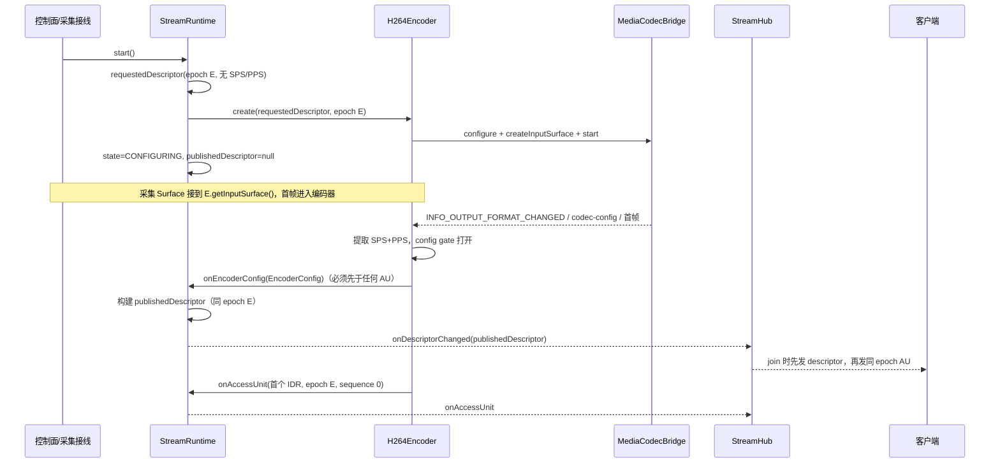

# H.264 适配器与配置生命周期实施计划

> **For agentic workers:** REQUIRED SUB-SKILL: Use superpowers:subagent-driven-development (recommended) or superpowers:executing-plans to implement this plan task-by-task. Steps use checkbox (`- [ ]`) syntax for tracking.

> **状态：计划草案，待主 agent 复审；尚未开始实现。** 本文件只定义下一批 H.264 codec 适配器与配置生命周期，不写产品代码或测试代码。执行开始时才创建 `.superpowers/sdd/2026-10-18-h264-adapter/` 下的任务 brief、RED/GREEN 日志与 review package。

**Goal:** 在**不接线现有 `LssService` / `LssServer` / `LssClient` / proto / UI** 的前提下，新增 H.264 Annex B 解析、`MediaCodec` bridge 抽象、H.264 encoder/decoder 适配器，以及“编码器先启动、拿到 SPS/PPS 后再发布最终 `StreamDescriptor`”的配置生命周期；为后续真实采集 Surface 接线、TCP 访问单元传输与设备验证准备可审查的契约。JVM 只用纯 Java 码流工具和 fake bridge/factory 验证；不调用 `android.media`，不执行任何设备、模拟器或 adb 验证。

**Architecture:** 在现有静态 Codec SPI 与单活动流 Runtime 上增加**两阶段编码器初始化**：`requestedDescriptor`（无 SPS/PPS，epoch 已分配）→ encoder 启动 → H.264 适配器从 `MediaCodec` 输出格式或首帧码流提取 SPS/PPS → `EncoderOutput.onEncoderConfig(EncoderConfig)` → Runtime 生成同 epoch 的 `publishedDescriptor` 并先于首个 AU 发布。H.264 的 NAL/SPS/PPS/IDR 解析只存在于 `core.codec.h264`；公共层只处理不透明 `CodecConfigPart`、`EncodedAccessUnit` 与 `StreamDescriptor`。`MediaCodec` 通过 JVM 可替换的 bridge 接口隔离，Android 实现单独放在 `AndroidMediaCodec*` 文件，JVM 测试不实例化。

**Tech Stack:** Java 11 source/target、Android minSdk 25、compileSdk 35、AGP 8.9.0、Gradle 8.11.1、JUnit 4.13.2。仅使用现有依赖；不引入 Mockito、Kotlin、协程、Robolectric 或新测试库。

**Spec:** [可扩展编码框架设计](../../codec-framework.md) · [媒体链路目标架构](../../media-architecture.md) · [任务看板](../../task-board.md)

## Global Constraints

- 源码与目标兼容级别保持 Java 11；`minSdk 25`、`compileSdk 35`、`targetSdk 35` 不变；不新增依赖，`app/build.gradle`、`gradle/libs.versions.toml` 零改动。
- 本批次**不修改** `LssService`、`LssClientService`、`LssServer`、`LssClient`、`MainActivity`、`screen_stream.proto`、布局与任何现有投屏数据路径；不新增生产接线。
- 不实现 HEVC、AV1、RTP、WebRTC、GPU Fanout、多活动流调度、每客户端转码、B 帧调度、时域层或 HDR。
- 不执行 `adb`、emulator、虚拟机、实机、`connectedAndroidTest` 或任何设备验证；不写“设备已通过”“性能已提升”之类未执行结论。
- **JVM 测试禁止实例化或调用 `android.media.*`。** `android.view.Surface` 只允许作为签名类型出现；JVM fake 返回 `null`，不创建 `Surface` 实例。真实 `MediaCodec` 只允许出现在 `core.codec.h264.AndroidMediaCodec*` 与 androidTest 中。
- 可新增 androidTest，但**不得运行**；若新增，必须能通过 `./gradlew :app:assembleDebugAndroidTest --offline` 单独编译，并在任务记录中明确“无设备证据”。
- H.264 的 NAL 解析、SPS/PPS 提取、IDR/B 帧判定只允许在 `core/codec/h264`。`core/model`、`core/stream`、`core/client` 不得出现 SPS/PPS/NAL/IDR 解析或 H.264 名称分支。
- 公共层继续不解析负载、不从 `flags.isSyncPoint()` 单独推断可加入点、不硬编码 codec 名称；`CodecRegistry.withDefaults()` 保持只注册 JPEG，不因本批次改变既有行为。
- 保持既有不变量：attempt generation 只增不复用；descriptor 先于同 epoch 首个 AU；每个 AU 带 `configEpoch`；参考帧溢出/超限/过期进入 `RESYNCING` 且只由同 epoch 可加入点恢复；unchecked transport 异常只影响单个客户端。
- `visible size` 与 `rotation` 继续按 spec 推进 `configEpoch`，但本批次对“仅显示参数变化”复用编码器（epoch-only update），不重建 encoder；coded size、profile/level、color、codec 变化才重建 encoder。此裁决不改变 spec 的“显示变化也升 epoch”。
- 不实现客户端超时定时器、恢复 ack、自动断开或旧 encoder 等待超时；仍以新 epoch 首个 join point 作为旧 encoder 释放信号。
- Pro（DeepSeek V4 Pro）通过 CU 只写生产/关键框架代码，不编译、不运行 Gradle、不修改测试、不提交；测试、fake、fixtures、验证、审查与提交由其他子 agent 完成。
- 文档不得包含本机绝对路径、用户名、账号、令牌、密钥或签名口令；只写仓库相对路径。
- 本批次结束时的正确状态是“H.264 适配器与配置生命周期已实现并仅经 JVM/fake 验证；未接现有投屏、未做设备验证”，不得写成 H.264 单流已上线。

## 当前实现与核心矛盾

已核对的现状（master `2a95ab2`）：

| 事实 | 位置 | 对本计划的影响 |
| --- | --- | --- |
| `EncoderFactory.create` 接收一个已构建的 `StreamDescriptor`，`Encoder.start()` 后才可能产出码流 | `core/codec/EncoderFactory.java`、`core/stream/StreamRuntime.java:82-108` | H.264 的 SPS/PPS 在 `MediaCodec` start 且首帧输入后才出现，无法在创建 encoder 前放进 descriptor |
| `StreamDescriptor` 不可变，`configHash` 覆盖 configParts | `core/model/StreamDescriptor.java:174-195` | 不能在发布后原地补 SPS/PPS；同 epoch 改 hash 会被发送/客户端会话拒绝 |
| `ClientSendSession.onDescriptor` 拒绝同 epoch 不同 hash | `core/stream/ClientSendSession.java:117-127` | 不能用“先发空配置 descriptor、再发同 epoch 带配置 descriptor”的补丁 |
| `ClientMediaSession.onDescriptor` 同样拒绝同 epoch 不同 hash | `core/client/ClientMediaSession.java:94-106` | 客户端只接受一次同 epoch 配置；必须保证它第一次看到的就是最终配置 |
| `StreamHub.join` 直接使用 active runtime 的 descriptor | `core/stream/StreamHub.java:127-151` | 配置未就绪时必须显式返回 `NOT_READY`，不能给客户端空配置 |
| 当前 JPEG 每帧独立、无配置部件 | `core/codec/jpeg/JpegEncoder.java` | JPEG 路径不能作为 H.264 配置时序的模板 |
| 当前投屏仍是 ImageReader → Bitmap → 软件 JPEG → `ScreenFrame` | `service/LssService.java:191-247`、`app/src/main/proto/screen_stream.proto:9-16` | 本批次不接线；后续接线批次才替换采集输出 |

### 必须解决的真实 H.264 难点

1. `MediaCodec` 编码器的 `csd-0`/`csd-1` 通常只在 `start()` 后、首个输出缓冲或 `INFO_OUTPUT_FORMAT_CHANGED` 时出现；不能在 `configure()` 前构造。
2. 首个输出缓冲可能就是 IDR；如果先发 AU 再发 descriptor，客户端无法配置解码器；如果在 `start()` 内阻塞等 SPS/PPS，采集 Surface 还没接上，会死锁。
3. 不同设备可能把 SPS/PPS 放在 `csd-0/csd-1`、`BUFFER_FLAG_CODEC_CONFIG` 或首帧码流内；适配器必须统一，但不能把解析上移到公共层。
4. 编码器标记的“关键帧”不一定是 IDR；普通 I 帧不能让新解码器加入。必须解析 NAL type 5、`first_mb_in_slice == 0` 与 slice type。
5. 尺寸/旋转变化需要新 epoch；旋转/可见尺寸变化不一定需要新编码器实例，不能一律重建。
6. 编码器线程与 Runtime 锁、listener 回调、stop/close 之间存在死锁风险；必须在锁外停止/关闭 encoder。

## 初始化与发布裁决（本计划的核心）

### 术语

| 名称 | 含义 | 是否对外发布 |
| --- | --- | --- |
| `requestedDescriptor` | 调用方请求的、用于创建 encoder 的描述符；含 streamKey、`configEpoch=E`、codecId/mime、请求的 coded/visible size、rotation、color；`configParts` 为空 | 否（仅 Runtime 内部与 encoder 构造） |
| `EncoderConfig` | H.264 适配器从 `MediaCodec` 输出格式或码流提取的配置快照：profile/level（可空）、实际 coded size、color、SPS/PPS `CodecConfigPart` | 由 `EncoderOutput.onEncoderConfig` 交给 Runtime |
| `publishedDescriptor` | Runtime 用 requested + EncoderConfig 构建的最终 descriptor；epoch 仍为 E；含 SPS/PPS；`configHash` 已计入配置 | 是，且只发布一次 |
| config gate | H.264 适配器在拿到 SPS+PPS 前不产生任何显示 AU 的内部状态 | 适配器内部 |

### 两阶段初始化



固定规则：

1. `StreamRuntime.start()` 对 `CodecDescriptor.hasConfigParts()==false` 的 codec 保持现有行为：encoder 启动成功即 `READY`，requested 就是 published。
2. 对 `hasConfigParts()==true` 的 codec：启动成功进入 `CONFIGURING`，`getPublishedDescriptor()` 返回 `null`；`getDescriptor()` 暂时返回 requested，仅用于 streamKey 等身份信息，不得当作可解码配置使用。
3. H.264 适配器必须在**同一 drain 线程**上先调用 `onEncoderConfig`，再调用任何 `onAccessUnit`；不得在 `start()` 调用栈内同步回调（否则 Runtime 尚未进入 `CONFIGURING`，会形成重入歧义）。
4. Runtime 收到 config 后：
   - 校验 attempt generation、状态、`configParts` 非空、coded size 为正；
   - 用 requested 的 streamKey/epoch/codecId/mime/bitstreamFormat/visible size/rotation，加上 config 的 profile/level/coded size/color/configParts，构建新 descriptor；
   - `publishedDescriptor` 只设置一次；state 变为 `READY`；
   - 在锁外同步通知所有 `StreamRuntimeListener.onDescriptorChanged`；
   - 回调返回后，才允许同一 generation 的 AU 进入 `onAccessUnit`。
5. 如果 AU 先于 config 到达：Runtime 将该 attempt 标记为 `FAILED`，丢弃 AU，通知 `onEncoderFailed`；不得发布无配置 descriptor，也不得把 AU 透传。
6. 配置确定**不推进 epoch、不重建 encoder、不重置客户端已有会话**。客户端第一次收到的就是 E 的最终 descriptor；不存在“同 epoch 空配置 → 同 epoch 带配置”的第二次发布。
7. 新 epoch 只由 `switchDisplayConfig`（显示参数变化）或 `prepareSwitch`（coded size/profile/color/codec 变化）产生；新 epoch 的 requested descriptor 也不含 configParts，最终 descriptor 仍由新 encoder 的 config 决定。
8. 没有客户端时也必须完成编码器初始化：采集接线必须把 Surface 接到 encoder，即使当前没有观看者；否则 Runtime 永远停在 `CONFIGURING`，`join` 返回 `NOT_READY`。这是后续接线批次的责任，本批次只用 fake 驱动验证。

### 字段裁决表

| 字段 | 最终 descriptor 取值 |
| --- | --- |
| `streamKey` | requested |
| `configEpoch` | requested（初始化不变；切换为 E+1） |
| `codecId` / `mime` / `bitstreamFormat` | requested |
| `profile` / `level` | config 非空则用 config，否则保留 requested（通常为 null） |
| `codedWidth` / `codedHeight` | config 的实际编码尺寸；非法或缺失时回退 requested |
| `visibleWidth` / `visibleHeight` | requested，保持调用方请求的显示尺寸 |
| `rotationDegrees` | requested |
| `configParts` | config 的 SPS/PPS，id 固定为 `sps` / `pps`，payload 为不含起始码的原始 NAL |
| `colorInfo` | config 非 `UNSPECIFIED` 时用 config，否则 requested |
| `configHash` | 由 `StreamDescriptor` 重新计算，包含 configParts；不包含 epoch |

### 为什么不选其他方案

| 方案 | 问题 |
| --- | --- |
| 先发布空配置 descriptor，start 后同 epoch 补配置 | `ClientSendSession` 与 `ClientMediaSession` 都拒绝同 epoch 不同 hash；放宽会破坏“描述符不可变、配置成组发布”的不变量，并让已配置客户端拿到错配置 |
| 在 `StreamRuntime.start()` 内阻塞等待 SPS/PPS | 需要采集 Surface 已接上并产生首帧；start 与采集接线互相等待，存在死锁；也无法在上层先拿到输入 Surface |
| 用硬编码 SPS/PPS 或从分辨率猜测 | 设备/profile/level/对齐不同，必然错；违反“不从分辨率猜测对齐” |
| 让 `EncoderFactory.create` 返回 descriptor | 工厂创建时 encoder 尚未 start，SPS/PPS 同样不存在；只会把矛盾搬进工厂 |
| 先发一个合成 IDR 骗出 SPS/PPS | 需要 Surface 和额外编码，增加延迟与无效 AU；仍不能解决 descriptor 先行问题 |
| 把 SPS/PPS 放进首个显示 AU，由客户端解析 | 公共层与客户端不得解析负载；首个 AU 仍必须先有 descriptor 才能配置解码器 |

### 重建边界（避免无谓重建 encoder）

| 变化 | 是否新建 encoder | 机制 | 新 epoch |
| --- | --- | --- | --- |
| 首次拿到 SPS/PPS | 否 | `onEncoderConfig` 只补全 descriptor | 否（仍为 E） |
| 目标码率变化 | 否 | `Encoder.updateParameters` → `MediaCodec.setParameters(VIDEO_BITRATE)` | 否 |
| 帧率提示/关键帧间隔变化 | 否 | 记录并在下一次创建 encoder 时使用；本批次不热更新 | 否 |
| `visibleWidth/Height` 或 `rotationDegrees` 变化 | 否 | `switchDisplayConfig`：复用 encoder，`updateConfigEpoch(E+1)`，重置 sequence，请求 IDR | 是（E+1） |
| `codedWidth/Height`、profile/level、colorInfo、codecId 变化 | 是 | `prepareSwitch` 创建新 encoder，config 后 `commitSwitch` | 是（E+1） |
| 编码器异步失败 | 视情况 | 未发布：可重试 start；已发布：不自动重建，交给上层关闭并新建 runtime | 否/上层决定 |

### 失败与重试裁决

| 场景 | Runtime 行为 | 是否允许重试 |
| --- | --- | --- |
| `start()` 同步抛异常 | 关闭该 encoder，保持 `IDLE`，attempt 已自增且不复用 | 允许再次 `start()`，使用新 attempt |
| 异步失败发生在 published 之前 | `FAILED`，`publishedDescriptor==null`；通知 `onEncoderFailed` | 允许 `start()`；旧 attempt 的迟到 config/AU 按 generation 丢弃 |
| 异步失败发生在 published 之后 | `FAILED`，保留 published；`StreamHub` detach 所有 session；新 join 返回 `NOT_READY` | 不允许 `start()`；上层关闭 runtime 并用 E+1 新建 |
| `prepareSwitch` 创建/启动失败 | 关闭新 encoder，旧 encoder 保持 `READY` | 允许重新 `prepareSwitch`，新 attempt |
| `commitSwitch` 停止 deferred 旧 encoder 失败 | 关闭新 encoder；旧 encoder 视为不可用，state `FAILED`，Hub detach；不得回 `READY` | 不允许继续用旧 encoder；上层关闭 runtime 并用 E+1 新建 |
| 非 deferred `switchDescriptor` 停止旧 encoder 失败 | 保持既有语义：关闭新 encoder，旧 encoder 继续 active，state 回 `READY` | 允许重新 `switchDescriptor` |
| `commitSwitch` 时新 encoder 尚未 config | state `CONFIGURING`；旧 encoder 已停止；config 到达后发布新 descriptor | 不需要重试 |
| `abortSwitch` | 关闭新 encoder，旧 encoder 继续；不发布新 descriptor | 允许重新 `prepareSwitch` |

## 不得退化的不变量

这些不变量在本批次每个相关 Task 都要有测试；任何一项失败都不得提交。

1. **attempt generation 不复用**：每次 `start()`、重试、`prepareSwitch` 都调用 `nextAttemptGeneration` 自增；旧 attempt 的 config、AU、failure 全部按 generation 丢弃。
2. **descriptor 先于同 epoch 首个 AU**：Runtime 的 config 通知先于 AU 透传；Hub/session 的 pending descriptor 先于队列 AU；transport 事件顺序固定为 `DESCRIPTOR` 后 `ACCESS_UNIT`。
3. **每 AU 带 epoch**：H.264 适配器给每个 AU 写入当前 epoch；Runtime、`ClientSendSession`、`ClientMediaSession` 对普通 AU 也校验 epoch；旧 epoch 普通 AU 丢弃，未来 epoch 进入 `RESYNCING`。
4. **参考帧重同步**：H.264 使用 `DROP_UNTIL_JOIN_POINT`；溢出、单 AU 超限、过期只从同 epoch 的**验证过的 IDR**恢复；任意 I 帧、仅 flag 的关键帧、无 VCL 的 config 包都不能恢复。
5. **unchecked transport 异常隔离**：单个 `MediaTransport.sendDescriptor/sendAccessUnit` 抛 `IOException` 或 `RuntimeException` 时，只 detach 该 session、关闭其 transport；其他客户端与编码器不受影响。
6. **配置与显示 AU 分离**：SPS/PPS 只出现在 descriptor 的 `configParts`；H.264 适配器不得把 config-only 包当显示 AU；显示 AU 中的 in-band SPS/PPS 必须剥离。
7. **描述符不可变**：published 后不原地修改；配置补全只发生在首次发布前；同 epoch 不同 hash 仍被会话拒绝。
8. **锁边界**：Runtime 不得在持有自己的锁时调用 `Encoder.stop()`、`Encoder.close()` 或可能等待回调的方法；encoder 不得在持有内部锁时调用 `EncoderOutput` 回调。否则 H.264 drain 线程与 Runtime 会互相等待。

## Review Focus

1. **配置时序**：H.264 是否严格 `onEncoderConfig` → `onAccessUnit`；Runtime 是否在 config 前拒绝 AU；descriptor 是否只发布一次；join 是否在 `READY` 前返回 `NOT_READY`。Task 3、4、5、10。
2. **IDR 判定**：是否 NAL type 5 + `first_mb_in_slice==0` + I/SI slice + `nal_ref_idc!=0`；是否拒绝普通 I 帧、仅 keyframe flag、B slice、无 VCL 包。Task 1、5、6、10。
3. **配置分离**：SPS/PPS 是否只在 descriptor；in-band config 是否被剥离；decoder configure 是否只用 descriptor 的 SPS/PPS；首帧是否必须 IDR。Task 1、5、6、10。
4. **epoch/sequence**：初始化是否不改 epoch；switch 是否 E+1；`updateConfigEpoch` 是否重置 sequence；每个 AU 是否带正确 epoch。Task 3、5、7、8、10。
5. **重建边界**：码率是否不重建；显示变化是否复用 encoder；coded size 是否走 `prepareSwitch`。Task 7、8、10。
6. **MediaCodec 生命周期**：drain 线程是否可靠退出；stop/close 是否幂等且只 release 一次；dequeue 超时是否不忙等；bridge RuntimeException/listener 异常是否只失败一次；旧 generation/attempt 是否丢弃。Task 2、5、6、11。
7. **锁与死锁**：Runtime 是否在锁外 stop/close；encoder 是否在锁外回调；并发 switch/close/failure 是否不死锁。Task 3、7、8、10。
8. **客户端恢复**：Surface 缺失/attach、configure 失败重试、旧 epoch、首帧非 IDR、decode 失败后只由 IDR 恢复。Task 6、9、10。
9. **既有不变量**：attempt 不复用、descriptor 先行、每 AU epoch、参考帧 resync、transport 异常隔离。Task 3、4、7、10。
10. **范围与证据**：无 `LssService/LssServer/LssClient/proto/UI` 改动；无 Android `media` 调用进入 JVM 测试；无设备结论；`CodecRegistry.withDefaults()` 仍只注册 JPEG。Task 11。

## 执行分工与交接

| 角色 | 负责 | 禁止 |
| --- | --- | --- |
| 测试 agent | 先写失败测试、fixtures、fake bridge/factory、fake deferred codec；运行红测并记录失败原因 | 不写生产实现；不改生产代码来“让测试通过” |
| Pro（DeepSeek V4 Pro，通过 CU） | 严格按每个 Task 的 Interfaces 与文件清单写生产/关键框架代码，包括 H.264 解析、适配器、Runtime 扩展与 Android bridge | 不编译、不运行 Gradle、不修改测试、不提交、不扩展契约、不引入新依赖 |
| 验证 agent | 编译、运行指定测试、修复仅限导入/签名/拼写接线问题；汇报失败断言 | 不改测试断言、不改变语义、不新增依赖 |
| 审查 agent | 对照 spec 与本计划检查职责边界、配置时序、IDR 判定、epoch、锁边界、无 Android 实现依赖 | 不为通过审查扩大范围；不跳过失败测试 |
| 集成 agent | 全量 JVM 测试、`assembleDebug`、`assembleDebugAndroidTest`、旧路径 diff、任务看板、文档与提交/推送 | 不执行 adb/设备/仪器测试；不改旧路径行为 |

**Handoff 规则：**

- 每个 Task 先由测试 agent 提交失败测试；Pro 只读测试与 Interfaces 写生产代码。
- Pro 交付后，验证 agent 运行命令。编译接线错误可最小修复；断言失败或契约不一致退回 Pro，附失败测试名与实际输出。
- 审查 agent 通过前不得提交该 Task；每个 Task 的提交由验证 agent 或集成 agent 执行。
- 任何生产修复必须与回归测试同提交；若修复发生在已提交 Task 之后，使用 `fix: ...`，不得混入后续测试提交。
- 若 Pro 的实现需要修改 proto、`LssService`、`LssServer`、`LssClient`、UI 或新增依赖，停止并退回计划审查。
- 执行在原始仓库 `master` 上直接进行，不创建或切换工作区。

## 文件结构

新增生产代码（`app/src/main/java/com/obby/android/localscreenshare/` 下）：

```text
core/
├── codec/
│   ├── EncoderConfig.java
│   ├── EncoderException.java
│   └── h264/
│       ├── H264FormatException.java
│       ├── H264NalUnit.java
│       ├── H264BitReader.java
│       ├── H264SliceHeader.java
│       ├── H264AccessUnitInfo.java
│       ├── H264AnnexBParser.java
│       ├── H264ConfigExtractor.java
│       ├── H264CodecPolicy.java
│       ├── H264Codec.java
│       ├── H264Encoder.java
│       ├── H264EncoderFactory.java
│       ├── H264Decoder.java
│       ├── H264DecoderFactory.java
│       ├── MediaCodecBridgeFactory.java
│       ├── MediaCodecEncoderBridge.java
│       ├── MediaCodecDecoderBridge.java
│       ├── EncoderFormat.java
│       ├── DecoderFormat.java
│       ├── EncodedSample.java
│       ├── EncoderStreamFormat.java
│       ├── DecodedOutput.java
│       ├── AndroidMediaCodecBridgeFactory.java
│       ├── AndroidMediaCodecEncoderBridge.java
│       └── AndroidMediaCodecDecoderBridge.java
├── model/
│   └── StreamDescriptor.java（修改）
├── stream/
│   ├── RuntimeState.java
│   ├── SwitchHandle.java
│   ├── StreamRuntime.java（修改）
│   ├── StreamRuntimeListener.java（修改）
│   ├── JoinDecision.java（修改）
│   └── StreamHub.java（修改）
├── codec/
│   ├── Encoder.java（修改）
│   ├── EncoderOutput.java（修改）
│   └── Decoder.java（修改）
└── client/
    └── ClientMediaSession.java（修改）
```

测试代码（`app/src/test/java/com/obby/android/localscreenshare/` 下）：

```text
core/codec/h264/H264AnnexBParserTest.java
core/codec/h264/H264ConfigExtractorTest.java
core/codec/h264/MediaCodecBridgeContractTest.java
core/codec/h264/H264EncoderTest.java
core/codec/h264/H264CodecPolicyTest.java
core/codec/h264/H264DecoderTest.java
core/codec/h264/H264CodecTest.java
core/stream/StreamRuntimeDeferredConfigTest.java
core/stream/StreamHubNotReadyTest.java
core/stream/StreamRuntimeSwitchTest.java
core/stream/StreamRuntimeDisplaySwitchTest.java
core/stream/StreamRuntimeRetryTest.java
core/client/ClientMediaSessionSurfaceTest.java
core/client/ClientMediaSessionH264PolicyTest.java
core/stream/H264StreamEndToEndTest.java
core/support/H264Fixtures.java
core/support/H264BitWriter.java
core/support/FakeDeferredCodec.java
core/support/FakeMediaCodecBridgeFactory.java
core/support/FakeMediaCodecEncoderBridge.java
core/support/FakeMediaCodecDecoderBridge.java
core/support/TestH264Registration.java
```

androidTest（`app/src/androidTest/java/com/obby/android/localscreenshare/` 下，**只编译不运行**）：

```text
core/codec/h264/H264MediaCodecSmokeTest.java
```

## 允许修改的既有 core 文件

| 文件 | 允许的修改 | 禁止 |
| --- | --- | --- |
| `core/codec/Encoder.java` | 增加带默认实现的 `isConfigured()`、`supportsConfigEpochUpdate()`、`updateConfigEpoch(int)` | 不改变既有 6 个抽象方法签名 |
| `core/codec/EncoderOutput.java` | 增加默认 `onEncoderConfig`、`onEncoderFailure`；保留唯一抽象方法 | 不删除 `onAccessUnit`，不引入 checked 异常 |
| `core/codec/Decoder.java` | 增加默认 `setOutputSurface(Surface)` | 不改变 `configure/decode/close` 签名 |
| `core/model/StreamDescriptor.java` | 增加 `sameRequestedConfig`、`sameEncodeInputConfig`、`withDisplayConfig` | 不改变现有构造/哈希/字段语义 |
| `core/stream/StreamRuntime.java` | 增加状态机、deferred config、prepare/commit/abort、display switch、失败/重试；把 stop/close 移到锁外 | 不改变非 deferred codec 的现有 `switchDescriptor` 结果；不改为多活动流 |
| `core/stream/StreamRuntimeListener.java` | 增加默认 `onEncoderFailed` | 不删除既有两个方法 |
| `core/stream/JoinDecision.java` | 增加 `NOT_READY` 与 `notReady(String)` | 不改变既有三个状态与静态工厂 |
| `core/stream/StreamHub.java` | join 前检查 `READY`；实现 `onEncoderFailed` detach；register 用 streamKey 兼容 | 不硬编码 H.264/JPEG 名称；不自动切换活动流 |
| `core/client/ClientMediaSession.java` | 增加 `retryConfigure()`、`onRenderTargetSurfaceChanged()`；configure 失败恢复 | 不改变六状态语义；不实现超时；不关闭 RenderTarget |

**明确不允许修改**：`core/codec/jpeg/*`、`core/stream/ClientSendSession.java`、`core/stream/BoundedAccessUnitQueue.java`、`LssService`、`LssClientService`、`LssServer`、`LssClient`、`MainActivity`、`screen_stream.proto`、布局、`app/build.gradle`、`gradle/libs.versions.toml`。如果实现发现必须改这些文件，停止并退回计划审查。

## 新增/变更接口签名

### Core SPI

```java
// core/codec/Encoder.java
public interface Encoder {
    void start();
    void stop();
    Surface getInputSurface();
    void updateParameters(StreamParameters parameters);
    void requestSyncPoint();
    void close();

    default boolean isConfigured() { return true; }
    default boolean supportsConfigEpochUpdate() { return false; }
    default void updateConfigEpoch(int configEpoch) {
        throw new UnsupportedOperationException("config epoch update is not supported");
    }
}
```

```java
// core/codec/EncoderOutput.java
@FunctionalInterface
public interface EncoderOutput {
    void onAccessUnit(EncodedAccessUnit accessUnit);

    default void onEncoderConfig(EncoderConfig config) {
    }

    default void onEncoderFailure(EncoderException failure) {
    }
}
```

```java
// core/codec/EncoderConfig.java
public final class EncoderConfig {
    public EncoderConfig(String profile, String level, int codedWidth, int codedHeight,
                         ColorInfo colorInfo, List<CodecConfigPart> configParts);
    public String getProfile();
    public String getLevel();
    public int getCodedWidth();
    public int getCodedHeight();
    public ColorInfo getColorInfo();
    public List<CodecConfigPart> getConfigParts();
}
```

约束：`codedWidth/codedHeight > 0`；`colorInfo` 非 null；`configParts` 非 null 且非空；所有 byte[] 防御性复制。

```java
// core/codec/EncoderException.java
public final class EncoderException extends RuntimeException {
    public EncoderException(String message);
    public EncoderException(String message, Throwable cause);
}
```

### Runtime / Hub / Client

```java
// core/stream/RuntimeState.java
public enum RuntimeState {
    IDLE, CONFIGURING, READY, SWITCHING, FAILED, CLOSED
}
```

```java
// core/stream/StreamRuntime.java（新增方法）
public RuntimeState getState();
public boolean isConfigured();
public StreamDescriptor getPublishedDescriptor(); // READY 前为 null
public SwitchHandle prepareSwitch(StreamDescriptor requestedNext);
public void commitSwitch(SwitchHandle handle);
public void abortSwitch(SwitchHandle handle);
public void switchDisplayConfig(int configEpoch, int visibleWidth, int visibleHeight,
                                int rotationDegrees);
```

```java
// core/stream/SwitchHandle.java
public final class SwitchHandle {
    public StreamKey getStreamKey();
    public int getConfigEpoch();
    public Surface getInputSurface();
    public boolean isResolved();
    public StreamDescriptor getResolvedDescriptor(); // 未 config 前为 null
    public boolean isCommitted();
    public boolean isAborted();
    public boolean isFailed();
    public EncoderException getFailure(); // 未失败时为 null
}
```

```java
// core/stream/JoinDecision.java
public enum Status {
    ACCEPTED,
    NOT_READY,
    REQUIRES_EXPLICIT_FALLBACK,
    REJECTED
}
public static JoinDecision notReady(String reason);
```

```java
// core/stream/StreamRuntimeListener.java
default void onEncoderFailed(StreamKey streamKey, EncoderException failure) {
}
```

```java
// core/client/ClientMediaSession.java（新增方法）
public synchronized boolean retryConfigure();
public synchronized boolean onRenderTargetSurfaceChanged();
```

```java
// core/codec/Decoder.java
default void setOutputSurface(Surface surface) {
}
```

```java
// core/model/StreamDescriptor.java（新增方法）
public boolean sameRequestedConfig(StreamDescriptor other);
public boolean sameEncodeInputConfig(StreamDescriptor other);
public StreamDescriptor withDisplayConfig(int configEpoch, int visibleWidth,
                                          int visibleHeight, int rotationDegrees);
```

语义：

- `sameRequestedConfig` 比较 streamKey、codecId、mime、bitstreamFormat、visible size、rotation、colorInfo；忽略 epoch、profile/level、coded size、configParts。coded size 不参与比较，因为 published 的 coded size 可能是编码器对齐后的实际值，而 requested 是调用方请求值，直接比较会产生假变化；用于拒绝 `prepareSwitch` 的显示/格式空操作。
- `sameEncodeInputConfig` 比较 codecId、mime、bitstreamFormat、coded size、colorInfo；忽略 visible size、rotation、epoch、profile/level、configParts。用于判断显示变化是否可复用 encoder。
- `withDisplayConfig` 保留 configParts、profile/level、coded size、colorInfo，只替换 epoch/visible/rotation，并重新计算 hash。

### H.264 解析与配置

```java
// core/codec/h264/H264NalUnit.java
public final class H264NalUnit {
    public int getType();
    public int getNalRefIdc();
    public int getStartCodeLength();
    public int getOffset();
    public int getLength();
    public byte[] getPayload(); // 防御性复制，含 NAL header，不含起始码
}
```

```java
// core/codec/h264/H264AccessUnitInfo.java
public final class H264AccessUnitInfo {
    public boolean hasVcl();
    public boolean hasIdr();
    public boolean hasNonIdrVcl();
    public boolean hasBSlice();
    public boolean hasSps();
    public boolean hasPps();
    public boolean isJoinable();
}
```

```java
// core/codec/h264/H264AnnexBParser.java
public final class H264AnnexBParser {
    public static List<H264NalUnit> parse(byte[] annexB);
    public static H264AccessUnitInfo analyze(byte[] accessUnit);
    public static boolean isIdrAccessUnit(byte[] accessUnit);
    public static byte[] stripSpsPps(byte[] accessUnit); // 无 VCL 时返回空数组
    public static boolean looksLengthPrefixed(byte[] data);
}
```

```java
// core/codec/h264/H264ConfigExtractor.java
public final class H264ConfigExtractor {
    public static List<CodecConfigPart> fromCodecSpecificData(byte[] csd0, byte[] csd1);
    public static List<CodecConfigPart> fromInBandPayload(byte[] accessUnit);
    public static byte[] sps(List<CodecConfigPart> parts);
    public static byte[] pps(List<CodecConfigPart> parts);
    public static byte[] toAnnexB(byte[] nalPayload);
}
```

约束：

- `H264AnnexBParser.parse` 支持 3/4 字节起始码；`looksLengthPrefixed` 用于识别 AVCC 风格的 csd。
- `isIdrAccessUnit` 只在以下全部满足时返回 true：首个 VCL NAL 是 type 5；`nal_ref_idc != 0`；`first_mb_in_slice == 0`；`slice_type % 5` 为 2（I）或 4（SI）；整个 AU 不含 B slice；载荷非空。
- 普通 type 1 I slice、仅 `keyFrame` 标志、IDR 但 `first_mb_in_slice != 0`、B slice、config-only 包均不是 join point。
- `H264ConfigExtractor.fromCodecSpecificData` 接受 Annex B 或 AVCC；必须恰好得到一个 SPS 与一个 PPS，否则抛 `H264FormatException`；本批次不支持多 SPS/PPS。
- config part id 固定为 `sps` 与 `pps`；payload 为原始 NAL（含 NAL header，不含起始码/长度前缀）。
- `stripSpsPps` 删除 type 7/8，保留 SEI/AUD/VCL，重建 Annex B 起始码。

### MediaCodec bridge

```java
// core/codec/h264/MediaCodecBridgeFactory.java
public interface MediaCodecBridgeFactory {
    MediaCodecEncoderBridge createEncoder(String mime);
    MediaCodecDecoderBridge createDecoder(String mime);
}
```

```java
// core/codec/h264/MediaCodecEncoderBridge.java
public interface MediaCodecEncoderBridge {
    void configure(EncoderFormat format);
    Surface createInputSurface();
    void start();
    void stop();
    void release();
    void requestSyncFrame();
    void updateBitrate(int bitrateBps);
    EncodedSample dequeueOutput(long timeoutUs); // 超时返回 null；内部负责 releaseOutputBuffer
    EncoderStreamFormat getOutputFormat();       // format change 后非 null
}
```

```java
// core/codec/h264/MediaCodecDecoderBridge.java
public interface MediaCodecDecoderBridge {
    void configure(DecoderFormat format);
    void setOutputSurface(Surface surface);
    void start();
    void stop();
    void release();
    int dequeueInputBuffer(long timeoutUs); // 超时返回 -1
    void queueInputBuffer(int index, byte[] data, long ptsUs);
    DecodedOutput dequeueOutput(long timeoutUs); // 超时返回 null；内部以 render=true release
}
```

```java
// 数据类，全部为纯 Java + 允许的 Surface 签名
public final class EncoderFormat {
    public EncoderFormat(int width, int height, int bitrateBps, int frameRate,
                         int keyFrameIntervalSeconds, String profile, String level);
}

public final class DecoderFormat {
    public DecoderFormat(int width, int height, byte[] csd0, byte[] csd1); // csd 为 Annex B
}

public final class EncodedSample {
    public EncodedSample(byte[] data, long ptsUs, boolean keyFrame,
                         boolean codecConfig, boolean formatChanged, boolean endOfStream);
}

public final class EncoderStreamFormat {
    public EncoderStreamFormat(byte[] csd0, byte[] csd1, int width, int height,
                               ColorInfo colorInfo);
}

public final class DecodedOutput {
    public DecodedOutput(long ptsUs, boolean formatChanged, boolean endOfStream);
}
```

### H.264 codec

```java
// core/codec/h264/H264Codec.java
public final class H264Codec {
    public static final String MIME = "video/avc";
    public static final String CONFIG_PART_SPS = "sps";
    public static final String CONFIG_PART_PPS = "pps";

    public static CodecRegistration registration(MediaCodecBridgeFactory bridgeFactory);
    public static CodecRegistration androidRegistration(); // Task 11
}
```

```java
// core/codec/h264/H264Encoder.java
public final class H264Encoder implements Encoder {
    public H264Encoder(StreamKey streamKey, StreamDescriptor requestedDescriptor,
                       StreamParameters parameters, EncoderOutput output,
                       MediaCodecBridgeFactory bridgeFactory);
    // 实现 Encoder；isConfigured() = config != null
    // supportsConfigEpochUpdate() = true
}
```

```java
// core/codec/h264/H264Decoder.java
public final class H264Decoder implements Decoder {
    public H264Decoder(StreamKey streamKey, StreamDescriptor descriptor,
                       RenderTarget renderTarget, MediaCodecBridgeFactory bridgeFactory);
}
```

## 任务依赖

```text
Task 1 (parser/config) ─┬─> Task 5 (encoder) ─┬─> Task 6 (decoder) ─┬─> Task 10 (E2E)
Task 2 (bridge/fake) ───┘                     │                     └─> Task 11 (Android bridge)
Task 3 (SPI/runtime deferred) ─> Task 4 (hub ready) ─> Task 7 (switch) ─> Task 8 (display/retry)
Task 6 (decoder) ─> Task 9 (client surface) ─> Task 10 (E2E)
Task 5 + Task 6 ─> Task 11 (Android bridge)
```

- Task 1、2 可并行；Task 3 也可与 1、2 并行。
- Task 4 依赖 Task 3；Task 5 依赖 Task 1、2、3；Task 6 依赖 Task 5；Task 7 依赖 Task 3；Task 8 依赖 Task 7；Task 9 依赖 Task 6；Task 10 依赖 Task 4–9；Task 11 依赖 Task 5、6。
- 每个 Task 结束时全量既有 162 JVM tests 必须保持通过；新增测试通过数单独记录。

## Task 1: H.264 Annex B 解析与配置提取（纯 Java）

**Files:**
- Create: `app/src/main/java/com/obby/android/localscreenshare/core/codec/h264/H264FormatException.java`
- Create: `.../h264/H264NalUnit.java`
- Create: `.../h264/H264BitReader.java`
- Create: `.../h264/H264SliceHeader.java`
- Create: `.../h264/H264AccessUnitInfo.java`
- Create: `.../h264/H264AnnexBParser.java`
- Create: `.../h264/H264ConfigExtractor.java`
- Test: `app/src/test/java/com/obby/android/localscreenshare/core/codec/h264/H264AnnexBParserTest.java`
- Test: `.../core/codec/h264/H264ConfigExtractorTest.java`
- Test support: `.../core/support/H264Fixtures.java`
- Test support: `.../core/support/H264BitWriter.java`

**Interfaces:**
- Consumes: `CodecConfigPart`、`H264FormatException`（本 Task 定义）。
- Produces: `H264NalUnit`、`H264AccessUnitInfo`、`H264AnnexBParser`、`H264ConfigExtractor` 的上述签名。

**实现边界：** 只做码流语法，不接触 `MediaCodec`、`Surface`、Runtime、Descriptor。所有测试使用合成 NAL 字节，不引入二进制资源。

- [ ] **Step 1（测试 agent）：写 fixtures 与失败测试**

`H264Fixtures` 至少提供：

- `sps()`：`67` 开头的合成 SPS NAL。
- `pps()`：`68` 开头的合成 PPS NAL。
- `idrSlice()`：`65` 开头，slice header `first_mb_in_slice=0`、`slice_type=2`、`pps_id=0`。
- `pSlice()`：`41` 开头，`first_mb_in_slice=0`、`slice_type=0`。
- `iSliceTypeOne()`：`41` 开头，`slice_type=2`，用于证明“普通 I 帧不是 IDR”。
- `bSlice()`：`41` 开头，`slice_type=1`。
- `idrWithNonZeroFirstMb()`：`65` 开头，`first_mb_in_slice=1`。
- `idrWithEmulationPrevention()`：slice header 字节含 `00 00 03`。
- `annexB(byte[]...)`：每个 NAL 前加 4 字节起始码。
- `avcc(byte[]...)`：每个 NAL 前加 4 字节大端长度。
- `inBandConfigAndIdr()`：`AUD + SPS + PPS + SEI + IDR`。

`H264AnnexBParserTest` 至少包含：

- `parse_acceptsThreeAndFourByteStartCodes`
- `parse_splitsNalUnitsAndSkipsTrailingZeros`
- `parse_rejectsEmptyAndTruncatedInput`
- `analyze_detectsSpsPpsAndIdr`
- `analyze_idrRequiresNalTypeFive`：type 1 I slice 返回 `hasIdr=false`、`isJoinable=false`
- `analyze_rejectsIdrWithNonZeroFirstMb`
- `analyze_rejectsIdrWithBSliceType`
- `analyze_rejectsIdrWithZeroNalRefIdc`
- `analyze_removesEmulationPreventionBytesForSliceHeader`
- `analyze_configOnlyPayloadIsNotJoinable`
- `isIdrAccessUnit_isFalseForMalformedPayloadWithoutThrowing`（若设计为返回 false；否则测试明确抛 `H264FormatException`）
- `looksLengthPrefixed_detectsAvccConfig`
- `stripSpsPps_removesConfigButKeepsVcl`

`H264ConfigExtractorTest` 至少包含：

- `extract_fromAnnexBCsdReturnsSpsAndPps`
- `extract_fromAvccCsdReturnsSpsAndPps`
- `extract_fromInBandPayloadReturnsSpsAndPps`
- `extract_rejectsMissingSps`
- `extract_rejectsMissingPps`
- `extract_rejectsMultipleSpsInThisBatch`
- `configPartIdsAreSpsAndPps`
- `configPartPayloadsAreDefensivelyCopied`
- `toAnnexB_prependsFourByteStartCode`

- [ ] **Step 2（测试 agent）：运行红测**

Run:

```bash
./gradlew :app:testDebugUnitTest \
  --tests "com.obby.android.localscreenshare.core.codec.h264.H264AnnexBParserTest" \
  --tests "com.obby.android.localscreenshare.core.codec.h264.H264ConfigExtractorTest" \
  --offline --console=plain
```

Expected: 编译失败，找不到 H.264 解析类；记录输出为红测证据。

- [ ] **Step 3（Pro）：只写解析与提取实现**

实现要求：

- `H264BitReader` 做 RBSP 去 emulation prevention，并提供 `readUnsignedExpGolomb()`。
- `H264SliceHeader` 只解析 `first_mb_in_slice`、`slice_type`、`pic_parameter_set_id` 三个字段；足够判定 IDR/B，不实现完整 slice header。
- `H264AnnexBParser` 同时支持 Annex B 与 AVCC 输入；`analyze` 遍历 NAL，统计 SPS/PPS/VCL，解析首个 VCL 的 slice header，并检测 B slice。
- `isIdrAccessUnit` 使用 `analyze` 的结果；格式错误返回 false，不把异常抛给 policy 调用方。
- `H264ConfigExtractor` 从 csd 或 in-band 中提取 SPS/PPS；payload 为原始 NAL；只允许一个 SPS 与一个 PPS。
- 不引入 Android 类型；不引入 Java 9+ API。

Pro 不运行 Gradle。

- [ ] **Step 4（验证 agent）：跑绿测**

Run: 同 Step 2。

Expected: `BUILD SUCCESSFUL`，两个测试类全部通过。仅导入/签名接线错误可最小修复；语义失败退回 Pro。

- [ ] **Step 5（审查 agent）：码流审查**

检查：

- 只有 `core.codec.h264` 解析 NAL/SPS/PPS；没有把解析放到 model/stream/client。
- IDR 判定不是“keyframe 布尔值”或“NAL type 5 单独成立”，必须包含 `first_mb_in_slice` 与 slice type。
- 普通 I 帧、B slice、config-only、非零 first_mb 均不可加入。
- AVCC 与 Annex B 都能处理；异常类型明确。
- 无 Android 依赖、无日志、无 Java 9+ 便捷 API。

通过后提交。

- [ ] **Step 6（验证 agent）：提交**

```bash
git add app/src/main/java/com/obby/android/localscreenshare/core/codec/h264 \
        app/src/test/java/com/obby/android/localscreenshare/core/codec/h264 \
        app/src/test/java/com/obby/android/localscreenshare/core/support/H264Fixtures.java \
        app/src/test/java/com/obby/android/localscreenshare/core/support/H264BitWriter.java
git commit -m "feat: 添加 H264 Annex B 解析与配置提取"
```

## Task 2: MediaCodec bridge 契约与 JVM fake

**Files:**
- Create: `.../core/codec/h264/MediaCodecBridgeFactory.java`
- Create: `.../h264/MediaCodecEncoderBridge.java`
- Create: `.../h264/MediaCodecDecoderBridge.java`
- Create: `.../h264/EncoderFormat.java`
- Create: `.../h264/DecoderFormat.java`
- Create: `.../h264/EncodedSample.java`
- Create: `.../h264/EncoderStreamFormat.java`
- Create: `.../h264/DecodedOutput.java`
- Test: `app/src/test/java/.../core/codec/h264/MediaCodecBridgeContractTest.java`
- Test support: `.../core/support/FakeMediaCodecBridgeFactory.java`
- Test support: `.../core/support/FakeMediaCodecEncoderBridge.java`
- Test support: `.../core/support/FakeMediaCodecDecoderBridge.java`

**Interfaces:**
- Consumes: `android.view.Surface`（仅签名）、`ColorInfo`。
- Produces: 上述 bridge 与数据类。

**实现边界：** 本 Task 只定义抽象与 fake，不写 Android 实现。fake 必须能在 JVM 上完整驱动 H.264 encoder/decoder，不调用 `android.media`。

- [ ] **Step 1（测试 agent）：写 fake 与失败测试**

`FakeMediaCodecEncoderBridge` 至少提供：

- `configure(EncoderFormat)` 记录参数。
- `createInputSurface()` 返回 `null`（JVM 不创建 Surface）。
- `start/stop/release` 计数；`release` 幂等由 adapter 保证，fake 记录调用次数。
- `requestSyncFrame()` 计数；`setSyncResponse(byte[] idrPayload)` 可在收到请求时自动入队一个 IDR 样本（供 E2E 的 join 驱动）；`updateBitrate(int)` 记录列表。
- `enqueueFormatChange(byte[] csd0, byte[] csd1, int width, int height)`。
- `enqueueSample(byte[] data, long ptsUs, boolean keyFrame, boolean codecConfig)`。
- `failNextDequeue(RuntimeException)`。
- `dequeueOutput(timeoutUs)` 从阻塞队列取样本；超时返回 null。
- `getOutputFormat()` 返回最近一次 format change 的快照。

`FakeMediaCodecDecoderBridge` 至少提供：

- `configure(DecoderFormat)` 记录。
- `setOutputSurface(Surface)` 记录；`failNextSetSurface()`。
- `dequeueInputBuffer` 返回递增索引；`queueInputBuffer` 记录 data/pts。
- `enqueueOutput(DecodedOutput)`；`dequeueOutput` 取出或超时返回 null。
- `failNextQueue`、`failNextDequeue`、`start/stop/release` 计数。

`MediaCodecBridgeContractTest` 至少包含：

- `fakeEncoder_recordsConfigureAndLifecycle`
- `fakeEncoder_returnsNullOnDequeueTimeout`
- `fakeEncoder_emitsFormatChangeThenSamples`
- `fakeEncoder_reportsCodecConfigAndKeyFrameFlags`
- `fakeDecoder_recordsConfigureAndQueuedInput`
- `fakeDecoder_reportsOutputAndSurfaceAttach`
- `bridgeFactory_createsIndependentEncoderAndDecoder`
- `fakeSurfaceIsNull_soJvmNeverInstantiatesSurface`

- [ ] **Step 2（测试 agent）：运行红测**

Run:

```bash
./gradlew :app:testDebugUnitTest \
  --tests "com.obby.android.localscreenshare.core.codec.h264.MediaCodecBridgeContractTest" \
  --offline --console=plain
```

Expected: 编译失败，找不到 bridge 类型。

- [ ] **Step 3（Pro）：只写接口与数据类**

要求：

- 所有 bridge 方法不声明 checked 异常；Android 实现抛 `RuntimeException`，由适配器包装。
- `EncodedSample`/`EncoderStreamFormat`/`DecodedOutput`/`DecoderFormat` 对 byte[] 做防御性复制。
- `DecoderFormat.csd0/csd1` 已是 Annex B；由 H.264 decoder 构造，bridge 不再拼接起始码。
- `EncoderFormat.keyFrameIntervalSeconds` 至少为 1；`frameRate` 至少为 1；调用方负责把 `StreamParameters` 转换。
- 不 import `android.media`；只允许 `android.view.Surface` 出现在方法签名。

Pro 不运行 Gradle。

- [ ] **Step 4（验证 agent）：跑绿测**

Run: 同 Step 2。Expected: `BUILD SUCCESSFUL`。

- [ ] **Step 5（审查 agent）：bridge 审查**

检查：

- bridge 不暴露 `MediaFormat`、`MediaCodec`、`ByteBuffer` 或 `Bundle`；JVM 可完全替换。
- `dequeueOutput` 语义明确（超时 null、内部释放输出缓冲）。
- fake 不创建 `Surface`；所有 byte[] 防御性复制。
- 没有 Android 实现提前进入本 Task。

通过后提交。

- [ ] **Step 6（验证 agent）：提交**

```bash
git add app/src/main/java/com/obby/android/localscreenshare/core/codec/h264 \
        app/src/test/java/com/obby/android/localscreenshare/core/codec/h264/MediaCodecBridgeContractTest.java \
        app/src/test/java/com/obby/android/localscreenshare/core/support/FakeMediaCodec*.java
git commit -m "feat: 添加 MediaCodec bridge 契约与 JVM fake"
```

## Task 3: 编码器延迟配置发布（Core SPI + StreamRuntime）

**Files:**
- Create: `.../core/codec/EncoderConfig.java`
- Create: `.../core/codec/EncoderException.java`
- Create: `.../core/stream/RuntimeState.java`
- Modify: `.../core/codec/Encoder.java`
- Modify: `.../core/codec/EncoderOutput.java`
- Modify: `.../core/stream/StreamRuntime.java`
- Test: `app/src/test/java/.../core/stream/StreamRuntimeDeferredConfigTest.java`
- Test support: `.../core/support/FakeDeferredCodec.java`

**Interfaces:**
- Consumes: Task 1 的 `CodecConfigPart`（仅类型）；现有 `StreamDescriptor`、`CodecRegistration`、`Encoder`。
- Produces: `EncoderConfig`、`EncoderException`、`RuntimeState`、`StreamRuntime` 新状态与 `getPublishedDescriptor()`、`isConfigured()`。

**Runtime 语义（必须由测试固定）：**

- `start()`：
  - `IDLE` 或 `FAILED` 且 `publishedDescriptor==null` 时可启动；其他状态抛 `IllegalStateException`。从 `FAILED` 重试时先关闭失败的 active encoder（drain 线程已退出），再创建新 attempt；不得复用旧 encoder 或旧 generation。
  - 每次创建 encoder 前 `nextAttemptGeneration++`，attempt 永不复用。
  - `hasConfigParts()==false`：encoder.start() 成功后 state `READY`，published=requested。
  - `hasConfigParts()==true`：encoder.start() 成功后 state `CONFIGURING`，published=null；不阻塞等待 config。
  - 同步 start 失败：关闭 encoder，state 回 `IDLE`，active=null。
- `onEncoderConfig`（来自 `EncoderOutput`）：
  - generation 必须等于当前 attempt，state 必须为 `CONFIGURING`（初始化）或 `SWITCHING`（Task 7 使用）。
  - 构建最终 descriptor；epoch 不变；configParts 非空；coded size 非法则失败。
  - 只发布一次；重复 config 忽略；发布后 state `READY`。
  - 在锁外通知 `onDescriptorChanged`；通知完成后才接受该 generation 的 AU。
- `onAccessUnit`：
  - `CONFIGURING` 且尚未发布时收到 AU：标记 `FAILED`，丢弃 AU，通知 `onEncoderFailed`，不发布 descriptor。
  - `READY`：校验 streamKey、generation、AU epoch；旧 epoch 普通 AU 也丢弃。
  - `FAILED`/`CLOSED`：丢弃。
- `onEncoderFailure`：
  - generation 不匹配或已失败/关闭则忽略。
  - state `FAILED`；若 published 为 null，允许后续 `start()` 重试；若 published 非 null，不允许重试。
  - 锁外通知 `onEncoderFailed`；不在此回调内 close encoder（避免 drain 线程自等待）。
- `close()`：幂等；关闭 active encoder 与任何待处理 attempt；即使单个 encoder.close() 抛异常也继续关闭其余对象，然后可按策略抛出首个异常。关闭后不再接受 config/AU/failure。
- `getDescriptor()`：published 存在则返回 published，否则 requested；`getPublishedDescriptor()` 只在 READY 后非 null。
- `getInputSurface()`：`READY`/`CONFIGURING`/`SWITCHING` 返回 active surface；`FAILED`/`CLOSED` 返回 null。
- `requestJoinPoint()`：只有 `READY` 才可能转发；`CONFIGURING`/`SWITCHING`/`FAILED`/`CLOSED` 返回 false。
- `updateParameters()`：`CONFIGURING`/`READY` 可更新；`FAILED`/`CLOSED` 抛 `IllegalStateException`；先调用 active encoder，成功后才替换 runtime parameters，失败保持旧值；不得推进 epoch 或重建 encoder。
- 既有 162 JVM tests 必须通过；非 deferred codec 行为不变。

- [ ] **Step 1（测试 agent）：写 `FakeDeferredCodec` 与失败测试**

`FakeDeferredCodec`：

- `CodecDescriptor` 使用 `carriesConfigParts=true`、`surfaceInputRequired` 可配置（测试默认 false，以便 JVM 无 Surface）。
- `FakeEncoder` 实现 `isConfigured()`，提供 `emitConfig(EncoderConfig)`、`emit(boolean join, int epoch, byte[] payload)`、`fail(EncoderException)`、`supportsConfigEpochUpdate()` 与 `updateConfigEpoch(int)`。测试不得在 `start()` 调用栈内同步 `emitConfig`；必须在 `start()` 返回后调用，避免重入 Runtime 锁。
- `FakeDecoder` 记录 configure/decode/close。
- 提供 `registration()` 与创建计数。

`StreamRuntimeDeferredConfigTest` 至少包含：

- `start_deferredCodecStaysConfiguringAndPublishesNoDescriptor`
- `start_nonDeferredCodecBecomesReadyImmediately`（回归）
- `encoderConfig_publishesFinalDescriptorWithSameEpoch`
- `encoderConfig_fillsProfileCodedSizeColorAndConfigParts`
- `encoderConfig_doesNotRecreateEncoderOrAdvanceEpoch`
- `encoderConfig_notifiesDescriptorBeforeFirstAccessUnit`
- `accessUnitBeforeConfig_failsAttemptAndDropsAu`
- `duplicateConfig_isIgnoredAndDoesNotRepublish`
- `closeDuringConfiguring_closesEncoderAndRejectsLateConfig`
- `asyncFailureBeforeConfig_allowsRetryWithNewAttempt`
- `asyncFailureAfterConfig_rejectsRetry`
- `lateConfigAndAuFromFailedAttempt_areIgnored`
- `getDescriptor_returnsRequestedBeforePublishAndFinalAfterPublish`
- `getInputSurface_isNullAfterFailure`

- [ ] **Step 2（测试 agent）：运行红测**

Run:

```bash
./gradlew :app:testDebugUnitTest \
  --tests "com.obby.android.localscreenshare.core.stream.StreamRuntimeDeferredConfigTest" \
  --offline --console=plain
```

Expected: 编译失败，找不到 `EncoderConfig`、`RuntimeState` 或新方法。

- [ ] **Step 3（Pro）：只写 SPI 与 Runtime**

要求：

- 严格按“初始化与发布裁决”实现；不得在 `start()` 内等待 config。
- `onEncoderConfig` 构建 descriptor 时使用 requested 的 visible/rotation，config 的 coded size/configParts/profile/level/color。
- **锁边界**：`onEncoderConfig`/`onAccessUnit`/`onEncoderFailure` 在锁内只更新状态与快照，通知在锁外；`close()` 在锁外关闭 encoder。`start()` 持有锁调用 `encoder.start()` 可以接受，但 encoder 不得在 start 调用栈内同步回调。
- 不解析 SPS/PPS；只接收 `EncoderConfig` 的不透明 config parts。
- 不引入 Android 依赖；不使用 Java 9+ API。

Pro 不运行 Gradle。

- [ ] **Step 4（验证 agent）：跑绿测与全量回归**

Run:

```bash
./gradlew :app:testDebugUnitTest \
  --tests "com.obby.android.localscreenshare.core.stream.StreamRuntimeDeferredConfigTest" \
  --offline --console=plain
./gradlew :app:testDebugUnitTest --offline --console=plain
```

Expected: 两条均 `BUILD SUCCESSFUL`；既有 162 tests 不回归。

- [ ] **Step 5（审查 agent）：配置时序审查**

检查：

- required config codec 在 config 前没有 published descriptor；Hub join 将在 Task 4 拒绝。
- config 只发布一次；重复 config 不产生同 epoch 新 hash。
- AU 先于 config 明确失败，不静默透传。
- attempt generation 只增；失败重试使用新 attempt。
- 锁外通知、锁外关闭；无死锁路径。
- 公共层没有 NAL/SPS/PPS 解析。

通过后提交。

- [ ] **Step 6（验证 agent）：提交**

```bash
git add app/src/main/java/com/obby/android/localscreenshare/core/codec/Encoder.java \
        app/src/main/java/com/obby/android/localscreenshare/core/codec/EncoderOutput.java \
        app/src/main/java/com/obby/android/localscreenshare/core/codec/EncoderConfig.java \
        app/src/main/java/com/obby/android/localscreenshare/core/codec/EncoderException.java \
        app/src/main/java/com/obby/android/localscreenshare/core/stream/RuntimeState.java \
        app/src/main/java/com/obby/android/localscreenshare/core/stream/StreamRuntime.java \
        app/src/test/java/com/obby/android/localscreenshare/core/stream/StreamRuntimeDeferredConfigTest.java \
        app/src/test/java/com/obby/android/localscreenshare/core/support/FakeDeferredCodec.java
git commit -m "feat: 支持编码器延迟配置发布"
```

## Task 4: StreamHub 就绪门与失败隔离

**Files:**
- Modify: `.../core/stream/JoinDecision.java`
- Modify: `.../core/stream/StreamRuntimeListener.java`
- Modify: `.../core/stream/StreamHub.java`
- Test: `app/src/test/java/.../core/stream/StreamHubNotReadyTest.java`

**Interfaces:**
- Consumes: Task 3 的 `RuntimeState`、`getState()`、`getPublishedDescriptor()`、`onEncoderFailed`。
- Produces: `JoinDecision.Status.NOT_READY`、`JoinDecision.notReady(String)`、Hub 失败 detach 行为。

**Hub 语义（必须由测试固定）：**

- `join` 在 active runtime `state != READY` 或 `getPublishedDescriptor()==null` 时返回 `NOT_READY`；不创建 session、不保存 capabilities、不请求 join point、不改变已有 session。
- `READY` 后 join 的现有行为不变：创建 session、`onDescriptor(published)`、加入 map、请求 join point；descriptor 先于首个 AU。
- `onEncoderFailed`：
  - 只处理 active stream 的 key；非 active 忽略。
  - 锁内移除所有 session 与 capabilities；锁外 `session.detach()` 关闭 transport。
  - 保留 activeRuntime（state 已为 `FAILED`），后续 join 返回 `NOT_READY`；不自动切流、不自动重建。
  - 已 detach 的 session 不再收到 AU。
- `register` 继续按 runtime descriptor 的 streamKey 注册；deferred runtime 在 CONFIGURING 时也可以注册，但 join 拒绝。
- `unregister/activate/drainOne` 既有行为不变；`drainOne` 对已 detach session 返回 false。

- [ ] **Step 1（测试 agent）：写失败测试**

`StreamHubNotReadyTest` 至少包含：

- `joinWhileConfiguring_returnsNotReadyAndCreatesNoSession`
- `joinWhileConfiguring_doesNotRequestJoinPoint`
- `joinAfterConfig_acceptedAndDescriptorPrecedesAu`
- `joinAfterConfig_existingClientsUnaffected`
- `encoderFailureAfterPublish_detachesAllSessionsAndClosesTransports`
- `encoderFailureAfterPublish_joinReturnsNotReady`
- `encoderFailureBeforePublish_hasNoSessionsAndAllowsRetry`
- `encoderFailureFromNonActiveStream_isIgnored`
- `notReadyDecision_hasNoSessionAndReason`

- [ ] **Step 2（测试 agent）：运行红测**

Run:

```bash
./gradlew :app:testDebugUnitTest \
  --tests "com.obby.android.localscreenshare.core.stream.StreamHubNotReadyTest" \
  --offline --console=plain
```

Expected: 编译失败，找不到 `NOT_READY` 或 `notReady`。

- [ ] **Step 3（Pro）：只写 Hub/Decision/Listener 修改**

要求：

- `JoinDecision.Status` 增加 `NOT_READY`，保留既有三个值；`notReady` 返回无 session、无 fallback。
- `StreamRuntimeListener.onEncoderFailed` 用 default 方法，避免破坏现有匿名实现。
- `StreamHub.join` 在任何 fallback 计算之前检查 readiness。
- `StreamHub.onEncoderFailed` 不在锁内调用 `session.detach()`；使用快照。
- 不硬编码 codec 名称；不改变 fallback 逻辑。

Pro 不运行 Gradle。

- [ ] **Step 4（验证 agent）：跑绿测与全量回归**

Run:

```bash
./gradlew :app:testDebugUnitTest \
  --tests "com.obby.android.localscreenshare.core.stream.StreamHubNotReadyTest" \
  --offline --console=plain
./gradlew :app:testDebugUnitTest --offline --console=plain
```

Expected: `BUILD SUCCESSFUL`；既有 `StreamHubTest` 全部通过。

- [ ] **Step 5（审查 agent）：Hub 审查**

检查：

- 配置未就绪时不泄露空配置 descriptor。
- 失败后不静默保留“看似可用”的会话；所有 transport 被关闭。
- 新 join 不因失败而触发 fallback 或自动切流。
- 锁外 detach；广播快照；无阻塞编码器。

通过后提交。

- [ ] **Step 6（验证 agent）：提交**

```bash
git add app/src/main/java/com/obby/android/localscreenshare/core/stream/JoinDecision.java \
        app/src/main/java/com/obby/android/localscreenshare/core/stream/StreamRuntimeListener.java \
        app/src/main/java/com/obby/android/localscreenshare/core/stream/StreamHub.java \
        app/src/test/java/com/obby/android/localscreenshare/core/stream/StreamHubNotReadyTest.java
git commit -m "feat: 添加流就绪门与编码器失败隔离"
```

## Task 5: H.264 编码器适配器

**Files:**
- Create: `.../core/codec/h264/H264CodecPolicy.java`
- Create: `.../h264/H264Encoder.java`
- Create: `.../h264/H264EncoderFactory.java`
- Test: `app/src/test/java/.../core/codec/h264/H264EncoderTest.java`
- Test: `.../core/codec/h264/H264CodecPolicyTest.java`

**Interfaces:**
- Consumes: Task 1 parser/config、Task 2 bridge、Task 3 `EncoderConfig`/`EncoderException`/SPI。
- Produces: `H264Encoder`、`H264EncoderFactory`、`H264CodecPolicy`。

**编码器语义（必须由测试固定）：**

- 构造保存 requested descriptor（configParts 必须为空）与 bridge factory；`start()`：
  - 创建 encoder bridge（mime `video/avc`）；
  - `configure(EncoderFormat)`：coded size 用 requested coded size；bitrate 用 `max(1, targetBitrateBps)`；frameRate 用 `max(1, frameRateHint)`；keyFrameIntervalSeconds 用 `max(1, keyFrameIntervalMs / 1000)`；profile/level 仅当 requested 非空时传入；
  - `createInputSurface()`；允许 fake 返回 null，生产 Android bridge 必须返回非 null；
  - `start()` bridge；启动单一 daemon drain 线程；返回不等 config。
- drain 线程：
  - `dequeueOutput(10ms)`；超时继续；stopRequested/closed 时退出。
  - `formatChanged`：读取 `getOutputFormat()`，尝试提取 SPS/PPS；若 csd 不完整/为空，捕获 `H264FormatException` 并继续等待 `codecConfig` 或 in-band config，**不得因第一次 format change 缺 csd 就失败**；若成功，设置 config，并在任何 AU 前调用 `onEncoderConfig`。
  - `codecConfig` 包：必须提取 SPS/PPS；不产生显示 AU；提取失败则 `fail`。
  - 首个有效 config 胜出；在任何 AU 之前再次收到不同 SPS/PPS 视为编码器不稳定，`fail`；完全相同则忽略。
  - 如果 config 已发布后再次收到不同的 SPS/PPS（config hash 变化），`fail(new EncoderException("encoder config changed without a new epoch"))`；完全相同的 config 重复通知可忽略。不得静默用新 SPS/PPS 继续旧 epoch。
  - 普通样本：若 config 尚未就绪，先尝试从 in-band SPS/PPS 提取；仍无 config 则 `fail`；若样本含 SPS/PPS，剥离后再判断 VCL。
  - 解析后无 VCL（仅 config/SEI）不产生 AU。
  - B slice：`fail(new EncoderException("B frames are not enabled"))`。
  - joinPoint = `H264AnnexBParser.isIdrAccessUnit(displayPayload)`；syncPoint 同 joinPoint；`keyFrame` 样本标志只作为诊断/辅助，不作为 join 的必要或充分条件。这样设备 keyframe flag 缺失时仍能识别真实 IDR，同时普通 I 帧永远不能冒充 IDR。
  - config 就绪后设置 `awaitingFirstIdr=true`；在首个验证过的 IDR 之前丢弃所有非 IDR 样本；首个 IDR 以 sequence 0 发出。这样每个 encoder 实例/epoch 的第一个显示 AU 都是 IDR。
  - AU：epoch 取当前 epoch；sequence 从 0 递增；pts 取样本 pts（负值失败）；dts=pts（本批次无 B 帧）；`JoinInfo(epoch, configParts)`；`AccessUnitFlags.of(joinPoint, joinPoint, false)`；payload 为剥离 config 后的 Annex B。
  - 调用 `onAccessUnit` 前不得持有 encoder 内部锁。
- 配置来源优先级：`csd-0/csd-1` → `codecConfig` 包 → 首帧 in-band；只能在首个显示 AU 前完成。
- `requestSyncPoint()`：调用 `bridge.requestSyncFrame()`；bridge RuntimeException 包装为 `EncoderException` 抛出。
- `updateParameters()`：目标码率变化调用 `bridge.updateBitrate(max(1, targetBitrateBps))`；帧率/关键帧间隔只记录，不热更新；不重建。bridge 调用失败原样抛出。
- `stop()`：设置 stopRequested；等待 drain 线程退出（最多 1000ms）；drain 线程在 finally 中 `bridge.stop()`；stop 幂等；返回后不得再有 AU 回调。若 join 超时，抛 `EncoderException`，但清理继续。
- `close()`：幂等；若线程仍存活，先 `stop()` 再 join；第二次仍超时则 `Thread.interrupt()` 并再等 500ms，最后调用 `bridge.release()`；`release()` 只调用一次；`getInputSurface()` 之后返回 null；close 不抛异常（清理失败也不阻断上层）；不得无限等待。
- `isConfigured()`：config != null；`supportsConfigEpochUpdate()` true；`updateConfigEpoch(E+1)` 原子更新 epoch、重置 sequence，并设置 `awaitingIdrAfterEpochChange=true`；之后 drain 线程丢弃所有非 IDR 样本，直到首个验证过的 IDR，再以 sequence 0 发出；非法 epoch 抛 `EncoderException`。这保证新 epoch 从 IDR 开始，旧 epoch 的 P 帧不会被标成新 epoch。
- 任何 bridge/listener RuntimeException：drain 线程调用一次 `onEncoderFailure`，停止循环，不再发 AU；不得重复通知。
- **锁边界**：encoder 内部锁只保护计数器/状态快照；`onEncoderConfig`/`onAccessUnit`/`onEncoderFailure` 与 bridge 调用在锁外。

`H264CodecPolicy` 语义：

- `getOverflowAction() == DROP_UNTIL_JOIN_POINT`。
- `isJoinPoint(au)` = `flags.joinPoint && flags.syncPoint && joinInfo != null && H264AnnexBParser.isIdrAccessUnit(payload)`；解析错误返回 false，不抛出。
- `requiresReconfigure` 使用 `configHash`。
- 不解析 SPS 内容，不依赖 profile 名称。

- [ ] **Step 1（测试 agent）：写失败测试**

`H264EncoderTest` 至少包含：

- `start_doesNotEmitConfigUntilFormatOrInBandConfig`
- `formatChange_emitsConfigBeforeFirstAccessUnit`
- `formatChangeWithoutCsd_waitsForInBandConfig`
- `codecConfigWithoutSpsPps_failsEncoder`
- `configChangeAfterPublish_failsEncoder`
- `differentConfigBeforeFirstAu_failsEncoder`
- `duplicateIdenticalConfig_isIgnored`
- `preIdrSamples_areDroppedUntilFirstIdr`
- `firstIdr_hasEpochSequenceZeroPtsDtsAndJoinInfo`
- `keyFrameFlagWithNonIdrPayload_isNotJoinPoint`
- `idrWithMissingKeyFrameFlag_isStillJoinPoint`
- `inBandSpsPps_areStrippedAndBecomeConfig`
- `codecConfigBuffer_isNotEmittedAsDisplayAu`
- `configOnlySample_doesNotProduceAu`
- `auBeforeConfig_failsOnceAndStops`
- `bSlice_failsEncoder`
- `bridgeRuntimeException_failsOnceAndStopsThread`
- `outputListenerException_failsOnce`
- `stop_joinsDrainThreadAndStopsBridgeOnce`
- `stop_isIdempotent`
- `close_isIdempotentAndReleasesBridgeOnce`
- `lateSampleAfterStop_isNotEmitted`
- `requestSyncPoint_forwardsToBridge`
- `requestSyncPointBridgeFailure_isEncoderException`
- `updateParameters_appliesBitrateOnly`
- `updateConfigEpoch_dropsNonIdrUntilFirstIdrAndRestartsSequence`
- `updateConfigEpoch_rejectsSkippedEpoch`
- `configPartsAreSpsAndPps`
- `negativePts_failsEncoder`

`H264CodecPolicyTest` 至少包含：

- `joinPoint_requiresValidatedIdr`
- `joinPoint_rejectsFlagOnlyKeyFrame`
- `joinPoint_rejectsTypeOneISlice`
- `joinPoint_rejectsMalformedPayloadWithoutThrowing`
- `overflowAction_isDropUntilJoinPoint`
- `requiresReconfigure_usesConfigHash`

- [ ] **Step 2（测试 agent）：运行红测**

Run:

```bash
./gradlew :app:testDebugUnitTest \
  --tests "com.obby.android.localscreenshare.core.codec.h264.H264EncoderTest" \
  --tests "com.obby.android.localscreenshare.core.codec.h264.H264CodecPolicyTest" \
  --offline --console=plain
```

Expected: 编译失败，找不到 H.264 encoder/policy。

- [ ] **Step 3（Pro）：只写编码器与 policy**

要求：

- 严格按上述状态机；config gate 在首个 AU 前必须打开。
- 所有 NAL 解析调用 Task 1；adapter 内不重复实现 bit reader。
- drain 线程命名、daemon、单一实例；stop/close 幂等。
- 不在内部锁内调用 output/bridge。
- 不 import `android.media`；不调用 `android.util.Log`。

Pro 不运行 Gradle。

- [ ] **Step 4（验证 agent）：跑绿测**

Run: 同 Step 2。Expected: `BUILD SUCCESSFUL`。

- [ ] **Step 5（审查 agent）：编码器审查**

检查：

- config 来源顺序与剥离逻辑；config 绝不作为显示 AU。
- IDR 判定不只信 keyFrame；普通 I/B/config-only 均拒绝。
- 每个 AU 的 epoch/sequence/pts/dts/flags/JoinInfo 正确。
- 线程退出、stop/close 幂等、failure 只通知一次。
- 锁外回调；无 Android media 依赖。
- policy 与 encoder 各自独立验证 IDR（defense in depth）。

通过后提交。

- [ ] **Step 6（验证 agent）：提交**

```bash
git add app/src/main/java/com/obby/android/localscreenshare/core/codec/h264/H264CodecPolicy.java \
        app/src/main/java/com/obby/android/localscreenshare/core/codec/h264/H264Encoder.java \
        app/src/main/java/com/obby/android/localscreenshare/core/codec/h264/H264EncoderFactory.java \
        app/src/test/java/com/obby/android/localscreenshare/core/codec/h264/H264EncoderTest.java \
        app/src/test/java/com/obby/android/localscreenshare/core/codec/h264/H264CodecPolicyTest.java
git commit -m "feat: 添加 H264 编码器适配器"
```

## Task 6: H.264 解码器适配器与 codec 注册

**Files:**
- Create: `.../core/codec/h264/H264Decoder.java`
- Create: `.../h264/H264DecoderFactory.java`
- Create: `.../h264/H264Codec.java`
- Test: `app/src/test/java/.../core/codec/h264/H264DecoderTest.java`
- Test: `.../core/codec/h264/H264CodecTest.java`

**Interfaces:**
- Consumes: Task 1 config extractor、Task 2 decoder bridge、Task 5 encoder factory/policy、现有 `Decoder`/`RenderTarget`/`DecoderException`。
- Produces: `H264Decoder`、`H264DecoderFactory`、`H264Codec.registration(factory)`。

**解码器语义（必须由测试固定）：**

- `configure(descriptor)`：
  - descriptor codecId 必须是 h264；epoch >=1；
  - `configParts` 必须恰好包含一个 `sps` 与一个 `pps`；缺失/重复抛 `DecoderException`；
  - 用 `H264ConfigExtractor.toAnnexB` 构造 `DecoderFormat.csd0/csd1`；
  - 创建 decoder bridge；`configure(DecoderFormat)`；`setOutputSurface(renderTarget.getSurface())`；`start()`；
  - 任何 RuntimeException 包装为 `DecoderException`，并 close 已创建的 bridge 一次；
  - 保存 descriptor、epoch、configHash；`firstFrameSeen=false`。
- `decode(au)`：
  - null/未 configure/epoch 不匹配 -> `DecoderException`；
  - 解析 AU；无 VCL -> `DecoderException`；
  - 使用 `H264AnnexBParser.stripSpsPps` 去除 in-band SPS/PPS（配置只来自 descriptor）；剥离后无 VCL -> `DecoderException`；
  - B slice -> `DecoderException`（本批次不启用 B 帧）；
  - `!firstFrameSeen` 时必须是 `H264AnnexBParser.isIdrAccessUnit(displayPayload)`；否则 `DecoderException("first access unit must be IDR")`；
  - 等待 input buffer 最多 10ms；超时 -> `DecoderException`；
  - `queueInputBuffer` 后 `firstFrameSeen=true`；
  - 循环 `dequeueOutput(0)` 直到 null；formatChanged 忽略；EOS -> `DecoderException`；正常输出由 bridge 以 render=true 释放；
  - bridge RuntimeException -> `DecoderException`。
- `setOutputSurface(surface)`：
  - 未 configure/closed -> `DecoderException`；
  - surface null -> `DecoderException`；
  - 调用 bridge；成功后将 `firstFrameSeen=false`（等待下一个 IDR）；失败包装为 `DecoderException`。
- `close()`：幂等；bridge.stop() 与 release() 各最多一次；不关闭 `RenderTarget`；不抛异常。
- `H264Codec.registration(factory)`：
  - codecId `CodecIds.H264`、mime `video/avc`、`ANNEX_B`、surface input/output 均 true、`carriesConfigParts=true`、fallbackPriority 10；
  - encoder/decoder factory 使用注入的 bridge factory；policy 为 `H264CodecPolicy`；
  - **不修改 `CodecRegistry.withDefaults()`**；测试显式注册 H264。
- `androidRegistration()` 留到 Task 11（需要 Android bridge factory）。

- [ ] **Step 1（测试 agent）：写失败测试**

`H264DecoderTest` 至少包含：

- `configure_requiresSpsAndPps`
- `configure_rejectsDuplicateSps`
- `configure_buildsAnnexBCsdForBridge`
- `configure_bridgeFailure_closesOnceAndThrowsDecoderException`
- `firstNonIdr_isRejected`
- `firstIdr_isQueuedAndOutputPumped`
- `epochMismatch_isRejected`
- `bSlice_isRejected`
- `inBandSpsPps_areStrippedBeforeQueue`
- `configOnlyPayload_isRejected`
- `inputTimeout_isDecoderException`
- `bridgeQueueFailure_isDecoderException`
- `setOutputSurface_forwardsAndResetsFirstFrameGate`
- `setOutputSurfaceNull_isDecoderException`
- `setOutputSurfaceBeforeConfigure_isDecoderException`
- `close_isIdempotentAndReleasesOnce`
- `close_doesNotCloseRenderTarget`

`H264CodecTest` 至少包含：

- `registration_hasH264DescriptorAndSurfaceFlags`
- `registration_usesH264PolicyAndFactories`
- `registration_doesNotChangeWithDefaults`
- `registryWithJpegAndH264_exposesBoth`
- `codecIdsAndMimeAreStable`

- [ ] **Step 2（测试 agent）：运行红测**

Run:

```bash
./gradlew :app:testDebugUnitTest \
  --tests "com.obby.android.localscreenshare.core.codec.h264.H264DecoderTest" \
  --tests "com.obby.android.localscreenshare.core.codec.h264.H264CodecTest" \
  --offline --console=plain
```

Expected: 编译失败。

- [ ] **Step 3（Pro）：只写解码器与注册**

要求：

- 首帧必须 IDR；后续 P 帧正常；B 帧拒绝。
- descriptor 的 SPS/PPS 只用于 configure；不在 decode 时重新解析配置。
- bridge 生命周期幂等；异常统一为 `DecoderException`。
- 不修改 `CodecRegistry.withDefaults()`；不硬编码 H.264 到公共层。
- 不 import `android.media`；不调用 `android.util.Log`。

Pro 不运行 Gradle。

- [ ] **Step 4（验证 agent）：跑绿测**

Run: 同 Step 2。Expected: `BUILD SUCCESSFUL`。

- [ ] **Step 5（审查 agent）：解码器审查**

检查：

- configure 只用 descriptor config；首帧 IDR；B/config-only 拒绝。
- 旧 epoch/未来 epoch 由 ClientMediaSession 处理，decoder 也拒绝不匹配。
- Surface 缺失/重挂载语义明确；close 不关闭 RenderTarget。
- 注册表默认行为未变。
- 无 Android media 依赖。

通过后提交。

- [ ] **Step 6（验证 agent）：提交**

```bash
git add app/src/main/java/com/obby/android/localscreenshare/core/codec/h264/H264Decoder.java \
        app/src/main/java/com/obby/android/localscreenshare/core/codec/h264/H264DecoderFactory.java \
        app/src/main/java/com/obby/android/localscreenshare/core/codec/h264/H264Codec.java \
        app/src/test/java/com/obby/android/localscreenshare/core/codec/h264/H264DecoderTest.java \
        app/src/test/java/com/obby/android/localscreenshare/core/codec/h264/H264CodecTest.java
git commit -m "feat: 添加 H264 解码器适配器"
```

## Task 7: 编码切换编排（prepare / commit / abort）

**Files:**
- Create: `.../core/stream/SwitchHandle.java`
- Modify: `.../core/stream/StreamRuntime.java`
- Modify: `.../core/model/StreamDescriptor.java`
- Test: `app/src/test/java/.../core/stream/StreamRuntimeSwitchTest.java`
- Test: `.../core/model/StreamDescriptorTest.java`（新增用例）

**Interfaces:**
- Consumes: Task 3 的 deferred config/state、Task 4 的 Hub readiness。
- Produces: `SwitchHandle`、`StreamRuntime.prepareSwitch/commitSwitch/abortSwitch`、`StreamDescriptor.sameRequestedConfig`。

**切换语义（必须由测试固定）：**

- `switchDescriptor(next)`：
  - 对 `hasConfigParts()==false` 的 codec 保持现有行为与测试结果；
  - 对 `hasConfigParts()==true` 的 codec 抛 `CodecSwitchException`，消息要求使用 `prepareSwitch`；不得创建 encoder。
- `prepareSwitch(requestedNext)`：
  - 只允许 state `READY`；目标 codec 必须 `hasConfigParts()==true`（非 deferred codec 继续用 `switchDescriptor`）；next streamKey 相同；`configEpoch == current+1`；next configParts 为空；requested profile/level 必须为 null（由新 encoder config 决定，避免空操作比较歧义）。
  - 空操作判定：`current.sameRequestedConfig(next)` 为 true **且** next coded size 等于 current published coded size 时拒绝；若 coded size 与 published 不同（可能是请求值 vs 编码器对齐值），允许切换，避免纯 coded size 变化被误判为空操作。此分支最多造成一次额外重建，不得据此无限循环。
  - 创建新 encoder（新 attempt），surface required 时校验非 null；`start()`；state `SWITCHING`；旧 encoder 继续 active，旧 descriptor 仍为 published；返回 `SwitchHandle`。
  - 新 encoder 的 config 可早于 commit 到达：保存 resolved descriptor，但不通知 listeners、不发布。
  - 新 encoder 的 AU 在 commit 前全部丢弃；旧 encoder 的 AU 继续透传。Runtime 在 `SWITCHING` 状态必须按 generation 区分：旧 active generation 且 epoch == published epoch 的 AU 正常广播；pending attempt 的 AU 丢弃。
  - `getInputSurface()` 在 `SWITCHING` 期间仍返回旧 encoder 的输入 Surface；`SwitchHandle.getInputSurface()` 返回新 encoder 的输入 Surface，供采集接线在 commit 前切换。commit 后 `getInputSurface()` 返回新 encoder Surface。
  - pending encoder 在 commit 前异步失败：关闭/标记该 pending encoder，`SwitchHandle` 标记 failed 并保存 `EncoderException`，state 回 `READY`，旧 encoder 继续；不得把整个 runtime 置为 `FAILED`，不得调用 `onEncoderFailed` 让 Hub detach 现有客户端，也不得通知客户端切换。之后 `commitSwitch(handle)` 必须拒绝。
  - 创建/启动失败：关闭新 encoder，state 回 `READY`，抛 `CodecSwitchException`；旧不变。
- `commitSwitch(handle)`：
  - 校验 handle 属于本 runtime、state `SWITCHING`、未 commit/abort。
  - **在 Runtime 锁外**调用旧 encoder `stop()`；失败则关闭新 encoder，state 置 `FAILED`（deferred 旧 encoder 可能已部分停止，不得假装仍 `READY`），锁外通知 `onEncoderFailed` 让 Hub detach，并抛原异常；`SwitchHandle` 不标记 committed。非 deferred `switchDescriptor` 的既有回滚语义不变。
  - 成功后锁内切换 active/generation，并重置 `pendingJoin=false`、`lastJoinMs=Long.MIN_VALUE`；若 handle 已 resolved：设置 published、state `READY`、通知 `onDescriptorChanged`、请求 join point；若未 resolved：state `CONFIGURING`，config 到达后发布并请求 join point。
  - 旧 encoder 加入 retired；新 epoch 首个 join point 广播后 close；旧 generation/epoch 的迟到 AU 丢弃。
  - commit 失败（stop 抛异常）不得发布新 descriptor。
- `abortSwitch(handle)`：
  - 校验；锁外 close 新 encoder；state 回 `READY`；旧不变；handle 标记 aborted；幂等。
- `SwitchHandle`：
  - `getInputSurface()` 在未 commit 时有效；commit/abort 后仍可读取但 adapter 已关闭；
  - `isResolved()`/`getResolvedDescriptor()` 反映新 encoder config；
  - 不允许外部创建；构造器包可见。
- **锁边界**：`commitSwitch`/`abortSwitch`/`close` 不得在 Runtime 锁内 stop/close encoder；必须有测试用“stop 等待回调”的 fake 证明不会死锁。
- `close()` 同时关闭 active 与 pending switch encoder；pending handle 标记 aborted/unusable；幂等；关闭后 commit/abort 拒绝。
- `getState()` 在 switch 期间为 `SWITCHING`；Hub join 仍使用旧 published descriptor（state 不是 READY 会拒绝新 join，这是有意保守行为）。

- [ ] **Step 1（测试 agent）：写失败测试**

`StreamRuntimeSwitchTest` 至少包含：

- `prepareSwitch_keepsOldActiveAndDoesNotPublish`
- `prepareSwitch_rejectsWhileConfiguring`
- `prepareSwitch_rejectsDuplicateEpochAndSkippedEpoch`
- `prepareSwitch_rejectsUnchangedRequestedConfig`
- `prepareSwitch_rejectsNonEmptyConfigParts`
- `configBeforeCommit_isHeldAndNotNotified`
- `newEpochAuBeforeCommit_isDropped`
- `oldEpochAuBeforeCommit_isStillForwarded`
- `commitSwitch_stopsOldPublishesNewDescriptorAndRequestsJoin`
- `commitSwitch_withoutConfig_staysConfiguringThenPublishes`
- `commitSwitch_stopFailure_closesNewAndMarksRuntimeFailed`
- `commitSwitch_stopFailure_detachesSessionsViaEncoderFailed`
- `commitSwitch_rejectsForeignOrCommittedHandle`
- `abortSwitch_closesNewAndKeepsOld`
- `abortSwitch_isIdempotent`
- `prewarmFailure_keepsOldReady`
- `pendingEncoderFailureBeforeCommit_keepsOldReadyAndMarksHandleFailed`
- `commitAfterPendingFailure_isRejected`
- `closeDuringSwitch_closesBothEncodersAndRejectsCommit`
- `oldEncoderClosedOnlyAfterNewJoin`
- `switchDescriptorOnDeferredCodec_throwsGuidance`
- `commitSwitch_doesNotHoldRuntimeLockWhileStoppingEncoder`（用 `BlockingStopEncoder` + `Future.get(2s)`）

`StreamDescriptorTest` 新增：

- `sameRequestedConfig_ignoresConfigPartsProfileCodedSizeAndEpoch`
- `sameRequestedConfig_detectsVisibleSizeAndRotation`
- `sameRequestedConfig_detectsCodecAndMime`

- [ ] **Step 2（测试 agent）：运行红测**

Run:

```bash
./gradlew :app:testDebugUnitTest \
  --tests "com.obby.android.localscreenshare.core.stream.StreamRuntimeSwitchTest" \
  --tests "com.obby.android.localscreenshare.core.model.StreamDescriptorTest" \
  --offline --console=plain
```

Expected: 编译失败，找不到 `SwitchHandle`/新方法。

- [ ] **Step 3（Pro）：只写 switch 与 descriptor 比较**

要求：

- 旧 `switchDescriptor` 对非 deferred codec 的行为逐条保持；重构时先跑既有 `StreamRuntimeTest`。
- `prepareSwitch`/`commitSwitch` 使用 attempt generation；新 encoder 的 config 只保存不发布。
- commit 在锁外 stop 旧 encoder；deferred stop 失败按 `FAILED` + detach 处理，非 deferred `switchDescriptor` 保持既有回滚。
- 旧 encoder close 仍在新 epoch 首个 join point 后。
- `SwitchHandle` 不可伪造/跨 runtime 使用。
- 不解析 NAL；不引入 Android 依赖。

Pro 不运行 Gradle。

- [ ] **Step 4（验证 agent）：跑绿测与全量回归**

Run:

```bash
./gradlew :app:testDebugUnitTest \
  --tests "com.obby.android.localscreenshare.core.stream.StreamRuntimeSwitchTest" \
  --tests "com.obby.android.localscreenshare.core.model.StreamDescriptorTest" \
  --offline --console=plain
./gradlew :app:testDebugUnitTest --offline --console=plain
```

Expected: `BUILD SUCCESSFUL`；既有 `StreamRuntimeTest` 全部通过。

- [ ] **Step 5（审查 agent）：切换审查**

检查：

- 旧 encoder 在 commit 前仍可服务；新 epoch AU 不提前透传。
- 新 descriptor 只在 commit 或 config 到达后发布；epoch 正确。
- deferred stop 失败不得把可能已停止的旧 encoder 当作可用；非 deferred 回滚测试仍通过。
- 锁外 stop/close；无死锁测试通过。
- `switchDescriptor` 对 deferred codec 明确拒绝，不偷偷创建 encoder。

通过后提交。

- [ ] **Step 6（验证 agent）：提交**

```bash
git add app/src/main/java/com/obby/android/localscreenshare/core/stream/SwitchHandle.java \
        app/src/main/java/com/obby/android/localscreenshare/core/stream/StreamRuntime.java \
        app/src/main/java/com/obby/android/localscreenshare/core/model/StreamDescriptor.java \
        app/src/test/java/com/obby/android/localscreenshare/core/stream/StreamRuntimeSwitchTest.java \
        app/src/test/java/com/obby/android/localscreenshare/core/model/StreamDescriptorTest.java
git commit -m "feat: 添加编码切换编排"
```

## Task 8: 显示参数 epoch 更新与启动重试

**Files:**
- Modify: `.../core/stream/StreamRuntime.java`
- Modify: `.../core/model/StreamDescriptor.java`
- Test: `app/src/test/java/.../core/stream/StreamRuntimeDisplaySwitchTest.java`
- Test: `.../core/stream/StreamRuntimeRetryTest.java`

**Interfaces:**
- Consumes: Task 7 的 runtime state/switch；`Encoder.supportsConfigEpochUpdate/updateConfigEpoch`。
- Produces: `StreamRuntime.switchDisplayConfig`、`StreamDescriptor.withDisplayConfig/sameEncodeInputConfig`、启动重试语义测试。

**显示切换语义（必须由测试固定）：**

- `switchDisplayConfig(newEpoch, visibleW, visibleH, rotation)`：
  - 只允许 state `READY`；newEpoch == current+1；visible size 为正；rotation 合法；至少一个显示字段变化；
  - `current.sameEncodeInputConfig(next)` 必须为 true；coded size/codec/mime/format/color 任一变化抛 `CodecSwitchException`，要求使用 `prepareSwitch`；
  - active encoder 必须 `supportsConfigEpochUpdate()`；否则抛 `CodecSwitchException`；
  - 调用 `encoder.updateConfigEpoch(newEpoch)`；成功后发布 `withDisplayConfig` 的新 descriptor；state 保持 `READY`；重置 `pendingJoin=false`、`lastJoinMs=Long.MIN_VALUE` 并请求 join point；
  - 不创建 encoder、不改变 input surface；
  - 新 epoch AU 的 sequence 从 0 开始；旧 epoch AU 丢弃；
  - 失败时 descriptor/epoch/encoder 不变。
- `withDisplayConfig` 保留 configParts/profile/level/coded size/color，只改 epoch/visible/rotation；重新计算 hash。
- `sameEncodeInputConfig` 只比较 codecId/mime/bitstreamFormat/coded size/color；忽略 visible/rotation/epoch/profile/level/configParts。

**启动重试语义：**

- `start()` 同步失败后 state `IDLE`，再次 `start()` 使用新 attempt；旧 encoder 的 AU/config/failure 丢弃。
- async failure before publish：state `FAILED`，`start()` 先 close 失败 encoder，再创建新 attempt；旧回调丢弃。
- async failure after publish：`start()` 抛 `IllegalStateException`，不得复用旧 epoch/encoder。
- `close()` 期间的旧 attempt 回调全部丢弃。
- attempt generation 单调递增；测试通过行为断言，不暴露内部计数器。

- [ ] **Step 1（测试 agent）：写失败测试**

`StreamRuntimeDisplaySwitchTest` 至少包含：

- `visibleSizeChange_reusesEncoderAndBumpsEpoch`
- `rotationChange_reusesEncoderAndKeepsConfigParts`
- `displaySwitch_resetsSequenceAndDropsOldEpochAu`
- `displaySwitch_newEpochStartsWithIdrSequenceZero`：epoch 更新后先来 P 帧被丢弃，首个 IDR 以 sequence 0 发出
- `displaySwitch_notifiesDescriptorAndRequestsJoin`
- `displaySwitch_preservesCodedSizeAndConfigParts`
- `displaySwitch_rejectsUnsupportedEncoder`
- `displaySwitch_rejectsNoOpAndSkippedEpoch`
- `displaySwitch_updateEpochFailure_leavesStateUnchanged`

`StreamRuntimeRetryTest` 至少包含：

- `syncStartFailureThenRetry_usesNewAttemptAndDropsLateCallbacks`
- `asyncFailureBeforePublishThenRetry_succeeds`
- `asyncFailureAfterPublish_retryRejected`
- `retryAfterClose_rejected`
- `lateConfigFromRetriedAttempt_isIgnored`
- `lateAccessUnitFromRetriedAttempt_isIgnored`

- [ ] **Step 2（测试 agent）：运行红测**

Run:

```bash
./gradlew :app:testDebugUnitTest \
  --tests "com.obby.android.localscreenshare.core.stream.StreamRuntimeDisplaySwitchTest" \
  --tests "com.obby.android.localscreenshare.core.stream.StreamRuntimeRetryTest" \
  --offline --console=plain
```

Expected: 编译失败，找不到 `switchDisplayConfig`/`withDisplayConfig`/`sameEncodeInputConfig`。

- [ ] **Step 3（Pro）：只写显示切换与重试**

要求：

- 显示切换不创建 encoder；更新 epoch 与 descriptor 的顺序保证旧 epoch AU 不会在新 descriptor 后透传。
- `updateConfigEpoch` 在 runtime 锁内调用但 encoder 内部不得回调 output；encoder 实现只更新原子状态。
- 重试逻辑只允许在未发布时；已发布失败明确拒绝。
- 旧 attempt 的 config/AU/failure 全部按 generation 丢弃。
- 不解析 NAL；不引入 Android 依赖。

Pro 不运行 Gradle。

- [ ] **Step 4（验证 agent）：跑绿测与全量回归**

Run:

```bash
./gradlew :app:testDebugUnitTest \
  --tests "com.obby.android.localscreenshare.core.stream.StreamRuntimeDisplaySwitchTest" \
  --tests "com.obby.android.localscreenshare.core.stream.StreamRuntimeRetryTest" \
  --offline --console=plain
./gradlew :app:testDebugUnitTest --offline --console=plain
```

Expected: `BUILD SUCCESSFUL`。

- [ ] **Step 5（审查 agent）：显示/重试审查**

检查：

- 仅显示变化不重建 encoder；coded size 变化必须走 prepareSwitch。
- sequence 在新 epoch 归零；旧 epoch AU 丢弃。
- 重试不复用 attempt；已发布失败不静默重试。
- 无死锁、无 Android 依赖。

通过后提交。

- [ ] **Step 6（验证 agent）：提交**

```bash
git add app/src/main/java/com/obby/android/localscreenshare/core/stream/StreamRuntime.java \
        app/src/main/java/com/obby/android/localscreenshare/core/model/StreamDescriptor.java \
        app/src/test/java/com/obby/android/localscreenshare/core/stream/StreamRuntimeDisplaySwitchTest.java \
        app/src/test/java/com/obby/android/localscreenshare/core/stream/StreamRuntimeRetryTest.java
git commit -m "feat: 添加显示参数 epoch 更新与启动重试"
```

## Task 9: 客户端 Surface 恢复与 H.264 状态机

**Files:**
- Modify: `.../core/codec/Decoder.java`
- Modify: `.../core/client/ClientMediaSession.java`
- Test: `app/src/test/java/.../core/client/ClientMediaSessionSurfaceTest.java`
- Test: `.../core/client/ClientMediaSessionH264PolicyTest.java`
- Test support: `.../core/support/TestH264Registration.java`

**Interfaces:**
- Consumes: Task 6 `H264Codec`/`H264Decoder`/`H264CodecPolicy`；现有 `ClientMediaSession`。
- Produces: `ClientMediaSession.retryConfigure()`、`onRenderTargetSurfaceChanged()`、`Decoder.setOutputSurface`。

**客户端语义（必须由测试固定）：**

- `onDescriptor` 对 surfaceOutputRequired codec 且 `renderTarget.getSurface()==null`：保存 descriptor/policy，state `RESYNCING`，不创建 decoder，返回 false（保持现有行为）。
- `retryConfigure()`：
  - closed/currentDescriptor null/state != `RESYNCING` -> false；
  - surface required 且仍为 null -> 保持 `RESYNCING`，false；
  - 关闭旧 decoder（若有），重新 create/configure；成功 `WAIT_RANDOM_ACCESS`，失败 `RESYNCING`；
  - 只允许显式重试，不因同一 descriptor 的重复 `onDescriptor` 自动重试。
- `onRenderTargetSurfaceChanged()`：
  - closed/currentDescriptor null -> false；
  - surface required 且仍为 null -> state `RESYNCING`，false；
  - decoder 存在：调用 `decoder.setOutputSurface(surface)`；成功 state `WAIT_RANDOM_ACCESS`（等待 IDR），返回 true；失败 close decoder、decoder=null、state `RESYNCING`，false；
  - decoder 不存在：调用 `retryConfigure()`；
  - 本批次 JVM 只能测试 null/缺失路径；非 null Surface 路径由 Task 11 androidTest 编译验证，不能声称设备通过。
- `onAccessUnit`：
  - 旧 epoch 普通 AU 丢弃；未来 epoch 进入 `RESYNCING`；
  - `WAIT_RANDOM_ACCESS`/`RESYNCING` 只有 `policy.isJoinPoint` 才 decode；
  - `STREAMING` 正常 decode；`DecoderException` -> `RESYNCING`；
  - H.264 policy 保证首帧非 IDR 不会进入 decode。
- `close()` 幂等；关闭 decoder，不关闭 RenderTarget。
- 六状态、listener 去重、同 epoch 不同 hash 拒绝等既有行为不变。
- JVM 无法创建非 null `Surface`；H.264 policy 集成测试使用 Task 10 定义的 `TestH264Registration.withoutSurfaceRequirement`，其 surface flag 为 false，仅用于验证码流/状态机，不证明真实 Surface 输出。Surface 缺失路径用生产 flag + `FakeRenderTarget` 返回 null 验证。

- [ ] **Step 1（测试 agent）：写失败测试**

`ClientMediaSessionSurfaceTest` 至少包含：

- `surfaceRequiredButMissing_entersResyncingAndCreatesNoDecoder`
- `retryConfigure_withMissingSurface_staysResyncing`
- `configureFailure_thenRetry_succeedsAndWaitsRandomAccess`
- `retryConfigure_closesFailedDecoderOnce`
- `retryConfigure_outsideResyncingReturnsFalse`
- `surfaceChangedWithNullSurface_entersResyncingAndDoesNotCallDecoder`
- `surfaceChangedWithoutDescriptor_returnsFalse`
- `surfaceChangedWithoutDecoder_retriesConfigure`
- `surfaceChangedWhenStillMissing_staysResyncing`

`ClientMediaSessionH264PolicyTest` 至少包含：

- `firstNonIdrInWaitRandomAccess_isDropped`
- `validIdr_transitionsToStreamingAndDecodes`
- `staleEpochOrdinaryAu_isDroppedWithoutStateChange`
- `futureEpochOrdinaryAu_entersResyncing`
- `decodeFailure_entersResyncingAndRecoversOnlyOnIdr`
- `bSliceJoinFlag_isNotAcceptedAsJoinPoint`
- `close_doesNotCloseRenderTarget`

- [ ] **Step 2（测试 agent）：运行红测**

Run:

```bash
./gradlew :app:testDebugUnitTest \
  --tests "com.obby.android.localscreenshare.core.client.ClientMediaSessionSurfaceTest" \
  --tests "com.obby.android.localscreenshare.core.client.ClientMediaSessionH264PolicyTest" \
  --offline --console=plain
```

Expected: 编译失败，找不到新方法/类型。

- [ ] **Step 3（Pro）：只写客户端恢复逻辑**

要求：

- 不改变六状态定义；`retryConfigure` 是显式恢复入口。
- Surface 缺失不创建 decoder；Surface 恢复后等待同 epoch IDR。
- decoder 错误只走 `DecoderException`；不关闭 RenderTarget。
- 不解析 NAL；只调用 policy。
- 不引入 Android 依赖（`Surface` 仅在 `Decoder` 签名）。

Pro 不运行 Gradle。

- [ ] **Step 4（验证 agent）：跑绿测与全量回归**

Run:

```bash
./gradlew :app:testDebugUnitTest \
  --tests "com.obby.android.localscreenshare.core.client.ClientMediaSessionSurfaceTest" \
  --tests "com.obby.android.localscreenshare.core.client.ClientMediaSessionH264PolicyTest" \
  --offline --console=plain
./gradlew :app:testDebugUnitTest --offline --console=plain
```

Expected: `BUILD SUCCESSFUL`；既有 `ClientMediaSessionTest` 全部通过。

- [ ] **Step 5（审查 agent）：客户端审查**

检查：

- Surface 缺失/恢复不清空 descriptor；重试只重建 decoder。
- 首帧非 IDR 被 policy 丢弃；decode 失败后只由 IDR 恢复。
- 旧/未来 epoch 语义不变；普通 AU 也校验。
- close 不关闭 RenderTarget；无超时实现。

通过后提交。

- [ ] **Step 6（验证 agent）：提交**

```bash
git add app/src/main/java/com/obby/android/localscreenshare/core/codec/Decoder.java \
        app/src/main/java/com/obby/android/localscreenshare/core/client/ClientMediaSession.java \
        app/src/test/java/com/obby/android/localscreenshare/core/client/ClientMediaSessionSurfaceTest.java \
        app/src/test/java/com/obby/android/localscreenshare/core/client/ClientMediaSessionH264PolicyTest.java \
        app/src/test/java/com/obby/android/localscreenshare/core/support/TestH264Registration.java
git commit -m "feat: 支持客户端 Surface 恢复与解码重配"
```

## Task 10: H.264 JVM 端到端与失败隔离

**Files:**
- Test: `app/src/test/java/.../core/stream/H264StreamEndToEndTest.java`
- Modify: `.../core/support/FakeTransport.java`（仅增加“发送抛 RuntimeException”的能力，如尚未具备）
- 不改生产文件；本 Task 只加测试与测试支持。

**Interfaces:**
- Consumes: Task 1–9 全部类型；`FakeMediaCodecBridgeFactory`、`FakeDeferredCodec`、`FakeRenderTarget`、`FakeTransport`、`MutableClock`。
- Produces: H.264 单流 JVM 装配与不变量证据。

**JVM 装配说明：**

- 生产 H.264 registration 的 `surfaceInputRequired/surfaceOutputRequired` 为 true；JVM 无法创建 `Surface`。因此 E2E 使用 `TestH264Registration.withoutSurfaceRequirement(bridgeFactory)`：保留 H.264 encoder/decoder/policy 与 `carriesConfigParts=true`，只把两个 surface flag 设为 false。此测试支持必须注释说明：**它不证明真实 Surface 路径；真实 Surface 仅由 Task 11 的编译级 androidTest 与后续设备批次覆盖。**
- 这不是生产分支；不得把 `withoutSurfaceRequirement` 放进主代码。
- runtime 使用 `joinPointMinIntervalMs=0` 或注入时钟，避免 join 请求被限频误判。
- 所有异步等待用 `CountDownLatch` + 超时，不用裸 `Thread.sleep` 作为断言。
- 事件顺序从 `FakeTransport.events` 读取；禁止先喂 AU 再喂 descriptor。

**E2E 场景（必须由测试固定）：**

1. `initialConfigThenJoin_descriptorBeforeFirstIdr`
   - runtime start → CONFIGURING；join 返回 NOT_READY；fake bridge 产生 format change（csd0/csd1）→ runtime READY；join accepted；drain 首事件 `DESCRIPTOR`，随后 IDR `ACCESS_UNIT`；客户端 `STREAMING`。
2. `lateJoin_receivesDescriptorThenNextIdrOnly`
   - 客户端 A 先进入 STREAMING；发若干 P 帧；B join 触发一次 sync request；fake bridge 发 IDR；B 的 transport 首事件是 descriptor，随后 IDR；B 不收到加入前 AU；A 不受影响。
3. `slowClientOverflow_resyncsAndRecoversOnlyOnIdr`
   - A/B 先 drain 初始 descriptor+IDR；A 停止 drain，B 继续；连续 P 帧使 A 溢出进入 RESYNCING；A 不再收到 P；fake 发 IDR 后 A 恢复；B 序列连续。
4. `dynamicBitrate_doesNotChangeEpochOrDescriptor`
   - `updateParameters` 改变 bitrate；fake encoder 记录 bitrate；descriptor hash/epoch/encoder create count 不变；后续 AU epoch 不变。
5. `displayOnlySwitch_reusesEncoderAndKeepsStreaming`
   - `switchDisplayConfig` 改 rotation/visible；encoder create count 不变；新 descriptor epoch+1；客户端先收新 descriptor 再收新 IDR；sequence 0；旧 epoch AU 丢弃。
6. `codedSizeSwitch_newEncoderNewEpochDescriptorFirst`
   - `prepareSwitch` + fake bridge config + `commitSwitch`；旧 encoder 停止；新 descriptor 先于新 IDR；旧 encoder 在新 IDR 后 close；客户端从 WAIT_CONFIG/WAIT_RANDOM_ACCESS 恢复。
7. `encoderFailure_detachesClientsAndRejectsJoin`
   - fake bridge dequeue 抛 RuntimeException；runtime FAILED；Hub detach 所有 session、关闭 transport；新 join NOT_READY；不自动重建。
8. `transportRuntimeException_isolatedToFailedClient`
   - A 的 `FakeTransport.sendAccessUnit` 抛 RuntimeException；Hub 移除 A；B 继续收到后续 AU；编码器不被阻塞。
9. `configRetryAfterFailure_noDescriptorFromFailedAttempt`
   - 第一次 start 的 fake bridge 在 config 前失败；runtime FAILED 且无 published；第二次 start 使用新 bridge 成功；客户端只看到第二次 descriptor；第一次迟到 config/AU 不出现。
10. `firstNonIdrNeverBecomesJoinPoint`
    - fake bridge 标记 keyFrame=true 但 payload 为 type 1 I slice；runtime 不把它当 join；客户端不进入 STREAMING。

- [ ] **Step 1（测试 agent）：写 E2E 与支持**

复用 Task 9 的 `TestH264Registration`，补齐必要的 fake 能力与上述测试。运行红测：

```bash
./gradlew :app:testDebugUnitTest \
  --tests "com.obby.android.localscreenshare.core.stream.H264StreamEndToEndTest" \
  --offline --console=plain
```

Expected: 先出现编译/断言失败；记录失败测试名与实际输出。

- [ ] **Step 2（验证 agent）：跑绿测**

Run: 同 Step 1。Expected: `BUILD SUCCESSFUL`。

- [ ] **Step 3（集成 agent）：全量 JVM 验证**

Run:

```bash
./gradlew :app:testDebugUnitTest --offline --console=plain
./gradlew :app:assembleDebug --offline --console=plain
```

Expected: 两条均 `BUILD SUCCESSFUL`；记录实际测试类/测试数，至少确认既有 162 tests 全通过且新增测试全通过。

- [ ] **Step 4（审查 agent）：端到端审查**

检查：

- 每个 epoch 的 descriptor 都在首个 AU 之前；late join 不收到加入前 AU。
- H.264 只从验证过的 IDR 加入；任意 I/config-only/flag-only 不恢复。
- 动态码率不升 epoch；显示切换复用 encoder；coded size 切换新 encoder。
- 失败/transport 异常隔离；客户端之间互不影响。
- E2E 未使用真实 `Surface`/`MediaCodec`/网络；`TestH264Registration` 的 surface 绕过已注释说明。
- 无生产文件改动（除 Task 1–9 已提交内容）。

通过后提交。

- [ ] **Step 5（验证 agent）：提交**

```bash
git add app/src/test/java/com/obby/android/localscreenshare/core/stream/H264StreamEndToEndTest.java \
        app/src/test/java/com/obby/android/localscreenshare/core/support/FakeTransport.java
git commit -m "test: 添加 H264 适配 JVM 端到端测试"
```

## Task 11: Android MediaCodec bridge、编译级 androidTest 与最终验证

**Files:**
- Create: `.../core/codec/h264/AndroidMediaCodecBridgeFactory.java`
- Create: `.../h264/AndroidMediaCodecEncoderBridge.java`
- Create: `.../h264/AndroidMediaCodecDecoderBridge.java`
- Modify: `.../h264/H264Codec.java`（新增 `androidRegistration()`）
- Test (androidTest, compile-only): `app/src/androidTest/java/com/obby/android/localscreenshare/core/codec/h264/H264MediaCodecSmokeTest.java`

**Interfaces:**
- Consumes: Task 2 bridge、Task 5/6 适配器。
- Produces: 生产 `MediaCodec` 实现与 `H264Codec.androidRegistration()`。

**Android 实现要求：**

- `AndroidMediaCodecBridgeFactory`：
  - `createEncoder("video/avc")` → `MediaCodec.createEncoderByType`；
  - `createDecoder("video/avc")` → `MediaCodec.createDecoderByType`；
  - 不缓存实例；每次返回新 bridge。
- `AndroidMediaCodecEncoderBridge`：
  - `configure` 构造 `MediaFormat`：mime、width、height、`KEY_BIT_RATE`、`KEY_FRAME_RATE`、`KEY_I_FRAME_INTERVAL`（秒）、`KEY_COLOR_FORMAT=COLOR_FormatSurface`；profile/level 仅在非空时设置，用 `MediaCodecInfo.CodecProfileLevel` 映射；不设置未公开的 B 帧键。
  - `createInputSurface()` 调用 `MediaCodec.createInputSurface()`；生产必须非 null；为 null 抛 `IllegalStateException`。
  - `start/stop/release` 幂等；release 释放 input Surface 与 codec。
  - `requestSyncFrame`/`updateBitrate` 使用 `setParameters(Bundle)`；方法 `synchronized` 串行化。
  - `dequeueOutput`：`INFO_OUTPUT_FORMAT_CHANGED` 返回 `formatChanged=true` 的样本；`INFO_TRY_AGAIN_LATER` 返回 null；普通 buffer 复制 bytes/flags/pts，`releaseOutputBuffer(index,false)`。
  - `getOutputFormat` 复制 `csd-0/csd-1`、width/height；color 用 `ColorInfo.UNSPECIFIED`（本批次不映射 HDR）。
  - 所有 `MediaCodec.CodecException`/`IllegalStateException` 保留为 RuntimeException，由适配器包装。
- `AndroidMediaCodecDecoderBridge`：
  - `configure` 用 `MediaFormat.createVideoFormat`，设置 `csd-0/csd-1` ByteBuffer（已是 Annex B），`configure(format, outputSurface, null, 0)`；surface 为 null 抛 `IllegalStateException`（适配器包装为 `DecoderException`）。
  - `setOutputSurface` 调用 `MediaCodec.setOutputSurface`（API 23+，minSdk 25 可用）。
  - `dequeueOutput` 以 `releaseOutputBuffer(index, true)` 渲染到 Surface；`INFO_OUTPUT_FORMAT_CHANGED` 返回 `formatChanged=true`；EOS 返回 `endOfStream=true`。
  - `close` 顺序：stop（若 started）→ release；幂等。
- 所有 `android.media` 导入只允许出现在 `AndroidMediaCodec*.java`；`H264Encoder`/`H264Decoder`/parser/config/bridge 接口不得 import `android.media`。

**androidTest（只编译不运行）：**

`H264MediaCodecSmokeTest` 至少包含：

- `avcEncoderAndDecoderAreListed`：用 `MediaCodecList` 查询 `video/avc` 编码/解码器存在。
- `encoderCanCreateInputSurfaceAndRelease`：创建编码器、configure baseline、createInputSurface、start、stop、release。**不输入帧、不读取输出、不断言 SPS/PPS 存在。**
- `decoderCanBeCreatedAndReleased`：创建解码器并 release；不 configure 真实 Surface。

测试类注释明确：**compile-only，未执行，不构成设备证据；不证明编码/解码、Surface 输出或 SPS/PPS 时序在真实设备上工作。**

- [ ] **Step 1（测试 agent）：写 androidTest 编译级测试**

androidTest 只写上述最小用例；不运行。先确认当前 androidTest 可编译：

```bash
./gradlew :app:assembleDebugAndroidTest --offline --console=plain
```

Expected: 当前 `ExampleInstrumentedTest` 编译成功；新增测试在 Pro 实现后再次执行。

- [ ] **Step 2（Pro）：只写 Android bridge 实现与 `androidRegistration()`**

要求：

- 所有 Android 调用集中在新文件；适配器与公共层保持纯 Java + Surface 签名。
- `MediaFormat` 键与 `MediaCodec` 常量使用公开 API；不反射隐藏 API。
- 不设置 B 帧、HDR、时域层或未公开键。
- `release` 顺序与幂等；不吞掉配置阶段的致命异常（由适配器包装）。
- `androidRegistration()` 使用 `new AndroidMediaCodecBridgeFactory()`，其他 descriptor 与 `registration(factory)` 完全一致。

Pro 不运行 Gradle。

- [ ] **Step 3（验证 agent）：编译与全量 JVM 验证**

Run:

```bash
./gradlew :app:testDebugUnitTest --offline --console=plain
./gradlew :app:assembleDebug --offline --console=plain
./gradlew :app:assembleDebugAndroidTest --offline --console=plain
```

Expected: 三条均 `BUILD SUCCESSFUL`。**不运行** `connectedAndroidTest`、adb、emulator 或实机。

- [ ] **Step 4（审查 agent）：Android 边界审查**

检查：

- `import android.media` 只出现在 `AndroidMediaCodec*.java`；其余 H.264/core 文件无 Android media 依赖。
- `AndroidMediaCodecEncoderBridge` 的 csd/format/flag 语义与 bridge 契约一致；decoder 的 csd 构造为 Annex B。
- 没有隐藏 API、反射、B 帧键、HDR 键或设备型号分支。
- `H264Codec.androidRegistration()` 与注入 factory 的 registration 字段一致。
- androidTest 明确标注 compile-only、无设备证据；没有 `connectedAndroidTest`。
- `LssService`/`LssServer`/`LssClient`/proto/UI/build.gradle 无改动。

通过后提交。

- [ ] **Step 5（验证 agent）：提交**

```bash
git add app/src/main/java/com/obby/android/localscreenshare/core/codec/h264/AndroidMediaCodec*.java \
        app/src/main/java/com/obby/android/localscreenshare/core/codec/h264/H264Codec.java \
        app/src/androidTest/java/com/obby/android/localscreenshare/core/codec/h264/H264MediaCodecSmokeTest.java
git commit -m "feat: 添加 Android MediaCodec bridge 实现"
```

- [ ] **Step 6（集成 agent）：旧路径与边界检查**

执行开始时记录基线：

```bash
: "${H264_BASE:?must be recorded at execution start}"
git cat-file -e "$H264_BASE^{commit}"
```

检查旧路径无改动：

```bash
git diff --name-only "$H264_BASE"..HEAD -- \
    app/src/main/java/com/obby/android/localscreenshare/service \
    app/src/main/java/com/obby/android/localscreenshare/client \
    app/src/main/java/com/obby/android/localscreenshare/server \
    app/src/main/proto \
    app/src/main/res

git status --porcelain -- \
    app/src/main/java/com/obby/android/localscreenshare/service \
    app/src/main/java/com/obby/android/localscreenshare/client \
    app/src/main/java/com/obby/android/localscreenshare/server \
    app/src/main/proto \
    app/src/main/res

git ls-files --others --exclude-standard -- \
    app/src/main/java/com/obby/android/localscreenshare/service \
    app/src/main/java/com/obby/android/localscreenshare/client \
    app/src/main/java/com/obby/android/localscreenshare/server \
    app/src/main/proto \
    app/src/main/res
```

Expected: 三条输出均为空。

检查 Android/JVM 隔离：

```bash
grep -R "import android\.media" app/src/main/java/com/obby/android/localscreenshare/core
# Expected exactly the AndroidMediaCodec* files and nothing else.

grep -R "android\.util\.Log\|System\.out\|android\.os\.\|android\.graphics\." \
  app/src/main/java/com/obby/android/localscreenshare/core || true
# Expected: no output.

grep -R "SPS\|PPS\|NAL\|AnnexB\|IDR" \
  app/src/main/java/com/obby/android/localscreenshare/core \
  --exclude-dir=h264 || true
# Expected: no output; parsing stays in core/codec/h264.

grep -R "List\.of\|Set\.of\|Map\.of\|List\.copyOf\|Set\.copyOf\|String\.isBlank\|Optional\.isEmpty\|Stream\.toList" \
  app/src/main/java/com/obby/android/localscreenshare/core || true
# Expected: no output.
```

Check `CodecRegistry.withDefaults()` still JPEG-only by running `JpegCodecTest`; check no H.264 registration added to defaults.

- [ ] **Step 7（集成 agent）：更新任务看板**

在本 Task 全量验证通过后更新 `docs/task-board.md`：

- `TB-FW-003` 根据实际完成范围标记：如果只完成适配器与 JVM/fake 验证，状态仍为“部分完成”，并明确“未接现有投屏、未做 TCP/设备验证”；不得标“已完成”。
- 新增/更新证据：计划路径、提交范围、`testDebugUnitTest` 实际测试数、`assembleDebug`、`assembleDebugAndroidTest`；明确 androidTest **未运行**。
- `TB-FW-008` 可补充 JVM 证据，但设备/网络验证仍未完成。
- `TB-FW-006` 仅在切换编排与 JVM 测试完成时更新为“部分完成”，仍不写设备验证。
- 提交：

```bash
git add docs/task-board.md
git commit -m "docs: 更新 H264 适配执行状态"
```

## 自审清单

- **范围诚实性：** 只实现 H.264 适配器与配置生命周期；不接现有投屏、不写 proto/UI、不做 HEVC/AV1/RTP/GPU Fanout/多流、不做设备验证。计划中的“完成”只指 JVM/fake 证据。
- **初始化裁决闭合：** requested → encoder start → config → published 的顺序、每个字段来源、为什么不能同 epoch 补配置、为什么不能 start 内等待、为什么不能硬编码/合成 SPS，均已写明。
- **类型闭合：** 所有测试引用的新类型（`EncoderConfig`、`RuntimeState`、`SwitchHandle`、bridge 数据类、`H264*`）都有明确归属与签名；既有方法返回类型不变。
- **重建边界：** 初始化补配置不重建；码率不重建；显示变化复用 encoder；coded size/profile/color/codec 走 `prepareSwitch`；失败重试区分已发布/未发布。
- **锁与死锁：** Runtime 锁外 stop/close；encoder 锁外回调；有 `BlockingStopEncoder` 测试；bridge 方法串行化。
- **不变量覆盖：** attempt 不复用、descriptor 先行、每 AU epoch、参考帧 resync、transport 异常隔离在 Task 3、4、7、8、10 有测试。
- **IDR 真实性：** NAL type 5 + first_mb=0 + I/SI + ref_idc；拒绝普通 I、B、config-only、flag-only；encoder 与 policy 双重验证。
- **JVM/Android 隔离：** JVM 不实例化 `Surface`/`MediaCodec`；Android 实现集中在 `AndroidMediaCodec*`；androidTest 只编译不运行。
- **执行可达性：** 每个 Task 有红测命令、Pro 实现、绿测命令、审查与提交；Task 11 有旧路径 diff/未跟踪检查与 grep 检查。
- **比例：** 计划给出接口、状态、测试名称与命令，不复制生产实现；具体线程/队列/解析算法留给 Pro。

## Execution Handoff

本计划先等待主 agent 复审。复审通过后按 Task 1 → Task 11 顺序执行；Task 1、2、3 可并行，但 Task 4–11 有明确依赖。执行开始时由集成 agent 记录 `H264_BASE=$(git rev-parse HEAD)`，并在 Task 11 使用；任何生产修复必须附回归测试并单独提交 `fix: ...`。本批次不执行 adb、emulator、虚拟机、实机或 `connectedAndroidTest`；androidTest 只编译。最终状态必须是“H.264 适配器与配置生命周期已实现并仅经 JVM/fake 验证”，而不是“H.264 投屏已接入或已通过设备验证”。
