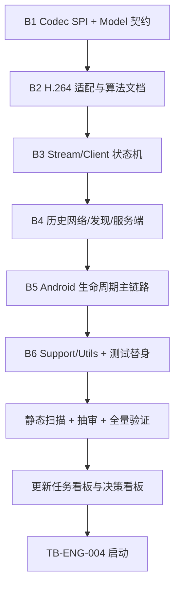

# 代码文档规范与中英双语资源实施计划（收敛版）

> **For agentic workers:** REQUIRED SUB-SKILL: Use superpowers:subagent-driven-development (recommended) or superpowers:executing-plans to implement this plan task-by-task. Steps use checkbox (`- [ ]`) syntax for tracking.

> **状态：计划已收敛，尚未执行。** TB-ENG-003 分 6 个批次串行执行，只允许新增或修改英文 Javadoc 与注释；TB-ENG-004 在 TB-ENG-003 全部完成并提交后另行启动。本文件只定义文档与资源改造的任务、边界与验收，不改变任何可执行行为、编解码路径、协议、布局结构或构建配置。

**Goal:** 把 TB-ENG-003（代码文档与英文注释规范）拆成可逐批验证、逐批提交的 6 个批次，补齐公共契约、生命周期、并发状态机与非显然算法的英文 Javadoc 与必要注释；在 TB-ENG-003 完成后按 DB-PLATFORM-002 落地 TB-ENG-004（英文默认资源 + `values-zh` 中文资源，跟随系统语言）。

**Architecture:** 文档改造按“公共契约 → codec 算法 → 状态机 → 历史组件 → Android 生命周期 → 支撑代码”分层推进。B1 先建立术语基线（access unit、descriptor、config epoch、join point、config gate、drain 等），后续批次复用同一术语，不各自造词。每个批次是一个独立提交单元：只改注释，验证通过、推送并确认 Build CI 成功后才开始下一批。TB-ENG-004 只改资源与必要的资源引用说明，不与 TB-ENG-003 混为同一提交批次。

**Tech Stack:** Java 11 source/target、Android minSdk 25、compileSdk 35、AGP 8.9.0、Gradle 8.11.1、JUnit 4.13.2。仅使用现有依赖；不引入 Mockito、Kotlin、协程、Robolectric 或新测试库。

**Spec:** [任务看板](../../task-board.md) · [决策看板](../../decision-board.md)

## 1. 背景与依据

| 依据 | 内容 | 当前状态 |
| --- | --- | --- |
| 任务板 TB-ENG-003 | 代码文档与英文注释规范，P2：历史代码与后续新增代码补齐 Javadoc 与必要注释，覆盖公共契约、生命周期、并发状态机与非显然算法；Javadoc、代码注释与日志统一英文；避免复述代码与过期说明。 | 待办，本计划落地 |
| 任务板 TB-ENG-004 | 中英双语与系统语言跟随，P2：英文与中文资源，`values/` 为英文默认与回退，中文放入 `values-zh`；跟随系统语言；暂不提供应用内语言开关。 | 待办，TB-ENG-003 完成后启动 |
| 决策 DB-DOC-002 | 历史与新增代码都补齐 Javadoc 与必要注释；统一英文；实施排在 H264 八 Task 之后，独立提交，不与编解码改动混改。 | 已批准·待实施/验证 |
| 决策 DB-PLATFORM-002 | `values/` 英文默认与回退，`values-zh` 中文；系统语言为中文时显示中文，其他语言或无法匹配时回退英文；暂不做应用内语言开关。 | 已批准·待实施/验证 |
| 前置状态 | H.264 适配批次已完成并验证：JVM 364/364 通过、`:app:assembleDebug` 通过、Build CI 绿；H.264 适配器与两阶段配置发布已落地。 | 已完成，已验证 |

本计划**不改动任何编解码行为**。H.264 的解析、两阶段配置发布、Runtime/Hub/客户端状态机、Android bridge 与既有测试都保持原状；文档批次只增加或修正英文 Javadoc 与注释。

本文区分“当前实现”“建议”“推测”“已验证证据”：标注“已验证证据”的条目来自对当前 `master` 的静态扫描或已记录的执行结果；其余条目是计划安排或待执行建议，不代表已经完成。

## 2. 盘点结论（已验证证据）

以下数字为当前 `master`（`11096a4`）的静态扫描结果，属于仓库事实，不是设备证据。

- 纯 Java 项目：142 个 `.java`、约 24,502 行；其中 `main` 102 个文件 / 10,546 行，`test` 38 个 / 13,835 行，`androidTest` 2 个 / 121 行。
- 源码内中文注释、中文 Javadoc、中文日志均为 **0**：已按 CJK 统一表意文字与兼容表意文字区间逐文件扫描验证；64 处 `Log.*` 调用全部为英文文本。因此“统一英文”没有清理量，任务实质是**补齐英文 Javadoc 与必要注释**。
- 注释缺口：全仓库 37 个文件完全无注释（`main` 27 / `test` 10 / `androidTest` 0；按 git 首次加入年份为 2025 的 27 个历史文件口径为 21 个）；类级 Javadoc 缺失 49 个文件（`main` 33 / `test` 16；历史文件口径为 25 个）；`app/src/main` 中 279 个显式 `public` 方法（排除构造器与按名称判定的 getter/setter）有 22 个带紧邻 Javadoc，占 7.9%（全仓库含测试为 849 个中 29 个，占 3.4%）。口径：完全无注释 = 文件不含任何 `//` 或 `/*`；类级 Javadoc 缺失 = 首个顶层类型声明前跳过空行与注解后没有紧邻的 `/** ... */`。
- 唯一的中文位于界面资源 `app/src/main/res/values/strings.xml`，属于 TB-ENG-004 范围，不在 TB-ENG-003 中处理。
- 缺口分级：

| 级别 | 判定标准 | 规模 |
| --- | --- | --- |
| P0 | 公共契约、生命周期、并发状态机、非显然算法 | 28 个文件 |
| P1 | 生命周期组件与公共 API 语义 | 约 30 个文件 |
| P2 | 其余轻度缺口与测试支持类 | 其余文件 |

缺口分级只决定批次内的书写深度与审查强度，不改变批次顺序；批次顺序由第 3 节的依赖关系决定。

## 3. TB-ENG-003 批次划分与顺序

| 批次 | 范围 | 规模 |
| --- | --- | --- |
| B1 Codec SPI + Model 契约 | `app/src/main/java/com/obby/android/localscreenshare/core/codec/*.java`（17）、`core/model/*.java`（11）、`core/render/*.java`（2） | 30 文件 / 约 1,257 行 |
| B2 H.264 适配与算法文档 | `core/codec/h264/*.java`（24 文件 / 约 2,490 行）；重点 `H264AnnexBParser`、`H264ConfigExtractor`、`H264BitReader`、`H264SliceHeader` 与 5 个 DTO、3 个 bridge 接口 | 中 |
| B3 Stream/Client 状态机 | `core/stream/*.java`（14）、`core/client/*.java`（2）；重点 `StreamRuntime`、`StreamHub`、`ClientSendSession`、`BoundedAccessUnitQueue`、`ClientMediaSession` | 16 文件 / 约 1,929 行 |
| B4 历史网络/发现/服务端 | `client/*.java`（4）、`discovery/*.java`（3）、`server/*.java`（5） | 12 文件 / 约 1,546 行 |
| B5 Android 生命周期主链路 | `service/LssService.java`、`service/LssClientService.java`、`MainActivity.java`、`App.java` | 4 文件 / 约 2,464 行 |
| B6 Support/Utils + 测试替身 | `support/*.java`（3）、`utils/*.java`（6）、测试支持类约 14 个 | 约 23 文件，生产代码约 565 行 |

执行顺序固定为 B1 → B2 → B3 → B4 → B5 → B6。B1 先行，为后续批次提供统一术语基线；后续批次不得另立同义术语。



批次依赖是硬约束：前一批次未完成验证、提交、推送并确认 Build CI 成功之前，不得开始下一批；不得并行修改同一批文件。

## 4. 每批执行与验证规程（硬约束，逐批适用）

### 4.1 允许与禁止的改动

- 实施者为子 agent；**只允许新增或修改英文 Javadoc 与注释**。
- 不得新增、删除或修改任何可执行语句、方法签名、字段、导入、逻辑或日志文本。
- 不得修改 `app/src/main/res/**`、`app/src/main/proto/**`、布局、`app/build.gradle`、`gradle/libs.versions.toml` 或 CI 配置。
- 不得新增依赖、测试、fixture 或构建任务。
- 一旦发现某处必须改动行为才能写清文档，**停止并上报**，不得自行改行为。关键生产代码的行为改动只能由另一会话的 Pro（DeepSeek V4 Pro）执行，并另立提交与回归测试。
- 不得为了“顺便修正”而改动常量、默认值、异常消息、字段可见性或线程语义。

### 4.2 注释质量要求

- 覆盖公共契约、生命周期、并发状态机与非显然算法；优先写“为什么”和“调用者必须知道什么”，而不是复述语句。
- 每个被触碰文件的类级 Javadoc 说明职责、线程模型与所有权边界；公共方法与公共字段说明前置条件、返回值、异常与副作用。
- 并发与生命周期说明必须写清：谁调用、在哪个线程、持有什么锁、回调是否在锁外、关闭后是否还允许回调。
- 不写复述代码的噪声注释，不写“将来会做”“暂时这样”之类的过期说明；已知延期项只在代码已有明确 TODO 或计划文档中记录，不在注释里重复承诺。
- 已有正确的英文注释保留；只在不覆盖契约或已经过期时补充或修正。
- 术语与 B1 基线一致；codec 专有名词只在 `core/codec` 内出现，公共层注释不引入具体 codec 名称分支的描述。

### 4.3 提交前自检

```bash
git diff -U0 -- '*.java'
```

- 内容行只允许是注释行（`//`、`/* ... */`、`/** ... */`）；`@@` hunk 头除外。
- 全部 `.java` 不含 CJK 字符；扫描范围覆盖 CJK 统一表意文字（4E00–9FFF、3400–4DBF）与兼容表意文字（F900–FAFF）。
- `git status --short` 只显示本批次范围内的 `.java` 文件；不得出现资源、构建文件或未跟踪文件。
- 若自检发现任何非注释改动，回退该改动后重新自检，不得带着行为改动提交。

### 4.4 每批验证

```bash
./gradlew :app:testDebugUnitTest --offline
./gradlew :app:assembleDebug --offline
```

- 两条命令均须 `BUILD SUCCESSFUL`。
- JVM 基线为 H.264 批次结束时的 364 tests / 0 failures；本计划不新增测试，测试数与结果应保持不变。
- 行为零变化：不得出现测试断言调整、资源变更或构建配置变更。

### 4.5 提交、推送与 CI 门禁

- **逐文件 `git add`**，禁止目录级 add；每个批次的提交只包含该批次列出的文件。
- 提交信息风格对齐仓库历史，使用 `docs: ...` 前缀，例如：
  - B1：`docs: 补齐 Codec SPI 与模型英文注释`
  - B2：`docs: 补齐 H264 适配英文文档`
  - B3：`docs: 补齐流与客户端状态机英文注释`
  - B4：`docs: 补齐网络发现与服务端英文注释`
  - B5：`docs: 补齐 Android 生命周期英文注释`
  - B6：`docs: 补齐工具与测试替身英文注释`
- 提交后执行 `git push origin master`；禁止 force-push。
- 推送后用 `gh run list --limit 3` 与 `gh run watch`（或轮询 `gh run view`）确认最新 Build CI 为 `success`，记录 run 编号与耗时。
- CI 未成功前不得开始下一批。CI 失败时必须读取真实日志、报告根因；不得伪造成功，也不得用跳过检查的方式让流水线变绿。

### 4.6 批次记录

每个批次完成后记录：改动文件清单、`testDebugUnitTest` 与 `assembleDebug` 结果、提交哈希与提交信息、Build CI run 编号/状态/耗时。记录进入交付汇报，不写入本计划文件。

## 5. TB-ENG-003 验收标准

- 静态扫描：全部 `.java` 无中文 Javadoc、中文注释与中文日志文本。
- 抽审：公共契约、生命周期、并发状态机与非显然算法有可核对说明；无复述代码、无过期说明等噪声注释。
- `./gradlew :app:testDebugUnitTest --offline` 与 `./gradlew :app:assembleDebug --offline` 通过；行为零变化。
- 完成后更新 [任务看板](../../task-board.md)：TB-ENG-003 标记为“已完成”，写明批次提交范围、测试数、构建结果与 CI 证据。
- 完成后更新 [决策看板](../../decision-board.md)：DB-DOC-002 标记为“已验证”，写明验证方式与证据边界。
- 看板更新以独立 docs 提交完成，不与任何批次注释提交混合。

## 6. TB-ENG-004 概要

TB-ENG-003 完成并提交后才开始 TB-ENG-004；详细盘点在 004 启动时进行，本节只固定裁决与边界。

### 6.1 依据与规则

- 依据 DB-PLATFORM-002：`values/` 为英文默认与回退，`values-zh` 为中文；跟随系统语言；暂不做应用内语言开关。
- 资源解析遵循 Android 限定符规则：系统语言为中文时命中 `values-zh`；其他系统语言或无法匹配时回退到 `values/` 的英文默认。

### 6.2 范围

- 把现有中文默认字符串迁移到 `values-zh`，键保持一致。
- `values/` 提供对应的英文默认字符串。
- 检查布局与代码中硬编码的用户可见文案，改为字符串资源；不改变布局结构或交互。
- 占位符、复数与格式参数在双语资源中保持一致：`xliff:g` 的 `id`、参数序号与类型（`%1$s`、`%2$d` 等）不得因翻译而变化。
- 不在本任务中新增功能、调整文案语义或引入应用内语言切换。

### 6.3 验收

- 资源键一致：`values/` 与 `values-zh/` 的键集合相同，无遗漏、无多余、无重复。
- 英文与中文资源均可被资源编译器解析；占位符与格式参数双语一致。
- `./gradlew :app:assembleDebug --offline` 通过。
- 语言跟随与回退以资源限定符和代码审查说明；不要求 adb、emulator、实机或 `connectedAndroidTest`。
- TB-ENG-004 与 TB-ENG-003 不混为同一提交批次；它自己的提交与看板更新独立执行。

## 7. 通用约束

- 全程禁止 `adb`、模拟器、虚拟机、实机与 `connectedAndroidTest`；不得写“设备已验证”“性能已提升”之类未执行的结论。
- 不新建或切换 worktree，直接在原仓库 `master` 上执行。
- 逐文件 `git add`，禁止目录级 add；禁止 force-push；不新增依赖。
- 与编解码改动不混改；H.264 已验证状态不得回退，任何注释改动都不得改变码流解析、配置发布、状态机或传输行为。
- 文档与代码中不得出现本机绝对路径、电脑名、用户名、账号、设备标识或执行者标识；引用仓库文件一律使用仓库相对路径。
- 图表一律使用 Mermaid，禁止 ASCII 图；产品两端只称“服务端/客户端”。
- 计划中的盘点数字是静态扫描结果，不是设备证据；本计划不产生 adb、模拟器、实机或网络验证记录。

## 停止与上报条件

出现以下任一情况时，停止当前批次并上报，不得自行扩大范围：

1. 某处必须改行为、签名、字段、资源或构建配置才能写清文档。
2. 注释与现有实现矛盾，且无法仅通过注释消除歧义。
3. 自检发现非注释改动无法在不改变行为的前提下回退。
4. 验证命令失败且根因不在注释改动范围内。
5. 推送后 Build CI 失败，且真实日志指向与注释无关的既有问题。
6. 批次范围与第 3 节不一致，或需要新增/删除文件才能完成。

上报内容必须包含：批次编号、文件路径、失败命令与真实输出、已排除的原因、建议的下一步。不得以“已通过”“应该没问题”替代证据。

## 自审清单

- **范围：** 只改英文 Javadoc 与注释；不改行为、资源、构建、依赖、测试。
- **顺序：** B1 → B2 → B3 → B4 → B5 → B6，严格串行；每批验证、提交、推送、CI 成功后才进入下一批。
- **术语：** B1 建立的术语基线在后续批次复用；公共层注释不引入具体 codec 名称分支。
- **质量：** 覆盖公共契约、生命周期、并发状态机与非显然算法；无复述代码与过期说明。
- **自检：** `git diff -U0` 只出现注释行；全部 `.java` 无 CJK；`git status` 无越界文件。
- **证据：** 每批记录测试数、构建结果、提交哈希与 CI run；不伪造成功。
- **看板：** TB-ENG-003 完成后更新任务看板与决策看板，独立 docs 提交。
- **TB-ENG-004：** 在 003 完成后启动；键一致、双语可解析、`assembleDebug` 通过；不做应用内语言开关；不与 003 混合提交。

## Execution Handoff

本计划已收敛但尚未执行。执行时按 B1–B6 严格串行，每个批次只允许英文 Javadoc 与注释改动，提交前用 `git diff -U0` 与 CJK 扫描自检，运行 `./gradlew :app:testDebugUnitTest --offline` 与 `./gradlew :app:assembleDebug --offline`，逐文件 `git add` 后推送并确认 Build CI 成功。任何必须改行为的点立即停止并上报，由 Pro 在独立会话处理。TB-ENG-003 全部完成并更新看板后，才启动 TB-ENG-004。全程不执行 adb、模拟器、实机或 `connectedAndroidTest`，不把静态扫描写成设备证据。
