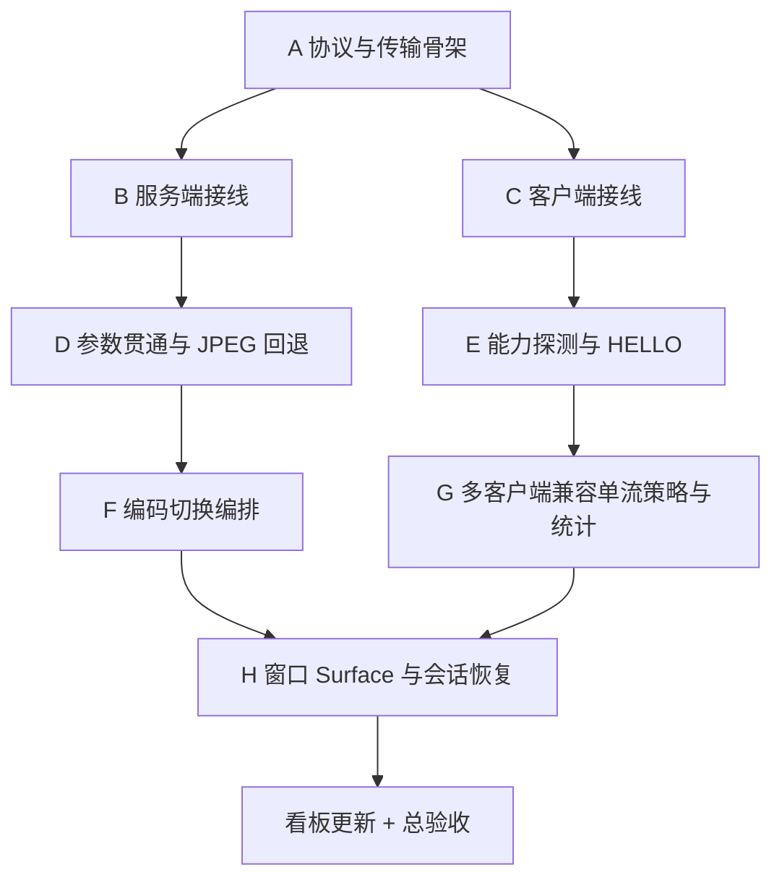

# 媒体路径接线实施计划（收敛版）

> **For agentic workers:** REQUIRED SUB-SKILL: Use superpowers:subagent-driven-development (recommended) or superpowers:executing-plans to implement this plan task-by-task. Steps use checkbox (`- [ ]`) syntax for tracking.

> **状态：计划已收敛，尚未执行。** 本计划把已实现但零接线的隔离编解码框架 + H.264 适配器接进生产投屏链路，分 A–H 八个批次串行执行，每批独立提交、独立验证、独立 CI 门禁。问题 3 代码层面完成后**由用户审视决定是否进入手机测试**；本计划不关闭问题 3。

**Goal:** 把 `core/codec`（含 H.264）、`core/model`、`core/stream`、`core/client`、`core/render` 框架接进 `LssService` 采集、`LssServer` 推流、`LssClient` 解码的生产链路，替换 2025 年 JPEG+gRPC 旧路径为「单采集单编码 + 每客户端独立会话 + 统一协议」的新路径，同时保留 JPEG 为经框架运行的降级模式。

**Architecture:** 一条双向 gRPC 流统一承载 H.264 与 JPEG 两种 codec：服务端 `LssService` 装配 `CodecRegistry`（显式注册 H.264 + 默认 JPEG）、`StreamRuntime`、`StreamHub`，`VirtualDisplay` 在 H.264 模式下直通编码器输入 Surface、在 JPEG 模式下走 ImageReader→压缩→`submitFrame`；`StreamHub` 按 `MediaTransport`（gRPC 实现）扇出到每客户端 `ClientSendSession`；客户端 `ClientMediaSession` 在专用单线程上解码，输出到 Surface 型 `RenderTarget`（H.264）或 `ShapeableImageView` 路径（JPEG）。协议升级为带 HELLO/能力声明的双向流，能力探测运行时进行，绝不按 API 等级/设备形态推断。

**Tech Stack:** Java 11 source/target、Android minSdk 25、compileSdk 35、AGP 8.9.0、Gradle 8.11.1、JUnit 4.13.2、protobuf-javalite + grpc-javalite（grpc-java 1.71.0、protoc 3.25.5）。仅使用现有依赖；不新增依赖、不改 `libs.versions.toml`。

**Spec:** [任务看板](../../task-board.md) · [决策看板](../../decision-board.md) · [媒体架构](../../media-architecture.md) · [窗口与会话设计](../../windowing-session-design.md)

## 1. 背景与依据

| 依据 | 内容 | 当前状态 |
| --- | --- | --- |
| 任务板问题 3 | 采集、编码参数与多客户端：单采集单编码、每客户端独立会话与有界队列；H.264 是兼容基线而非上限。 | 未关闭，本计划只做代码层面收官 |
| 任务板 TB-FW-003 | StreamRuntime/Hub 生产接线（服务端装配、采集直通、每客户端排空）。 | 待办，本计划落地 |
| 任务板 TB-FW-006 | 客户端会话与 RenderTarget 接线（单线程解码、Surface 型输出）。 | 待办，本计划落地 |
| 任务板 TB-MEDIA-003 | 运行时编解码能力探测与选档（服务端 `MediaCodecList`、客户端解码能力）。 | 待办，本计划落地 |
| 决策 DB-CODEC-006 | 禁止按 API 等级/设备形态推断能力。 | 已批准·待实施/验证 |
| 前置状态 | 框架 + H.264 已实现且 364 JVM 测试全绿；生产链路仍为 JPEG+gRPC 旧路径，框架零接线。 | 已完成，已验证 |
| 文档语义漂移 | `windowing-session-design.md`、`README.md`、`decision-board.md`、`media-architecture.md`、`optimization-roadmap.md` 仍以已删除的 `MediaCodec.setOutputSurface` 为前提，需按新设计修订。 | 待修，本计划批次 H 落地 |

本计划区分「当前实现 / 建议 / 推测 / 已验证证据」：标注「已验证证据」的条目来自对当前 `master`（`7e0e6cb`）的静态扫描；其余为待执行安排。

## 2. 盘点结论（已验证证据）

以下为当前 `master` 的静态扫描事实，非设备证据：

- 协议：`app/src/main/proto/screen_stream.proto` 只有 `GetScreenStream(Empty) → stream ScreenFrame{int64 timestamp; bytes data; bool secure}`，无 codec/descriptor/epoch/宽高字段。
- 框架（已实现、零生产接线）：`core/codec`（17 文件，`CodecRegistry.withDefaults()` 只注册 JPEG）、`core/codec/h264`（24 文件，`H264Codec.androidRegistration()` 无生产调用）、`core/codec/jpeg`（7）、`core/model`（11）、`core/stream`（15）、`core/client`（2）、`core/render`（2）。`grep core.codec|core.stream|core.client` 在 `core/` 包外零命中。
- 关键缺口：
  - `RenderTarget` 无生产实现（仅有测试替身 `FakeRenderTarget`）。
  - `Encoder` 接口无向非 Surface 编码器提交输入的公共 API；`JpegEncoder.offerJpegFrame(long ptsUs, byte[] jpegBytes)` 是 `Encoder` 之外的公共方法，`StreamRuntime` 无法触达。
  - `StreamRuntime.switchDescriptor`（`StreamRuntime.java:485`，`502-507`）对 `hasConfigParts()==true` 的 codec 显式抛 `CodecSwitchException`。
  - `LssClientService.ScreenShareViewer` 用 `ShapeableImageView`（Bitmap 路径），与 Surface 输出不兼容。
- `CallerRunsPolicy`：`server/LssServer.java:138-148`（`mGrpcServerExecutor`）、`client/LssClient.java:107-117`（`mGrpcClientExecutor`）。
- `StreamRuntime.start()` 已知缺陷：`registry.require(...)`（`StreamRuntime.java:198`）在 try 之外，未注册 codecId 会让 attempt 停在 `CONFIGURING` 且无法重试。本计划不引入未注册 codec 路径，故不触发；如需修复另立任务（TB-CORE 范围外）。
- 测试：`app/src/test` 共 364 个 `@Test`（38 个文件），无 Mockito，仅 JUnit 4.13.2 + 自写假件（`core/support/*`：`FakeTransport`、`FakeRenderTarget`、`FakeMediaCodecBridgeFactory`、`FakeCodec`、`FakeDeferredCodec`、`TestH264Registration`、`CapturingJpegEncoderFactory`、`H264Fixtures`、`H264BitWriter`、`MutableClock`、`BlockingTransport`）。`androidTest` 4 个，仅编译。

## 3. 总体架构（目标态）

```mermaid
flowchart LR
    subgraph Server["服务端（LssService + LssServer）"]
        VD["VirtualDisplay"]
        IR["ImageReader（JPEG 降级）"]
        RT["StreamRuntime（唯一编码器）"]
        HUB["StreamHub"]
        CSS["ClientSendSession ×N"]
        GT["GrpcMediaTransport（MediaTransport 实现）"]
        VD -- "H.264：输入 Surface" --> RT
        IR -- "JPEG：submitFrame" --> RT
        RT -- "onAccessUnit/onDescriptorChanged" --> HUB
        HUB -- "offer / drainOne" --> CSS
        CSS -- "sendDescriptor/sendAccessUnit" --> GT
    end
    subgraph Client["客户端（LssClient + LssClientService）"]
        GRX["gRPC 双向流"]
        DEC["专用单线程解码驱动"]
        CMS["ClientMediaSession"]
        RTG["RenderTarget"]
        GRX -- "ServerMessage 入队" --> DEC
        DEC -- "onDescriptor/onAccessUnit" --> CMS
        CMS -- "Decoder → 输出" --> RTG
        RTG -- "H.264：Surface / JPEG：ImageView" --> V["悬浮窗"]
    end
    GT <== "Stream(ClientMessage) ⇄ ServerMessage" ==> GRX
```



- 单一协议：JPEG 与 H.264 都走同一条双向流；「codec 模式」只是注册表里的 codec 选择，不是两套传输。
- H.264 采集直通：`VirtualDisplay` 输出到 `runtime.getInputSurface()`（编码器输入 Surface），不再 ImageReader→Bitmap。
- JPEG 降级：ImageReader→Bitmap→JPEG 压缩→`runtime.submitFrame(ptsUs, jpegBytes)`→`JpegEncoder`→AU→同一框架路径。
- 每客户端独立会话：`StreamHub.join/drainOne/detach` 替换旧的单帧 conflate 扇出；`CallerRunsPolicy` 从媒体路径移除。



批次顺序与边界以本提示词为准；A 先行（协议与传输是所有批次的公共底座），B/C 分别接线服务端/客户端，D/E 在 B/C 之后补充参数与能力，F/G/H 收尾编排、多客户端与窗口。每批独立可验证、独立提交。

## 4. 全局约束（逐批适用，硬约束）

- 每批独立提交：逐文件 `git add`（禁止目录级 add），提交信息遵循仓库历史风格，push 后确认 Build CI success 才进下一批；禁止 force-push。
- 每批验证（Git Bash，仓库根）：`./gradlew :app:testDebugUnitTest --offline`（基线 364，只增不减）与 `./gradlew :app:assembleDebug --offline` 均通过；androidTest 仅编译。
- 全程禁止 adb、模拟器/实机、`connectedAndroidTest`、安装或启动 App。
- 不新增依赖；`app/build.gradle`、`gradle/libs.versions.toml` 不做无关改动；不新增/切换 worktree，不删除既有 worktree/分支。
- 不读取/记录签名、密钥、口令；仓库代码与跟踪文档不得写本机绝对路径、电脑名、用户名、账号、设备标识、会话/agent ID。
- 图表一律 Mermaid；产品两端只称「服务端/客户端」；`docs/*.md` 中文，代码注释/Javadoc/日志英文（以 `core/codec/h264/H264Encoder.java` 为基准）。
- 旧 JPEG+gRPC 行为在降级模式下必须保持可用；不得回退已验证的框架/H.264/TB-ENG-003/TB-ENG-004 成果；与裁决冲突时停下来报告，不擅自取舍。
- CI 失败先看真实日志定位根因，不跳过测试、不伪造成功。
- 已取消工作区会话迁移：不提出/执行任何 Kimi Code 会话/索引/配置/运行时文件的修改或删除。

## 5. Review Focus（最可能咬人的输入与失败模式）

1. **secure 标志跨协议**：旧协议 secure 每帧携带；新协议收敛到 `Descriptor` 级（投影级标志）。投屏过程中 secure 改变必须仍然能传达给客户端，不能静默丢失。
2. **gRPC observer 非线程安全**：`MediaTransport` 的 gRPC 实现必须把 `sendDescriptor/sendAccessUnit` 串行化到单一发送路径；`ClientSendSession.drainOne` 已保证每会话单 drainer，但 transport 不得再并发 `onNext`。
3. **deferred 切换的半成品状态**：H.264 换档（尺寸/旋转/IDR 间隔）期间旧编码器仍在产流、新编码器尚未发布 descriptor；此时加入的新客户端必须得到 `NOT_READY` 而非错误 descriptor；失败必须保留旧编码器。
4. **JPEG 与 H.264 的 queue 溢出语义不同**：JPEG `OverflowAction` 保留最新帧、H.264 丢弃至 join point；降级切换不能把 H.264 的 resync 语义错误套到 JPEG。
5. **Surface 失效恢复**：客户端 `RenderTarget.getSurface()` 为 null 时 `ClientMediaSession` 停在 `RESYNCING`；只有 `retryConfigure()` 是恢复入口，接线代码不得绕过它直接重建解码器。

每条对应批次：1→A（`Descriptor.secure` 字段 + mapper 测试）；2→A（`GrpcMediaTransport` 串行化测试）；3→F（deferred switch 状态机测试）；4→D（JPEG 回退 + `CodecPolicy` 测试）；5→H（`retryConfigure` 恢复测试）。

## 6. 批次详细计划

### 批次 A：协议与传输骨架

**目标：** 把 proto 升级为双向流，落地 `MediaTransport` 的 gRPC 实现与服务端客户端消息解析。

**文件：**
- Modify：`app/src/main/proto/screen_stream.proto`
- Create：`app/src/main/java/com/obby/android/localscreenshare/transport/GrpcMediaTransport.java`
- Create：`app/src/main/java/com/obby/android/localscreenshare/transport/ScreenStreamProtoMapper.java`
- Test：`app/src/test/java/com/obby/android/localscreenshare/transport/ScreenStreamProtoMapperTest.java`、`GrpcMediaTransportTest.java`

**关键决策（实施者不可自行改动的部分）：**

- 替换 RPC 为双向流（pre-release、versionCode 1，无已发布客户端，可破坏性变更）：

```proto
service ScreenStreamService {
  rpc Stream(stream ClientMessage) returns (stream ServerMessage) {}
}
```

- `ClientMessage` 的 oneof：`Hello hello`、`Ready ready`、`RequestKeyframe request_keyframe`。`Hello{int32 protocol_version; string client_id; Capabilities capabilities}`；`protocol_version` 缺省按「旧客户端、H.264 兼容档」处理。
- `ServerMessage` 的 oneof：`Descriptor descriptor`、`AccessUnit access_unit`。
- `Descriptor` 字段必须完整对应 `StreamDescriptor`：`protocol_version`、`config_epoch`、`codec_id`、`mime`、`profile`、`level`、`coded_width`、`coded_height`、`visible_width`、`visible_height`、`rotation_degrees`、`bitstream_format`（`JPEG_FRAME`/`ANNEX_B`/`AVCC` 枚举字符串）、`repeated ConfigPart config_parts`、`ColorInfo color`、`config_hash`、`bool secure`。
- `AccessUnit` 字段对应 `EncodedAccessUnit`：`config_epoch`、`sequence`、`pts_us`、`dts_us`、`bool has_dts`、`bool sync_point`、`bool join_point`、`bool config`（三布尔对应 `AccessUnitFlags`）、`bytes payload`、`repeated ConfigPart join_config_parts`（`JoinInfo`）、`int32 temporal_layer_id`（可选，缺省 = 无）。
- 协议版本常量：`ScreenStreamProtoMapper.PROTOCOL_VERSION = 1`。
- `GrpcMediaTransport implements MediaTransport`：构造 `GrpcMediaTransport(StreamObserver<ServerMessage> observer, boolean secure)`；`sendDescriptor`/`sendAccessUnit` 内部用同一个私有 `synchronized` 块或 `ReentrantLock` 串行化对 `observer.onNext(...)` 的调用（observer 非线程安全），经 `ScreenStreamProtoMapper` 映射后发送；`close()` 幂等非抛。不得回调所属 session。
- `ScreenStreamProtoMapper`：纯静态无状态映射 `StreamDescriptor→Descriptor`、`EncodedAccessUnit→AccessUnit`、`Descriptor→StreamDescriptor`、`AccessUnit→EncodedAccessUnit`（客户端用），`Capabilities↔ClientCapabilities`（批次 E 前先放占位，仅 codecId 集合）。`ptsUs` 单位微秒；`dtsUs` 用 `has_dts` 区分 `EncodedAccessUnit.DTS_UNSET`。
- 客户端消息解析（服务端读入方向）本批先落一个接口 `ClientMessageListener`（回调 `onHello/onReady/onRequestKeyframe`），具体分发由批次 B 的 `LssServer` 实现接上；本批只定义与解析 `ClientMessage` 的 oneof 分发。

**风险：** proto lite 对 `oneof` 与双向流兼容；破坏性变更需同步改 `LssServer`/`LssClient`（批次 B/C），A 批本身只新增不破坏旧调用点（旧 `GetScreenStream`/`ScreenFrame` 移除后，A 批结束时编译会因 `LssServer`/`LssClient` 仍引用旧 API 而红）。**处理**：A 与 B/C 是逻辑连续但提交独立的批次——A 批提交时保留对旧 RPC 的引用点不变会破坏编译。因此 A 批把「proto 演进 + mapper + GrpcMediaTransport + 解析接口」作为纯新增落地，**旧 `GetScreenStream` 方法名保留为已废弃直至 B/C 改完**（proto 同时保留旧 `GetScreenStream`/`ScreenFrame`，B/C 完成后由 B 或 C 的收尾提交删除）。计划调整：proto 在 A 批**新增** `Stream` RPC 与新消息，**不删除**旧 `GetScreenStream`；旧方法删除放入批次 C（客户端切完后旧路径无引用）。

**验证：**
- 新增 `ScreenStreamProtoMapperTest`：`StreamDescriptor↔Descriptor` 往返（含空 configParts、`ColorInfo`、secure、config_hash 校验）；`EncodedAccessUnit↔AccessUnit` 往返（含 `DTS_UNSET`、join_point+join_config_parts、三 flag 位）。
- 新增 `GrpcMediaTransportTest`（用 fake `StreamObserver` 记录调用顺序）：并发 `sendDescriptor`+`sendAccessUnit` 不产生交错；`close()` 幂等。
- `./gradlew :app:testDebugUnitTest --offline` 与 `:app:assembleDebug --offline`。

### 批次 B：服务端接线

**目标：** `LssService` 装配框架并直通采集；`LssServer` 用 `StreamHub` 替换单帧扇出，新增每客户端排空驱动，移除 `CallerRunsPolicy`。

**文件：**
- Modify：`app/src/main/java/com/obby/android/localscreenshare/service/LssService.java`
- Modify：`app/src/main/java/com/obby/android/localscreenshare/server/LssServer.java`
- Create：`app/src/main/java/com/obby/android/localscreenshare/server/StreamCallHandler.java`（一次 gRPC `Stream` 调用：收 HELLO→`hub.join`；收 keyframe→`runtime.requestJoinPoint()`；持有 `GrpcMediaTransport` 与排空线程）
- Create：`app/src/main/java/com/obby/android/localscreenshare/core/stream/ClientSessionKeyFactory.java`（或 `server/StreamKeyFactory`）——统一 `StreamKey`/`ClientSessionKey` 生成
- Test：`app/src/test/java/com/obby/android/localscreenshare/server/StreamCallHandlerTest.java`

**关键决策：**

- `LssService` 在 `onStartCommand` 装配：`CodecRegistry registry = CodecRegistry.withDefaults(); registry.register(H264Codec.androidRegistration());`；`StreamKey` 用 `serviceId + 采集会话实例`（`sessionInstanceId`）+ 固定 `streamId`；`StreamDescriptor` 按采集尺寸 + H.264（`CodecIds.H264`、`H264Codec.MIME`、`BitstreamFormat.ANNEX_B`、codedSize=projection size、visibleSize=projection size、rotation=0、configParts 空）；`StreamParameters` 从 Preferences 取（批次 D 前用常量/`StreamParameters.DEFAULT` 过渡）。
- H.264 采集直通：`VirtualDisplay` 输出 `runtime.getInputSurface()`（`getInputSurface()` 仅在 CONFIGURING/READY 非空，故顺序为 `runtime.start()` 之后再 `createVirtualDisplay(..., runtime.getInputSurface(), ...)`）。JPEG 降级路径保留 ImageReader→Bitmap→compress（作为降级模式，批次 D 接 `submitFrame`）。
- 停止顺序改为「先停编码再释放采集」：`runtime.close()`（先）→ 释放 `VirtualDisplay`/`ImageReader`/`MediaProjection`（后）。`StreamHub.unregister`/`detach` 在 `LssServer.stop()` 内。
- `LssServer`：删除内层 `ScreenStreamService`/`ScreenStreamResponseObserver` 的单帧 conflate 扇出，改为实现新 `ScreenStreamServiceGrpc.ScreenStreamServiceImplBase.Stream`：每次调用 new 一个 `StreamCallHandler`，由它驱动 `hub.join/drainOne/detach`。
- 每客户端排空驱动：`StreamCallHandler` 持有一个单线程排空执行器（每客户端一个，或共享一个 `lss-stream-drain-*` 池），循环 `hub.drainOne(key)` 直到 `false`，再用「offer 信号 / 就绪回调」唤醒；发送在 `ClientSendSession` 的 `drainLock` 下串行。
- **移除 `CallerRunsPolicy`**：`LssServer` 的 `mGrpcServerExecutor` 拒绝策略改为 `ThreadPoolExecutor.AbortPolicy`（媒体发送不再经由该 executor 的 `onReadyHandler`；排空由独立 drain 线程承担）。`LssClient` 的 `CallerRunsPolicy` 在批次 C 移除（该文件在 C 重做）。
- `secure`：`GrpcMediaTransport` 由 `LssService` 当前的 `mIsProjectionSecure` 决定；投影级 secure 变更通过重发 `Descriptor`（新 epoch 或带外信号）传达，本批先按「启动时快照」处理，动态变更留批次 H 的恢复编排。

**风险：** `getInputSurface()` 时序（必须 `start()` 后非空）；`runtime.start()` 的 `registry.require` 在 try 外（已注册 H.264，不触发）；停止顺序反了会导致编码器 close 时仍在产流。**处理**：装配顺序与停止顺序写死为上述；`StreamCallHandlerTest` 覆盖 join→drain→detach→异常隔离。

**验证：**
- 新增 `StreamCallHandlerTest`（fake transport + `TestH264Registration`）：HELLO→ACCEPTED；`drainOne` 发送 descriptor 先于 AU；keyframe 请求→`requestJoinPoint`；detach 后 drain 返回 false。
- 全部既有 364 测试仍绿（`StreamHub`/`ClientSendSession` 行为未改）。

### 批次 C：客户端接线

**目标：** `LssClient` 改用双向流，接收解析驱动 `ClientMediaSession`（decode 串行化到单线程）；Surface 型 `RenderTarget`；`LssClientService` 改造；移除 `CallerRunsPolicy`；删除旧 `GetScreenStream`/`ScreenFrame`。

**文件：**
- Modify：`app/src/main/java/com/obby/android/localscreenshare/client/LssClient.java`
- Modify：`app/src/main/java/com/obby/android/localscreenshare/service/LssClientService.java`
- Modify：`app/src/main/proto/screen_stream.proto`（删除旧 `GetScreenStream`/`ScreenFrame`）
- Create：`app/src/main/java/com/obby/android/localscreenshare/client/ClientMediaReceiver.java`（gRPC `onNext` 只入队到 decode 线程）
- Create：`app/src/main/java/com/obby/android/localscreenshare/render/SurfaceRenderTarget.java`（TextureView/SurfaceView 浮层，`getSurface()` 可 null）
- Create：`app/src/main/java/com/obby/android/localscreenshare/render/BitmapRenderTarget.java`（JPEG 路径，包 `ShapeableImageView`，实现 `renderEncodedImage`）
- Test：`app/src/test/java/com/obby/android/localscreenshare/client/ClientMediaReceiverTest.java`

**关键决策：**

- decode 串行化：`LssClient` 建一个专用单线程执行器 `lss-client-decode`（每客户端一个，`ThreadPoolExecutor(1,1,...)` + 有界队列），gRPC `onNext` 只做「反序列化 + 入队」，**绝不在 gRPC 共享 executor 上直接 decode**。`ClientMediaReceiver` 从队列取 `ServerMessage`，依次调 `ClientMediaSession.onDescriptor/onAccessUnit`。
- `LssClient` 改造：`newStub(channel).Stream(new StreamObserver<ClientMessage>{...})`；连接建立后先发 `Hello`（clientId + 能力，能力探测在批次 E 补，本批先空 `Capabilities`）；`onError/onCompleted` → `onDisconnected`（复用现有主线程分发）。
- `SurfaceRenderTarget`：浮层持有 `TextureView`（`getSurface()` 返回 `TextureView.getSurfaceTexture() != null ? new Surface(texture) : null`）或 `SurfaceView`；`renderEncodedImage` 抛 `UnsupportedOperationException`（H.264 不用）。实现 `getSurface()` 可返回 null（会话进入 RESYNCING）。
- `BitmapRenderTarget`：实现 `renderEncodedImage(EncodedImageFrame)`（`BitmapFactory.decodeByteArray`→复用现有 `ScreenShareViewer` 的 setFrame 逻辑或新浮层）；`getSurface()` 返回 null（JPEG 不需要 Surface）。
- `LssClientService`：`ScreenShareViewer` 的缩放/圆角/拖动逻辑尽量复用；H.264 用 `SurfaceRenderTarget`，JPEG 用 `BitmapRenderTarget`；首帧/连接语义以进入 `STREAMING` 为准（`ClientStateListener` 回调驱动 loading→viewer 切换）。
- **移除 `CallerRunsPolicy`**（`LssClient.java:107-117`）：`mGrpcClientExecutor` 拒绝策略改为 `AbortPolicy`，因为解码已迁到 decode 线程。

**风险：** `ClientMediaSession` 全方法 synchronized（单线程驱动下无重入问题）；`RenderTarget.getSurface()` null 语义（会话停 RESYNCING，靠 `retryConfigure` 恢复）；旧 `ScreenShareViewer` 与 `ShapeableImageView` 复用边界。**处理**：decode 线程严格单线程；Surface 生命周期由批次 H 收尾，本批只保证 null-safe。

**验证：**
- 新增 `ClientMediaReceiverTest`：`onNext` 只入队不 decode（注入 spy decode 线程断言串行）；descriptor 先于 AU；`onDescriptor` 返回 false（重复 epoch）不崩溃。
- 删除旧 proto 方法后 `assembleDebug` 通过（旧路径引用点已全部清除）。

### 批次 D：参数贯通与 JPEG 回退

**目标：** Preferences/UI 增加码率、IDR 间隔、codec 模式（H.264/JPEG）；`StreamParameters` 贯通到编码器；JPEG 回退经框架运行。

**文件：**
- Modify：`app/src/main/java/com/obby/android/localscreenshare/support/Preferences.java`
- Modify：`app/src/main/java/com/obby/android/localscreenshare/service/LssService.java`
- Modify：`app/src/main/res/layout/` 与 `app/src/main/res/values/strings.xml`、`values-zh/strings.xml`（设置 UI）
- Modify：`app/src/main/java/com/obby/android/localscreenshare/core/codec/jpeg/JpegEncoder.java`
- Create：`app/src/main/java/com/obby/android/localscreenshare/core/codec/FrameInputEncoder.java`
- Modify：`app/src/main/java/com/obby/android/localscreenshare/core/stream/StreamRuntime.java`
- Test：`app/src/test/java/com/obby/android/localscreenshare/core/stream/StreamRuntimeSubmitFrameTest.java`、`core/codec/jpeg/JpegEncoderSubmitFrameTest.java`

**关键决策：**

- Preferences 新增：`KEY_PROJECTION_BITRATE`（int bps）、`KEY_PROJECTION_IDR_INTERVAL`（int ms）、`KEY_PROJECTION_CODEC`（String `h264`/`jpeg`）。旧 `quality` 只服务 JPEG。
- `StreamParameters` 贯通：`LssService` 从 Preferences 构造 `StreamParameters(bitrate, frameRate, idrInterval)` 传给 `StreamRuntime`；码率热更新走 `runtime.updateParameters()`（`H264Encoder.updateParameters` 只热应用码率，`H264Encoder.java:262-274`）。
- **新增 `FrameInputEncoder` 接口**（`core/codec/`）：
  ```java
  public interface FrameInputEncoder { boolean submitFrame(long ptsUs, byte[] encodedBytes); }
  ```
  `JpegEncoder implements Encoder, FrameInputEncoder`（`offerJpegFrame` 逻辑移入 `submitFrame`，保留旧方法名或改为委托，倾向直接改名）。
- **`StreamRuntime.submitFrame(long ptsUs, byte[] encodedBytes)`**：锁内校验 `state == CONFIGURING || READY` 且 `activeEncoder instanceof FrameInputEncoder`，锁外转发；否则返回 `false`。`ptsUs` 由 `LssService` 从 `image.getTimestamp()`（纳秒）`/1000` 得微秒。
- JPEG 回退：codec 模式 = `jpeg` 时，`LssService` 走 ImageReader→Bitmap→compress（复用现有 `mScreenFrameBitmap.compress(...)`）→ `runtime.submitFrame(ptsUs, data)`；`StreamRuntime` 用 `JpegCodec.registration()`（非 deferred，`start()` 即发布 descriptor）。JPEG 的 descriptor codedSize/visibleSize 用采集尺寸，`configParts` 空、`BitstreamFormat.JPEG_FRAME`。

**风险：** 帧率/IDR 间隔仅创建时生效，变更需重建编码器（走批次 F 编排）；JPEG 与 H.264 的 `CodecPolicy`（`OverflowAction`）不同。**处理**：码率热更新、帧率/IDR 变更触发 `switchDescriptor`（F）；JPEG 回退复用 `JpegCodecPolicy` 的保留最新帧语义，不套用 H.264 丢弃语义。

**验证：**
- 新增 `StreamRuntimeSubmitFrameTest`：JPEG runtime `start()` 后 `submitFrame` 返回 true 并产 AU；H.264 runtime `submitFrame` 返回 false；非 READY 返回 false。
- 新增 `JpegEncoderSubmitFrameTest`：`submitFrame` 完整 JPEG→AU joinPoint；不完整帧→false；`stop/close` 后 false。
- `testDebugUnitTest` 总数只增不减。

### 批次 E：能力探测与 HELLO

**目标：** 服务端 `MediaCodecList`/`VideoCapabilities` 编码能力探测；客户端解码能力探测；`ClientCapabilities` 从 codecId 集合升级为能力模型；HELLO 字段可缺省、旧客户端按 H.264 兼容档。

**文件：**
- Create：`app/src/main/java/com/obby/android/localscreenshare/core/stream/CodecCapability.java`
- Modify：`app/src/main/java/com/obby/android/localscreenshare/core/stream/ClientCapabilities.java`
- Create：`app/src/main/java/com/obby/android/localscreenshare/support/CodecCapabilityProbe.java`（`MediaCodecList` + `VideoCapabilities` 探测；服务端/客户端共用）
- Modify：`app/src/main/java/com/obby/android/localscreenshare/client/LssClient.java`（探测并填 `Hello.capabilities`）
- Modify：`app/src/main/java/com/obby/android/localscreenshare/server/StreamCallHandler.java`（HELLO 解析 `Capabilities`）
- Modify：`app/src/main/java/com/obby/android/localscreenshare/transport/ScreenStreamProtoMapper.java`（`Capabilities↔ClientCapabilities` 完整映射）
- Test：`app/src/test/java/com/obby/android/localscreenshare/core/stream/ClientCapabilitiesTest.java`、`ScreenStreamProtoMapperCapabilityTest.java`

**关键决策：**

- `CodecCapability`（不可变）：`codecId`、`mime`、`profile`、`level`、`maxWidth`、`maxHeight`、`maxFrameRate`、`maxBitrateBps`、`surfaceOutput`、`adaptive`；`null` profile/level 表示「未声明」。
- `ClientCapabilities` 升级：保留旧构造 `ClientCapabilities(Set<String> codecIds)`（每 id 视为「任意能力」，兼容既有测试）；新增 `ClientCapabilities(Map<String, CodecCapability>)`；`supports(String)` = 存在该 id；新增 `getCapability(String)`、`getCodecIds()`。
- `CodecCapabilityProbe`：`probeEncoder(String mime)` / `probeDecoder(String mime)` 用 `MediaCodecList` 枚举 + `VideoCapabilities` 的 `getSupportedWidths/Heights/FrameRates/Bitrates` 与 `isSizeSupported`/`areSizeAndRateSupported`/`isBitrateSupported`，产出 `CodecCapability`；`MediaCodecList` 为空或异常 → 返回空/降级，**绝不按 API 等级推断**（DB-CODEC-006）。
- 服务端：用 `probeEncoder("video/avc")` 决定 H.264 descriptor 的 profile/level 与是否可用（不可用→JPEG）；客户端：`probeDecoder("video/avc")` 填 HELLO。
- HELLO 字段可缺省：`protocol_version == 0` 或 `capabilities` 空 → 按 H.264 兼容档（`CodecIds.H264` 任意能力）处理；`client_id` 空 → 用传输侧生成的非空 id。

**风险：** `VideoCapabilities` 是 `@hide`/需反射或 `MediaCodecList.getCodecInfo`；minSdk 25 上 API 可用性。**处理**：探测逻辑集中在 `CodecCapabilityProbe`，异常全部捕获并降级为「未声明/不可用」，不 crash；探测结果对 JVM 测试不可见（JVM 不触 `android.media.*`），测试用 `CodecCapability` 纯模型 + fake 能力集合。

**验证：**
- 新增 `ClientCapabilitiesTest`：旧构造兼容；新构造的 `supports`/`getCapability`/不可变；空集合。
- 新增 `ScreenStreamProtoMapperCapabilityTest`：`Capabilities↔ClientCapabilities` 往返（含缺省字段、空 profile/level）。
- `assembleDebug`（含 `android.media.*` 探测代码）通过。

### 批次 F：编码切换编排（修订 `switchDescriptor` 契约）

**目标：** 预热新编码器→切 VirtualDisplay 输出 Surface→新 descriptor/config/可加入点先发布→客户端重配→释放旧编码器；失败保留旧编码器；采集尺寸/旋转/帧率/IDR 间隔变化走此路径并推进 epoch。

**文件：**
- Modify：`app/src/main/java/com/obby/android/localscreenshare/core/stream/StreamRuntime.java`（关键生产代码，Pro 亲自做）
- Modify：`app/src/main/java/com/obby/android/localscreenshare/service/LssService.java`（尺寸/旋转/参数变化触发 `switchDescriptor` + `virtualDisplay.setSurface`）
- Test：`app/src/test/java/com/obby/android/localscreenshare/core/stream/StreamRuntimeDeferredSwitchTest.java`

**关键决策：**

- 修订 `switchDescriptor(StreamDescriptor next)` 契约，**支持 `hasConfigParts()==true` 的 deferred codec**（H.264）：
  - 删除 `StreamRuntime.java:502-508` 的「deferred 抛 `CodecSwitchException`」。
  - 语义：同步预热新编码器（`factory.create` + surface 校验 + `start()`）；成功后在锁内把新编码器设为 active、`generation++`、state 置 `CONFIGURING`（deferred）或 `READY`（非 deferred）、旧编码器移入 `retiredEncoders`、`requested`/`publishedDescriptor` 更新为 `next`（deferred 时 `publishedDescriptor` 清空，待新 config 再发布）；失败则关闭新编码器、保留旧编码器/descriptor/epoch/state，抛 `CodecSwitchException`。
  - 复用既有 generation + `onEncoderConfig` + `onAccessUnit`（首个新 epoch join point 后 `toClose` 关闭 retired）机制：新编码器 config 到达即发布新 descriptor（`onDescriptorChanged` 通知客户端重配）；旧编码器在首个新 epoch join point 转发后关闭。
- 非 deferred 切换（JPEG→JPEG 尺寸变化）沿用既有同步发布路径（`switchDescriptor` 内 `publishedDescriptor = next`），不新增通知语义。
- `LssService` 的采集尺寸/旋转变化：构造新 `StreamDescriptor`（epoch = 当前 +1）→ `runtime.switchDescriptor(next)` → 成功后 `mVirtualDisplay.setSurface(runtime.getInputSurface())`（H.264）；JPEG 尺寸变化→重建 `ImageReader` + `virtualDisplay.setSurface(reader surface)` + `switchDescriptor`。帧率/IDR 间隔变化：先 `updateParameters(newParams)` 再 `switchDescriptor(尺寸不变但 epoch+1 的新 descriptor)`（`sameDecodeConfig` 为 false 的前提：构造新 descriptor 时把「参数变化」反映为可区分的 decode config 或显式允许 epoch 推进——**实现时若 `sameDecodeConfig(next)==true` 会抛「decode config unchanged」，需让参数变化也产生不同 config hash，或用专门的重建入口**；本计划取后者：新增 `StreamRuntime.restartWithParameters(StreamDescriptor, StreamParameters)` 或放宽 `switchDescriptor` 的 sameDecodeConfig 校验为「epoch 递增即可，允许同 config hash 的 epoch-only 推进」，二选一在实施第一步用测试锁定）。
- 切换不保证零间隙；网络/控制会话不重建。

**风险：** deferred 切换期间 `getDescriptor()` 短暂为 null（新客户端得 `NOT_READY`，可接受）；`sameDecodeConfig` 校验与「epoch-only 推进」的冲突。**处理**：Review Focus #3；`StreamRuntimeDeferredSwitchTest` 锁定「旧编码器保留至新 epoch 首个 join point」「失败保留旧编码器」「新客户端切换期间 NOT_READY」。

**验证：**
- 新增 `StreamRuntimeDeferredSwitchTest`（`FakeDeferredCodec` + `TestH264Registration`）：deferred→deferred 切换成功、新 config 发布、旧编码器在新 join point 后关闭；预热失败保留旧编码器并抛 `CodecSwitchException`；切换期间 join → `NOT_READY`。
- 既有 `StreamRuntimeTest`/`StreamRuntimeDeferredConfigTest` 仍绿。

### 批次 G：多客户端兼容单流策略与统计

**目标：** 新客户端加入按共同兼容能力选档；不兼容只能「快照/显式全局降级/拒绝」，不得静默降级已有客户端；`ClientSendStats` 并入服务端统计。

**文件：**
- Modify：`app/src/main/java/com/obby/android/localscreenshare/core/stream/StreamHub.java`（`computeFallback` 升级为能力感知，或新增 `computeCommonCapability`）
- Modify：`app/src/main/java/com/obby/android/localscreenshare/server/LssServer.java` / `StreamCallHandler.java`（解读 `JoinDecision.REQUIRES_EXPLICIT_FALLBACK` → 快照/显式全局降级/拒绝）
- Modify：`app/src/main/java/com/obby/android/localscreenshare/server/LssServerStats.java`（并入 `ClientSendStats`）
- Test：`app/src/test/java/com/obby/android/localscreenshare/core/stream/StreamHubCapabilityJoinTest.java`

**关键决策：**

- `StreamHub.join` 的 `computeFallback`（`StreamHub.java:428-458`）从「codecId 交集」升级为「能力交集」：候选 codec 必须被加入客户端与所有既有客户端以**共同兼容的能力档**支持（profile/level/宽高/帧率/码率/Surface 交集非空）；仍以最低 `fallbackPriority` 优先，并列按 codecId 稳定排序。`JoinDecision.REQUIRES_EXPLICIT_FALLBACK` 元数据携带选出的 codecId（已存在，`requiresFallback(codecId, reason)`）。
- `LssServer` 解读决策：`REQUIRES_EXPLICIT_FALLBACK` 时不得自动降级——三选一：① 拒绝该客户端；② 显式全局降级（调用方主动把 active stream 换成共同 codec，需重建 runtime，触发所有客户端重配）；③ 快照（对不兼容客户端发一张当前帧 JPEG 快照后断开）。本批实现「拒绝 + 上报」为默认；显式全局降级与快照作为受控路径提供入口（`StreamCallHandler` 回调 + 决策记录），不静默执行。
- `LssServerStats` 增加 per-client 媒体统计（队列深度/丢弃/重同步），来源 `hub.getSession(key).getStats()`（`ClientSendStats`）；采样周期沿用 3s。

**风险：** 能力交集计算与 `ClientCapabilities` 升级的联动；「显式全局降级」会重建 runtime、破坏进行中的会话，须只在用户/上层明确触发。**处理**：本批默认拒绝 + 上报，降级/快照只留显式入口与单测，不接自动触发。

**验证：**
- 新增 `StreamHubCapabilityJoinTest`：两个能力不同客户端，加入者与既有者无共同能力档 → `REQUIRES_EXPLICIT_FALLBACK`；有共同档 → `ACCEPTED`；加入后既有客户端能力不被静默改变。

### 批次 H：窗口 Surface 与会话恢复

**目标：** 悬浮窗 TextureView/SurfaceView 切换、最后帧快照、Surface 失效后的恢复编排；修订文档语义漂移（`setOutputSurface` 前提）。

**文件：**
- Modify：`app/src/main/java/com/obby/android/localscreenshare/service/LssClientService.java`（窗口切换 = attach/detach 渲染目标）
- Modify：`app/src/main/java/com/obby/android/localscreenshare/render/SurfaceRenderTarget.java`（Surface 失效通知 + 最后帧快照）
- Modify：`app/src/main/java/com/obby/android/localscreenshare/client/LssClient.java`（Surface 失效 → `retryConfigure` 编排）
- Modify（docs）：`docs/windowing-session-design.md`、`docs/README.md`、`docs/decision-board.md`、`docs/media-architecture.md`、`docs/optimization-roadmap.md`（去掉 `MediaCodec.setOutputSurface` 前提，改为 `RenderTarget.getSurface()` + `retryConfigure()`）
- Test：`app/src/test/java/com/obby/android/localscreenshare/core/client/ClientMediaSessionRecoveryTest.java`（扩展，已验证存在）

**关键决策：**

- 窗口切换 = 会话不断：按 `docs/windowing-session-design.md`，同会话内 attach/detach `RenderTarget`，不停 Service、不重连、不重解码。H.264 解码器输出到 Surface 型 `RenderTarget`；窗口切换复用现有 `ScreenShareViewer` 的缩放/圆角/拖动，仅替换渲染后端。
- Surface 失效恢复：`RenderTarget.getSurface()` 为 null 时 `ClientMediaSession` 进入 `RESYNCING`（已验证行为，`ClientMediaSession.java:163-166`）；`LssClient` 在 Surface 重新可用时调用 `retryConfigure()`（`ClientMediaSession.java:252-262`，唯一恢复入口），**不绕过它重建解码器**。框架无 `setOutputSurface`，故选择「重建解码器但不重建网络会话」的编排（`retryConfigure` 即重建 decoder、复用网络会话）。
- 最后帧快照：Surface 失效时 `SurfaceRenderTarget` 保留最后一帧（JPEG 快照或纹理位图），供窗口切换过渡显示。
- 文档语义漂移修订：五份文档中「`MediaCodec.setOutputSurface` 实现窗口切换/恢复」的表述全部改为 `RenderTarget.getSurface()` + `ClientMediaSession.retryConfigure()`；`DB-WIN-003` 与解码器 Surface 裁决的冲突点按新设计标注。

**风险：** 框架无 `setOutputSurface`，重建 decoder 有短暂间隙；最后帧快照的像素来源。**处理**：Review Focus #5；恢复编排只走 `retryConfigure`；间隙用快照过渡。

**验证：**
- 扩展 `ClientMediaSessionRecoveryTest`：Surface 失效→RESYNCING→Surface 恢复→`retryConfigure`→WAIT_RANDOM_ACCESS→join point→STREAMING；`retryConfigure` 在非 RESYNCING 状态返回 false。
- 文档提交与代码提交分离（docs 独立提交）。

## 7. 执行与验证规程（逐批适用）

### 7.1 允许与禁止的改动

- 关键生产代码（协议、传输、采集/编码/解码接线、`StreamRuntime`/`StreamHub`/`ClientMediaSession`/`LssService`/`LssServer`/`LssClient`/`LssClientService` 的可执行语句）由 Pro 亲自设计与编写。
- 纯英文 Javadoc/注释、文档、资源、测试可由 Flash 子 agent 执行；Flash 不得编写/修改关键生产代码可执行语句。
- 不新增依赖；不改 `app/build.gradle` 与 `gradle/libs.versions.toml` 的无关项；不改 CI 配置。
- 不得回退已验证成果；与九项不可反转裁决冲突时停下报告。

### 7.2 每批验证

```bash
./gradlew :app:testDebugUnitTest --offline
./gradlew :app:assembleDebug --offline
```

- 两条命令均 `BUILD SUCCESSFUL`；JVM 基线 364，新增测试后总数只增不减；androidTest 仅编译。

### 7.3 提交、推送与 CI 门禁

- 逐文件 `git add`；提交信息对齐仓库历史风格（`feat:`/`refactor:`/`docs:` 前缀，中文描述）。
- `git push origin master`；禁止 force-push。
- `gh run list --limit 3` 与 `gh run watch`（或轮询 `gh run view`）确认最新 Build CI `success`，记录 run 编号；CI 未绿不进入下一批。

## 8. 看板更新与总验收

- 每批完成后按新版式规则（日期降序 + emoji + `<details>` 折叠、概览窄表 + 详情块、证据单源）更新 `docs/task-board.md` 对应条目（TB-FW-003、TB-FW-006、TB-MEDIA-003 等）的状态与证据（独立 docs 提交）。
- 全部批次完成后的总验收：364+ 新增 JVM 测试全绿、`assembleDebug` 通过、CI 全绿、看板/决策板同步（涉及裁决状态变化的条目更新，问题 3 保持未关闭）。
- **随后停止，向用户汇报**：完成了什么、每批证据、已知限制（无设备验证）、遗留风险；由用户审视决定是否进入手机测试。
- 完成后按交接提示词体例撰写下一棒交接提示词（仓库外 `E:\temp\LocalScreenShareAndroid-handoff\`，文件名带日期与主题），并作为独立提示词交给用户。
