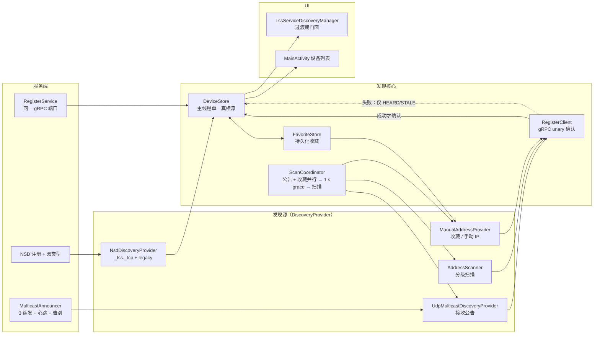

# 设备发现实施计划（方案 B 收敛版）

> **For agentic workers:** REQUIRED SUB-SKILL: Use superpowers:subagent-driven-development or superpowers:executing-plans to implement this plan task-by-task. Steps use checkbox (`- [ ]`) syntax for tracking.

> **状态：计划已收敛，尚未执行。** 技术路线、身份方案与字段分层已在 [局域网设备发现调研](../../discovery-research.md) 中收敛为“方案 B”，本文件只做文件级拆解，不重新裁决。B1–B5 串行执行，每批独立提交、独立验证、独立 CI 门禁；TB-DISC-010（自签 TLS + TOFU pinning）只列边界，不细化。设备验证仍未解禁：本计划全部验收均为离线口径（JVM 测试、编译、文档检查、CI），发现真实行为待设备实测。

**Goal:** 把单一 NSD 发现改造为“UDP 组播为主 + gRPC unary Register 双向确认 + mDNS 为辅 + 分级扫描 + 收藏/手动 IP 兜底”的发现层，以 `DeviceStore` 为设备状态单一真相源，以 AndroidKeyStore EC P-256 派生身份替代随机 `serviceId`；B1–B3 保持 UI 零改动，B4 只增加手动 IP 与收藏入口。

**Architecture:** `DiscoveryProvider`（NSD、组播、手动）只产出观测，不持有传输与信任判断；所有观测汇入主线程约束的 `DeviceStore`，由它做多通道合并、TTL、告别、收藏关联与排序；`RegisterClient` 通过既有 gRPC 端口做 unary 确认，只有确认成功才把设备置为 `CONFIRMED`；`LssServiceDiscoveryManager` 在过渡期保留原有对外契约，作为 `DeviceStore` 的 UI 门面。

**Tech Stack:** Java 11 source/target、Android minSdk 25、compileSdk 35、targetSdk 35、AGP 8.9.0、Gradle 8.11.1、JUnit 4.13.2、protobuf-javalite + grpc-javalite（grpc-java 1.71.0、protoc 3.25.5）、Gson 2.13.1。仅使用现有依赖；不新增依赖、不改 `gradle/libs.versions.toml`。

**Spec:** [发现调研](../../discovery-research.md) · [任务看板](../../task-board.md) · [决策看板](../../decision-board.md) · [媒体架构](../../media-architecture.md) · [媒体路径接线计划](2026-10-19-media-path-wiring.md)

## 1. 背景与目标

| 依据 | 内容 | 当前状态 |
| --- | --- | --- |
| 任务板 TB-DISC-001 | 设备发现调研沉淀：机制矩阵、LocalSend 源码结论、身份与字段三层分配、可靠性参数、方案 B。 | 已完成，调研文档已提交 |
| 任务板 TB-DISC-002/003 | `LssDeviceInfo` + `DeviceStore` + `DiscoveryProvider`；NSD 服务类型、实例名、TXT、超时、退避、网络回调加固。 | 待办，B1 落地 |
| 任务板 TB-DISC-004 | AndroidKeyStore EC P-256；`fp` 与 26 字符短 ID；重装即新身份；设置内重置。 | 待办，B2 落地 |
| 任务板 TB-DISC-005/006 | UDP 组播公告、心跳、告别、`MulticastLock`；proto 增加 unary `Register`，成功才进 store。 | 待办，B3 落地 |
| 任务板 TB-DISC-007/008 | 分级扫描；手动 IP 常驻入口；收藏持久化与上次成功地址。 | 待办，B4 落地 |
| 任务板 TB-DISC-009 | 发现设置、统一列表渲染、服务端/客户端分区与状态展示。 | 待办，B5 落地 |
| 任务板 TB-DISC-010 | 自签 TLS + TOFU pinning。 | 后置，本计划只列边界 |
| 决策 DB-SEC-001 | 发现默认不广播设备名；明文传输只允许在可信局域网；`FLAG_SECURE` 不是加密。 | 已批准·待实施 |
| 前置状态 | 媒体路径批次 A–H 已落地；当前 `master`（`6286c04`）静态扫描 31 个测试类、396 个 `@Test`；既有发现链路仍为 NSD 单通道。 | 已验证证据（静态扫描） |

目标：

- 多通道发现，任一通道可用即可发现；同一设备的多通道观测合并为一条记录。
- 可达性即真值：公告/解析只产生 `HEARD`，应用层 `Register` 成功才产生 `CONFIRMED`。
- 身份稳定且可重置：`fp = SHA-256(SPKI)`，短 ID 26 字符；重装或重置产生新身份，收藏方显式确认。
- 生命周期完整：启动连发、周期心跳、停服告别、TTL 过期、网络切换重发现、失败退避。
- 降级路径明确：组播被过滤时走分级扫描；扫描失败时收藏与手动 IP 仍可用。

非目标（本计划不涉及）：

- 不做云端账号、会合服务、跨公网发现。
- 不在发现阶段传输 codec profile/分辨率/帧率等详细能力。
- 不实现 TLS 与 pinning 校验（TB-DISC-010）。
- 不做 Windows/Web 端实现，只为字段与传输解耦预留位置。

标记约定沿用调研文档：**当前实现** 可在代码中直接核对；**建议** 是目标设计；**已验证证据** 指对当前 `master` 的静态扫描或已记录的执行结果；**推测** 是对设备行为或产品意图的判断。本文件所有“行号”均指 `6286c04` 时的源码位置。

## 2. 现状接线点（已验证证据）

### 2.1 发现链路

| 位置 | 当前实现 | 对 B1 的含义 |
| --- | --- | --- |
| `app/src/main/java/com/obby/android/localscreenshare/discovery/LssServiceDiscoveryManager.java:54` | 进程级单例，全部状态限定主线程；首个监听者订阅时启动 NSD，最后一个退订时停止。 | 保留“单例 + 主线程快照”的线程模型，`DeviceStore` 沿用同一纪律。 |
| 同文件 `:188`、`:232-235` | `discoverServices()` 只调用 `NsdManager.discoverServices(Constants.NSD_SERVICE_TYPE, ...)`，类型来自常量。 | 改为由 `NsdDiscoveryProvider` 执行，并对新旧类型各启动一个 discovery。 |
| 同文件 `:107-160` | `onServiceFound` 立即触发 resolve；解析结果按 service id 去重并过滤自身。 | resolve 改走带超时的封装；自身过滤改用设备短 ID（不能用 IP，多网卡会漏）。 |
| 同文件 `:119`、`:277-298`、`:288` | `buildServiceInfo` 要求 TXT `id`、TXT `name` 与解析出的 host 三者齐备，缺一即丢弃。 | “`name` 默认不广播”会让旧判据丢弃所有新服务；B1 必须把 `name` 改为可空并给出短 ID 回退显示。 |
| 同文件 `:163-173` | `onServiceLost` 直接移除条目；没有应用层 TTL。 | 改为向 store 写 `LOST` 观测，由 store 统一过期。 |
| 同文件 `:255-268` | 快照不可变、变化时才回调；监听器回调在主线程。 | 门面层继续输出不可变快照，`DeviceStoreListener` 同语义。 |
| `app/src/main/java/com/obby/android/localscreenshare/utils/NsdUtils.java:31-41`、`:49-75`、`:70` | 单线程串行 resolver；`CountDownLatch.await()` 无超时。一个不回调的 resolve 会永久占用唯一 resolver 线程。 | B1 增加超时参数与一次性回调保护；超时后释放线程并上报失败。 |
| `app/src/main/java/com/obby/android/localscreenshare/support/Constants.java:31` | `NSD_SERVICE_TYPE = "_localscreenshare._udp"`：类型标签 16 字符，超过 RFC 6763 的 15 字符上限，且 `_udp` 与实际 TCP gRPC 承载不符。 | 改为 `_lss._tcp`，旧类型保留为 legacy 常量用于双注册。 |
| 同文件 `:34`、`:37` | TXT key 只有 `id` 与 `name`。 | 增加 `r/s/j/sec/auth/pv/mv/caps`；`name` 键保留给用户显式开启的 `n`。 |
| `app/src/main/java/com/obby/android/localscreenshare/discovery/LssServiceInfo.java:48-68` | 不可变、`Parcelable`，四个字段：`id/name/hostAddress/port`，`name` 标注 `@NonNull`。 | 过渡期作为 UI 与 `Intent` 契约保留；B2 追加 `fingerprint`，B5 由 `LssDeviceInfo` 取代。 |

### 2.2 UI 与客户端消费

| 位置 | 当前实现 | 对 B1–B4 的含义 |
| --- | --- | --- |
| `app/src/main/java/com/obby/android/localscreenshare/MainActivity.java:300` | `LssServiceDiscoveryListener mServiceDiscoveryListener = mDiscoveryListAdapter::submitList`。 | 订阅面只有一个方法引用；门面层不改签名即可零改动。 |
| 同文件 `:367`、`:369`、`:396`、`:416` | 工具栏开关与 `onStart/onStop` 直接调用 manager 的订阅/退订。 | 保持方法名与语义，内部转交 store 与 providers。 |
| 同文件 `:182-208` | `DiscoveryListAdapter` 继承 `ListAdapter<LssServiceInfo, ...>`；空列表显示“搜索中”，非空显示列表。 | B1–B4 不改类型；B5 换成 `LssDeviceInfo` 并增加分区与状态徽标。 |
| 同文件 `:563-567` | 点击条目调用 `startScreenShareViewer(LssServiceInfo)`，经 `EXTRA_SERVICE_INFO` 启动客户端服务。 | B4 点击 `HEARD` 设备时先做一次 `Register` 再启动；B5 改用 `LssDeviceInfo`。 |
| `app/src/main/java/com/obby/android/localscreenshare/service/LssClientService.java:343` | `intent.getParcelableExtra(Constants.EXTRA_SERVICE_INFO)`，只读 `hostAddress` 与 `port` 建链。 | 模型迁移只需保证 `hostAddress/port` 可取；B5 统一切到 `LssDeviceInfo` 的主地址。 |

### 2.3 服务端注册与会话

| 位置 | 当前实现 | 对 B1/B3 的含义 |
| --- | --- | --- |
| `app/src/main/java/com/obby/android/localscreenshare/server/LssServer.java:427-456` | `start()` 绑定 gRPC 端口，构造 `LssServerInfo`，随后 `registerService` 并注册默认网络回调。 | 组播公告随 `start()`/`stop()` 启停，与 NSD 注册同生命周期。 |
| 同文件 `:511-519` | 实例名直接取 `serverInfo.getId()`（32 字符随机 ID）；TXT 写入 `id` 与 `name`。 | 实例名改 `LSS-<id 前8位>`；TXT 改为最小集；`name` 默认不写。 |
| 同文件 `:292-327` | 注册失败后立即 `unregisterService` 再 `registerService`，无退避。 | 换成 `BackoffPolicy`（1/2/4/8/16/30 s，带 jitter），网络变化时重置。 |
| 同文件 `:362-377` | 默认网络回调在可用/丢失/能力变化时重解析地址。 | 复用为“网络变化 → 重启 NSD 发现 + 重新公告”，客户端侧也需要同类回调。 |
| `app/src/main/java/com/obby/android/localscreenshare/server/LssServerInfo.java:42-60` | 服务器运行态 `id/name/hostAddress/port`，`Parcelable` 经 `Messenger` 传给 Activity。 | B2 追加 `deviceId` 与 `fingerprint`，`id` 保留为废弃别名；不改 `Messenger` 协议。 |
| `app/src/main/java/com/obby/android/localscreenshare/client/LssClient.java:190-197` | 构造函数只接收 `host`、`port`，使用明文 OkHttp channel。 | Register 复用同一地址与端口，无需新通道类型。 |
| 同文件 `:264-276` | HELLO 的 `client_id` 是每次启动随机生成的 `client-<UUID>`，`protocol_version` 固定 1。 | 设备身份不在 HELLO 中；B3 增加 `device_id`/`fingerprint` 字段，不改 `client_id` 的会话语义。 |
| `app/src/main/java/com/obby/android/localscreenshare/server/StreamCallHandler.java:126-147` | `onHello` 只读 `client_id` 与能力；`protocol_version` 被忽略；空能力回退为 H.264 基线。 | Register 的版本策略独立实现；HELLO 兼容回退保持不变。 |

### 2.4 身份、偏好与清单

| 位置 | 当前实现 | 影响 |
| --- | --- | --- |
| `app/src/main/java/com/obby/android/localscreenshare/support/Preferences.java:172-179` | `getServiceId()` 首次生成 32 字符随机 UUID（去连字符）并持久化。 | 身份改为 Keystore 派生后，该值只服务 legacy NSD 与旧收藏过渡。 |
| 同文件 `:187-195`、`:191` | `getServiceName()` 首次读取 `Settings.Global.DEVICE_NAME` 并持久化，作为 NSD TXT 与本地显示名。 | 这是调研指出的泄露点；默认广播必须停止，但本地显示可继续使用该名字。 |
| 同文件 `:374-381` | 发现开关 `KEY_DISCOVERY_ENABLED`。 | B5 的设置项沿用同一 observer 机制。 |
| `app/src/main/AndroidManifest.xml:5-12` | 已有 `INTERNET`、`ACCESS_NETWORK_STATE`、`ACCESS_WIFI_STATE`、前台服务与悬浮窗权限。 | 缺少 `CHANGE_WIFI_MULTICAST_STATE`（普通权限），B3 必须补。 |
| 同文件 `:16` | `android:allowBackup="true"`。 | 备份恢复后 SharedPreferences 还在、Keystore 密钥不在，会出现“旧收藏 + 新身份”，必须走身份变更提示。 |
| `app/build.gradle:19`、`:24` | `compileSdk 35`、`targetSdk 35`。 | 尚未触发 `ACCESS_LOCAL_NETWORK`；升级 targetSdk 时才成为风险项。 |
| `app/src/main/proto/screen_stream.proto:7-9` | 只有一个双向流 RPC `Stream`。 | B3 追加 unary `Register`，服务名不变、端口不变。 |
| `app/src/test`（静态扫描） | 31 个测试类、396 个 `@Test`；无 Mockito，使用手写 fake（`core/support/*`）。 | 新发现层测试沿用 `MutableClock`、手写 fake 与契约测试的既有风格。 |

### 2.5 与已收敛决策的偏差与冲突（只报告，不改裁决）

1. **TXT `name` 是当前发现的必需字段**：`LssServiceDiscoveryManager.java:288` 在缺少 `name` 时直接丢弃服务。决策要求“`name` 默认不广播”，因此 B1 必须同时放宽摄入判据与模型可空性；否则新服务类型上线后列表恒为空。
2. **`LssServiceInfo.name` 是 `@NonNull` 且是跨服务 `Parcelable` 契约**（`LssServiceInfo.java:48-55`、`LssClientService.java:343`）：名字可空无法用现有模型表达，B1 采用短 ID 回退显示，B5 才迁移模型。
3. **HELLO 没有设备身份字段**：`LssClient.java:265-268` 的 `client_id` 是会话级随机值，服务端 `StreamCallHandler.onHello` 也只把它当会话键。字段三层分配要求 HELLO 携带 `id`/`fp`，B3 需新增 proto 字段而不是复用 `client_id`。
4. **实例名不是设备名**：`LssServer.java:513` 使用随机 `serviceId`，调研已校正这一事实；真正的设备名泄露点是 TXT `name`（`LssServer.java:517` + `Preferences.java:191`），与决策描述一致。
5. **NSD 注册失败无退避**：`LssServer.java:293-306` 立即重试；与 B1 的“重试退避”要求冲突，B1 明确替换。
6. **`targetSdk` 仍为 35**：`ACCESS_LOCAL_NETWORK` 尚未生效，风险只在未来升级 targetSdk 时出现；本计划不提前声明该权限。
7. **备份与身份语义相抵**：`allowBackup="true"` 会恢复收藏但不会恢复 Keystore 密钥；这不是决策冲突，但 B2/B4 必须把“身份变更”做成显式状态，不能静默覆盖收藏。

## 3. 总体架构



模块职责：

| 模块 | 职责 | 不做什么 |
| --- | --- | --- |
| `DiscoveryProvider` | 启停一个发现源，产出 `DeviceObservation`。 | 不判断可达性、不写信任、不持有 gRPC 通道。 |
| `DeviceStore` | 合并多通道观测、TTL/过期/告别、收藏关联、排序、快照。 | 不做网络 I/O、不解析报文、不直接触达 UI。 |
| `RegisterClient` | 对候选地址发起 unary `Register`，超时/重试/去重。 | 不决定列表展示、不持久化。 |
| `ScanCoordinator` | 分级触发：公告与收藏并行 → 1 s grace → 接口 prefix 扫描。 | 不扫描 VPN/蜂窝；不无限扫描。 |
| `MulticastAnnouncer` | 服务端公告、心跳、告别。 | 不选择 UI 可见性（由 `LssService` 传入）。 |
| `RegisterService` | 服务端接收 Register、限速、回包、回打一次反向 Register。 | 不直接写 UI 模型。 |
| `FavoriteStore` | 收藏与上次成功地址持久化。 | 不把收藏当成可达性证据。 |

线程模型（**建议**，沿用现有发现管理器）：

- `DeviceStore` 是进程级单例（与 `Preferences`、`LssServiceDiscoveryManager` 一致），由服务端 `RegisterService` 与 Activity 侧发现共用同一实例，避免“服务端学到设备、界面看不到”。
- `DeviceStore` 的所有状态只在主线程读写；provider 的网络线程只负责解析，然后通过 `ThreadUtils.getMainThreadExecutor()` 投递观测。
- store 对外只发不可变快照 `List<LssDeviceInfo>`，替换而非原地修改，保证 `DiffUtil` 与 `ListAdapter` 的既有假设成立。
- TTL 由一个主线程 `Handler` 每秒 `tick()` 驱动，不用每设备一个定时器。
- `TimeSource` 注入（复用 `core/stream/TimeSource` 与测试用 `MutableClock`），使 TTL/退避可在 JVM 上确定性测试。

## 4. 字段与协议设计

### 4.1 `LssDeviceInfo`

**建议** Java 不可变值对象（项目为纯 Java，不使用调研里的 Kotlin 伪代码）：

```java
public final class LssDeviceInfo {
    String id;                 // 26 字符 Crockford base32，设备主键
    String fingerprint;        // base64url(SHA-256(SPKI))；广播中为空，Register/HELLO 才有
    String name;               // 可空；空时 UI 回退为 "LSS-" + id 前 8 位
    DeviceRole role;           // SERVER / CLIENT / BOTH / UNKNOWN
    ShareState state;          // LIVE / IDLE / UNKNOWN
    JoinPolicy join;           // OPEN / APPROVAL / CLOSED / UNKNOWN
    boolean secure;
    AuthMode auth;             // NONE / PIN / MTLS / UNKNOWN
    String protocolVersion;    // "1.0"
    int metadataVersion;       // 字段语义版本，变化时客户端丢弃旧缓存
    int capabilities;          // codec/能力位图
    List<DeviceAddress> addresses;
    DevicePresence presence;   // HEARD / CONFIRMED / STALE / UNREACHABLE
    long lastSeenMs;           // 最后一次听到任何通道
    long lastConfirmedMs;      // 最后一次应用层确认
    boolean favorite;
    boolean identityChanged;   // 收藏指纹与当前设备指纹不一致
}
```

`DeviceAddress`：`host`（IPv4 字面量或带方括号的 IPv6 字面量）、`port`、`family`（4/6）、`channel`（`NSD`/`MULTICAST`/`SCAN`/`MANUAL`/`FAVORITE`）、`lastConfirmedMs`、`confirmed`。

扩展说明：调研模型里的 `state` 是“直播中/空闲”，本计划另加 `presence` 表达可达性，避免两个语义挤在同一个字段。

### 4.2 DeviceStore 设计

**主键**：`id`（短 ID）。`fingerprint` 是信任锚，不作为主键，因为广播阶段没有 `fp`；同一 `id` 不同 `fp` 视为身份冲突，进入 `identityChanged`，不自动合并。legacy 条目没有短 ID 时用 `legacy:<随机 id>` 作为临时键，并在 B2 后逐步淘汰。

**多通道候选合并**：条目内部维护 `Map<channelKey, ChannelState>`，`channelKey = channel + host + port`。同一设备的 NSD、组播、扫描、手动观测都并入同一条目；地址按“已确认优先、IPv4 优先、最近确认优先”排序，客户端取第一个可用地址。

**`Available` 判据**：只有 `lastConfirmedMs` 在 `CONFIRMED_TTL` 内且至少一个通道 `confirmed=true` 才是 `CONFIRMED`；NSD 解析、组播公告、扫描候选都只算 `HEARD`。点击 `HEARD` 设备时先做一次 `Register`，成功后启动串流；失败则提示并保留条目。

**TTL、过期与告别**：

| 参数 | 值 | 说明 |
| --- | --- | --- |
| `HEARD_TTL_MS` | 15 s | 3 个活跃心跳周期；超时降为 `STALE` |
| `CONFIRMED_TTL_MS` | 45 s | 3 个空闲心跳周期；超时降为 `STALE` |
| `REMOVE_AFTER_MS` | 90 s | 非收藏条目在 2×CONFIRMED_TTL 后移除 |
| `STORE_CAPACITY` | 256 | 超限时先淘汰最旧的 `STALE` 非收藏条目 |
| `TICK_INTERVAL_MS` | 1 s | 主线程定时器，一次扫描全表 |

告别：收到 `announces=false` 且 `id` 匹配、`boot` 相同且 `seq` 更新时立即置 `LOST` 并从快照移除（收藏条目保留为 `UNREACHABLE`）。NSD `onServiceLost` 只降级对应通道，不直接删条目。

**乱序与去重**：公告带 `boot`（每次进程启动随机 64 位十六进制）与单调 `seq`；同一 `boot` 下只接受更大的 `seq`，不同 `boot` 视为重启并重置序号基线。

**线程模型**：见第 3 节；`DeviceStore` 不持有锁，所有方法断言主线程（debug 断言 + `ThreadUtils.isMainThread()` 早退）。

**与收藏的关系**：`FavoriteStore` 是独立持久层，`DeviceStore` 只读取收藏标记与 `customAlias`。收藏条目不因 TTL 删除，状态退化为 `UNREACHABLE`；收藏探测由 `ManualAddressProvider` 在每次发现启动时与公告并行触发。收藏指纹与当前 `fp` 不一致时置 `identityChanged`，UI 要求用户确认后才更新收藏。

### 4.3 公告报文（UDP 组播）

**选择 JSON 而不是 protobuf 二进制**，理由：

1. 公告是发现层的最小集（目标 ≤ 320 字节），JSON 的体积代价可忽略；
2. 报文可抓包直读，便于设备实测与问题定位；
3. 发现层不应依赖媒体 proto 的演进；JSON 用字段白名单解码，未知字段忽略，天然向前兼容；
4. Gson 已是生产依赖（`Preferences` 使用），不新增依赖；protobuf 仍只服务 gRPC 控制面。

**建议**报文：

```json
{
  "v": 1,
  "id": "L7Q3K9M2F4X8B6N1C5V0Z3T7R2",
  "role": "server",
  "state": "live",
  "join": "approval",
  "sec": false,
  "auth": "none",
  "pv": "1.0",
  "mv": 1,
  "caps": 3,
  "port": 8080,
  "plat": "android",
  "boot": "b7f3c2a1d4e59608",
  "seq": 42,
  "ttl": 15,
  "announces": true,
  "n": "客厅电视"
}
```

- `n` 仅在用户显式开启“广播设备名”时出现，默认不写。
- `fp` 不进公告；`port` 是 gRPC 端口，供 Register 使用。
- 解码限制：UTF-8、最大 512 字节、最多 24 个字段、字符串长度上限 64；超限直接丢弃并计数。
- `announces` 缺省按 `true` 处理（v1 前向兼容）；`false` 表示告别。
- `caps` 位图 v1 只定义 `1=H264`、`2=JPEG`，其余位保留。

### 4.4 `Register` RPC

**建议**在既有 `screen_stream.proto` 中新增，不新建服务、不新建端口：

```proto
service ScreenStreamService {
  rpc Stream(stream ClientMessage) returns (stream ServerMessage) {}
  rpc Register(RegisterRequest) returns (RegisterResponse) {}
}

// Existing message, extended with identity fields. client_id keeps its
// session-scoped meaning; device_id is the stable discovery key.
message Hello {
  int32 protocol_version = 1;
  string client_id = 2;
  Capabilities capabilities = 3;
  string device_id = 4;
  string fingerprint = 5;
}

message RegisterRequest {
  int32 protocol_version = 1;
  bool announces = 2;
  DeviceSummary self = 3;
}

message RegisterResponse {
  int32 protocol_version = 1;
  bool accepted = 2;
  string reject_reason = 3;
  DeviceSummary self = 4;
}

message DeviceSummary {
  string device_id = 1;
  string fingerprint = 2;
  string name = 3;
  string role = 4;
  string state = 5;
  string join = 6;
  bool secure = 7;
  string auth = 8;
  int32 metadata_version = 9;
  uint32 capabilities = 10;
  repeated DeviceAddress addresses = 11;
}

message DeviceAddress {
  string host = 1;
  int32 port = 2;
  int32 family = 3;
}
```

语义：

- `RegisterRequest.self` 必填；缺 `device_id` 或 `fingerprint` 时响应 `accepted=false, reject_reason="missing_identity"`。
- `announces=true`：请求方把自己当作“公告发起者”，响应方最多回打一次 `announces=false` 的反向 Register（带 0–200 ms jitter），随后不再传播；`announces=false`：只回包，不再发起任何 Register。由此每条 Register 链最多一跳，杜绝回环。
- 成功判据在客户端侧：收到 `accepted=true` 且 `self.device_id` 非空、`protocol_version` 兼容，才向 `DeviceStore` 写 `CONFIRMED`；超时、拒绝、版本不兼容都只保留 `HEARD`。
- 服务端在成功时也把调用方 `self` 写入本机 store（双方互学），但不得因写入而再次主动 Register。
- 复用关系：`Register` 只携带发现层字段；HELLO 继续携带能力细节与 `client_id`，两者不合并。HELLO 新增的 `device_id`/`fingerprint` 只用于把会话绑定到发现条目，`client_id` 仍决定 `StreamHub` 的会话键，避免把“同设备重连”误判为“同会话重复加入”。`Capabilities` 消息只属于 HELLO；Register 的能力是位图 `capabilities`。
- 版本策略：`ScreenStreamProtoMapper.PROTOCOL_VERSION` 保持 1，`RegisterRequest.protocol_version` 复用它；`0` 按 1 处理；请求版本高于本机时回 `accepted=false, reject_reason="unsupported_version"`，本机版本高于请求时正常回包但只使用 v1 字段；`metadata_version` 变化只影响缓存失效，不改变协议版本。
- 限速：每远端地址 10 次/分钟、全局 100 次/分钟；超限回 `reject_reason="rate_limited"`，不抛异常。
- 字段校验：`device_id` 长度 26、`fingerprint` ≤ 64、`name` ≤ 64、`addresses` ≤ 4、字符串只允许可打印 UTF-8。

### 4.5 mDNS TXT

服务类型 `_lss._tcp`；实例名 `LSS-<id 前 8 位大写>`；SRV 提供端口；TXT 最小集：

```text
v=1
id=L7Q3K9M2F4X8B6N1C5V0Z3T7R2
r=server
s=live
j=approval
sec=0
auth=none
pv=1.0
mv=1
caps=3
```

- `name` 默认不写；用户开启“广播设备名”后追加 `n=<name>`。
- 键长均 ≤ 9 字符，TXT 总量目标 ≤ 200 字节。
- legacy 类型 `_localscreenshare._udp` 在过渡期继续注册与发现，但只写 `id` 与可选 `name`，避免旧客户端解不出新键。

### 4.6 字段三层分配（对齐调研 5.2）

| 字段 | 广播公告 | Register 响应 | HELLO | 理由 |
| --- | --- | --- | --- | --- |
| `id` | 是 | 是 | 是 | 列表/收藏主键 |
| `fp` | 否 | 是 | 是 | 太长；用于 pin 与身份比对 |
| 显示名 | 可选 | 是 | 是 | 隐私；连接后才算已验证 |
| 精确型号/OS | 否 | 否 | 是 | 降低 fingerprinting |
| `role` | 是 | 是 | 是 | 服务端/客户端分区 |
| `state` | 是 | 是 | 是 | 直播中/空闲 |
| `join` | 是 | 是 | 是 | 可直接加入/需确认/关闭 |
| `viewers` | 否 | 是 | 是 | 活动隐私；unicast 足够 |
| codec 位图 | 是 | 是 | 是 | 兼容性提示 |
| codec profile/分辨率/fps | 否 | 否 | 是 | 太大；连接后协商 |
| `sec`/`auth` | 是 | 是 | 是 | 决定 TLS/认证 |
| `pv`/`mv` | 是 | 是 | 是 | 兼容性/缓存失效 |
| 会话标题 | 否 | 可选 | 是 | 隐私 |
| PIN/challenge | 否 | 否 | 是 | 秘密 |
| 多地址 | 否 | 是 | 是 | 源 IP 不够时补充 |
| `boot`/`seq`/`ttl` | 是 | 否 | 否 | 去重/过期 |

## 5. 批次计划

### 5.1 全局约束与 Review Focus

逐批硬约束：

- 每批独立提交；逐文件 `git add`，禁止目录级 add；提交信息用 `feat:`/`refactor:`/`docs:` 前缀 + 中文描述；禁止 force-push。
- 每批验证（Git Bash，仓库根）：`./gradlew :app:testDebugUnitTest --offline` 与 `./gradlew :app:assembleDebug --offline`；JVM 基线 396（当前 `master` 静态统计），只增不减。
- 全程禁止 adb、模拟器/实机、`connectedAndroidTest`、安装或启动 App。
- 不新增依赖；不改 `gradle/libs.versions.toml`、`app/build.gradle` 与 CI 配置；清单只允许在 B3 增加 `CHANGE_WIFI_MULTICAST_STATE` 这一项普通权限。
- 文档中文、代码注释/Javadoc/日志英文；图表一律 Mermaid；仓库内不写本机绝对路径、用户名、设备标识、会话/agent ID。
- 与已收敛决策冲突时停下报告，不擅自取舍。

Review Focus（最容易咬人的失败模式）：

1. **自身过滤不能按 IP**：多网卡、热点、双栈下同一设备有多个地址；只按 `id` 过滤，`id` 未建立前按私有 `boot` + 本机公告内容比对。
2. **公告不能升级为可达**：任何 `HEARD` 观测都不得写 `CONFIRMED`；只有 `Register` 成功且身份字段齐全才写。
3. **主线程约束**：socket 接收线程、gRPC 回调、NSD 回调都不得直接改 store；必须投递主线程，否则快照竞争与 `DiffUtil` 崩溃。
4. **`MulticastLock` 引用计数**：公告方与接收方可能同时存在，锁必须按引用计数获取/释放；服务停止、Activity 退到后台都要归零，避免耗电与泄漏。
5. **双注册的名字冲突**：同一实例名注册到新旧两个服务类型时，失败重试必须只重试失败的那个类型，不能把另一个已成功的注册 unregister。
6. **身份重置的连锁反应**：重置后旧收藏全部进入 `identityChanged`，不得自动覆盖；正在进行的发现与公告必须重启。

### 5.2 批次 B1：设备模型、DeviceStore 与 NSD 加固（TB-DISC-002 + TB-DISC-003）

**目标：** 建立 `LssDeviceInfo`/`DeviceAddress`/`DeviceStore`/`DiscoveryProvider` 抽象；修正 NSD 服务类型、实例名与 TXT；补 resolve 超时、启动失败退避、网络回调重发现；UI 零改动。

**文件：**

- Create：`app/src/main/java/com/obby/android/localscreenshare/discovery/model/LssDeviceInfo.java`
- Create：`app/src/main/java/com/obby/android/localscreenshare/discovery/model/DeviceAddress.java`
- Create：`app/src/main/java/com/obby/android/localscreenshare/discovery/model/DeviceRole.java`、`ShareState.java`、`JoinPolicy.java`、`AuthMode.java`、`DevicePresence.java`、`DiscoveryChannel.java`
- Create：`app/src/main/java/com/obby/android/localscreenshare/discovery/store/DeviceStore.java`
- Create：`app/src/main/java/com/obby/android/localscreenshare/discovery/store/DeviceEntry.java`（包内可见的合并状态）
- Create：`app/src/main/java/com/obby/android/localscreenshare/discovery/store/DeviceStoreListener.java`
- Create：`app/src/main/java/com/obby/android/localscreenshare/discovery/provider/DiscoveryProvider.java`
- Create：`app/src/main/java/com/obby/android/localscreenshare/discovery/provider/DeviceObservation.java`
- Create：`app/src/main/java/com/obby/android/localscreenshare/discovery/nsd/NsdDiscoveryProvider.java`
- Create：`app/src/main/java/com/obby/android/localscreenshare/discovery/nsd/NsdTxtRecord.java`（纯 JVM 编解码）
- Create：`app/src/main/java/com/obby/android/localscreenshare/support/BackoffPolicy.java`
- Modify：`app/src/main/java/com/obby/android/localscreenshare/discovery/LssServiceDiscoveryManager.java`（改为门面 + store 的 `LssServiceInfo` 映射）
- Modify：`app/src/main/java/com/obby/android/localscreenshare/utils/NsdUtils.java`（带超时的 resolve）
- Modify：`app/src/main/java/com/obby/android/localscreenshare/support/Constants.java`（新类型、TXT 键、TTL/容量）
- Modify：`app/src/main/java/com/obby/android/localscreenshare/server/LssServer.java`（实例名、TXT、退避、双注册）
- Modify：`app/src/main/java/com/obby/android/localscreenshare/support/Preferences.java`（设备别名可空、是否广播名字、legacy 说明）
- Test：`app/src/test/java/com/obby/android/localscreenshare/discovery/store/DeviceStoreTest.java`、`DeviceStoreMergeTest.java`
- Test：`app/src/test/java/com/obby/android/localscreenshare/discovery/model/LssDeviceInfoTest.java`
- Test：`app/src/test/java/com/obby/android/localscreenshare/discovery/nsd/NsdTxtRecordTest.java`
- Test：`app/src/test/java/com/obby/android/localscreenshare/support/BackoffPolicyTest.java`

**类设计要点：**

- `DiscoveryProvider`：`void start(DiscoveryProviderListener listener)`、`void stop()`、`String id()`；`DiscoveryProviderListener.onObserved(DeviceObservation)`、`onProviderError(String reason)`。provider 不感知 store。
- `DeviceObservation`：`source`、`id?`、`fingerprint?`、`name?`、`role/state/join/secure/auth`、`address`、`boot?`、`seq?`、`lastSeenMs?`、`confirmed=false`（provider 永远只能产出未确认观测）。
- `DeviceStore`：见 4.2；额外提供 `List<LssServiceInfo> legacySnapshot()` 供门面使用，`name` 为空时回退 `LSS-` + id 前 8 位。
- `NsdTxtRecord`：`Map<String, String> decode(Map<String, byte[]>)`、`Map<String, byte[]> encode(LssDeviceInfo, boolean shareName)`；未知键忽略，缺失必需键返回空。
- `NsdDiscoveryProvider`：两个 `NsdManager.discoverServices` 注册（新类型 + legacy），每类型独立 `DiscoveryListener`；`onStartDiscoveryFailed` 用 `BackoffPolicy` 退避重启；`registerDefaultNetworkCallback` 在 `onAvailable/onLost/onCapabilitiesChanged` 时重启发现；解析超时 2 s。
- `NsdUtils.resolveService` 增加 `timeoutMs` 重载：`latch.await(timeout)`，用 `AtomicBoolean` 保证回调只投递一次；超时投递 `onResolveFailed(TIMEOUT)`，resolver 线程继续处理下一项。
- `LssServer.buildNsdServiceInfo`：实例名 `LSS-` + id 前 8 位大写；TXT 由 `NsdTxtRecord.encode` 生成；`nsdServiceInfo.setAttribute` 逐键写入；双注册分别持有两个 `RegistrationListener`，各自重试。
- `Preferences`：新增 `getDeviceAlias(): @Nullable String`、`setDeviceAlias`、`isShareNameEnabled()`；`getServiceName()` 保留为“本地显示名”，不再作为广播默认值。

**验证：**

- 新增测试覆盖：多通道上报同一设备合并为一条；TTL 到期降级与移除；告别立即移除；收藏条目不因 TTL 删除；`HEARD` 不因公告或 NSD 解析升级为 `CONFIRMED`；`NsdTxtRecord` 编解码往返、缺 `name` 仍可解、未知键忽略；`BackoffPolicy` 序列与重置。
- `./gradlew :app:testDebugUnitTest --offline`（396 + 新增，只增不减）、`./gradlew :app:assembleDebug --offline`。

**提交计划：** 一个 `feat:` 提交（代码 + 测试）；随后一个 `docs:` 提交更新 TB-DISC-002/003 状态与证据。

### 5.3 批次 B2：设备身份（TB-DISC-004）

**目标：** AndroidKeyStore 生成并长期持有 EC P-256 密钥；`fp = base64url(SHA-256(SPKI))`、短 ID = Crockford base32(SHA-256(SPKI)[0..16]) 共 26 字符；重装即新身份；设置内提供“重置设备身份”；当前无 TLS，`fp` 只作声明值。

**文件：**

- Create：`app/src/main/java/com/obby/android/localscreenshare/identity/DeviceIdentity.java`
- Create：`app/src/main/java/com/obby/android/localscreenshare/identity/IdentityProvider.java`
- Create：`app/src/main/java/com/obby/android/localscreenshare/identity/AndroidKeystoreIdentityProvider.java`
- Create：`app/src/main/java/com/obby/android/localscreenshare/identity/IdentityManager.java`（进程级单例 + 内存缓存）
- Create：`app/src/main/java/com/obby/android/localscreenshare/identity/SpkiId.java`（纯 JVM 派生）
- Create：`app/src/main/java/com/obby/android/localscreenshare/support/Base32Crockford.java`
- Modify：`app/src/main/java/com/obby/android/localscreenshare/server/LssServerInfo.java`（追加 `deviceId`、`fingerprint`，`id` 保留）
- Modify：`app/src/main/java/com/obby/android/localscreenshare/discovery/LssServiceInfo.java`（追加可空 `fingerprint`）
- Modify：`app/src/main/java/com/obby/android/localscreenshare/server/LssServer.java`（`id` 取设备短 ID；TXT 不写 `fp`，`fp` 只走 Register 与 HELLO）
- Modify：`app/src/main/java/com/obby/android/localscreenshare/MainActivity.java`（设置面板显示短 ID + “重置设备身份”）
- Modify：`app/src/main/res/layout/widget_screen_share_service_settings.xml`、`app/src/main/res/values/strings.xml`、`app/src/main/res/values-zh/strings.xml`
- Test：`app/src/test/java/com/obby/android/localscreenshare/identity/SpkiIdTest.java`、`DeviceIdentityTest.java`、`IdentityProviderContractTest.java`
- Test：`app/src/test/java/com/obby/android/localscreenshare/support/Base32CrockfordTest.java`
- Test support：`app/src/test/java/com/obby/android/localscreenshare/identity/support/FakeIdentityProvider.java`

**类设计要点：**

- `IdentityProvider`：`DeviceIdentity loadOrCreate()`、`DeviceIdentity reset()`；实现不得在 JVM 测试中被调用，纯派生逻辑全部放在 `SpkiId`/`Base32Crockford`。
- `AndroidKeystoreIdentityProvider`：别名 `lss-device-identity`；`KeyGenParameterSpec` 使用 EC P-256、`PURPOSE_SIGN|VERIFY`、`DIGEST_SHA256`、不需要用户认证；AndroidKeyStore 会为密钥对生成自签证书，`fp` 仍从 `PublicKey.getEncoded()`（X.509 SPKI）计算，因此证书续签不改变身份。
- `SpkiId.derive(byte[] spkiDer)`：一次 SHA-256，完整 32 字节做 base64url 去填充（`fp`），前 16 字节做 Crockford base32（26 字符，`id`）。
- 异常：密钥缺失、`KeyPermanentlyInvalidatedException`、Keystore 不可用 → 重新生成并返回“身份已变更”事件，由 UI 提示；不得回退到 `Preferences.getServiceId()`。
- 重置流程：删除别名 → 重新生成 → 清空 `DeviceStore` → 重启 NSD 双注册与组播公告 → 收藏条目标记 `identityChanged`。
- `LssServerInfo` 的 `Parcel` 追加字段写在末尾，保证旧读取顺序不变；`id` 与 `deviceId` 在 B2 期间同值，`id` 标注 `@Deprecated`。

**验证：**

- `Base32CrockfordTest`：已知向量、填充/大小写归一、26 字符长度。
- `SpkiIdTest`：固定 EC SPKI DER 的 `fp`/`id` 稳定、长度、字符集；篡改 1 字节后全变。
- `IdentityProviderContractTest`：fake 上首次生成、重复读取稳定、重置后变化。
- `IdentityManager` 为 Android 依赖，不写 JVM 单测；只保证 `assembleDebug` 通过。

**提交计划：** 一个 `feat:` 提交（身份 + 设置入口 + 测试）；随后 `docs:` 提交更新 TB-DISC-004。

### 5.4 批次 B3：UDP 组播通道与 Register（TB-DISC-005 + TB-DISC-006）

**目标：** 组播公告（组 `224.0.0.167` 可配、端口可配、TTL=1、3 连发 100/500/2000 ms、周期心跳、停服告别 `announces:false`、`MulticastLock`）；proto 增加 unary `Register`（复用现有 gRPC 端口）；公告触发的 Register 成功后才写入 store；`announces` 防回环。

**文件：**

- Modify：`app/src/main/proto/screen_stream.proto`（`Register` + `DeviceSummary` + `DeviceAddress`）
- Modify：`app/src/main/AndroidManifest.xml`（`CHANGE_WIFI_MULTICAST_STATE`）
- Create：`app/src/main/java/com/obby/android/localscreenshare/discovery/udp/Announcement.java`
- Create：`app/src/main/java/com/obby/android/localscreenshare/discovery/udp/AnnouncementCodec.java`（纯 JVM JSON 编解码 + 限制）
- Create：`app/src/main/java/com/obby/android/localscreenshare/discovery/udp/MulticastSocketFactory.java`（抽象）
- Create：`app/src/main/java/com/obby/android/localscreenshare/discovery/udp/AndroidMulticastSocketFactory.java`
- Create：`app/src/main/java/com/obby/android/localscreenshare/discovery/udp/MulticastTransport.java`（每接口一个 socket、接收循环、错误重建）
- Create：`app/src/main/java/com/obby/android/localscreenshare/discovery/udp/MulticastAnnouncer.java`
- Create：`app/src/main/java/com/obby/android/localscreenshare/discovery/udp/UdpMulticastDiscoveryProvider.java`
- Create：`app/src/main/java/com/obby/android/localscreenshare/discovery/udp/MulticastLockManager.java`（引用计数）
- Create：`app/src/main/java/com/obby/android/localscreenshare/discovery/register/RegisterClient.java`
- Create：`app/src/main/java/com/obby/android/localscreenshare/discovery/register/RegisterProtoMapper.java`（纯 JVM 映射）
- Create：`app/src/main/java/com/obby/android/localscreenshare/server/RegisterCallHandler.java`
- Modify：`app/src/main/java/com/obby/android/localscreenshare/server/LssServer.java`（在既有 `StreamService` 上实现 `register`，委托 `RegisterCallHandler`；向公告器提供端口与设备摘要）
- Modify：`app/src/main/java/com/obby/android/localscreenshare/service/LssService.java`（公告器随服务启停、可见性、告别）
- Modify：`app/src/main/java/com/obby/android/localscreenshare/client/LssClient.java`（HELLO 增加 `device_id`/`fingerprint` 字段）
- Modify：`app/src/main/java/com/obby/android/localscreenshare/support/Constants.java`（组/端口/TTL/心跳/连发常量）
- Modify：`app/src/main/java/com/obby/android/localscreenshare/support/Preferences.java`（组播组、端口、公告开关）
- Test：`app/src/test/java/com/obby/android/localscreenshare/discovery/udp/AnnouncementCodecTest.java`、`MulticastAnnouncerTest.java`、`MulticastProviderDedupTest.java`
- Test：`app/src/test/java/com/obby/android/localscreenshare/discovery/register/RegisterClientTest.java`、`RegisterProtoMapperTest.java`
- Test：`app/src/test/java/com/obby/android/localscreenshare/server/RegisterCallHandlerTest.java`
- Test support：`app/src/test/java/com/obby/android/localscreenshare/discovery/support/FakeMulticastSocketFactory.java`、`FakeRegisterStub.java`

**组播通道设计：**

| 项 | 设计 |
| --- | --- |
| socket 生命周期 | 公告器随 `LssService` 启停；接收器随发现订阅启停（Activity 在前台时）；任一活动即持有 `MulticastLock`，引用计数归零才释放。 |
| socket 粒度 | 每个可用接口一个 socket（上限 4），各自 `joinGroup`、`setTimeToLive(1)`、`setLoopbackModeDisabled(true)`；与 LocalSend 的每网卡一 socket 一致，避免出接口竞态；回环关闭失败时仍按 `id` 过滤自身。 |
| 线程 | 每个 socket 一个接收线程（守护线程，后台优先级）；发送由公告器单线程调度器串行执行；解析后只投递 store 观测。 |
| 报文格式 | JSON UTF-8，≤ 512 字节；选择理由见 4.3。 |
| 接收缓冲 | 65536 字节；连续 10 次接收错误后关闭并按 `BackoffPolicy` 重建该 socket。 |
| 启动连发 | 3 次，100/500/2000 ms。 |
| 心跳 | 活跃 5 s（正在串流）、空闲 15 s；公告内容带递增 `seq`。 |
| 告别 | 停服时 3 次（0/100/300 ms）`announces=false`，随后关闭 socket 并释放锁。 |
| 去重 | `(id, boot, seq)`；过滤自身 `id`；同一地址 300 ms 内只触发一次 Register（合并抖动）。 |

**Register 设计：**

- `RegisterClient.register(DeviceAddress, boolean announces, Callback)`：500 ms deadline、2 次重试（0.2/0.5 s + jitter）、单地址在途去重；回调在主线程。
- 服务端 `RegisterCallHandler`：校验 → 限速 → 写本机 store（仅成功）→ 若 `announces=true` 且未达反向配额，异步回打一次 `announces=false`。
- `assembleDebug` 必须覆盖 proto 生成代码；`RegisterProtoMapper` 保持纯 JVM，便于往返测试。

**验证：**

- `AnnouncementCodecTest`：往返、缺省 `announces` 为 true、超长/超字段丢弃、未知字段忽略、`n` 缺省。
- `MulticastAnnouncerTest`：假调度器断言 100/500/2000 序列、心跳间隔切换、告别 3 连发与 `announces=false`。
- `MulticastProviderDedupTest`：同 `boot` 旧 `seq` 丢弃、不同 `boot` 重置、自身 `id` 过滤、300 ms 合并。
- `RegisterClientTest`：成功、超时重试次数、拒绝不写 store、并发去重。
- `RegisterCallHandlerTest`：`announces=true` 最多一次反向回打；`announces=false` 不回打；缺失身份拒绝；限速拒绝。
- `./gradlew :app:testDebugUnitTest --offline`、`./gradlew :app:assembleDebug --offline`。

**提交计划：** proto + 代码 + 测试一个 `feat:` 提交；随后 `docs:` 更新 TB-DISC-005/006。

### 5.5 批次 B4：分级扫描、手动 IP 与收藏（TB-DISC-007 + TB-DISC-008）

**目标：** 公告与收藏并行探测 → 1 s grace 内零确认才扫描；按接口 prefix 扫描（不写死 `/24`、并发 ≤ 50、单请求 500 ms、不扫 VPN/蜂窝）；手动 IP 常驻入口（8–12 s 无结果亮出）；收藏持久化 `{id, fp, ip, port, alias, customAlias}`；上次成功地址优先。

**文件：**

- Create：`app/src/main/java/com/obby/android/localscreenshare/discovery/scan/NetworkPrefix.java`（纯 JVM 候选生成）
- Create：`app/src/main/java/com/obby/android/localscreenshare/discovery/scan/LocalInterface.java`
- Create：`app/src/main/java/com/obby/android/localscreenshare/discovery/scan/InterfaceEnumerator.java`（抽象）
- Create：`app/src/main/java/com/obby/android/localscreenshare/discovery/scan/AndroidInterfaceEnumerator.java`（`ConnectivityManager` + `LinkProperties`）
- Create：`app/src/main/java/com/obby/android/localscreenshare/discovery/scan/AddressScanner.java`
- Create：`app/src/main/java/com/obby/android/localscreenshare/discovery/scan/ScanCoordinator.java`
- Create：`app/src/main/java/com/obby/android/localscreenshare/discovery/favorite/FavoriteDevice.java`
- Create：`app/src/main/java/com/obby/android/localscreenshare/discovery/favorite/FavoriteStore.java`
- Create：`app/src/main/java/com/obby/android/localscreenshare/discovery/manual/ManualAddressProvider.java`
- Modify：`app/src/main/java/com/obby/android/localscreenshare/MainActivity.java`（手动 IP 对话框、收藏长按菜单、8–12 s 后显示入口）
- Modify：`app/src/main/java/com/obby/android/localscreenshare/service/LssClientService.java`（连接成功回写上次地址）
- Modify：`app/src/main/java/com/obby/android/localscreenshare/support/Preferences.java`（收藏文件与上次地址键）
- Modify：`app/src/main/res/layout/` 与 `values/strings.xml`、`values-zh/strings.xml`（手动入口、收藏操作）
- Test：`app/src/test/java/com/obby/android/localscreenshare/discovery/scan/NetworkPrefixTest.java`、`InterfaceFilterTest.java`、`AddressScannerTest.java`、`ScanCoordinatorTest.java`
- Test：`app/src/test/java/com/obby/android/localscreenshare/discovery/favorite/FavoriteStoreTest.java`
- Test support：`app/src/test/java/com/obby/android/localscreenshare/discovery/support/FakeInterfaceEnumerator.java`、`FakeProbe.java`、`FakePreferencesStore.java`

**类设计要点：**

- `NetworkPrefix.candidates(Inet4Address local, int prefixLength, int maxHosts, Predicate<InetAddress> skip)`：从 `local` 与掩码计算网络地址与广播地址，枚举主机地址；跳过自身、网络地址、广播地址；`maxHosts` 上限 1024，超出时只扫“本机所在 /24”并在结果中标记 `partial=true`（保留非常见掩码能力，同时给出成本上限）。
- `AndroidInterfaceEnumerator`：`ConnectivityManager.getAllNetworks()` + `getLinkProperties`；只接受 `TRANSPORT_WIFI` 或 `TRANSPORT_ETHERNET`，排除 `TRANSPORT_VPN`、`TRANSPORT_CELLULAR`；排除 `tun*`、`ppp*`、`rmnet*`、`dummy*`、`p2p*` 接口名；只取 IPv4；prefix 长度小于 22（网络大于 1022 台）时按 `maxHosts` 截断。
- `AddressScanner`：固定 50 线程池 + 有界队列（128）；每个候选一个 `RegisterClient`（500 ms）；总预算 8 s/接口，`cancel()` 幂等；返回 `ScanResult(scanned, confirmed, cancelled, partial)`。
- `ScanCoordinator`：`IDLE → ANNOUNCING → GRACE(1 s) → SCANNING → DONE`；启动公告与收藏探测并行；grace 结束确认数 > 0 则不扫描；扫描只在用户刷新、发现启动、网络变化时触发，不周期执行。
- `FavoriteStore`：独立 `SharedPreferences` 文件 `lss-favorites`，Gson 序列化 `List<FavoriteDevice>`；`customAlias=true` 时远端改名不覆盖；`fingerprint` 变化时置 `identityChanged` 而不是覆盖。
- 上次成功地址：`LssClientService` 在 `onConnected` 时写 `{id → host, port}`；`ManualAddressProvider` 启动时先探测这些地址，再探测收藏。

**验证：**

- `NetworkPrefixTest`：`/24`、`/22`、`/16` 的主机数、跳过自身/网络/广播、`maxHosts` 截断与 `partial` 标记。
- `InterfaceFilterTest`：VPN/蜂窝/回环/点对点被排除；Wi-Fi 与以太网保留；IPv6-only 接口跳过。
- `AddressScannerTest`：并发不超过 50、单请求超时、取消后不再发新探测、预算耗尽终止。
- `ScanCoordinatorTest`：grace 内有确认不扫描；无确认才扫描；网络变化重启；重复触发合并。
- `FavoriteStoreTest`：往返、`customAlias` 语义、身份变化标记、损坏 JSON 回退为空。
- `./gradlew :app:testDebugUnitTest --offline`、`./gradlew :app:assembleDebug --offline`。

**提交计划：** 一个 `feat:` 提交（扫描 + 收藏 + 手动入口 + 测试）；随后 `docs:` 更新 TB-DISC-007/008。

### 5.6 批次 B5：发现设置与 UI 集成（TB-DISC-009）

**目标：** 发现设置（组播组/端口/超时、可见性、仅兼容模式）；设备列表统一从 `DeviceStore` 渲染；服务端/客户端分区与状态展示；`LssServiceInfo` 契约迁移到 `LssDeviceInfo`。

**文件：**

- Create：`app/src/main/java/com/obby/android/localscreenshare/discovery/DiscoverySettings.java`（不可变设置快照）
- Create：`app/src/main/java/com/obby/android/localscreenshare/discovery/VisibilityPolicy.java`（本机可见性与到期策略）
- Create：`app/src/main/java/com/obby/android/localscreenshare/discovery/DeviceListModel.java`（纯 JVM：分区、排序、空状态）
- Modify：`app/src/main/java/com/obby/android/localscreenshare/MainActivity.java`（`ListAdapter<LssDeviceInfo>`、分区标题、状态徽标、设置面板）
- Modify：`app/src/main/java/com/obby/android/localscreenshare/service/LssClientService.java`（`EXTRA_SERVICE_INFO` 改 `LssDeviceInfo`）
- Modify：`app/src/main/java/com/obby/android/localscreenshare/support/Constants.java`（`EXTRA_SERVICE_INFO` 类型说明）
- Modify：`app/src/main/java/com/obby/android/localscreenshare/support/Preferences.java`（组播组、端口、超时、可见性、仅兼容模式）
- Modify：`app/src/main/res/layout/activity_main.xml`、`item_screen_share_discovery.xml`、`widget_screen_share_service_settings.xml`
- Modify：`app/src/main/res/values/strings.xml`、`app/src/main/res/values-zh/strings.xml`
- Test：`app/src/test/java/com/obby/android/localscreenshare/discovery/DiscoverySettingsTest.java`、`DeviceListModelTest.java`、`VisibilityPolicyTest.java`

**类设计要点：**

- `DiscoverySettings`：`multicastGroup`、`multicastPort`、`registerTimeoutMs`、`visibility`（`HIDDEN/FAVORITES/VISIBLE/VISIBLE_10_MIN`）、`compatOnly`；从 `Preferences` 读取，非法值回退默认；变化时通过 `Preferences.Observer` 重启 providers。
- `DeviceListModel`：输入 `List<LssDeviceInfo>` + 本机角色，输出 `List<Row>`（`HEADER_SERVERS`、`DEVICE`、`HEADER_CLIENTS`、`EMPTY_HINT`）；排序：`CONFIRMED` 优先 → 收藏优先 → IPv4 优先 → 最近确认 → 名称 → `id`。
- `MainActivity`：`DiffUtil.areItemsTheSame` 用 `id`；`areContentsTheSame` 用值相等；空列表文案区分“搜索中（< 8 s）”“未发现设备（≥ 8 s，显示手动入口）”“发现已关闭”。
- 可见性：`HIDDEN` 不公告也不接收；`FAVORITES` 只对收藏方可见（通过 Register 白名单，广播仍发但 `join=closed`）；`VISIBLE_10_MIN` 到期自动回到 `HIDDEN`，由主线程定时器驱动。
- 兼容模式：`compatOnly=true` 时只注册 legacy 类型、只使用 H.264 能力位，跳过组播与扫描。
- `LssServiceInfo` 在 B5 后只保留给 legacy NSD 适配器内部使用，标注 `@Deprecated`；`LssClientService` 改读 `LssDeviceInfo`，`LssServiceInfo` 的删除放到后续清理提交。

**验证：**

- `DeviceListModelTest`：分区顺序、收藏置顶、`CONFIRMED` 优先、IPv6 排序、空列表状态。
- `VisibilityPolicyTest`：`HIDDEN/FAVORITES/VISIBLE/VISIBLE_10_MIN` 的展示与到期回退。
- `DiscoverySettingsTest`：默认值、非法组播组回退、端口范围、仅兼容模式映射。
- `./gradlew :app:testDebugUnitTest --offline`、`./gradlew :app:assembleDebug --offline`；中英文资源键一致。

**提交计划：** 一个 `feat:` 提交（设置 + 列表 + 迁移 + 测试）；随后 `docs:` 更新 TB-DISC-009 与任务看板“当前焦点”。

### 5.7 后置项 TB-DISC-010 的边界（不在本计划细化）

- 自签证书来自 AndroidKeyStore 密钥对；`fp` 仍按 SPKI 计算，证书续签不改变身份。
- TOFU 首次连接确认、指纹变化拒绝、收藏与 pinning 的绑定关系。
- Register 与媒体流同时加密；与 TB-SEC-001 合并设计。
- 本计划只保证：`LssDeviceInfo.fingerprint` 字段、Register/HELLO 的身份字段与收藏指纹已经就位，届时不需要再改发现字段。

## 6. 兼容与迁移

### 6.1 新旧客户端/服务端共存

| 组合 | 行为 | 过渡措施 |
| --- | --- | --- |
| 新客户端 + 新服务端 | 组播 + Register + NSD 新类型全功能 | 目标态 |
| 新客户端 + 旧服务端 | 旧服务端只注册 `_localscreenshare._udp` 且 TXT 只有 `id/name` | 新客户端同时发现 legacy 类型，条目标 `role=UNKNOWN`、`presence=HEARD`；连接前尝试 Register，失败则按旧路径直接连 gRPC |
| 旧客户端 + 新服务端 | 旧客户端只发现 legacy 类型 | 新服务端在过渡期双注册 legacy 类型，legacy TXT 使用 `id`（legacy serviceId）与 `name=LSS-xxxx`（不写设备名）；组播公告旧客户端不解析，无影响 |
| 新客户端 + 旧服务端（IPv6/多地址） | 旧服务端无多地址 | 使用 NSD 解析出的单地址，能力位按 legacy 处理 |

双注册的生命周期：B1 引入，至少保留一个发布版本；删除条件是新客户端覆盖率确认后，由任务板另立条目。

### 6.2 `LssServerInfo` / `serverId` 的废弃路径

1. B2：`LssServerInfo` 追加 `deviceId` 与 `fingerprint`；`id` 与 `deviceId` 同值并标注 `@Deprecated`；`Preferences.getServiceId()` 只服务 legacy NSD。
2. B3：Register/HELLO 使用 `deviceId`；`client_id` 仍是会话级随机值，不承载设备身份。
3. B5：`LssServiceInfo` 退出 UI 与 `Intent` 契约，`LssServerInfo.id` 不再被新代码读取。
4. 后续清理提交：删除 `Preferences.getServiceId()` 与 `LssServiceInfo`；在此之前保留是为了让旧收藏与旧 NSD 条目仍可解析。

### 6.3 协议版本

- `PROTOCOL_VERSION = 1` 同时服务 HELLO 与 Register；`RegisterRequest.protocol_version == 0` 按 1 处理。
- 请求版本高于本机：回 `accepted=false, reject_reason="unsupported_version"`，本机不写 store；UI 标记“需升级”。
- `metadata_version` 单调递增，用于让客户端丢弃旧字段缓存；不触发协议拒绝。
- 组播公告的 `v` 是公告格式版本，与 gRPC 协议版本独立；未知 `v` 直接忽略。

### 6.4 身份与收藏迁移

- 旧收藏若以 `serviceId` 为键，迁移时保留为 legacy 条目，首次 Register 成功拿到 `fp` 后提示“绑定身份”，用户确认后改写为 `{id, fp}`。
- `allowBackup` 恢复后 Keystore 密钥缺失：新身份 + 旧收藏 → 全部 `identityChanged`，不自动覆盖。
- 重置身份：清空 store、重启公告与 NSD、收藏全部标记待确认。

## 7. 风险与缓解

| 风险 | 影响 | 缓解 | 批次 |
| --- | --- | --- | --- |
| Android 17 `ACCESS_LOCAL_NETWORK`（targetSdk 升级时） | 未授权时组播/扫描/localhost 之外的 LAN 访问被拒 | 升级 targetSdk 时同步申请运行时权限；权限拒绝时降级为手动 IP；本计划不提前声明 | 后置 |
| 组播被 AP 隔离/企业网络过滤 | 公告收不到，列表为空 | 1 s grace 后分级扫描；收藏与手动 IP 常驻；扫描失败只退避该接口 | B4 |
| 扫描成本 | 大网段（`/16`）或多次刷新导致耗电与延迟 | 每接口 1024 候选上限、总预算 8 s、并发 50、仅在零确认时触发、退到后台取消 | B4 |
| Keystore 证书续签限制 | 证书过期后无法在原密钥上续签 | 身份按 SPKI 而非证书计算；证书长期有效；无法续签时换密钥并按新身份提示 | B2 / TB-DISC-010 |
| mDNS SRV target 泄露 hostname | 系统 responder 可能暴露主机名 | mDNS 只作辅助通道；TXT 最小化；不把 hostname 放进任何字段；彻底控制需自建 responder，列为已知限制 | B1 |
| 公告伪造/放大 | 任意主机可发公告，诱导 Register 流量 | 公告只产生 `HEARD`；Register 限速与字段校验；缓存容量上限；不因公告自动连接媒体流 | B3 |
| 自身发现 | 多网卡下按 IP 过滤会漏 | 按 `id` 过滤；`id` 未建立前按本机公告的 `boot`/`seq` 识别 | B1/B3 |
| `MulticastLock` 泄漏 | 待机耗电、Wi-Fi 过滤策略异常 | 引用计数 + 服务/页面生命周期双保险；停止时强制归零并断言 | B3 |
| 双注册名字冲突 | 一个类型注册失败导致另一个被误注销 | 两个类型各自持有 listener 与重试状态，互不 unregister | B1 |
| 主线程卡顿 | 大量观测/扫描结果集中投递 | 观测按 100 ms 合并批量投递；扫描结果只投递确认项；快照变化才回调 | B1/B4 |

## 8. 验收标准

### 8.1 逐批验收

| 批次 | 交付 | 离线验证 | 完成判据 |
| --- | --- | --- | --- |
| B1 | 模型 + store + provider 抽象 + NSD 加固 | 新增 store/TTL/合并/TXT/退避测试；`testDebugUnitTest`、`assembleDebug` | 396 + 新增全绿；UI 无改动即可显示新类型条目 |
| B2 | Keystore 身份 + 短 ID + 重置入口 | `SpkiId`/base32/契约测试；`assembleDebug` | 同一安装 ID 稳定；重置后变化；`fp` 长度与字符集正确 |
| B3 | 组播 + Register + 心跳/告别 | 编解码、调度、去重、Register 客户端/服务端测试；`assembleDebug` | 公告触发 Register；失败不入 store；`announces` 链最多一跳 |
| B4 | 扫描 + 手动 IP + 收藏 | prefix/接口过滤/扫描调度/收藏测试 | 非 `/24` 可生成候选；VPN/蜂窝被排除；收藏往返与身份变更标记 |
| B5 | 设置 + 统一列表 | 设置/分区/可见性测试；资源键一致 | 列表只从 `DeviceStore` 渲染；分区与状态正确 |

### 8.2 全局离线验收

```bash
./gradlew :app:testDebugUnitTest --offline
./gradlew :app:assembleDebug --offline
python scripts/checks/check_docs.py
```

- 两条 Gradle 命令 `BUILD SUCCESSFUL`；JVM 测试数从 396 起只增不减；androidTest 仅编译。
- `check_docs.py` 全绿（相对链接、表格列数、代码围栏、绝对路径与凭据扫描）。
- 每次 push 后 `gh run list --limit 4` 确认 Build 与 Checks 均 `success`，记录 run 编号。
- 文档提交每批独立；任务看板条目在代码提交后更新状态与证据。

### 8.3 明确未验证的范围

- 同一 LAN 两台 Android 的真实互发现、5 s 内出现、停服 10 s 内消失。
- 组播在真实 AP、AP 隔离、企业网络、跨 VLAN 下的行为。
- `MulticastLock` 的实际收包效果、待机耗电、后台回收后的恢复。
- AndroidKeyStore 在真实设备上的生成/读取/重置行为，以及备份恢复后的身份变化。
- mDNS SRV target 的实际 hostname 泄露程度。
- Android 17 `ACCESS_LOCAL_NETWORK` 的运行时行为。
- 扫描在 `/22`、`/16`、热点、双栈网络下的时延与准确率。

以上全部标记为“待设备实测”，在本计划中不作为已完成结论；发现真实行为未验证前，不得关闭 TB-DISC-002 至 TB-DISC-009 的验证状态。
