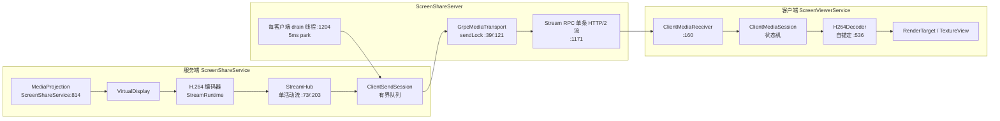
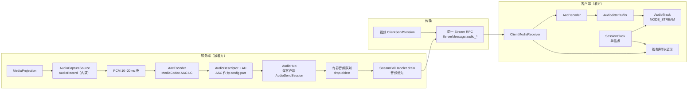

# 服务端声音传输实施计划（TB-AUDIO-001 调研 + 批次拆解）

> **For agentic workers:** REQUIRED SUB-SKILL: Use superpowers:subagent-driven-development or superpowers:executing-plans to implement this plan task-by-task. Steps use checkbox (`- [ ]`) syntax for tracking.

> **状态（2026-10-21 更新）：A1–A7 已按第 10.1 章的裁决结果实施并逐批提交；A7b 因 D1=不做而取消；A8 设备验证未执行。** 本文件的调研部分保留原样，实施落位与验证证据以任务看板 `TB-AUDIO-001` 与 `TB-AUDIO-003` 为准。依据为 2026-10-21 工作树（master）的静态代码审查、Android 平台公开文档、AOSP 兼容性定义（CDD）与 scrcpy/WebRTC/GStreamer 的公开资料。**设备验证未解禁**：凡涉及真机音频采集、回声、编码器可用性、音画同步实测、功耗与温升之处一律标注 **推测**，并写成设备验证阶段的检查点，不作为结论。JVM 基线以实施后 `:app:testDebugUnitTest` 实际数字为准（A1–A7 实施后 **1236 个测试 / 120 类**；N1/N2/N4 修复后 **1248 / 121**；N6-1 修复后 **1262 / 122**，只增不减）。

> **A5 语义修订（2026-10-21，N6-1 修复）**：本节 6.6 与第 4 章中「播放头 ns 与 `clock.map(最后写入 Pts)` 直接相减」的描述已作废 —— 那样比较的是两个不同时钟（音轨内纳秒 vs 开机单调时钟），实测把 `AV_OFFSET` 抬到 ≈21 h。现行语义见 6.6 的「漂移守卫（修订）」：采样侧改为**帧计数**（`AudioSink.getPresentedFrames(nowNs)`），会话侧用「最后写入缓冲区末端的时间戳 − 仍排在音轨里的帧时长」得到**可闻位置的流时间**，守卫只对**偏移的变化量**（相对上次修正）动作。

> **落位**：本文件位于 `docs/superpowers/plans/2026-10-21-audio.md`；文内所有相对链接按该位置解析（`../../task-board.md` 等）。

**Goal:** 在**不新增依赖、不改 minSdk 25、不动构建文件**的前提下，把「被看方设备正在播放的声音」送到观看端：API 29+ 用 `AudioPlaybackCapture` 内录，AAC-LC 编码，复用现有 gRPC 双向流的新消息类型传输，观看端用 `AudioTrack` 播放并与现有 H.264 画面**共用一条会话单调时钟**；API 25–28 默认**无音频**且 UI 明示，麦克风降级仅在用户裁决后作为独立批次；任何一段音频链路失败都**只降级音频、绝不打断视频**。

**Architecture:** 五层：**采集**（`AudioRecord`，内录或麦克风）→ **编码**（MediaCodec AAC-LC，输出原始 AAC 帧 + `AudioSpecificConfig`）→ **服务端扇出**（一路采集/编码，每客户端独立有界音频队列，音频优先于视频出队，慢客户端只丢自己的音频）→ **传输**（同一 `Stream` RPC 上新增 `AudioDescriptor`/`AudioAccessUnit`，与视频共用连接但队列与重同步策略完全独立）→ **播放**（客户端 AAC 解码 + jitter buffer + `AudioTrack`，音频 buffer 驱动播放，视频按共享时钟映射到同一条时间轴）。协议增量全部是 proto3 新增字段，旧端按「未知字段 → payload 未设置」忽略，**不新增 RPC、不改端口、不改 TLS 形态**。

**Tech Stack:** Java 11 source/target、Android minSdk 25、compileSdk/targetSdk 35、AGP 8.9.0、Gradle 8.11.1、JUnit 4.13.2（手写 fake，仓库惯例，无 Mockito）、grpc-java 1.72.0、protobuf-javalite。音频只用平台 API：`AudioRecord` / `AudioPlaybackCaptureConfiguration`（API 29+）/ `MediaCodec`（`audio/mp4a-latm`）/ `AudioTrack` / `AcousticEchoCanceler`（仅麦克风模式）。

**Spec:** [任务看板](../../task-board.md#tb-audio-001) · [决策看板](../../decision-board.md#db-audio-001) · [媒体架构音频](../../media-architecture.md) · 原始问答第 5 问（仓库外材料 `LocalScreenShareAndroid-handoff/original-questions-answers.md`） · [命名规范](../../naming-conventions.md) · [编码框架](../../codec-framework.md) · [传输可观测性计划](2026-10-21-transport-observability.md)

## 1. 背景与目标

| 依据 | 要求 | 当前状态 |
| --- | --- | --- |
| [TB-AUDIO-001](../../task-board.md#tb-audio-001) | API 29+ `AudioPlaybackCapture`；API 25–28 默认无声或显式麦克风；AAC-LC 兼容优先；统一会话单调时钟与客户端 jitter buffer | 📋 待办。仓库内**没有任何音频代码**：无 `RECORD_AUDIO`、无 `AudioRecord`/`AudioTrack`/AAC 相关类 |
| [DB-AUDIO-001](../../decision-board.md#db-audio-001) | 音频**默认关闭**；不伪装内录；低版本默认无声；统一单调时钟；jitter buffer | 📝 已裁决·未实施 |
| [DV-005](../../decision-board.md) | 音频是否纳入产品范围；API 25–28 是否接受麦克风降级 | 未裁决；本计划提交 10 个裁决点（第 10 章） |
| 原始问答第 5 问（仓库外材料） | `AudioPlaybackCapture → AudioRecord PCM → AAC-LC/Opus → 与视频一起传输`；老设备优先 AAC-LC；被采集 App 可拒绝 | 设计意图一致，Opus 因平台与依赖纪律被排除（3.3） |
| [DB-PLATFORM-001](../../decision-board.md#db-platform-001) | 不为音频抬高 minSdk；能力运行时探测 | 本计划遵守：API 25–28 无音频，不抬高门槛 |
| [媒体架构 §7](../../media-architecture.md) | 内录权限与可见指示、降级三选、统一时钟、音频缓冲与漂移校正 | 本计划把 §7 落成可执行批次 |

目标：

- **默认静音、显式开启**：服务端用户打开开关才采集；任何时刻都有可见指示；不静默开麦。
- **视频优先**：音频任何失败（权限、采集、编码、播放）都只让音频进入可见的「不可用」状态，视频继续。
- **兼容优先**：AAC-LC 硬编是 Android CDD 的强制项；不引入 Opus 软编或任何新依赖。
- **音画同轴**：音频与视频 PTS 使用同一 `CLOCK_MONOTONIC` µs 基；客户端只有一个会话时钟锚点，避免两条时间轴各自漂移。
- **多客户端隔离**：一路采集、一路编码、每客户端独立队列；慢客户端丢自己的音频，不拖累编码器、视频和其他客户端。
- **可测**：时间戳映射、jitter buffer 决策、丢帧/补静音、能力协商、协议映射全部纯 JVM 可测；Android 类全部藏在 bridge/fake 之后。
- **可回滚**：每批独立提交；A1 纯新增，A2–A7 任意一批回退都回到「视频可用、音频不可用」。

非目标（本计划不涉及）：

- 不做麦克风降级实现（仅在 D1 裁决为「做」后另开 A7b；见第 10 章）。
- 不做 Opus / FLAC / 原始 PCM 编码；不做多档音频码率自适应。
- 不做音频的 NACK/FEC/PLC 协议；TCP 之上只做丢帧与补静音。
- 不做音频分级授权（属 [TB-SEC-001](../../task-board.md#tb-sec-001)）；v1 的语义是「能看就能听」。
- 不做服务端音频回放/录制文件；不做音量归一化、降噪、混音。
- 不做设备验证（未解禁）；设备步骤写成清单（6.10）。
- 不改 `StreamRuntime`/`ClientSendSession` 的视频语义，不改编码参数、队列上限与 RTP/UDP 路线。

标记约定沿用 [发现调研](../../discovery-research.md)：**业界事实**附外部来源；**建议**是本计划的目标设计；**推测**是对设备/网络行为的判断，必须由设备验证回答。本文件行号均指 2026-10-21 工作树。

## 2. 现状：音频要插进哪条链路

### 2.1 协议：只有视频的 oneof

| 位置 | 内容 | 对音频的意义 |
| --- | --- | --- |
| `app/src/main/proto/screen_stream.proto:7-14` | 一个 `Stream` 双向流 + 一个 `Register` 一元调用，同端口 | 音频不需要新 RPC 也能进同一条流 |
| `:16-23` | `ClientMessage` oneof：`hello=1`、`ready=2`、`request_keyframe=3`、`ping=4` | 新增 `audio_control` 只能占 5（若裁决要做，D7） |
| `:91-106` | `Capabilities{codecs=1}` + `CodecCapability`（视频语义：宽高/帧率/码率/surface） | 音频能力需要独立 message，不能塞进 `CodecCapability` |
| `:108-114` | `ServerMessage` oneof：`descriptor=1`、`access_unit=2`、`pong=3` | 新增 `audio_descriptor=4`、`audio_access_unit=5` 是纯增量 |
| `:116-159` | `Descriptor` 带 `coded_width/coded_height/color/config_parts`；`AccessUnit` 带 `pts_us/dts_us/sync_point/join_point` | 视频描述符语义太窄，音频需要自己的描述符；`AccessUnit` 的 join/sync 语义对音频无意义 |

### 2.2 扇出：单活动流 + 每客户端一条队列

| 事实 | 代码 | 影响 |
| --- | --- | --- |
| 一个 hub 只有一个 `activeRuntime` | `core/stream/StreamHub.java:73`、`:186`、`:203` | 音频**不能**直接注册成「第二条活动流」而不改 `StreamHub` |
| 广播只转发活动流的 AU | `StreamHub.java:462-484` | 新流会被静默丢弃 |
| 每客户端一条有界队列 + 参考依赖/重同步策略 | `core/stream/ClientSendSession.java:198-282`、`:303-397` | 音频是自包含帧，不该走 `RESYNCING`/join point 语义 |
| 每客户端一条 drain 线程，空闲 park 5 ms | `server/ScreenShareServer.java:1197-1222` | 音频可复用同一条线程，但必须优先出队 |
| 传输发送由一把锁串行化 | `transport/GrpcMediaTransport.java:39`、`:121-128` | 音频与视频共用 `StreamObserver`；慢发送会互相等待（TCP 层无法消除） |
| 发送走 `onNext`，不看 `isReady()` | `GrpcMediaTransport.java:126` | 音频必须新增「未就绪即丢」的路径，避免排队膨胀 |

### 2.3 能力协商：客户端探测解码器，服务端按能力 join

| 事实 | 代码 | 影响 |
| --- | --- | --- |
| 客户端 HELLO 携带 `probeClientDecoders()` | `client/ScreenShareClient.java:454`、`client/CodecCapabilityProbe.java:36` | 音频能力在同一条路径追加 |
| 空能力集按 H.264 基线处理 | `server/StreamCallHandler.java:348-353` | 老客户端不声明音频 → 服务端必须视为「无音频」而不是报错 |
| join 只校验活动流的 codec | `StreamHub.java:263`、`:563-595` | 音频能力不参与视频 join，独立判断 |
| 能力协商没有版本号门控 | `transport/ScreenStreamProtoMapper.java:38` | proto3 增量字段即可，无需 bump |

### 2.4 时间基：已经有单调时钟，但锚点在解码器内部

| 事实 | 代码 | 影响 |
| --- | --- | --- |
| 服务端 JPEG 帧时间戳来自 `Image.getTimestamp()`（ns，单调） | `service/ScreenShareService.java:462-467`、`:496` | 与 `AudioRecord.getTimestamp(TIMEBASE_MONOTONIC)` 同基，**可直接比较** |
| 视频 PTS 以 µs 上线 | `ScreenShareService.java:496`、`core/codec/h264/H264Encoder.java:699-714` | 音频 PTS 用同一单位与同一时钟 |
| 客户端把 PTS 映射到设备时钟的锚点是「第一帧解码输出」 | `core/codec/h264/H264Decoder.java:536-546` | 音频若各自锚定，音画会各走一条时间轴；必须改成**会话级共享时钟** |
| 呈现策略是「迟到立即呈现、超前按时调度、过期丢弃」 | `core/render/PresentationPacer.java:65`、`H264Decoder.java:407-428` | 视频侧只需把 `targetNs` 换成共享时钟的映射结果 |

### 2.5 UI、设置与前台服务

| 事实 | 代码 | 影响 |
| --- | --- | --- |
| 设置项在 `MainActivity` 逐行构建，偏好键集中在 `Preferences` | `MainActivity.java:1288`、`:1393`、`settings/Preferences.java:42-185` | 音频开关按同一模式加一行；新增键 `KEY_AUDIO_ENABLED` 等 |
| 服务端已经是 `mediaProjection` 类型前台服务，且 `startForeground` 在 `getMediaProjection` 之前 | `AndroidManifest.xml:9-11`、`:42`、`ScreenShareService.java:801-814` | 内录音频沿用该 FGS 类型，只需新增 `RECORD_AUDIO` 运行时权限（**推测**：内录不属于 microphone 类型，不需要额外 FGS 类型；A8 验证） |
| 清单没有 `RECORD_AUDIO` | `AndroidManifest.xml` | A6 新增 |
| 观看端没有音频播放、音量或音频状态 | `service/ScreenViewerService.java:778-806` | A4/A6 新增 |

### 2.6 一条决定方案形状的事实：视频编码 SPI 装不下音频

`CodecDescriptor` 的语义是 `surfaceInput/surfaceOutput/carriesConfigParts`（`core/codec/CodecDescriptor.java:22-86`），`EncoderConfig` 要求 `codedWidth/codedHeight/ColorInfo/configParts`（`core/codec/EncoderConfig.java:29-65`），`BitstreamFormat` 只有 `JPEG_FRAME/ANNEX_B/AVCC`（`core/model/BitstreamFormat.java:9-24`）。把采样率塞进 `codedWidth`、把声道塞进 `codedHeight` 会把视频路径的契约污染成「宽高其实是采样率」的谎话，并且 `StreamRuntime` 的 join point/关键帧语义对音频无效。

**结论：音频走一套并列的最小契约（`core/audio`），不复用 `core/codec` 的视频 SPI，也不把音频注册进 `CodecRegistry`。** 这与命名规范 1.4 的依赖方向一致：`core/audio` 只依赖 `core/model`/`core/util` 与 Android 平台 API，不被 `core/codec` 依赖。

## 3. 业界事实（带来源）

> 采集日期 2026-10-21。`developer.android.com` 在本次抓取中出现重定向循环，Android 参考文档以下述镜像/转载页为准（内容为 AOSP 文档原文）；AOSP 源码与 CDD 原文直接引用。

### 3.1 AudioPlaybackCapture（API 29+）的硬边界

| 事实 | 来源 | 对项目的含义 |
| --- | --- | --- |
| 捕获配置由 `new AudioPlaybackCaptureConfiguration.Builder(mediaProjection)` 构造，再交给 `AudioRecord.Builder.setAudioPlaybackCaptureConfig(...)`；同一个录屏授权同时覆盖视频与音频 | [Android Developers Blog: Capturing Audio in Android Q](https://android-developers.googleblog.com/2019/07/capturing-audio-in-android-q.html) | 不需要第二次用户授权弹窗；采集必须与投屏的 `MediaProjection` 生命周期绑定 |
| 必须持有 `RECORD_AUDIO` 运行时权限 | 同上 | 新增敏感权限；需运行时请求与拒绝路径 |
| 只有 usage 为 `USAGE_UNKNOWN` / `USAGE_GAME` / `USAGE_MEDIA` 的播放能被捕获；其余 usage **一律不可捕获** | [AudioPlaybackCaptureConfiguration（Android 文档镜像）](https://learn.microsoft.com/en-us/dotnet/api/android.media.audioplaybackcaptureconfiguration?view=net-android-35.0) | 通知音、闹钟、通话（`VOICE_COMMUNICATION`）不在内录范围内；产品文案必须说「设备播放的媒体声音」而不是「所有声音」 |
| 还要同时满足：播放方/应用层的 capture policy 为 `ALLOW_CAPTURE_BY_ALL`（取最严格者）；manifest `allowAudioPlaybackCapture` 为 true，或未设置且 targetSdk ≥ Q；采集方与被采集方在**同一用户配置**（工作资料隔离） | 同上 | 被采集 App 可合法拒绝；DRM/版权内容通常不可采；「没有声音」是常态而非故障 |
| `AudioRecord.Builder.setAudioPlaybackCaptureConfig` 与 `setAudioSource` **互斥**，同时调用抛 `IllegalStateException` | [AOSP `AudioRecord.java`](https://android.googlesource.com/platform/frameworks/base.git/+/master/media/java/android/media/AudioRecord.java) | 内录路径绝不能顺手 `setAudioSource(MIC)`；两条采集路径必须是两个实现 |
| 目标 API 28 及以下的应用默认**不允许**被第三方捕获，必须显式 `allowAudioPlaybackCapture="true"`；target 29 起默认允许 MEDIA/GAME/UNKNOWN | [Android Developers Blog](https://android-developers.googleblog.com/2019/07/capturing-audio-in-android-q.html) | 老应用（target ≤28）大多不出声，进一步说明「无声」需要可解释的 UI |
| 业界实现（scrcpy）在 **Android 10 上直接禁用音频**，Android 11 需要保证解锁并让系统认为采集方在前台，Android 12+ 才「开箱即用」 | [scrcpy 2.0 发布说明](https://blog.rom1v.com/2023/03/scrcpy-2-0-with-audio/)、[scrcpy audio 文档](https://github.com/Genymobile/scrcpy/blob/master/doc/audio.md) | **推测**：普通 App 在 API 29 上大概率可用（API 29 就是引入版本），但 OEM 差异大；本项目把 API 29 标为「实验支持」，失败按无声降级 |

### 3.2 API 25–28 的降级与麦克风方案

| 事实 | 来源 | 对项目的含义 |
| --- | --- | --- |
| `AudioPlaybackCaptureConfiguration` 自 **API 29** 起才有；API 25–28 没有任何系统内录公开 API | [类文档 `ApiSince=29`](https://learn.microsoft.com/en-us/dotnet/api/android.media.audioplaybackcaptureconfiguration?view=net-android-35.0) | 25–28 只能「无声」或「麦克风」，没有第三条路 |
| scrcpy 把麦克风做成**显式音源**，并提供 `mic-voice-communication` 映射到 `VOICE_COMMUNICATION`（「会利用回声消除或自动增益，如果设备支持」） | [scrcpy audio 文档](https://github.com/Genymobile/scrcpy/blob/master/doc/audio.md) | 业界惯例是「显式选择、绝不默认」，与本项目 DB-AUDIO-001 一致 |
| Android 自带 AEC 通过 `AcousticEchoCanceler.create(audioSession)` 附着到 `AudioRecord`，`isAvailable()` 判断设备是否实现；平台也可能按 `AudioSource` 默认插入 AEC，应用应查 `getEnable()` | [AcousticEchoCanceler（文档镜像）](https://iut-fbleau.fr/docs/android/reference/android/media/audiofx/AcousticEchoCanceler.html) | AEC **只消除本机扬声器→本机麦克风的声学回声**；观看端扬声器→服务端麦克风的「网络回声」不在其职责内 |
| 通话/通知/告警类声音不可被内录（3.1 的 usage 限制） | 同上 | 麦克风模式「听起来像内录」是不可能的，必须持续提示「环境声」 |
| 麦克风前台服务需要 `microphone` 类型与对应权限；Android 14 起 while-in-use 类型有后台启动限制 | [Google Play 前台服务类型说明](https://support.google.com/googleplay/android-developer/answer/16965181?hl=en-GB) | 若裁决做麦克风，清单与 FGS 类型要单独一批，且不能在后台被拉起 |

### 3.3 编码选型：AAC-LC 是唯一不引入依赖的「必得」项

| 事实 | 来源 | 对项目的含义 |
| --- | --- | --- |
| Android CDD 5.1.1：**AAC-LC 编码器 REQUIRED**（定义麦克风的设备）、**解码器 REQUIRED**、标准采样率 8–48 kHz、mono/stereo；ADTS 自 Android 4.0 起可编码 | [AOSP CDD 5.1 Media Codecs](https://gitgud.io/aosp/platform/compatibility/cdd/-/blob/5031e27e6cca9bf5a9005c6b9b2f7ba55140a74a/5_multimedia/5_1_media-codecs.md) | AAC-LC 是唯一由 CDD 强制保证的通用音频编码器（对定义麦克风的设备），因此也是「不必探测就能承诺」的唯一选择 |
| 同一张表里 **Opus 只有解码器 REQUIRED（Android 5.0+），编码器一栏为空** | 同上 | 不能假设设备有 Opus 编码器；设备可能根本没有该组件，应用也无法自带软编而不引入依赖 |
| scrcpy 实测存在「设备没有 Opus 编码器」的机型，官方建议改用 `--audio-codec=aac` | [scrcpy audio 文档](https://github.com/Genymobile/scrcpy/blob/master/doc/audio.md) | 佐证上一条：Opus 编码在 Android 上不是普遍能力 |
| 引入 libopus 需要新增原生依赖（NDK 构建、ABI 打包、许可证与体积） | 本仓库纪律（不新增依赖、构建文件不动） | **本项目 Opus 编码出局**：不是技术优劣问题，是依赖纪律与平台保证问题 |
| AAC-LC 每帧 1024 个采样；ADTS 头为 7 字节（28+28 bit，无 CRC，ISO/IEC 13818-7）；编码器 priming/延迟因实现而异，需实测校准 | [ADTS（oxideav-aac 文档，引 ISO/IEC 13818-7）](https://docs.rs/oxideav-aac/latest/oxideav_aac/adts/index.html)、[AAC 解码器文档](https://learn.microsoft.com/en-us/windows/win32/medfound/aac-decoder) | 48 kHz 下一帧 ≈ 21.33 ms；ADTS 头约占 128 kbps 流的 2%，所以**线上不必用 ADTS**；priming 作为固定偏移在 A8 校准 |
| Opus 默认 20 ms 帧、算法延迟约 26.5 ms（RFC 6716） | [RFC 6716](https://www.rfc-editor.org/rfc/rfc6716.html) | 即使忽略可用性，Opus 的延迟优势在本项目「局域网 + 50–100 ms 缓冲」尺度下也不构成决定性理由 |

### 3.4 采样率、声道与码率的业界惯例

| 事实 | 来源 | 对项目的含义 |
| --- | --- | --- |
| scrcpy 音频默认 **128 kbps**，并演示 16 kbps 仍可用（语音场景） | [scrcpy audio 文档](https://github.com/Genymobile/scrcpy/blob/master/doc/audio.md) | 128 kbps 是「音乐/视频」默认档；64–96 kbps 是单声道合理档 |
| `AudioRecord` 文档写明：**44100 Hz 是目前唯一保证在所有设备上工作的采样率**，其他采样率可能不受支持 | [AudioRecord（文档镜像）](https://iut-fbleau.fr/docs/android/reference/android/media/AudioRecord.html) | 采样率必须运行时协商并可回退，不能硬编码 48 kHz |
| 采集缓冲用 `READ_BLOCKING` 小块读（scrcpy 用 5 ms/960 B），实测音频块约每 20 ms 产生一次 | [scrcpy 2.0 发布说明](https://blog.rom1v.com/2023/03/scrcpy-2-0-with-audio/) | 读循环按 10–20 ms 粒度设计，不要一次要 500 ms |
| AAC/Opus 编码器在 Android 上的输出帧长**不可配置**：Opus 960 采样（20 ms）、AAC 1024 采样（21.33 ms） | 同上 | 服务端帧节奏由编码器决定，不要试图做 10 ms AAC 帧 |

### 3.5 音画同步的业界做法

| 事实 | 来源 | 对项目的含义 |
| --- | --- | --- |
| ITU-R BT.1359-1：人对「声音超前画面」约 **+45 ms**、「声音滞后画面」约 **−125 ms** 开始可察觉；可接受上限约 +90/−185 ms | [ITU-R BT.1359（转述）](https://www.forasoft.com/learn/audio-for-video/articles-audio/lip-sync-itu-r-bt-1359-tolerance-windows) | 目标应显著严于可察觉阈值：**建议 \|Δ\| ≤ 40 ms，v1 验收 ≤ 100 ms** |
| WebRTC 的默认模型是「音频为主时钟」：音视频是两条独立 RTP 流，靠 RTCP Sender Report 把各自的 RTP 时间戳映射到同一个 NTP 时间轴，接收端让视频跟随音频 | [RFC 3550 §6.4](https://www.rfc-editor.org/rfc/rfc3550)、[WebRTC A/V 同步综述](https://getstream.io/blog/av-sync-webrtc-streams/) | 「两条流 + 一张共同时间表」是标准形状；我们的「一条 gRPC 流 + 同源 PTS」等价且更简单 |
| GStreamer 惯例是音频 sink 驱动 pipeline 全局时钟 | [GstClock](https://gstreamer.freedesktop.org/documentation/gstreamer/gstclock.html)、[GStreamer sink 说明](https://walterfan.github.io/gstreamer-cookbook/1.basic/sink-element.html) | 再次印证音频为主时钟 |
| scrcpy 的实时音频播放**完全不使用 PTS**：按缓冲水位驱动，欠载补静音、绝不丢样本，用重采样做时钟漂移补偿 | [scrcpy 2.0 发布说明](https://blog.rom1v.com/2023/03/scrcpy-2-0-with-audio/) | 音频不适合「按 PTS 精确调度」；用 buffer 驱动 + 漂移守卫更稳 |

### 3.6 传输复用：分流与合流的两种范式

| 事实 | 来源 | 对项目的含义 |
| --- | --- | --- |
| gRPC 的四种方法都以 HTTP/2 stream 承载，**单个 RPC 内消息顺序有保证**；一个 channel 可以复用多条 stream，但底层仍是同一条 TCP 连接 | [gRPC Core concepts](https://grpc.io/docs/what-is-grpc/core-concepts/) | 同一 RPC 内音频排在视频之后是应用层队头阻塞；分成两条 RPC 只解决 HTTP/2 层，解决不了 TCP 层 |
| WebRTC 的音视频是两条独立 RTP 流（48 kHz 音频时钟 / 90 kHz 视频时钟），靠 RTCP SR 对齐；媒体通常又复用在同一传输通道上（rtp-mux） | [RFC 3550](https://www.rfc-editor.org/rfc/rfc3550)、[WebRTC 协议综述](https://www.voipmonitor.org/doc/Understanding_the_WebRTC_Protocol) | 「逻辑分流、物理合流」是主流：队列必须独立，连接可以共用 |
| RTMP 把音频、视频、数据复用进一条连接，用 chunk 与时间戳区分轨道，播放端各自缓冲 | [RTMP 与 WebRTC 对比](https://antmedia.io/webrtc-vs-rtmp/) | 本项目的单 gRPC 流更接近 RTMP 合流模型；差别是我们有强类型消息与每客户端独立队列 |

### 3.7 客户端播放与缓冲

| 事实 | 来源 | 对项目的含义 |
| --- | --- | --- |
| `AudioTrack.Builder` 可设 `PERFORMANCE_MODE_LOW_LATENCY`（API 26+，属建议性请求，设备可忽略）；API 24/25 用已废弃的 `FLAG_LOW_LATENCY` | [Oboe FAQ](https://github.com/google/oboe/blob/main/docs/FAQ.md)、[AudioTrack.Builder.SetPerformanceMode](https://learn.microsoft.com/en-us/dotnet/api/android.media.audiotrack.builder.setperformancemode?view=net-android-34.0) | 低延迟写法按 API 分档；minSdk 25 要保留旧路径 |
| 音频缓冲必须存在：太小会欠载爆音，太大会增加延迟；scrcpy 默认目标 50 ms、输出缓冲 10 ms，并明确「不要随意改输出缓冲」 | [scrcpy audio 文档](https://github.com/Genymobile/scrcpy/blob/master/doc/audio.md) | jitter buffer 默认 50–60 ms，可调范围 40–120 ms |
| 欠载时补静音、**不要丢后续样本**；靠补偿机制吸收补静音引入的延迟 | [scrcpy 2.0 发布说明](https://blog.rom1v.com/2023/03/scrcpy-2-0-with-audio/) | 客户端欠载策略照抄：补静音、不丢帧 |
| `AudioRecord.getTimestamp(AudioTimestamp, TIMEBASE_MONOTONIC)` 可把采集帧位置映射到单调时钟；`AudioTrack.getTimestamp` 可估计播放头与输出延迟 | [AudioRecord（文档镜像）](https://iut-fbleau.fr/docs/android/reference/android/media/AudioRecord.html) | 服务端时间戳优先用它；客户端漂移校正也用它 |
| 通话类单向延迟 0–150 ms 为「透明」、150–400 ms 可接受（ITU-T G.114） | [ITU-T G.114](https://www.itu.int/rec/T-REC-G.114) | 音画同步之外，端到端音频延迟预算以 150 ms 为上限设计 |

## 4. 方案选型与理由（建议）

### 4.1 总览

### 4.2 编码：AAC-LC + 原始帧，ASC 走音频描述符

**建议：**

- 编码 `audio/mp4a-latm`，profile `AACObjectLC`，采样率取设备输出原生率（`AudioManager.getProperty(PROPERTY_OUTPUT_SAMPLE_RATE)`），初始化失败回退 44.1 kHz；默认立体声（裁决点 D3），码率默认 128 kbps（立体声）/ 64–96 kbps（单声道）。
- 线上传输**原始 AAC 帧**，音频描述符里带 `ConfigPart(id="csd-0", payload=AudioSpecificConfig)`（通常 2 字节）。客户端 `MediaCodec` 解码器直接 `KEY_CSD_0` 配置，不需要 ADTS 解析。
- **不采用 ADTS**：7 字节/帧（≈2% 开销）且需要每帧计算头；仅在「调试导出」或「用 ffmpeg 分析」时可选生成，不进入协议。
- 帧长固定 1024 采样（21.33 ms @48 kHz）；服务端 PTS 取该帧**第一个采样**的采集时刻。

**理由：** AAC-LC 编码器在 CDD 中是强制项（3.3），解码器同样强制，正好构成「服务端必能编、客户端必能解」的闭环；Opus 编码器不保证存在且需要新依赖；ADTS 在纯 App 间传输没有收益。

### 4.3 采集：内录优先，麦克风只做显式选项

**建议：**

- `PlaybackCaptureSource`（API 29+）：`AudioPlaybackCaptureConfiguration.Builder(projection).addMatchingUsage(MEDIA/GAME/UNKNOWN)` + `AudioRecord.Builder.setAudioPlaybackCaptureConfig`，**不调用** `setAudioSource`（3.1）。
- 采集格式：16-bit PCM、设备原生采样率、请求声道数；`AudioRecord` 初始化失败（不支持/设备被占用）→ `AudioUnavailable`，音频降级，视频继续。
- 音频采集**复用同一个 `MediaProjection` 实例**，不新建 `VirtualDisplay`；开关音频不重建投影、不重新请求录屏授权。
- 读循环：`READ_BLOCKING`，每次 10 ms 数据；累计到 1024 采样交给编码器。
- 麦克风路径（A7b，仅 D1=做 时）：`VOICE_COMMUNICATION` + `AudioRecord.getAudioSessionId()` + `AcousticEchoCanceler.create(...)`（不可用则明确提示「本机不支持回声消除」）；持续通知「正在采集环境声」。

**理由：** 内录是唯一「传设备正在播放的声音」的合法路径；麦克风在内录不可用时只能采环境声，且存在观看端扬声器→服务端麦克风的网络回声，必须显式选择并持续提示（3.2）。

### 4.4 传输复用：同一 RPC、新消息类型、独立音频队列

**建议：**

- 在现有 `Stream` RPC 上新增 `ServerMessage.audio_descriptor=4` 与 `audio_access_unit=5`；`Capabilities.audio_codecs=2` 声明客户端解码能力。**不新增 RPC、不新增端口。**
- 服务端新增 `core/audio/AudioHub` 与每客户端 `AudioSendSession`：按**时长**限界（建议 300 ms / 32 帧），溢出丢最旧帧（`drop-oldest`），**不重同步、不请求关键帧**。
- 每客户端仍只有一条 drain 线程：`drainOnce()` 先取一帧音频（队列非空时最多连续取 N 帧），再取一帧视频；音频永远排在自己的视频前面。
- `GrpcMediaTransport` 新增 `sendAudioDescriptor` / `sendAudioUnit`；发送前检查 `ServerCallStreamObserver.isReady()`，未就绪直接丢弃该音频帧并计数（音频自包含，丢一帧只损失 21 ms），**绝不阻塞**。
- 客户端 `ClientMediaReceiver` 新增 `AUDIO_DESCRIPTOR` / `AUDIO_ACCESS_UNIT` 分支，交给独立的 `ClientAudioSession`，与视频状态机完全解耦。

**理由：**

- **为什么不新开一条 RPC**：新 RPC 要复制认证、join、takeover、统计、关闭语义，且底层仍是同一条 TCP（3.6），并不能换来隔离；收益不抵复杂度。
- **为什么必须独立队列**：视频队列在慢客户端上会积压到数百毫秒；音频若排队其后会「先卡后猛播」。独立队列 + 丢弃策略保证音频延迟有上界。
- **代价（必须写进风险）**：同一 `StreamObserver` 的发送锁与 TCP 仍可能让音频等一次视频发送；局域网下单帧 H.264 发送是毫秒级，v1 接受；若实测出现可感知卡顿，再评估第二条连接（D6 的另一选项）。

### 4.5 扇出：一采一编，多队列

**建议：**

- 一个 `AudioCaptureSource` + 一个 `AacEncoder`，输出广播到 `AudioHub` 当前所有声明了 AAC 能力的会话（客户端静音是本地行为，不逐客户端停发；是否支持「请求停发」见 D7）。
- 编码器线程只负责采集/编码/广播，**永不**等待任何客户端；每个客户端队列各自丢弃。
- 无观看者时的行为（裁决点 D9）：建议**懒启动**——第一个观看者加入才开采集，最后一个离开后停止；无观看者时不占用麦克风/内录与电量。
- 音频会话与视频会话同生共死：视频 join 被拒/被 takeover，音频也一并结束；音频失败不反向影响视频。

**理由：** 与视频的扇出模型同构（一采一编多队列），复用同一条 drain 线程与统计口径；慢客户端隔离是 DB-AUDIO-001 未写但必须遵守的工程约束。

### 4.6 时间基与音画同步

**建议：**

- **服务端**：音频 PTS 与视频 PTS 都是 `CLOCK_MONOTONIC` 微秒。音频优先用 `AudioRecord.getTimestamp(TIMEBASE_MONOTONIC)` 把 `framePosition` 映射到 `nanoTime`，再按「帧首采样相对当前读位置」回推；不可用时回退 `startNs + frameIndex × 1024 × 1e9 / sampleRate`。
- **客户端**：新增 `core/audio/SessionClock`（纯 JVM）：
  - `anchorIfUnset(ptsUs, nowNs)` 只锚定一次；谁先到谁锚定（音频先到 → 音频锚定；音频关闭 → 视频锚定，退回现状）。
  - `map(ptsUs) = anchorNs + (ptsUs − anchorPtsUs) × 1000`。
  - 流重启、**视频描述符 epoch 变化**时重置锚点；音频描述符 epoch 变化只重建音频解码/播放，不重置共享时钟；**视频单侧的 `flush()`/重同步不重置共享锚点**，否则一次视频追赶会把音频时间轴一起拉扯。
- **音频播放**：buffer 驱动，不按 PTS 逐帧调度（3.5）；第一帧写入 `AudioTrack` 的时刻作为锚点。若时钟已被视频锚定，音频以「立即开始、必要时补静音」对齐，不回头改视频时间轴。
- **视频呈现**：`H264Decoder` 注入 `SessionClock`（带默认 `null` 重载保留现状），`present()` 用 `clock.map(ptsUs)` 作为 `targetNs`，仍遵守「迟到立即呈现、过期丢弃」。
- **漂移守卫**（A5，2026-10-21 修订）：每 2 s 采样一次「可闻位置的流时间」与 `SessionClock.unmap(now)`，见 6.6 的「漂移守卫（修订）」；只对偏移的**变化量**在帧边界丢/补一帧，冷却 2 s，阈值 40 ms；不做重采样（v1 不做，设备实测后再评估）。
- **验收口径**：建议 |Δ| ≤ 40 ms（ITU 可察觉阈值的保守内缩），v1 实测验收 ≤ 100 ms；具体数值是**推测**，由 A8 设备清单回答。

**理由：** 两条流共享同一 PTS 基时，「同一锚点 + 同一线性映射」就能保证相对同步；让音频驱动播放、视频跟随，符合 WebRTC/GStreamer/scrcpy 的共识（3.5）。音频按 PTS 精确调度在 Java `AudioTrack` 上既不可靠也无必要。

### 4.7 客户端播放与 jitter buffer

**建议：**

- `AacDecoder`：`MediaCodec` 同步模式，`csd-0` 来自音频描述符；输出 PCM 的采样率/声道以**解码器实际输出格式**为准（部分设备会改写），据此重建 `AudioTrack`。
- `AudioJitterBuffer`（纯 JVM 决策器）：目标 60 ms（约 3 帧），启动预填；深度 > 150 ms 丢最旧帧；深度为 0 补静音；按 PTS 间隔检测「服务端丢帧」并补等长静音（不能用「下一帧立刻播」代替，否则音频会变速）。
- `AudioTrackSink`：`AudioTrack` `MODE_STREAM` + `USAGE_MEDIA`、`CONTENT_TYPE_MOVIE`，API 26+ 设 `PERFORMANCE_MODE_LOW_LATENCY`，缓冲取 `max(minBufferSize, 3 × 帧字节)`；专用写线程，`WRITE_BLOCKING`。
- 静音/音量：`AudioTrack.setVolume()`；不停止解码与时钟，保证取消静音后不跳变。
- 音频焦点：v1 不主动抢焦点（投屏场景常与设备本机播放并存）；仅在设备实测出现混音问题时再评估（推测项）。

### 4.8 权限与 UX

**建议（服务端）：**

1. 设置页新增「共享设备声音」开关，**默认关**；API < 29 时置灰，副标题「Android 10 以下不支持内录」。
2. 打开时请求 `RECORD_AUDIO`；拒绝则开关回弹并就地说明原因，不重复弹窗骚扰（沿用系统「不再询问」语义）。
3. 采集期间：通知文案与状态 chip 明确「正在采集设备播放的音频」；停止投屏/撤销授权立即停止采集。
4. 采集「静默失败」（`AudioRecord` 起不来、编码器初始化失败、没有可采集的播放）：开关回弹 + 原因文案；**不自动切麦克风**。
5. 被采集 App 拒绝/内容受保护：仍然「静音」，UI 文案说明「当前应用不允许内录」；无法逐 App 精确归因时用通用文案（推测：系统不提供「谁拒绝」的信息）。

**建议（客户端）：**

1. 观看窗口提供音量/静音按钮；HUD 显示「声音：接收中/已静音/不可用」。
2. 客户端 AAC 解码器缺失或 `AudioTrack` 初始化失败：视频继续，音频状态显示不可用。

### 4.9 能力协商与降级矩阵

| 场景 | 服务端行为 | 客户端表现 |
| --- | --- | --- |
| 服务端 API < 29，音频关（D1 未做麦克风） | 不采集、不发音频消息 | 无声；UI 说明系统不支持 |
| 服务端 API ≥ 29，音频关（默认） | 不采集 | 无声；可提示「对方未共享声音」 |
| 服务端开音频，客户端未声明 AAC | 不向该客户端发音频（其他客户端不受影响） | 该客户端无声，无报错 |
| 服务端开音频，客户端声明 AAC | 发 `AudioDescriptor` + AU | 解码播放；失败则本地降级 |
| 采集/编码失败 | 音频进入 `UNAVAILABLE`，视频继续 | 收不到音频消息；HUD 显示不可用 |
| 客户端播放失败 | 无感知 | 视频继续；HUD 显示不可用 |
| 旧客户端 + 新服务端 | 新消息被旧客户端当作 `PAYLOAD_NOT_SET` 忽略 | 视频正常 |
| 新客户端 + 旧服务端 | 永不收到 `AudioDescriptor` | 视频正常，音频保持关闭 |

### 4.10 推测清单（必须由设备验证回答，不作为结论）

| # | 推测 | 若不成立的后果 | 验证项 |
| --- | --- | --- | --- |
| S1 | 普通 App 在 API 29 上可以正常内录（scrcpy 的 Android 10 限制来自其 shell 运行方式，而非 App 路径） | API 29 只能按「无音频」处理，D5 收紧为 30+ | A8-1 |
| S2 | 设备默认输出为 48 kHz，`AudioRecord` 能以 48 kHz 初始化；失败可回退 44.1 kHz | 采集格式需按设备实际采样率动态协商，帧长 1024 不变但帧时长变化 | A8-4/A8-5 |
| S3 | AAC 编码器端到端延迟（含 priming）在 40–80 ms 量级，可用固定偏移修正 | 需要把偏移做成设备相关参数或改用更低延迟配置 | A8-3/A8-5 |
| S4 | 同一 `StreamObserver` 上的音频发送不会被视频大帧阻塞到可感知（局域网） | 需要第二条连接或把视频发送切片（D6 重评估） | A8-6 |
| S5 | 共享锚点 + 帧级丢/补能把 \|Δ\| 控制在 100 ms 内，长时间漂移可被 2 s 守卫吸收 | 需引入重采样或更频繁的校正（D10 选 B） | A8-3/A8-5 |
| S6 | 内录沿用 `mediaProjection` FGS 类型即可，不需要 `microphone` 类型 | 需要额外的 FGS 类型与权限声明（A6 范围扩大） | A8-7 |
| S7 | 另一 App 并发采集时系统让后启动者收到静音，而不是报错 | 需要把并发采集失败单独归类，文案与重试策略随之变化 | A8-2/A8-7 |
| S8 | 被采集 App 拒绝时系统不提供「谁拒绝」的归因信息 | 文案保持通用，不能做逐 App 提示 | A8-2 |

## 5. 对现有协议 / StreamHub / 能力协商的影响面

| 位置 | 改动 | 兼容性 / 风险 |
| --- | --- | --- |
| `app/src/main/proto/screen_stream.proto` | 新增 `Capabilities.audio_codecs=2`、`AudioCodecCapability`、`ServerMessage.audio_descriptor=4`、`ServerMessage.audio_access_unit=5`、`AudioDescriptor`、`AudioAccessUnit`；（可选）`ClientMessage.audio_control=5` | 纯增量；proto3 未知字段保留，旧端忽略；**不新增 RPC** |
| `transport/ScreenStreamProtoMapper.java` | 新增音频描述符/AU/能力的双向映射；`dispatchClientMessage` 若加入 `AUDIO_CONTROL` 必须补 case（现在未知 payload 抛异常） | 新方法独立，不动 `PROTOCOL_VERSION`（保持 1） |
| `core/model/` | 新增 `AudioDescriptor`、`AudioAccessUnit`、`AudioCodecCapability` | 纯数据、叶子层，不反向依赖 |
| `core/stream/ClientCapabilities.java` | 新增带音频 map 的构造器（默认空），`supportsAudio(codecId)` | 旧构造器保留，测试不受影响 |
| `core/audio/`（新包） | `AudioCaptureSource`、`AacEncoder`、`AudioTimestampMapper`、`AudioHub`、`AudioSendSession`、`SessionClock`、`AudioJitterBuffer`、播放契约 | 新包按技术层切分；音频**不注册**进 `CodecRegistry` |
| `core/stream/StreamHub.java` | **不改** | 这是选择「独立 AudioHub」的直接收益：视频的 join/takeover/重同步语义零风险 |
| `server/StreamCallHandler.java` | 持有可选 `AudioSendSession`；`onHello` 记录音频能力；`drainOnce` 音频优先；`close()` 一并 detach 音频 | 构造器带默认重载，避免波及既有测试 |
| `server/ScreenShareServer.java` | `stream()` 创建音频会话；`drainLoop` 调用复合 drain；会话结束时关闭音频 | 每客户端仍一条线程 |
| `transport/GrpcMediaTransport.java` | 新增 `sendAudioDescriptor` / `sendAudioUnit`（`isReady()` 不满足即丢） | 与 `MediaTransport` 视频契约分离，新增窄接口 |
| `service/ScreenShareService.java` | 音频流水线生命周期绑 `MediaProjection`；偏好变化启停；指标接入 | 音频启动失败只记录并降级，不 `stopService()` |
| `service/ScreenViewerService.java` | 音频会话生命周期、音量/静音、HUD 状态 | 与渲染宿主切换解耦（音频不随窗口 attach/detach 重建） |
| `client/ClientMediaReceiver.java` | 新增两个消息分支 | 视频分支不变 |
| `core/codec/h264/H264Decoder.java` | 注入 `SessionClock`（默认 `null` 保持现状） | 构造器新增默认重载；`flush()` 只重置解码器本地状态，不重置共享锚点（见 4.6） |
| `settings/Preferences.java` | 新增 `KEY_AUDIO_ENABLED`、`KEY_AUDIO_CHANNELS`、`KEY_AUDIO_BITRATE`、`KEY_AUDIO_BUFFER_MS`（后三者可先只读默认） | 默认值：关 / 2 / 128000 / 60 |
| `AndroidManifest.xml` | 新增 `RECORD_AUDIO`；麦克风模式另加 `FOREGROUND_SERVICE_MICROPHONE` 与 `microphone` 类型 | 内录沿用现有 `mediaProjection` FGS 类型 |
| `core/metrics/PipelineMetrics.java` | 新增音频窗口/计数器（如 `AUDIO_QUEUE_DEPTH`、`AUDIO_DROPPED`、`AUDIO_UNDERRUNS`、`AV_OFFSET`） | 纯增量；HUD/日志复用现有聚合 |
| `MainActivity.java` | 设置行 + 权限请求 + 拒绝/不可用文案 | 与现有设置行同构 |
| `res/values/strings.xml`、`values-zh/strings.xml` | 新增双语文案 | 键集合必须一致 |

## 6. 批次计划

### 6.1 全局约束与 Review Focus

逐批硬约束（与前序计划一致）：

- 每批独立提交；逐文件 `git add`，禁止目录级 add；提交信息 `feat:`/`fix:`/`refactor:`/`docs:` 前缀 + 中文描述；禁止 force-push。
- 每批验证（Git Bash，仓库根）：`./gradlew :app:testDebugUnitTest --offline` 与 `./gradlew :app:assembleDebug --offline`；JVM 基线只增不减（2026-10-21 清点 1098 个 `@Test` / 103 个类）。
- 全程禁止 adb、模拟器/实机、`connectedAndroidTest`、安装或启动 App。
- **不新增依赖**；不改 `gradle/libs.versions.toml`、`app/build.gradle`、CI 配置；不新增 RPC；除音频相关新增字段外不动既有 proto。
- 文档中文、代码注释/Javadoc 英文；Javadoc 一律多行块；图表一律 Mermaid；仓库内不写本机绝对路径、用户名、设备标识、会话/agent ID。
- **严禁 Release workflow**；不触发任何发布动作。
- 与已收敛决策冲突时停下报告，不擅自取舍。

Review Focus（最容易咬人的失败模式）：

1. **不要在 `AudioRecord` 上同时设 `setAudioSource` 与 playback capture 配置**：直接 `IllegalStateException`。内录与麦克风必须是两个实现，不是同一个构造函数里的布尔开关。
2. **不要把音频塞进 `ClientSendSession`**：它会用视频的 `CodecPolicy` 做 `RESYNCING`/join point，音频帧没有关键帧概念，结果是要么全丢要么无限重同步。音频用独立队列与独立状态。
3. **不要让音频等待视频队列**：`drainOnce` 必须先音频后视频；`isReady()` 为 false 时丢音频而不是入队等待。
4. **不要在音频路径复用视频的 `StreamKey`**：音频会话用独立的 session key/epoch，避免与视频 epoch 校验互相误伤。
5. **不要按 PTS 调度音频**：`AudioTrack` 不是渲染器，按 PTS 睡眠会饿死缓冲；用 buffer 驱动 + PTS 只做同步与丢帧判断。
6. **不要在 `H264Decoder` 里再建第二套锚点**：音频与视频共用一个 `SessionClock`；只有描述符 epoch 变化或流重启才重置锚点，`flush()` 不重置。
7. **不要把「静音」当成「没有数据」**：静音是合法内容，编码器照常出帧；发现「长时间无帧」只能判定采集故障，不能判定用户静音。
8. **不要在权限拒绝后自动开麦克风**：也不要在用户不知情时保留采集；开关状态、通知指示、实际采集三者必须一致。
9. **不要动既有测试语义**：新增构造参数一律带默认重载（沿用 `H264Decoder`/`StreamCallHandler` 的既有做法）。
10. **不要用「能编译」当验证**：音频的核心正确性（丢帧、补静音、时钟映射、能力门控）全部要在 JVM 用例里可见。

### 6.2 A1：音频契约与协议（纯 JVM，零接线）

**目标：** 把「音频描述符 / 音频 AU / 音频能力 / 映射」变成可单测的纯 JVM 类型，不碰任何生产路径。整批可回滚且零行为变化。

**文件：**

- Create：`app/src/main/java/com/obby/android/localscreenshare/core/model/AudioDescriptor.java`（codec、mime、profile、sampleRate、channels、bitrate、frameSamples、configParts、epoch、configHash）
- Create：`app/src/main/java/com/obby/android/localscreenshare/core/model/AudioAccessUnit.java`（epoch、sequence、ptsUs、payload）
- Create：`app/src/main/java/com/obby/android/localscreenshare/core/model/AudioCodecCapability.java`（codecId、mime、maxSampleRate、maxChannels、maxBitrate）
- Create：`app/src/main/java/com/obby/android/localscreenshare/core/audio/AudioCodecIds.java`（`AAC = "aac"`、`AAC_MIME = "audio/mp4a-latm"`）
- Modify：`app/src/main/proto/screen_stream.proto`（4.4 的字段）
- Modify：`app/src/main/java/com/obby/android/localscreenshare/transport/ScreenStreamProtoMapper.java`（音频映射）
- Modify：`app/src/main/java/com/obby/android/localscreenshare/core/stream/ClientCapabilities.java`（音频能力）
- Test：`app/src/test/java/com/obby/android/localscreenshare/transport/ScreenStreamProtoMapperAudioTest.java`
- Test：`app/src/test/java/com/obby/android/localscreenshare/core/model/AudioDescriptorTest.java`
- Test：`app/src/test/java/com/obby/android/localscreenshare/core/stream/ClientCapabilitiesAudioTest.java`

**设计要点：**

- `AudioDescriptor` 校验：采样率 > 0、声道 1–2、码率 > 0、`frameSamples == 1024`（v1 只支持 AAC-LC）、configParts 非空；`configHash` 由稳定字段计算，算法与视频描述符同风格（不引入新依赖）。
- `AudioCodecCapability` 的 0 值表示「不约束」，与视频 `CodecCapability` 的语义一致。
- `ClientCapabilities` 新增构造器 `(Map<String, CodecCapability>, Map<String, AudioCodecCapability>)`；旧构造器委托空音频 map。
- `ScreenStreamProtoMapper` 新增 `toProtoAudioDescriptor/toAudioDescriptor/toProtoAudioAccessUnit/toAudioAccessUnit`；`toProtoCapabilities`/`toClientCapabilities` **原地扩展**为同时读写 `audio_codecs`（保持单一 `Capabilities` 消息，不新增第二个能力消息）。音频 AU 的 payload 允许为空吗？**不允许**（空帧无意义，抛 `IllegalArgumentException`，与视频 `toAccessUnit` 一致）。
- 不新增 `ClientMessage` 字段（`audio_control` 等 D7 裁决后再加）。

**验证：**

- 映射往返：描述符字段逐项相等、`configHash` 稳定、ASC 字节完全一致；AU 的 pts/sequence/epoch 不变。
- 兼容：构造「只含视频字段」的 `ServerMessage`/`Capabilities` 字节，解析后音频相关为「未设置/空」；反向构造未知字段的字节，旧式解析不抛异常。
- 校验：采样率 0、声道 3、空 configParts、空 payload 全部被拒。
- 命令：`./gradlew :app:testDebugUnitTest --offline`、`./gradlew :app:assembleDebug --offline`。

**提交计划：** 一个 `feat:` 提交（模型与 proto）+ 一个 `feat:` 提交（映射与能力）。回退即回到「只有视频」的协议形态。

### 6.3 A2：服务端采集与 AAC 编码（无网络）

**目标：** 在 JVM 可测的边界内完成「PCM 块 → AAC 帧 + PTS」，Android 实现藏在 bridge 后面；本批不把音频接到任何会话。

**文件：**

- Create：`app/src/main/java/com/obby/android/localscreenshare/core/audio/AudioCaptureSource.java`（`open/read/close/getSampleRate/getChannels`）
- Create：`app/src/main/java/com/obby/android/localscreenshare/core/audio/AudioCaptureException.java`
- Create：`app/src/main/java/com/obby/android/localscreenshare/core/audio/AudioTimestampMapper.java`（`framePosition` + `nanoTime` → 帧首 PTS；纯 JVM）
- Create：`app/src/main/java/com/obby/android/localscreenshare/core/audio/AacEncoder.java`（输入 PCM 块、输出 `AudioAccessUnit` + `AudioDescriptor`）
- Create：`app/src/main/java/com/obby/android/localscreenshare/core/audio/AudioEncoderBridge.java`（`MediaCodec` 的最小抽象，便于 JVM fake）
- Create：`app/src/main/java/com/obby/android/localscreenshare/core/audio/mediacodec/AndroidAudioEncoderBridge.java`
- Create：`app/src/main/java/com/obby/android/localscreenshare/core/audio/mediacodec/PlaybackCaptureSource.java`（API 29+）
- Create：`app/src/main/java/com/obby/android/localscreenshare/core/audio/AudioPipeline.java`（读循环 → 编码 → 输出回调；生命周期 start/stop/close）
- Test：`app/src/test/java/com/obby/android/localscreenshare/core/audio/AudioTimestampMapperTest.java`
- Test：`app/src/test/java/com/obby/android/localscreenshare/core/audio/AacEncoderTest.java`
- Test：`app/src/test/java/com/obby/android/localscreenshare/core/audio/AudioPipelineTest.java`
- Test support：`app/src/test/java/com/obby/android/localscreenshare/core/support/FakeAudioCaptureSource.java`、`FakeAudioEncoderBridge.java`

**设计要点：**

- `AudioTimestampMapper`：`ptsUs(frameStart, timestampFramePosition, timestampNs, sampleRate)`；处理「读位置落后于时间戳」「framePosition 回绕/重置」；时间戳不可用时用 `frameIndex` 线性推导。全部整数运算，避免浮点误差累积。
- `AacEncoder`：`MediaFormat.createAudioFormat("audio/mp4a-latm", sampleRate, channels)` + `KEY_AAC_PROFILE = AACObjectLC` + `KEY_BIT_RATE`；异步回调只投递任务到队列，读写各用专用线程（照抄 scrcpy 的教训：回调线程里做阻塞读会多出 20 ms 延迟，来源 3.4）。输出 `csd-0` 即 ASC。
- `AudioPipeline`：从 source 读 10 ms 块，累计到 1024 采样送编码；编码输出带 PTS；`start()` 前先打开 source（失败抛 `AudioCaptureException`）；`close()` 幂等并等待线程退出（与 `Encoder.close()` 的线程约定一致）。
- 采集失败/编码器初始化失败分类：`PERMISSION_DENIED`、`UNSUPPORTED`、`DEVICE_BUSY`、`ENCODER_FAILED`，供 A6 文案使用。

**验证：**

- `AudioTimestampMapperTest`：常规映射、读位置滞后、时间戳为 0/不可用回退、采样率 44.1k/48k、长时间（1 小时）累计误差 ≤ 1 ms（整数推导）。
- `AacEncoderTest`：给定 PCM 块序列与 fake bridge，输出帧数 = 采样数/1024、PTS 单调且间隔 = 1024/采样率、首帧携带 `csd-0`、`close()` 后无回调。
- `AudioPipelineTest`：source 抛异常 → `AudioCaptureException` 分类正确且线程退出；source 返回 0 字节（静音/设备忙）→ 不忙等（有最小等待）、不产出空帧；`stop()` 后不再回调。
- 命令：`./gradlew :app:testDebugUnitTest --offline`、`./gradlew :app:assembleDebug --offline`。

**提交计划：** 一个 `feat:` 提交（时间戳与编码）+ 一个 `feat:` 提交（采集与水线）。回退即删除新包，零生产影响。

### 6.4 A3：服务端扇出与传输

**目标：** 把音频接进 `Stream` RPC：能力协商 → 会话创建 → 有界队列 → 音频优先 drain → 客户端可见的 `AudioDescriptor`/`AudioAccessUnit`。

**文件：**

- Create：`app/src/main/java/com/obby/android/localscreenshare/core/audio/AudioHub.java`（register/join/detach/offer/snapshot）
- Create：`app/src/main/java/com/obby/android/localscreenshare/core/audio/AudioSendSession.java`（有界队列、drop-oldest、计数）
- Create：`app/src/main/java/com/obby/android/localscreenshare/core/audio/AudioSendStats.java`
- Create：`app/src/main/java/com/obby/android/localscreenshare/core/audio/AudioTransport.java`
- Modify：`app/src/main/java/com/obby/android/localscreenshare/transport/GrpcMediaTransport.java`（实现 `AudioTransport`，`isReady()` 丢弃）
- Modify：`app/src/main/java/com/obby/android/localscreenshare/server/StreamCallHandler.java`（音频能力、join、drain、close）
- Modify：`app/src/main/java/com/obby/android/localscreenshare/server/ScreenShareServer.java`（`stream()` 创建音频会话、`drainLoop` 复合 drain、统计）
- Modify：`app/src/main/java/com/obby/android/localscreenshare/service/ScreenShareService.java`（创建/持有 `AudioHub`，但本批不启采集，先允许测试注入音频源）
- Test：`app/src/test/java/com/obby/android/localscreenshare/core/audio/AudioSendSessionTest.java`
- Test：`app/src/test/java/com/obby/android/localscreenshare/core/audio/AudioHubTest.java`
- Test：`app/src/test/java/com/obby/android/localscreenshare/core/audio/AudioStreamEndToEndTest.java`
- Test support：`app/src/test/java/com/obby/android/localscreenshare/core/support/FakeAudioTransport.java`

**设计要点：**

- `AudioSendSession`：容量按「帧数 + 时长」双限（32 帧 / 300 ms）；`offer` 溢出丢最旧并计数；`drainOne` 与视频同构（`tryLock`，一次一条）；`detach` 幂等；**没有** `RESYNCING`/join point。
- `AudioHub`：`join(ClientSessionKey, ClientCapabilities, AudioTransport)`；能力不含 AAC → `rejected("audio codec unsupported")`（仅日志，不关视频）；`onAudioUnit` 广播，单会话异常隔离；`detachIfCurrent` 与视频同语义，避免旧 handler 关掉新会话。
- **会话先于音频存在**：只要视频 join 成功且客户端声明 AAC，就建立音频会话（即使此刻音频未开启）；音频开始/格式变化时先向所有会话排入新的 `AudioDescriptor`，再排 AU；`drainOne` 保证描述符先于同 epoch 的第一帧。
- `StreamCallHandler`：HELLO 解析出音频能力；视频 `tryJoin` 成功后再 `audioJoin`（失败只记 `audioUnavailableReason`）；`drainOnce()` 先 `drainAudioOnce()`（队列非空时最多连续 4 帧）再视频；`close()` 先 detach 音频再 detach 视频。
- `ScreenShareServer.drainLoop`：保持单线程与 5 ms park；仅当音频和视频都无数据时才 park。
- `GrpcMediaTransport`：`sendAudioUnit` 前检查 `ServerCallStreamObserver.isReady()`；非 ready 返回 `false` 并让 session 计数丢弃。发送仍走同一把 `sendLock`（observer 非线程安全），但调用方不阻塞等待队列。
- 统计：`AudioSendStats`（queuedFrames、queuedMs、sent、dropped）进入 `ServerStats` 的会话行（字段可空，老客户端/无音频时为 0）。

**验证：**

- `AudioSendSessionTest`：队列上限、drop-oldest 计数、detach 后 offer/drain 均 no-op、transport 抛异常时 detach 且异常上抛。
- `AudioHubTest`：能力门控（无 AAC 不收）、广播隔离（一个 transport 抛异常不影响另一个）、takeover 只 detach 旧会话、无活动音频时 join 的行为。
- `AudioStreamEndToEndTest`（JVM，参照 `H264StreamEndToEndTest` 的 fake 组装）：注入 30 帧音频 + 视频帧，断言客户端先收到 `AudioDescriptor` 再收到 AU、AU 顺序与 PTS 单调、视频 descriptor/AU 顺序不受影响、慢客户端（fake transport 阻塞）下音频丢弃而视频仍前进。
- 命令：`./gradlew :app:testDebugUnitTest --offline`、`./gradlew :app:assembleDebug --offline`。

**提交计划：** 一个 `feat:` 提交（hub/session）+ 一个 `feat:` 提交（handler/server/transport）。回退后 `AudioDescriptor` 永不出现，旧行为完整保留。

### 6.5 A4：客户端解码、播放与缓冲

**目标：** 客户端收到音频后能解码、缓冲、播放、静音；音频失败不影响视频。

**文件：**

- Create：`app/src/main/java/com/obby/android/localscreenshare/core/audio/AudioDecoder.java`（契约）
- Create：`app/src/main/java/com/obby/android/localscreenshare/core/audio/mediacodec/AndroidAudioDecoder.java`
- Create：`app/src/main/java/com/obby/android/localscreenshare/core/audio/AudioSink.java`（`write(short[]/byte[], offset, count)`、`setVolume`、`play/pause/release`、`getPresentedFrames(nowNs)`）
- Create：`app/src/main/java/com/obby/android/localscreenshare/core/audio/AudioPlayhead.java`（纯 JVM：帧计数 → 流时间、`AudioTrack` 时间戳外推）
- Create：`app/src/main/java/com/obby/android/localscreenshare/core/audio/AudioJitterBuffer.java`（纯 JVM 决策器）
- Create：`app/src/main/java/com/obby/android/localscreenshare/core/audio/ClientAudioSession.java`（descriptor 校验、解码、缓冲、播放线程）
- Create：`app/src/main/java/com/obby/android/localscreenshare/core/audio/mediacodec/AudioTrackSink.java`
- Modify：`app/src/main/java/com/obby/android/localscreenshare/client/ClientMediaReceiver.java`（两个消息分支）
- Modify：`app/src/main/java/com/obby/android/localscreenshare/service/ScreenViewerService.java`（创建/关闭音频会话、音量/静音、HUD 状态）
- Modify：`app/src/main/java/com/obby/android/localscreenshare/client/CodecCapabilityProbe.java`（探测 AAC 解码器并声明能力）
- Test：`app/src/test/java/com/obby/android/localscreenshare/core/audio/AudioJitterBufferTest.java`
- Test：`app/src/test/java/com/obby/android/localscreenshare/core/audio/ClientAudioSessionTest.java`
- Test support：`app/src/test/java/com/obby/android/localscreenshare/core/support/FakeAudioDecoder.java`、`FakeAudioSink.java`、`MutableAudioClock.java`

**设计要点：**

- `AudioJitterBuffer` 只做决策（输入：当前深度 ms、新帧、PTS 间隔、播放头偏差；输出：`WRITE`/`DROP_OLDEST`/`WRITE_SILENCE`/`WAIT`），由 `ClientAudioSession` 执行；纯函数便于穷举测试。
- 启动预填：深度 ≥ 目标（60 ms）或等待 ≥ 120 ms 后开始；开始后不再「等更多」。
- 缺口处理：`nextPts − lastWrittenPts > 1.5 帧` → 按差值补静音，再写新帧（不许「立即写」）。
- 溢出：深度 > 150 ms → 丢最旧帧直到 ≤ 90 ms，计数。
- 解码输出格式以 `MediaCodec` 的实际 `outputFormat` 为准；声道/采样率变化 → 重建 `AudioTrack`（在 epoch 内视为异常但可恢复）。
- `AudioTrackSink`：API 26+ `setPerformanceMode(LOW_LATENCY)`，API 25 用 `FLAG_LOW_LATENCY`（若可用）；缓冲 `max(minBufferSize, 3 帧)`；写线程 `WRITE_BLOCKING`；`setVolume` 支持静音。
- `ClientMediaReceiver`：音频消息不进入 `ClientMediaSession`；音频会话独立 epoch 校验；收到未知音频 codec → 关闭音频会话并上报不可用。
- 生命周期：音频会话独立于渲染宿主，窗口 attach/detach 不重建 `AudioTrack`；只在 Service 停止或流结束时释放。

**验证：**

- `AudioJitterBufferTest`：预填阈值、欠载补静音、溢出丢弃、PTS 缺口补静音、漂移守卫触发条件与冷却、边界（单帧、空缓冲）。
- `ClientAudioSessionTest`：descriptor 先于 AU；未知 codec 关闭；解码异常降级；静音不停止时钟；`close()` 幂等且停止写线程。
- `ScreenStreamProtoMapperAudioTest` 已覆盖线上形状（A1）。
- 命令：`./gradlew :app:testDebugUnitTest --offline`、`./gradlew :app:assembleDebug --offline`。

**提交计划：** 一个 `feat:` 提交（解码与 jitter buffer）+ 一个 `feat:` 提交（AudioTrack 与 viewer 接线）。回退后客户端忽略音频消息，视频不变。

### 6.6 A5：音画同步

**目标：** 音频与视频共用一条会话时钟，误差可观测、可回归。

**文件：**

- Create：`app/src/main/java/com/obby/android/localscreenshare/core/audio/SessionClock.java`（纯 JVM：`anchorIfUnset`、`map`、`reset`）
- Modify：`app/src/main/java/com/obby/android/localscreenshare/core/codec/h264/H264Decoder.java`（可选注入；默认 `null` 保持现状）
- Modify：`app/src/main/java/com/obby/android/localscreenshare/core/codec/h264/H264Codec.java`（工厂透传）
- Modify：`app/src/main/java/com/obby/android/localscreenshare/core/codec/h264/H264DecoderFactory.java`（新增带默认值的构造）
- Modify：`app/src/main/java/com/obby/android/localscreenshare/core/audio/ClientAudioSession.java`（用时钟安排首帧、漂移守卫）
- Modify：`app/src/main/java/com/obby/android/localscreenshare/service/ScreenViewerService.java`（创建 `SessionClock` 并同时交给音频与视频）
- Modify：`core/metrics/PipelineMetrics.java`（`AV_OFFSET` 窗口）
- Test：`app/src/test/java/com/obby/android/localscreenshare/core/audio/SessionClockTest.java`
- Test：`app/src/test/java/com/obby/android/localscreenshare/core/audio/AudioVideoSyncTest.java`

**设计要点：**

- `SessionClock`：`anchorIfUnset` 线程安全、只锚一次；`map` 纯函数；`reset` 用于 epoch/流重启；锚点值永远来自「同一时钟的本地 ns」。
- 视频：`targetNs = clock == null ? 原逻辑 : clock.map(ptsUs)`；只有**视频描述符 epoch 变化**与**流重启**调用 `clock.reset()`；音频 epoch 变化不重置时钟；视频单侧 `flush()`/追赶不重置共享锚点（否则一次视频重同步会把音频时间轴拉扯一下）。
- 音频：首帧写入时间 = `now`（若时钟未锚定则同时锚定）；若时钟已锚定且 `map(首帧Pts) < now`，立即开始并在 `AV_OFFSET` 记录负值。
- 漂移守卫（修订，2026-10-21）：每 2 s 采样一次可闻位置的流时间与 `SessionClock.unmap(now)`；阈值 40 ms、冷却 2 s 不变，但**作用于偏移的变化量**：一串稳定的偏差（编码器 priming、解码首帧锚点、观看端画面滞后）不能被一帧媒体消掉，追它只会每 2 s 补一帧静音一直到流结束 —— 这正是 N6-1 的观测故障，故把固定偏差交给 `AV_OFFSET` 指标与 A8 校准，守卫只吸收「动起来」的那部分。
- 指标：`AV_OFFSET`（ms）、`AUDIO_UNDERRUNS`、`AUDIO_DROPPED`；HUD 可显示「音画偏差」调试项（默认隐藏）。

**漂移守卫（修订，2026-10-21 N6-1）**

`AV_OFFSET` 的语义是「音频当前可闻位置」与「共享时间轴在同一时刻应有的位置」之差，两侧都是同一条 `SessionClock` 映射后的**流时间 µs**：

1. 采样侧只给**帧计数**：`AudioSink.getPresentedFrames(nowNs)` 用 `AudioTrack.getTimestamp()` 的 `(framePosition, nanoTime)` 外推到 `nowNs`（`nanoTime` 与 `System.nanoTime()` 同基，正是 `NanoClock.MONOTONIC` 的时钟），取不到时间戳时退回 `getPlayheadPosition()`。帧计数与「已写入帧数」同基，量纲不再可能错配。
2. 会话侧换算：`可闻位置 = 最后写入缓冲区的末端 Pts − (已写入帧 − 已呈现帧 + 待写帧) / 采样率`。输出缓冲（`AudioTrackSink` 缓 128 ms）与写线程队列里的预填因此都被**计入并抵消**，不再表现为固定偏差；`AudioPlayhead` 是纯 JVM 的这两步算术。**2026-10-21 修订（R2）**：原式只扣「已写入 − 已呈现」，深预填（实测 ~106 ms）被算成偏置，`av.offset.p50` 抬到 70–91 ms；待写帧计入后预期回到 ~30 ms 量级。
3. 偏差：`offset = 可闻位置 − clock.unmap(now)`；`AV_OFFSET` 记录 `|offset|`，HUD 与日志口径不变。
4. 守卫：维护「上次修正后的 offset」作为基准，只有 `|offset − 基准| > 40 ms` 才动作（冷却 2 s 不变）；动作后基准前移。可闻音频相对时间轴前移 → 补一帧静音（延迟后续内容），后移 → 丢一帧已缓冲内容（把后续内容前移）。固定偏差不改基准反复追。**2026-10-21 修订（R3）**：基准只在轨道真的播放之后才成立 —— `play()` 时清空基准（`reanchorDriftBaselineLocked()`），因为播放前的测量描述的是「一条还没播放的轨道」，其偏差由正在预填的媒体主导。不这样做，新音频会话在已锚定的视频时间线上重播时，预填跳变会被当成漂移，守卫丢一帧去纠（设备实测 `offset = -185 ms`）。

**验证：**

- `SessionClockTest`：先音频后视频、先视频后音频、epoch 重置、时钟跳变、并发 `anchorIfUnset` 只成功一次。
- `AudioVideoSyncTest`：fake 时钟 + fake sink/视频 pacer；健康稳态（含 21 h 开机时长、含 3 帧输出缓冲）读数为 0 ± 1 ms 且零修正；音频时钟快 4% → 偏移越过 40 ms 时补一帧；时间轴跳前 2.2 s → 丢一帧；**稳定偏差（130 ms）只上报不修正**；冷却期内不重复修正；`AV_OFFSET` 落在预期区间。
- `AudioPlayheadTest`：帧计数外推（含时间戳在未来、未知位置、缺采样率）与「末端 Pts − 排队帧时长」的换算（含排队帧超过已写入帧的钳制）。
- 命令：`./gradlew :app:testDebugUnitTest --offline`、`./gradlew :app:assembleDebug --offline`。

**提交计划：** 一个 `feat:` 提交（时钟）+ 一个 `feat:` 提交（视频接线与指标）。回退到「各自锚定」，音频仍可播放但不保证同步（文案不承诺）。

### 6.7 A6：权限、设置与可见指示

**目标：** 用户能开、能关、能看懂「为什么没有声音」。

**文件：**

- Modify：`app/src/main/AndroidManifest.xml`（`RECORD_AUDIO`）
- Modify：`app/src/main/java/com/obby/android/localscreenshare/settings/Preferences.java`（音频键与默认值）
- Modify：`app/src/main/java/com/obby/android/localscreenshare/MainActivity.java`（设置行、权限请求、拒绝回弹）
- Modify：`app/src/main/java/com/obby/android/localscreenshare/service/ScreenShareService.java`（采集启停、通知文案、不可用原因）
- Modify：`app/src/main/java/com/obby/android/localscreenshare/service/ScreenViewerService.java`（音量/静音入口、HUD）
- Modify：`app/src/main/res/values/strings.xml`、`app/src/main/res/values-zh/strings.xml`
- Create：`app/src/main/java/com/obby/android/localscreenshare/core/audio/AudioAvailability.java`（枚举 + 文案键映射，纯 JVM）
- Test：`app/src/test/java/com/obby/android/localscreenshare/core/audio/AudioAvailabilityTest.java`

**设计要点：**

- API 门控：`Build.VERSION.SDK_INT < 29` → 开关置灰 + 说明，不请求权限（若 D1=做，此处改为提供「使用麦克风」显式选项，属 A7b）。
- 开关 → 权限 → 启动采集的顺序固定；任一步失败都回弹开关并保留原因；不允许「开关开着但没采集」。
- 通知/状态 chip：采集期间必须可见；停止投屏即停止采集并撤下指示。
- 不可用原因枚举：`API_UNSUPPORTED`、`PERMISSION_DENIED`、`CAPTURE_FAILED`、`ENCODER_FAILED`、`NO_VIEWERS`、`CLIENT_UNSUPPORTED`；每个枚举有双语资源键。
- 客户端：静音按钮与音量；不弹「无法播放声音」的阻断框，只在 HUD 标记。

**验证：**

- `AudioAvailabilityTest`：API 28/29 分支、权限拒绝、采集失败、编码失败的文案键与「是否可重试」判定。
- 资源一致性：`values/` 与 `values-zh/` 键集合相同（沿用既有检查方式）。
- 命令：`./gradlew :app:testDebugUnitTest --offline`、`./gradlew :app:assembleDebug --offline`。

**提交计划：** 一个 `feat:` 提交（设置与权限）+ 一个 `feat:` 提交（指示与文案）。回退后回到「始终无音频」的现状。

### 6.8 A7：降级与边界（不含麦克风）

**目标：** 把「没有音频」的所有形态变成可见、可解释、可恢复的状态，并把音频失败与视频彻底隔离。

**文件：**

- Modify：`app/src/main/java/com/obby/android/localscreenshare/service/ScreenShareService.java`（失败分类与降级）
- Modify：`app/src/main/java/com/obby/android/localscreenshare/service/ScreenViewerService.java`（客户端不可用状态）
- Modify：`app/src/main/java/com/obby/android/localscreenshare/server/ScreenShareServer.java`（会话统计中的音频状态）
- Create：`app/src/main/java/com/obby/android/localscreenshare/core/audio/AudioSessionState.java`（`OFF/STARTING/ACTIVE/UNAVAILABLE`，纯 JVM）
- Test：`app/src/test/java/com/obby/android/localscreenshare/core/audio/AudioSessionStateTest.java`
- Test：`app/src/test/java/com/obby/android/localscreenshare/core/audio/AudioDegradationMatrixTest.java`

**覆盖的边界：**

| 边界 | 期望 |
| --- | --- |
| 无音频输出设备（罕见） | `AudioRecord` 初始化失败 → `UNAVAILABLE`，视频继续 |
| 没有可采集的 App / 全部拒绝 | 采集仍运行但编码的是静音；UI 文案提示「当前没有可用的媒体声音」仅作提示，不报错 |
| 另一 App 正在采集（通话/录音） | **推测**：系统并发采集策略可能让后启动者只收到静音；按「静音」处理，不误报为故障 |
| 采样率不支持（48k 失败） | 自动回退 44.1k 重建；再失败 → `UNAVAILABLE` |
| 编码器初始化失败 | 停止音频，视频继续，原因可见 |
| 编码器运行中失败 | 同一条降级路径；不 `stopService()` |
| 客户端无 AAC 解码器 | 服务端不发送；客户端音频状态 `UNAVAILABLE` |
| 客户端 `AudioTrack` 失败 | 关闭音频会话；视频继续 |
| 投影停止/撤销 | 音频随投影停止；状态回 `OFF` |
| 客户端全部离开（D9=懒启动时） | 采集停止；下次有人加入再启动 |
| 旧客户端忽略新消息 | 视频行为不变 |

**验证：** 状态机穷举、降级矩阵逐项（fake 源/编码器/transport/decoder）、「音频失败不改变视频事件序列」的端到端断言。
**提交计划：** 一个 `feat:` 提交（状态与降级）+ 一个 `feat:` 提交（统计与 HUD）。

### 6.9 A7b：麦克风降级（条件批次，仅 D1=做 时执行）

**目标：** API 25–28（或内录不可用时由用户显式选择）用麦克风采集环境声，持续提示，不伪装内录。

**前置条件：** D1 已裁决为「做」；D2 明确「25–28 默认无声，麦克风为显式选项」。

**文件（预估）：** `core/audio/mediacodec/MicrophoneCaptureSource.java`、`Preferences` 新增音源键（`output`/`mic`）、`MainActivity` 音源选择 UI、`AndroidManifest.xml` 的 `FOREGROUND_SERVICE_MICROPHONE` 与 `microphone` 类型、双语文案。

**设计要点：** `VOICE_COMMUNICATION` 优先（可能自带 AEC/NS/AGC）；`AcousticEchoCanceler.create(session)` 失败时明确提示「本机不支持回声消除」；采集期间通知常驻「正在采集环境声」；观看端扬声器→服务端麦克风的回声无法用本机 AEC 消除，文案必须提前说明。

**不做的事：** 不自动把麦克风当内录；不在内录可用时默认选麦克风；不在后台启动麦克风 FGS。

### 6.10 A8：设备验证清单（解禁后执行，不改代码）

1. Android 10 / 11 / 12 / 13 / 14 / 15 各一台：内录是否能起、能听到、开关与通知一致。
2. 被采集 App 覆盖：本地音乐播放器、视频 App、游戏、浏览器视频、导航语音、通话中（应静音）、DRM 内容（应静音或提示）。
3. 音画同步：用「拍手/节拍器视频」测 |Δ|，记录 P50/P95；目标 ≤ 40 ms，验收 ≤ 100 ms。
4. 编码器可用性：`MediaCodecList` 枚举 AAC 编码器，记录厂商/软硬；确认 44.1k 与 48k 都能初始化。
5. 采集延迟与缓冲：`AudioRecord.getTimestamp` 可用性、实际块大小、10 分钟漂移量。
6. 多客户端：3 台观看端同时播放，慢客户端（限速/弱 Wi-Fi）下音频丢弃与视频表现。
7. 权限与隐私：拒绝权限、系统「不再询问」、工作资料、锁屏、通知被隐藏时的行为。
8. 功耗与温升：开/关音频各 30 分钟对比（电池、温度、CPU）。
9. 与蓝牙/耳机/扬声器路由切换：插入耳机、断连、通话抢占音频焦点。
10. 回声（仅 A7b）：服务端扬声器外放 + 观看端外放，主观评估回声与 AEC 效果。

## 7. 测试策略

### 7.1 分层

| 层 | 手段 | 覆盖 |
| --- | --- | --- |
| 纯 JVM（主力） | JUnit 4 + 手写 fake（`FakeAudioCaptureSource`、`FakeAudioEncoderBridge`、`FakeAudioDecoder`、`FakeAudioSink`、`MutableAudioClock`） | 时间戳映射、编码帧节奏、队列丢弃、jitter buffer 决策、SessionClock、降级状态机、能力门控 |
| 协议 | `ScreenStreamProtoMapperAudioTest` | 往返一致、未知字段兼容、非法值拒绝 |
| 端到端（JVM） | `AudioStreamEndToEndTest`，参照 `H264StreamEndToEndTest` 的组装方式 | descriptor 先于 AU、音频优先 drain、慢客户端隔离、音频失败不影响视频 |
| 契约 | 与 `IdentityProviderContractTest` 同风格 | `AudioSink`/`AudioDecoder` 的 fake 与 Android 实现在行为上一致（生命周期、幂等 close） |
| 设备（未解禁） | 6.10 | 真机采集、编码器、同步、功耗、回声 |

新增测试的硬约束：不引入 Mockito；不改既有测试语义；每批用例数只增不减。

### 7.2 必测负面清单

| 场景 | 期望 |
| --- | --- |
| 客户端未声明 AAC 能力 | 服务端不发音频；视频正常；无异常日志噪音 |
| 音频描述符字段非法（采样率 0、声道 3、空 config） | 拒绝并降级，不崩溃 |
| 音频 AU 的 payload 为空 | 拒绝 |
| 采集权限被拒 | `UNAVAILABLE(PERMISSION_DENIED)`，开关回弹，不启动麦克风 |
| `AudioRecord` 初始化失败 | `UNAVAILABLE(CAPTURE_FAILED)`，视频继续 |
| AAC 编码器初始化失败 | `UNAVAILABLE(ENCODER_FAILED)`，视频继续 |
| 编码器运行中抛异常 | 音频线程退出、会话 detach、视频继续 |
| 慢客户端（transport 阻塞） | 音频 drop-oldest，编码器与其他客户端不受影响 |
| `isReady()==false` | 音频帧被丢弃并计数，不阻塞 drain |
| 音频 PTS 跳变/回退 | 客户端补静音或重置缓冲，不倒退播放 |
| PTS 缺口（服务端丢帧） | 补等长静音，不变速 |
| 音频缓冲欠载 | 补静音，不丢后续样本 |
| `SessionClock` 并发锚定 | 只锚定一次，两个线程看到同一锚点 |
| 视频 epoch 变化 / 流重启 | 共享锚点重置；音频 epoch 变化只重建音频链路、不重置锚点 |
| 客户端解码器缺失 | 音频状态不可用；视频正常 |
| `AudioTrack` 初始化失败 | 音频会话关闭；视频正常 |
| 旧客户端收到音频消息 | 忽略，视频不变 |
| 投影停止 | 音频停止，状态 `OFF` |

### 7.3 明确未验证的范围

真机 `AudioPlaybackCapture` 在 API 29/30 的可用性、各 OEM 的 AAC 编码器行为与延迟、`AudioRecord.getTimestamp` 的可用性与精度、音画同步的真实误差、蓝牙/耳机路由与音频焦点冲突、回声与 AEC 效果、功耗与温升、被采集 App 的实际覆盖率、用户对「无声」文案的理解。

## 8. 兼容、回滚与风险

| 风险 | 影响 | 缓解 | 批次 |
| --- | --- | --- | --- |
| API 29 内录在部分机型不可用 | 用户开了却没声音 | 标为实验；`UNAVAILABLE` 可见；不阻塞视频 | A2/A7 |
| 被采集 App 大量 opt-out | 大面积无声，用户误判故障 | 文案解释「当前应用不允许内录」；不重试、不静默 | A6/A7 |
| 同一 TCP 上的队头阻塞 | 视频大帧发送时音频迟滞 | 音频独立队列 + `isReady()` 丢弃 + 音频优先 drain；实测超标再评估第二条连接 | A3 |
| `AudioRecord` 只保证 44.1 kHz | 48k 初始化失败 | 运行时回退 44.1k，再失败降级 | A2 |
| AAC 编码器延迟与 priming | 音画音频略滞后 | PTS 取帧首采样；priming 用固定偏移修正（推测项，A8 校准） | A2/A5 |
| 设备音频时钟与 `nanoTime` 漂移 | 长时间播放后不同步 | 可闻位置（流时间）比对 + 偏移变化量超过 40 ms 时丢/补一帧；固定偏差只上报不追；v1 不做重采样 | A5 |
| 客户端解码输出格式与请求不一致 | 播放速率错/杂音 | 以 `outputFormat` 重建 `AudioTrack`；失败降级 | A4 |
| 音频焦点冲突 | 观看端音乐被暂停或混音 | v1 不抢焦点；设备实测后决定 | A8 |
| `RECORD_AUDIO` 隐私与商店政策 | 上架审核风险 | 默认关、显式开关、常驻指示、隐私说明 | A6 |
| 「能看就能听」的授权缺口 | 未授权观看者听到声音 | 记录到 TB-SEC-001；本计划不实现分级授权 | A3/第 9 章 |
| 音频失败拖垮视频 | 投屏中断 | 所有音频异常在自身线程内捕获并降级；Review Focus 3/8 | A2–A7 |
| 开关与采集状态不一致 | 用户以为没在采 | 状态机单一来源 + 通知指示 + A7 用例 | A6/A7 |

回滚：A1 纯新增；A2 纯新增（无接线）；A3 回退后音频消息永不发送（客户端忽略即可）；A4 回退后客户端忽略音频；A5 回退为「各自锚定」；A6/A7 只影响 UI 与状态；A7b 单独回退到「无麦克风」。

## 9. 看板登记需求

| ID | 动作 | 状态 | 优先级 | 标题 / 要点 | 关联 |
| --- | --- | --- | --- | --- | --- |
| TB-AUDIO-001 | 改写 | 📋 待办 | 🟡 P2 | 范围细化为 A1–A8；交付物：音频契约与协议、服务端采集/编码/扇出、客户端解码/播放、同步、权限 UX、降级矩阵；把「Opus 不做」写成明确排除项 | 本计划第 6 章 |
| DB-AUDIO-001 | 补裁决细节 | 📝 已裁决·未实施 | — | 写明 AAC-LC + ASC（不用 ADTS）、单 `Stream` RPC 新消息类型、独立音频队列、音频为主时钟、API 29 实验支持 | 本计划 4.2–4.6 |
| DV-005 | 补证据 | 维持「未裁决」 | — | 音频范围已具备可实施方案；麦克风降级仍待用户裁决（D1/D2） | 本计划第 10 章 |
| TB-AUDIO-002（新，条件） | 新增 | ⏸ 待裁决 | 🟡 P2 | 麦克风降级（A7b）：VOICE_COMMUNICATION + AEC + 持续指示；仅在 D1=做 时激活 | 本计划 6.9 |
| TB-AUDIO-003（新） | 新增 | ⏳ 等待设备验证 | 🟡 P2 | 音频设备验证清单（6.10 的 10 项），并入 [TB-ENG-013](../../task-board.md#tb-eng-013) 统一回归 | 本计划 6.10 |
| TB-SEC-001 | 关联 | 📋 待办 | 🟠 P1 | 明确 v1 音频不按客户端授权；分级授权（观看/音频/反控）仍归本条 | 本计划第 8 章 |
| DV-024（新，建议） | 新增裁决 | — | — | 音频默认开关、默认声道/码率、API 29 支持等级、静音门控、无观看者停采 | 本计划第 10 章 |
| DV-025（新，建议） | 新增裁决 | — | — | 传输复用形态（同一 RPC vs 独立 RPC）与可接受的 TCP 队头阻塞上限 | 本计划 4.4 |
| 媒体架构 §7 | 补链接 | — | — | 在 §7 末尾指向本计划，标注「已给出实施批次」 | 本计划 |

## 10. 待用户评审的裁决点

> 以下每一项都会改变实施范围或默认行为，**请先裁决再进入 A2 之后的批次**。每项给出选项、建议与影响批次；未裁决前不建议越过用户直接实施，A1 可以先做（纯契约，不锁死行为）。
>
> **裁决结果见 10.1；A1–A7 已按该结果实施。**

### 10.1 用户裁决结果（2026-10-21，实施依据）

| # | 裁决 | 对实施的影响 |
| --- | --- | --- |
| D1 | **不做麦克风降级**（选 A） | A7b 整批取消，`TB-AUDIO-002` 保持“待裁决”不激活；API 25–28 纯无声 + UI 明示，任何路径都不请求 `MIC` 源 |
| D2 | 采纳建议 A：25–28 只做「无音频」明示 | `AudioAvailability.API_UNSUPPORTED` + 设置开关置灰；不提供麦克风选项 |
| D3 | 采纳建议 A：立体声 128 kbps | `Preferences.DEFAULT_AUDIO_CHANNELS=2`、`DEFAULT_AUDIO_BITRATE=128000`；声道限制 1–2 |
| D4 | 采纳建议 A：音频默认关 | `KEY_AUDIO_ENABLED` 默认 false；开启需显式开关 + 录音权限 |
| D5 | 采纳建议 A：API 29 实验支持、失败即无声 | `AudioAvailability.forApiLevel(29)=AVAILABLE`，文案不承诺；失败进入 `UNAVAILABLE/CAPTURE_FAILED` |
| D6 | 采纳建议 A：同一 `Stream` RPC 复用 | 仅新增 `audio_descriptor=4`/`audio_access_unit=5`/`Capabilities.audio_codecs=2`，不新增 RPC/端口 |
| D7 | 采纳建议 A：不新增停发控制 | 客户端只本地静音；未新增 `ClientMessage` 字段 |
| D8 | 采纳建议 A：静音门控常发 | 编码器照常出帧；「长时间无帧」只判采集故障 |
| D9 | 采纳建议 A：无观看者懒启动 | `AudioHub.getSessionCount()==0` 时不再有会话可发；采集随视频会话启停（`ScreenShareService` 的状态机） |
| D10 | 采纳建议 A：锚定 + 帧级丢/补，目标 \|Δ\|≤40 ms（v1 验收 ≤100 ms） | `SessionClock` + `AudioJitterBuffer.DRIFT_THRESHOLD_MS=40`、冷却 2 s；不做重采样。**验收口径（2026-10-21 R2 修订）**：`av.offset` = 可闻位置 − 时间轴应有位置，可闻位置扣掉**轨道内未播帧 + 等写线程的帧**（`AudioPlayhead.audiblePtsUs(..., pendingFrames, ...)`），所以预填不再算作偏置；设备复验预期 p50 回到 ~30 ms 量级（上一轮 70–91 ms 的口径偏差），判据仍为 < 40 ms |
| D11 | 采纳建议 A：v1「能看就能听」 | 不做音频分级授权；缺口登记 `TB-SEC-001` |

| # | 裁决点 | 选项 | 建议 | 影响批次 |
| --- | --- | --- | --- | --- |
| D1 | **是否做麦克风降级** | A. 不做，API 25–28 永久无声；B. 做，作为显式音源；C. 只在内录失败时提示用户手动切换 | **B（做，但仅显式）**：与 DB-AUDIO-001 一致，且业界（scrcpy）已验证该模式；若产品不接受隐私/回声成本则选 A（**最终裁决 A**） | A7b（条件批次） |
| D2 | **API 25–28 是否只做「无音频」** | A. 是，只做无声 + 说明；B. 默认麦克风；C. 默认无声，提供麦克风选项 | **A（v1）**；C 的显式麦克风选项留给 A7b（D1=做 时）；B 违反「不静默开麦」，不采纳 | A6/A7 |
| D3 | **默认声道与码率** | A. 立体声 128 kbps；B. 单声道 64 kbps；C. 立体声 96 kbps | **A**：屏幕共享常见音乐/视频，128 kbps 是 scrcpy 默认；弱网再降档（后置） | A2 |
| D4 | **音频默认开关状态** | A. 默认关（现状裁决）；B. 默认开（API 29+）；C. 首次投屏时询问一次 | **A**：DB-AUDIO-001 已裁决默认关；C 可作为 UX 增强 | A6 |
| D5 | **API 29 的支持等级** | A. 实验支持（失败即无声）；B. 正式支持；C. 不支持（仅 30+） | **A**：API 29 是引入版本，但 scrcpy 在 Android 10 上直接禁用；标实验最诚实，等 A8 数据再升级 | A2/A6/A7 |
| D6 | **传输复用形态** | A. 同一 `Stream` RPC + 新消息类型（推荐）；B. 新增独立音频 RPC；C. 独立 TCP 连接 | **A**：复用认证/join/关闭语义，协议增量最小；B/C 只在 A8 实测 TCP 队头阻塞不可接受时再评估 | A1/A3 |
| D7 | **客户端能否请求停发音频** | A. 不新增，客户端只本地静音；B. 新增 `AudioControl{enabled}`，服务端按客户端停发 | **A（v1）**：局域网带宽不是瓶颈，少一条协议路径；B 可在多客户端/弱网时再加 | A1/A3 |
| D8 | **静音门控（VAD）** | A. 始终发（静音也编码）；B. 低于能量阈值停发，客户端补静音 | **A（v1）**：实现简单、时间轴连续；B 省带宽但引入「静音段」语义与恢复抖动 | A2/A4 |
| D9 | **无观看者时是否停采** | A. 停（懒启动）；B. 一直采 | **A**：与「无观看者暂停编码」的既有省电原则一致；代价是首个观看者加入后约 100–300 ms 内没有音频（采集与编码启动），客户端以静音填充 | A3/A7 |
| D10 | **同步目标与漂移策略** | A. 锚定 + 帧级丢/补（v1）；B. 加轻微重采样；C. 不做同步，仅提示 | **A**：目标 \|Δ\| ≤ 40 ms、验收 ≤ 100 ms；B 留到设备实测证明 A 不足时。**2026-10-21 口径修订**：`av.offset` 的可闻位置必须计入「等写线程的帧」（R2），否则预填被当成偏置（实测 +70–91 ms）；修正后设备判据不变（< 40 ms），预期读数 ~30 ms | A5 |
| D11 | **音频授权** | A. 能看就能听（v1）；B. 音频单独授权 | **A（v1）**，并在 TB-SEC-001 记录缺口；B 属于分级授权，需与观看/反控一起设计 | A3/看板 |

## 11. 附录：证据索引

### 11.1 代码（2026-10-21 工作树）

| 位置 | 内容 |
| --- | --- |
| `app/src/main/proto/screen_stream.proto:16-23` | `ClientMessage` oneof（音频控制只能占 5） |
| `screen_stream.proto:91-106` | `Capabilities` / `CodecCapability`（视频语义） |
| `screen_stream.proto:108-114` | `ServerMessage` oneof（音频新增 4/5） |
| `screen_stream.proto:116-159` | `Descriptor` / `AccessUnit`（视频字段与 join 语义） |
| `core/stream/StreamHub.java:73`、`:186`、`:203`、`:462-484` | 单活动流与广播过滤（不改） |
| `core/stream/ClientSendSession.java:198-282`、`:303-397` | 视频队列与重同步语义（音频不复用） |
| `core/stream/ClientCapabilities.java` | 能力集合（新增音频 map） |
| `core/codec/CodecDescriptor.java:22-86`、`core/codec/EncoderConfig.java:29-65`、`core/model/BitstreamFormat.java:9-24` | 视频 SPI 装不下音频的证据 |
| `core/codec/h264/H264Decoder.java:407-428`、`:536-546` | 呈现决策与自锚定时间映射（A5 改） |
| `core/render/PresentationPacer.java:65` | 呈现决策纯函数 |
| `server/StreamCallHandler.java:191-218`、`:336-356`、`:227-264` | 消息分发、HELLO/能力、drain |
| `server/ScreenShareServer.java:1171-1202`、`:1204-1243` | 单 RPC、每客户端 drain 线程 |
| `transport/GrpcMediaTransport.java:39`、`:121-128` | 发送锁与 `onNext`（音频 `isReady` 丢弃点） |
| `transport/ScreenStreamProtoMapper.java:38`、`:50-176` | 协议映射与版本 |
| `service/ScreenShareService.java:462-496`、`:801-814`、`:1419-1451` | 视频时间戳、投影/FGS、流水线装配 |
| `service/ScreenViewerService.java:778-806` | 客户端会话装配（音频接入点） |
| `client/ClientMediaReceiver.java:160-205` | 消息分发（音频分支） |
| `client/CodecCapabilityProbe.java:36-41` | 客户端解码能力探测 |
| `settings/Preferences.java:42-185` | 偏好键与默认值模式 |
| `AndroidManifest.xml:9-11`、`:42` | FGS 权限与服务类型（缺 `RECORD_AUDIO`） |
| `core/metrics/PipelineMetrics.java:56`、`:148` | 指标窗口/计数器（音频新增） |

### 11.2 外部来源

- [Capture video and audio playback（Android 官方，经镜像转述）](https://learn.microsoft.com/en-us/dotnet/api/android.media.audioplaybackcaptureconfiguration?view=net-android-35.0)：usage 限制、capture policy、manifest `allowAudioPlaybackCapture`、同用户配置、`ApiSince=29`
- [Capturing Audio in Android Q（Android Developers Blog）](https://android-developers.googleblog.com/2019/07/capturing-audio-in-android-q.html)：`RECORD_AUDIO`、`createScreenCaptureIntent` 同时覆盖音视频、targetSdk 默认表、opt-out 方式
- [AOSP `AudioRecord.java`](https://android.googlesource.com/platform/frameworks/base.git/+/master/media/java/android/media/AudioRecord.java)：`setAudioPlaybackCaptureConfig` 与 `setAudioSource` 互斥
- [AudioRecord 参考（文档镜像）](https://iut-fbleau.fr/docs/android/reference/android/media/AudioRecord.html)：44.1 kHz 保证、`getTimestamp(TIMEBASE_MONOTONIC)`、缓冲语义
- [AcousticEchoCanceler（文档镜像）](https://iut-fbleau.fr/docs/android/reference/android/media/audiofx/AcousticEchoCanceler.html)：AEC 附着方式与可用性
- [AOSP CDD 5.1 Media Codecs](https://gitgud.io/aosp/platform/compatibility/cdd/-/blob/5031e27e6cca9bf5a9005c6b9b2f7ba55140a74a/5_multimedia/5_1_media-codecs.md)：AAC-LC 编解码 REQUIRED（8–48 kHz）、Opus 仅解码 REQUIRED、ADTS 编码自 Android 4.0
- [scrcpy audio 文档](https://github.com/Genymobile/scrcpy/blob/master/doc/audio.md)：Android 11+、Android 10 禁用、采集失败仅视频、默认 128 kbps、默认缓冲 50 ms、输出缓冲 10 ms、麦克风显式音源、Opus 编码器缺失时改 AAC
- [scrcpy 2.0 发布说明](https://blog.rom1v.com/2023/03/scrcpy-2-0-with-audio/)：采集块 5 ms、AAC 1024 采样不可配置、回调线程陷阱、PTS 不参与实时播放、补静音不丢样本、重采样漂移补偿
- [ADTS 头定义（oxideav-aac 文档，引 ISO/IEC 13818-7）](https://docs.rs/oxideav-aac/latest/oxideav_aac/adts/index.html)：28+28 bit 固定/可变头（7 字节）、payload 为 `raw_data_block`
- [AAC 解码器文档（Microsoft Learn）](https://learn.microsoft.com/en-us/windows/win32/medfound/aac-decoder)：AAC-LC 1024 采样帧、ADTS 输入可含多帧
- [RFC 6716（Opus）](https://www.rfc-editor.org/rfc/rfc6716.html)：2.5–60 ms 帧、20 ms 默认、约 26.5 ms 算法延迟
- [ITU-R BT.1359 同步阈值（转述）](https://www.forasoft.com/learn/audio-for-video/articles-audio/lip-sync-itu-r-bt-1359-tolerance-windows)：+45 ms / −125 ms 可察觉、+90/−185 ms 可接受
- [ITU-T G.114](https://www.itu.int/rec/T-REC-G.114)：单向延迟预算
- [RFC 3550（RTP/RTCP）](https://www.rfc-editor.org/rfc/rfc3550)：RTCP Sender Report 的 RTP↔NTP 映射
- [gRPC Core concepts](https://grpc.io/docs/what-is-grpc/core-concepts/)：单 RPC 内消息有序、四种流式方法
- [WebRTC 协议综述](https://www.voipmonitor.org/doc/Understanding_the_WebRTC_Protocol)：默认媒体复用与独立 RTP 流
- [WebRTC vs RTMP](https://antmedia.io/webrtc-vs-rtmp/)：合流模型的对照
- [Oboe FAQ](https://github.com/google/oboe/blob/main/docs/FAQ.md)、[AudioTrack.Builder.SetPerformanceMode](https://learn.microsoft.com/en-us/dotnet/api/android.media.audiotrack.builder.setperformancemode?view=net-android-34.0)：低延迟模式与 API 26 门槛
- [Google Play 前台服务类型说明](https://support.google.com/googleplay/android-developer/answer/16965181?hl=en-GB)：`microphone`/`mediaProjection` FGS 类型与限制

## 12. 实施记录（2026-10-21）

按第 10.1 章裁决实施，每批独立提交、逐文件 `git add`、推送后不等待 CI。A7b 取消；A8 未执行。

| 批次 | 提交 | 内容 |
| --- | --- | --- |
| A1 | `1fde9a4` | 音频描述符/帧/能力契约、proto 纯增量、映射与能力协商 |
| A2 | `d37dcbe` | 采集/编码契约、AAC 帧封装、时间戳映射、采集水线、内录与编码器实现 |
| A3 | `189ea1f` | `AudioHub`/`AudioSendSession` 扇出、`GrpcMediaTransport` 音频发送、handler/server 接线 |
| A4 | `6c1b6e2` | 客户端 AAC 解码、jitter buffer、`AudioTrack`、接收分支与能力探测 |
| A5 | `2979c58` | `SessionClock` 单锚点、`H264Decoder` 注入、漂移守卫与 `AV_OFFSET` |
| A6 | `f6c3809` | `RECORD_AUDIO`、设置开关与权限回弹、采集启停与原因、静音与 HUD |
| A7 | `6c33071` | `AudioSessionState` 状态机、降级矩阵、音频统计行 |
| N6-1 | `5799139` | `AudioPlayhead` + `AudioSink.getPresentedFrames(nowNs)`：`AV_OFFSET` 量纲修正、输出缓冲计入、漂移守卫改为只追偏移变化量 |
| N6-1 后续 | `5d186c6` | lint `NewApi`：`startAudioPipeline` 恢复 API 29 显式门控（`forCaptureStart` 让 lint 失去 SDK 判断，`PlaybackCaptureSource` 实例化被重报） |
| R1–R3 | `0b0f8cb` | 水位 250/150 → **400/250 ms** + 渐进丢弃（`MAX_DROP_FRAMES_PER_PLAN=2`）；`audiblePtsUs` 计入待写帧（`av.offset` 口径）；`play()` 时重锚漂移基准（重连瞬态） |

**验证口径**：`rm -rf app/build/test-results/testDebugUnitTest` 后 `./gradlew :app:testDebugUnitTest --offline` 为 **1262 tests / 122 classes / 0 failures / 0 errors**（A1–A7 为 1236/120，N1/N2/N4 为 1248/121，只增不减；R1–R3 后为 **1322/128**）；`./gradlew :app:assembleDebug --offline` 通过；`./gradlew :app:lintDebug --offline` 0 errors / 146 warnings（`5d186c6` 起，此前 `6210a0b` 起的 Build 因 `NewApi` 红）；`check_strings.py`、`check_cjk.py`、`check_docs.py` 通过。

**与计划的偏差（保守、可回滚）**：

- `AudioSendStats` 未写进 `ServerStats` 的 Parcelable 行，改由服务端每个指标周期输出一条 `audio:` 汇总日志；理由是给 `ServerStats` 增加 Parcelable 字段会改动跨进程契约且与音频无直接收益，日志已达同样可观测性。
- `AudioPipeline` 的采集锚点取 `start()` 时刻的单调时钟，`AudioRecord.getTimestamp` 只用于契约与设备校准入口；原因是当前水线按采样数整数推导即可保证帧间隔无累积误差，平台时间戳的可用性属 A8 推测项。
- 观看端静音入口放在悬浮窗显示菜单（末行之前）并同时通过 `ViewerBinder` 暴露给全屏 Activity；未为两种宿主各加一套按钮，避免扩大 UI 改动面。
