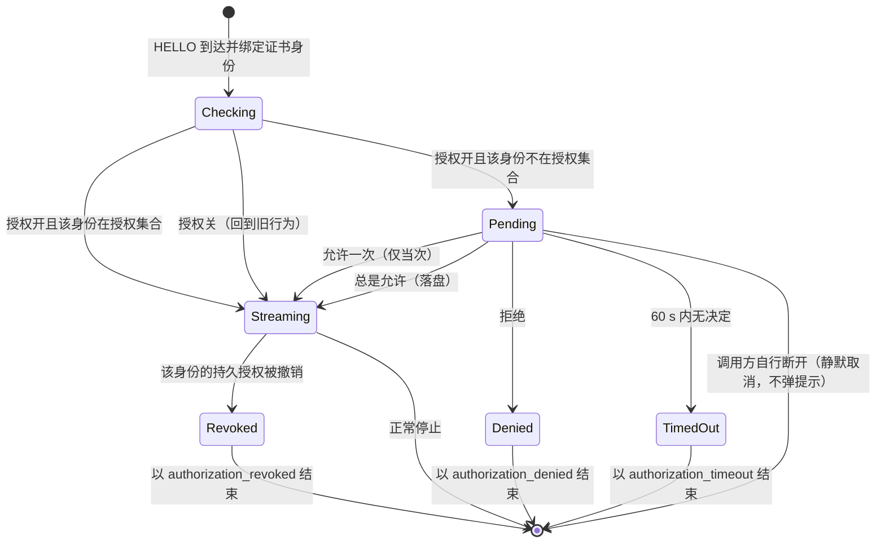
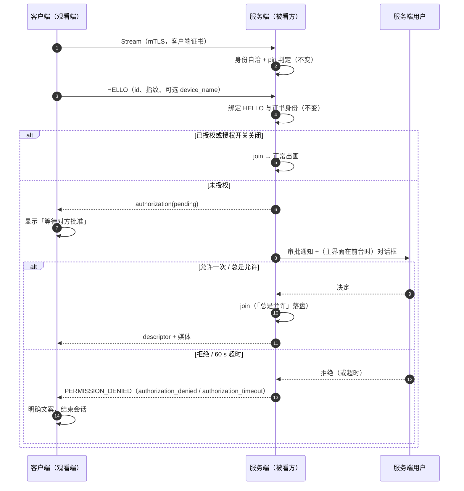

# 配对与授权实施计划（TB-SEC-001：默认拒绝 + 审批 + 持久授权）

> 状态：S1–S4 已于 2026-10-21 落地（提交 `7416f9f` 授权存储/策略/闸门、`8c3cf1d` 服务端审批流与协议增量、`3cc5ef8` 客户端等待与拒绝文案、`a7840d2` 设置与已授权设备管理），S5 为看板/决策板登记；**设备验证未执行**，点位见第 8 章与[任务看板](../../task-board.md#tb-sec-001)条目。
> 证据口径：全量 JVM **1363 tests / 132 classes / 0 failures / 0 errors / 0 skipped**（基线 1322/128），`assembleDebug`、`lintDebug`（0 errors / 146 warnings）与三项 checks 通过。
> 依据：派发方 2026-10-21 的裁决（两层分离、默认拒绝、持久授权、撤销即时生效、开关默认开、音频沿用「能看就能听」）。
> 相关：[任务看板](../../task-board.md)、[决策看板](../../decision-board.md)、[TOFU 计划](2026-10-21-tls-tofu.md)、[命名规范](../../naming-conventions.md)、[媒体架构安全模型](../../media-architecture.md)。

## 1. 目标与边界

| 问题 | 由谁回答 | 本轮动它吗 |
| --- | --- | --- |
| 对端是不是它自称的那台机器 | TOFU pin + 握手证书（TB-DISC-010，已完成） | 不动 |
| 准不准它看 | 本计划：授权集合 + 服务端审批 | 新增 |
| 能不能听 | 沿用 D11「能看就能听」，不单独设音频许可 | 不动 |
| 能不能反控 | TB-CTRL-001（未实施） | 不做 |

一句话：**pin 是身份记录，授权是许可。已 pin 不等于已授权。**

不做：PIN 码 / 扫码配对（DV-022 仍维持「人工比对」口径）、会话令牌、按能力的观看/音频/反控分级（音频已按 D11 合并，反控尚未实施）、多用户账号、云端。

## 2. 现状与接入点

| 位置 | 现状 | 本计划怎么用 |
| --- | --- | --- |
| `server/StreamCallHandler.onHello` | HELLO 到达后绑定证书身份，随即 `hub.join` | 在绑定之后、join 之前插入授权闸门 |
| `StreamCallHandler.getJoinFailure` → `ScreenShareServer.drainLoop` | 拒绝原因以 `PERMISSION_DENIED + description` 结束时 | 复用同一条通道承载新的拒绝原因 |
| `ScreenShareServer.stream()` | 握手证书身份 → `acceptPeer`（pin 判定，首次静默 pin） | 保持不变；**pin 的静默记录不改** |
| `trust/TlsPinStore` | 内存快照 + `synchronized` + 私有 SharedPreferences + fail-closed | 新授权存储照抄该形态，但**另开文件**（信任记录与许可不在同一份文档） |
| `ScreenShareService` 通知 / `MainActivity` 设置 | 已有服务端通知、Messenger 状态下发、设置 sheet | 审批通知 + 审批对话框 + 「已授权设备」入口 |
| `client/StreamFailure` | 已把身份类拒绝与普通断线分开 | 新增授权类拒绝（拒绝 / 超时 / 撤销） |

## 3. 设计

### 3.1 身份与授权键

- 授权键 = **设备身份**：`device_id`（26 字符）**且** 指纹（base64url，43 字符）逐字相等。
- 只按 id 命中、指纹不等 → 视为未授权（并记录一条 WARN）：正常情况下 TOFU 早已拒绝这种连接，这里只是不制造第二条放行路径。
- 无证书身份（仅隐藏的明文调试开关下可能出现）→ **无法持久授权**，每次都只能「允许一次」。

### 3.2 状态机

- **默认拒绝**：未授权身份不会被直接拒绝，而是进入 `Pending` 且**暂不 join**（不进 `StreamHub`，不占会话，不产生任何媒体帧）。
- **超时**：60 s（`AuthorizationPolicy.APPROVAL_TIMEOUT_MS`）。超时由该调用自己的 drain 轮询判定，**不新增线程/定时器**；判定发生在下一次 drain（≤5 ms）。
- **撤销即时生效**：直播中的会话在每次 drain 复核一次授权（内存查找），持久授权被撤销后下一次 drain（≤5 ms）即断流，原因 `authorization_revoked`。「允许一次」建立的会话不做撤销复核，因为它本就不在授权集合里。

### 3.3 策略（纯决策）

`authorization/AuthorizationPolicy`（纯 JVM，无 Android 类型）：

| 输入 | 结果 |
| --- | --- |
| 授权开关关 | `ALLOW`（旧行为） |
| 授权开 + 身份在授权集合且指纹相等 | `ALLOW` |
| 授权开 + 身份不在集合 / 指纹不等 / 无身份 | `REQUIRE_APPROVAL` |

另含两个纯判定：`shouldPersist(outcome, hasIdentity)`（只有「总是允许」且身份可验证才落盘）、`isGrantValid(entry, id, fingerprint)`。

拒绝原因常量集中在 `AuthorizationPolicy`：`authorization_denied`、`authorization_timeout`、`authorization_revoked`。

### 3.4 存储

`authorization/AuthorizationStore`（进程级单例，`get()`）+ `AuthorizationStorage` / `SharedPreferencesAuthorizationStorage`：

- 私有文件 `lss-authorization`（与 `lss-trust`、设置、收藏都分开）。
- 文档：`{"entries":[{"deviceId","fingerprint","deviceName","grantedAtMs"}]}`；坏文档 → 空表（fail-closed，等价于「谁都没被授权」）。
- 写盘失败不影响内存态，下一次变更重试（与 `TlsPinStore` 一致）。
- 只由用户动作写入：「总是允许」与设置页撤销。

### 3.5 审批交互（服务端）

- 审批请求到达时：`AuthorizationGate` 记一条待批准请求；`ScreenShareService` 立刻
  - 发一条高优先级通知（独立通道 `lss-approval`）：标题「<设备名> 请求观看你的屏幕」，正文「指纹 <短码> · 60 秒后自动拒绝」，三个动作按钮：允许一次 / 总是允许 / 拒绝；点正文进主界面；
  - 若主界面已绑定，再通过既有 Messenger 下发一条请求消息，由主界面弹三键对话框（同一组选项）。
- 决定来源只有这两个入口；两者都调用同一个 `AuthorizationGate.resolve(requestId, outcome)`。
- 请求被取消/超时/已决定后，通知撤销；主界面收到对应消息后收起对话框。
- 设备名来自 HELLO 的 `device_name`，**只有在对方开启「共享设备名」时才发送**（维持「发现默认不广播设备名」）；缺失时显示「未知设备」+ id 短码。

### 3.6 审批交互（客户端）

- 服务端在待批准状态发一条 `ServerMessage.authorization`（`PENDING`），客户端据此把加载提示改为「已发送观看请求，等待对方批准…」。
- 结束原因文案（双语）：

| 原因 | 客户端文案 |
| --- | --- |
| `authorization_denied` | 对方拒绝了这次观看请求 |
| `authorization_timeout` | 对方没有在限时内批准，请求已被拒绝 |
| `authorization_revoked` | 对方已撤销观看授权，连接已断开 |

  三者都按「不接受重试」的终止处理（同身份类拒绝：错误可复现，重连不能改变结果，需回到列表重新发起）。

### 3.7 设置与开关

- 新增偏好键 `KEY_AUTHORIZATION_ENABLED`，**默认开**。
- 服务端设置 sheet 新增「要求批准观看请求」开关 + 一行说明；关闭时说明改为风险提示（任何能连上来的设备都可直接观看），中英双语。
- 新增「已授权设备（N）」入口：列出名称 / id 短码 / 授权时间，逐条撤销；撤销即时生效（3.2）。

### 3.8 协议增量（纯增量）

| 消息 | 字段 | 方向 | 旧端行为 |
| --- | --- | --- | --- |
| `Hello` | `device_name = 6` | 客户端 → 服务端 | 旧服务端忽略，审批显示「未知设备」 |
| `ServerMessage` | `authorization = 6`（`AuthorizationStatus{state}`） | 服务端 → 客户端 | 旧客户端视作 `PAYLOAD_NOT_SET` 忽略，只会表现为「等待更久」，不会报错 |

拒绝原因沿用既有 `Status.PERMISSION_DENIED + description`，不新增 RPC、不新增端口、不新增依赖。

### 3.9 兼容与回退

- 旧客户端连新服务端：进待批准 → 用户批准后照常出画；拒绝时旧客户端显示既有「连接被拒」文案（信息更少但不误导）。
- 新客户端连旧服务端：没有 `authorization` 消息，客户端不会显示「等待批准」；旧服务端直接放行或拒绝。
- 关掉开关：授权闸门整体短路，行为与落地前逐字相同；已落盘的授权集合保留（不删数据）。
- 代码回退：S1–S4 各自独立提交，回退 S2/S3 即恢复旧行为（`StreamCallHandler` 不传 gate 时为 legacy）。

## 4. 时序

## 5. 批次

| 批次 | 范围 | 文件（新建 / 修改） | 验证 |
| --- | --- | --- | --- |
| S1 | 授权存储 + 策略 + 闸门（纯 JVM，零接线） | 新建 `authorization/AuthorizationEntry`、`AuthorizationStorage`、`SharedPreferencesAuthorizationStorage`、`AuthorizationStore`、`AuthorizationPolicy`、`ApprovalOutcome`、`AuthorizationGate`；测试四件 | 全量单测；不触生产路径 |
| S2 | 服务端审批流 + 协议增量 | 修改 `screen_stream.proto`、`StreamCallHandler`、`ScreenShareServer`、`GrpcMediaTransport`、`Preferences`、`ScreenShareService`、`ServiceProtocol`、`ServiceProtocol` 常量 | 全量单测 + `assembleDebug` + `lintDebug` |
| S3 | 客户端状态文案 | 修改 `ScreenShareClient`、`ClientObserver`、`StreamFailure`、`ScreenViewerService`、双语文案 | 全量单测 + 三件套 |
| S4 | 管理界面与撤销 | 修改 `MainActivity`、设置 sheet 布局、新增已授权设备对话框/行布局、文案 | 全量单测 + `assembleDebug` + `lintDebug` + 三件套 |
| S5 | 看板 / 决策板登记 | 修改 `docs/task-board.md`、`docs/decision-board.md`（TB-SEC-001、DB-SEC-004、DV-026） | `check_docs.py` |

每批独立提交、逐文件 `git add`、中文提交信息、push 不等 CI。

## 6. Review Focus

1. **不要在 TrustManager / gRPC 回调线程弹 UI。** 审批只发通知与消息，决定由主线程回传。
2. **不要把待批准做成「join 了但不下发媒体」。** 待批准期间不得进 `StreamHub`，否则会话数、音频扇出、懒停策略都会被一个未批准的对端带偏。
3. **不要复用 `TlsPinStore` 的文档。** pin 与授权是两件事，撤销授权不得影响 pin（含「静默 pin 行为保留」）。
4. **不要按 id 单独放行。** 必须 id + 指纹同时相等；只比 id 会让一次身份迁移变成永久放行。
5. **不要在 drain 路径上读文件或打日志。** 撤销复核只做内存查找；`authorization_revoked` 的日志由连接关闭处打一次。
6. **不要漏掉「调用方自己断了」的清理。** 待批准请求必须随 `close()` 取消，否则通知会挂在通知栏。
7. **不要给「允许一次」的会话做撤销复核**，否则用户在设置里撤销另一台设备时会误伤它。
8. **开关关闭必须逐字回到旧行为**（不新增提示、不改变时序），并在 UI 明示风险。
9. **组件构造禁令**（命名规范第 8 章）：新代码不得在 Activity/Service 字段初始化器里触碰 Context；`AuthorizationStore.get()` 只在 `onCreate()` 之后调用。
10. **文案必须双语**，新增字符串同时进 `values` 与 `values-zh`；跑三件套。

## 7. 风险与已知取舍

- **60 s 超时是产品参数**，不是安全参数：它只决定「对方要等多久才知道被拒」，不改变默认拒绝。
- 待批准期间占用一个 gRPC 流与一个 drain 线程（5 ms 轮询，几乎空转），最多 60 s；不占用编码器与 `StreamHub` 会话。
- 「总是允许」把许可绑定在设备身份上：对方重置身份即需重新审批（这是刻意的——新身份就是新设备）。
- 授权集合没有容量上限（局域网设备数量有限）；撤销是唯一删除入口。
- 关掉开关后不清理已授权集合：重新打开时既有授权仍生效，避免开关抖动导致反复审批。

## 8. 设备验证点位（留给验证棒，本棒不执行）

1. 未授权设备请求观看 → 服务端 1 s 内出现审批通知（设备名 + 指纹短码），客户端显示「等待对方批准」；服务端 `lss-stream` 日志无 `join`、`ServerStats` 会话数不变。
2. 「允许一次」→ 客户端出画；断开重连 → 再次弹审批。
3. 「总是允许」→ 出画；断开重连 → 不再弹审批；`/data/data/.../shared_prefs/lss-authorization.xml` 出现该 id。
4. 「拒绝」→ 客户端弹出「对方拒绝了这次观看请求」，不再重试。
5. 60 s 不操作 → 客户端弹出超时文案，服务端通知消失。
6. 设置 →「已授权设备」→ 撤销正在观看的设备 → 客户端 ≤1 s 内断流并显示「对方已撤销观看授权」。
7. 关闭「要求批准观看请求」→ 新设备直接出画（旧行为），设置里出现风险说明；重新打开后既有授权仍生效。
8. 客户端未开启「共享设备名」→ 审批显示「未知设备」+ id 短码，不泄露设备名。
