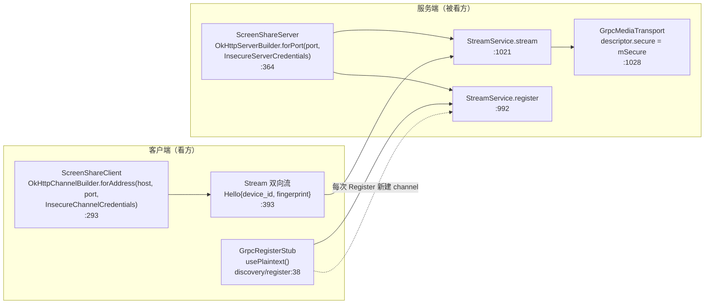
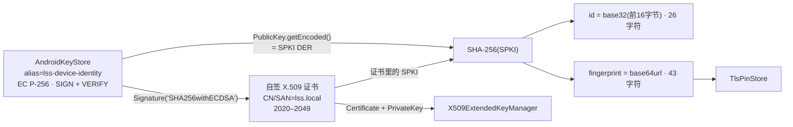
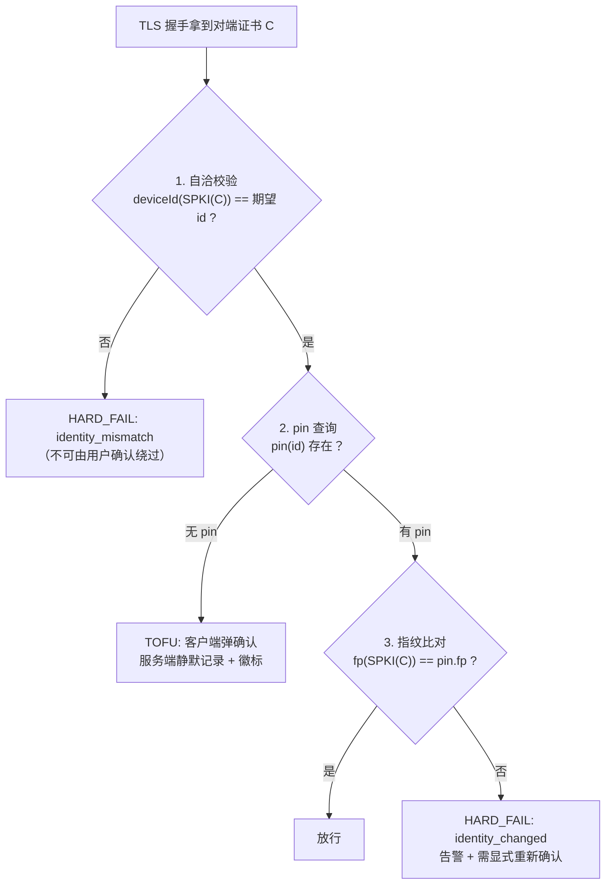
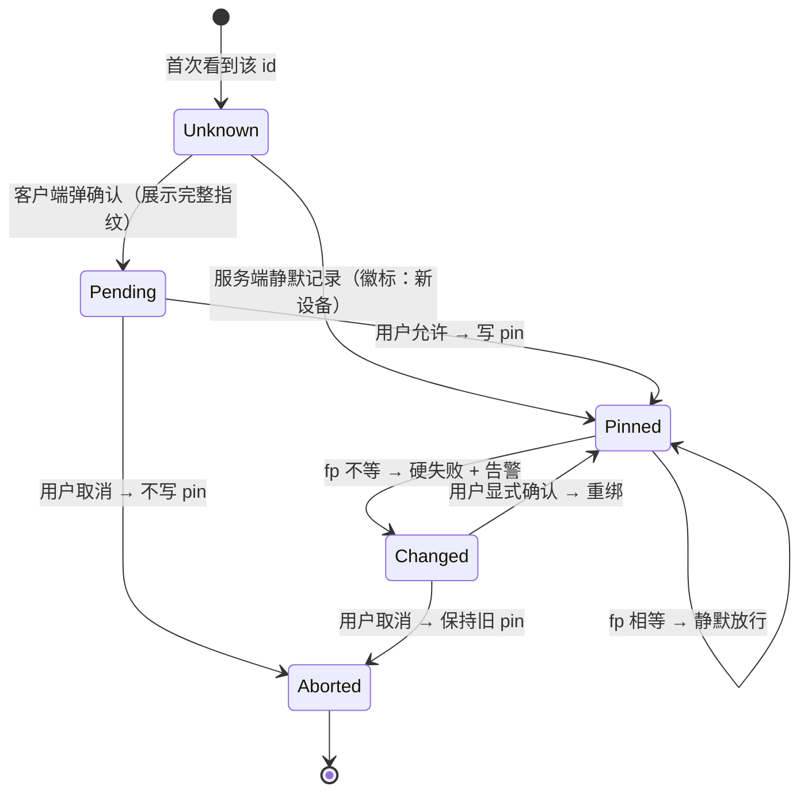
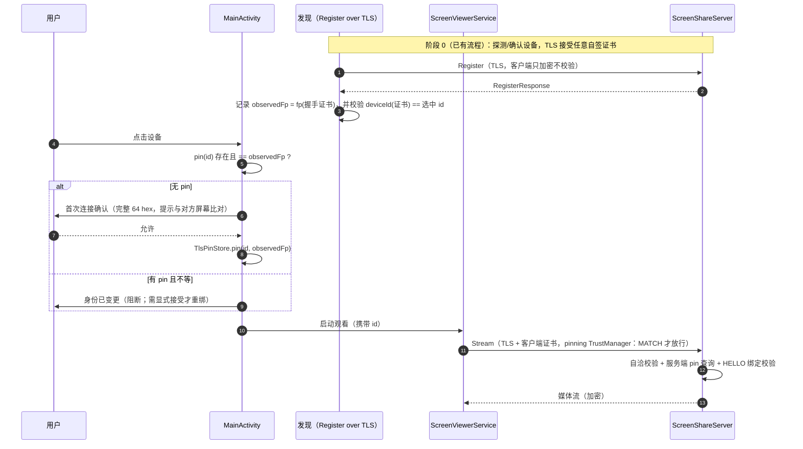

# 自签 TLS 与 TOFU 身份 pinning 实施计划（TB-DISC-010 调研 + 批次拆解）

> **For agentic workers:** REQUIRED SUB-SKILL: Use superpowers:subagent-driven-development or superpowers:executing-plans to implement this plan task-by-task. Steps use checkbox (`- [ ]`) syntax for tracking.

> **状态：本文件只做调研与计划，未写任何实现代码，未改动仓库任何文件。** 依据为 2026-10-21 工作树的静态代码审查、grpc-java 1.72.0 源码、以及 LocalSend / KDE Connect / AirDrop / Syncthing 的公开资料。**设备验证未解禁**：凡涉及真机握手、AndroidKeyStore 私钥在 TLS 中的可用性、功耗与温升之处一律标注 **推测**，并写成设备验证阶段的检查点，不作为结论。全量基线以实施时的 `:app:testDebugUnitTest` 实际数字为准（2026-10-21 实测为 **946 tests / 84 个测试类**），本计划要求只增不减。

> **落位**：本文件写好后应放到 `docs/superpowers/plans/2026-10-21-tls-tofu.md`；文内所有相对链接按该位置解析（`../../task-board.md` 等）。

**Goal:** 把「局域网里谁是谁」从**明文自报**变成**密码学可验证**：gRPC 的 Register 与媒体流全部走 TLS，双方用同一把身份密钥的自签证书互相认证（mTLS），证书身份以 SPKI 指纹为准并与发现层已有的 `id` 强绑定，首次连接由用户确认一次（TOFU），此后任何指纹变化都必须显式重新确认、绝不静默重绑。

**Architecture:** 四层，自下而上：**身份材料**（复用 `lss-device-identity` 这把 EC P-256 密钥，自签一张字段受控的 X.509 证书，证书只是公钥的容器，身份永远是 `SHA-256(SPKI)`）→ **凭据适配**（自定义 `X509ExtendedKeyManager` / `X509ExtendedTrustManager` 喂给 grpc 的 `TlsServerCredentials` / `TlsChannelCredentials`）→ **信任判定**（`PinPolicy` 三态：自洽 / 已 pin / 变了；`TlsPinStore` 持久化）→ **呈现**（首次确认对话框、指纹变更告警、本机指纹展示）。协议增量只有「把同端口从明文换成 TLS」与两个公告字段的取值（`secure`、`auth=mtls`），**不新增 proto 字段、不新增依赖、不改 grpc 版本**。

**Tech Stack:** Java 11 source/target、Android minSdk 25、compileSdk/targetSdk 35、AGP 8.9.0、Gradle 8.11.1、JUnit 4.13.2（手写 fake，仓库惯例，无 Mockito）、grpc-java **1.72.0**（`grpc-okhttp` + `OkHttpServerBuilder`）、protobuf-javalite、Gson（已有）。AndroidKeyStore（EC P-256、`PURPOSE_SIGN` + `PURPOSE_VERIFY`、`setUserAuthenticationRequired(false)`）。

**Spec:** [任务看板](../../task-board.md) · [决策看板](../../decision-board.md) · [发现调研](../../discovery-research.md) · [媒体架构](../../media-architecture.md) · [命名规范](../../naming-conventions.md) · [项目现状](../../project-assessment.md) · [发现实施计划](2026-10-20-device-discovery.md) · [传输可观测性计划](2026-10-21-transport-observability.md)

## 1. 背景与目标

| 依据 | 要求 | 当前状态 |
| --- | --- | --- |
| [TB-DISC-010](../../task-board.md#tb-disc-010) | 自签 TLS + TOFU 指纹确认；Register 与媒体流加密；与 TB-SEC-001 协同 | 📋 待办。全链路明文，无任何传输保护 |
| [TB-SEC-001](../../task-board.md#tb-sec-001) | 配对、会话令牌、默认拒绝未配对客户端、分级授权 | 📋 待办。**本计划不实现授权**，见第 8 章边界 |
| [DV-009](../../decision-board.md) | 「仅可信局域网」边界是否可接受；若不接受则先做配对与传输加密 | 未裁决。本计划交付加密那一半，配对/授权仍缺 |
| [发现调研 §5.1](../../discovery-research.md) | 身份用 SPKI 哈希而非整张证书哈希；同密钥续签身份不变 | 已落地 `SpkiId`（`id` 26 字符 + `fingerprint` 43 字符） |
| [TB-DISC-004](../../task-board.md#tb-disc-004) | 设备身份（密钥派生 ID） | ✅ 已完成：AndroidKeyStore EC P-256，`IdentityManager` 进程内缓存 |
| 发现调研 §7.5 风险 | 「Android Keystore 自签证书的续签能力有限；可能需要自定义 TrustManager 或软件密钥」 | 本计划正面回答：**自定义 KeyManager + 自己签证书**，见 6.1、6.2 |

目标：

- **加密是默认且唯一的路径**：Register 与 Stream 共用一个 TLS 端口；没有"自动降级到明文"的分支。
- **身份可验证且可追责**：连接的那一端必须持有 `id` 对应的私钥；证书与 `id` 的自洽校验（`deviceId(SPKI) == 选中/自报的 id`）在首次连接也生效，**不依赖用户是否确认过**。
- **首次连接只问一次，之后不再打扰**：TOFU 确认一次即写入 pin；匹配的连接完全静默。
- **变化必须显式**：pin 不匹配一律硬失败 + 明确告警，绝不自动重绑（与现有 `FavoriteStore` 的 `identityChanged` 语义一致）。
- **可测**：核心判定（证书生成、指纹派生、pin 决策、绑定校验）全部纯 JVM；握手路径在 JVM 内用 loopback 真跑一遍，**不等设备**。
- **可回滚**：每批独立提交；不引入依赖；除「同端口换 TLS」外不动既有协议字段。

非目标（本计划不涉及）：

- 不做配对/会话令牌/分级授权（[TB-SEC-001](../../task-board.md#tb-sec-001)）。
- 不做 PIN 码、二维码配对（扫码只作为**可选**增强在 6.3 提到，不进批次）。
- 不做证书链/CA、不做证书轮换协议、不做 OCSP/CRL。
- 不改媒体路径、不改编码参数、不改队列上限、不做 RTP/UDP。
- 不做设备验证（未解禁）；设备步骤写成清单（第 9.7 节）。
- 不做 Windows/桌面端互通（发现调研 §7.3 的 P3 范围）。

标记约定沿用 [发现调研](../../discovery-research.md)：**当前实现** 可在代码中核对；**业界事实** 附外部来源；**建议** 是目标设计；**推测** 是对设备/网络行为的判断。本文件行号均指 2026-10-21 工作树。

## 2. 现状：明文面在哪，身份已经有什么

| 位置 | 内容 | 备注 |
| --- | --- | --- |
| `server/ScreenShareServer.java:364` | `OkHttpServerBuilder.forPort(port, InsecureServerCredentials.create())` | 唯一的服务端入口；`Stream` 与 `Register` 同端口 |
| `client/ScreenShareClient.java:293` | `OkHttpChannelBuilder.forAddress(host, port, InsecureChannelCredentials.create())` | 媒体流客户端 |
| `discovery/register/GrpcRegisterStub.java:38` | `.usePlaintext()` | 发现握手；每次调用新建 channel 并在结束时关闭 |
| `server/ScreenShareServer.java:239`、`:611`、`:910`、`:942`、`:1028` | `mSecure` 标志：写进 `DeviceInfo.secure` 与 `Descriptor.secure` | **注意：它不是恒 false，而是"私密屏幕"偏好**（见 2.3） |
| `discovery/model/AuthMode.java:28` | `MTLS` 枚举值已存在，注释写明"reserved for the pinned-TLS work" | 公告字段 `auth` 目前恒为 `none` |

### 2.1 身份设施（本计划的复用基础）

| 已有能力 | 代码 | 对本计划的意义 |
| --- | --- | --- |
| 一把长期身份密钥 | `identity/AndroidKeystoreKeyStore.java:39`（alias `lss-device-identity`）、`:112-122`（EC P-256，用途 `SIGN` + `VERIFY`，`setDigests(SHA256)`，不要求用户认证） | 密钥用途已覆盖 TLS 1.2/1.3 的 ECDSA 签名；**私钥永不可导出**，决定了凭据只能走 `KeyManager` 而非 PEM |
| 身份派生 | `identity/SpkiId.java:84`（`fingerprint` = base64url(SHA-256(SPKI))，43 字符）、`:94`（`id` = base32(前 16 字节)，26 字符） | pinning 直接复用，**零新算法**。两个值同源同摘要 |
| 身份变更检测 | `identity/DeviceIdentity.isChanged()`、`IdentityManager.recordIdentity()`、`MainActivity.java:812` | 本机身份变了会提示；对端视角的"变了"由 pin 承担 |
| 收藏身份绑定 | `discovery/favorite/FavoriteStore.java:355 checkIdentity`、`:249 sync`、`:299 confirmIdentity` | **TOFU 的语义骨架已经存在**（匹配/变化/未知三态 + 显式确认），pin 复用同一套口径 |
| 连接前身份拦截 | `MainActivity.java:932-951`：收藏指纹与本次观察不一致时先弹框再连接 | 首次确认对话框的落点与既有交互同源 |
| 传输里的自报身份 | `proto: Hello.device_id=4, fingerprint=5`；`StreamCallHandler.java:317-318` 已接收 | mTLS 之后这两个字段从"自报"变成"可交叉校验的声明" |
| 连接属性拦截器 | `ScreenShareServer.java:160-170`（`REMOTE_ADDRESS` Context key + `ServerInterceptor`） | 新增一个把 `Grpc.TRANSPORT_ATTR_SSL_SESSION` 放进 Context 的同构拦截器 |

### 2.2 三条决定方案形状的事实

1. **身份私钥不可导出。** `AndroidKeystoreKeyStore` 只回读公钥与私钥句柄，`PrivateKey.getEncoded()` 对 AndroidKeyStore 密钥返回 null。因此 grpc 的 `TlsServerCredentials.keyManager(File/InputStream certPem, keyPem)` **用不了**，必须走 `keyManager(KeyManager...)`，由一个自定义 `X509ExtendedKeyManager` 在握手时把 keystore 别名交给 Conscrypt 去签名。
2. **证书必须自己签。** AndroidKeyStore 会为自己的条目生成一张自签证书，但它的 subject、SAN、有效期、序列号都不受应用控制（**推测**：CN 取别名、无 SAN、有效期起点很早）。客户端的 `OkHostnameVerifier` **只按 SAN 匹配、不做 CN 回退**（`getSubjectAltNames` 为空即失配），因此"借"keystore 自动证书在多数机型上会直接握手失败。结论：**用身份密钥自己签一张字段受控的证书**（6.2），keystore 自动证书只作为回退。
3. **`Server` 是字段初始化器里构造的。** `ScreenShareServer.java:363-373` 的 `mGrpcServer` 在构造期建好；D-1 事故已经证明"组件构造期做重活/触上下文"会直接 FATAL。TLS 凭据需要读 keystore，**必须在 `start()` 里构造**（那里本来就在加载身份，`ScreenShareServer.java:640`），见 6.7。

### 2.3 一处与草案初稿不同的事实：`mSecure` 是"私密屏幕"，不是"传输安全"

草案初稿把 `mSecure` 当成恒为 false 的"安全位"。核对工作树后必须纠正：

| 事实 | 代码 | 结论 |
| --- | --- | --- |
| `mSecure` 来自用户可见的 **Private screen** 偏好 | `ScreenShareService.java:802` → `setSecure(Preferences.isProjectionSecure())` | 它是**内容防截取**：服务端写进 `Descriptor.secure`，观看端据此给自己窗口加 `FLAG_SECURE`（`ScreenViewerService.java:363`、`:1269`） |
| 同一个标志也被写进发现公告 | `ScreenShareServer.java:910`、`:942` | 发现层的 `secure` 因此**今天表达的不是传输加密** |
| 两者是不同消息、不同语义 | `Descriptor.secure`（会话内容）vs `DeviceInfo.secure`（设备能力） | 不需要新增 proto 字段就可以分开：会话描述符继续用私密屏幕，**发现公告改报传输是否加密** |

因此本计划的落地口径是：

- `Descriptor.secure` **保持**私密屏幕语义（T4 的观看端 `FLAG_SECURE` 不受影响）。
- `DeviceInfo.secure` 与 `auth` 在发现公告/Register 摘要里表达**传输能力**：TLS 开启时 `secure=true`、`auth=mtls`；隐藏键放开明文时 `secure=false`、`auth=none`。
- Review Focus 第 8 条相应改写为"不要用同一个字段同时表达两件事"。

## 3. 威胁模型：TLS + TOFU 挡住什么、挡不住什么

| 攻击 | 现状（明文） | TLS + pinning 后 | 说明 |
| --- | --- | --- | --- |
| 同网段被动嗅探（看画面） | 直接可看 | **挡住** | 全链路 TLS |
| 被动嗅探 Register（收集设备名/ID/地址） | 直接可读 | 密文；但目的地 IP 与固定的 TLS SNI（`lss.local`）仍可见 | 公告层的隐私由发现设置管（TB-DISC-009）；固定 SNI 不泄露设备身份 |
| 首次接触时的主动 MITM（冒充服务端） | 成功 | **挡住**：`deviceId(证书 SPKI) != 选中 id` 即硬失败（6.4 第 1 条） | 除非攻击者让用户在列表里选中它自己的设备（此时用户看到的是陌生指纹） |
| 已 pin 之后的冒充（换证书） | 成功 | **挡住**：pin 不匹配硬失败 + 告警 | 永不自动重绑 |
| 客户端伪造 `Hello.device_id` 冒充别人的设备 | 成功 | **挡住**：服务端按**握手证书**重算 id 与 fp 并与 HELLO 比对（T3） | 自报字段从此只是声明 |
| 陌生设备请求观看 | 成功 | **仍可能成功** | **这是授权问题，属于 TB-SEC-001**；本计划只保证"它是它自称的那台设备" |
| 已 pin 设备被恶意使用（设备本身被拿下） | 成功 | 仍成功 | pin 只回答"是不是同一台机器" |
| 局域网外/AP 级攻击者 | 明文可读 | 加密可读性消失；但首连仍可能被诱导 | 如实写进 DV-009 的结论 |

**必须提前声明的两个反直觉点：**

1. **加密不等于授权。** TLS 落地之后，"任何能到达端口的设备都可以请求观看"这件事本身**没有改变**，改变的只是"服务端与观看端能确认对面就是它以为的那台机器"。把安全边界写进 DV-009 时必须说清这一条，否则会把「已加密」误读成「已配对」。
2. **TOFU 的强度上限是"用户第一次比较的那一次"。** 首次确认之后的任何冒充都会被拒；首连那一次只能靠用户肉眼或扫码。这也是为什么 6.3 明确反对把指纹截短展示（KDE Connect 的 32 bit 截断就是被撞出碰撞的实例）。

## 4. 业界做法与证据

### 4.1 KDE Connect：配对 + 每次 TLS 都校验证书

| 做法 | 出处 | 对我们的意义 |
| --- | --- | --- |
| 发现包（Identity）走 UDP、无认证；真正通信走 TLS 1716 端口 | [KDE Connect 协议](https://invent.kde.org/network/kdeconnect-meta/-/blob/master/protocol.md) | 与我们「发现只当提示、信任在连接时建立」完全同构 |
| 配对时把双方公钥算一个哈希、**截断到 8 字符**给用户比对；配对接受后把对端证书连同 `deviceId` 存起来，**之后每次 TLS 连接都校验** | [KDE Connect 安全披露](https://cezarlungu.com/kde-connect-security-disclosure/) | 存 pin + 每次校验的模型直接照抄；**截断到 8 字符是反面教材**（CVE-2025-32901，碰撞可构造） |
| 该披露同时指出：发现包可以覆盖已建立连接里学到的设备名/ID，导致显示层被污染与 DoS | 同上 | 我们的对应约束：**TLS 建立后，身份只以握手证书为准**，发现层观测不得覆盖已 pin 身份（6.4 第 3 条） |

结论：**要照抄的是"一次确认 + 永久 pin + 每次校验"，不要照抄的是"截短到 8 字符"和"发现层数据可以覆盖已认证身份"。**

### 4.2 LocalSend：整证书指纹 + 双方互出示证书

| 做法 | 出处 | 对我们的意义 |
| --- | --- | --- |
| 每台设备启动时生成自签证书（RSA-2048，`CN=LocalSend User`，**无 SAN**，有效期 1975–4096），指纹 = **证书 DER 的 SHA-256（大写 hex）** | [LocalSend `cert.rs`](https://github.com/localsend/localsend/blob/main/packages/core/src/crypto/cert.rs) | 无 SAN + "仅凭指纹识别"的组合说明：**当校验完全由指纹承担时，SAN/CN 只是给 TLS 栈看的**，需要一个固定值让主机名校验通过（我们取 `lss.local`，见 6.2） |
| HTTPS 模式下**忽略请求体里的 `fingerprint`**，以握手证书为准 | [LocalSend 协议 §2/§3](https://github.com/localsend/protocol) | 我们的 Register 也照此办理：用握手证书重算 fp，不信 body |
| 同一张证书既做服务端证书也做客户端证书 | 同上 / `cert.rs` | 支持"一把密钥一个身份"，mTLS 不需要第二把密钥 |
| 指纹是**整证书**的哈希 → 换证书即换身份 | 同上 | **这正是我们不能用的地方**：我们的证书每次进程启动重新签（ECDSA 签名随机），DER 不稳定；用整证书哈希会导致每次启动身份都变。**必须用 SPKI 哈希**（与发现调研 §5.1 的结论一致） |

### 4.3 AirDrop：外部信任锚 + 明确的接收方确认

| 做法 | 出处 | 对我们的意义 |
| --- | --- | --- |
| 用 iCloud 身份证书做双向认证，身份再与"通讯录"比对；连接的 TLS 通道上交换身份证书 | [Apple Platform Security: AirDrop security](https://support.apple.com/en-mz/guide/security/sec2261183f4/web) | 它有我们**没有**的外部信任锚（iCloud + 通讯录）。我们没有锚，所以只能用 TOFU + 一次人工确认，这是诚实的能力边界 |
| 即使身份已验证，**接收方仍要被明确询问**是否接受 | 同上 | 印证第 8 章的边界：**身份认证**与**是否允许观看**是两件事，后者属于 TB-SEC-001 |

### 4.4 Syncthing：证书哈希即 Device ID

| 做法 | 出处 | 对我们的意义 |
| --- | --- | --- |
| Device ID = 证书 DER 的 SHA-256，base32 + Luhn；换证书即换 ID；本地发现可被冒充，**身份在 TLS 握手时用证书重算** | [Syncthing Device IDs](https://docs.syncthing.net/dev/device-ids.html)（亦见发现调研 [S14]） | "握手时重算身份"与我们的 `deviceId(证书 SPKI)` 自洽校验是同一形状；它用整证书哈希是因为**证书文件长期不变**，我们做不到（4.2） |

### 4.5 四条落地结论

1. **身份 = 密钥的 SPKI 哈希，证书只是载体**（否则"每次启动重新签证书"会把身份打散）。
2. **确认一次、pin 永久、每次校验**；变化一律显式（KDE 的做法，去掉截断）。
3. **发现层永远只是提示**：已认证身份只能来自握手证书，不能被公告/响应体覆盖。
4. **展示必须是完整指纹**；截短到 32 bit 已被证明可被碰撞（KDE CVE-2025-32901）。

## 5. gRPC 与 Android 的技术事实（决定实现形状）

| 事实 | 出处 | 结论 |
| --- | --- | --- |
| `OkHttpServerBuilder` 只接受 `ServerCredentials`：`TlsServerCredentials`、`InsecureServerCredentials`、`SslSocketFactoryServerCredentials`、`ChoiceServerCredentials`；**没有** `sslSocketFactory` 之类的直通口 | [OkHttpServerBuilder 1.72.0](https://github.com/grpc/grpc-java/blob/v1.72.0/okhttp/src/main/java/io/grpc/okhttp/OkHttpServerBuilder.java) | 服务端 TLS 只能从 `TlsServerCredentials` 进 |
| `TlsServerCredentials.Builder.keyManager(KeyManager...)` 与 `trustManager(TrustManager...)` 存在；OkHttpServer 明确把 `CUSTOM_MANAGERS` 与 `MTLS` 列为已理解特性，并把它交给 `SSLContext.init(km, tm, null)` | 同上 + [TlsServerCredentials 1.72.0](https://github.com/grpc/grpc-java/blob/v1.72.0/api/src/main/java/io/grpc/TlsServerCredentials.java) | **自定义 KeyManager/TrustManager 是官方支持路径**，可喂 AndroidKeyStore 句柄，无需导出 PEM |
| 客户端 `TlsChannelCredentials.Builder` 同样支持 `keyManager(KeyManager...)` / `trustManager(TrustManager...)`；`OkHttpChannelBuilder` 理解 `MTLS` 与 `CUSTOM_MANAGERS` | [TlsChannelCredentials 1.72.0](https://github.com/grpc/grpc-java/blob/v1.72.0/api/src/main/java/io/grpc/TlsChannelCredentials.java) + `OkHttpChannelBuilder.sslSocketFactoryFrom` | mTLS 客户端证书与 pinning 校验都不需要额外依赖 |
| 用 `ChannelCredentials` 时 `OkHttpChannelBuilder` 会 `freezeSecurityConfiguration`，**不能再设 `hostnameVerifier`**；主机名校验由 `OkHttpTlsUpgrader` 用 `OkHostnameVerifier` 对 `overrideAuthority`（无则目标 host）执行 | `OkHttpChannelBuilder.hostnameVerifier` 源码 + [`OkHttpTlsUpgrader`](https://github.com/grpc/grpc-java/blob/v1.72.0/okhttp/src/main/java/io/grpc/okhttp/OkHttpTlsUpgrader.java) | 自签证书必须带固定 SAN，客户端用 `overrideAuthority("lss.local")` 让主机名校验确定通过；**校验的实质交给 pinning TrustManager** |
| 服务端与客户端都会把 `Grpc.TRANSPORT_ATTR_SSL_SESSION` 写进传输属性（服务端在 `TlsServerHandshakerSocketFactory` 里） | [`TlsServerHandshakerSocketFactory`](https://github.com/grpc/grpc-java/blob/v1.72.0/okhttp/src/main/java/io/grpc/okhttp/TlsServerHandshakerSocketFactory.java) + `OkHttpClientTransport` | 服务端能在**应用层拿到本次握手的对端证书**，所以 mTLS 的身份绑定不靠自报字段 |
| 服务端握手不设客户端模式，主机名校验只在客户端一侧 | 同上 | 自签证书在服务端侧只需能被 Conscrypt 解析；字段约束由我们自己定 |
| AndroidKeyStore 的 EC 密钥可用于签名，但确实存在按密钥参数（padding/digest）触发的 provider 兼容问题 | [Conscrypt issue #1201](https://github.com/google/conscrypt/issues/1201)（RSA-PSS 的 padding 不匹配） | 我们的密钥是 EC + `DIGEST_SHA256`，理论上与 TLS 1.2/1.3 的 `ecdsa_secp256r1_sha256` 匹配；**但"在真实 Conscrypt 握手里能用"只能设备验证**（第 9.7 节），架构上留好软件密钥回退（6.1） |

**结论：三件套** —— 自定义 `X509ExtendedKeyManager`（服务端与客户端各一份）+ 自定义 `X509ExtendedTrustManager`（pinning）+ 固定 `overrideAuthority`。**不新增依赖、不动 grpc 版本、不动 proto**。

## 6. 方案

### 6.1 密钥与证书：复用身份密钥，证书是可替换的容器

**建议：复用同一把身份密钥，不引入第二把。** 理由：

- 发现层已经用这把密钥派生 `id`/`fingerprint`，用户比对的那一个值就是它；再引入一把 TLS 密钥就必须再造一套"把 TLS 密钥绑定到身份密钥"的签名声明（否则用户要比对两个指纹，或者被中间人拿到一个未被绑定的指纹）。
- 该密钥当前**没有任何其它用途**（只做身份锚），给它 TLS 签名职责不增加暴露面。
- `IdentityManager.reset()` 的语义正好是我们要的"换身份 → 对端必须重新确认"。
- 备选（不推荐、仅在 6.1.1 的回退里出现）：独立 TLS 密钥 + 身份密钥签名的证书绑定声明。代价是发现层要新增字段与校验，收益只是"TLS 密钥可以轮换"，本轮不需要。

**证书是可替换的容器。** 因为身份取 SPKI 哈希，换一张证书（换序列号、换有效期、换 SAN、甚至换成 keystore 自动证书）**都不会改变 `id` 与 `fingerprint`**，对端不需要重新确认。这直接回答了"证书轮换/续签"的顾虑：我们根本不需要续签协议。

#### 6.1.1 存储与回退

| 项 | 建议 | 理由 |
| --- | --- | --- |
| 私钥存储 | AndroidKeyStore（现状），不导出、不进备份 | 硬件/系统级保护；重装即新身份，是安全默认 |
| 证书存储 | **不落盘**。进程内按需生成（一次 ECDSA 签名，毫秒级），运行时缓存 | 避免把派生数据当权威；也避免"证书文件与密钥不匹配"的状态 |
| 若 keystore 私钥无法用于 TLS（设备验证失败） | 回退到**软件密钥**：新增 `SoftwareIdentityKeyStore`，在同一 alias 语义下把 PKCS#8 放进私有目录（可用 keystore 的 AES 密钥做静态加密） | `IdentityKeyStore` 已是接口（`identity/IdentityKeyStore.java`），回退只需换实现；身份派生与 pinning 完全不变 |
| 若自签证书被 Conscrypt 拒绝 | 回退到 keystore 自动证书（`keyStore.getCertificate(alias)`），指纹仍按 SPKI 计算，对端无感 | 两条路径的 `fingerprint` 相同，**不需要用户重新确认** |

### 6.2 证书生成：字段受控的自签 v3 证书

**建议**：纯 JVM 手写 DER（约 200–300 行），不使用 BouncyCastle（不新增依赖），不依赖 `sun.security.x509`（Android 上不可用）。

| 字段 | 值 | 理由 |
| --- | --- | --- |
| `version` | v3 | 需要扩展 |
| `serialNumber` | `SHA-256(SPKI)[0..16]`，最高位清零，全零则置 1 | 由密钥决定、稳定、非负、非零 |
| `signature` | `ecdsa-with-SHA256`（1.2.840.10045.4.3.2） | 与 P-256 密钥匹配；TLS 1.2/1.3 都接受 |
| `issuer` / `subject` | `CN=lss.local` | 自签，issuer == subject |
| `validity` | `20200101000000Z` .. `20491231235959Z`（UTCTime） | 宽窗，规避设备时钟错误；2050 之后 RFC 5280 要求 GeneralizedTime，故上界取 2049 |
| `subjectPublicKeyInfo` | 身份公钥的 SPKI DER **原样搬运** | 保证 `cert.getPublicKey().getEncoded()` 与身份 SPKI 逐字节一致 → 指纹同一 |
| `extendedKeyUsage` | `serverAuth, clientAuth` | 同一张证书两用（LocalSend 同构） |
| `keyUsage` | `digitalSignature`（critical） | ECDSA 签名用途 |
| `basicConstraints` | `cA=false`（critical） | 明确不是 CA |
| `subjectAltName` | `dNSName=lss.local` | 给客户端 `OkHostnameVerifier` + `overrideAuthority("lss.local")` 用；**这是必需的**，LocalSend 靠"完全跳过主机名校验"绕开，我们不想绕 |

新增常量 `TlsNames.AUTHORITY = "lss.local"`（客户端 `overrideAuthority` 与证书 SAN 同源，避免两处字符串漂移）。

**风险与缓解**：手写 DER 的典型坑是 BIT STRING 的 unused-bits、EC 签名（r,s）的内层 DER 包装、UTCTime 格式。验证方式见第 9 章：用 `CertificateFactory` 解析回来 + `cert.verify(publicKey)` + 字段断言；这三个测试在纯 JVM 里就能暴露全部低级错误。

### 6.3 指纹格式与展示

| 项 | 建议 |
| --- | --- |
| 规范化形式（存储/线上） | **沿用现有** `base64url(SHA-256(SPKI))`，43 字符。不新增第二种规范形式，避免迁移 |
| 展示形式 | 转成**大写十六进制、每 8 字符一组、共 8 组**（64 hex）。仅展示层转换，纯函数可测 |
| 是否截短 | **不截短**。KDE Connect 把配对哈希截到 8 个十六进制字符（32 bit）后被构造出碰撞（CVE-2025-32901）；任何小于 128 bit 的展示都不能作为确认依据 |
| 对比方式 | 对话框展示完整 64 hex，并给出"在对方设备的分享通知/设置里找到同一串"的引导；提供"复制" |
| 可选增强（不进批次） | 服务端在分享通知/主界面展示 `lss://host:port#<fp>` 二维码，观看端扫码即完成确认（消除人工比对）。列入第 13 章裁决点 Q2 |

### 6.4 三条硬校验（顺序固定，任何一条失败都断开）

1. **自洽校验（首次连接也生效）**：`id` 与 `fingerprint` 是同一个 SPKI 摘要的两种编码，所以"选中/自报的 id"与"握手证书的 id"必须相等。这一步**不需要任何存储**，因此它挡住了首连 MITM——攻击者可以在公告里冒充任何 `id`，但拿不出与该 `id` 对应的私钥。
2. **pin 查询**：`TlsPinStore` 按 `id` 查。无记录 = 首次。
3. **指纹比对**：有记录则必须逐字相等（只做首尾空白 trim；不做大小写折叠、不做模糊匹配）。

**服务端侧的绑定（T3）**：`Hello.device_id` / `Hello.fingerprint` 从"自报"变成"声明"：服务端用握手证书重算两者并比对，不一致即 `UNAUTHENTICATED`。这样即使客户端伪造 HELLO，也拿不到别人 id 的会话。

**发现层不得覆盖已认证身份**：`Register` 响应体里的 `fingerprint` 只作参考，落库的观测值一律用握手证书重算值（与 LocalSend 的处理一致）。

#### 6.4.1 一个必须讲清的副作用：真正的换密钥看起来像"新设备"

`id` 与 `fingerprint` 是**同一个摘要**的两种编码，所以只要密钥变了，两者会**同时**变成新值——旧 pin（按 `id` 存）永远匹配不上。于是：

| 情形 | 校验结果 | 用户看到 |
| --- | --- | --- |
| 同一 `id` 但指纹不同（伪造成 id、或旧版本留下的历史记录） | `CHANGED` | "身份已变更"告警（**这才是现有 `FavoriteStore.checkIdentity` 能覆盖的场景**） |
| 真的换了密钥（`IdentityManager.reset()`、恢复备份、重装） | 旧的 `id` 再也出现不了 → 表现为 `UNKNOWN` | 列表里出现**一台新设备**；旧条目变成不可达 |

因此 TB-DISC-010 的验收语"指纹变化被拒绝"要拆成两半：**同 id 不同指纹 → 硬拒绝**（已实现语义）；**换密钥 → 不会静默接受，但表现为"新设备"，需要用户自己意识到**。

实施后 `CHANGED` 在密码学上等价于"我们存过一个不是从证书来的指纹"或"撞了 SHA-256"，正常流程**不可能**产生。因此它必须按**安全事件**处理：拒绝 + WARN + 计数，文案不要写成"设备可能更新过"，避免把异常说成日常。

为了让"换密钥"这件事可见，增加一条**软提示**：

- `TlsPinStore` 除按 `id` 存 pin 外，额外记一份 `address(host:port) → 上次成功的 id`（只作提示，不作校验）。
- 连接到某个地址时，若该地址上次对应的 `id` 与本次不同，首次确认对话框追加一行"该地址上次是另一台设备（`<旧 id 前 8 位>`）"。
- **不阻断**：DHCP 复用同一 IP 在局域网里是常态，硬失败会造成误伤。
- 同理，服务端的"新设备"徽标也带上"该地址曾见过旧身份"的标记。

### 6.5 TOFU 状态机与两侧策略差异

| | 客户端（观看方） | 服务端（被看方） |
| --- | --- | --- |
| 首次 | **必须确认**（有 UI 上下文，用户主动发起） | **静默记录** + 在分享通知/状态摘要里显示"新设备"徽标 |
| 变化 | 硬失败 + 阻断式对话框（旧/新指纹并列） | 硬失败 + 通知告警；需在分享界面显式接受 |
| 何时写 pin | 确认后立即写；随 `Register` 探测到的证书值写入（6.6） | 首次 HELLO 绑定通过后写 |
| 为什么不同 | 观众主动点按，确认成本可接受 | 被看方可能在锁屏/后台，阻断式中断体验不可接受；"是否允许观看"另有 TB-SEC-001 |

**不自动重绑**：`Changed` 状态只能由用户显式动作离开；这与现有 `FavoriteStore.confirmIdentity` 的语义完全一致，UI 文案也复用（`discovery_identity_changed_connect`）。

### 6.6 连接时序（含首次确认）

要点：

- **pin 写入发生在 MainActivity，不发生在后台服务里**：服务是异步的，弹框成本高且容易与悬浮窗争焦点；主界面本来就有"连接前拦截"的先例（`MainActivity.java:934`）。
- **流的握手只允许 MATCH**：`UNKNOWN` 说明 pin 在两次动作之间被清掉/被换设备，按失败处理并提示重试（避免"边看边确认"）。
- 首次确认的代价是**多一次握手**（探测 + 正式连接），一次 ECDSA 签名与一次 ECDH，局域网内可忽略。

### 6.7 生命周期与线程约束

- **禁止在字段初始化器里加载 keystore/生成证书**（D-1 的同类反模式，见 [可观测性计划 8.1](2026-10-21-transport-observability.md) 第 8 条）。`mGrpcServer` 改为在 `start()` 内构造，位置就在 `ScreenShareServer.java:640` 加载身份之后；`:653`、`:808`、`:813`、`:965` 的引用改为经一个 `grpcServer()` 访问器（内部断言非空）。
- 证书生成与身份加载都在 `start()` 的主线程路径上，**只发生一次**；进程内由 `IdentityManager` 缓存 `DeviceIdentity`，TLS 材料由新的 `TlsMaterialHolder` 缓存（双重检查，参照 `IdentityManager` 的写法）。
- `PinningTrustManager` 会在 gRPC 传输线程被调用，因此**只做内存查找 + 一次 SHA-256**：`TlsPinStore` 照抄 `FavoriteStore` 的形态（内存快照 + `synchronized` + 写盘失败不致命），握手路径上不读文件、不拼字符串、不打日志。

### 6.8 回退与降级

| 情形 | 行为 |
| --- | --- |
| 正常路径 | TLS 1.2/1.3（跟随平台），mTLS，pinning 强校验；**没有任何自动降级** |
| 对端是老版本（公告 `sec=false` 或 `auth=none`） | 不拨号；列表项显示"该设备不支持加密连接"，并给出升级提示。**不尝试明文** |
| 握手失败/证书被拒 | 断开 + 明确原因（`insecure_transport` / `identity_mismatch` / `identity_changed` / `pin_unknown`），不重试明文 |
| 运维/验证需要临时明文 | 隐藏偏好键 `KEY_TLS_ALLOW_PLAINTEXT`（默认 `false`）。开启时：公告 `sec=false`（对端知情）、主界面常驻警告条、日志一条 WARN。**没有"用户可见的关闭加密"开关** |
| 代码级回滚 | T1/T2/T3 各自独立提交；回退 T2 即恢复 `Insecure*Credentials`，pin 数据留在盘上但不再被读取（无害）；回退 T4/T5 只影响 UI 与公告 |

**与 DV-009 的关系**：DV-009 的问法是"仅可信局域网是否可接受"。本计划把"传输加密"从缺项变成已具备，但**配对与授权依旧缺失**，因此建议 DV-009 维持"未裁决"，并新增一条 DV 记录 TOFU 的强度上限（首次确认靠人眼/扫码）。详见第 13 章 Q8。

## 7. 与现有发现的衔接点

| 衔接点 | 现状 | 本计划怎么用 |
| --- | --- | --- |
| 身份派生 `SpkiId` | `fingerprint`（43）与 `id`（26）同源 | **原样复用**，pinning 不引入新哈希、新编码 |
| `IdentityManager` / `IdentityKeyStore` | 已给 `KeyPair`，已处理"密钥不可用/被换" | TLS 凭据从这里取密钥；`reset()` 直接成为"换身份"的唯一入口 |
| `DeviceIdentity.isChanged()` | 检测本机身份变化 | 本机视角不变；对端视角由 pin 承担 |
| `FavoriteStore.checkIdentity` 三态 | `MATCH/CHANGED/UNKNOWN` | `PinPolicy.PinOutcome` 与之同构，文案与交互复用 |
| `DeviceStore.confirmIdentity` | 内存态确认 | 不变；pin 是持久态，二者不互相替代（6.4 第 3 条） |
| 连接前身份拦截 `MainActivity.java:932-951` | 收藏身份变化时先弹框 | 首次确认对话框挂同一处 |
| `AuthMode.MTLS` | 已存在，恒不公告 | T5 开始真正公告 `secure=true, auth=mtls` |
| `DeviceInfo.secure` / `Descriptor.secure` | 已有字段，恒 false | T2 起置 true，观看端可据此显示"已加密" |
| `Hello.device_id/fingerprint` | 已存在，当前为自报 | T3 起成为"声明"，由握手证书交叉校验 |
| `REMOTE_ADDRESS_INTERCEPTOR` | Context 属性注入的先例 | 新增 `TlsSessionInterceptor`（同构），把 `SSLSession` 放进 Context |
| 可观测性 `PipelineMetrics` | `tls.*` 无 | T3 可选：`tls.handshake`/`tls.pinReject` 计数（不进必做项） |

## 8. 与 TB-SEC-001 的边界划分

| 关注点 | TB-DISC-010（本计划） | TB-SEC-001 |
| --- | --- | --- |
| 传输机密性/完整性 | ✅ 全链路 TLS | 复用本计划的通道 |
| 设备身份（"你是你说的那台机器吗"） | ✅ SPKI 指纹 + pin + 自洽校验 | 复用 |
| 谁可以观看（"是否允许"） | ❌ **不做**：任何通过身份校验的设备仍可请求观看 | ✅ 配对、默认拒绝未配对客户端、会话令牌 |
| 授权分级（观看/音频/反控） | ❌ | ✅ |
| PIN 码、配对请求、一次性令牌 | ❌ | ✅ |
| 发现隐私（不广播设备名） | 已由 TB-DISC-009 覆盖 | 可增强（如配对期内不公告） |
| 服务端首次观看是否必须显式批准 | 本计划只**留接口**（`PinPolicy` 支持 `REQUIRE_APPROVAL`，默认关闭） | 由 SEC-001 决定并接管 |

一句话：**DISC-010 解决"A 与 B 之间不能被偷听、不能被冒充"；SEC-001 解决"B 有没有资格看 A"。** 任何把 TOFU pin 当成"已配对"的说法都必须纠正。第 12 章建议在任务看板给两个条目各加一条互引说明。

## 9. 批次计划

### 9.1 全局约束与 Review Focus

逐批硬约束（与前序计划一致）：

- 每批独立提交；逐文件 `git add`，禁止目录级 add；提交信息 `feat:`/`fix:`/`refactor:`/`docs:` 前缀 + 中文描述；禁止 force-push。
- 每批验证（Git Bash，仓库根）：`./gradlew :app:testDebugUnitTest --offline` 与 `./gradlew :app:assembleDebug --offline`；JVM 基线只增不减（2026-10-21 实测 946 tests / 84 classes）。
- 全程禁止 adb、模拟器/实机、`connectedAndroidTest`、安装或启动 App。
- **不新增依赖**；不改 `gradle/libs.versions.toml`、`app/build.gradle`、CI 配置；不动 proto 字段（只改常量取值）。
- 文档中文、代码注释/Javadoc 英文；Javadoc 一律多行块；图表一律 Mermaid；仓库内不写本机绝对路径、用户名、设备标识、会话/agent ID。
- 与已收敛决策冲突时停下报告，不擅自取舍。

Review Focus（最容易咬人的失败模式）：

1. **不要在构造期加载 keystore。** `mGrpcServer` 从 `final` 字段改为 `start()` 内构造；任何 `new TlsMaterialHolder(...)` 都不许出现在字段初始化器里（D-1 的同类事故）。
2. **不要用证书哈希当身份。** pin 存的是 `base64url(SHA-256(SPKI))`，与 `DeviceIdentity.getFingerprint()` 逐字一致；出现 `SHA-256(cert.getEncoded())` 一律打回。
3. **不要让发现层覆盖已认证身份。** `Register` 响应体里的 `fingerprint` 只写进"待确认提示"，绝不写进 pin；pin 只能来自握手证书。
4. **不要在 TrustManager 里弹 UI 或阻塞。** 它跑在 gRPC 传输线程；未知 pin 只抛异常 + 回调观察者，确认由主线程完成。
5. **不要关掉主机名校验。** 用 `overrideAuthority(TlsNames.AUTHORITY)`，不要 `hostnameVerifier`（用 `ChannelCredentials` 时本来也设不了），也不要 `setEndpointIdentificationAlgorithm(null)`。
6. **不要让 pin 不匹配自动重绑。** `Changed` 只能由用户显式动作离开；服务端也不例外（只允许"移除该 pin 后重新首连"这种显式动作）。
7. **不要新增"关闭加密"的用户开关。** 只有隐藏偏好键 `KEY_TLS_ALLOW_PLAINTEXT`（默认关），开启时必须让对端从公告看出来（`secure=false`）。
8. **不要用一个字段表达两件事。** `Descriptor.secure` 是私密屏幕（`FLAG_SECURE`），`DeviceInfo.secure` 是传输能力（2.3）；不要为了省一个字段把传输加密写进描述符，也不要新增 proto 字段。
9. **不要动既有测试的语义。** 新增构造参数一律带默认重载（沿用 `StreamCallHandler` 的既有做法），避免波及 `FakeTransport` 等 4 个测试类。

### 9.2 T1：TLS 材料与信任内核（纯 JVM，零接线）

**目标：** 把"身份密钥 → 证书 → 凭据 → pin 判定"做成可单测的纯 JVM 组件，不碰任何生产路径。整批可整批回滚且零行为变化。

**文件：**

- Create：`app/src/main/java/com/obby/android/localscreenshare/identity/tls/TlsCertificate.java`
- Create：`app/src/main/java/com/obby/android/localscreenshare/identity/tls/SelfSignedCertificateEncoder.java`（DER 写入 + 签名）
- Create：`app/src/main/java/com/obby/android/localscreenshare/identity/tls/IdentityKeyAdapter.java`（`X509ExtendedKeyManager`）
- Create：`app/src/main/java/com/obby/android/localscreenshare/identity/tls/TlsMaterial.java`（证书 + 指纹 + id + KeyManager 的不可变组合）
- Create：`app/src/main/java/com/obby/android/localscreenshare/identity/tls/TlsMaterialHolder.java`（进程内缓存，参照 `IdentityManager`）
- Create：`app/src/main/java/com/obby/android/localscreenshare/trust/TlsPin.java`
- Create：`app/src/main/java/com/obby/android/localscreenshare/trust/TlsPinStorage.java`
- Create：`app/src/main/java/com/obby/android/localscreenshare/trust/SharedPreferencesTlsPinStorage.java`
- Create：`app/src/main/java/com/obby/android/localscreenshare/trust/TlsPinStore.java`
- Create：`app/src/main/java/com/obby/android/localscreenshare/trust/PinPolicy.java`
- Create：`app/src/main/java/com/obby/android/localscreenshare/trust/PinningTrustManager.java`
- Test：`app/src/test/java/com/obby/android/localscreenshare/identity/tls/SelfSignedCertificateEncoderTest.java`
- Test：`app/src/test/java/com/obby/android/localscreenshare/identity/tls/IdentityKeyAdapterTest.java`
- Test：`app/src/test/java/com/obby/android/localscreenshare/trust/PinPolicyTest.java`
- Test：`app/src/test/java/com/obby/android/localscreenshare/trust/TlsPinStoreTest.java`
- Test：`app/src/test/java/com/obby/android/localscreenshare/trust/PinningTrustManagerTest.java`
- Test：`app/src/test/java/com/obby/android/localscreenshare/trust/support/FakeTlsPinStorage.java`

**设计要点：**

- 包切法：`identity/tls` 是"身份领域内的凭据适配"（值对象 + 编码器 + KeyManager + 缓存），`trust` 是"对等设备信任锚"（pin 模型 + 存储 + 判定 + TrustManager）。两处都不是 `utils`/`common` 类包；若 `trust` 后续超过 12 个类或出现第三种以上角色，再按 [命名规范](../../naming-conventions.md) 1.3 拆 `trust/pin`。
- `SelfSignedCertificateEncoder.encode(PublicKey spki, PrivateKey signer) -> byte[]`：只读公钥的 `getEncoded()`（keystore 私钥不可 `getEncoded()`）；签名用 `Signature.getInstance("SHA256withECDSA")`，**不指定 provider**（Android 上落到 Conscrypt 的 keystore 桥，JVM 上落到默认 provider）。
- `TlsMaterial.fromKeyPair(keyPair)`：算 `SpkiId.fingerprint` / `deviceId`，签证书，包一个只服务该别名的 `X509ExtendedKeyManager`（同时实现 `chooseEngineServerAlias`/`chooseEngineClientAlias`，因为 JSSE 的 SSLSocket 与 SSLEngine 走不同方法）。
- `PinPolicy.decide(@Nullable expectedId, byte[] certSpki, @Nullable TlsPin pin) -> PinOutcome`：严格按 6.4 的顺序；`IDENTITY_MISMATCH` 不可被任何用户动作绕过。纯函数，输入都是字节/字符串。
- `PinningTrustManager`：实现 `X509ExtendedTrustManager`（四个 `check*` 方法都实现；客户端/服务端角色由构造参数决定）；`checkServerTrusted` 只取 `chain[0]`，`chain.length != 1` 直接拒；**不校验有效期**（设备时钟不可信，且身份由 pin 承担；这一点写进 Javadoc 与第 13 章 Q6）。
- `TlsPinStore`：内存 `List<TlsPin>` + `synchronized`，写盘失败不影响内存（照抄 `FavoriteStore`）；JSON 解析失败**按空表处理**（fail-closed：下次连接会重新提示，而不是静默放行）。除 pin 外还维护一张**只作提示**的 `address → id` 索引（6.4.1），不参与任何放行判断。
- 所有新增类不得 import `discovery`、`server`、`client`、`core.*`；`identity/tls` 只依赖 `identity` 与 JDK，`trust` 只依赖 `identity`（取 `SpkiId`）与 JDK。

**验证（本批不接触任何生产路径）：**

- `SelfSignedCertificateEncoderTest`：`CertificateFactory.getInstance("X.509").generateCertificate(...)` 能解析；`cert.verify(cert.getPublicKey())` 通过；`getSubjectX500Principal()` == `CN=lss.local`；`getNotBefore/getNotAfter` 正确；`getSigAlgName()` 含 `SHA256withECDSA`；`getPublicKey().getEncoded()` 与原 SPKI **逐字节相等**；`getSubjectAlternativeNames()` 含 `dNSName=lss.local`；`getExtendedKeyUsage()` 同时含 serverAuth/clientAuth；**序列号非负非零**。
- `IdentityKeyAdapterTest`：`chooseServerAlias("EC", null, null)` 返回别名；`getCertificateChain` 长度 1；`getPrivateKey` 同一引用。
- `PinPolicyTest`：无 pin → `UNKNOWN`；匹配 → `MATCH`；不匹配 → `CHANGED`；id 与证书不一致 → `IDENTITY_MISMATCH`（且与 pin 存在与否无关）；`expectedId == null` 时跳过第 1 条。
- `PinningTrustManagerTest`：用 `FakeIdentityKeyStore` 造真实 EC 证书，覆盖四种结局 + 链长 > 1 被拒 + 有效期已过仍 `MATCH`（文档化行为）。
- `TlsPinStoreTest`：首次写入/覆盖/移除、坏 JSON 视为空、写盘失败仍可读、比较时只 trim 首尾空白（不做大小写折叠）、地址索引只作提示（同一地址换 id 不改变放行结果）。
- 命令：`./gradlew :app:testDebugUnitTest --offline`、`./gradlew :app:assembleDebug --offline`。

**提交计划：** 一个 `feat:` 提交（证书/凭据）+ 一个 `feat:` 提交（pin 存储与判定），互不依赖。

### 9.3 T2：服务端 TLS 与客户端 pinning（单向认证）

**目标：** 同端口换 TLS：服务端出示证书；客户端用 pinning TrustManager 校验服务端；Register 与 Stream 都加密。此批**不含**客户端证书（mTLS 在 T3）。

**文件：**

- Modify：`app/src/main/java/com/obby/android/localscreenshare/server/ScreenShareServer.java`
  - `mGrpcServer` 改为在 `start()` 内构造（见 6.7），使用 `OkHttpServerBuilder.forPort(port, TlsServerCredentials.newBuilder().keyManager(material.keyManager()).build())`
  - `setSecure(true)`（或直接去掉该开关，恒 true）
- Modify：`app/src/main/java/com/obby/android/localscreenshare/client/ScreenShareClient.java`
  - `OkHttpChannelBuilder.forAddress(host, port, TlsChannelCredentials.newBuilder().trustManager(pinning).build()).overrideAuthority(TlsNames.AUTHORITY)`
  - 构造参数新增 `expectedDeviceId` 与 pin 查询接口（带默认重载，避免波及既有测试）
- Modify：`app/src/main/java/com/obby/android/localscreenshare/discovery/register/GrpcRegisterStub.java`
  - 明文换 TLS；**这一侧使用"接受任意自签证书"的 TrustManager**（发现阶段的定位是"找到"，不是"信任"），但要把观察到的证书 SPKI 指纹回传给调用方
  - 回传方式：`RegisterStub.Callback` 新增**带默认实现**的方法 `onPeerFingerprint(String spkiFingerprint)`（Java 8 default method），既有实现与 `FakeRegisterStub` 不需要改
- Modify：`app/src/main/java/com/obby/android/localscreenshare/discovery/register/RegisterStub.java`（同上，接口新增 default 方法）
- Modify：`app/src/main/java/com/obby/android/localscreenshare/discovery/DiscoveryManager.java`（把注册观测到的证书指纹写入 `DeviceObservation`/`FavoriteStore.sync` 的 fp 参数）
- Modify：`app/src/main/java/com/obby/android/localscreenshare/discovery/provider/DeviceObservation.java`（如需携带"fp 来源=cert"）
- Modify：`app/src/main/java/com/obby/android/localscreenshare/settings/Preferences.java`（`KEY_TLS_ALLOW_PLAINTEXT`）
- Create：`app/src/main/java/com/obby/android/localscreenshare/identity/tls/TlsNames.java`（`AUTHORITY`、`CERT_CN`）
- Test：`app/src/test/java/com/obby/android/localscreenshare/transport/TlsHandshakeEndToEndTest.java`（**本计划的核心验证**）
- Test：`app/src/test/java/com/obby/android/localscreenshare/transport/support/AcceptAnyTrustManager.java`

**设计要点：**

- 服务端不要求客户端证书（`ClientAuth.NONE`）：T2 的语义是"我能证明我是谁"，不讲"我能证明你是谁"。
- 客户端 `PinningTrustManager` 的 `expectedDeviceId` 来自被选中的 `DeviceInfo.id`；因此**即使没有 pin，首连的 MITM 也会被自洽校验挡住**。
- `GrpcRegisterStub` 每次调用新建 channel 的现状不变；TLS 只是把 `usePlaintext()` 换成 credentials。**注意**：探测预算 500 ms（分级扫描）与 8 s 总预算需要复核——TLS 握手在慢设备上可能吃掉可观比例，**这是本批最需要设备数据的地方**（第 9.7 节），代码上不先调整预算。
- `GrpcConstants` 不动（流控窗口与消息上限与 TLS 无关）；authority/CN 只放在 `TlsNames`。

**验证：**

- **`TlsHandshakeEndToEndTest`（JVM，loopback）**：用 `FakeIdentityKeyStore` 生成两把真实 EC 密钥 → `TlsMaterial` 起一个 `OkHttpServerBuilder` 服务（随机端口，注册一个最小 service）→ 客户端用 pinning TrustManager 连接：
  - pin 正确 → 握手成功、`register` 调用成功、`SSLSession` 里能看到对端指纹；
  - pin 缺失（客户端要求 MATCH）→ 握手失败且异常里带 `pin_unknown`；
  - pin 不匹配 → 失败且带 `identity_changed`；
  - `expectedDeviceId` 与证书 id 不一致 → 失败且带 `identity_mismatch`；
  - 客户端不带 `overrideAuthority` → 主机名校验失败（反向证明 SAN/authority 配置是必要的，而不是被绕过）。
  - 若 JVM 环境的 ALPN 不支持（`Protocol.HTTP_2` 协商失败），退化为**裸 JSSE 测试**（`SSLServerSocket`/`SSLSocket` + 同一套 KeyManager/TrustManager），并把这个限制写进测试的 Javadoc——**不允许**因此跳过握手测试。
- `./gradlew :app:testDebugUnitTest --offline`、`./gradlew :app:assembleDebug --offline`。

**提交计划：** 一个 `feat:` 提交（服务端）+ 一个 `feat:` 提交（客户端与 Register）。回退任一个都退回明文。

> 补充：`RegisterStub` 的 default 方法意味着 `FakeRegisterStub`、`RegisterClientTest`、`RegisterAddressProbe` 都不需要改；若实施时发现需要强制实现，改为在 `Callback` 上加 `default` 空实现，而不是新增抽象方法（见 9.1 Review Focus 第 9 条）。

### 9.4 T3：mTLS 与双向身份绑定

**目标：** 客户端出示证书，服务端按握手证书重算身份、与 HELLO 交叉校验、写入/校验服务端 pin。

**文件：**

- Modify：`app/src/main/java/com/obby/android/localscreenshare/client/ScreenShareClient.java`（`TlsChannelCredentials.newBuilder().keyManager(...).trustManager(...)`）
- Modify：`app/src/main/java/com/obby/android/localscreenshare/server/ScreenShareServer.java`（`clientAuth(REQUIRE)` + 服务端 TrustManager；`StreamService.stream()` 从 Context 取对端身份并传给 `StreamCallHandler`）
- Create：`app/src/main/java/com/obby/android/localscreenshare/server/TlsSessionInterceptor.java`（把 `Grpc.TRANSPORT_ATTR_SSL_SESSION` 放进 Context，同构于 `REMOTE_ADDRESS_INTERCEPTOR`）
- Create：`app/src/main/java/com/obby/android/localscreenshare/trust/PeerIdentityMapper.java`（纯 JVM：`SSLSession` → 对端 SPKI → `(id, fp)`；`SSLSession` 用接口/适配器隔离，便于单测）
- Modify：`app/src/main/java/com/obby/android/localscreenshare/server/StreamCallHandler.java`（`onHello` 里做绑定校验；不一致 → `joinFailure = "identity_mismatch"` 并关闭；注入一个窄接口 `PeerIdentitySource`，带默认重载）
- Modify：`app/src/main/java/com/obby/android/localscreenshare/server/RegisterCallHandler.java`（Register 也校验：请求体 fp 与证书 fp 不一致时以证书为准并记一条 WARN）
- Test：`app/src/test/java/com/obby/android/localscreenshare/trust/PeerIdentityMapperTest.java`
- Test：`app/src/test/java/com/obby/android/localscreenshare/server/StreamCallHandlerTest.java`（追加：伪造 device_id 被拒、fp 不一致被拒、无证书被拒）
- Test：`app/src/test/java/com/obby/android/localscreenshare/transport/TlsHandshakeEndToEndTest.java`（追加：客户端证书缺失 → 服务端拒绝；两把不同密钥同一个 device_id → 第二个被拒）

**设计要点：**

- 服务端 TrustManager 只需"接受任意自签客户端证书"（加密 + 持有私钥的证明），**信任判定放在应用层**——因为握手时服务端还不知道对端自称是谁（HELLO 在握手之后）。这避免了把设备 id 塞进 SNI 这类 hack。
- 绑定校验用**同一次握手**的证书，不信任 `Hello.fingerprint`；`Hello.device_id` 与证书 id 不一致即拒。
- 服务端 pin 语义：首次静默记录 + `DeviceInfo` 上加一个"新设备"徽标；变化则拒绝并在分享通知告警（第 13 章 Q1）。
- 可选：`StreamCallHandler` 把 `tls.pinReject` 记进 `PipelineMetrics`（若已有 scope 可直接用；否则本批不做）。

**验证：** 上述单测 + 握手 E2E 追加用例；`H264StreamEndToEndTest` 保持全绿；两条 gradlew 命令。

**提交计划：** 一个 `feat:` 提交。

### 9.5 T4：TOFU 确认 UX 与身份变更告警

**目标：** 让用户看得见、比得了、改得动：首次确认、变更告警、本机指纹展示。

**文件：**

- Modify：`app/src/main/java/com/obby/android/localscreenshare/MainActivity.java`
  - `startScreenShareViewer` 之前插入 pin 闸门（`TofuPolicy`，纯 JVM 决策 + 本类只做渲染）
  - 首次确认对话框（完整 64 hex、分组、可复制、引导比对）
  - 身份变更对话框（旧/新指纹并列；"信任新身份"/"取消"）
  - 设置页"本机指纹"展示（与 `device_identity_label` 相邻）
- Create：`app/src/main/java/com/obby/android/localscreenshare/trust/TofuPolicy.java`（纯 JVM：输入 `PinOutcome` + 场合（首次/变更）→ 动作（放行/弹确认/弹告警/硬失败））
- Create：`app/src/main/java/com/obby/android/localscreenshare/trust/FingerprintFormatter.java`（base64url ↔ 展示用 hex 分组，纯函数）
- Modify：`app/src/main/java/com/obby/android/localscreenshare/service/ScreenShareService.java`（分享通知 `:1423` 增加一行本机指纹引导；"新设备"徽标由 `ServerStats` 的会话块带出）
- Modify：`app/src/main/res/values/strings.xml`、`app/src/main/res/values-zh/strings.xml`
- Test：`app/src/test/java/com/obby/android/localscreenshare/trust/TofuPolicyTest.java`
- Test：`app/src/test/java/com/obby/android/localscreenshare/trust/FingerprintFormatterTest.java`

**设计要点：**

- **文案要诚实**：首次确认对话框必须写清"这不是配对，对方仍可能请求观看，是否允许由后续的配对/授权功能决定"（与第 8 章一致），避免用户误以为点了就等于授权。
- 首次确认对话框在"该地址上次是另一台设备"时追加一行提示（6.4.1），但**不阻断**；确认后同时更新 pin 与地址索引。
- 指纹展示**只在此处转换**为 hex；存储与比较永远用 base64url。`FingerprintFormatterTest` 覆盖 43 字符 ↔ 64 hex 的往返与非法输入。
- 变更告警复用既有 `discovery_identity_changed_*` 文案家族，新增"证书指纹"措辞，不另造一套词汇。
- 服务端告警走通知 + 状态摘要徽标，不弹阻断框（被看方可能在锁屏）。
- 字符串同步 `values-zh`，跑 `python scripts/checks/check_strings.py`、`check_cjk.py`、`check_docs.py`。

**提交计划：** 一个 `feat:` 提交（客户端确认）+ 一个 `feat:` 提交（服务端展示/告警）。

### 9.6 T5：公告、兼容与收口

**目标：** 让"加密能力"在发现层可见，并把不兼容讲清楚，而不是表现为"设备消失"。

**文件：**

- Modify：`app/src/main/java/com/obby/android/localscreenshare/server/ScreenShareServer.java`（`buildDeviceSummary`/`buildAdvertisement`：`DeviceInfo.secure=true`、`auth=MTLS`；`Descriptor.secure` 仍取私密屏幕标志）
- Modify：`app/src/main/java/com/obby/android/localscreenshare/discovery/register/RegisterCallHandler.java`（复用既有 `REASON_UNSUPPORTED_VERSION`；新增 `REASON_INSECURE_TRANSPORT`，与 `REASON_*` 同风格）
- （不递增 `PROTOCOL_VERSION`：`RegisterProtoMapper.isVersionCompatible` 只拒绝比自己新的版本，递增既拦不住旧端，也不会被旧端拒绝；版本区分由 TLS 握手与公告 `secure=false` 承担。）
- Modify：`app/src/main/java/com/obby/android/localscreenshare/discovery/ui/DiscoveryListModel.java`（不支持加密的对端行的提示态）
- Modify：`app/src/main/res/values/strings.xml`、`app/src/main/res/values-zh/strings.xml`
- Test：`app/src/test/java/com/obby/android/localscreenshare/discovery/register/RegisterCallHandlerTest.java`（追加拒绝原因）
- Test：`app/src/test/java/com/obby/android/localscreenshare/discovery/ui/DiscoveryListModelTest.java`（追加"不支持加密"行的呈现）

**设计要点：**

- `secure=false` 的对端：可发现、可展示、**不可连接**，点击给出"该设备不支持加密连接"。
- 明文回退开关打开时，公告 `secure=false` 且 `auth=NONE`，主界面常驻警告条。
- 旧对端（不提供 TLS）根本完成不了握手，表现为连接失败；列表里以公告 `secure=false` 显示"不支持加密连接"并禁止点击。`REASON_UNSUPPORTED_VERSION` 仍用于真正更**新**的对端。

**提交计划：** 一个 `feat:` 提交。

### 9.7 T6：设备验证清单（解禁后执行，不改代码）

**目标：** 把"只能在设备上证明"的假设逐条验证，产出证据而不是结论。

| # | 检查项 | 通过判据 | 备注 |
| --- | --- | --- | --- |
| D1 | AndroidKeyStore 私钥能否完成 TLS 握手 | 真机（API 29）与模拟器（API 36）均能握手并出画 | **推测**成立与否的关键；失败即启用 6.1.1 的软件密钥回退 |
| D2 | API 25 模拟器 | TLS 1.2 握手成功、出画 | minSdk 25 的最低保证 |
| D3 | 证书字段 | `CertificateFactory` 解析 + 与 JVM 单测同一断言 | 证明 DER 在 Conscrypt 下同样被接受 |
| D4 | 首次确认流程 | 观众首次连接弹框、比对一致后可看；取消则不可看 | 两台设备同屏比对 |
| D5 | 指纹变更 | 在服务端重置身份后，观众连接被拒并看到"身份已变更"；确认后可恢复 | 覆盖 `IdentityManager.reset()` 路径 |
| D6 | 首连 MITM 演练 | 用另一台设备伪造公告的 `device_id`，观众连接被 `identity_mismatch` 拒绝 | 不依赖用户是否确认 |
| D7 | 扫描预算 | 分级扫描在 TLS 下的成功率与耗时（对比明文基线） | 若显著退化，只调扫描超时，**不降级明文** |
| D8 | 性能 A/B | 同一场景 TLS 开/关：`rtt.p50/p95`、`enc.cap2out.p50`、`rx.stall`、`tx.send.p95` 的差值 | 用 TB-OBS 既有仪表；**只记录差值、不预设阈值**，差值交给 DV-001/DV-018 的后续裁决 |
| D9 | 功耗/温升 | 30 min 长看，对比明文基线的电量与热状态 | 与第 8 问共用采样 |
| D10 | 备份/恢复 | 恢复后本机新身份 → 对端全部显示"身份已变更" | 与 `allowBackup=true` 的现状一致 |

**提交计划：** 一个 `docs:` 提交（证据报告 + 看板更新）。

## 10. 测试策略

### 10.1 分层

| 层 | 手段 | 覆盖 |
| --- | --- | --- |
| 纯 JVM（主力） | JUnit 4 + `FakeIdentityKeyStore`（真实软件 EC 密钥）+ `FakeTlsPinStorage` | 证书 DER、字段、指纹一致性；KeyManager 选择；pin 决策矩阵；store 持久化与坏数据；指纹展示转换 |
| **JVM 真实握手（本计划新增的关键层）** | `OkHttpServerBuilder` + `OkHttpChannelBuilder` 走 loopback，真实 TLS 1.2/1.3 | 正常握手、pin 缺失/不匹配、id 不一致、缺客户端证书、hostname 校验必要性 |
| 契约 | 沿用 `IdentityProviderContractTest` 风格 | `IdentityKeyStore` 实现（AndroidKeyStore / 软件）在 TLS 材料上的行为一致 |
| 端到端（JVM） | `H264StreamEndToEndTest` | TLS 改动不改变事件顺序（descriptor 先于 AU）；`FakeTransport` 路径不受影响 |
| 设备（未解禁） | 第 9.7 节 | 全部真机行为 |

新增测试的硬约束：不引入 Mockito；不改既有测试语义；每批用例数只增不减。

### 10.2 为什么"JVM 里真跑一次握手"是本计划的核心证据

- TLS 的问题几乎全部出在**配置的组合**上（KeyManager 选错别名、SAN 与 authority 不匹配、chain 长度、`clientAuth` 与 TrustManager 的组合），这些在纯函数单测里看不见。
- 用 `FakeIdentityKeyStore` 的**真实 EC 密钥** + 同一个 `SelfSignedCertificateEncoder` + 同一个 `PinningTrustManager`，可以在 JVM 里完整走一遍握手，代价是几十毫秒。
- 这条测试一旦绿，剩下的不确定性就只有"AndroidKeyStore 私钥在 Conscrypt 下的可用性"（D1）与性能（D8），两者都必须在设备上回答，但**都属于"同一个 API 形状能否跑通"，而不是"设计是否成立"**。

### 10.3 负面测试清单（必须都有用例）

| 场景 | 期望 |
| --- | --- |
| pin 不匹配 | 握手失败，原因 `identity_changed`，绝不自动重绑 |
| 选中 id 与证书 id 不一致 | 失败，`identity_mismatch`，用户不可绕过 |
| 无 pin 且策略为"必须已 pin"（流的握手） | 失败，`pin_unknown` |
| 客户端不出示证书（服务端 `REQUIRE`） | 服务端拒绝 |
| 客户端链长 > 1 | 拒绝（只接受自签单证书） |
| 证书已过期（我们忽略有效期） | **通过**（文档化；见 Q6） |
| pin store 文件损坏 | 视为空表 → 重新提示（fail-closed） |
| 同一地址换了 id（6.4.1） | 放行，但首次确认对话框带"该地址上次是另一台设备"提示 |
| 对端公告 `sec=false` | 不拨号 |

### 10.4 明确未验证的范围

真机 Conscrypt 与 AndroidKeyStore 的 TLS 组合、API 25 的 TLS 1.2 行为、TLS 对首帧时延与码率的影响、扫描预算在弱设备上的余量、功耗与温升、用户对"比对 64 hex"的接受度。

## 11. 兼容、回滚与风险

| 风险 | 影响 | 缓解 | 批次 |
| --- | --- | --- | --- |
| AndroidKeyStore 私钥无法用于 TLS（OEM/Conscrypt 限制） | 完全无法加密 | 6.1.1 的软件密钥回退（同一 `IdentityKeyStore` 接口，身份不变）；D1 优先验证 | T1/T2 |
| 手写 DER 证书有字段错误 | 握手失败或证书被拒 | `CertificateFactory` 往返 + `verify()` + 字段断言 + D3 双端验证 | T1 |
| 主机名校验失败（SAN/authority 不一致） | 所有连接失败 | `TlsNames.AUTHORITY` 单一常量 + E2E 负面用例（不带 authority 必须失败） | T2 |
| 每次启动重新签证书导致 DER 变化 | 若误用整证书哈希，身份每次启动都变 | 明确只用 SPKI 哈希；Review Focus 2；`FingerprintFormatter`/`TlsCertificate` 单测锁死 | T1 |
| 版本不兼容（一端升级一端没升） | "设备在但连不上" | `Register` 拒绝原因 + 列表提示 + `sec=false` 不拨号 | T5 |
| 扫描预算被 TLS 吃掉 | 分级扫描漏设备 | D7 基线；只调超时，不降级明文 | T2 |
| 用户不理解指纹/直接点确认 | TOFU 退化为盲信 | 文案说明"比对什么"；可选扫码（Q2）；不截短 | T4 |
| pin 与收藏身份两套数据不一致 | 提示与实际校验冲突 | pin 是唯一权威（6.4）；收藏仅用于展示与迁移；T4 的统一确认入口同时写两处 | T4 |
| 明文回退开关被误开 | 隐私回退 | 默认关、无 UI 入口、开启即公告 `sec=false` + 常驻警告 | T5 |
| TLS 带来性能回退 | 卡顿/发热 | D8 用既有指标做 A/B；无基线前不预设阈值 | T6 |
| `Server` 构造期加载 keystore（D-1 复现） | 启动 FATAL | 6.7 的硬约束 + Review Focus 1；`start()` 内构造 | T2 |

回滚：T1 纯新增；T2 回退即恢复 `Insecure*Credentials`（pin 数据留在盘上但不再被读取）；T3 回退为单向 TLS（仍然加密，仍校验证书）；T4/T5 只影响 UI 与公告；T6 只产文档。

## 12. 看板登记需求

| ID | 动作 | 状态 | 优先级 | 标题 / 要点 | 关联 |
| --- | --- | --- | --- | --- | --- |
| TB-DISC-010 | 改写 | 📋 待办 | 🟠 P1（建议由 P2 上调） | 范围细化为 T1–T6；交付物：TLS 凭据与证书、pin 存储与判定、TOFU UX、公告与兼容、设备证据 | 本计划第 9 章 |
| TB-SEC-001 | 补边界说明 | 📋 待办 | 🟠 P1 | 明确"DISC-010 只做身份与加密，不做授权"；"默认拒绝未配对客户端"仍归本条 | 本计划第 8 章 |
| DV-009 | 补证据 | 维持"未裁决" | — | 传输加密已具备；配对/授权仍缺；首连仍为 TOFU | 本计划第 3、6.8 节 |
| DV-022（新，建议） | 新增裁决 | ⏳ 等待验证 | — | TOFU 首连的强度上限是否可接受（人工比对完整 64 hex；是否必须提供扫码） | 本计划 6.3 |
| DV-023（新，建议） | 新增裁决 | 📝 已裁决·未实施 | — | 不提供用户可见的"关闭加密"；隐藏回退键默认关，开启时对端可见 | 本计划 6.8 |
| DB-SEC-001（补） | 补一条 | — | — | 身份以 SPKI 哈希为准、证书只是载体；发现层数据不得覆盖已认证身份 | 本计划 4.5、6.4 |
| TB-DISC-012 | 关联 | 📋 待办 | 🟡 P2 | 双真机联机验证清单追加 D1–D6（TLS 相关项必须双真机） | 本计划 9.7 |

另需在 [发现调研](../../discovery-research.md) §7.5 的风险条目上追加"已由 TB-DISC-010 给出方案"的指针（不删原风险描述）。

## 13. 裁决记录（2026-10-21 已全部裁决）

| # | 问题 | 裁决 | 落地位置 |
| --- | --- | --- | --- |
| Q1 | 服务端首次遇到新观看者 | **静默 pin + "新设备"徽标**；被看方可能在锁屏，不做阻断式批准 | 6.5、9.4、9.5 |
| Q2 | 指纹展示是否加扫码 | **本轮不做扫码**，只做完整 64 hex 人工比对；扫码后置 | 6.3、9.5 |
| Q3 | "忘记此设备的信任"入口 | **需要**，放在设备详情/收藏入口 | 9.5 |
| Q4 | 明文回退隐藏键 | **保留 `KEY_TLS_ALLOW_PLAINTEXT`，默认关，不自动降级** | 6.8、9.6 |
| Q5 | TLS 是否复用身份密钥 | **复用**：EC P-256 SPKI 即身份，证书只是容器 | 6.1、9.2 |
| Q6 | 是否校验证书有效期 | **不校验**：设备时钟不可信，身份由 pin 承担 | 6.2、9.2 |
| Q7 | 老收藏指纹是否迁移成 pin | **不迁移**：明文公告来源不可信，首次连接确认一次 | 6.5、9.5 |
| Q8 | DV-009 是否部分解除 | **维持未裁决**；新增 DV-022 记录 TOFU 强度上限 | 6.8、12 |
| Q9 | 同地址换设备是否阻断 | **只提示不阻断**，但提示必须在首次确认对话框可见 | 6.4.1、9.5 |

> 实施时若发现上表与代码现状冲突（例如字段语义被既有功能占用），按第 9.1 节最后一条停下来报告，不自作取舍。本轮已把 2.3 的 `mSecure` 语义修正写回本计划。

## 14. 附录：证据索引

### 14.1 代码（2026-10-21 工作树）

| 位置 | 内容 |
| --- | --- |
| `server/ScreenShareServer.java:364` | 服务端明文入口 `InsecureServerCredentials` |
| `server/ScreenShareServer.java:363-373` | `mGrpcServer` 为字段初始化器构造（T2 要改） |
| `server/ScreenShareServer.java:636`、`:653`、`:808-815`、`:965` | 启动、端口读取、停机、NSD 端口 |
| `server/ScreenShareServer.java:239`、`:611`、`:910`、`:942`、`:1028` | `mSecure` 的传递链（**私密屏幕**：`Descriptor.secure` → 观看端 `FLAG_SECURE`；`DeviceInfo.secure` 目前也被它占用） |
| `server/ScreenShareServer.java:160-170` | `REMOTE_ADDRESS` Context key + `ServerInterceptor`（`TlsSessionInterceptor` 的模板） |
| `server/ScreenShareServer.java:640-660` | `start()` 内加载身份（TLS 材料的构造点） |
| `server/StreamCallHandler.java:308-330` | `onHello`：接收 `device_id` / `fingerprint` 并尝试 join（T3 的绑定点） |
| `server/StreamCallHandler.java:130-154` | 构造器与参数校验（新增参数的写法参照） |
| `client/ScreenShareClient.java:293` | 客户端明文入口 `InsecureChannelCredentials` |
| `client/ScreenShareClient.java:393-403` | `Hello` 携带 `device_id` / `fingerprint` |
| `discovery/register/GrpcRegisterStub.java:38` | `.usePlaintext()`（T2 必改，否则发现全断） |
| `discovery/model/AuthMode.java:28` | `MTLS` 预留值 |
| `identity/SpkiId.java:84`、`:94`、`:65` | `fingerprint` / `deviceId` / `digest` |
| `identity/AndroidKeystoreKeyStore.java:39`、`:112-122` | 别名与密钥参数（EC P-256、SIGN/VERIFY、SHA-256、不需用户认证） |
| `identity/IdentityManager.java:54-96` | 进程内缓存与 `reset()` 语义 |
| `identity/DeviceIdentity.java:88-93`、`:117` | `fromSpki` 与 `isChanged` |
| `discovery/favorite/FavoriteStore.java:249`、`:299`、`:355` | `sync` / `confirmIdentity` / `checkIdentity`（TOFU 语义骨架） |
| `discovery/store/DeviceStore.java:272` | `confirmIdentity`（内存态） |
| `MainActivity.java:812`、`:853`、`:934-948` | 本机身份变化提示、重置、连接前身份拦截 |
| `app/src/main/java/.../discovery/favorite/SharedPreferencesFavoriteStorage.java` | pin 存储的写法模板 |
| `app/src/main/proto/screen_stream.proto` | `Hello.device_id=4`、`fingerprint=5`、`DeviceSummary.secure=7`、`auth=8` |
| `app/src/main/AndroidManifest.xml:17` | `allowBackup=true`（恢复后身份变化的路径） |
| `app/src/test/java/.../identity/support/FakeIdentityKeyStore.java` | 真实软件 EC 密钥，TLS 握手测试的基础（946 tests / 84 classes 基线） |

### 14.2 外部来源

- [grpc-java 1.72.0 `OkHttpServerBuilder`](https://github.com/grpc/grpc-java/blob/v1.72.0/okhttp/src/main/java/io/grpc/okhttp/OkHttpServerBuilder.java)（只接受 `ServerCredentials`；`understoodTlsFeatures` 含 `MTLS`/`CUSTOM_MANAGERS`）
- [grpc-java 1.72.0 `TlsServerCredentials`](https://github.com/grpc/grpc-java/blob/v1.72.0/api/src/main/java/io/grpc/TlsServerCredentials.java)（`keyManager(KeyManager...)` / `trustManager(TrustManager...)` / `clientAuth`）
- [grpc-java 1.72.0 `TlsChannelCredentials`](https://github.com/grpc/grpc-java/blob/v1.72.0/api/src/main/java/io/grpc/TlsChannelCredentials.java)（客户端自定义 manager）
- [`TlsServerHandshakerSocketFactory`](https://github.com/grpc/grpc-java/blob/v1.72.0/okhttp/src/main/java/io/grpc/okhttp/TlsServerHandshakerSocketFactory.java)（服务端写入 `TRANSPORT_ATTR_SSL_SESSION`）
- [`OkHttpTlsUpgrader`](https://github.com/grpc/grpc-java/blob/v1.72.0/okhttp/src/main/java/io/grpc/okhttp/OkHttpTlsUpgrader.java)（客户端主机名校验走 `OkHostnameVerifier`）
- [grpc-java `Grpc.java`](https://github.com/grpc/grpc-java/blob/v1.72.0/api/src/main/java/io/grpc/Grpc.java)（`TRANSPORT_ATTR_SSL_SESSION`）
- [LocalSend 协议 v2.2](https://github.com/localsend/protocol)（指纹定义与 HTTPS 模式下忽略 body 指纹）
- [LocalSend `cert.rs`](https://github.com/localsend/localsend/blob/main/packages/core/src/crypto/cert.rs)（自签证书参数、无 SAN、有效期 1975–4096）
- [KDE Connect 协议](https://invent.kde.org/network/kdeconnect-meta/-/blob/master/protocol.md)
- [KDE Connect 安全披露（含 CVE-2025-32901 的 8 字符截断碰撞）](https://cezarlungu.com/kde-connect-security-disclosure/)
- [Apple Platform Security: AirDrop security](https://support.apple.com/en-mz/guide/security/sec2261183f4/web)
- [Syncthing Device IDs](https://docs.syncthing.net/dev/device-ids.html)
- [Conscrypt issue #1201（keystore 密钥与 TLS 签名参数兼容问题）](https://github.com/google/conscrypt/issues/1201)
- [W3C Open Screen Protocol](https://w3c.github.io/openscreenprotocol/)（发现与身份的通用做法，见发现调研 [S18]）
- [RFC 7469 Public Key Pinning](https://www.rfc-editor.org/rfc/rfc7469)（SPKI pinning 的规范定义）
- [RFC 5280 §4.1.2.5（UTCTime 只用到 2049）](https://www.rfc-editor.org/rfc/rfc5280)
