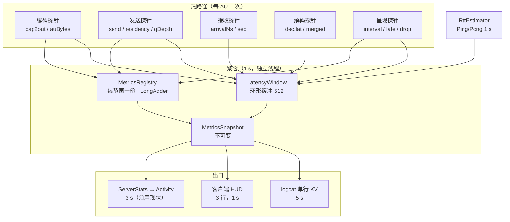
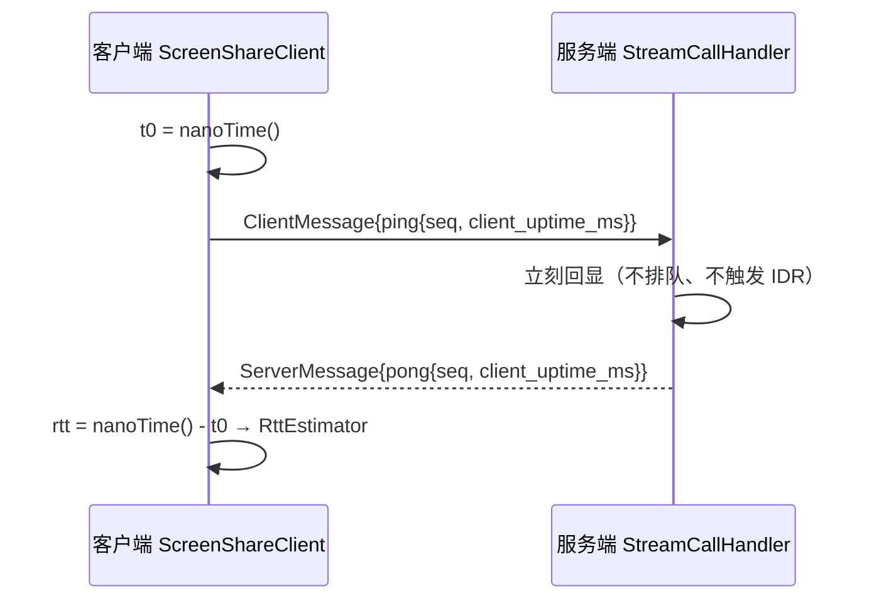
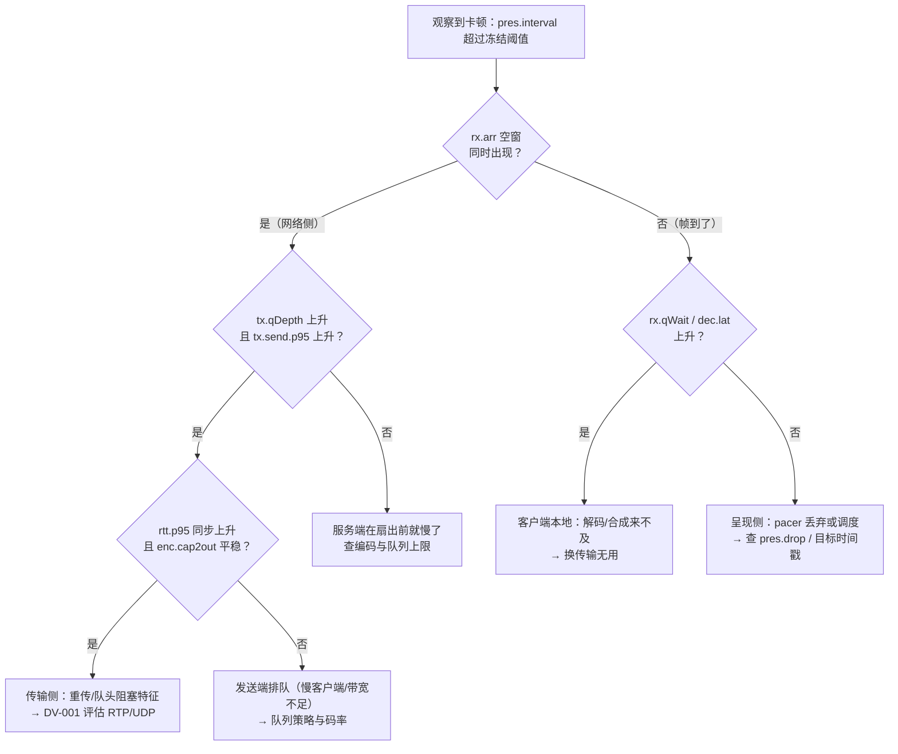

# 传输与管线可观测性实施计划（TB-OBS-001 调研 + 批次拆解）

> **For agentic workers:** REQUIRED SUB-SKILL: Use superpowers:subagent-driven-development or superpowers:executing-plans to implement this plan task-by-task. Steps use checkbox (`- [ ]`) syntax for tracking.

> **状态：本文件只做调研与计划，未写任何实现代码。** 基于 `master`（`22c82b8`）的静态代码审查，以及 scrcpy、W3C WebRTC Stats、Android MediaCodec、gRPC 官方资料；本地 `:app:testDebugUnitTest` 基线为 **812 tests / 72 个测试类全绿**（与 [任务看板](../../task-board.md) 记录一致）。设备验证仍未解禁，**本文件不含任何实测数字**：凡涉及设备或网络行为的地方一律标为 **推测**，阈值只作为「待校准的建议」，不作为结论。

**Goal:** 让「一帧从屏幕到另一块屏幕」在每个环节都可测量，从而把 [DV-001](../../decision-board.md)（TCP 是否升级 RTP/UDP）从"凭直觉"变成"凭数据"；同时为第 8/9 问（发烫、卡顿）提供可归因的量化证据，并顺手关掉 [TB-ENG-007](../../task-board.md#tb-eng-007) 这条已知遗留。

**Architecture:** 三层，自下而上：**探针**（热路径只做 `System.nanoTime()` 与无锁计数，零分配、零字符串拼接）→ **聚合**（1 s 快照，专用线程，固定容量环形缓冲算 p50/p95/p99，取快照不加业务锁）→ **呈现**（logcat 单行结构化 KV、客户端悬浮窗调试叠加层、服务端 `ServerStats` → Activity）。唯一天然缺失的指标是 **RTT**：gRPC 的 HTTP/2 PING 往返时间不向应用暴露，因此另开一条应用层时间戳心跳（`Ping`/`Pong`，唯一的协议增量），其余指标全部在既有数据结构上就地测量。

**Tech Stack:** Java 11 source/target、Android minSdk 25、compileSdk/targetSdk 35、AGP 8.9.0、Gradle 8.11.1、JUnit 4.13.2（手写 fake，仓库惯例，无 Mockito）、protobuf-javalite + grpc-javalite。**不新增依赖、不改构建文件**；proto 仅做向后兼容的增量字段。

**Spec:** [任务看板](../../task-board.md) · [决策看板](../../decision-board.md) · [渐进优化路线图](../../optimization-roadmap.md) · [媒体架构](../../media-architecture.md) · [编码框架设计](../../codec-framework.md) · [命名规范](../../naming-conventions.md) · [问题 3 接线计划](2026-10-19-media-path-wiring.md) · [查看器画质与设置计划](2026-10-21-viewer-quality-and-settings.md)

## 1. 背景与目标

| 依据 | 要求 | 当前状态 |
| --- | --- | --- |
| 原始 12 问第 9 问 | "记录采集、编码、发送、接收、解码、渲染各阶段耗时和队列深度"；"视频按单调时钟 PTS 渲染，迟到帧不排队追赶" | **完全未实施**：管线里没有任何阶段耗时；PTS 渲染已在 [TB-CLIENT-004](../../task-board.md#tb-client-004) 落地，但没有"迟到多少"的记录 |
| [DV-001](../../decision-board.md) | 判据四件套：RTT p50/p95、重传率/重传超时、帧到达间隔 p95/p99、解码截止错过 | **全部缺失**。2026-10-20 双机联机因此无法裁决，维持 gRPC 双向流现状 |
| [DV-018](../../decision-board.md) | 队列字节/时间上限、可加入点等待超时、切换确认超时取多少 | **缺实测依据**：`StreamQueueLimits` 默认值（4 MiB / 120 units / 2000 ms）在代码里明确写着"临时调参值"（`core/stream/StreamQueueLimits.java:20-22`） |
| [TB-OBS-001](../../task-board.md#tb-obs-001) | 统一指标接口；覆盖服务端采集/编码/发送、客户端接收/解码/渲染、网络与设备；调试导出；基线报告 | 📋 待办。验收五项：指标可用、隐私、开销可控、基线完整、无行为变化 |
| [TB-ENG-007](../../task-board.md#tb-eng-007) | `ClientSendStats` 并入服务端统计，UI 与通知可见 | 📋 待办。数据已产出（`ClientSendSession.getStats()`），但没有出口 |
| 第 8 问（发烫/功耗） | 需要可量化的分阶段证据，而不是"感觉烫" | 只有一条 3 s 一次的字节速率，没有任何 CPU/温度/队列证据 |
| [路线图阶段 0](../../optimization-roadmap.md) | 统一指标接口 + 服务端/客户端/网络/设备/日志五组指标 + 基线 + 五项验证标准 | **未执行**；本计划就是阶段 0 的第一批落地 |

目标：

- **先能测，再谈优化**：本计划只增加测量能力，不改媒体路径、不改编码参数、不改队列上限、不改用户可见行为。
- **每个指标都要有归因价值**：一个指标如果无法参与"卡顿到底卡在哪一段"的判断，就不进清单（第 3 章按此筛选）。
- **开销可证明，而不是可声明**：热路径的写入次数、快照开销、开关关闭时的代价都能算清，并给出 A/B 验收口径（第 7.2 节）。
- **诚实标注边界**：采集帧数、编码器内部队列、TCP 重传次数、玻璃到玻璃延迟这四项在当前架构下**测不到**，只能用可解释的替代量推断（第 3.5 节），绝不把推断当测量。
- **一次交付可回滚的最小集合**：六个代码批次，每批单独提交、单独验证、单独回滚，任意一批不做也不阻塞其他批。

非目标（本计划不涉及）：

- 不做 RTP/UDP、不做 WebRTC、不做 jitter buffer/NACK/PLI（这些是 DV-001 裁决之后的动作，见 [TB-NET-001](../../task-board.md#tb-net-001)）。
- 不做 Perfetto/Systrace 集成、不引入任何新的分析或崩溃上报依赖。
- 不改编码参数、不改队列上限、不实现多档流。
- 不做服务端的新设置界面；唯一的 UI 增量是客户端悬浮窗的调试叠加层与服务端状态摘要里的一行。
- 不做设备验证（未解禁）；本文件只把设备步骤写成可执行清单（第 7.3、8.8 节）。

标记约定沿用 [发现调研](../../discovery-research.md)：**当前实现** 可在代码中直接核对；**业界事实** 附外部来源；**建议** 是目标设计；**推测** 是对设备或网络行为的判断。本文件行号均指 `22c82b8`。

## 2. 现状：探针能插在哪，已经有什么

```mermaid
flowchart LR
    subgraph SERVER["服务端（被看方）"]
        A["VirtualDisplay<br/>ScreenShareService:756"] -->|"H.264: 输入 Surface<br/>ScreenShareService:744"| B["H264Encoder<br/>drain + dequeueOutput<br/>:368-393"]
        B --> C["StreamRuntime.onAccessUnit<br/>:707"]
        C --> D["StreamHub.onAccessUnit<br/>:386 扇出"]
        D --> E["ClientSendSession.drainOne<br/>:267"]
        E --> F["GrpcMediaTransport.send<br/>:95 持锁 onNext"]
    end
    F -->|"gRPC/TCP 双向流<br/>每消息一个 AU"| G["ScreenShareClient.onNext<br/>:229"]
    subgraph CLIENT["客户端（看方）"]
        G --> H["decode 线程池<br/>容量 256 :121-131"]
        H --> I["ClientMediaReceiver<br/>:80"]
        I --> J["ClientMediaSession<br/>:200"]
        J --> K["H264Decoder.decode<br/>:186 / drainOutputs :283"]
        K --> L["present → SurfaceTexture<br/>:325"]
    end
    L --> M["TextureView 悬浮窗<br/>ScreenViewerService:738"]
```



| 阶段 | 代码位置 | 已有可观测物 | 缺口 |
| --- | --- | --- | --- |
| 采集（H.264） | `ScreenShareService.java:744`、`:756` | **无回调**：VirtualDisplay 直接把帧画进编码器输入 Surface | 采集帧计数、采集时间戳 |
| 采集（JPEG 降级） | `ScreenShareService.java:344`、`:395` | `onImageAvailable` 与 `image.getTimestamp()` 齐全，并且已经做了帧率节流 | 仅缺计数聚合 |
| 编码 | `H264Encoder.java:373`、`:550`、`:638` | `EncodedSample.getPtsUs()`（采集侧时间戳）、`sequence` 自增、payload 长度、`System.nanoTime()` | 延迟计算、AU 大小分布 |
| 扇出 | `StreamRuntime.java:707`、`StreamHub.java:386` | `getSessionCount()`；无 AU 计数 | 每窗口 AU 计数、join point 计数 |
| 发送队列 | `ClientSendSession.java:352` | `ClientSendStats`：队列深度/字节、累计丢弃、重同步次数、已发送单元数 | **没有出口**（TB-ENG-007）；没有单次发送耗时 |
| 发送 | `GrpcMediaTransport.java:95-102` | 无 | `onNext` 阻塞时长（= TCP 反压的直接证据） |
| 线缆字节 | `ScreenShareServer.java:347`、`ScreenShareClient.java:145` | `ServerStreamTracer.outboundWireSize` / `ClientStreamTracer.inboundWireSize` 已接 `ServerStats`、`ClientStats` | — |
| 接收 | `ScreenShareClient.java:229-255` | 消息对象；`ThreadPoolExecutor` 的队列可读（`getQueue().size()`） | 到达时间戳、队列深度导出、丢弃计数 |
| 解码 | `H264Decoder.java:186-273`、`:283-320` | PTS 往返（输入 `ptsUs` → `DecodedOutput.getPtsUs()`）；输入预算 20 ms | 解码时延、合并丢弃数、预算超时计数 |
| 呈现 | `H264Decoder.java:325-342` | `lastPresentedNs`、`PresentationPacer.Decision` | 呈现间隔、迟到量、DROP 计数 |
| 会话 | `ClientMediaSession.java:336`、`ClientSendSession.java:412` | 状态转换（有监听）、重同步计数 | 重同步**原因**、切换黑帧时长 |

### 2.1 三个决定方案的现状约束

1. **H.264 路径没有采集回调。** 采集端是 `VirtualDisplay → MediaCodec 输入 Surface`（`ScreenShareService.java:744-757`），帧不经过应用层，因此"采集帧率"和"采集耗时"都没有自然探针。可用的替代量是**编码输出 PTS 的间隔**（PTS 由生产者给出，见 3.5 的时钟假设与自校准方案）。
2. **单向流没有回程控制消息。** `ServerMessage` 只有 `descriptor` 与 `access_unit`（`app/src/main/proto/screen_stream.proto`），客户端发往服务端的 `ClientMessage` 有 `hello`/`ready`/`request_keyframe`。**没有任何可以携带"服务端立刻回一个字节"的通道**，所以应用层 RTT 必须新增一对消息（第 5.6 节）。
3. **统计已有数据、没有出口。** 服务端每 3 s 采集一次（`ScreenShareServer.java:384-406`），但只汇总到"总速率 + 每远程地址速率"；客户端同样只有入站字节（`ClientStats`）。管线阶段数据完全没进这条通路。

## 3. 指标清单

### 3.1 标记

| 标记 | 含义 |
| --- | --- |
| ✅ 当前实现可测 | 数据已经存在，只需读取或聚合，不改热路径 |
| 🔧 需新增探针 | 数据不存在，需要加一次时间戳或计数（均为纯本机运算） |
| 🧪 需新增协议 | 需要新增一条控制消息（只有 RTT） |
| ⚠️ 推测 / 不可测 | 当前架构下拿不到真值，只能用可解释的替代量推断，必须标注 |

### 3.2 服务端：采集 / 编码 / 扇出 / 发送

| 键 | 含义（单位） | 采集点 | 类别 | 用途 |
| --- | --- | --- | --- | --- |
| `enc.cap2out` | 采集时间戳 → 编码输出可取出的时长（ms），含编码器排队，p50/p95/max | `H264Encoder.drain`（`:373` 前后） | 🔧 | 第 8 问「编码段耗时」；与客户端 ROWD 对比可区分"编码积压 vs 传输积压" |
| `enc.outInterval` | 相邻编码输出 PTS 之差（ms），p50/p95 | 同上 | 🔧 | 采集侧帧节奏的替代量（3.5 节） |
| `enc.auRate` | 每窗口编码 AU 数 / 秒 | `StreamRuntime.onAccessUnit`（`:707`） | 🔧 | 实际编码帧率，对照 `KEY_FRAME_RATE` 提示值（DB-CODEC-004） |
| `enc.auBytes` | AU 大小分布（B），p50/p95/max | 同上（`payload.length`） | 🔧 | 码率尖峰、IDR 大小、队列上限（DV-018）的取值依据 |
| `enc.bitrate` | 编码输出字节 / 秒 | 同上 | 🔧 | 对照设置值 4 Mbps，验证码率控制是否有效 |
| `kf.request` | 关键帧请求次数 / 窗口 | `StreamRuntime.requestJoinPoint`（`:438-450`） | 🔧 | 客户端卡顿的间接信号；请求风暴检测 |
| `kf.joins` | 实际发出的 join point 数 / 窗口 | `StreamRuntime.onAccessUnit` 的 `isJoinPoint` 分支（`:729`） | 🔧 | 与 `kf.request` 对比，可得"请求被限频/被忽略"的比例 |
| `tx.clients` | 扇出会话数 | `StreamHub.getSessionCount()`（`:373`） | ✅ | 多客户端场景基线 |
| `tx.qDepth` / `tx.qBytes` | 每客户端发送队列当前深度（units / B），窗口内 max | `ClientSendSession.getStats()`（`:352`） | ✅（峰值聚合属 O2） | 慢客户端识别；DV-018 的队列上限依据 |
| `tx.qResidency` | AU 从入队到被取走的时长（ms），p50/p95/max | `ClientSendSession.drainOne` + 队列 `enqueuedMs`（`BoundedAccessUnitQueue.java:259-268`） | 🔧 | 发送侧排队延迟；需给 `QueuePollResult` 增加入队时间戳（见 8.3） |
| `tx.send` | 单次 `sendAccessUnit` 调用耗时（ms），p50/p95/max | `ClientSendSession.drainOne`（`:311`） | 🔧 | **TCP 反压的直接证据**：`onNext` 在流控窗口耗尽时阻塞 |
| `tx.sent` / `tx.drop` / `tx.resync` | 累计发送单元、累计丢弃、重同步次数 | `ClientSendStats` | ✅ | DV-018 的重同步次数 |
| `tx.wire` | 每远程地址出站字节 / 秒 | `ServerStreamTracer.outboundWireSize`（`ScreenShareServer.java:347`） | ✅ | 已实现，不重复造 |
| `tx.flowWindow` | gRPC 流控窗口占用估算 = `tx.qBytes` / 1 MiB | 派生 | ⚠️ | 只是近似：真正占用在 gRPC 内部 |

### 3.3 客户端：接收 / 解码 / 呈现 / 会话

| 键 | 含义（单位） | 采集点 | 类别 | 用途 |
| --- | --- | --- | --- | --- |
| `rx.arr` | 相邻 AU 到达间隔（ms），p50/p95/p99 | `ScreenShareClient.onNext`（`:229`）打时间戳 | 🔧 | **DV-001 的"帧到达间隔 p95/p99"** |
| `rx.rowd` | 相对单向延迟（ms，定义见 6.2），p50/p95/max | 到达时间戳 + AU `ptsUs` | 🔧 | **DV-001 的核心可判决量**：传输造成的延迟增长 |
| `rx.stall` / `rx.stallMax` | 到达空窗超过阈值的次数 / 最长时长（ms） | 由 `rx.arr` 派生 | 🔧 | **重传拖尾的可观测影子**（TCP 不丢帧，只卡住） |
| `rx.seqGap` | `AccessUnit.sequence` 不连续次数 | 到达侧按 `(epoch, sequence)` 判重 | 🔧 | 区分"服务端没发"与"路上丢了" |
| `rx.qDepth` | decode 线程池队列深度 | `ThreadPoolExecutor.getQueue().size()`（`:121-131`） | ✅ | 客户端积压；第 9 问的"解码积压" |
| `rx.shed` | 因 decode 队列满被丢弃的消息数 | `onNext` 的 `RejectedExecutionException` 分支（`:240-246`） | 🔧 | 当前只打一条 warning，没有计数 |
| `rx.qWait` | 消息入队 → 解码线程开始处理（ms），p50/p95 | decode 线程入口 | 🔧 | 拆开"网络到达"与"等解码器"两段 |
| `dec.lat` | 送入解码器 → 输出可取回（ms，按 PTS 匹配），p50/p95/max | `H264Decoder.decode` / `drainOutputs` | 🔧 | 第 9 问"解码耗时"；DV-001 的"解码截止错过"分母 |
| `dec.shed` | 输入预算耗尽而丢弃的帧数 | `H264Decoder.decode`（`:242-254`） | 🔧 | 当前只调 `requestKeyFrame()`，不计数 |
| `dec.merged` | 一次 drain 中因"只留最新"被丢弃的输出数 | `H264Decoder.drainOutputs`（`:299-302`） | 🔧 | 解码跑不过合成时的静默合并量 |
| `pres.interval` | 相邻呈现间隔（ms），p50/p95/p99 | `H264Decoder.present`（`:325`） | 🔧 | 观感平滑度的直接量化 |
| `pres.late` | 交帧迟到量 = `max(0, nowNs − targetNs)`（ms），p50/p95/max | 同上（`toDeviceTimeNs` 之后） | 🔧 | 画面"晚到多久"的直接量 |
| `dec.deadlineMiss` | 输出可取回时目标时刻已过的帧数 / 秒（= 解码没赶上本帧自己的呈现时刻） | `drainOutputs` 取到输出的那一刻 | 🔧 | **DV-001 的"解码截止错过"** |
| `pres.drop` | `PresentationPacer` 判 DROP 的帧数 | 同上 | 🔧 | 本地丢帧（不等于网络丢帧） |
| `freeze` / `freezeMax` | 冻结次数 / 最长时长（ms），定义见 4.2 | 由 `pres.interval` 派生 | 🔧 | 与 WebRTC 对齐的口径，便于外部对照 |
| `resync` | 重同步次数 + 原因（输入超时/解码异常/等 Surface/等 IDR） | `ClientMediaSession.setState`（`:336`）+ `H264Decoder` | 🔧 | 第 9 问归因；当前只有次数、没有原因 |
| `switch.blackout` | 新 epoch 描述符到达 → 下一帧呈现（ms） | `ClientMediaReceiver` + `present` | 🔧 | DV-018 的"切换黑帧时长" |
| `join.latency` | 发出关键帧请求 → 首个 join point AU 到达（ms） | `ScreenShareClient.requestKeyFrame` 记录起点，到达侧匹配 `sync_point` | 🔧 | DV-018 的"可加入点等待超时"；卡顿恢复时延 |
| `rx.wire` | 入站字节 / 秒 | `ClientStreamTracer.inboundWireSize`（`ScreenShareClient.java:145`） | ✅ | 已实现 |
| `kf.sent` | 客户端发出的关键帧请求数 | `ScreenShareClient.requestKeyFrame`（`:302`）与节流器 | 🔧 | 与 `kf.request` 对齐；恢复时延的分子 |

### 3.4 传输

| 键 | 含义（单位） | 采集点 | 类别 | 用途 |
| --- | --- | --- | --- | --- |
| `rtt.p50` / `rtt.p95` / `rtt.ewma` | 应用层往返时延（ms） | `Ping`/`Pong`（第 5.6 节） | 🧪 | **DV-001 的"RTT p50/p95"**；路径 RTT 与排队延迟的分离量 |
| `rtt.lost` | 超时未回的样本数 | 同上 | 🧪 | 丢样本身也是拥塞信号 |
| `tx.backlog` | 服务端累计 `tx.sent` − 客户端累计收到（近似，按窗口对齐） | 两端计数离线关联 | ⚠️ | 管道内滞留量的粗估；窗口对齐误差随速率放大，只作参考 |
| `link.disconnects` | 断线次数 | 现有 `ClientObserver.onDisconnected` | ✅ | 稳定性基线 |

### 3.5 不可测与推测：必须写清楚的四个边界

| 项目 | 为什么测不到 | 采用的替代量 | 替代量的成立条件 |
| --- | --- | --- | --- |
| H.264 采集帧数与采集耗时 | 采集端无应用层回调（VirtualDisplay → 输入 Surface） | `enc.outInterval`（编码输出 PTS 间隔） | 编码器不主动丢帧；PTS 由生产者按采集时刻给出。**推测**，需在 O2 用自校准验证 |
| 编码器内部输入队列深度 | MediaCodec 不暴露 BufferQueue 深度 | `enc.cap2out` 相对其 p50 的偏移量 | 编码耗时本身稳定；偏移增长即排队增长。**推测** |
| TCP 重传次数 / 重传超时 | gRPC 不暴露 TCP 统计（HTTP/2 PING 的 RTT 也不向应用开放） | `rx.stall` + `rx.rowd` + `tx.send` + `rtt` 联合判断（6.3 决策树） | 重传表现为**延迟**而非丢帧：可靠传输只会卡住，不会少帧 |
| 玻璃到玻璃延迟 | 解码器到屏幕之间的呈现由 SurfaceFlinger 完成，应用侧只有 `present()` 的时刻 | `pres.late`（应用到合成边界） | 只能回答"应用有没有按时交帧"，不能回答"像素何时发光" |

同时明确**不采集**：画面内容、输入文本、设备名、指纹、绝对路径、对端完整 IP（`ServerStats` 现有实现已包含远程地址，属于本机调试展示，沿用现状；结构化日志里只写会话短标识）。

## 4. 业界做法与证据

### 4.1 scrcpy：把统计做成"两个计数器 + 一个窗口 + 一个开关"

| 做法 | 出处 | 对我们的意义 |
| --- | --- | --- |
| FPS 计数器是一个独立线程，按 1 s 窗口把 `nr_rendered` / `nr_skipped` 打印成一行 | [fps_counter.c](https://github.com/Genymobile/scrcpy/blob/master/app/src/fps_counter.c) | 与我们"1 s 快照 + 单行 KV"的结构一致；只统计**两个**计数就足以回答"掉没掉帧" |
| 计数在生产者侧无锁累加，打印在窗口线程 | 同上 | 热路径只写计数，绝不在 AU 路径上格式化字符串 |
| 可运行时开关（`--print-fps`、`MOD+i`） | [scrcpy(1)](https://manpages.debian.org/testing/scrcpy/scrcpy.1.en.html) | 统计必须能随开随关，且关闭时零成本；对应第 5.7 节 |
| 区分 rendered / skipped 两个口径 | 同上 | 我们也必须区分"网络没来"（`rx.arr` 空窗）与"来了但本地丢了"（`pres.drop`、`dec.merged`、`dec.shed`） |

### 4.2 WebRTC Stats：指标模型的直接对标

W3C 的 `RTCInboundRtpStreamStats` / `RTCOutboundRtpStreamStats` 已经把"投屏质量"拆成了可判定的字段，我们借用其**口径**而不是其实现（[W3C webrtc-stats](https://www.w3.org/TR/webrtc-stats/)）：

| WebRTC 字段 | 语义 | 我们的对应指标 | 差异 |
| --- | --- | --- | --- |
| `totalDecodeTime` / `framesDecoded` | 送入解码器到取回数据的累计时间 | `dec.lat` | 一致；我们按 PTS 匹配单帧，更直接用 |
| `totalInterFrameDelay` + `totalSquaredInterFrameDelay` | 相邻**呈现**帧间隔之和与平方和，可算方差 | `pres.interval` 的 p50/p95 + 方差 | 一致 |
| `framesDropped` / `freezeCount` | 丢弃帧；冻结定义为间隔 ≥ `max(3×avg, avg+150ms)`（近 30 帧均值） | `pres.drop`、`freeze` | **直接采用该冻结定义**，便于和外部工具对照 |
| `jitterBufferDelay` / `jitterBufferEmittedCount` | 帧在抖动缓冲内停留的时长（首包入 → 整帧出） | `rx.qWait` + `tx.qResidency` | 语义近似：我们分两端记，不做统一抖动缓冲 |
| `pliCount` / `firCount` / `nackCount` | 关键帧请求与重传请求次数 | `kf.sent` / `kf.request` / `kf.joins` | 有 PLI 语义，没有 NACK（TCP 没有这层） |
| `packetsLost` / `jitter` | RTP 丢包与抖动（RFC 3550） | `rx.seqGap` + `rx.stall` | **不可直接照搬**：TCP 不丢包，只产生队头阻塞 |
| `RTCRemoteOutboundRtpStreamStats.reportsSent` + 候选对的 `currentRoundTripTime` | 对端报告 + 路径 RTT | `rtt.p50/p95` | 我们只能自己做应用层往返测量 |

这里有一条对 DV-001 很关键的推论：**RTP 的 `packetsLost` 在 TCP 上没有对应物**。TCP 丢包表现为重传与队头阻塞，输出是"延迟尖峰"而不是"缺帧"。因此 DV-001 的判据不该是"丢包率"，而必须是"卡顿的持续时长与出现频率"——这也是本计划把 `rx.stall`、`rx.rowd`、`pres.late` 放在核心位置的原因。

### 4.3 MediaCodec：解码时延的通行测法

| 做法 | 出处 | 结论 |
| --- | --- | --- |
| 在 `queueInputBuffer` 前打时间戳，在 `dequeueOutputBuffer` 后按 `presentationTimeUs` 匹配，差值即解码时延 | [Grafika 实践记录](https://exchangetuts.com/how-to-reduce-latency-in-mediacodec-videoavc-decoding-1641344283644936) | 与本仓库现有 PTS 往返完全同构：`H264Decoder` 已经把 AU 的 `ptsUs` 送进 `queueInputBuffer`（`AndroidMediaCodecDecoderBridge.java:124`），并从 `BufferInfo.presentationTimeUs` 取回（`:141`）。**只需加一次 `nanoTime()` 与一次查表** |
| 输入侧超时用 `dequeueInputBuffer(timeoutUs)` 的累计预算表达反压 | [MediaCodec 参考](https://developer.android.com/reference/android/media/MediaCodec) | 与 `H264Decoder.INPUT_BUDGET_NANOS` 一致；我们补计数即可 |

编码侧同理：`EncodedSample.getPtsUs()` 与取回时刻的差值就是"采集→编码产出"，但要注意它**包含编码器排队**，不是纯编码耗时（3.5 节）。

### 4.4 gRPC 的 RTT：能拿到什么、拿不到什么

| 事实 | 出处 | 结论 |
| --- | --- | --- |
| HTTP/2 的 PING 帧"可用于估算往返时间、带宽时延积" | [gRPC Keepalive 指南](https://grpc.io/docs/guides/keepalive/) | 协议层有能力 |
| keepalive 的 `KEEPALIVE_TIME`/`KEEPALIVE_TIMEOUT` 只用于保活与断连检测，客户端默认关闭 | 同上（Client 默认 `INT_MAX`） | 本项目两个 channel 都没有配置 keepalive（`GrpcConstants` 只有流控窗口与消息上限） |
| grpc-java 的公开 API 不返回 PING 的 RTT；`ClientStreamTracer`/`ServerStreamTracer` 只给 wire size | 仓库现有用法（`ScreenShareClient.java:140-152`、`ScreenShareServer.java:328-353`） | **必须自己做应用层时间戳心跳** |
| 长连接流式 RPC 上，keepalive 失败会直接终止 RPC、丢掉未发送数据 | [gRPC Keepalive 指南](https://grpc.io/docs/guides/keepalive/) | 统计探针不能靠调 keepalive 来实现；也提醒我们不要用"频繁强制 IDR"当 ping（会破坏码率稳定性） |

### 4.5 从证据推出的四条低开销原则

1. **热路径只写计数和时间戳**：一次 `System.nanoTime()`、一次 `LongAdder.add`，不分配、不加锁、不拼字符串。
2. **窗口与分位在快照侧算**：环形缓冲固定容量，排序只发生在 1 s 一次的聚合线程上。
3. **统计必须可关**：关闭时每个探针是一次 `volatile boolean` 读；不允许出现"关不掉"的埋点。
4. **口径要能对外对齐**：冻结、呈现间隔、解码时延都按 WebRTC 的定义写，便于用第三方工具交叉验证（第 7.2 节的 A/B 验收也依赖这一点）。

## 5. 架构方案

### 5.1 三层的形状



### 5.2 热路径写入契约（可审计的硬约束）

| 允许 | 禁止 |
| --- | --- |
| 一次 `nanoTime()` | `System.currentTimeMillis()`（可回跳） |
| `LongAdder.add(1)` / `increment()` | 任何 `synchronized`、`ConcurrentHashMap.compute` |
| 固定容量数组写入 + 原子索引 | 装箱、`new` 对象、lambda 捕获 |
| 条件：`if (!enabled) return;` | 在热路径拼字符串、格式化、调用 `Log.*` |

每条指标在实现时必须能回答"每 AU 增加几次写入"。预算：单 AU 总计 ≤ 4 次 `nanoTime` + ≤ 8 次计数写入；快照侧 0 次（分位、排序、格式化全部发生在聚合线程）。

### 5.3 数据结构

- `core/util/NanoClock`：`nowNs()` 的新接口，`NanoClock.MONOTONIC = System::nanoTime`。**不改 `TimeSource`**（`core/util/TimeSource.java` 是 `nowMs()` 的 lambda，加方法会波及其全部实现与测试），毫秒与纳秒两条时钟并存、各取所需。测试用 `MutableNanoClock`（对应现有 `core/support/MutableClock` 的风格）。
- `core/metrics/LatencyWindow`：固定容量（默认 512）环形缓冲，记录 `long` 样本；`snapshot()` 时拷贝并排序，返回 `p50/p95/p99/max/count`；容量满后覆盖最旧样本；`reset()` 只在换 epoch 时调用。排序上界：512 个 long，一次约 5k 次比较，1 s 一次 → 可忽略。
- `core/metrics/MetricsRegistry`：按枚举键持有计数与窗口的容器（每进程一份并不合适——多流/多会话会互相污染；改为**每个范围一份**：服务端编码 1 份、每客户端发送 1 份、客户端接收 1 份），持有 `enabled` 开关的 volatile 快照。
- `core/metrics/MetricNames`：结构化日志的键名常量（`UPPER_SNAKE`，按域名分 2–3 个类，每个 ≤ 20 个值，遵循 [命名规范](../../naming-conventions.md) 第 5 章）。
- `core/metrics/PipelineMetrics`：一个范围的全部窗口 + 计数，`PipelineMetrics.NONE` 为空实现（沿用 `KeyFrameRequester.NONE` 的既有惯例，见 `core/codec/h264/H264Decoder.java:97`），已有构造器不变，新增一个可注入的重载。
- `core/metrics/ArrivalTracker`：接收侧派生量（`rx.arr`、`rx.rowd`、`rx.stall`、`rx.seqGap`），**纯 JVM**，是 DV-001 判据的核心计算单元。
- `core/metrics/RttEstimator`：`seq → sendNs` 的小表（容量 8）+ 超时清理；输出 `p50/p95/ewma/lost`。
- `core/metrics/MetricsFormatter`：把快照渲染成单行 KV 或 HUD 三行文本；纯函数，输入快照、输出 `String`（唯一允许拼字符串的位置）。
- `server/ServerStatsMapper`：把"每会话统计 + 每地址字节计数"映射成 `ServerStats`；纯函数，可 JVM 单测（`ServerProfile` 是私有内部类且依赖 `SystemClock`，因此聚合逻辑必须上提到纯类）。

### 5.4 聚合与快照

- 快照周期：日志 5 s（对齐现有 3 s 统计的观感，但更省），HUD 1 s（只在叠加层打开时），`ServerStats` 保持 3 s（不改既有节奏，避免 UI 抖动）。
- 聚合线程：服务端与客户端各自一个 `HandlerThread`（服务端已有 `mImageReaderHandlerThread` 的用法可参考），优先级 `THREAD_PRIORITY_BACKGROUND`；**不建新线程池**。
- 快照不可变：`MetricsSnapshot` 一次性构造，跨线程直接传递，不加锁；窗口读取与热路径写入之间只允许出现"样本错位"，不允许出现"读到半条记录"。
- 快照频率与窗口期配合：5 s 窗口用 512 样本可覆盖 30 fps × 5 s = 150 帧，留 3 倍余量；HUD 的 1 s 窗口用 128 样本。

### 5.5 三个出口

| 出口 | 触发 | 内容 | 约束 |
| --- | --- | --- | --- |
| logcat | 5 s，`KEY_METRICS_ENABLED` 打开时 | 单行 KV，前缀固定 `lss.metrics`，按 `role=server/client` 区分 | 不写设备名、指纹、画面、payload；会话标识只写随机 id 的后 8 位 |
| 客户端 HUD | 1 s，叠加层打开时 | 3 行：帧率/码率/RTT；队列/解码/迟到；ROWD/卡顿/丢帧/关键帧 | 只在悬浮窗内，默认关闭；关闭后 `Visibility.GONE`，不做任何计算 |
| `ServerStats` | 3 s，沿用现状 | 现有总速率/每地址速率 + 每客户端一行（队列深度、丢弃、重同步、发送 p95） | `Parcelable` 需同步新增字段的读写；`@Data` 的 `equals` 会随字段变化，注意通知刷新逻辑 |

HUD 的挂点：`SurfaceShareViewer`（`ScreenViewerService.java:738`）当前把 `TextureView` 直接作为窗口根视图（`:922` `addView(mTextureView, mLayoutParams)`）。改为 `FrameLayout` 根 + `TextureView(MATCH_PARENT)` + `TextView(调试叠加层)`，`mLayoutParams` 仍然作用于根视图，`getTextureView()`、`updateContentTransform()`（`:970-993`）、`updateShape()`（`:995-1010`）的坐标语义不变。叠加层开一个 `FLAG_NOT_TOUCHABLE` 语义（不拦截触摸）：`TextView` 自己 `setClickable(false)` 即可，触摸仍落到 `TextureView` 的 listener。

### 5.6 RTT 通道（唯一的协议增量）



设计要点：

- proto 增量：`ClientMessage` 加 `Ping ping = 4;`，`ServerMessage` 加 `Pong pong = 3;`；`Ping{int32 seq; int64 client_uptime_ms;}`、`Pong{int32 seq; int64 client_uptime_ms;}`。**只回显客户端自己给的字段**，不回传服务端时间，避免引入时钟同步问题。
- 频率：1 s 一次，负载 < 40 B/s；上限 2 s 内未回即判丢（`rtt.lost++`），连续 5 次不回不影响任何既有行为（不主动断连——断连仍由 gRPC 自己负责）。
- 位置：`StreamCallHandler.onClientMessage`（`:107-125`）的 `switch` 加一个 `case PING`，直接在 gRPC 回调线程写回显；**不经过 drain 线程的发送队列**，否则测到的是队列延迟。写入需要与 `GrpcMediaTransport` 的 `sendLock` 协调（`:95-102` 的 `onNext` 是串行的，observer 非线程安全），因此回显必须走同一个锁。
- 接口形状：`StreamCallHandler` 注入一个窄回调（`PongTarget`，按命名规范 2.3 的"输出端"角色，仅 `sendPong(int seq, long clientUptimeMs)`），服务端用 `GrpcMediaTransport::sendPong` 实现，默认 `NO_OP`。**不扩宽 `MediaTransport` 接口**，否则 `FakeTransport`、`BlockingTransport` 与 4 个既有测试类都要跟着改。
- 兼容性：proto3 的 oneof 对端不认识的字段会被当作 `PAYLOAD_NOT_SET` 忽略；旧客户端连新服务端、新客户端连旧服务端都只会退化为"没有 RTT 样本"，不报错。`ScreenStreamProtoMapper.PROTOCOL_VERSION` 不需要因此递增（不涉及描述符与码流兼容）。
- 为什么不用"强制 IDR 当 ping"：会制造码率尖峰与额外解码负载，污染正在测量的东西；只在 O5 尚未落地时允许作为临时手段，且必须限频（现有 `KeyFrameRequestThrottle`）并标注为"RTT 上界，含编码时延"。

### 5.7 采样开关与降级

| 开关 | 默认 | 作用 |
| --- | --- | --- |
| `KEY_METRICS_ENABLED`（两端共用同一个偏好键） | `false` | 结构化日志与窗口计算；关闭时探针全为 no-op，日志与 HUD 都不产出 |
| `KEY_VIEWER_HUD_ENABLED`（客户端） | `false` | 悬浮窗调试叠加层：1 s 快照 + 渲染；关闭后连快照都不做，也不覆盖 `KEY_METRICS_ENABLED` |

不用 `BuildConfig.DEBUG`：`app/build.gradle` 未启用 `buildFeatures.buildConfig`，把开关做成偏好项既避免动构建文件，也让"调试构建导出"与"用户自证"共用一条通路。HUD 的入口挂在悬浮窗双击菜单（现有 `ViewerZoomMenuModel`）新增一行"显示调试信息"，需要新增字符串并同步 `values-zh`（[命名规范](../../naming-conventions.md) 4.3）。

### 5.8 隐私与脱敏

- 不记录画面内容、不记录 payload、不记录输入文本、不记录设备名/指纹/绝对路径。
- 远程地址沿用现有 `ServerStats` 行为（本机展示），但**结构化日志不写完整地址**，只写 `peers=N`。
- 会话标识：客户端 `client-id` 是每次运行随机生成的 UUID（`ScreenShareClient.java:278`），日志只取后 8 位作为 `sid`，用于把两端日志离线对上；它不是设备身份，也不是发现身份。

## 6. 归因：指标如何支撑 DV-001 与 DV-018

### 6.1 DV-001 需要的四类证据，分别由谁提供

| DV-001 判据 | 指标 | 批次 | 为什么它能支撑 |
| --- | --- | --- | --- |
| RTT p50/p95 | `rtt.p50/p95/ewma/lost` | O5 | 唯一能直接看到"路径往返"的量；与 `rx.rowd` 一起把"路径慢"与"排队慢"分开 |
| 重传率 / 重传超时（不可见） | `rx.stall`、`rx.rowd`、`tx.send`、`rx.seqGap` | O2 + O4 | TCP 重传的**唯一可观测后果**是队头阻塞：到达空窗 + 延迟增长 + 发送阻塞，而序列号不缺。四者联合出现即为重传/拥塞特征 |
| 帧到达间隔 p95/p99 | `rx.arr` | O4 | 直接回答"画面供给是否规律"；与 `enc.outInterval` 对比可判断抖动由编码侧还是网络引入 |
| 解码截止错过 | `dec.deadlineMiss` + `pres.late` + `pres.drop` + `dec.merged` | O4 | 回答"就算帧到了，本地还赶得上吗"；若迟到主要来自 `rx.qWait`/`dec.lat`，则换传输无用 |

### 6.2 相对单向延迟（ROWD）：不需要时钟同步的关键技巧

服务端 PTS 用的是服务端时钟，客户端 `nanoTime()` 用的是客户端时钟，两者有**未知但恒定**的偏移 `θ`。对每一帧：

```text
observed = arrivalNs(client) − ptsNs(server) = θ + captureToEncode + transportQueue + jitter
rowd     = observed − min(observed over window)   // θ 和固定开销被减掉
```

`rowd` 保留的正是"这一帧比最快的那一帧多花了多久"，也就是**排队与抖动的增长量**。前提三条，实现时必须校验：

1. 两端都以 `CLOCK_MONOTONIC` 为基（服务端 PTS 来自 SurfaceFlinger/VirtualDisplay，**推测**成立；O2 首次运行做自校准：样本落在一个合理区间且不出现负值或秒级跳变才启用该指标）。
2. 会话内两端时钟不发生跳变（单调时钟保证）。
3. `min` 用滑动窗口（建议 30 s）而非全程最小值，避免启动期的偶发快帧把基线钉死。

这条量是 DV-001 的核心：**它把"TCP 重传拖尾"从不可见变成一条曲线**。

### 6.3 归因决策树



### 6.4 DV-001 的裁决程序（预注册，阈值待校准）

**做法**：先跑基线，再按同一套判据解释数据；阈值在产品确认"可接受观感"后由基线数据反推，**不在本文件里写成常量**。建议程序如下：

1. 同一对设备、同一 AP、同一画面内容（静止 / 滚动列表 / 视频播放各 10 分钟），各重复 3 次，全程开启 O1–O6 的全部指标。
2. 对每段会话计算：`rx.rowd.p95`、`rx.stall`（> 200 ms 的次数）、`rx.arr.p99`、`pres.late.p95`、`rtt.p95`、`tx.send.p95`、`enc.cap2out.p95`。
3. 归因：按 6.3 决策树把每段的主要卡顿归到「编码/发送队列/传输/解码/渲染」之一。
4. 判决：
   - 若卡顿主要归因**不在传输**（第 3 步落在 R2–R4）→ DV-001 维持"不切换"，把结论写进决策看板，并把这些证据转给对应的优化任务。
   - 若卡顿归因**在传输**且 `rx.stall` 的时长量级足以被用户看见（例如长于一帧间隔的数十倍并反复出现）→ 才启动 RTP/UDP 评估（TB-NET-001），并把 `rx.rowd.p95` 与 `rx.stall` 作为切换前后的对照指标。
   - 若数据不足（例如全是静止画面、无卡顿）→ **不裁决**，补充场景再测；不允许用"没有卡顿"推出"TCP 永远够用"。
5. 每次裁决必须附：设备组合、网络条件、画面内容、指标快照、归因结论。缺任何一项都不能改 DV-001 的状态。

**必须提前声明的两个反直觉点**：① TCP 上没有"丢帧"，只有"晚到"，因此任何以"丢包率"为格式的判据都不适用；② 4 Mbps 码流配 1 MiB 流控窗口（`GrpcConstants.GRPC_FLOW_CONTROL_WINDOW`）理论上可缓冲约 2 s 的数据，也就是说**发送端在真正阻塞之前，延迟可能已经涨到秒级**——这正是 `rx.rowd` 比 `tx.send` 更早、更灵敏的原因。

### 6.5 DV-018 的数值来源

| DV-018 待定项 | 由哪个指标给出 |
| --- | --- |
| 发送队列字节上限 | `tx.qBytes` 峰值分布 + `enc.auBytes` 的 p95（4 MiB 是否过大） |
| 发送队列单元上限 | `tx.qDepth` 峰值 + `enc.auRate`（120 units 在 30/60 fps 下分别是几秒） |
| 驻留时间上限 | `tx.qResidency` p95/max（2000 ms 是否远超可感知延迟） |
| 可加入点等待超时 | `join.latency`（`kf.sent` → 首个 join point 到达） |
| 切换确认超时 | `switch.blackout` 分布 |
| 重同步频率 | `tx.resync` / `resync` |

### 6.6 仪器自身的验证：注入拥塞的对照实验

测量工具必须先被证明"能看见问题"，否则"没测到"不等于"没问题"。设备验证解禁后，除正常基线外必须做一组**对照**：

- 在同一 AP 上人为制造拥塞（例如另一台设备跑满上行带宽），确认 `rx.stall`、`rx.rowd.p95`、`tx.send.p95` 三者在时间上**同步抬升**，并且 `rx.seqGap` 保持为 0（证明是拥塞而不是丢帧）。
- 若注入拥塞后指标**没有**变化，说明探针位置或窗口太粗，必须先修仪表再谈 DV-001；这一条比任何单次测量结果都重要。

## 7. 测试策略

### 7.1 分层

| 层 | 手段 | 覆盖 |
| --- | --- | --- |
| 纯 JVM（主力） | JUnit 4 + 现有 fake（`FakeTransport`、`BlockingTransport`、`FakeMediaCodec*Bridge`、`FakeRenderTarget`、`MutableClock`） | `LatencyWindow` 分位与容量、`ArrivalTracker`（ROWD/空窗/序号缺口）、`RttEstimator`（乱序/丢样/时钟回退）、`MetricsFormatter`、`ServerStatsMapper` |
| 契约测试 | 沿用 `MediaCodecBridgeContractTest` 风格 | 新增探针不得改变 bridge 的 `present/discard` 成对语义；`dec.merged` 计数必须与实际 `discard` 次数一致 |
| 端到端（JVM） | `H264StreamEndToEndTest` 风格 | 服务端 `tx.sent` 与客户端收到数在 fake transport 上守恒；统计不改变事件顺序（descriptor 仍先于 AU） |
| 编解码器 | `H264DecoderTest` + `MutableNanoClock` | 解码时延按 PTS 匹配、合并丢弃计数、呈现迟到计算、开关关闭时全部为 no-op |
| 协议 | `ScreenStreamProtoMapperTest` | `Ping`/`Pong` 编解码往返；未知 payload 仍被忽略 |
| 设备（未解禁） | 见 7.3 | 全部设备行为 |

新增测试的硬约束：不引入 Mockito；不改既有测试的语义；每批 JVM 用例数只增不减（基线 812）。

### 7.2 开销验收

| 项 | 口径 | 通过条件（**建议**，待实测校准） |
| --- | --- | --- |
| 关闭态开销 | 开关关闭时，热路径只多一次 volatile 读 | 编译产物里探针调用被内联为 `if` 判空；`enc.cap2out`/`dec.lat` 不产生样本 |
| 开启态开销 | 同一场景 A/B：指标关 vs 开 | 编码 `enc.cap2out.p50`、解码 `dec.lat.p50` 差异 ≤ 5%，`pres.interval` 分布无系统性偏移 |
| 内存 | 每个范围：2 个 512 长度 `long[]` + 8 个 `LongAdder` | 常驻增量 < 32 KB/会话 |
| 日志量 | 5 s 一行，单行 ≤ 512 B | 10 分钟会话 ≤ 60 KB 文本 |
| 线程 | 仅复用既有 `HandlerThread` | 不新增常驻线程 |

### 7.3 设备验收矩阵（解禁后执行）

| 组合 | 观察项 | 判定 |
| --- | --- | --- |
| 真机服务端 ↔ 模拟器客户端（同 AP） | 静止/滚动/视频三段各 10 min | 指标齐全、无 ANR、无新增崩溃 |
| 5 GHz ↔ 2.4 GHz | `rx.arr.p99`、`rx.stall`、`rtt.p95` | 记录差异，不作为通过/失败判据 |
| 注入拥塞 | 6.6 的对照实验 | 三项指标同步抬升，`rx.seqGap` 为 0 |
| 慢客户端（后台限速/旧机） | `tx.qDepth`、`tx.drop`、`tx.resync` | 慢客户端不影响其他客户端（既有语义不变） |
| 分辨率/帧率切换 | `switch.blackout`、`tx.resync` | 记录黑帧时长分布，供 DV-018 |
| 30 min 长稳 | 内存、线程数、日志体积 | 无线性增长 |

### 7.4 明确未验证的范围

所有设备与网络行为、PTS 时钟基假设、SurfaceFlinger 侧延迟、Wi-Fi 驱动与路由器的缓冲策略、编码器内部队列的真实深度、`rx.stall` 阈值与"用户可感知卡顿"的对应关系。

## 8. 批次计划

### 8.1 全局约束与 Review Focus

逐批硬约束（与前序计划一致）：

- 每批独立提交；逐文件 `git add`，禁止目录级 add；提交信息 `feat:`/`fix:`/`refactor:`/`docs:` 前缀 + 中文描述；禁止 force-push。
- 每批验证（Git Bash，仓库根）：`./gradlew :app:testDebugUnitTest --offline` 与 `./gradlew :app:assembleDebug --offline`；JVM 基线 **812**，只增不减。
- 全程禁止 adb、模拟器/实机、`connectedAndroidTest`、安装或启动 App。
- 不新增依赖；不改 `gradle/libs.versions.toml`、`app/build.gradle`、CI 配置；除 O5 的 proto 增量外不动 schema。
- 文档中文、代码注释/Javadoc 英文；Javadoc 一律多行块；图表一律 Mermaid；仓库内不写本机绝对路径、用户名、设备标识、会话/agent ID。
- 与已收敛决策冲突时停下报告，不擅自取舍。

Review Focus（最容易咬人的失败模式）：

1. **探针不能改变时序**：`System.nanoTime()` 只读；不得为了取时间戳调整锁的顺序，尤其 `ClientSendSession.drainOne` 的"传输调用在锁外"与 `GrpcMediaTransport` 的 `sendLock`。
2. **统计不能进入已有锁的临界区做重活**：窗口写入必须是 O(1) 数组操作，排序只能发生在快照线程。
3. **`ServerStats` 是可 `Parcelable` 的 `@Data`**：新增字段必须同时改 `writeToParcel`/`CREATOR`，否则跨进程读取直接错位；`equals` 变化会影响 `Objects.equals` 的去重逻辑（`ScreenShareServer.java:393`）。
4. **不要用"估算"冒充"测量"**：`tx.backlog`、`tx.flowWindow`、采集帧数这类量必须带 `⚠️` 标记出现在输出里（键名加 `approx.` 前缀），避免后续被当作事实引用。
5. **关闭态必须真的关**：同一场景 A/B 时，若关闭态仍有窗口分配或快照线程，视为未实现。
6. **HUD 不得阻塞渲染路径**：叠加层文本更新在 1 s 定时线程上完成，主线程只做一次 `setText`；`TextureView` 的 `Surface` 生命周期不受根视图替换影响（`:922` 的 `addView`/`removeView` 成对迁移到容器）。
7. **RTT 回显不排队**：`Pong` 必须绕开 `ClientSendSession` 的队列，否则测到的是本地队列延迟。

### 8.2 O1：指标内核（纯 JVM，零接线）

**目标：** 新增可测的指标基础设施，不改任何生产路径。整批可整批回滚且零行为变化。

**文件：**

- Create：`app/src/main/java/com/obby/android/localscreenshare/core/util/NanoClock.java`
- Create：`app/src/main/java/com/obby/android/localscreenshare/core/metrics/LatencyWindow.java`
- Create：`app/src/main/java/com/obby/android/localscreenshare/core/metrics/PipelineMetrics.java`
- Create：`app/src/main/java/com/obby/android/localscreenshare/core/metrics/MetricsSnapshot.java`
- Create：`app/src/main/java/com/obby/android/localscreenshare/core/metrics/MetricNames.java`
- Create：`app/src/main/java/com/obby/android/localscreenshare/core/metrics/MetricsFormatter.java`
- Test：`app/src/test/java/com/obby/android/localscreenshare/core/metrics/LatencyWindowTest.java`
- Test：`app/src/test/java/com/obby/android/localscreenshare/core/metrics/PipelineMetricsTest.java`
- Test：`app/src/test/java/com/obby/android/localscreenshare/core/metrics/MetricsFormatterTest.java`
- Test：`app/src/test/java/com/obby/android/localscreenshare/core/support/MutableNanoClock.java`

**设计要点：**

- `LatencyWindow(int capacity)`：`record(long sample)`、`snapshot()`（返回不可变 `Stats{p50,p95,p99,max,count}`）、`reset()`。分位定义固定写在 Javadoc：`p95` = 排序后第 `ceil(0.95 * n) - 1` 个（最近秩法），保证测试可断言。
- `PipelineMetrics`：持有窗口与 `LongAdder`；`PipelineMetrics.NONE` 的所有方法为 no-op；`isEnabled()` 为 `volatile`。
- `MetricsFormatter`：`toLogLine(role, Snapshot)`、`toHud(Snapshot)`；全部键名来自 `MetricNames`，禁止散落字符串。
- 包位置：`core/metrics` 是技术层新包，只依赖 JDK，**不得** import `core/codec`、`core/stream`（[命名规范](../../naming-conventions.md) 1.4 的依赖方向）。

**验证：** 分位边界（n=1、n=100、全相同值、含 0）、容量覆盖顺序、reset 语义、关闭态无分配（用"窗口 count 始终为 0"断言）、格式化输出键名的稳定性（快照比较）。`./gradlew :app:testDebugUnitTest --offline`、`./gradlew :app:assembleDebug --offline`。

**提交计划：** 一个 `feat:` 提交。

### 8.3 O2：服务端管线探针（编码 / 扇出 / 发送）

**目标：** 把服务端三个阶段的耗时与队列接到 `PipelineMetrics`，并把每客户端发送统计变成可枚举的数据。**输出只有 logcat，不改 UI、不改 `ServerStats`。**

**文件：**

- Modify：`app/src/main/java/com/obby/android/localscreenshare/core/codec/h264/H264Encoder.java`（新增可选 `PipelineMetrics` 构造参数，记录 `cap2out`、`outInterval`、`auBytes`）
- Modify：`app/src/main/java/com/obby/android/localscreenshare/core/stream/StreamRuntime.java`（`auRate`、`bitrate`、`kf.request`、`kf.joins`；透传 metrics 给编码器工厂调用点）
- Modify：`app/src/main/java/com/obby/android/localscreenshare/core/stream/ClientSendSession.java`（`tx.send`、`tx.qResidency`、`tx.qDepth` 峰值）
- Modify：`app/src/main/java/com/obby/android/localscreenshare/core/stream/QueuePollResult.java`（增加入队时刻，供驻留时间计算）
- Modify：`app/src/main/java/com/obby/android/localscreenshare/core/stream/BoundedAccessUnitQueue.java`（poll 时带出 `enqueuedMs`）
- Modify：`app/src/main/java/com/obby/android/localscreenshare/core/stream/StreamHub.java`（新增 `snapshotSessions()`：按 key 稳定排序的会话快照，供 O3 与统计使用）
- Modify：`app/src/main/java/com/obby/android/localscreenshare/service/ScreenShareService.java`（构造 metrics、启动 5 s 日志、随管线启停）
- Test：`app/src/test/java/com/obby/android/localscreenshare/core/stream/ClientSendSessionTest.java`（追加：`BlockingTransport` 下 `tx.send` 有样本；驻留时间随 fake clock 前进）
- Test：`app/src/test/java/com/obby/android/localscreenshare/core/stream/StreamHubTest.java`（追加：`snapshotSessions()` 稳定顺序、detach 后消失）
- Test：`app/src/test/java/com/obby/android/localscreenshare/core/codec/h264/H264EncoderTest.java`（追加：`cap2out` 在 fake bridge 下可计算、关闭态为 0）

**设计要点：**

- `cap2out = nowNs - ptsUs * 1000`；**必须自校准**：只接受 `0 < 差值 < 5 s` 的样本，连续 3 个越界样本则关闭该指标并只打一条日志（防止 PTS 时钟基假设不成立时输出垃圾数据）。
- `tx.send` 计时包住 `transport.sendAccessUnit(...)`（`ClientSendSession.java:311`），这是唯一在锁外的传输调用，计时不会扩大临界区。
- `QueuePollResult` 增加字段属于内部契约变更，需同步更新其工厂方法与既有测试；该改法比"在 session 里另存一份入队时间"更可靠（队列已有 `enqueuedMs`，见 `BoundedAccessUnitQueue.java:259-268`）。

**验证：** 上述新增用例；`H264StreamEndToEndTest` 保持全绿（事件顺序不变）；`./gradlew :app:testDebugUnitTest --offline`、`./gradlew :app:assembleDebug --offline`。

**提交计划：** 一个 `feat:` 提交（可拆两个：编码/扇出 与 发送队列）。

### 8.4 O3：服务端统计聚合（并入 TB-ENG-007）与 UI 一行

**目标：** 把 `ClientSendStats` 与新增的发送指标并入 `ServerStats`，让服务端界面与通知能看到"每个观看者的队列与丢弃"，同时关闭 [TB-ENG-007](../../task-board.md#tb-eng-007)。

**文件：**

- Create：`app/src/main/java/com/obby/android/localscreenshare/server/ServerStatsMapper.java`（纯 JVM：会话快照 + 每地址字节 → `ServerStats`）
- Modify：`app/src/main/java/com/obby/android/localscreenshare/server/ServerStats.java`（`TransportStats` 增加客户端块：队列深度/字节、丢弃、重同步、发送 p95、状态；同步 `writeToParcel`/`CREATOR`）
- Modify：`app/src/main/java/com/obby/android/localscreenshare/server/ScreenShareServer.java`（`ServerProfile.collect()` 改为调用 mapper；按远程地址关联会话）
- Modify：`app/src/main/java/com/obby/android/localscreenshare/server/StreamCallHandler.java`（接收并暴露 `InetSocketAddress`，用于会话↔地址关联；新构造参数带默认重载）
- Modify：`app/src/main/java/com/obby/android/localscreenshare/MainActivity.java`（状态摘要增加一行，例如"观看者 1 · 队列 3 · 丢弃 0 · 重同步 0"）
- Modify：`app/src/main/res/values/strings.xml`、`app/src/main/res/values-zh/strings.xml`
- Test：`app/src/test/java/com/obby/android/localscreenshare/server/ServerStatsMapperTest.java`
- Test：`app/src/test/java/com/obby/android/localscreenshare/server/ServerStatsTest.java`（`Parcel` 往返，新字段不丢）

**设计要点：**

- 会话↔地址：`StreamService.stream()` 里已有上下文中的远程地址（`REMOTE_ADDRESS.get()`，见 `ScreenShareServer.java:883`），把它传给 `StreamCallHandler`；`ServerStatsMapper` 按地址把"字节计数"与"会话统计"合到一条。
- 同一地址多会话（同一设备重连并存）时，字节数按会话均不可分——**如实标注**：客户端块只挂会话统计，字节仍按地址汇总，避免编造分配。
- UI 只加一行摘要，不新增界面；`ServerStats` 的 3 s 节奏不变。

**验证：** mapper 的纯函数用例（零会话、单会话、双会话、地址缺失、字节缺失）、`Parcel` 往返、`MainActivity` 编译通过、`./gradlew :app:testDebugUnitTest --offline`、`./gradlew :app:assembleDebug --offline`、三件套检查（`check_strings.py`、`check_cjk.py`、`check_docs.py`）。

**提交计划：** 一个 `feat:` 提交 + 一个 `docs:` 提交（看板登记见第 10 章）。

### 8.5 O4：客户端管线探针（接收 / 解码 / 呈现）

**目标：** 补齐接收侧时间戳、解码时延、呈现迟到与冻结统计，让第 9 问与 DV-001 的客户端侧判据可算。

**文件：**

- Create：`app/src/main/java/com/obby/android/localscreenshare/core/metrics/ArrivalTracker.java`（纯 JVM：`rx.arr`、`rx.rowd`、`rx.stall`、`rx.seqGap`）
- Modify：`app/src/main/java/com/obby/android/localscreenshare/client/ScreenShareClient.java`（`onNext` 打到达时间戳；`rx.shed` 计数；`rx.qDepth` 采样；把 client-id 存下来供 `sid` 日志）
- Modify：`app/src/main/java/com/obby/android/localscreenshare/client/ClientMediaReceiver.java`（`onServerMessage(message, arrivalNs)` 重载，保留旧签名）
- Modify：`app/src/main/java/com/obby/android/localscreenshare/core/codec/h264/H264Decoder.java`（`dec.lat`、`dec.deadlineMiss`、`dec.merged`、`dec.shed`、`pres.interval`、`pres.late`、`pres.drop`、`freeze`）
- Modify：`app/src/main/java/com/obby/android/localscreenshare/core/client/ClientMediaSession.java`（重同步原因、epoch 切换时刻，供 `switch.blackout`）
- Modify：`app/src/main/java/com/obby/android/localscreenshare/client/ClientStats.java`（增加 `decLatP95`、`presentLateP95`、`rttP95`、`rxStall` 等只读字段）
- Modify：`app/src/main/java/com/obby/android/localscreenshare/service/ScreenViewerService.java`（挂 metrics、5 s 日志、把快照交给 HUD）
- Test：`app/src/test/java/com/obby/android/localscreenshare/core/metrics/ArrivalTrackerTest.java`
- Test：`app/src/test/java/com/obby/android/localscreenshare/core/codec/h264/H264DecoderTest.java`（追加解码时延/合并/迟到用例）
- Test：`app/src/test/java/com/obby/android/localscreenshare/client/ClientMediaReceiverTest.java`（追加到达时间戳透传）

**设计要点：**

- `ArrivalTracker.feed(epoch, sequence, ptsUs, arrivalNs)`：维护上一次到达时刻、上一个 `sequence`、滑动 `min(observed)` 窗口（30 s）、空窗阈值 `stallThresholdMs = max(3 × 最近 30 帧间隔均值, 150 ms)`（与 WebRTC `freezeCount` 同构，见 4.2）。
- 解码时延匹配：`decode()` 在 `queueInputBuffer` 成功处记录 `ptsUs → nowNs`，`drainOutputs()` 取到 `DecodedOutput.ptsUs` 时查表；表容量固定（8），未命中就丢弃该样本（不增长、不分配）。
- 迟到与截止分开记：`pres.late = max(0, nowNs - targetNs)` 在交帧时刻计算（`SCHEDULE_AT` 提前交出即为 0，不把"提前排队"误判成迟到）；`dec.deadlineMiss` 只在"输出可取回时 `nowNs > targetNs`"时 +1，这才是"解码没赶上"的真值。
- `ClientStats` 是纯 DTO，新增字段不改变现有 `inboundDataSize/Rate` 语义。

**验证：** 上述用例 + `H264StreamEndToEndTest` 全绿 + 编译检查。

**提交计划：** 一个 `feat:` 提交（可拆"接收/到达"与"解码/呈现"两个）。

### 8.6 O5：RTT 通道（Ping/Pong）

**目标：** 用最小的协议增量拿到真正的应用层 RTT，补齐 DV-001 的最后一项判据。

**文件：**

- Modify：`app/src/main/proto/screen_stream.proto`（`ClientMessage.ping = 4`、`ServerMessage.pong = 3`，消息体仅 `seq` 与回显字段）
- Modify：`app/src/main/java/com/obby/android/localscreenshare/transport/ScreenStreamProtoMapper.java`（如需映射辅助）
- Modify：`app/src/main/java/com/obby/android/localscreenshare/server/StreamCallHandler.java`（`case PING` → 立即回 `Pong`）
- Modify：`app/src/main/java/com/obby/android/localscreenshare/server/ScreenShareServer.java`（构造 `StreamCallHandler` 时注入 `transport::sendPong`）
- Modify：`app/src/main/java/com/obby/android/localscreenshare/transport/GrpcMediaTransport.java`（新增 `sendPong`，与既有 `send` 共用 `sendLock`）
- Create：`app/src/main/java/com/obby/android/localscreenshare/server/PongTarget.java`（窄回调，`NO_OP` 默认）
- Create：`app/src/main/java/com/obby/android/localscreenshare/core/metrics/RttEstimator.java`
- Modify：`app/src/main/java/com/obby/android/localscreenshare/client/ScreenShareClient.java`（1 s 发 `Ping`，回包喂 estimator）
- Test：`app/src/test/java/com/obby/android/localscreenshare/core/metrics/RttEstimatorTest.java`
- Test：`app/src/test/java/com/obby/android/localscreenshare/server/StreamCallHandlerTest.java`（追加：`PING` 触发一次回显、不影响 attach 状态）
- Test：`app/src/test/java/com/obby/android/localscreenshare/transport/ScreenStreamProtoMapperTest.java`（追加：`Ping`/`Pong` 往返）

**设计要点：**

- 回显**不经过** `ClientSendSession` 队列（Review Focus 7）：直接 `observer.onNext`，与 `GrpcMediaTransport.send` 共用 `sendLock` 保证 observer 串行。
- 连续 2 次无回包计 `rtt.lost`；不做任何断连决策（断连仍归 gRPC）。
- 兼容：旧实现收到 `PING` 走 `default: break` 忽略；新实现收到无 `pong` 的消息不受影响。
- 若治理层不接受 proto 增量，退路是"关键帧往返上界"（5.6 末段）：`RttEstimator` 保持不变，只是样本来源换成"`requestKeyframe` → 首个 `join_point` AU 到达"，并在日志里加 `rtt.kind=keyframe_upper`。此退路会把编码时延算进 RTT，**必须标注为上界**。

**提交计划：** 一个 `feat:` 提交。

### 8.7 O6：调试叠加层 / 结构化日志 / 开关 / 设备状态块

**目标：** 让指标"看得见"：客户端悬浮窗三行 HUD、两端单行结构化日志、开关与降级，外加最小的设备状态块（热状态、电量温度、进程内存），为第 8 问提供旁证。

**文件：**

- Modify：`app/src/main/java/com/obby/android/localscreenshare/service/ScreenViewerService.java`（`SurfaceShareViewer` 改为 `FrameLayout` + `TextureView` + 叠加层 `TextView`；1 s 更新；双击菜单新增"显示调试信息"）
- Modify：`app/src/main/java/com/obby/android/localscreenshare/render/ViewerZoomMenuModel.java`（菜单多一行；纯 JVM 可测）
- Modify：`app/src/main/java/com/obby/android/localscreenshare/settings/Preferences.java`（`KEY_METRICS_ENABLED`、`KEY_VIEWER_HUD_ENABLED`）
- Modify：`app/src/main/res/layout/widget_screen_share_*`（如需）
- Modify：`app/src/main/res/values/strings.xml`、`app/src/main/res/values-zh/strings.xml`
- Create：`app/src/main/java/com/obby/android/localscreenshare/core/metrics/DeviceProfileSampler.java`（纯 JVM 接口 + 平台实现分离：接口只收 `long` 值，Android 取值在 `service` 层）
- Test：`app/src/test/java/com/obby/android/localscreenshare/core/metrics/MetricsFormatterTest.java`（追加 HUD 三行用例）
- Test：`app/src/test/java/com/obby/android/localscreenshare/render/ViewerZoomMenuModelTest.java`（追加菜单行）

**设计要点：**

- 根视图替换后：`mLayoutParams` 仍作用于容器；`getTextureView()` 不变；`updateView()` 的 `updateViewLayout` 目标改为容器；`dismiss()` 的 `removeView` 同样改为容器。`SurfaceRenderTarget` 只认 `TextureView`，不受影响。
- HUD 文本三行示例（字段按 5.5 的顺序，数值来自快照）：`30.1 fps · 3.8 Mbps · RTT 4.2 ms` / `q 2 · dec 12 ms (p95 31) · late 0` / `rowd +8 ms · stall 1 · drop 0 · kf 0`。
- 设备状态块：`PowerManager.getCurrentThermalStatus()`（API 29+，低版本跳过）、`BatteryManager` 温度、`Debug.getNativeHeapAllocatedSize()` 或 `Runtime` 内存、`/proc/self/stat` 的线程数（可选）。全部只读，采样周期 10 s，与指标同线输出；**不做功耗归因**。
- 字符串同步 `values-zh`，运行 `check_strings.py`、`check_cjk.py`、`check_docs.py`。

**提交计划：** 一个 `feat:` 提交（HUD + 菜单）与一个 `feat:` 提交（设备状态块），互相独立。

### 8.8 O7：基线执行与 DV-001 裁决（设备解禁后，不改代码）

**目标：** 按第 6.4 节跑基线、按第 6.6 节验证仪表、产出基线报告并把结论登记到两个看板。

**产出（文档，不是代码）：**

- `docs/` 下新增基线报告（设备组合、网络条件、画面内容、指标快照、归因结论），文件名按现有约定（日期前缀 + 主题）。
- 更新 [TB-OBS-001](../../task-board.md#tb-obs-001) 的验收证据；按 6.4 的判决更新 [DV-001](../../decision-board.md)（保持"未裁决"也是一种合法结论，但必须写清缺什么数据）。
- 若判决支持 RTP 评估，才新开 TB-NET 条目；不支持则把证据转给编码/队列优化任务（DV-018 的数值同时落地为 `StreamQueueLimits` 的取值依据）。

**验证：** 报告中的每个数字都能在日志里找到对应行；两台设备的日志能按 `sid` 对上；注入拥塞对照组通过（6.6）。

**提交计划：** 一个 `docs:` 提交。

## 9. 兼容、回滚与风险

| 风险 | 影响 | 缓解 | 批次 |
| --- | --- | --- | --- |
| PTS 时钟基假设不成立 | `enc.cap2out`、`rx.rowd` 输出无意义甚至为负 | 自校准 + 越界即关闭该指标；日志明确标注 `approx.` | O2/O4 |
| 探针改变锁顺序 | 反压、死锁或卡顿 | 探针只读时间戳；`tx.send` 计时在既有锁外；`Pong` 复用 `sendLock` 且不排队 | O2/O5 |
| `ServerStats` 的 `Parcelable` 字段错位 | 跨进程读取崩溃 | 同批改 `writeToParcel` + `CREATOR` + `Parcel` 往返测试 | O3 |
| 关不掉的埋点 | 线上性能回退 | 关闭态断言用例（窗口 count 恒为 0） | O1–O6 |
| proto 增量被拒 | 无 RTT → DV-001 缺一项 | 退路：关键帧往返上界，标注为 `rtt.kind=keyframe_upper` | O5 |
| HUD 影响渲染 | 掉帧、窗口闪烁 | 叠加层非触摸、1 s 更新、关闭时不计算；根视图替换后回归 `TextureView` 生命周期 | O6 |
| 统计被当成结论 | 用"估算值"做架构决策 | 附录与输出里区分 ✅/🔧/🧪/⚠️；`approx.` 前缀；DV-001 判决要求归因而非单值 | 全部 |
| 指标名/格式漂移 | 历史日志不可比 | 键名集中在 `MetricNames`；格式化器有快照用例 | O1 |

回滚：O1 是纯新增；O2–O5 每批一个提交，回退即恢复旧行为（O5 回退时旧对端只会忽略 `ping`）；O6 的 HUD 有独立开关，回退只需隐藏菜单项。

## 10. 看板登记需求

本计划需要新增/改写以下条目（**建议**文本，实施时按 [任务看板](../../task-board.md) 的 `<details>` 格式登记）：

| ID | 动作 | 状态 | 优先级 | 标题 / 要点 | 关联 |
| --- | --- | --- | --- | --- | --- |
| TB-OBS-001 | 改写 | 📋 待办 | 🔴 P0 | 范围细化为 O1–O7；交付物为"指标定义 + 结构化日志 + HUD + 基线报告"；验收沿用阶段 0 五项并补"关闭态零开销" | 本计划第 3、8 章 |
| TB-ENG-007 | **并入 O3** | 改为"并入 TB-OBS-001 O3" | 🟡 P2 | `ClientSendStats` 并入 `ServerStats` + UI 摘要行；验收条件原样保留，避免重复实现 | 本计划 8.4 |
| TB-OBS-002（新，建议） | 新增 | 📋 待办 | 🟠 P1 | RTT 探针（Ping/Pong）与 `RttEstimator`；**DV-001 的唯一缺口** | 本计划 5.6、8.6 |
| DB-OBS-001（新，建议） | 新增裁决 | 📝 已裁决·未实施 | — | 仪表本身不得改变媒体路径与锁顺序；关闭态零开销；估算值必须带 `approx.` 标记 | 本计划 5.2、8.1 |
| DB-OBS-002（新，建议） | 新增裁决 | 📝 已裁决·未实施 | — | TCP 上的"丢包"以卡顿时长而非丢帧率度量；DV-001 的判据是 `rx.rowd`/`rx.stall`/`pres.late`/`rtt` 的联合归因 | 本计划 4.2、6.1 |
| DV-001 | 补证据来源 | 维持"待验证" | — | 判据细化为第 6.1 表的四类，验证程序见 6.4；仪表未落地前不得裁决 | 本计划第 6 章 |
| DV-018 | 补证据来源 | 维持"待验证" | — | 数值来源见 6.5；O3/O4 提供队列与切换黑帧数据 | 本计划 6.5 |
| [路线图阶段 0](../../optimization-roadmap.md) | 补指针 | — | — | 3.2 的"改造内容"与 3.3 的"验证标准"由本计划承接 | 本计划第 1、7 章 |

另需在 [决策看板](../../decision-board.md) 的"待决策/待验证"表登记两条 DV：一条是"`rx.stall` 阈值与用户可感知卡顿的对应关系"，一条是"`StreamQueueLimits` 的最终取值"（后者与 DV-018 合并即可，不重复开条目）。

## 11. 附录：证据索引

代码（`22c82b8`）：

| 位置 | 内容 |
| --- | --- |
| `service/ScreenShareService.java:744`、`:756` | H.264 采集：VirtualDisplay 直连编码器输入 Surface |
| `service/ScreenShareService.java:344`、`:395` | JPEG 采集：`onImageAvailable` 与 `submitFrame`（有帧回调） |
| `core/codec/h264/H264Encoder.java:373`、`:550`、`:638-654` | 编码输出取回、PTS、`emitAccessUnit` |
| `core/stream/StreamRuntime.java:438-450`、`:707-767` | join point 请求与限频、AU 转发 |
| `core/stream/StreamHub.java:343-408` | 单客户端 drain、扇出 |
| `core/stream/ClientSendSession.java:267-342`、`:352-360` | 发送循环、`getStats()` |
| `core/stream/BoundedAccessUnitQueue.java:259-268` | 队列条目已带 `enqueuedMs` |
| `core/stream/StreamQueueLimits.java:20-22` | 队列默认值明确标注为"临时调参值" |
| `transport/GrpcMediaTransport.java:95-102` | `send` 持 `sendLock` 调用 `onNext` |
| `transport/GrpcConstants.java:15-22` | 流控窗口 1 MiB、消息上限 8 MiB |
| `client/ScreenShareClient.java:140-152`、`:229-255`、`:302-321` | 入站字节 tracer、接收与 decode 队列丢弃、关键帧请求 |
| `core/codec/h264/H264Decoder.java:61`、`:186-273`、`:283-342` | 输入预算、解码、合并与呈现 |
| `core/codec/mediacodec/AndroidMediaCodecDecoderBridge.java:124`、`:141` | PTS 送入与取回（解码时延可匹配） |
| `core/render/PresentationPacer.java` | 呈现决策语义（DROP/PRESENT_NOW/SCHEDULE_AT） |
| `server/ScreenShareServer.java:328-353`、`:384-406`、`:1129-1158` | 出站字节 tracer、3 s 统计采集、`collect()` |
| `server/StreamCallHandler.java:107-125` | 客户端控制消息分支（`PING` 的挂点） |
| `service/ScreenViewerService.java:525-539`、`:738-1010` | 客户端统计接收与通知、悬浮窗结构 |
| `app/src/main/proto/screen_stream.proto` | `ClientMessage`/`ServerMessage` 现有 payload |
| `core/support/MutableClock.java`、`BlockingTransport.java` | 现有可复用测试替身 |

外部来源：

- [scrcpy fps_counter.c（1 s 窗口 + 渲染/跳过两计数 + 独立线程）](https://github.com/Genymobile/scrcpy/blob/master/app/src/fps_counter.c)
- [scrcpy(1) manpage（`--print-fps` 可运行时开关）](https://manpages.debian.org/testing/scrcpy/scrcpy.1.en.html)
- [W3C WebRTC Stats（`totalDecodeTime`、`totalInterFrameDelay`、`freezeCount`、`jitterBufferDelay`、`pliCount`、`packetsLost`）](https://www.w3.org/TR/webrtc-stats/)
- [gRPC Keepalive 指南（HTTP/2 PING 可估 RTT；keepalive 默认与作用域）](https://grpc.io/docs/guides/keepalive/)
- [Android MediaCodec（`releaseOutputBuffer` 时间戳、输入缓冲超时语义）](https://developer.android.com/reference/android/media/MediaCodec)
- [Grafika 风格解码时延测量（queueInputBuffer 与 dequeueOutputBuffer 按 PTS 对齐）](https://exchangetuts.com/how-to-reduce-latency-in-mediacodec-videoavc-decoding-1641344283644936)
- 项目内原始需求：原始 12 问的第 8/9 问回答（`original-questions-answers.md`，仓库外材料，2026-10-20 由用户提供，不在本仓库内，因此不列入链接校验）
