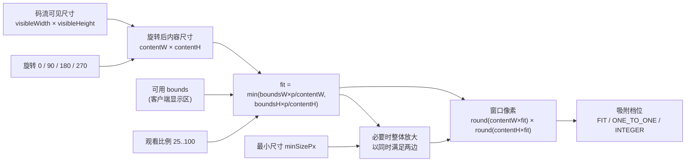
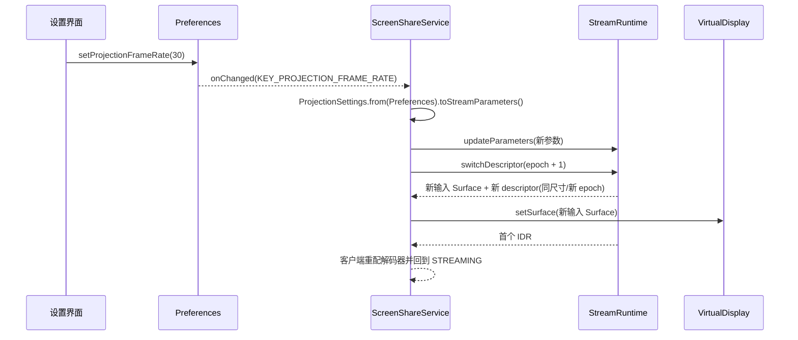
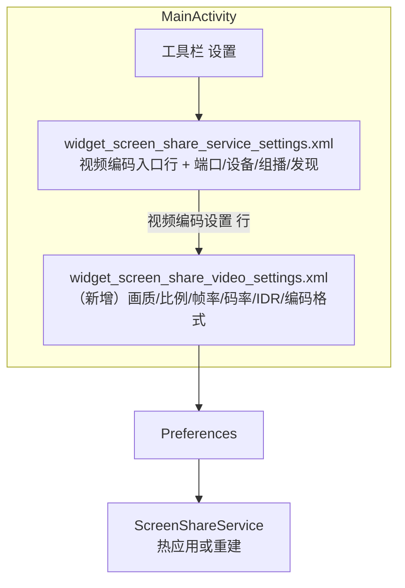

# 查看器画质治理与设置界面实施计划（调研 + 批次拆解）

> **For agentic workers:** REQUIRED SUB-SKILL: Use superpowers:subagent-driven-development or superpowers:executing-plans to implement this plan task-by-task. Steps use checkbox (`- [ ]`) syntax for tracking.

> **状态：调研完成，代码未实施。** 本文件基于 `master`（`270c37c`）的静态代码审查、Android 官方文档与 scrcpy 源码；本地 `:app:testDebugUnitTest` 结果目录为 60 个测试类 / **694 tests / 0 failures / 0 errors**（与任务看板记录的 670/58 相比已增长，以本文件为准）。全部画质结论都标注证据级别，**未做设备实测**：任何收益、比例或阈值都必须先测量再实施，不在本文件预设数字。
> 本阶段只交付本计划文档，不写实现代码。

**Goal:** 让客户端在小窗下"看起来清楚"这件事有可判定的根因和可回滚的修法；同时把已经存在于 `Preferences` 但没有任何界面入口、也没有接通编码器的服务端参数（帧率、码率、IDR 间隔、编码格式）暴露到一个新的视频设置界面，并补上"改了要生效"的编排。

**Architecture:** 画质治理分三层，从便宜到贵严格排序：**几何正确**（宽高比、旋转、窗口尺寸由码流尺寸算出，纯 JVM 决策类 + 视图接线）→ **采样与比例**（缩放档位、1:1/整数档、必要时把分辨率降档放到编码侧）→ **帧调度**（呈现时间戳、过期帧不追赶、重同步请求关键帧）。设置界面沿用项目既有的 `BottomSheetDialog` + XML + Material 控件模式，参数读取收敛到一个纯 JVM 的 `ProjectionSettings`，生效方式按"热应用 / 重建编码器 / 需重启"三档显式化。

**Tech Stack:** Java 11 source/target、Android minSdk 25、compileSdk/targetSdk 35、AGP 8.9.0、Gradle 8.11.1、JUnit 4.13.2、Material Components（`BottomSheetDialog`、`Slider`、`MaterialSwitch`、`NumberPicker`）、protobuf-javalite + grpc-javalite、Gson。UI 为 View/XML（**不是 Compose**，`app/build.gradle` 无 Compose 依赖，也未启用 viewBinding，全部 `findViewById`）。不新增依赖、不改构建文件。

**Spec:** [任务看板](../../task-board.md) · [决策看板](../../decision-board.md) · [媒体架构](../../media-architecture.md) · [窗口与会话设计](../../windowing-session-design.md) · [编码框架设计](../../codec-framework.md) · [问题 3 接线计划](2026-10-19-media-path-wiring.md)

## 1. 背景与目标

| 依据 | 内容 | 当前状态 |
| --- | --- | --- |
| 原始 12 问第 7 问 | "客户端能否只调整自己观看的分辨率和帧率"：短期方案为 `inSampleSize` 解码、解码前合并旧帧、本地显示帧率上限、保持宽高比与可靠过滤 | 从未实施：`BitmapRenderTarget` 没有 `inSampleSize`，surface 路径没有应用层合并与限帧（平台会丢多余帧，见 3.5），宽高比在 surface 路径反而丢了 |
| 用户抱怨 | "缩放效果比较差，锯齿很明显" | 抱怨产生于软件 JPEG 时代；本文件第 3 章核验它在 H.264 链路下的现状 |
| 决策 DB-MULTI-002 | 客户端窗口缩放只改本地渲染，不减少网络字节与解码工作量；分辨率变化通常需重配解码器 | 已裁决·未实施（surface 路径已是"本地缩放"语义，但没有几何约束） |
| 决策 DB-CODEC-003 | 分辨率由 VirtualDisplay 与编码器共同决定且必须匹配，变化要新 `configEpoch` + SPS/PPS + IDR | 已裁决·已部分实施（`ScreenShareService.updateProjectionSize()` 走 `switchDescriptor`） |
| 决策 DB-CODEC-004 | `KEY_FRAME_RATE` 只是目标提示，不是严格上限 | 已裁决·未实施（编码器只设 hint，且帧率偏好根本没送到编码器） |
| 决策 DB-CODEC-005 | 码率可配且通常可运行时调整；IDR 间隔可配 | 已裁决·部分实施（码率热应用；IDR 只在码率键变化时顺带重建参数对象） |
| 决策 DB-CODEC-008 | 分辨率/帧率按场景分档，小窗与全屏可不同档 | ⏳ 待验证（本计划只做单档参数，不做多档） |
| 任务 TB-ENG-005 | 把 `KEY_PROJECTION_BITRATE`、`KEY_PROJECTION_IDR_INTERVAL`、`KEY_PROJECTION_CODEC` 暴露到设置界面并贯通 | 📋 待办（本计划第 7 章） |
| 任务 TB-CLIENT-001 | 客户端画质与多客户端档位 | 📋 待办（本计划只做本地渲染质量与单档参数，不做协商） |
| 前置事实 | 生产客户端只接 `SurfaceRenderTarget`，`BitmapRenderTarget` 与旧 `ScreenShareViewer` 已无生产引用（`ScreenViewerService.java:150` 只有声明、没有赋值） | 已核对 |

目标：

- **先证伪再实施**：把"锯齿"拆成可分别证伪的四个机制，每个机制给出代码级证据与测量方法；不为了有活干而编造问题。
- **几何先于采样**：窗口尺寸由码流可见尺寸决定（保持宽高比、支持旋转），这是零成本、可 JVM 单测、可独立回滚的一批。
- **采样有明确上限**：在保留 `TextureView`（透明、圆角、拖动都依赖它）的前提下，说明哪些质量提升在框架内做不到，只能靠"让比例接近 1"或"换渲染路径"。
- **帧调度只做有证据收益的部分**：客户端本地限帧在 surface 输出路径上收益有限（平台已经丢多余帧），真正的限帧位置在编码前。
- **设置界面可交付**：每个控件都能说清"改了之后什么时候生效、生效需要什么代价"，不放没有通路的控件。

非目标（本计划不涉及）：

- 不做每客户端独立码流、不做多档流、不做每客户端转码（DB-MULTI-001/002/003、TB-CLIENT-002）。
- 不实现自建 GL 渲染管线（mipmap 三线性）；只把它列为"几何与比例修完仍有残差"时的后置选项。
- 不做 JPEG 客户端查看器（TB-ENG-006）；因此编码格式切换本轮不交付。
- 不做设备/真机验证：设备验证仍未解禁，本计划全部验收为离线口径，设备项只写验收矩阵。

标记约定沿用 [发现调研](../../discovery-research.md)：**当前实现** 可在代码中直接核对；**业界事实** 附外部来源；**建议** 是目标设计；**推测** 是对设备行为或产品意图的判断。本文件行号均指 `270c37c`。

## 2. 现状：一帧从网络到像素

```mermaid
flowchart LR
    A["ScreenShareServer<br/>采集尺寸 = 屏幕 bounds × 投影比例"] -->|"H.264 编码<br/>尺寸 = 采集尺寸"| B["StreamRuntime<br/>每客户端有界队列"]
    B -->|"gRPC 双向流<br/>每条消息一帧 AU"| C["ScreenShareClient<br/>decode 线程 FIFO 队列(256)"]
    C --> D["ClientMediaSession<br/>epoch/join point 校验"]
    D --> E["H264Decoder<br/>输入预算 20ms"]
    E --> F["MediaCodec 解码<br/>releaseOutputBuffer(idx, true)"]
    F --> G["SurfaceTexture<br/>(解码输出尺寸)"]
    G --> H["TextureView<br/>拉伸填满窗口"]
    H --> I["悬浮窗<br/>宽 = 客户端屏幕宽 × 观看比例"]
```

| 环节 | 当前实现（代码位置） | 对画质的影响 |
| --- | --- | --- |
| 采集/编码尺寸 | `ScreenShareService.java:1063-1068` 取"当前显示最大窗口 bounds × `projectionScale`"；`:1045-1060` 把同一尺寸同时写进 `codedSize` 与 `visibleSize` | 默认 100% 时客户端解码全屏分辨率，与窗口大小无关 |
| 编码参数 | `H264Encoder.java:147-153` 只设 `KEY_BIT_RATE`、`KEY_FRAME_RATE`、`KEY_I_FRAME_INTERVAL`（秒，`:169-173` 向上取整、下限 1 s） | `KEY_FRAME_RATE` 是提示；IDR 最小 1 s |
| 像素路径 | `AndroidMediaCodecDecoderBridge.java:140` 对每个输出缓冲直接 `releaseOutputBuffer(index, true)` | 没有呈现时间戳、没有合并、没有本地限帧 |
| 队列 | `ScreenShareClient.java:72` `DECODE_QUEUE_CAPACITY = 256`；`:230-237` 队列满即丢整条消息 | 丢的是**编码帧**，会破坏参考帧，直到下一个 IDR 才恢复 |
| 输入预算 | `H264Decoder.java:52` 20 ms；`:196-201` 普通帧拿不到输入缓冲时静默丢弃 | 同上：静默丢 P 帧等于静默花屏 |
| 渲染目标 | `SurfaceRenderTarget.java:72-83` 只把 `SurfaceTexture` 包成 `Surface`，从不调 `setTransform` 或 `setDefaultBufferSize` | 视图与内容比例不一致时被拉伸 |
| 窗口尺寸 | `ScreenViewerService.java:885-886` `宽 = bounds 宽 × 观看比例`、高同理 | 窗口比例 = **客户端屏幕**比例，与码流无关 |
| 旋转 | `StreamDescriptor` 明确"旋转由显示侧应用"，但客户端全链路没有读取 `rotationDegrees` | 一旦服务端开始下发非 0 旋转就会画错 |
| 旧位图查看器 | `ScreenViewerService.java:1228-1233` 用 `min(宽比, 高比)` 反算窗口尺寸，`:1176-1187` 设置 `Matrix`，`:1374-1379` 加 `FILTER_BITMAP_FLAG` | **正确做法还留在死代码里**：比例对、有过滤 |

## 3. 锯齿根因分析

### 3.1 结论先行

用户的抱怨来自软件 JPEG 时代，但**它没有随 H.264 消失**，而是换了形态：

| 机制 | JPEG 时代 | 当前 H.264 路径 | 证据级别 |
| --- | --- | --- | --- |
| R1 宽高比失真 | 不存在（窗口按帧尺寸反算，比例守恒） | **新引入**：窗口按客户端屏幕尺寸算，`TextureView` 拉伸 | 当前实现，代码可判定 |
| R2 单次双线性降采样、无 mipmap | 存在（`ImageView` 过滤 + 全尺寸位图） | **仍然存在**（`TextureView` 图层采样，比例任意） | 业界事实 + 推断（见 3.3） |
| R3 清晰度上限（分辨率 × 码率 × 帧率） | 存在（JPEG 质量档） | **仍然存在**：100% 分辨率 + 4 Mbps + 60 fps | 当前实现，代码可判定 |
| R4 帧调度与丢帧语义 | 存在（队列积压、丢最新帧无害） | **仍然存在且更糟**：丢编码帧会破坏参考链 | 当前实现 + 平台文档 |

因此本文件是**实施计划**，不是纯验证计划：R1 是可以直接从代码判定的回归，R2/R3/R4 是"机制仍在、影响大小待测量"的两段式安排（先量化、再决定是否实施）。

### 3.2 R1 宽高比失真（结构性，最该先修）

当前实现：

- `ScreenViewerService.java:885-886`：窗口像素尺寸 = **客户端可见显示区** × 观看比例（默认 80%，`Preferences.java:191`），下限 56 dp（`values/dimens.xml:6`）。
- `SurfaceRenderTarget.java:72-83`：只把 `TextureView.getSurfaceTexture()` 包成 `Surface`，**没有** `setTransform(...)`，也没有 `setDefaultBufferSize(...)`。
- 解码输出缓冲的尺寸是编码尺寸（服务端屏幕尺寸），因此"内容比例 = 服务端屏幕比例"、"窗口比例 = 客户端屏幕比例"，二者一旦不同就被拉伸。

业界事实（AOSP）：

- [Android 图形架构：TextureView](https://source.android.com/docs/core/graphics/arch-tv) 明确指出：SurfaceView 与 TextureView 播放视频的**最大差别就在于"呈现正确宽高比"这一步**——SurfaceView 靠给 `WindowManager` 新的窗口尺寸，TextureView 靠 `TextureView#setTransform()` 配置变换矩阵。
- 同一个页面对比：TextureView 的内容"由 GPU 合成进视图层级"，随后 SurfaceFlinger 再合成一次，"每个可见像素被合成两次"；SurfaceView 走 overlay 平面。

什么时候会看出来（**建议**做成可复现的判定条件）：

| 场景 | 比例差 | 视觉后果 |
| --- | --- | --- |
| 服务端竖屏 1080×2340 ↔ 客户端竖屏 1080×2400 | ≈ 2.5% | 轻微纵向拉伸，肉眼在圆形图标、圆形头像上可见 |
| 服务端横屏 2400×1080 ↔ 客户端竖屏窗口 864×1920 | 两轴比例 x 0.36 / y 1.78，相差 ≈ 4.9 倍 | 严重变形（横图被压进竖框），同时叠加极端非整数降采样 |
| 服务端 16:9 平板 ↔ 客户端 20:9 手机 | ≈ 25% | 明显变形 |
| 旧位图查看器（同尺寸帧） | 0 | 不变形 |

复现口径：`device-test-2026-10-20-r5` 的 `corner-02-streaming.png` 是"真机→模拟器"同竖屏组合，比例差只有 2.5%，因此观感接近正常；**这条缺陷在横竖屏或跨机型组合下才暴露**，不能用同型号同朝向的一次测试否定它。

### 3.3 R2 采样：为什么"降采样"必然锯齿

**数学事实**：双线性采样只读 2×2 个纹素。当缩放比为 `s < 1` 时，相邻采样点间距为 `1/s` 像素；`s < 0.5` 时采样点之间必然**整像素被跳过**，高频内容（1 px 线条、文字笔画、图标边缘）就会走样——表现为锯齿、抖动、摩尔纹。要正确降采样必须让每个采样点覆盖更多源像素，即可分离箱式滤波（逐级 1/2）或 mipmap。

**业界事实（scrcpy）**：

- [scrcpy `texture.c`](https://github.com/Genymobile/scrcpy/blob/master/app/src/texture.c) 在启动时按需打开 **trilinear filtering（mipmaps）**，日志文本是 `Trilinear filtering enabled` / `Trilinear filtering disabled`；这正是一条为"降采样画质"专门加的路径。
- [scrcpy `doc/video.md`](https://github.com/Genymobile/scrcpy/blob/master/doc/video.md) 说明硬件解码帧"Trilinear filtering (mipmaps) is not available"——即硬件帧路径会退回较低质量的采样，作者明确记录了这条质量损失。

**当前实现的边界（关键，决定方案选型）**：

- `TextureView` 的内容由 HWUI 作为图层合成，采样的滤波方式与是否使用 mipmap 都由框架决定，应用侧**没有 API** 打开 mipmap；只有自己写 GL 采样才能控制。
- 所以"在保留 TextureView 的前提下提升降采样质量"只有两个可用杠杆：**让比例接近 1**（窗口调到接近码流像素，或把编码尺寸降到接近窗口像素），**或**换渲染路径。
- 具体走哪条取决于设备实测（第 9 章测量口径）；本文件把它标为 **推测**：在 `s ≥ 0.75` 时单个双线性采样的锯齿不明显，`s ≤ 0.5` 时明显。这个阈值必须实测校准，不能写进代码当常量。

### 3.4 R3 清晰度上限：分辨率、码率、帧率

当前实现：

- 采集/编码尺寸 = 服务端全屏 × 100%（默认，`Preferences.java:175`）。
- 码率默认 4 Mbps（`Preferences.java:183`），帧率默认 60（`:179`），IDR 默认 1000 ms（`:185`）。
- 1080×2340 @ 60 fps / 4 Mbps ≈ **0.026 bit/pixel/frame**（每帧约 67 kbit、8 KB 量级）。屏幕内容静止时够用，滚动、视频、动效场景下必然丢细节：文字边缘会先丢高频，再被去块滤波抹平，观感常被描述为"糊"或"边缘发毛"。

这一项与 R2 的**观感重叠**，必须靠测量区分：

- 若客户端显示尺寸 ≈ 编码尺寸（`s ≈ 1`）仍然不满意 → 归因 R3（码率/分辨率上限），修法在编码侧。
- 若把窗口放到 1:1 明显变清楚、缩小就"发毛" → 归因 R2（采样），修法在几何与比例。

### 3.5 R4 帧调度、合并与丢帧语义

当前实现与平台行为：

| 事实 | 出处 | 含义 |
| --- | --- | --- |
| 每解出一帧立即 `releaseOutputBuffer(index, true)` | `AndroidMediaCodecDecoderBridge.java:140` | 呈现节奏 = 网络到达节奏，没有 PTS 调度 |
| 可从解码线程一次性取多个输出、也可用时间戳调度呈现 | [MediaCodec 参考](https://developer.android.com/reference/android/media/MediaCodec)：`releaseOutputBuffer(int, long renderTimestampNs)`；`releaseOutputBuffer(bufferId, false)` 表示"不渲染" | 应用侧**可以**做"过期帧丢弃 + 定时呈现"，不需要自建 GL 管线 |
| "View 表面（SurfaceView/TextureView）一直会丢弃过多帧"；Q 起默认丢过多帧 | 同页 MediaCodec 文档（"When rendering output to a Surface…"） | **显示端已经有一层"只保留最新帧"**：解码输出快于合成时，多余帧被 BufferQueue 丢掉 |
| 解码队列满 256 条消息即整条丢弃 | `ScreenShareClient.java:72`、`:230-237` | 丢的是编码帧：P 帧丢失后参考链断裂，画面损坏直到下一个 IDR |
| 普通帧 20 ms 内拿不到输入缓冲就静默丢弃 | `H264Decoder.java:196-201` | 同上，且**没有任何恢复动作** |
| 重同步不请求关键帧 | `ClientMediaSession` 状态机、`ScreenViewerService.java:265-280` 都只在 `STREAMING` 时做 UI；`ScreenShareClient.requestKeyframe()`（`:293`）已存在但无人调用 | 一旦损坏，只能等服务端周期性 IDR（默认 1 s） |

由此得到两个必须写清楚的反直觉结论：

1. **"本地显示帧率上限"在 surface 路径上收益很小**：平台已经丢了多余帧，本地限帧省不到解码，只省一点合成。真正有效的限帧位置是**编码前**——业界做法见 4.1（scrcpy 用编码器的 `max-fps-to-encoder` 私有键 + 明确注释 `KEY_FRAME_RATE` 不决定实际帧率）。
2. **"帧合并只取最新"在 H.264 上不能用 JPEG 的方式做**：编码帧不能随便丢（DB-MULTI-001 已裁决同一结论）。能合并的是**解码后的呈现**，且合并后要能快速恢复，也就是"丢过期帧 + 请求 IDR"。

### 3.6 逐条排除：是不是只有 R3？

用现有证据能排除的：

- **不是 JPEG 编解码本身**：生产路径已无 JPEG（客户端能力固定声明 H.264，`ScreenViewerService.java:552-555`；`ClientMediaReceiver` 只处理 descriptor/access unit）。JPEG 的 CPU 解码与全尺寸位图已不在链路上。
- **不是 `inSampleSize` 缺失**：`BitmapRenderTarget.java:40-46` 确实没有 `inSampleSize`，但该目标没有生产引用（TB-ENG-006 未完成），对当前观感无影响。
- **不是主线程上传**：解码在 `lss-client-decode-*` 单线程（`ScreenShareClient.java:116-126`），渲染走 Surface，无主线程纹理上传。

不能排除、必须测量的：R2 与 R3 的占比，以及 R1 在真实机型组合下的可见程度。

### 3.7 根因总表

| 编号 | 根因 | 证据（代码 / 外部） | 影响 | 处置批次 |
| --- | --- | --- | --- | --- |
| R1 | 窗口比例取自客户端屏幕，`TextureView` 拉伸 | `ScreenViewerService.java:885-886`、`SurfaceRenderTarget.java:72-83`；AOSP arch-tv | 变形，跨朝向/跨机型严重 | Q1 + Q2 |
| R2 | 单次双线性、无 mipmap、比例任意 | scrcpy trilinear 开关；采样数学 | 缩小后文字/细线走样 | Q3（比例档位）+ 后置 GL 选项 |
| R3 | 100% 分辨率 + 4 Mbps + 60 fps 的清晰度天花板 | `Preferences.java:175/179/183`、`H264Encoder.java:147-153` | 全尺寸下仍"糊" | Q5（可配置）+ 测量 |
| R4 | 呈现无调度、丢编码帧无恢复、重同步不请求 IDR | `AndroidMediaCodecDecoderBridge.java:140`、`ScreenShareClient.java:72/230-237`、`H264Decoder.java:196-201` | 花屏持续到周期 IDR；延迟累积 | Q4 |
| R5 | 旋转未应用（前向风险） | `StreamDescriptor` Javadoc；客户端无 `rotationDegrees` 读取 | 服务端一旦下发旋转就画错 | Q1（一并处理） |

## 4. 业界做法与证据

### 4.1 scrcpy（投屏领域的直接对标）

| 做法 | 出处 | 结论 |
| --- | --- | --- |
| 按 `--max-size` 在**设备侧**降分辨率，另一维按源比例推算，并按编码器对齐取整 | [doc/video.md](https://github.com/Genymobile/scrcpy/blob/master/doc/video.md) | 缩放优先放在编码前；客户端拿到的是"本来就小"的码流 |
| 客户端默认 **letterbox**（保持比例，留黑边），另有 `--render-fit=stretched/unscaled` | [doc/window.md](https://github.com/Genymobile/scrcpy/blob/master/doc/window.md) | 保持比例是默认行为，拉伸是显式选项 |
| 启用 trilinear（mipmap）滤波改善降采样；硬件帧不支持时明说 | [app/src/texture.c](https://github.com/Genymobile/scrcpy/blob/master/app/src/texture.c)、video.md | 真正的抗锯齿靠 mipmap，不靠"更贵的双线性" |
| `KEY_FRAME_RATE` 固定 60，注释"不决定实际帧率（可变）"；`--max-fps` 用私有键 `max-fps-to-encoder` 在编码器入口限帧 | [server/.../SurfaceEncoder.java](https://github.com/Genymobile/scrcpy/blob/master/server/src/main/java/com/genymobile/scrcpy/video/SurfaceEncoder.java) | 限帧在编码前；帧率是提示不是保证（与 DB-CODEC-004 一致） |
| 解码帧缓冲 `push` 直接替换 pending 帧 | [app/src/frame_buffer.c](https://github.com/Genymobile/scrcpy/blob/master/app/src/frame_buffer.c) | "只保留最新帧"发生在**解码后**，从不丢编码包 |
| 默认零缓冲以取最低延迟，需要平滑才显式加 `--video-buffer` | doc/video.md | 实时投屏默认不排队；平滑是可选代价 |

### 4.2 Android 平台事实

| 事实 | 出处 | 用途 |
| --- | --- | --- |
| TextureView 呈现正确宽高比必须自己 `setTransform` | [AOSP arch-tv](https://source.android.com/docs/core/graphics/arch-tv) | R1 的修法依据 |
| TextureView 内容要多一次 GPU 拷贝并合成两次；SurfaceView 走 overlay | 同上 | 解释为什么保留 TextureView 有质量/功耗代价，但透明与圆角要它 |
| 可用 `releaseOutputBuffer(index, renderTimestampNs)` 定时呈现、`(index,false)` 丢弃 | [MediaCodec](https://developer.android.com/reference/android/media/MediaCodec) | R4 不需自建 GL 管线就能"过期帧不追赶" |
| View 表面一直会丢弃过多帧；Q 起默认丢弃 | 同上 | 说明客户端显示已有一层合并，本地限帧收益有限 |
| `KEY_MAX_WIDTH/KEY_MAX_HEIGHT` 是"为分辨率切换准备的预期最大值"（adaptive playback），**不是**降采样请求 | [MediaFormat](https://developer.android.com/reference/android/media/MediaFormat) | 排除"解码时就缩小"的取巧方案：没有可移植的解码期降采样 |

### 4.3 从证据推出的三条原则

1. **缩放的位置决定质量与成本**：编码前降分辨率（省带宽、省解码、比例天然正确）> 客户端 GPU 采样（省带宽但费解码、比例要自己管）> CPU 位图缩放（最差，已淘汰）。
2. **抗锯齿靠滤波链，不靠"多采一次"**：可用手段只有 mipmap（框架不给）、比例接近 1（可以做到）、或换渲染路径（成本高）。
3. **限帧与合并在两端分工**：编码前限帧（省一切）；解码后合并/丢过期帧（省合成，不省解码）；永不随手丢编码帧。

## 5. 方案选型

### 5.1 候选方案矩阵

| 方案 | 做法 | 质量收益 | 成本/风险 | 结论 |
| --- | --- | --- | --- | --- |
| S1 几何修复 | 窗口尺寸由码流可见尺寸 × 观看比例反算，处理旋转与最小尺寸 | 消除变形（R1），顺带让降采样比例变成"统一比例" | 低：纯计算 + 视图接线，可 JVM 单测 | **做（Q1/Q2）** |
| S2 缩放档位 | `适应 / 1:1 / 整数档`；1:1 时比例 = 1，锯齿与模糊同时消失 | 显著（文字场景），但窗口可能超出屏幕 | 低：一个枚举 + 一段吸附计算 | **做（Q3）** |
| S3 编码侧降档 | 把投影比例调到接近窗口像素；或按窗口尺寸给出建议值 | 显著（R2+R3 同时改善），省带宽与解码 | 中：影响所有观看者（DB-MULTI-002），必须是用户设置而非自动 | **做（Q5 的可配置化 + 界面提示），自动降档不做** |
| S4 GL 渲染管线 | 自建 `SurfaceTexture` + EGL + mipmap 降采样，再画进 `TextureView` 的 Surface | 理论最好（等同 scrcpy 三线性） | 高：EGL 生命周期、丢失设备兼容、约 500 行新代码、无 JVM 可测面 | **后置（Q6，仅当 Q3 后仍有残差）** |
| S5 换 `SurfaceView` | 交给 HWC 缩放 | 功耗最好 | 破坏透明度/圆角/拖动动画（`TextureView` 的全部优势） | **不做**，只记入 [窗口与会话设计](../../windowing-session-design.md) 的全屏方案 |
| S6 解码期降采样 | `KEY_MAX_WIDTH` 等 | 无 | 平台不支持（见 4.2） | **排除** |

### 5.2 决策建议（新增看板条目，见第 11 章）

- **DB-RENDER-001（建议）**：客户端渲染必须保持内容宽高比，窗口尺寸由 `StreamDescriptor` 的可见尺寸与旋转推导；比例与最小尺寸的取舍以"不改变用户选择的观看比例语义"为准；拉伸只在显式"铺满"档位下允许。
- **DB-RENDER-002（建议）**：抗锯齿的上限由渲染路径决定：`TextureView` 下不做 mipmap，只做几何正确 + 比例吸附；需要更高降采样质量时按 S4 另立批次，不在本条内承诺。
- **DB-RENDER-003（建议）**：限帧与合并在两端分工（4.3 第 3 条）；客户端不丢编码帧，丢帧只在解码输出侧发生，且必须配"请求关键帧"的恢复动作。

### 5.3 目标几何计算（Q1 的纯 JVM 契约）

契约（纯 JVM，不依赖 `android.graphics.Matrix`——JVM 单测里 Android 类不可用）：

- 输入：`contentWidth`、`contentHeight`、`rotationDegrees`、`boundsWidth`、`boundsHeight`、`scalePercent`、`minSizePx`、`ZoomMode`。
- 输出：窗口 `width`/`height`、生效比例 `scale`、是否吸附过（`snapped`）。
- 约束：结果不小于 `minSize`（两边都是）、不超过 bounds；`rotationDegrees` 为 90/270 时交换宽高；非法输入（宽高 ≤ 0、bounds 为空）回退到"按 bounds × 比例"的原行为，保证首帧前的窗口可用。
- 视图侧只负责把结果写进 `WindowManager.LayoutParams` 与（必要时）`TextureView.setTransform`。

## 6. 帧合并与帧率上限：放在哪里

| 层次 | 能力 | 收益 | 本计划 |
| --- | --- | --- | --- |
| 编码前（服务端） | 投影比例、帧率、码率、IDR | 省带宽、省解码、省电，画质与比例同时改善 | 做：参数可配 + 重建生效（Q5） |
| 解码输出（客户端） | 定时呈现、丢弃过期帧 | 延迟不累积、不追帧；不省解码 | 做：呈现步进 + 合并（Q4） |
| 解码输入（客户端） | 丢编码帧 | 省解码但**破坏参考链** | 不做：只把"已经发生丢弃"变成显式恢复（请求 IDR） |
| 合成（系统） | View 表面丢过多帧 | 已由平台完成 | 依赖，不重复实现 |

由此明确两处与原第 7 问短期方案的偏差（**建议**在计划中记录，避免后续误解）：

1. "按悬浮窗尺寸用 `inSampleSize` 解码"——只适用于位图路径；surface 路径不存在图片采样解码，等价手段是编码侧降档。位图路径随 TB-ENG-006 一并处理。
2. "增加本地显示帧率上限"——surface 路径由平台丢弃多余帧，本地限帧只影响合成；真正有效的上限在编码器（scrcpy 的 `max-fps-to-encoder` 语义，Android 10+ 的私有键，**建议**在 Q5 里按 API 等级与实测定夺，失败即忽略）。

## 7. TB-ENG-005 设置界面

### 7.1 现状核对

| 参数 | 偏好键（`Preferences.java`） | 默认 | 界面控件 | 生效方式（实测于代码） |
| --- | --- | --- | --- | --- |
| 分辨率比例 | `KEY_PROJECTION_SCALE`（`:52`、`:509-517`） | 100（`:175`） | 有：`scale_setting`（`MainActivity.java:967-983`） | `updateProjectionSize()` → `switchDescriptor` + 重指 VirtualDisplay（`ScreenShareService.java:886-926`） |
| 帧率 | `KEY_PROJECTION_FRAME_RATE`（`:62`、`:436-444`） | 60（`:179`） | 有：`frame_rate_setting`（`MainActivity.java:985-1001`） | **无效**：观察者只写 `mProjectionFrameRate`（`:436-438`），该字段只被 JPEG 采样循环使用（`:339`）；H.264 编码器从未收到新帧率 |
| JPEG 质量 | `KEY_PROJECTION_QUALITY` | 85（`:177`） | 有：`quality_setting` | 下一帧（仅 JPEG 模式，`:364`） |
| 码率 | `KEY_PROJECTION_BITRATE`（`:77`、`:480-488`） | 4 Mbps（`:183`） | **无** | 有：观察者 `updateParameters`（`:439-447`）→ `H264Encoder.updateParameters` 热应用（`:267-279`） |
| IDR 间隔 | `KEY_PROJECTION_IDR_INTERVAL`（`:82`、`:494-502`） | 1000 ms（`:185`） | **无** | **半无效**：只在码率键变化时被顺带打包，单独改 IDR 不触发任何动作；即使触发也不会重建编码器（`H264Encoder.updateParameters` 只热应用码率） |
| 编码格式 | `KEY_PROJECTION_CODEC`（`:72`、`:466-474`） | `h264`（`:181`） | **无** | **仅重启生效**：观察者 switch 中没有该键（`:415-468`），且客户端能力固定为 H.264（`ScreenViewerService.java:552-555`） |

结论：TB-ENG-005 的真实范围不是"加控件"，而是**加控件 + 补三条生效通路**，其中编码格式一条被 TB-ENG-006 阻塞。

### 7.2 参数生效矩阵（目标态）

| 设置项 | 生效方式 | 代价 | 实施要点 |
| --- | --- | --- | --- |
| 码率 | 热应用 | 无 | 已有通路；UI 只负责写入偏好 |
| 分辨率比例 | 重建编码器（新 `configEpoch` + 新 IDR） | 客户端重配解码器并等待新 epoch 的首个 IDR，期间画面停住数百毫秒 | 已有通路 `updateProjectionSize()` |
| 帧率 | 重建编码器 | 同上 | 新增：写偏好 → `updateParameters` → `switchDescriptor(epoch+1)` → `setSurface(新输入面)` |
| IDR 间隔 | 重建编码器 | 同上 | 同上（编码器按秒取整，UI 步长必须 ≥ 1 s） |
| 编码格式 | 重建整条管线 | 客户端需重新协商；JPEG 客户端查看器缺失 | 本轮不提供切换，见 7.4 |
| JPEG 质量 | 下一帧 | 无 | 仅当编码格式 = JPEG 时显示 |

重建编排（**建议**复用现有机制，不新增核心 API）：

风险与约束：

- `switchDescriptor` 要求 `next.configEpoch == requested.configEpoch + 1`（`StreamRuntime.java:537-540`），因此"改参数"与"改尺寸"必须走同一条串行路径，避免并发切换撞 epoch。**建议**在 `ScreenShareService` 内用一个"待生效重建"标记 + 主线程合并（300 ms 防抖），合并在同一次重建里。
- 同尺寸、同编码格式的 descriptor 与旧的 config hash 相同；`ClientMediaSession.onDescriptor` 对"新 epoch + 同 hash"是接受并重配的（已在 Javadoc 写明），不需要客户端改动。

### 7.3 界面结构与控件规格

沿用现有模式：`BottomSheetDialog` + `setContentView(R.layout.*)` + Material `Slider`/`MaterialSwitch`/`NumberPicker` + `setOnShowListener` 回填 + 滑块松手才落盘。新增一个**独立的视频设置 sheet**，从现有服务端设置 sheet 末尾的入口行进入：现有 sheet 已有十余个控件（画质、比例、帧率、端口、设备、组播、发现等），继续堆叠会把"连接与发现"和"视频编码"混在一起。

控件归属：**视频相关控件从旧 sheet 迁到新 sheet**（画质、比例、帧率、码率、IDR、编码格式），旧 sheet 只保留入口行与连接/发现相关控件。这样"视频编码"只有一个真源，不会出现两处滑杆写同一个键。旧 sheet 已存的偏好值全部保留（键不变），迁移只动布局与绑定代码。

控件规格（**建议**，数值范围需在设备上复核；帧率与比例沿用现有范围，不收紧既有语义）：

| 控件 id | 标签字符串键 | 控件类型 | 范围 / 步长 | 默认 | 落盘时机 | 生效 |
| --- | --- | --- | --- | --- | --- | --- |
| `quality_setting` | `projection_quality_setting_label` | Slider | 0–100，步 1 | 85 | 松手 | 下一帧（仅 JPEG 模式；H.264 下隐藏该行） |
| `scale_setting` | `projection_scale_setting_label` | Slider | 5–100%，步 1 | 100% | 松手 | 重建编码器 |
| `frame_rate_setting` | `projection_frame_rate_setting_label` | Slider | 1–120，步 1（沿用现值；>60 需设备支持，界面附说明） | 60 | 松手 | 重建编码器 |
| `bitrate_setting` | `projection_bitrate_setting_label` | Slider | 0.5–20 Mbps，步 0.5 | 4 Mbps | 松手 | 热应用 |
| `idr_interval_setting` | `projection_idr_interval_setting_label` | Slider | 1–10 s，步 1 | 1 s | 松手 | 重建编码器 |
| `codec_setting` | `projection_codec_setting_label` | 只读 `MaterialTextView` | — | `H.264` | 不写 | 不适用（见 7.4） |

界面文案（新增，必须同步 `values-zh`；键名按 [命名规范](../../naming-conventions.md) 4.1 的 `<domain>_<screen>_<purpose>`）：

- `video_settings_title`：视频编码
- `video_settings_entry_label`：视频编码设置
- `video_settings_summary`：`%1$s · %2$d fps · %3$s`（编码格式 · 帧率 · 码率）——入口行右侧的当前值摘要
- `video_settings_rebuild_hint`：修改分辨率比例、帧率或关键帧间隔会重建编码器，画面可能短暂停顿并重新同步
- `video_settings_frame_rate_note`：高于 60 fps 需要设备编码器支持
- `video_settings_codec_locked_note`：当前版本固定使用 H.264
- `projection_bitrate_setting_label`：码率；`projection_bitrate_value_label`：`%1$s/s`
- `projection_idr_interval_setting_label`：关键帧间隔；`projection_idr_interval_value_label`：`%1$d 秒`
- `projection_codec_setting_label`：编码格式；`projection_codec_value_h264`：`H.264（硬件）`

实现约束：

- 不新增依赖、不改 `app/build.gradle`、不引入 viewBinding（与现有 `findViewById` 风格一致）。
- 数值格式化复用 `NumberFormat`（与 `screen_share_viewer` 的百分比格式化一致），不写死单位换算。
- 参数取值与钳制集中到纯 JVM 的 `settings/ProjectionSettings`（对齐 `settings/DiscoverySettings` 的既有形态）：负责"偏好 → `StreamParameters` + codecId"的映射与非法值回退，并在 JVM 单测里覆盖边界（例如 IDR 500 ms 必须被抬到 1 s，因为编码器按秒取整）。
- 迁移旧 sheet 的三个控件时**不得**顺手改它们的范围或标签语义（避免"设置界面顺手改了行为"的评审噪声）；只搬位置。

### 7.4 为什么本轮不交付"编码格式"切换

1. 生产客户端只声明 H.264 能力（`ScreenViewerService.java:552-555`），且生产查看器是 surface 型；JPEG 模式在客户端**没有可显示的查看器**（TB-ENG-006 未完成，`BitmapRenderTarget` 无生产引用）。
2. 切到 JPEG 还会让 `ScreenShareService` 走 ImageReader 分支（`:908-925`），那是完全不同的采集路径，需要独立的回归面。
3. 因此本轮把 `codec_setting` 做成**只读展示**（让用户看见当前编码格式），并把可切换能力挂到 TB-ENG-006 之后。这是有意收窄 TB-ENG-005 的范围，需要在看板上改写该条目描述（第 11 章）。

## 8. 批次计划

### 8.1 全局约束与 Review Focus

逐批硬约束（与前序计划一致）：

- 每批独立提交；逐文件 `git add`，禁止目录级 add；提交信息 `feat:`/`fix:`/`refactor:`/`docs:` 前缀 + 中文描述；禁止 force-push。
- 每批验证（Git Bash，仓库根）：`./gradlew :app:testDebugUnitTest --offline` 与 `./gradlew :app:assembleDebug --offline`；JVM 基线 **694**，只增不减。
- 全程禁止 adb、模拟器/实机、`connectedAndroidTest`、安装或启动 App。
- 不新增依赖；不改 `gradle/libs.versions.toml`、`app/build.gradle` 与 CI 配置。
- 文档中文、代码注释/Javadoc 英文；Javadoc 一律多行块；图表一律 Mermaid；仓库内不写本机绝对路径、用户名、设备标识、会话/agent ID。
- 与已收敛决策冲突时停下报告，不擅自取舍。

Review Focus（最容易咬人的失败模式）：

1. **窗口几何在首帧前也要可用**：descriptor 到达前没有码流尺寸，必须回退到当前行为（bounds × 比例），不能出现 0×0 或 56×56 的窗口。
2. **旋转的双重来源**：`StreamDescriptor.rotationDegrees` 与采集侧"按当前方向重新采集"可能同时存在；先用 descriptor 值，服务端恒为 0 时行为与现状完全一致（可做无回归论证）。
3. **观看比例的语义不能漂移**：现有语义是"占可用显示区的百分比"（位图查看器也是这么算的），几何修复后必须保持同一语义，否则用户已保存的 80% 会突然变成别的尺寸。
4. **重建不得并发**：`switchDescriptor` 要求 epoch 严格 +1，尺寸与参数两类重建必须串行合并，否则抛 `ConfigEpochException`。
5. **丢帧只发生在解码输出侧**：任何"为了省 CPU 丢编码帧"的改动都是错的；已发生的输入侧丢弃必须转成"请求关键帧"。
6. **不要用 `Map`/`Set` 顺序依赖渲染逻辑**：`ViewerFitPolicy` 是纯函数，任何缓存都不得让它对同一输入给出不同结果（否则 JVM 测试会变成假绿）。

### 8.2 Q1：几何策略类（纯 JVM）

**目标：** 新增纯 JVM 策略类 `render/ViewerFitPolicy.java`（后缀按 [命名规范](../../naming-conventions.md) 2.3：纯决策用 `*Policy`），把"码流尺寸 + 旋转 + bounds + 观看比例 + 最小尺寸 + 档位"映射到窗口像素尺寸，附完整单测。**本批不接线**，因此零行为变化、可整批回滚。

**文件：**

- Create：`app/src/main/java/com/obby/android/localscreenshare/render/ViewerFitPolicy.java`
- Create：`app/src/main/java/com/obby/android/localscreenshare/render/ZoomMode.java`
- Test：`app/src/test/java/com/obby/android/localscreenshare/render/ViewerFitPolicyTest.java`

**设计要点：**

- `ZoomMode { FIT, ONE_TO_ONE, INTEGER }`：`FIT` 保持比例按比例缩放；`ONE_TO_ONE` 窗口 = 内容像素（超出 bounds 时钳到 bounds 并回报 `clamped=true`）；`INTEGER` 在 `{1, 1/2, 1/3, 1/4}` 中取最接近用户比例的一档（不枚举到无限小，避免窗口缩到不可用）。
- 结果用不可变值对象 `Fit { int width; int height; float scale; boolean snapped; boolean clamped; }`，不用 `android.graphics.Matrix`（JVM 测试不可用）。
- 旋转：90/270 交换内容宽高；0/180 不变；非法角度按 0 处理（与 `StreamDescriptor` 的校验互补：那里拒绝非法值，这里防御非法输入）。
- 回退：内容尺寸 ≤ 0 或 bounds 为空时返回"bounds × 比例"（与当前 `ScreenViewerService.java:885-886` 等价），并置 `fallback=true`。
- 最小值：`width/height` 都不小于 `minSizePx`，但**不得**因此破坏比例——先按比例算，再把两边同时放大到满足最小值。

**验证：**

- 覆盖：同尺寸恒等（码流 1080×2340、bounds 1080×2400、80% → 864×1872，比例误差 ≤ 1 px）；横竖屏互换；bounds 小于内容；`ONE_TO_ONE` 钳制；`INTEGER` 吸附（80% → 100% 或 50%，取更近）；最小尺寸；非法输入回退。
- `./gradlew :app:testDebugUnitTest --offline`（694 + 新增）、`./gradlew :app:assembleDebug --offline`。

**提交计划：** 一个 `feat:` 提交（策略 + 单测）。

### 8.3 Q2：查看器接入几何（修 R1 与 R5）

**目标：** `SurfaceShareViewer` 按码流可见尺寸与旋转设置窗口尺寸；descriptor 变化（尺寸/旋转/新 epoch）时重算；配置变化（旋转、多窗口）时重算；首帧前保持回退行为。**这一批修掉"变形"这个可以直接判定的缺陷。**

**文件：**

- Modify：`app/src/main/java/com/obby/android/localscreenshare/service/ScreenViewerService.java`（`SurfaceShareViewer.updateLayoutParams()`、`show()`、新增 `setContentGeometry(...)`）
- Modify：`app/src/main/java/com/obby/android/localscreenshare/client/ClientMediaReceiver.java`（新增可选的码流几何回调；在 `DESCRIPTOR` 分支先回调再 `onDescriptor`）
- Modify：`app/src/main/java/com/obby/android/localscreenshare/render/SurfaceRenderTarget.java`（仅在需要 letterbox 时暴露 `setTransform` 入口；若窗口比例恒等于内容比例则不需要改动，见下）
- Test：`app/src/test/java/com/obby/android/localscreenshare/client/ClientMediaReceiverTest.java`（追加几何回调用例）

**设计要点：**

- 几何来源：`StreamDescriptor.getVisibleWidth()/getVisibleHeight()/getRotationDegrees()`。不要用 `codedWidth/Height`（含对齐填充；当前二者相同，但 DB-CODEC-003 落地对齐后就会不同）。
- 传递路径：`ClientMediaReceiver`（解码线程）→ 回调 → `ScreenViewerService` 用 `mMainHandler.post` 切主线程 → `viewer.setContentGeometry(...)`。不改 `ClientMediaSession` 的核心契约（避免动 6 个既有测试类），几何是显示侧关注点。
- 重算时机：首次拿到几何、几何变化、`onConfigurationChanged`（现有 `SurfaceShareViewer` 没有实现这个回调，位图查看器有：`:1388-1393`）、以及用户改观看比例。
- 窗口比例 = 内容比例时**不需要** `setTransform`；只有在未来的"铺满/letterbox"档位下才需要。因此本批不改 `SurfaceRenderTarget` 的渲染逻辑，只做尺寸。这是"最小改动、可整批回滚"的关键。
- 圆角半径按新尺寸重算（`updateShape()` 已按窗口短边计算，只需在尺寸变化后调用）。
- 位置钳制沿用现有 `getLocationBounds`（窗口尺寸变化后必须重新钳制，否则窗口可能出界）。

**验证：**

- `ClientMediaReceiverTest`：descriptor 带来 1080×2340/0° 与 2340×1080/90° 时回调值正确；epoch 变化重复回调；非法/缺失尺寸不回调。
- 手工核对（离线）：同尺寸组合下新旧窗口尺寸一致（无回归论证）；横屏码流 2340×1080 + 竖屏 bounds 1080×2400 + 80% 时窗口为 864×399（宽约束），而不是现状的 864×1920（把横图拉成竖框）。
- `./gradlew :app:testDebugUnitTest --offline`、`./gradlew :app:assembleDebug --offline`。

**提交计划：** 一个 `fix:` 提交；随后一个 `docs:` 提交更新看板。

### 8.4 Q3：缩放档位（1:1 / 整数档）与入口

**目标：** 在悬浮窗上提供"适应窗口 / 原始大小(1:1) / 整数缩放"三档，解决"缩小就发毛、想看清文字"的实际使用诉求；档位与观看比例一起持久化。

**文件：**

- Modify：`app/src/main/java/com/obby/android/localscreenshare/render/ViewerFitPolicy.java`（若 Q1 未含 `INTEGER` 的完整语义则在此补齐）
- Modify：`app/src/main/java/com/obby/android/localscreenshare/service/ScreenViewerService.java`（长按菜单或双指手势入口；`SurfaceShareViewer` 目前只有单击/长按拖拽，需要新增一个入口）
- Modify：`app/src/main/java/com/obby/android/localscreenshare/settings/Preferences.java`（`KEY_VIEWER_ZOOM_MODE`，默认 `FIT`）
- Test：`app/src/test/java/com/obby/android/localscreenshare/render/ViewerFitPolicyTest.java`（吸附与钳制用例）

**设计要点：**

- 入口：`SurfaceShareViewer` 加"双击打开菜单"或"长按后短按"——**建议**用长按拖拽不变、新增双击打开 3 项菜单（位图查看器原本就是双击打开设置 sheet，`:1047-1054`，保持同一手势语义）。
- 1:1 档在窗口大于屏幕时，向 bounds 钳制并在菜单里灰显"原始大小（超出屏幕）"。
- 持久化：档位与比例分开存；切档不覆盖用户的比例。
- 不做"缩放动画"、不做手势缩放（避免与拖动冲突），留给后续交互批次。

**验证：**

- 吸附用例：`FIT` + 80% → 0.8；`ONE_TO_ONE` → 1.0（或钳制）；`INTEGER` 只在 `{1, 1/2, 1/3, 1/4}` 中取最近（等距向上取）：80% → 1.0、60% → 0.5、33% → 1/3。规则写进 Javadoc 与测试方法名。
- `./gradlew :app:testDebugUnitTest --offline`、`./gradlew :app:assembleDebug --offline`。

**提交计划：** 一个 `feat:` 提交。

### 8.5 Q4：呈现调度与恢复（R4）

**目标：** 解码输出不再"到达即显示"：按最小间隔丢弃过期帧、按时间戳呈现；已发生的输入侧丢弃与队列溢出必须转成"请求关键帧"，让损坏窗口从"最多 1 个 IDR 周期"缩短到"一次往返"。

**文件：**

- Create：`app/src/main/java/com/obby/android/localscreenshare/core/render/PresentationPacer.java`（纯 JVM：`Decision decide(nowNs, ptsNs, lastPresentedNs, minIntervalNs)` → `PRESENT_NOW / SCHEDULE_AT / DROP`）
- Modify：`app/src/main/java/com/obby/android/localscreenshare/core/codec/mediacodec/MediaCodecDecoderBridge.java`（`dequeueOutput` 不再隐式渲染；新增 `present(index, timestampNs)` 与 `discard(index)`）
- Modify：`app/src/main/java/com/obby/android/localscreenshare/core/codec/mediacodec/AndroidMediaCodecDecoderBridge.java`
- Modify：`app/src/main/java/com/obby/android/localscreenshare/core/codec/h264/H264Decoder.java`（呈现决策、合并、丢弃上报）
- Modify：`app/src/main/java/com/obby/android/localscreenshare/core/codec/Decoder.java`（若需要"需要关键帧"信号；建议用返回值或回调，不改 `decode` 签名）
- Modify：`app/src/main/java/com/obby/android/localscreenshare/client/ScreenShareClient.java`（队列满时通知会话需要关键帧并限频请求）
- Modify：`app/src/main/java/com/obby/android/localscreenshare/service/ScreenViewerService.java`（`RESYNCING → requestKeyframe()`，限频）
- Test：`app/src/test/java/com/obby/android/localscreenshare/core/render/PresentationPacerTest.java`、`core/codec/h264/H264DecoderTest.java`（追加）、`core/codec/mediacodec/MediaCodecBridgeContractTest.java`（追加）、`client/ScreenShareClientTest`（若无则新建，需 fake transport）

**设计要点：**

- 合并（latest wins）：一次 `decode()` 末尾把所有可取的输出都取出；只有最新一个参加呈现决策，其余 `discard`。这与 scrcpy 的 `push` 覆盖 pending 帧同构。
- 呈现：`present(index, targetNs)` 使用系统单调时钟换算的纳秒时间戳；`targetNs` 早于当前时刻时立即呈现。
- 限帧位置：客户端"最小间隔"默认 0（不限制），只在 `KEY_VIEWER_FRAME_CAP` 打开时生效；**主限帧开关在编码侧**（Q5）。
- 恢复：`H264Decoder` 的输入预算丢弃、`ScreenShareClient` 的队列溢出、`ClientMediaSession` 的 `DecoderException` 三条路径都产生"需要关键帧"事件；`ScreenViewerService` 收到后调用 `ScreenShareClient.requestKeyframe()`，并复用服务端的 join point 限频（`StreamRuntime.joinPointMinIntervalMs` 100 ms + pending 合并）。
- 不改 `ClientMediaSession` 的状态机语义；"需要关键帧"只是外部副作用。

**验证：**

- `PresentationPacerTest`：早/晚/等间隔、间隔为 0 时全呈现、PTS 回退、时钟跳变。
- `H264DecoderTest`：两个输出同时可取时只呈现最新、另一个被 discard；输入预算丢弃时上报"需要关键帧"。
- 契约测试：bridge 的 `present/discard` 必须成对释放每个输出索引（泄漏即失败）。
- `./gradlew :app:testDebugUnitTest --offline`、`./gradlew :app:assembleDebug --offline`。

**提交计划：** 一个 `feat:` 提交（建议拆两个：呈现/合并一个，恢复/关键帧请求一个；两个都能独立回滚）。

### 8.6 Q5：参数生效编排 + 视频设置界面（TB-ENG-005 / TB-ENG-012）

**目标：** 新增视频设置 sheet；补齐帧率与 IDR 的生效通路（重建编码器）；码率保持热应用；编码格式只读展示。参数读取集中到 `ProjectionSettings`。

**文件：**

- Create：`app/src/main/java/com/obby/android/localscreenshare/settings/ProjectionSettings.java`
- Create：`app/src/main/res/layout/widget_screen_share_video_settings.xml`
- Modify：`app/src/main/java/com/obby/android/localscreenshare/MainActivity.java`（新增 `createVideoSettingsDialog()`；把 `quality_setting`/`scale_setting`/`frame_rate_setting` 的绑定从 `createServiceSettingsDialog()` 搬到新 sheet；旧 sheet 增加入口行与摘要回填）
- Modify：`app/src/main/java/com/obby/android/localscreenshare/service/ScreenShareService.java`（帧率/IDR 键 → 合并重建；编码格式键 → 明确不处理）
- Modify：`app/src/main/res/values/strings.xml`、`app/src/main/res/values-zh/strings.xml`
- Modify：`app/src/main/res/layout/widget_screen_share_service_settings.xml`（移除已迁移的三个控件；末尾增加"视频编码设置"入口行）
- Test：`app/src/test/java/com/obby/android/localscreenshare/settings/ProjectionSettingsTest.java`
- Test：`app/src/test/java/com/obby/android/localscreenshare/core/stream/StreamRuntimeTest.java`（追加"同尺寸换 epoch 重建"用例，若已有 `switchDescriptor` 覆盖则只补参数断言）

**设计要点：**

- `ProjectionSettings`：`bitrateBps`（钳到 100 kbps–50 Mbps）、`frameRate`（1–120）、`idrIntervalMs`（1000–30000，且为 1000 的整数倍）、`scalePercent`（5–100）、`jpegQuality`（0–100）、`codecId`；`toStreamParameters()` 与 `isH264()`。非法值回退默认并**不抛异常**（偏好可能被旧版本写入）。
- 重建编排：`ScreenShareService` 增加 `private void scheduleEncoderRebuild()`，用主线程 `Handler` 300 ms 防抖，合并同批参数变化；执行顺序固定为 `updateParameters(新参数)` → `switchDescriptor(epoch+1)` → `mVirtualDisplay.setSurface(getInputSurface())`；失败时记录日志并保持旧参数（`switchDescriptor` 失败不会替换活动编码器）。
- 尺寸变化（`KEY_PROJECTION_SCALE`）与参数变化共用同一串行路径，避免两次重建撞 epoch。
- 码率单独变化时**不重建**（走 `updateParameters` 热应用），避免为了码率闪一下。
- 界面：入口行显示 `video_settings_summary`；sheet 顶部放 `video_settings_rebuild_hint`；"编码格式"行只读并附 `video_settings_codec_locked_note`（`当前版本固定使用 H.264`）。所有字符串同时写 `values-zh`（`scripts/checks/check_strings.py` 会校验）。
- `frame_rate_setting` **沿用现有 1–120 范围**（DB-CODEC-004：`KEY_FRAME_RATE` 只是提示；范围收紧属于行为变更，不在本批夹带），只增加 `video_settings_frame_rate_note` 说明高于 60 fps 需要设备支持。

**验证：**

- `ProjectionSettingsTest`：默认值、IDR 500 ms → 1000 ms、IDR 1500 ms → 2000 ms、码率越界、帧率越界、`codecId` 非法回退 `h264`。
- `StreamRuntimeTest`：同尺寸 + 新 epoch 的 `switchDescriptor` 成功、旧编码器被 retire、新参数进入新编码器（用 `FakeCodec` 断言）。
- `./gradlew :app:testDebugUnitTest --offline`、`./gradlew :app:assembleDebug --offline`；`python scripts/checks/check_strings.py`、`check_cjk.py`、`check_docs.py` 全绿。
- 手工核对：资源键在中英一致；新 layout 不含硬编码文本（全部 `@string/`）。

**提交计划：** 一个 `feat:` 提交（设置 + 编排 + 测试）；随后一个 `docs:` 提交更新 TB-ENG-005 与新增条目。

### 8.7 Q6（后置，不在本轮实施）：GL 降采样管线

仅当 Q3 之后仍能在实测中看到明显锯齿时启动。要点先记在这里，避免重复调研：

- 结构：`MediaCodec` → 内部 `SurfaceTexture`（`GL_TEXTURE_EXTERNAL_OES`）→ EGL 上下文 → 生成 mipmap → 一次性降采样 blit → `TextureView` 的 Surface（保留 alpha）。
- 不做 `SurfaceView`（会丢掉透明与圆角）。
- 验收必须包含：首帧延迟、功耗、设备兼容（部分 GPU 对 `GL_TEXTURE_EXTERNAL_OES` + `glGenerateMipmap` 支持差）。

## 9. 测试策略

| 层 | 手段 | 覆盖 |
| --- | --- | --- |
| 纯 JVM（主力） | JUnit 4 + 手写 fake（仓库惯例，无 Mockito） | `ViewerFitPolicy`、`PresentationPacer`、`ProjectionSettings`、`ClientMediaReceiver` 几何回调、`H264Decoder` 呈现/丢弃、bridge 契约 |
| 契约测试 | `MediaCodecBridgeContractTest` 风格 | `present`/`discard` 成对释放、索引泄漏、非法状态 |
| 端到端（JVM） | `H264StreamEndToEndTest` 风格（fake codec） | 重建（Q5）→ 新 epoch → 客户端重配 → 恢复 STREAMING |
| 设备验收（未解禁） | 双机组合矩阵 | 见下表 |

设备验收矩阵（**待设备验证解禁**，本阶段不执行）：

| 组合 | 观察项 | 判定 |
| --- | --- | --- |
| 同型号同朝向（如真机↔模拟器竖屏） | 圆形图标是否仍为圆；文字边缘 | 与现状无回归 |
| 竖屏 ↔ 横屏 | 是否变形、是否留黑边 | 不变形 |
| 1080p ↔ 2K 手机 | 比例与清晰度 | 不变形；记录有效比例 |
| 投影比例 100% / 50% + 观看比例 80% / 40% | 文字清晰度 | 记录"能看清的最小比例" |
| 改帧率/IDR | 生效时延、客户端停顿时长 | ≤ 2 s，无花屏（除新 IDR 前） |
| 弱网/慢客户端 | 花屏恢复时间 | 明显短于一个 IDR 周期 |

测量口径（**建议**在 Q4 一并落到日志/统计，不新增依赖）：

- 客户端：解码帧数/秒、呈现帧数/秒、丢弃帧数/秒、重同步次数、队列深度峰值。
- 服务端：实际输出帧率（编码器出帧计数）、码率、IDR 间隔实测值。
- 画面：同一画面在 `s≈1` 与 `s≈0.5` 下的截图对比，避免用"感觉"结论。

**明确未验证的范围**：所有设备行为、真实 GPU 采样、`TextureView` 的实际滤波方式、`max-fps-to-encoder` 私有键的可用性、功耗与发热变化、重建时的用户可感停顿。

## 10. 兼容、回滚与风险

| 风险 | 影响 | 缓解 | 批次 |
| --- | --- | --- | --- |
| 观看比例语义漂移 | 用户已保存的比例变成别的窗口大小 | 保持"占可用显示区百分比"语义；Q1 的恒等用例即回归护栏 | Q1/Q2 |
| 首帧前无几何 | 0×0 窗口或闪烁 | `fallback` 分支 + 单测强制覆盖 | Q1/Q2 |
| 重建撞 epoch | `ConfigEpochException`、编码中断 | 串行合并 + 防抖 + 只允许 +1 | Q5 |
| bridge 契约改动波及 | 编解码路径回归 | 先扩接口、再改实现、再改 fake；契约测试先行 | Q4 |
| 关键帧请求风暴 | 服务端 IDR 洪泛、码率尖峰 | 复用 join point 限频（100 ms + pending 合并）+ 客户端侧 1 s 冷却 | Q4 |
| 1:1 档超出屏幕 | 窗口不可见 | 钳到 bounds 并在菜单标注 | Q3 |
| 只读编码格式被误解为"坏了" | 用户困惑 | 附说明文案；TB-ENG-006 完成后解锁 | Q5 |
| 控件迁移导致旧 sheet 缺项 | 用户找不到画质/比例/帧率 | 入口行摘要必须显示当前值；迁移只搬位置不改范围 | Q5 |

回滚：每批一个提交，纯新增类（Q1）可整批回退；Q2 只改渲染尺寸计算，回退即恢复旧行为；Q4 的 bridge 改动若出问题可整体回退（不影响 Q5）。

## 11. 看板登记需求

本计划需要新增/改写以下条目（**建议**文本，实施时按 [任务看板](../../task-board.md) 的 `
` 格式登记）：

| ID | 状态 | 优先级 | 标题 | 关联 |
| --- | --- | --- | --- | --- |
| TB-CLIENT-003（新） | 📋 待办 | 🟠 P1 | 查看器宽高比与缩放质量 | 本计划 Q1–Q3 |
| TB-CLIENT-004（新） | 📋 待办 | 🟡 P2 | 客户端呈现调度与关键帧恢复 | 本计划 Q4 |
| TB-ENG-012（新） | 📋 待办 | 🟡 P2 | 编码参数生效编排（帧率/IDR 重建） | 本计划 Q5 |
| TB-ENG-005（改写） | 📋 待办 | 🟡 P2 | 新视频设置界面（码率/IDR 可写，编码格式只读） | 本计划第 7 章 |
| DB-RENDER-001 / 002 / 003（新） | 📝 已裁决·未实施 | — | 渲染比例、抗锯齿上限、限帧分工 | 第 5.2 节 |
| DV 条目（新） | 待验证 | — | 客户端降采样残差是否需要 GL 管线（Q6 触发条件） | 第 8.7 节 |

TB-ENG-005 的改写要点：把"码率、IDR 间隔与编码模式三个偏好…需补设置 UI 并贯通到 `StreamParameters` 与 codec 选择"改为"码率与 IDR 间隔补设置 UI 并贯通；编码格式在本轮只读展示，可切换能力依赖 TB-ENG-006"，并在条目里记录第 7.1 节的三条断点证据。

## 12. 附录：证据索引

代码（`270c37c`）：

| 位置 | 内容 |
| --- | --- |
| `service/ScreenViewerService.java:885-886` | 窗口尺寸 = 客户端 bounds × 观看比例 |
| `service/ScreenViewerService.java:544-551` | `SurfaceRenderTarget` 构造与 surface 可用回调 |
| `service/ScreenViewerService.java:795-804` | `show()` 读取偏好并挂窗口 |
| `service/ScreenViewerService.java:1228-1233` | （死代码）位图查看器按帧比例反算窗口 |
| `service/ScreenViewerService.java:1374-1379` | （死代码）位图查看器 `FILTER_BITMAP_FLAG` |
| `render/SurfaceRenderTarget.java:72-83` | 只包装 `SurfaceTexture`，无 `setTransform` |
| `core/codec/mediacodec/AndroidMediaCodecDecoderBridge.java:140` | `releaseOutputBuffer(index, true)` |
| `core/codec/h264/H264Decoder.java:52`、`:196-201`、`:219-223` | 输入预算、静默丢弃、非阻塞取输出 |
| `client/ScreenShareClient.java:72`、`:116-126`、`:230-237`、`:293-299` | 队列上限、解码线程、溢出丢弃、关键帧请求能力 |
| `service/ScreenShareService.java:886-926` | 尺寸变化 → 重建编码器 + 重指 VirtualDisplay |
| `service/ScreenShareService.java:1028-1031` | 启动时从偏好构造 `StreamParameters` |
| `service/ScreenShareService.java:415-468` | 偏好观察者（帧率只写字段、IDR 随码率、codec 未处理） |
| `core/codec/h264/H264Encoder.java:147-153`、`:169-173`、`:267-279` | 编码器格式、IDR 秒级取整、只热应用码率 |
| `core/stream/StreamRuntime.java:524-570` | `switchDescriptor` 预创建编码器、epoch +1 约束 |
| `settings/Preferences.java:175-191` | 投影与观看默认值 |
| `core/model/StreamDescriptor.java:19-23` | 可见尺寸/旋转语义与"旋转由显示侧应用" |

外部来源：

- [AOSP：TextureView 与 SurfaceView 的合成、宽高比与 setTransform](https://source.android.com/docs/core/graphics/arch-tv)
- [Android：MediaCodec（Surface 输出、丢过多帧、releaseOutputBuffer 时间戳）](https://developer.android.com/reference/android/media/MediaCodec)
- [Android：MediaFormat（KEY_MAX_WIDTH/HEIGHT 是 adaptive playback 提示）](https://developer.android.com/reference/android/media/MediaFormat)
- [scrcpy：doc/video.md（max-size 保比例、帧率可变、三线性滤波限制）](https://github.com/Genymobile/scrcpy/blob/master/doc/video.md)
- [scrcpy：doc/window.md（默认 letterbox）](https://github.com/Genymobile/scrcpy/blob/master/doc/window.md)
- [scrcpy：app/src/texture.c（trilinear/mipmap 开关）](https://github.com/Genymobile/scrcpy/blob/master/app/src/texture.c)
- [scrcpy：app/src/frame_buffer.c（pending 帧被覆盖 = 只保留最新）](https://github.com/Genymobile/scrcpy/blob/master/app/src/frame_buffer.c)
- [scrcpy：server SurfaceEncoder.java（KEY_FRAME_RATE 注释、max-fps-to-encoder）](https://github.com/Genymobile/scrcpy/blob/master/server/src/main/java/com/genymobile/scrcpy/video/SurfaceEncoder.java)
