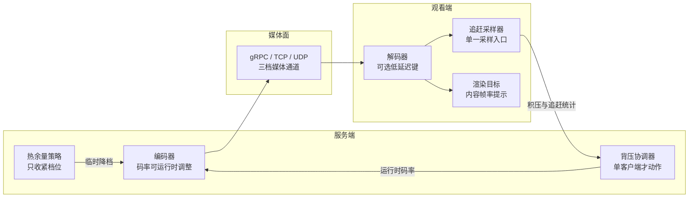
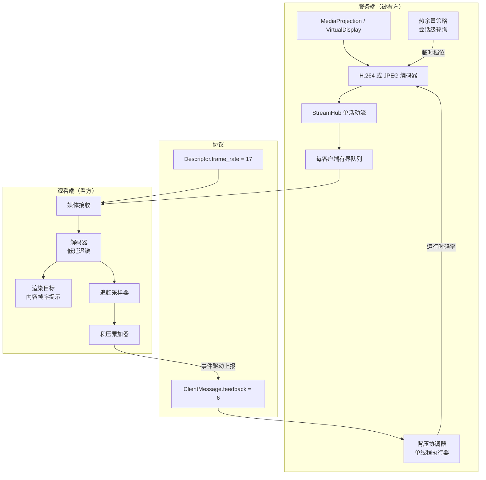
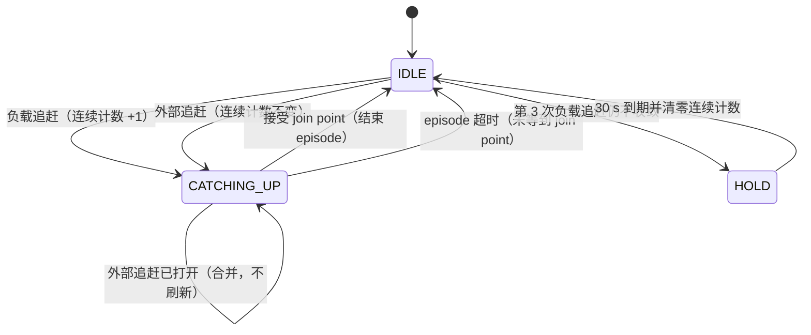
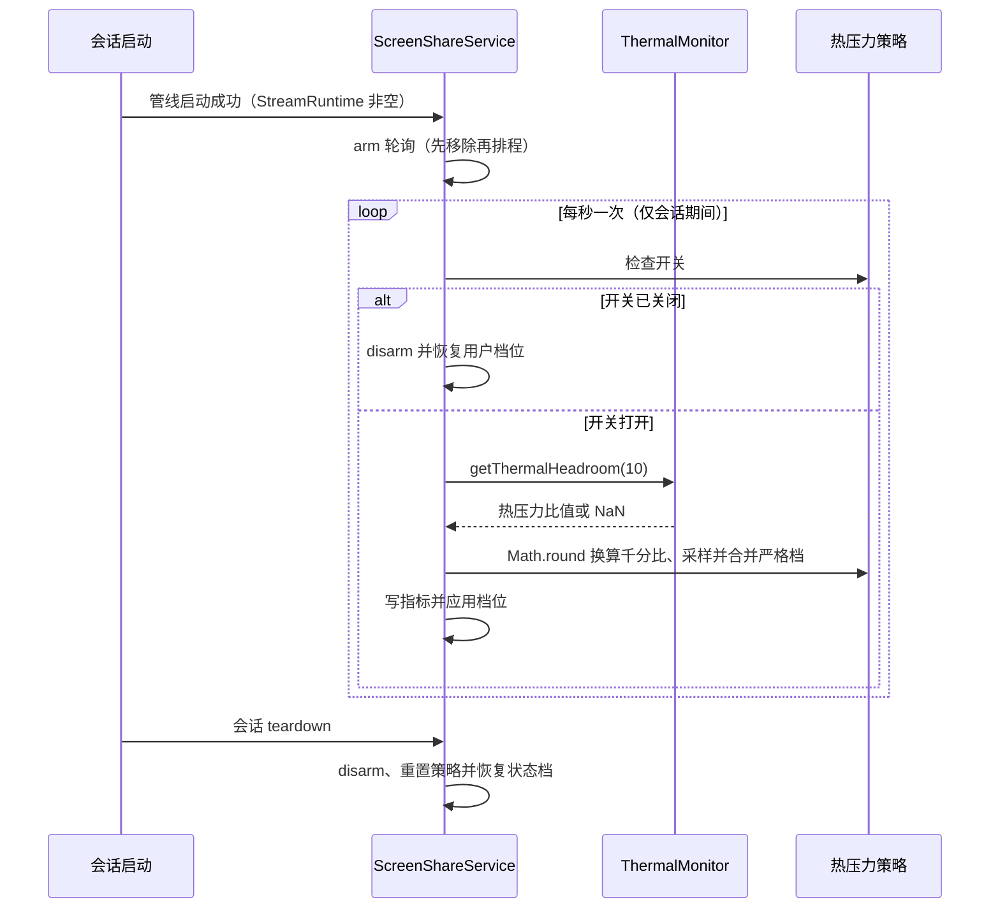
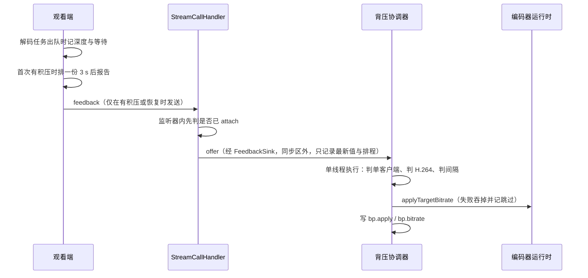
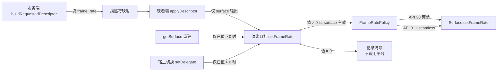

# 性能候选设计：解码低延迟、热余量预测、追赶采样、内容帧率与单客户端背压（2026-10-23）

> 状态：B1–B5 **代码与 JVM 用例已完成**，B6 文档/看板收口完成（2026-10-24）；**未做设备验证、未做阈值校准、未做收益实测**。本文仍是意图、边界、协议与判据的来源，落地记录见[实施计划](../plans/2026-10-23-performance-candidates.md)。
> 依据：用户 2026-10-23 批准的五项实施范围（[TB-ENG-016](../../task-board.md#tb-eng-016)），以及提出范围时逐条给定的主裁决（三态指标、会话级热余量轮询、丢片追赶的计法、背压仅单客户端、`frame_rate` 不入哈希、`SurfaceView` 另立、`CatchUpPolicy` 阈值不收紧）；候选来源为 [性能优化业界调研](../../performance-research.md) §4.2。
> 关联：[实施计划](../plans/2026-10-23-performance-candidates.md) · [决策看板](../../decision-board.md) · [任务看板](../../task-board.md) · [媒体链路目标架构](../../media-architecture.md) · [命名与包结构规范](../../naming-conventions.md)
> 证据边界：本文的状态回填依据 B1–B5 的代码与 JVM 用例、B6 的文档收口；**没有**在任何设备上执行验证，也没有运行 adb。所有阈值都是初值，标注“待设备校准”；所有收益表述都是方向判断，不是测量结果。

## 0. 阅读约定

标记沿用 [性能优化业界调研](../../performance-research.md) §0，并在本文额外区分“已验证证据”：

| 标记 | 含义 | 本文里的典型对象 |
| --- | --- | --- |
| 当前实现 | 可在当前仓库代码中直接核对的事实 | 解码器 `configure` 只写尺寸与 CSD、追赶采样只接 gRPC 路径 |
| 已验证证据 | 来自平台文档、上游源码或本仓已记录的设备实测 | `getThermalHeadroom` 官方 ≤1 次/秒、`DV-027` 的 HOLD 期实测 |
| 建议 | 本文给出的目标设计，尚未落地 | 三级回退顺序、事件驱动上报 |
| 推测 | 无公开对照实验或未在本项目测量 | 阈值 0.70 / 0.85 的实际触发点、码率降档的观感收益 |

数字纪律：本文出现的每一个新阈值都是**初值**。阈值只能由设备数据改写，不能由评审意见或类比改写；改写时必须同时更新本文、[实施计划](../plans/2026-10-23-performance-candidates.md) 与对应看板条目。

## 1. 意图与理由

### 1.1 要解决的四类体验问题

| 问题 | 现场表现 | 现有仪表能回答什么 | 本设计对应的能力 |
| --- | --- | --- | --- |
| 端到端延迟偏高且抖动 | 操作后画面跟进慢，延迟忽大忽小 | `dec.lat.p50/p95`、`pres.late`、`rx.arr` | 解码器低延迟键（B2） |
| 过热后“撞墙式”掉帧 | 温度上来后帧率骤降、画质突跳 | 设备状态块的 `thermal`（平台热状态） | 热余量预测降档（B3） |
| 观看端滞后只能事后追赶 | 画面持续落后，追赶发生时已经积压数秒 | `rx.qWait`、`rx.qDepth`、`rx.catchup`、`rx.catchup.lat`、`rx.converge.fail` | 追赶采样覆盖修复（B1）+ 单客户端码率背压（B5） |
| 刷新节奏与内容帧率不匹配 | 非整数倍刷新率下的周期性抖动（3:2 pulldown） | 无（当前没有内容帧率信息） | 描述符 `frame_rate` + `Surface.setFrameRate`（B4） |

### 1.2 为什么是这五项

这五项共同满足四个条件，因此被选为本轮范围，而不是调研清单里的其他条目：

1. **不改架构**：不新增编码器实例、不新增传输档、不改双宿主视图结构，只加参数、加观测、加一个纯决策层。
2. **可 JVM 验证**：每项都能把决策抽成纯 Java 类，Android API 藏在 seam 之后；不依赖仪器测试。
3. **有指标键**：每项落地后都能在既有“每 5 s 一行”的指标输出里被看见，否则无法做设备回归。
4. **可独立回退**：每项都有自己的闸门，回退不需要回滚其他四项。

`SurfaceView` 取代 `TextureView`（调研 §4.2 第 2 条）**不满足第 1 条**：它改双宿主视图结构、快照过渡与圆角/透明度实现，风险等级与本批不同，因此另立评估，不在本设计内。

### 1.3 与既有裁决的关系

| 裁决 | 关系 |
| --- | --- |
| [DB-POWER-001](../../decision-board.md#db-power-001) 热降档是临时覆盖，不写回用户设置 | 本设计的热余量降档**沿用**该语义：只改生效值，绝不写偏好，开关关闭立即恢复用户值 |
| [DB-OBS-001](../../decision-board.md#db-obs-001) 仪表不得改变媒体路径与锁顺序 | 背压的编码器调用被移出 gRPC 回调线程；采样点只读队列长度与时间戳 |
| [DB-OBS-002](../../decision-board.md#db-obs-002) TCP 上的丢包以卡顿时长度量 | B1 复用既有追赶指标，不新增“丢包率”类键；外部追赶的 reason 单独成值 |
| [DV-011](../../decision-board.md) 帧率是提示不是严格上限 | B4 只下发内容帧率**提示**，不构成严格限帧；也不改已有的编码前限帧路径 |
| [DV-012 / DB-MULTI-006](../../decision-board.md#db-multi-006) 不做多档流 | 背压只在**单客户端**自动动作；多客户端只观测，不构成重开多档流的理由 |
| [DV-027](../../decision-board.md) HOLD 期滞后无界增长，待产品裁决 | 本设计**不改变** HOLD 语义，只防止 B1 把丢片路径误送进 HOLD；风险与设备判据见 §9 |
| [DB-CODEC-011](../../decision-board.md) 描述符与运行参数分离 | `frame_rate` 是显示提示，**不进** `configHash`，表示解码配置身份不变；字段本身不推进 `configEpoch`，但当前 H.264 帧率设置变化会经编码器重建推进 epoch、让客户端重配一次 |

### 1.4 五项之间的耦合



> 闭环里只有两条控制边：背压改码率（B5）、热余量改档位（B3）。其余三项是观测与本地呈现，不改变对端行为。**图的含义是“控制边最少”，不是“五项必须同时上线”。**

## 2. 目标 / 非目标 / 反目标

### 2.1 目标

| # | 目标 | 可判定形式 |
| --- | --- | --- |
| G1 | 解码侧请求平台低延迟与实时优先级，并在厂商拒绝时安全退化 | 三态指标可区分“生效 / 部分生效 / 回退 / 未请求”，且拒绝机型仍正常出画 |
| G2 | 用热余量预测提前降档，早于平台热状态变差 | 降档时刻早于 `thermal` 进入高热状态；开关关闭后无采样、无残留覆盖 |
| G3 | 观看端两条接收路径与丢片路径共用同一套追赶决策，指标口径一致 | 同一场景下 TCP/UDP 都能产生 `rx.catchup` 与 `rx.catchup.lat`；丢片有独立 reason |
| G4 | 把内容帧率告诉系统，减少非整数倍刷新率下的节奏抖动 | 帧率变化后提示更新；`frame_rate=0` 时不残留旧提示 |
| G5 | 单客户端弱网时用码率背压削峰，而不是等积压后追赶 | 出现 `bp.apply`、码率下降、积压回落；多客户端时 `bp.apply=0` |
| G6 | 五项都能离线验证，且每项可单独回退 | 每项有定向 JVM 用例与一个独立闸门 |

### 2.2 非目标

- 不做严格帧率上限、不做 `Display.Mode` 切换、不做 120 fps、不做自适应分辨率。
- 不做多档流、不做每客户端转码、不做第二个编码器实例；不重开 [DV-012](../../decision-board.md)。
- 不改 `CatchUpPolicy` 的任何阈值与判定顺序；不改 HOLD 的语义与时长（[DV-027](../../decision-board.md) 仍待裁决）。
- 不给 UDP 档新增描述符通道、不做 FEC/NACK、不做 UDP 上的客户端到服务端反馈。
- 不引入 ADPF / `PerformanceHintManager`，不引入新依赖，不抬高 `minSdk`。
- 不做观看端功耗基线测量（设备项只写检查点，见 §8）。

### 2.3 反目标

反目标是“技术上做得到、但本设计明确拒绝”的做法。写出来是为了防止实施时用它们“顺手达标”：

| 反目标 | 为什么拒绝 |
| --- | --- |
| 用常驻 1 Hz / 3 s 定时器换采样精度 | 直接污染功耗口径；空闲观看端不该有周期性唤醒 |
| 为了指标好看把“未请求”写成“回退” | 让设备判据失去意义，等于自己制造假证据 |
| 多客户端时对所有观看者一起降码率 | 单流扇出下这是全局决策，违背 [DV-012](../../decision-board.md) 的边界 |
| 用丢片追赶去触发收敛失败 HOLD | 丢片是网络故障，不是解码赤字；混淆两者会让 HOLD 在高丢包环境里频繁误伤 |
| 在解码热路径上加探针、拼字符串、加锁 | 违背 [DB-OBS-001](../../decision-board.md#db-obs-001) 与零分配纪律 |
| 把 `frame_rate` 放进 `configHash` 以“顺手”触发重配 | 会让哈希不再表示解码配置身份（语义失真），并可能为纯显示提示多付一次解码器重建；它**并不会省掉 `configEpoch` 重建**——当前 H.264 帧率设置变化仍会重建编码器并推进 epoch |
| 全局替换 `SurfaceView` 以“一次解决功耗” | 改双宿主结构与快照过渡，风险与收益都不在本批可评估范围 |
| 用未校准的阈值当验收标准 | 阈值只能由设备数据改写；未校准值只能作为“待校准”初值 |

## 3. 约束

| 约束 | 内容 | 判定方式 |
| --- | --- | --- |
| C1 平台基线 | `minSdk 25`、`compileSdk/targetSdk 35`、Java 11、无新依赖、不改构建文件 | 构建与 lint 双变体通过；依赖清单零变化 |
| C2 协议兼容 | 只加字段：`ClientMessage.feedback = 6`、`Descriptor.frame_rate = 17`；`PROTOCOL_VERSION` 保持 1 | 新旧端交叉一轮不断流；未知 oneof 字段落 `unknownFields` |
| C3 协议单一出口 | 描述符映射只改 `ScreenStreamProtoMapper` 一处；UDP 档描述符恒走控制面 | 代码评审；不出现第二条描述符通道 |
| C4 热路径 | 每帧路径零分配、零字符串拼接、不新增锁；允许新增 `volatile` | 评审逐条核对；新增锁对象即阻断 |
| C5 线程边界 | 编码器更新只在专用单线程执行；gRPC 回调线程不调用编码器 | 评审 + 单测；异常不冒泡到回调线程 |
| C6 指标命名 | 单常量类只承载一个域、最多 20 个值；客户端常量类已超限，必须拆 | [命名规范](../../naming-conventions.md) §5；超限即拆类 |
| C7 文档语言 | 仓库文档中文；Java Javadoc 英文多行块；`core/**` 字段无前缀、app 层 `m` 前缀 | 脚本检查 + 评审 |
| C8 测试纪律 | 只用 JVM 短测试；测试先行；每个提交内同步实测测试基线；`tests` 与 `classes` 都只能不减，合并测试类视为删测试 | 每个提交的命令与输出可核对；`check_test_count.py` 双变体一致 |

补充两条不可协商的口径：

- **描述符与服务端的编解码无关**：服务端对 H.264 与 JPEG 都填 `frame_rate`，客户端只按“是否需要 surface 输出”决定是否消费。只有这一条口径，避免出现“JPEG 不填”与“都填”两种说法并存。
- **`ClientMetricNames` 不再追加常量**：它已有 28 个值，超过规范上限；新的客户端键必须进新的域常量类。

## 4. 五项已裁决实施范围

> **落地状态（2026-10-24）**：B1–B5 均已代码 + JVM 用例完成；**设备验证、阈值校准与收益实测全部未做**。本节的“建议 / 待设备校准”证据级别不因落地而升级，任何一项都不得写成“设备已验证”。

### 4.1 解码低延迟（B2）

| 项 | 结论 | 证据级别 |
| --- | --- | --- |
| 请求哪些键 | `KEY_LOW_LATENCY`（API 30+）与 `KEY_PRIORITY`（实时优先级） | 建议 |
| 不请求哪些键 | **不含** `KEY_OPERATING_RATE`：解码侧目标帧率需要新的描述符契约，本轮只做两个键，避免与 B4 的 `frame_rate` 提示重复定义 | 建议（范围裁决） |
| 生效判据 | `dec.lowLat` 三态：`1` = 生效（含“低延迟保留、优先级被去”）、`2` = 请求后被回退、`0` = 未请求或已随解码器关闭清零且永不打印 | 建议 |
| 回退顺序 | 全键 → 去优先级 → 全去；每次失败先 `reset()` 再重配；与可选键无关的失败原样抛出 | 建议（沿用编码侧既有范式） |
| 写入时机 | 只在 `configure` 与 `start` **整体成功之后**写 gauge；解码器 `close` 时清零 | 当前实现约束：`start` 失败会释放解码器；指标作用域跨解码器复用 |

三态是外部契约，必须先由用例钉住“`0` 不打印、`1` 打印、`2` 打印”，再实现。设备判据只用 `2`，不用 `0`：`0` 在日志里不存在，把它写成判据会导致“永远不通过”。

### 4.2 热余量预测降档（B3）

平台方法名是 `getThermalHeadroom`，但它的返回值是**热压力比值**（当前温度 / 平台开始限流的温度），不是“还剩多少余量”：`1.0` 表示平台即将限流、`>1.0` 表示已经限流，**读数越大越热**。本节与 §7、§8、§10 一律按这个方向读写；指标键 `thermalHeadroom` 表达的是“热压力千分比”。

| 项 | 结论 | 证据级别 |
| --- | --- | --- |
| 信号 | `getThermalHeadroom(10)` 是预测，`getCurrentThermalStatus` 是现状；两者合并只允许“取严格档” | 已验证证据（平台语义）+ 建议（合并规则） |
| 采样频率 | 至多 1 次/秒（平台建议 ≤1 次/秒） | 已验证证据 |
| 进入 / 退出阈值 | 热压力进入 REDUCED 0.70、进入 MINIMAL 0.85、退出 MINIMAL 0.78、退出 REDUCED 0.60（千分比 700 / 850 / 780 / 600） | **待设备校准** |
| 千分比换算 | 统一 `Math.round(headroom * 1000f)`；**禁止** `(int)` 强制截断（`0.70f` 的实际值是 `0.69999998…`，截断得 699，会让阈值用例自己假失败） | 建议（实现口径） |
| 有效样本域 | 接受 `[0.0, 2.0]`；`NaN` 与区间外的值忽略、档位不变。有效值**不钳制**：`>1.0` 原样保留，指标可打印到 2000 | 建议（实现口径） |
| 生命周期 | **会话级 arm / disarm**：arm 的入口条件必须同时满足“平台 ≥ API 30”“开关打开”“`ThermalMonitor` 非空”“**会话运行中**（`StreamRuntime` 非空）”；随每次会话启动成功 arm，随每次 teardown 与 `onDestroy` disarm；disarm 除 `reset` 预测档外，把已生效档位回落为只由当前状态决定的档位（无状态档则 `NONE`），预测档不跨会话 | 建议（本设计的关键修正） |
| 开关关闭 | 立即 `Tier.NONE`（恢复用户设置）+ `removeCallbacks` + `reset()`，不等下一次 tick；之后不再 re-arm | 建议 |
| 开关打开 | 立即采样一次；**只有会话运行中才 arm 1 Hz 轮询，没有会话就只采样这一次** | 建议 |
| 异常样本 | `NaN` 与越界值忽略，档位不变 | 建议 |
| 事件词表 | `thermal: event=throttle\|recover\|disabled\|forecast\|status\|session-end`：状态降档 `throttle`、状态回落 `recover`、开关关闭 `disabled`、预测样本生效 `forecast`、无效样本按状态 `status`、会话 teardown 且档位确因丢弃预测档而变化 `session-end`。`session-end` **不是每次 teardown 都打印**：只有预测档此前确实收紧了生效档位、teardown 回落时档位因此发生变化，才打一行（`setThermalTier` 在档位不变时直接返回、不打印）；预测档未收紧时 teardown 不产生事件。`session-end` 只表示轮询下线与档位回落为状态档，不代表设备已验证 | 当前实现 |

“设置打开但没有会话”这一行是本节第二个关键修正。`MainActivity` 用 `BIND_AUTO_CREATE` 绑定服务，所以“打开 App、还没开始共享、切一下热降档开关”也会走到采样入口；若此时无条件 arm，空闲期就会有 1 Hz 定时器，直接违反 §2.3 的反目标与 §8 ⑨ 的功耗口径。因此 arm 与“会话运行中”绑定，而“开关打开”只允许一次立即采样。

会话级 arm/disarm 是本节的核心。平台热监听在 `onCreate` 启动、`onDestroy` 停止，而会话 teardown 每次都会发生；若把 1 Hz 轮询也绑在 `onCreate`/`onDestroy`，第一个会话结束后轮询就永久停摆。反过来，把 `removeCallbacks` 放进 teardown 而 arm 只在 `onCreate`，会让下一个会话再也不会被采样。两种写法都错，因此 arm 必须与“会话启动成功”成对。

### 4.3 追赶采样覆盖修复（B1）

**问题**（当前实现）：gRPC 路径每解一条消息就采样一次；媒体通道路径只记录 `rx.qWait`，从不采样；丢片追赶只递增代数并让会话重同步，完全绕过决策器。后果是 TCP/UDP 档下 `rx.catchup` 几乎不增长，日志无法区分“解码赤字”与“网络丢片”。

| 项 | 结论 | 证据级别 |
| --- | --- | --- |
| 单一入口 | 新增纯 JVM 采样器，两条接收路径共用；每帧顺序固定为“先结束 episode，再采样” | 建议 |
| 丢片并轨 | 丢片追赶也进入采样器，作为“外部追赶” episode；计入 `rx.catchup` 与 `rx.catchup.lat` | 建议 |
| 预算规则 | 外部追赶**不计入**连续失败预算、不触发收敛失败 HOLD；同一条口径也要求它不设冷却、不启动收敛计时 | 建议（主裁决 + 实现口径） |
| 阈值 | `CatchUpPolicy` 的 1 s / 64 / 2 s / 5 s / 3 次 / 30 s **一律不收紧、不改判定顺序** | 建议（主裁决） |
| reason 取值 | 既有 1 = 队列等待、2 = 队列深度，新增 3 = 外部追赶；`rx.catchup.why` 打印对应符号 | 建议 |
| 会话 gate | 丢片先看会话 `onCatchUp()` 的返回值：configure 前（无解码器）或关闭后返回 false，此时不打开 episode、不增 `rx.catchup`、不写 `why`、不递增代数 | 建议（审查修正） |
| 检出时刻 | `lossNs` 在投递 decode executor 之前取定并在任务内复用；排队延迟计入 `rx.catchup.lat`，不得让起点变成任务执行时刻 | 建议（审查修正） |
| HOLD 期边界 | 30 s HOLD 内丢片仍触发会话重同步（flush + `RESYNCING` + 关键帧请求），但采样器不新增 episode、不改 `rx.catchup` / `rx.catchup.lat` / `why`；有意边界，依据 [DV-027](../../decision-board.md) | 建议（主裁决） |
| episode 结束日志 | 丢片可触发的 episode 结束路径只写 `rx.catchup.lat`，不再调用 `String.format` 拼日志 | 建议（审查修正） |

“计指标但不占预算”的理由：丢片是网络类故障，把它计入“解码赤字”预算会让高丢包环境反复进入 30 s HOLD，而 HOLD 的滞后无界问题（[DV-027](../../decision-board.md)）尚未裁决。设计上宁可少惩罚，也不能把未裁决的取舍推到主路径。同理，外部追赶也不能写“上次动作时间”：否则一次丢片会顺带把下一次真正的负载追赶往后推 5 s 冷却，等于把丢片惩罚转嫁给赤字检测。

代价要写清：外部追赶 episode 打开期间，采样器对积压采样返回“无动作”（最长一个 episode 超时窗口）。若同一时刻真有解码赤字，它会晚一个窗口被发现；这个窗口不是无限的，因为 episode 有超时，且“已打开”时不会刷新。设备项 ③ 要求同时观察 reason=3 的占比与 `rx.catchup` 的形态，防止丢片掩盖赤字。

HOLD 期边界是**有意行为**，不是漏记账：`CatchUpPolicy` 在 30 s HOLD 内忽略外部追赶（`onExternalCatchUp` 保持不新增 episode、不改 `lastReason`、不增连续计数），但客户端仍要执行会话重同步——没有 flush 与 `RESYNCING`，丢片后的 P 帧会继续进解码器，画面无法恢复。也就是说 HOLD 期丢片只影响“能不能解”，不影响“怎么记账”；这一取舍与 [DV-027](../../decision-board.md) 的状态机取舍绑定，本轮不改 HOLD 语义。会话 gate 与检出时刻是同一口径的两条实现约束：没有解码器时重同步本身无事可做，必须连记账一起跳过；检出时刻若在任务执行时才取，慢队列反而会把 `rx.catchup.lat` 量小。

### 4.4 内容帧率提示（B4）

| 项 | 结论 | 证据级别 |
| --- | --- | --- |
| 承载 | 描述符新增 `int32 frame_rate = 17`，`0` = 未知或清除 | 建议 |
| 冲突面 | **不进 `configHash`**，表示解码配置身份不变；字段本身不推进 `configEpoch`。但当前 H.264 帧率设置变化仍经编码器重建推进 `configEpoch`，客户端重配一次；不得写成“永不推进 epoch / 永不重建” | 建议（主裁决） |
| 下发 | 服务端 H.264 与 JPEG 都填；客户端只在需要 surface 输出时消费 | 建议 |
| 平台门控 | API < 30 不调用；API 30 用两参版本；API 31+ 用 seamless 三参版本；异常吞掉 | 建议 |
| `0` 语义 | 清除：不调用平台、**停止重放旧值**；重放路径只在值大于 0 时重放 | 建议（主裁决） |
| 幂等 | 重复下发同值不产生第二次平台调用；宿主切换后由新宿主重放一次 | 建议 |
| 防御分支 | “同 epoch 同 hash 但帧率不同”的处理保留为防御代码；当前服务端每次参数变化都推进 epoch，该分支端到端不可达 | 当前实现 |

`frame_rate` 之所以敢不进 `configHash`：它描述的是“内容节奏提示”，不改变解码配置；哈希只表示解码配置身份，字段不同不代表需要换配置，放进去只会让哈希语义失真。这里**不能反过来说“放进哈希就会省掉 epoch 重建”**：当前 H.264 帧率设置变化仍会重建编码器并推进 `configEpoch`，客户端照常重配一次；因此 `frame_rate` 的真实收益是避免把“纯显示提示”误判成解码配置变化，以及在防御性路径上少付一次重建代价（黑帧 + 重等 IDR）。代价是同一 `configHash` 下帧率可能变化，因此需要在描述符相等的判定之外单独比较该字段。

### 4.5 单客户端码率背压（B5）

| 项 | 结论 | 证据级别 |
| --- | --- | --- |
| 动作范围 | **只有 `sessionCount == 1` 才自动调码率**；多客户端只观测（必要时回上限并结束覆盖） | 建议（主裁决） |
| 编解码边界 | 仅 H.264 动作；JPEG 记为跳过 | 建议 |
| 上报节奏 | **事件驱动**：首次观察到积压时排一份 3 s 后的报告；报告仍有积压则续排；转干净时补一份 CLEAR 后停 | 建议（主裁决） |
| 拥塞判据 | 深度 ≥ 8 **或** 等待 ≥ 400 ms **或** 任意追赶事件判 `CONGESTED`；三者同时 ≤ 2 / 100 ms / 0 判 `CLEAR`；两者之间为 `HOLD`（不降档、不累计 CLEAR） | **待设备校准** |
| 降档 | 一步 ×75%，下限为覆盖前码率的 40%；目标等于当前码率时不调用编码器、不记动作 | **待设备校准** |
| 回升 | 连续 2 份 CLEAR 且距上次动作 ≥5 s；**一步回上限**并结束覆盖 | 建议（主裁决） |
| 最小动作间隔 | 5 s；同一时刻最多一个在途应用，最新值胜出 | **待设备校准** |
| 外部写入 | 读回值 ≠ 上次应用值 ⇒ 判定为外部写入（用户改设置、热降档、旋转/尺寸变化），清空覆盖、不回升、不重试；RESTORE 前同样检测，命中记 `bp.skip` 且不恢复 | 建议（有意行为） |
| 失败 | 编码器拒绝时吞掉异常、状态不变、记跳过；失败日志最多每 60 s 一条；协调器自身 RuntimeException（含总闸 supplier 与目标 getter）同样吞掉并记跳过 | 建议 |
| 总闸 | 隐藏键（默认开启、无界面入口），只用于设备验证与回退；不新增设置项 | 建议（范围裁决） |
| 装配 | 协调器在 `ScreenShareServer.setMetrics()` 内创建，捕获调用方传入的**同一个** `PipelineMetrics` 实例；`stream()` 把协调器本身交给 handler；**不得**在构造期创建（那时字段还是 `PipelineMetrics.NONE`，`bp.*` 永不打印） | 建议（本设计的关键修正） |
| 执行器 | 生产用惰性创建的单线程执行器 `lss-backpressure`；测试注入可手动 drain 的执行器；handler 只依赖窄接口 `FeedbackSink` | 建议 |
| 关闭语义 | `NONE` 实例与 `close()` 之后的 `offer` 恒为空操作：不建线程、不写指标、不调编码器、不抛异常；`close()` 幂等且有界。**`close()` 不恢复码率**：服务随会话关闭，编码器生命周期与会话相同，关停时不需要也不应该再写一次码率 | 建议 |

“深度 8”与追赶的“深度 64”不是矛盾：8 是**早期预警**（在积压变成赤字之前介入），64 是**已不可恢复**（作废队列、等 join point）。两者相差一个数量级是设计意图，必须写进 Javadoc，否则后人会以为其中一个写错了。

多客户端“只观测”的含义要说全：不动作、记跳过；如果此前已有覆盖（从单客户端变为多客户端），必须回上限并结束覆盖，不能让一个已降码率的流继续服务两个观看者。

## 5. 不实施边界

| 不实施 | 理由 | 归属 |
| --- | --- | --- |
| `SurfaceView` 取代 `TextureView` | 改双宿主结构、快照过渡与圆角/透明实现，须单独评估 | 另立评估，不在本批 |
| 收紧 `CatchUpPolicy` 任何阈值 | 主裁决；且 DV-027 未裁决前改阈值等于改一个未定语义 | 本轮不做 |
| 改变 DV-027 的裁决状态或 HOLD 语义 | 待产品裁决；本设计只登记风险与判据 | [DV-027](../../decision-board.md) |
| 多档流 / 每客户端转码 / 第二编码器实例 | 已由 [DB-MULTI-006](../../decision-board.md#db-multi-006) 否决 | 不重开 |
| UDP 描述符通道、FEC/NACK、UDP 上的客户端到服务端反馈 | 传输档的既有边界；背压只走控制面 gRPC | 不重开 |
| ADPF / `PerformanceHintManager` | 与热余量能力重叠，收益未测，且 OEM 差异大 | 不引入 |
| `Display.Mode` 切换、120 fps、自适应分辨率 | 超出内容帧率提示的范围 | 不引入 |
| `KEY_OPERATING_RATE` | 需要新的解码侧帧率契约，与 B4 的提示语义重复定义 | 不引入（文档必须写明） |
| 严格限帧 | [DV-011](../../decision-board.md) 已裁决帧率是提示 | 不改 |
| 抬高 `minSdk`、引入新依赖 | 平台基线与依赖纪律 | 不做 |
| 功耗/温升的实测结论 | 未解禁设备验证 | 只写检查点 |

## 6. 关键架构与协议

### 6.1 端到端拓扑



### 6.2 协议增量

```proto
message ClientMessage {
  oneof payload {
    Hello hello = 1;
    Ready ready = 2;
    RequestKeyframe request_keyframe = 3;
    Ping ping = 4;
    MediaChannelEvent media_channel_event = 5;
    // 观看端积压观测；旧服务端忽略，旧客户端永不发送。
    StreamFeedback feedback = 6;
  }
}

// 每个字段都表示“自上一份报告以来”。从不发送的观看端不产生任何开销。
message StreamFeedback {
  int32 queue_depth_peak = 1;    // 解码任务出队时的队列深度峰值
  int32 catch_up_events = 2;     // 区间内开始的追赶 episode 数
  int32 queue_wait_peak_ms = 3;  // 提交到开始解码的最坏等待
  int64 client_uptime_ms = 4;    // 发送方时钟，仅用于日志对齐
}
```

```proto
message Descriptor {
  // ... 既有字段 1–16 ...
  // 内容帧率提示；0 表示未知或清除，不参与 config_hash。
  int32 frame_rate = 17;
}
```

兼容性论证：proto3 的未知 oneof 字段进入 `unknownFields`，`getPayloadCase()` 返回 `PAYLOAD_NOT_SET`；旧服务端的消息分发对 `PAYLOAD_NOT_SET` 无动作，因此旧服务端收到 `feedback` 既不断流也不报错。描述符的 `frame_rate` 按两个方向看：旧服务端不填该字段时，新客户端读到 0，等于“未提示”；新服务端填了该字段时，它对旧客户端是 proto3 未知字段，被忽略，不会断流。

### 6.3 追赶采样状态机



要点：

- 一帧可以**同时**是“结束当前 episode 的 join point”和“下一次追赶的起点”。采样器必须返回两个信息，而不是一个枚举；否则要么丢掉结束事件，要么漏掉新起点。
- 外部追赶只打开或合并 episode，从不增加连续计数、从不进入 HOLD、从不设置冷却。
- HOLD 期内外部追赶不改变采样器状态（不新增 episode、不改 `lastReason`、不增计数），但客户端层仍执行会话重同步（flush + `RESYNCING` + 关键帧请求）；这是有意边界，HOLD 取舍引用 [DV-027](../../decision-board.md)。
- 计数只在“真正开始一次负载追赶”时增加；连续计数在队列持续清爽 5 s 后清零（既有语义）。

### 6.4 热压力采样生命周期



开关的打开/关闭是另一条入口：设置关闭 → 立即恢复用户档位（回 `NONE`）并 disarm；设置打开 → 立即采样一次，**只有 `StreamRuntime` 非空时才 arm**。没有会话时的“打开”只留这一次采样，不产生定时器。

### 6.5 背压时序



装配与线程接缝（写死）：

- **指标注入顺序**：协调器只在 `ScreenShareServer.setMetrics()` 内创建，捕获的是调用方传入的同一个 `PipelineMetrics` 实例；`stream()` 把同一个协调器交给 handler。禁止在 `ScreenShareServer` 构造期创建——构造期字段仍是 `PipelineMetrics.NONE`，`bp.apply` / `bp.skip` / `bp.bitrate` 会被永久丢弃，而 JVM 用例注入真实 scope 查不出来。
- **执行器接缝**：生产用名为 `lss-backpressure` 的单线程执行器，惰性创建（没有 `offer` 就不建线程）；测试注入可手动 drain 的执行器，因此“连发 3 份只应用一次、且用最新一份”可以在 drain 前后分别断言。
- **handler 只看见窄接口**：`FeedbackSink` 仅含 `offer` 与 `close`。`NONE` 实例与 `close()` 之后的 `offer` 恒为空操作：不建线程、不读指标、不调编码器、不抛异常；`close()` 幂等且有界等待。

### 6.6 内容帧率下发与重放



### 6.7 线程与锁边界

| 位置 | 线程 | 规则 |
| --- | --- | --- |
| 追赶采样 | 解码线程（单线程） | 纯数值比较；时间由调用方传入，类内不读时钟 |
| 背压上报排程 | 解码线程 + 主线程 Handler | 一次 `volatile` 读 + 极少 CAS；不新增锁 |
| 控制消息解析 | gRPC 回调线程，监听器同步区内 | 只做 gate 与字段拷贝，不调用编码器 |
| 码率应用 | 专用单线程执行器（惰性创建，测试可注入） | 最新值胜出；异常不冒泡；`NONE`/`close()` 后不建线程 |
| 热压力轮询 | 主线程 Handler（仅会话期间） | 先移除再排程；与 teardown 顺序固定；无会话不 arm |
| 内容帧率下发 | 会话线程 / 主线程（重放） | surface 引用改为 `volatile`；平台调用异常吞掉 |

## 7. 指标

### 7.1 新增与变更的键

| 位置 | 键 | 类型 | 值域 | 语义 | 打印规则 |
| --- | --- | --- | --- | --- | --- |
| 客户端 | `dec.lowLat` | gauge | 0 / 1 / 2 | 1 = 低延迟生效（含优先级被去）；2 = 请求后被回退；0 = 未请求，或本解码器写过的值已随 `close` 清零 | 只在 1 或 2 时打印；0 永不打印 |
| 客户端 | `fb.sent` | counter | ≥0 | 已发送的反馈份数 | 非 0 打印 |
| 客户端 | `fb.skip` | counter | ≥0 | 因未连接或已停止而跳过的份数 | 非 0 打印 |
| 客户端 | `rx.catchup.why` | 符号 | `qWait` / `qDepth` / `ext` | 最近一次追赶的触发信号；新增 `ext` | 发生追赶后打印 |
| 服务端 | `bp.apply` | counter | ≥0 | 码率动作已执行次数 | 非 0 打印 |
| 服务端 | `bp.skip` | counter | ≥0 | 因多客户端、非 H.264、总闸关闭、外部写入、下限空操作或协调器异常而跳过；未 attach 的反馈在 handler 内直接丢弃，不解析、不 offer、不记 `bp.skip` | 非 0 打印 |
| 服务端 | `bp.bitrate` | gauge | >0 | 当前生效目标码率 | 非 0 打印 |
| 服务端 | `thermalHeadroom` | gauge | 0–2000（0 = 未采样；1000 = 平台开始限流；>1000 = 已限流，不钳制） | 热压力千分比：`Math.round(getThermalHeadroom(10) × 1000)`，越大越热 | 非 0 打印 |
| 服务端 | `thermalTier` | gauge | 1 / 2 / 3（0 = 未采样） | 1 = NONE、2 = REDUCED、3 = MINIMAL | 非 0 打印 |

> `thermalHeadroom` 有一个已知的同值碰撞：真实热压力为 0.000 时与“未采样”同为 0，都不会打印。判据因此**不依赖该键的 0 值**——档位由 `thermalTier`（1/2/3）表达，热压力只用于观察趋势与回填阈值。这是刻意接受的取舍；若将来需要区分“真实的 0”与“未采样”，必须另加显式采样标志，而不是改该键的语义。

常量归属：

| 常量类 | 内容 | 容量 |
| --- | --- | --- |
| 新建 `DecoderMetricNames` | `dec.lowLat` | 1 / 20 |
| 新建 `FeedbackMetricNames` | `fb.sent`、`fb.skip` | 2 / 20 |
| 既有 `ServerMetricNames` | 追加 5 个后**恰好 20** | 20 / 20，Javadoc 必须写明“下一条服务端键必须先按域拆类” |
| 既有 `ClientMetricNames` | **不追加**（已 28） | 超限，禁止再增 |

### 7.2 既有键的口径变化

- `rx.catchup` / `rx.catchup.lat` 从“只覆盖 gRPC 路径”扩为“三条路径都覆盖”。历史日志与新日志不可直接横比，设备回归必须标明构建。
- `rx.catchup.why=ext` 是唯一新增符号；`rx.converge.fail` 的语义与阈值不变。
- `bp.bitrate` 在覆盖期间是削减后的值，回到用户值后等于用户设定；看到“码率不等于设置值”先查是否有覆盖。

### 7.3 设备判据只用哪些键

只用可打印且语义唯一的键：`dec.lowLat`（1/2）、`dec.lat.p50/p95`、`thermalHeadroom`、`thermalTier`、`thermal`、`rx.catchup`、`rx.catchup.lat`、`rx.catchup.why`、`rx.qDepth`、`rx.qWait`、`rx.converge.fail`、`pres.drop`、`freeze`、`bp.apply`、`bp.skip`、`bp.bitrate`、`tx.clients`、`fb.sent`、`fb.skip`。不把 gauge 的 0 值当判据。

## 8. 设备验证

**本节不执行**，只定义检查点。设备验证未解禁；任何一项通过都必须附同一构建的日志原文与场景描述。

| # | 点位 | 判据 | 观察键 |
| --- | --- | --- | --- |
| ① | 解码低延迟 | 支持机型 `dec.lowLat=1` 且延迟有改善；拒绝机型 `dec.lowLat=2` 且仍正常出画、无配置失败 | `dec.lowLat`、`dec.lat.p50/p95` |
| ② | 热压力 | 注入温升时 `thermalHeadroom` 单调上升（越大越热）、降档早于平台高热状态；回落不抖动；开关关闭后无 1 Hz 采样痕迹；**未开始共享时切换开关只允许一次立即采样、不得起 1 Hz 采样**；结束共享时**仅在预测档曾收紧生效档位、teardown 回落使档位发生变化**的情况下出现一行 `event=session-end`（未收紧则不打印），且下一会话开始前不再带上一会话的预测档 | `thermalHeadroom`、`thermalTier`、`thermal`、生效帧率与采集比例 |
| ③ | 追赶覆盖 | 同一低负载场景对照历史 `rx.catchup` 计数；TCP/UDP 两档都能出现 `rx.catchup` 与延迟；丢片 reason 记为 `ext`；`rx.converge.fail` 后冻结时长与丢帧在可接受范围 | `rx.catchup*`、`rx.converge.fail`、`freeze`、`pres.drop` |
| ④ | 内容帧率 | 全屏/悬浮窗切换后仍生效；帧率从 60 改 30 后提示更新；非整数倍刷新率设备对照 | 系统帧率转储、jank 计数 |
| ⑤ | 单客户端背压 | 弱化网络后出现 `bp.apply`，积压回落；两次动作间隔 ≥5 s、无升降振荡；回升一步回用户值 | `bp.*`、`rx.qDepth`、`rx.qWait` |
| ⑥ | 多客户端不动作 | 两人观看时 `tx.clients=2`、`bp.apply=0`、`bp.skip` 增长、码率仍为用户值 | `tx.clients`、`bp.*` |
| ⑦ | JPEG 边界 | JPEG 模式无 `dec.lowLat`、不消费帧率、无 `bp.apply`，出画与既有 JPEG 回归一致 | 同上 |
| ⑧ | 协议兼容 | 新服务端 + 旧客户端、旧服务端 + 新客户端各一轮：不断流、不报错、指标不异常 | 会话状态与指标 |
| ⑨ | 功耗口径 | 上报改为事件驱动后，空闲观看 10 min 的唤醒次数不高于改动前基线 | 系统唤醒统计 |
| ⑩ | 阈值校准 | ①–⑨ 的实测数据回填热压力与背压常量 | 全部 |

明确两条：`CatchUpPolicy` 阈值**本轮不校准、不收紧**；DV-027 的 HOLD 语义不改，只登记风险与判据。

## 9. 风险与回退

| 风险 | 影响 | 缓解 | 回退闸门 |
| --- | --- | --- | --- |
| B1 把 HOLD 路径推到默认 TCP 主路径 | 收敛失败后出现 12 s 级停顿 | 外部追赶不计入连续预算；风险登记进任务看板；设备项 ③ 给出回滚判据 | 整提交还原，并同步回滚文档口径 |
| 厂商解码器拒绝可选键且重置后仍不可用 | 初始化失败、黑屏 | 三级回退；最终失败原样抛出走既有失败重试；`dec.lowLat=2` 可观测 | 把“是否请求”恒置否（一行），保留枚举与指标 |
| 新增接口方法漏实现 | 编译失败 | 文件表列全三个实现（含测试内私有实现） | 不适用（编译期拦截） |
| 热余量噪声或恒为 NaN | 误降档或采样停摆 | NaN 与越界值忽略、进入/退出阈值留滞回、只收紧、会话级 arm/disarm、开关关闭立即重置 | 恢复“只按平台状态取档”，删除 arm 调用点 |
| 会话结束后轮询停摆 | 第二个会话不再采样 | arm 与“会话启动成功”成对；disarm 与 teardown 成对 | 同上 |
| 帧率与配置哈希解耦后被当重复描述符 | 帧率不生效 | 同哈希分支防御性补发 + 单测；明确该分支不可端到端复现 | 服务端不填或客户端不消费（两处独立开关） |
| 平台方法在旧系统不存在 | 运行期崩溃 | 纯 JVM 策略类钉住两参/三参分支；吞异常；双变体 lint | 不消费帧率字段 |
| 背压降码率引起画质抖动 | 体验回退 | 5 s 间隔、40% 封底、两步 CLEAR 才回升、一步回上限、多客户端不动作、总闸 | 客户端不排程 / 服务端不注入协调器 / 总闸恒假，三选一 |
| 编码器更新阻塞控制面 | 控制消息排队 | 专用单线程 + 监听器同步区外调用 | 同上 |
| 背压上报污染功耗口径 | 设备项 ⑨ 失真 | 事件驱动、空闲零定时器 | 客户端不排程 |
| 指标常量类超限 | 与命名规范冲突 | 新建两个客户端域常量类；服务端常量类注明已达上限 | 不适用（评审拦截） |
| 文档把“两个键”写成“整条建议已落地” | 判据被误读 | 明写未含 `KEY_OPERATING_RATE` 及原因 | 文档修订 |
| 文档把含 `Display.Mode` 的整条建议写成已落地 | 读法被放大成“已经切显示模式” | 只标“部分落地：仅 `Surface.setFrameRate` 提示，未含 `Display.Mode` 切换” | 文档修订 |
| 背压协调器在构造期捕获 `PipelineMetrics.NONE` | `bp.*` 永不打印，设备项 ⑤⑥ 失效 | 只在 `setMetrics()` 内创建、与 handler 共用同一实例；`bp.apply` 有定向用例 | 服务端不注入协调器 |
| 设置打开但无会话仍 arm 1 Hz 轮询 | 空转采样，违反功耗口径 | arm 入口加“会话运行中”，无会话只采样一次；设备项 ② 复核 | 删除设置打开分支的 arm 调用 |

回退总原则：每项都必须是**一个提交可还原**，且代码与文档口径同时回滚；只回代码会造成“文档说有效、日志里没有”的假状态。

## 10. 待设备校准参数汇总

| 参数 | 初值 | 归属 | 校准依据 |
| --- | --- | --- | --- |
| 热压力进入 REDUCED | 0.70（700‰） | B3 | 设备项 ②：降档时刻是否早于平台高热状态且不误触发 |
| 热压力进入 MINIMAL | 0.85（850‰） | B3 | 同上 |
| 热压力退出 MINIMAL | 0.78（780‰） | B3 | 回落是否抖动 |
| 热压力退出 REDUCED | 0.60（600‰） | B3 | 同上 |
| 轮询间隔 | 1000 ms | B3 | 平台建议上限；功耗口径 |
| 预测窗 | 10 s | B3 | 平台推荐值 |
| 拥塞深度 | 8 | B5 | 与 `rx.qDepth` 回落的相关性 |
| 拥塞等待 | 400 ms | B5 | 与 `rx.qWait` 回落的相关性 |
| 清除深度 / 等待 | 2 / 100 ms | B5 | 是否产生升降振荡 |
| 降档步长 / 下限 | 75% / 40% | B5 | 画质主观评价与码率恢复速度 |
| 回升所需 CLEAR 份数 | 2 | B5 | 振荡次数 |
| 最小动作间隔 | 5 s | B5 | 动作频率与 `kf.request` 负载 |

## 11. 裁决与证据索引

| 结论 | 类型 | 依据 |
| --- | --- | --- |
| 五项范围与 `SurfaceView` 另立评估 | 已裁决（用户） | [TB-ENG-016](../../task-board.md#tb-eng-016) |
| `dec.lowLat` 三态 | 已裁决（主 agent） | 本文 §4.1、§7.1 |
| 热余量会话级 arm/disarm | 已裁决（主 agent） | 本文 §4.2、§6.4 |
| 丢片追赶计指标但不占连续预算 | 已裁决（主 agent） | 本文 §4.3、§6.3 |
| 背压仅单客户端自动调码率 | 已裁决（主 agent） | 本文 §4.5、§6.5 |
| `frame_rate` 不进配置哈希 | 已裁决（主 agent） | 本文 §4.4、§6.6 |
| `CatchUpPolicy` 阈值不收紧 | 已裁决（主 agent） | 本文 §4.3、§5、§8 |
| 解码器配置只写尺寸与 CSD | 当前实现 | `app/src/main/java/.../core/codec/mediacodec/AndroidMediaCodecDecoderBridge.java` |
| 编码侧已有“去键重配”范式 | 当前实现 | `app/src/main/java/.../core/codec/mediacodec/AndroidMediaCodecEncoderBridge.java` |
| 追赶采样只接 gRPC 路径、丢片绕过决策 | 当前实现 | `app/src/main/java/.../client/ScreenShareClient.java` |
| HOLD 期滞后无界、约 12 s 同一帧 | 已验证证据（设备实测） | [DV-027](../../decision-board.md) |
| 热余量建议 ≤1 次/秒、10 s 预测窗 | 已验证证据（平台文档） | [性能优化业界调研](../../performance-research.md) §5 |
| 运行时改码率不重建编码器 | 已验证证据（平台文档） | [性能优化业界调研](../../performance-research.md) §2 |
| 阈值 0.70 / 0.85 的实际触发点 | 推测 | 未在本项目测量 |
| 背压对主观画质与延迟的收益 | 推测 | 未在本项目测量 |
