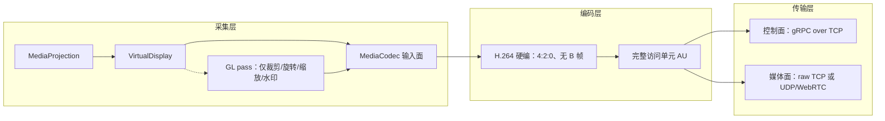

# 采集格式、传输格式与传输方式业界调研

> 状态：调研完成，未落地；调研日期 2026-10-22
> 证据边界：本文整理公开源码、协议规范与厂商文档，回答“采集格式、传输格式、传输方式”三个问题的业界做法。标注为“已验证证据”的条目来自可复核的上游源码或官方文档；标注为“推测”的条目是工程推断。**未做设备实测、未做网络抓包、未做吞吐或延迟对照实验**，因此文中的延迟数字与结论只代表被引用来源的口径。
> 相关文档：[媒体链路目标架构](media-architecture.md) · [可扩展编码框架设计](codec-framework.md) · [性能优化业界调研](performance-research.md) · [决策看板](decision-board.md) · [任务看板](task-board.md)

## 0. 阅读约定

| 标记 | 含义 |
| --- | --- |
| 当前实现 | 可在当前仓库代码或已定裁决中直接核对 |
| 已验证证据 | 来自上游源码、协议规范或官方文档，可复核 |
| 建议 | 本文给出的设计、参数或取舍建议，尚未落地 |
| 推测 | 对未公开实现、产品意图或未测量行为的判断 |

本文的“三家”指三类对象：采集端（Android 侧取画面的路径）、编码格式（码流本身的约束）、传输方式（承载码流的协议与连接模型）。三者常被混在一起讨论，本文刻意分开。

## 1. 结论先行

1. **采集**：Android 无 root 的公开最优路径，就是 `MediaProjection → VirtualDisplay → MediaCodec.createInputSurface()` 直通硬编。scrcpy 走的是同一条路；Parsec 也明确宣传“zero-copy GPU pipeline to the encoder”。把帧回读到 RGBA/YUV 再送编码器，是降级/兼容路径，不是性能路径。
2. **格式**：H.264 硬编、4:2:0、无 B 帧、完整 AU，是 2026 年最稳的低延迟基线。HEVC 是“质量/带宽档”，AV1 在移动端硬编仍稀缺，不适合做默认。
3. **传输**：TCP 在“屏幕镜像/远程桌面”阵营是主流（scrcpy、AirPlay 镜像、RustDesk、RDP、VNC）；UDP 在“游戏串流/WebRTC”阵营是主流（Moonlight、Parsec、Steam Link、WebRTC、Miracast、Cast Streaming）。干净 LAN 下 TCP 足够；弱 Wi-Fi/高帧率交互时 UDP 明显更优。
4. **gRPC**：控制面合适，媒体面不是业界主流。干净 LAN 下 HTTP/2 over TCP 的头部阻塞通常不可测；丢包/重传时会放大为数百毫秒级卡顿。建议控制/媒体分通道，媒体面可保留 raw TCP 或换 UDP/WebRTC。
5. **不限 minSdk 的实质增量**：API 34 单应用采集、API 29 内录音频、MediaCodec 编解码低延迟参数。这些是隐私/能力/参数级改进，不是采集吞吐的量级提升。

## 2. 代表性方案对照

### 2.1 方案矩阵

| 方案 | 采集格式 | 视频编码 | 音频编码 | 传输协议 | 延迟策略 | 证据 |
| --- | --- | --- | --- | --- | --- | --- |
| **scrcpy 4.x** | MediaProjection/VirtualDisplay（或 SurfaceControl）→ MediaCodec 输入 Surface；仅裁剪/旋转时过 GL | H.264 默认；H.265/AV1/VP8/VP9 可选 | Opus 默认 128 kbps；AAC/FLAC/raw | 3 个 TCP socket（adb tunnel 或直连 TCP） | 无视频缓冲、丢帧、100 ms repeat、`KEY_LATENCY=1`、realtime priority | 〔源码〕[develop.md](https://github.com/Genymobile/scrcpy/blob/master/doc/develop.md)〔源码〕[SurfaceEncoder.java](https://github.com/Genymobile/scrcpy/blob/master/server/src/main/java/com/genymobile/scrcpy/video/SurfaceEncoder.java) |
| **Moonlight + Sunshine** | GPU 桌面抓取（DXGI DDA/NVFBC/PipeWire）→ GPU 编码器 | H.264/HEVC；AV1（NVENC，实验/可选） | Opus | RTSP/TCP 48010；视频 RTP/UDP 47998；音频 RTP/UDP 48000；控制 ENet/UDP 47999；HTTP(S) 47989/47984 | UDP + Reed-Solomon FEC；低延迟编码；frame pacing | 〔官方〕[Wolf 协议表](https://games-on-whales.github.io/wolf/stable/protocols/index.html)〔官方〕[Sunshine FEC](https://docs.lizardbyte.dev/projects/sunshine/v2026.830.223700/stream_8cpp.html) |
| **Parsec** | zero-copy GPU pipeline → encoder | H.264（官方）；HEVC 部分硬件（测评） | 未公开 | 自研 BUD（reliable UDP）+ DTLS 1.2 | 官方称 LAN 以太网仅增加 7 ms；动态码率 | 〔官方〕[Parsec technology](https://parsec.app/technology) |
| **Steam Link / Remote Play** | 主机抓取 → GPU 编码（细节未公开） | H.264 默认；HEVC；AV1 实验/新版 | 未公开 | UDP 27031/27036；TCP 27036/27037 | UDP + 低延迟网络选项 | 〔官方〕[Steam Remote Play 端口](https://help.steampowered.com/en/faqs/view/0689-74B8-92AC-10F2)〔测评〕[AV1 实验](https://www.eteknix.com/steam-deck-oled-adds-hdr-streaming-and-av1-codec-support/) |
| **WebRTC** | `getDisplayMedia`；Android 经 MediaProjection + VirtualDisplay + SurfaceTexture/GL | VP8/H.264 Constrained Baseline 必须；VP9/AV1/HEVC 可选 | Opus 必须；G.711 回退 | RTP/SRTP over UDP；ICE/STUN/TURN；DTLS；SCTP data channel | jitter buffer、NACK/PLI/FEC、GCC/TWCC、simulcast/SVC | 〔官方〕[MDN WebRTC codecs](https://developer.mozilla.org/en-US/docs/Web/Media/Guides/Formats/WebRTC_codecs)〔官方〕[MDN protocols](https://developer.mozilla.org/en-US/docs/Web/API/WebRTC_API/Protocols) |
| **Miracast** | 显示合成 → H.264 → MPEG2-TS | H.264 必须；HEVC 可选 | LPCM 必须；AAC/AC3 可选 | Wi-Fi Direct P2P；RTSP 控制；RTP/UDP + MPEG2-TS | 无强制延迟上限；缓冲/AV 同步 | 〔官方/标准〕[Wi-Fi Display 2.1 spec](https://raw.githubusercontent.com/wiki/albfan/miraclecast/files/Wi-Fi_Display_Technical_Specification_v2.1_0.pdf)〔百科〕[Miracast](https://en.wikipedia.org/wiki/Miracast) |
| **AirPlay** | 显示抓取 → H.264 | H.264（镜像）；HEVC（AirPlay 2 媒体） | AAC-ELD（镜像）/ALAC（音频） | H.264 over TCP:7100；HTTP/RTSP 控制；NTP 时钟 | 缓冲；旧 AirTunes 音频约 2 s | 〔逆向文档〕[Unofficial AirPlay spec](https://nto.github.io/AirPlay.html)〔百科〕[AirPlay](https://en.wikipedia.org/wiki/AirPlay) |
| **Google Cast** | 镜像：Cast Streaming；播放：URL/HTTP，无采集 | H.264/VP8/HEVC/VP9/AV1（接收端） | AAC/Opus/MP3/FLAC | 镜像 UDP（Cast Streaming）；播放 HTTP/DASH/HLS over TCP | 播放缓冲数秒；镜像低延迟 | 〔源码/官方〕[Chromium media/cast](https://chromium.googlesource.com/chromium/src/+/refs/heads/main/media/cast/README.md)〔官方〕[Cast media codecs](https://developers.google.com/cast/docs/media) |
| **RustDesk** | `scrap` 抓取 → 编码（CPU/GPU） | VP8/VP9/AV1 软编；H.264/H.265 硬编 | 未公开（推断 Opus） | TCP 21115–21117；WebSocket 21118/21119；UDP 21116 仅注册 | 自适应；P2P 或 relay | 〔官方〕[RustDesk docs](https://rustdesk.com/docs/en/)〔官方〕[self-host 端口](https://rustdesk.com/docs/en/self-host/) |
| **AnyDesk** | 专有 DeskRT | DeskRT（专有） | 专有 | UDP 优先，TCP 回退；TLS 1.2 | 厂商称 LAN <16 ms | 〔测评/厂商〕[AnyDesk performance](https://anydesk.com/en-gb/performance) |
| **TeamViewer** | 专有 | 专有（细节未公开） | 专有 | TCP/UDP 5938 主端口；443 回退 | 自适应 | 〔官方〕[TeamViewer ports](https://www.teamviewer.com/en-us/global/support/knowledge-base/teamviewer-remote/troubleshooting/ports-used-by-teamviewer/) |
| **RDP** | 桌面合成/Desktop Duplication → EGFX | AVC420/AVC444；HEVC 可选 | PCM/压缩音频（实现相关） | TCP 3389；UDP Shortpath 3390 可选 | 自适应、缓存、帧率优化 | 〔官方〕[RDP graphics encoding](https://learn.microsoft.com/en-us/azure/virtual-desktop/graphics-encoding)〔官方〕[RDP Shortpath](https://docs.azure.cn/en-us/virtual-desktop/rdp-shortpath) |
| **VNC/RFB** | framebuffer 回读 → RFB 编码 | 无视频编码；Raw/CopyRect/RRE/Hextile/TRLE/ZRLE | 无 | TCP 5900 | 增量/脏矩形；无延迟保证 | 〔标准〕[RFC 6143](https://www.rfc-editor.org/rfc/rfc6143.html) |

### 2.2 表注

- scrcpy 的视频包是“完整 MediaCodec output buffer + 12 字节头”，不做分片/重组；这正是“完整 AU”的工程范本。〔源码〕[Streamer.java](https://github.com/Genymobile/scrcpy/blob/master/server/src/main/java/com/genymobile/scrcpy/device/Streamer.java)
- scrcpy 的音频采集用 `REMOTE_SUBMIX` + shell 权限，普通 app 拿不到；普通 app 只能用 `AudioPlaybackCapture`（API 29+），且被采集 app 可 opt-out。〔官方〕[scrcpy 2.0 audio blog](https://blog.rom1v.com/2023/03/scrcpy-2-0-with-audio/)〔官方〕[Android playback capture](https://developer.android.google.cn/guide/topics/media/playback-capture?hl=en)
- AirPlay 逆向文档较老（Apple TV 5.0 / iOS 5.1 时代），AirPlay 2 的镜像细节公开有限；表中“H.264 over TCP”应视为旧版镜像的可靠证据，而非 AirPlay 2 全貌。
- Google Cast 要区分“媒体播放”和“屏幕镜像”：前者是 URL + HTTP 自适应流，天然有数秒缓冲；后者才是低延迟 Cast Streaming（UDP）。〔源码〕Chromium `media/cast` 明确写的是 “Cast Streaming Protocol (over UDP network sockets)”。

### 2.3 三层关系

> 图示为本文归纳的业界主流分层，不是某个产品的完整架构；“控制面/媒体面分离”本身是结论 §3.3 的第 3 条共识。

## 3. 三个问题的业界共识与分歧

### 3.1 采集格式

#### 共识

1. **Android 无 root 的公开路径就是 MediaProjection。** 官方文档明确：MediaProjection 把真实显示或应用窗口投影到 VirtualDisplay，再由应用提供 `Surface` 消费；scrcpy 的 `ScreenCapture` 也是 `createVirtualDisplay(..., surface)`，失败时才回退到 SurfaceControl。〔官方〕[Android media projection](https://developer.android.google.cn/media/grow/media-projection?hl=en)〔源码〕[ScreenCapture.java](https://github.com/Genymobile/scrcpy/blob/master/server/src/main/java/com/genymobile/scrcpy/video/ScreenCapture.java)
2. **采集端最优是 Surface 直通编码器。** scrcpy 用 `MediaCodec.createInputSurface()` 拿到编码器输入面，再交给 VirtualDisplay；全程 GPU 侧流转，应用不接触像素。Parsec 也把“zero-copy GPU pipeline to the encoder”作为核心技术卖点。〔源码〕SurfaceEncoder.java〔官方〕[Parsec technology](https://parsec.app/technology)
3. **只有需要裁剪/旋转/缩放/水印时才加 GL pass。** scrcpy 在没有 filter 时直接把 `videoSize` 作为 VirtualDisplay 尺寸；有 crop/orientation/angle 时才启动 `OpenGLRunner`。每加一层 GL 就多一次纹理拷贝/同步，通常换来约一帧延迟。〔源码〕ScreenCapture.java
4. **采集分辨率应一次到位，避免“先采大再缩小编码”。** scrcpy 把最终 `videoSize` 直接用于 VirtualDisplay（无 filter 时），编码器也按该尺寸配置。〔源码〕SurfaceEncoder.java / ScreenCapture.java
5. **回读路径是降级/兼容路径。** VNC/RFB 是典型的 framebuffer 回读 + 位图编码；主流视频串流（scrcpy、Moonlight、Parsec、WebRTC）都不把 RGBA 回读作为主路径。〔标准〕RFC 6143〔推断〕
6. **新 API 的改进主要在隐私/音频，不在采集吞吐。** API 34 单应用采集排除状态栏/通知等系统 UI；API 29 内录解决“系统声音”问题；两者都不改变“Surface 直通编码器”这条主路径。〔官方〕Android media projection / playback capture

#### 分歧

- **普通 app vs shell 权限**：scrcpy 用 `app_process` 以 shell 身份运行，能拿 `REMOTE_SUBMIX`、SurfaceControl 等系统能力；普通 app 只能走公开 MediaProjection。这不是“更优解”，是权限边界。
- **GL 常开 vs 按需**：部分实现为了统一分辨率/旋转，每帧都过 GL；scrcpy 只在必要时过。前者实现简单，后者延迟更低。
- **单应用 vs 全屏**：单应用更隐私、更聚焦，但会带来尺寸变化、letterbox、系统 UI 排除等行为差异；全屏更完整。
- **VirtualDisplay vs SurfaceControl**：SurfaceControl 更底层、可绕开部分 DisplayManager 限制，但需要系统权限；公开 app 不可用。

### 3.2 传输格式（编码与封装）

#### 共识

1. **H.264 是通用底座。** scrcpy 默认 H.264，并明确“H.265 质量更好，但 H.264 延迟更低”；WebRTC 强制 H.264 Constrained Baseline；Miracast 强制 H.264；AirPlay 镜像、RDP AVC、Cast 镜像也都以 H.264 为基线。〔官方〕[scrcpy video.md](https://github.com/Genymobile/scrcpy/blob/master/doc/video.md)〔官方〕MDN WebRTC codecs〔标准〕Miracast spec
2. **低延迟编码参数已形成惯例：无 B 帧、IPPP、短 GOP/按需 IDR、CBR/VBR + 单帧 VBV、zerolatency。** Android `KEY_MAX_B_FRAMES` 默认值就是 0；Sunshine 默认 `sw_tune=zerolatency`；WebRTC H.264 用 Constrained Baseline。〔官方〕[MediaFormat](https://developer.android.google.cn/reference/android/media/MediaFormat?hl=en)〔官方〕[Sunshine configuration](https://docs.lizardbyte.dev/projects/sunshine/master/md_docs_2configuration.html)
3. **完整 AU 发送是正确做法。** scrcpy 把 `MediaCodec` 每个 output buffer 作为一个 packet 发送，带 12 字节头（PTS/大小/关键帧/配置标志），客户端按 AU 解码；不做 RTP 式分片/重组。〔源码〕Streamer.java / SurfaceEncoder.java
4. **音频实时首选 Opus。** scrcpy 默认 Opus 128 kbps；WebRTC 强制 Opus；Moonlight 音频用 Opus。AAC 是兼容回退：scrcpy 文档明确，若设备无 Opus 编码器，改用 `--audio-codec=aac`。〔官方〕[scrcpy audio.md](https://github.com/Genymobile/scrcpy/blob/master/doc/audio.md)〔官方〕MDN WebRTC codecs
5. **HEVC 是质量/带宽档，不是延迟档；AV1 移动硬编仍稀缺。** scrcpy 文档称 H.265 质量更好但 H.264 延迟更低、AV1 编码器在 Android 上不常见；Tensor G3/Pixel 8 是首个支持移动 AV1 硬编的 SoC，且当时没有应用能用上。〔官方〕scrcpy video.md〔测评〕[Pixel 8 AV1 硬编实测](https://takusan.negitoro.dev/posts/android_video_av1_pixel_8_hardware_encoder/)
6. **4:2:0 是串流默认；4:4:4 只在高带宽/文本场景作为高档。** RDP 默认 4:2:0，可通过 AVC 全屏编码 + 高质量策略开 4:4:4；Parsec Warp 套餐提供 10-bit 4:4:4。Android 硬编的 4:4:4 支持并不普遍。〔官方〕RDP graphics encoding〔测评〕Parsec 第三方对比

#### 分歧

- **H.264 vs HEVC 在 LAN 的取舍**：HEVC 同质量省 25–50% 带宽（微软说法），但硬编延迟、兼容性、专利/许可复杂度更高；多数串流仍默认 H.264，把 HEVC 作为可选项。
- **AV1 的时机**：AV1 效率最高、免专利，适合屏幕内容；但移动硬编少、软编慢，Steam/Sunshine 仍是实验/可选。
- **4:2:0 vs 4:4:4**：文本/设计场景 4:4:4 明显更清晰，但带宽更高、Android 硬编支持不保证。
- **固定 GOP vs intra refresh**：Android 文档明确推荐 `KEY_INTRA_REFRESH_PERIOD` 用于视频流（码率更平滑、抗丢包），但多数低延迟编码器仍用周期性 IDR；scrcpy 用 10 秒 I 帧间隔。
- **Opus vs AAC**：Opus 低延迟/低码率更好，但 Android 不是所有设备都有 Opus 编码器；AAC 兼容性最好，但帧长约 21.3 ms、算法延迟更高。

### 3.3 传输方式

#### 共识

1. **实时视频主流走 UDP（RTP 或自定义）。** Moonlight/Sunshine 视频走 RTP/UDP 47998；Parsec 用自研 BUD；Steam Link 用 UDP 27031/27036；WebRTC 用 RTP/SRTP over UDP；Miracast 用 RTP/UDP + MPEG2-TS；Cast Streaming 也是 UDP。理由一致：避免 TCP 重传/头部阻塞，能 FEC/NACK，能丢弃过期帧。
2. **屏幕镜像/远程桌面大量使用 TCP。** scrcpy 三个 socket 都是 TCP（adb tunnel 或直连）；AirPlay 镜像用 H.264 over TCP；RustDesk relay/WebSocket 是 TCP；RDP 默认 TCP 3389；VNC 是 TCP 5900；TeamViewer 主端口 5938 同时开 TCP/UDP。
3. **控制面与媒体面分离是惯例。** scrcpy 有 video/audio/control 三个 socket；Moonlight 用 RTSP/HTTP 做控制、RTP 做媒体；WebRTC 用信令 + RTP；RDP 用 DVC + 图形通道。
4. **UDP 阵营靠 FEC/NACK/抖动缓冲/拥塞控制保体验。** Moonlight 用 Reed-Solomon FEC；WebRTC 用 NACK/PLI/FEC + GCC/TWCC + jitter buffer；Parsec 用 BUD 的动态码率。代价是带宽冗余和实现复杂度。
5. **干净 LAN 上 TCP 足够。** scrcpy 作者 2018 年测得 35–70 ms 延迟（当时以 USB/adb 为主），并长期以 TCP 为唯一传输；没有找到“局域网 TCP 必然不可用”的业界证据。
6. **加密/配对模型收敛：首次信任 + 强加密。** Parsec 用 DTLS 1.2 + AES；WebRTC 用 DTLS-SRTP + 证书指纹；RustDesk 用 NaCl；AirPlay 用 FairPlay。mTLS + TOFU 与这些模型同类。

#### 分歧

- **TCP vs UDP for LAN**：游戏串流一致选 UDP；桌面镜像多数选 TCP。分界线是“帧率/交互实时性 + 网络可控性”。
- **自研 UDP vs WebRTC**：Parsec/Moonlight 自研协议能把延迟压到最低；WebRTC 生态通用但栈重。取决于是否需要浏览器/跨端互操作。
- **FEC vs NACK vs 丢帧**：FEC 增带宽、NACK 增延迟、丢帧降质量；Moonlight 用 FEC，WebRTC 三者都用，scrcpy 直接丢帧。
- **是否加 jitter buffer**：scrcpy 视频默认零缓冲追求最低延迟；WebRTC/Moonlight 有缓冲平滑抖动。
- **gRPC 作为媒体面**：调研范围内没有主流串流产品用 gRPC 承载视频媒体；它更多出现在控制面/微服务/RPC。

## 4. 对本项目当前三选的评估

> **当前实现**（可在仓库与裁决中核对）：采集为 `MediaProjection → VirtualDisplay → MediaCodec 输入面`；格式为 H.264 硬编、4:2:0、无 B 帧、完整 AU（HEVC 已按 DV-003 裁决不引入，见 [决策看板](decision-board.md)）；传输为统一 gRPC 双向流承载完整访问单元，控制/媒体同一条连接。依据：[媒体链路目标架构](media-architecture.md)、[可扩展编码框架设计](codec-framework.md)。

### 4.1 总表

| 选择 | 业界印证 | 业界更优解 | 值得跟踪的触发条件 |
| --- | --- | --- | --- |
| **采集：MediaProjection → VirtualDisplay → MediaCodec 输入面** | scrcpy 同构；Parsec zero-copy；官方文档推荐 Surface 消费 | 无 root 下没有本质更优路径。优化点：尺寸一次到位、只在必要时过 GL、单应用采集、编解码低延迟参数、正确处理 API 34 的“一 token 一 VirtualDisplay” | 需要单应用/隐私 → API 34；需要内录 → API 29；编码延迟 >1 帧 → `KEY_LATENCY`/priority；HDR/10-bit → HEVC |
| **格式：H.264 硬编、4:2:0、无 B 帧、完整 AU** | scrcpy 默认 H.264 且称其延迟最低；WebRTC H.264 CB；Miracast/AirPlay/RDP 都以 H.264 为基线 | LAN 高质量档用 HEVC（两端硬解且带宽紧张时）；文本/设计场景可考虑 4:4:4；AV1 暂不做默认 | 带宽不足/1440p+/HDR → HEVC；两端 AV1 硬编 → AV1；设备无 H.264 硬解 → baseline/JPEG 降级 |
| **传输：gRPC 双向流 / TCP** | scrcpy/AirPlay/RustDesk/RDP/VNC 都用 TCP；干净 LAN 下 TCP 足够；控制/媒体分离是惯例 | 媒体面用 UDP/WebRTC/RTP 更适合弱网/高帧率；至少把控制与媒体分通道；gRPC 保留控制面 | Wi-Fi 丢包导致 p99 帧间隔 >50–100 ms；目标 60 fps 游戏；多客户端/WAN；4K 高码率单消息 >4 MB；控制 RTT 被视频拖慢 |

### 4.2 采集：业界印证、更优解、触发条件

**业界印证**：scrcpy 的 `ScreenCapture` 和 `SurfaceEncoder` 与项目当前方案几乎一一对应；Parsec 官方把“zero-copy GPU pipeline to the encoder”作为低延迟核心；Android 官方文档明确 VirtualDisplay 的输出就是应用提供的 `Surface`。

**业界更优解**：没有公开 API 比“VirtualDisplay → 编码器输入面”更零拷贝。真正的“更优”是工程细节：VirtualDisplay 尺寸 = 最终编码尺寸；只有 crop/rotate/水印才加 GL pass；用 `KEY_LATENCY=1`、`KEY_PRIORITY=0`、`KEY_OPERATING_RATE`、`KEY_MAX_B_FRAMES=0`、`KEY_REPEAT_PREVIOUS_FRAME_AFTER`；编码器能力查询失败时优先降分辨率/码率而不是切 JPEG（scrcpy 的 `MAX_SIZE_FALLBACK`）。**API 34 单应用采集是产品能力上的更优，不是吞吐上的更优**；且 API 34 对同一个 MediaProjection token 只允许一次 `createVirtualDisplay()`——JPEG 降级若是“再开一个 ImageReader 的 VirtualDisplay”，在 Android 14+ 会直接抛 `SecurityException`，可行方案是单 VirtualDisplay + GL 分叉，或切换 `VirtualDisplay.setSurface()`（会中断编码），或重新申请 consent。

**触发条件**：需要“只共享某个 app” → API 34 单应用采集 + `onCapturedContentResize`；需要系统内录 → API 29（已被本项目实现）；编码延迟超过 1 帧或静态画面首帧慢 → 检查 `KEY_LATENCY`、`KEY_REPEAT_PREVIOUS_FRAME_AFTER`、`KEY_PRIORITY`；需要 HDR/10-bit → 评估 HEVC Main10；需要重连不重新弹 consent → 公开 API 做不到。

### 4.3 格式：业界印证、更优解、触发条件

**业界印证**：H.264 是低延迟默认（scrcpy 原话：H.265 质量更好但 H.264 延迟更低）；无 B 帧是行业默认（`KEY_MAX_B_FRAMES` 默认值 0；WebRTC 用 Constrained Baseline）；完整 AU 是正确封装（scrcpy 一个 output buffer 一个 packet 带 12 字节头）；Opus 是实时音频默认（AAC 回退）；4:2:0 是默认。

**业界更优解**：HEVC 作为“质量/带宽档”（两端硬解 + 带宽紧张 + 1440p+/HDR 时省 25–50% 带宽，但是可选项不是默认）；4:4:4 只在文本/设计场景；AV1 暂不做默认（移动硬编只有 Tensor G3/Pixel 8 起少数设备；AOSP 软编 `c2.android.av1.encoder` 默认 disabled）；音频如要升级，Opus 优先、AAC 回退。

**触发条件**：带宽不足或目标 1440p+/HDR → 评估 HEVC；两端都有 AV1 硬编 → 可做 AV1 实验档；文本清晰度是核心卖点 → 评估 4:4:4（先确认编码器支持）；低端客户端无 H.264 硬解 → baseline profile 或 JPEG 降级。

### 4.4 传输：业界印证、更优解、触发条件

**业界印证**：TCP 在屏幕镜像/远程桌面是主流；干净 LAN 下 TCP 足够；控制/媒体分离是惯例；UDP 是弱网/高帧率的更优解。

**业界更优解**：媒体面不要用 gRPC/HTTP2 承载视频——gRPC 是 HTTP/2 over TCP，所有 stream 共享一条 TCP 连接，丢一个 TCP 段所有 stream 一起等重传。更优分层：控制面保留 gRPC（mTLS、typed schema、双向流），媒体面 raw TCP + 12 字节帧头（scrcpy 风格）或 UDP/WebRTC/RTP；如果必须单连接，至少把控制与媒体放到不同 TCP 连接。如果留在 gRPC 媒体面：独立连接 + `TCP_NODELAY`；有界队列 + 丢弃过期帧；大 AU 分片避免超过默认 4 MB 上限；调大 HTTP/2 流控窗口；控制消息走高优先级独立通道；用 p99 帧间隔/控制 RTT 做验收而不是平均延迟。

**触发条件**：场景扩展到弱 Wi-Fi/公网/60 fps 游戏 → 媒体面换 UDP/WebRTC；多客户端/需要 SFU → WebRTC；单 AU >4 MB → 消息分片或换传输；“视频一卡鼠标也卡” → 控制/媒体分连接；需要 FEC/NACK/抖动缓冲 → UDP 阵营。

### 4.5 gRPC 头部阻塞在干净 LAN 下是否可测

**通常不可测**（8 Mbps、1080p60 平均每帧约 16 KB，干净 LAN RTT <1 ms；HTTP/2 framing + protobuf 拷贝远小于 1 ms）——没有找到公开 benchmark，属工程推断。

两个可测反例：

1. Wi-Fi 丢包/重传时 TCP RTO 让所有 stream 一起停，p99 帧间隔可能到数百毫秒。
2. 单条大消息超过 gRPC 默认 4 MB 上限或占满流控窗口。

验证方法：用 `tc netem` 注入 0.1–1% 丢包/5–20 ms 抖动，测 p50/p99 帧间隔、控制 RTT、首帧时间；p99 帧间隔 >50–100 ms 或控制 RTT 被视频拖慢，就应把媒体面移出 gRPC/TCP。

> 该验证方法对应 [决策看板](decision-board.md) DV-001 的复评条件；本文只提供业界参照，不替代设备基线。

## 5. 不限 minSdk 时值得引入的新 API 与新编解码

| 能力 | API/版本 | 成熟度 | 对项目价值 | 建议 |
| --- | --- | --- | --- | --- |
| 系统内录音频 | `AudioPlaybackCapture`，API 29+ | 成熟，但被采集 app 可 opt-out、DRM 静音 | 高 | 已实现 |
| 单应用采集 | `MediaProjectionConfig`，API 34+ | 成熟但行为复杂（排除系统 UI、尺寸变化、letterbox） | 中高 | 可选模式；必须配 `onCapturedContentResize` |
| 采集内容尺寸变化回调 | `onCapturedContentResize`，API 34+ | 成熟 | 高 | 单应用/旋转/多窗口必需 |
| 编码器低延迟模式 | `KEY_LATENCY`（API 30 公开；scrcpy API 26+ 用私有键） | 成熟，OEM 差异大 | 高 | 默认设置；用输出 format 验证实际生效值 |
| 解码器低延迟模式 | `KEY_LOW_LATENCY=1`（Android 11+） | 成熟 | 中高 | 客户端解码器开启；与 jitter buffer 策略一起调 |
| 实时优先级/工作帧率 | `KEY_PRIORITY=0`、`KEY_OPERATING_RATE`（API 23+） | 成熟 | 高 | 默认设置 |
| 显式禁用 B 帧 | `KEY_MAX_B_FRAMES=0` | 默认值即 0 | 高 | 显式设置防 OEM 默认变化 |
| Intra refresh | `KEY_INTRA_REFRESH_PERIOD`（需 `FEATURE_IntraRefresh`） | 取决于编码器 | 中 | 可选；先查 capability |
| 运行时码率/关键帧 | `PARAMETER_KEY_VIDEO_BITRATE`、`PARAMETER_KEY_REQUEST_SYNC_FRAME` | 成熟 | 高 | 与背压/拥塞信号联动 |
| 持久化输入 Surface | `createPersistentInputSurface()`（API 23+） | 成熟 | 中 | 可选 |
| HEVC 硬编 | `MIMETYPE_VIDEO_HEVC`（API 21+） | 成熟，广泛但不保证 | 中高 | 可选档；按 `MediaCodecInfo` 查询 |
| AV1 硬编 | `MIMETYPE_VIDEO_AV1`（解码 Android 10+；硬编少数 SoC） | 不成熟 | 低（当前） | 观望；只在明确硬编设备做实验档 |
| Android 15 QPR1 隐私 chip/锁屏自动停止 | Android 15 QPR1+ | 成熟（系统行为） | 产品约束 | 必须处理 `onStop()` |
| 厂商低延迟编码扩展 | 厂商 `MediaFormat` 键 | 实验/设备特定 | 中 | 按设备白名单调优 |

## 6. 证据强度、反例与未证实点

**证据较强**：scrcpy（源码+文档，与项目同构）；Moonlight/Sunshine 端口布局（Wolf 协议表）；WebRTC 强制编解码器与传输模型（MDN+RFC）；Miracast（Wi-Fi Display spec）；RDP（微软官方）；VNC（RFC 6143）；Android MediaProjection/MediaFormat（官方）。

**证据较弱**：TeamViewer/AnyDesk/Steam Link 编解码细节未公开；Parsec HEVC 来自第三方测评；gRPC 串流 HOL 代价无公开 benchmark（工程推断）；AirPlay 2 镜像细节公开有限；AV1 移动硬编 2025–2026 仍在变化；scrcpy 35–70 ms 是 2018 年 USB 场景数据。

**对项目最有价值的反例**：

1. “LAN 就一定 TCP”不成立（Moonlight/Parsec/Steam/WebRTC 在 LAN 仍用 UDP）。
2. “TCP 一定不可用”也不成立（scrcpy/AirPlay/RDP/VNC/RustDesk 证明镜像场景 TCP 可用）。
3. “JPEG 降级一定更快”不成立（JPEG 单帧带宽通常高于 H.264 P 帧，适合极弱网/无硬解/静态文本）。
4. “gRPC 多 stream 就没有 HOL”不成立（多 stream 仍在一条 TCP 连接上）。

## 7. 引用来源

### 一手（官方文档、协议规范、上游源码）

- [T1] Android MediaProjection 指南: https://developer.android.google.cn/media/grow/media-projection?hl=en
- [T2] Android Playback capture: https://developer.android.google.cn/guide/topics/media/playback-capture?hl=en
- [T3] Android `MediaFormat`: https://developer.android.google.cn/reference/android/media/MediaFormat?hl=en
- [T4] MDN WebRTC codecs: https://developer.mozilla.org/en-US/docs/Web/Media/Guides/Formats/WebRTC_codecs
- [T5] MDN WebRTC protocols: https://developer.mozilla.org/en-US/docs/Web/API/WebRTC_API/Protocols
- [T6] Wi-Fi Display Technical Specification v2.1: https://raw.githubusercontent.com/wiki/albfan/miraclecast/files/Wi-Fi_Display_Technical_Specification_v2.1_0.pdf
- [T7] RFC 6143 The Remote Framebuffer Protocol: https://www.rfc-editor.org/rfc/rfc6143.html
- [T8] Microsoft RDP graphics encoding: https://learn.microsoft.com/en-us/azure/virtual-desktop/graphics-encoding
- [T9] Microsoft RDP Shortpath: https://docs.azure.cn/en-us/virtual-desktop/rdp-shortpath
- [T10] Steam Remote Play 端口: https://help.steampowered.com/en/faqs/view/0689-74B8-92AC-10F2
- [T11] Google Cast media codecs: https://developers.google.com/cast/docs/media
- [T12] Sunshine configuration: https://docs.lizardbyte.dev/projects/sunshine/master/md_docs_2configuration.html
- [T13] Sunshine FEC 实现文档: https://docs.lizardbyte.dev/projects/sunshine/v2026.830.223700/stream_8cpp.html
- [T14] Wolf 协议与端口表: https://games-on-whales.github.io/wolf/stable/protocols/index.html
- [T15] RustDesk 文档: https://rustdesk.com/docs/en/
- [T16] RustDesk 自托管端口: https://rustdesk.com/docs/en/self-host/
- [T17] TeamViewer 端口说明: https://www.teamviewer.com/en-us/global/support/knowledge-base/teamviewer-remote/troubleshooting/ports-used-by-teamviewer/
- [T18] AnyDesk performance: https://anydesk.com/en-gb/performance
- [T19] Parsec technology: https://parsec.app/technology
- [T20] scrcpy video 文档: https://github.com/Genymobile/scrcpy/blob/master/doc/video.md
- [T21] scrcpy audio 文档: https://github.com/Genymobile/scrcpy/blob/master/doc/audio.md
- [T22] scrcpy develop 文档: https://github.com/Genymobile/scrcpy/blob/master/doc/develop.md
- [T23] scrcpy 2.0 audio 公告: https://blog.rom1v.com/2023/03/scrcpy-2-0-with-audio/
- [T24] Chromium `media/cast` README: https://chromium.googlesource.com/chromium/src/+/refs/heads/main/media/cast/README.md
- [T25] scrcpy `SurfaceEncoder.java`: https://github.com/Genymobile/scrcpy/blob/master/server/src/main/java/com/genymobile/scrcpy/video/SurfaceEncoder.java
- [T26] scrcpy `ScreenCapture.java`: https://github.com/Genymobile/scrcpy/blob/master/server/src/main/java/com/genymobile/scrcpy/video/ScreenCapture.java
- [T27] scrcpy `Streamer.java`: https://github.com/Genymobile/scrcpy/blob/master/server/src/main/java/com/genymobile/scrcpy/device/Streamer.java

### 二手（百科、逆向文档、测评）

- [T28] Miracast（Wikipedia）: https://en.wikipedia.org/wiki/Miracast
- [T29] AirPlay（Wikipedia）: https://en.wikipedia.org/wiki/AirPlay
- [T30] Unofficial AirPlay Specification: https://nto.github.io/AirPlay.html
- [T31] Steam Deck OLED 的 AV1 支持（测评）: https://www.eteknix.com/steam-deck-oled-adds-hdr-streaming-and-av1-codec-support/
- [T32] Pixel 8 AV1 硬编实测: https://takusan.negitoro.dev/posts/android_video_av1_pixel_8_hardware_encoder/

> 二手来源仅用于补充厂商未公开的实现细节；凡与官方文档冲突之处，以一手来源为准。

## 8. 实施状态（2026-10-22 补，不改变正文结论）

本节只记录调研结论落地到了哪一步，不改写第 1–7 节的判断与来源。

调研在本项目三选上给出的建议是：**媒体面先用裸 TCP（帧头极简、不套 protobuf），UDP/RTP 作为弱网可选档**，并把「丢包/重排/拥塞」的工具箱（NACK、FEC、jitter buffer、拥塞控制）留给真正需要的一档。落地对应关系（[TB-NET-003](task-board.md#tb-net-003) B1–B6，计划见 [双媒体传输实施计划](superpowers/plans/2026-10-22-media-transports.md)）：

| 调研建议 | 落地形态 | 证据 |
| --- | --- | --- |
| 第①档：控制面与媒体面分工（§2.3、§3.3） | 控制面仍 gRPC；媒体面抽象为 `MediaTransport` 三档，失败逐档回退 | [DB-NET-003](decision-board.md#db-net-003)、`MediaChannelNegotiationEndToEndTest` |
| 第②档：裸 TCP 承载 H.264、帧头不套 protobuf（§2.3 的 scrcpy 一列） | 16 字节帧头 + DESCRIPTOR/AU 帧型；mTLS 复用 + per-RPC token | `MediaFrameCodec`、`MediaTlsFactory`、`TcpMediaLoopbackTest` |
| 第③档：UDP/RTP 风格分包（§3.3 的分片与重排做法） | AES-256-GCM 分片、重排窗、按 AU 重组、丢片整 AU 丢弃 | `UdpMediaPacketCodec`、`DatagramReorderWindow`、`AccessUnitReassembler`、`UdpMediaReceiverLoopbackTest` |
| 工具箱中**未做**的部分 | FEC/RS、NACK、拥塞控制/码率自适应（只保留头部标志位与重开条件） | [DB-NET-003](decision-board.md#db-net-003) 的「明确不做」与重开条件 |
| 需要实测才能定的部分（§4.5、§6） | 三档的设备侧行为、弱网读数与回退时延 | [TB-ENG-013](task-board.md#tb-eng-013) 第 16 项 |

**边界**：以上落地只有 JVM 与回环 socket 证据，没有任何真机、真实弱网或跨 AP 的读数；调研里「TCP 队头阻塞在干净 LAN 下是否可测」的问题仍未回答，`udp.*` 与 `rx.rowd/rx.stall` 的可比性也要等设备基线。
