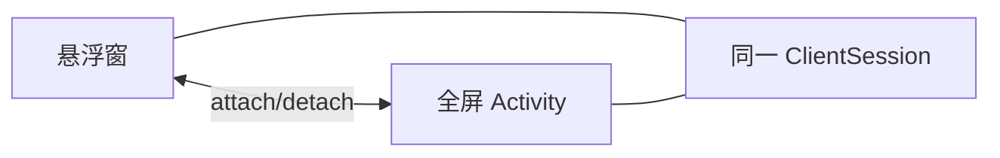
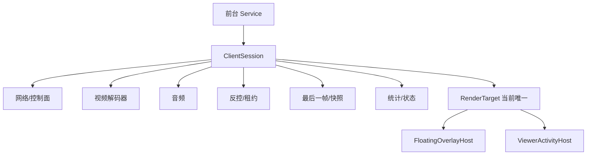
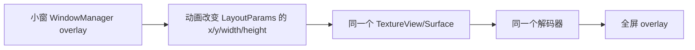
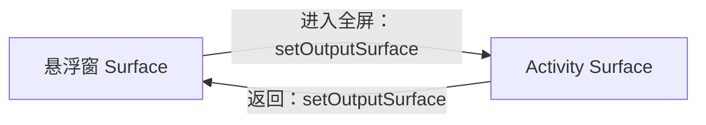
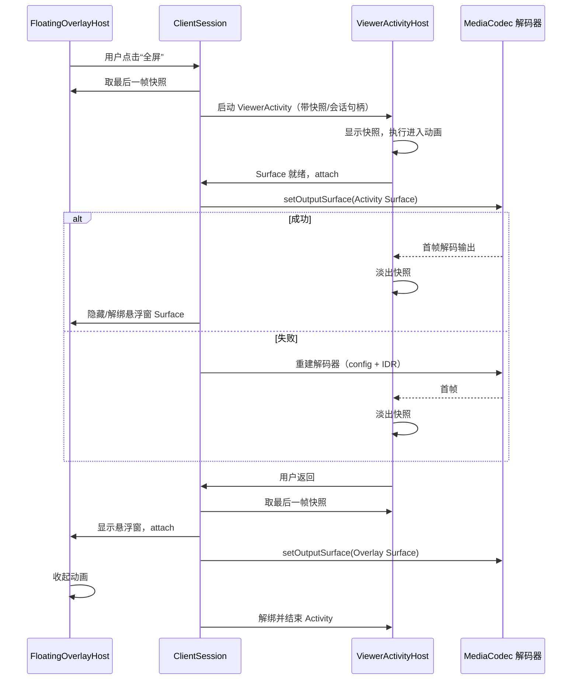
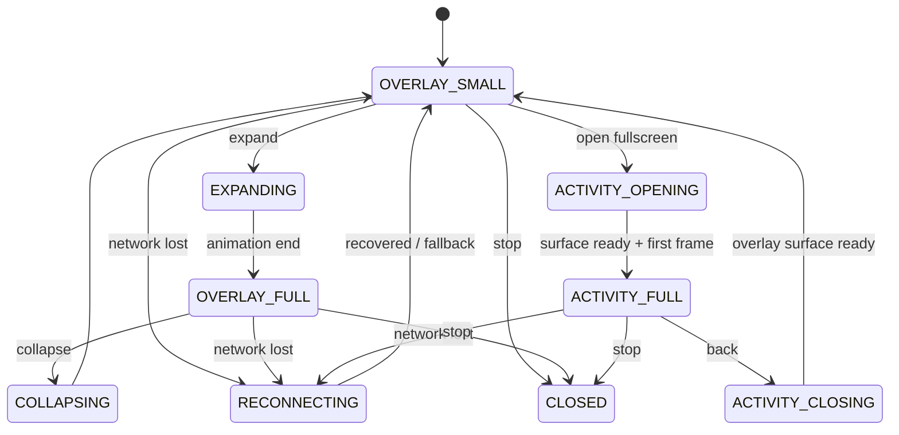

# 悬浮窗与全屏会话设计

> 状态：目标设计，尚未实现；当前代码只有悬浮窗客户端，没有全屏 Activity。
> 验证状态：未在设备上验证窗口切换、Surface 切换或动画；本文给出方案与验收标准，不声称已经可用。
> 相关文档：[项目现状](project-assessment.md) · [媒体架构](media-architecture.md) · [路线图](optimization-roadmap.md)

## 1. 问题

当前客户端把网络、解码结果和悬浮窗 UI 都放在 `LssClientService` 里：

- `LssClientService` 持有 `LssClient`、加载框和 `ScreenShareViewer`（`.../service/LssClientService.java:84-94`、`:109-176`）。
- 客户端侧的 `MainActivity` 只负责发现和启动 `LssClientService`，不承载视频画面（`.../MainActivity.java:469-474`）。
- `ScreenShareViewer` 是一个 `WindowManager` 悬浮窗，内部是 `ShapeableImageView`，不是 Surface 渲染目标（`LssClientService.java:409-844`、`:794-843`）。
- `dismiss()` 会清空帧、移除 View；`stopService()` 会停止 `LssClient` 并结束 Service（`LssClientService.java:583-606`、`:275-303`）。

因此，如果直接新增一个“全屏 Activity”并在 Activity 里重新创建 `LssClient`，窗口切换就会变成：

这不是“切换窗口”，而是“重连”。目标是把窗口切换变成同一会话内的渲染目标切换：

切换过程中只 attach/detach 渲染目标，不停 Service、不重建网络、不重新认证、不重新解码整条流。

## 2. 目标模型：ClientSession + RenderTarget

### 2.1 所有权

`ClientSession` 由 Service 持有，生命周期长于任何 Activity 或悬浮窗。它负责：

- 网络连接、认证、会话恢复、重连策略。
- 媒体解包、解码器生命周期、config+IDR 处理。
- 音频解码/播放（如果启用）。
- 反控事件与租约（如果启用）。
- 最后一帧/快照、统计、状态机。
- 向当前 `RenderTarget` 提供 Surface 或显示帧。

`RenderTarget` 只负责“把解码结果放到某个 Surface/View 上”，不拥有连接、解包或解码器。它可以是：

- `FloatingOverlayHost`：`WindowManager` 悬浮窗，内部 `TextureView` 或 `SurfaceView`。
- `ViewerActivityHost`：全屏 `Activity`，内部 `SurfaceView` 或 `TextureView`。

### 2.2 RenderTarget 契约

建议的接口语义（伪代码，不是现有 API）：

| 方法 | 作用 |
| --- | --- |
| `Surface getVideoSurface()` | 返回解码器输出 Surface |
| `void showLastFrame(Bitmap frame)` | 过渡/占位显示最后一帧 |
| `void clearVideoSurface()` | 解绑时清空 |
| `void onVideoSizeChanged(width, height, rotation)` | 通知尺寸/旋转变化 |
| `void setSecure(boolean secure)` | 设置 `FLAG_SECURE` 等 |

规则：

- 同一时刻只有一个 `RenderTarget` 拥有解码器输出 Surface。
- `attach`/`detach` 必须幂等；重复调用不崩溃。
- `attach`/`detach` 不调用 `stopService`，不关闭 socket，不释放 `ClientSession`。
- Surface 的生命周期由显示目标管理；`ClientSession` 只持有当前 Surface 的引用，并在失效时收到通知。
- 过渡期间的快照层是 UI 层，不是第二个解码输出目标；解码器仍然只输出到一个 Surface。

### 2.3 线程模型

| 线程 | 职责 | 约束 |
| --- | --- | --- |
| 主线程 | WindowManager/Activity、View、动画、权限 UI | 不阻塞；不等待网络/解码 |
| 网络线程 | 控制面/媒体读取、解包、队列 | 不直接操作 View；不持有 UI 锁 |
| 解码线程 | MediaCodec 输入/输出、Surface 切换 | `setOutputSurface` 与解码在同一线程；不持有会话锁 |
| 音频线程 | AudioRecord/AudioTrack/编码 | 独立队列；不阻塞视频 |
| 编码线程（服务端） | MediaCodec 输出、缓存、扇出 | 不直接写每个慢客户端 |

`ClientSession` 的内部锁只保护状态字段；不要在锁内调用 `setOutputSurface`、`addView`、`removeView`、`Surface.release` 或网络写。

## 3. 当前实现为什么不能直接复用

| 现状 | 影响 |
| --- | --- |
| `ScreenShareViewer` 是 `ShapeableImageView`，显示的是解码后的 Bitmap | 无法直接接收 MediaCodec 的 Surface 输出；需要改成 Surface/TextureView 显示目标 |
| `LssClientService` 同时拥有 `LssClient` 和悬浮窗 | 窗口销毁与连接生命周期耦合；Activity 介入会重复创建连接 |
| `dismiss()` 清空帧并移除 View | 没有“保留最后一帧”的过渡语义 |
| `stopService()` 停止 `LssClient` | 任何“关闭窗口”的误用都会导致断连 |
| 悬浮窗 `FLAG_NOT_FOCUSABLE` | 无法直接处理返回键、输入法和焦点；全屏交互需要另一种显示目标 |
| 没有全屏 Activity | 没有 Activity 生命周期、沉浸式系统栏、返回栈可复用 |

这些不是“加一个 Activity 就好”的问题，而是所有权问题。先拆 `ClientSession`，再做窗口切换，风险最低。

## 4. 方案 A：同一悬浮窗展开

### 4.1 思路

不创建 Activity，直接把当前悬浮窗从“小窗”动画到“全屏”，解码器始终输出到同一个 Surface：

### 4.2 优点

- **动画最顺**：没有 Activity 启动、没有 Surface 切换、没有解码器重建；只是窗口 bounds 变化。
- **连接零风险**：不涉及 Service/网络/解码器生命周期。
- **实现成本最低**：适合第一版“展开/收起”。
- **适合全屏播放器**：画面、控制层、手势都在同一个窗口内，容易做连续动画。
- **适合悬浮监看的自然延伸**：用户只是把正在看的小窗放大，而不是“进入另一个页面”。

### 4.3 实现要点

- 悬浮窗容器改为 `FrameLayout`/`ViewGroup`，内部放 `TextureView`（小窗/动画友好）或 `SurfaceView`（稳定全屏）。
- 用 `ValueAnimator` + `RectEvaluator` 动画化 `WindowManager.LayoutParams` 的 `x/y/width/height`；每帧 `updateViewLayout`。
- 保持宽高比，剩余区域做 letterbox/背景；圆角随尺寸插值。
- 小窗状态保留拖动、缩放、透明度；全屏状态禁用拖动，显示关闭/收起按钮。
- 全屏时是否隐藏状态栏/导航栏：overlay 不是 Activity，不能像 Activity 那样直接使用 `WindowInsetsController` 控制系统栏；可以绘制到系统栏下方/上方，但不能保证真正的沉浸式。需要沉浸式时用方案 B。
- `FLAG_NOT_FOCUSABLE` 下无法接收返回键；全屏 overlay 用屏幕内按钮退出，或临时切换焦点标志（会影响其他 App，慎用）。
- 全屏 overlay 仍受 `TYPE_APPLICATION_OVERLAY` 层级限制，可能被系统关键窗口/其他 overlay 遮挡；OEM 可能限制最大尺寸。
- 透明度和圆角对 `SurfaceView` 的支持不如 `TextureView`；小窗/动画优先 `TextureView`。

### 4.4 局限

| 局限 | 影响 | 应对 |
| --- | --- | --- |
| 不能真正控制状态栏/导航栏 | “全屏”可能仍有系统栏 | 用方案 B 的 Activity 做沉浸式 |
| 无 Activity 返回栈/返回键 | 用户习惯的 Back 行为缺失 | 屏幕内关闭按钮；或 B |
| 输入法/焦点能力弱 | 不适合文本输入、复杂控制 | 用 B |
| OEM overlay 限制 | 某些设备无法全屏/被裁剪 | 检测可用区域；降级到 B |
| 多窗口/分屏语义弱 | 不是系统级全屏 | 产品上定义为“最大化悬浮窗” |

### 4.5 适用结论

方案 A 适合：

- 用户主要需求是“把小窗放大看”。
- 不需要系统级沉浸式、返回键、输入法。
- 希望最低风险地实现“展开/收起”。

它是第一版窗口切换的推荐基线。

## 5. 方案 B：悬浮窗与全屏 Activity

### 5.1 思路

用 `ViewerActivity` 承载全屏 Surface；悬浮窗和 Activity 之间通过 `ClientSession` 切换解码器输出 Surface：

关键点：

- **没有跨 WindowManager/Activity 的原生共享元素**。Shared Element Transition 作用于同一 Activity 窗口内的 View；悬浮窗是独立的 WindowManager window，不能直接共享。
- 用**最后帧快照 + 过渡层**做视觉连续性。
- 用 `MediaCodec.setOutputSurface`（API 23+）切换解码输出；失败时只重建解码器，不重建连接。

### 5.2 切换流程

### 5.3 最后帧快照

用途：

- Activity 启动/表面就绪前，避免黑屏。
- 悬浮窗收起/展开时，提供视觉连续性。
- 解码器切换失败时，作为占位。

实现选项：

| 来源 | 方法 | 注意 |
| --- | --- | --- |
| SurfaceView | `PixelCopy.request`（API 24+） | 异步；需要处理超时；minSdk 25 可用 |
| TextureView | `TextureView.getBitmap()` | 可能分配大 Bitmap；只在切换时调用；及时回收 |
| 解码器输出 | 额外 `ImageReader`/离屏 Surface | 复杂；不要把稳态路径变成 Bitmap 路径 |
| 服务端快照 | 单独的低频 JPEG | 增加延迟与带宽；只作为兜底 |

约束：

- 快照只保留一份，ARGB_8888；切换完成后回收。
- 不写磁盘、不进相册、不上传；`FLAG_SECURE` 内容也要在内存中谨慎处理。
- 快照不是“第二路解码”；不要为了过渡维持第二个解码器。
- 如果拿不到快照，显示占位/品牌色，不要卡住切换。

### 5.4 `MediaCodec.setOutputSurface`

- API 23+，minSdk 25 可用。
- 在解码器处于执行状态时调用；建议在解码线程调用，避免与 `dequeueOutputBuffer`/callback 并发。
- 切换前确保旧 Surface 上的输出 buffer 已释放；切换后可能短暂没有新帧，用快照覆盖。
- 新 Surface 必须有效；`SurfaceView` 要等 `surfaceCreated`，`TextureView` 要等 `SurfaceTexture` 可用。
- `setOutputSurface` 可能抛 `IllegalStateException`/`IllegalArgumentException`；捕获后走“重建解码器”路径。
- 重建解码器时使用缓存的 `MediaFormat`/csd（config）+ 请求 IDR；网络连接、会话令牌、音频和反控不受影响。
- 不要把“Surface 切换失败”升级为“断开连接”；这是两个不同的故障域。

### 5.5 过渡动画

推荐“Activity 内快照 + 悬浮窗淡出”的简单方案：

1. 点击全屏时，悬浮窗先抓取最后一帧。
2. 启动透明/无标题的 `ViewerActivity`，把快照作为全屏 `ImageView` 显示。
3. Activity 在快照上执行 scale/translate/fade 动画；同时悬浮窗淡出。
4. Activity Surface 就绪后 `setOutputSurface`；首帧到达后淡出快照。
5. 返回时反向：Activity 抓取快照，显示悬浮窗，切换 Surface，执行收起动画，结束 Activity。

不建议依赖“跨窗口共享元素”：平台没有提供 WindowManager overlay 与 Activity 之间的 shared element 通道；自己用 snapshot 层更可控。

动画注意：

- 不要在动画期间阻塞主线程等待解码首帧；用超时/占位。
- 用 `ViewPropertyAnimator`/`ValueAnimator`，避免每帧分配大量对象。
- 动画时长按设备调优；本文不给出未经验证的固定数值。
- 首帧到达前不要移除快照，否则会出现黑屏/闪烁。
- 如果 Surface 切换失败，保持快照并提示，不要直接黑屏。

### 5.6 Activity 设计

- `ViewerActivity` 不持有 `LssClient`；只绑定 `ClientSession`（通过 Binder/Messenger/接口）。
- `exported=false`；`launchMode` 用 `singleTop` 或 `singleTask`，避免重复实例。
- 透明/无标题主题；`WindowCompat.setDecorFitsSystemWindows(false)` + `WindowInsetsControllerCompat` 做沉浸式。
- `SurfaceView` 优先用于稳定全屏；`TextureView` 用于需要透明度/圆角/复杂变换的场景。
- `FLAG_KEEP_SCREEN_ON` 可选；`FLAG_SECURE` 按会话安全状态设置。
- `onStop`/`onDestroy` 只 detach，不停止 Service；旋转时要么 `configChanges` 自行处理，要么重建 Activity 后重新 attach Surface。
- 返回键走 `OnBackPressedDispatcher`，先执行收起动画，再 `finish`；动画期间重复返回要合并。
- 从 Service/悬浮窗启动 Activity 可能受后台 Activity 启动限制；只应由用户点击触发，并准备通知 `PendingIntent` 作为兜底。
- 不要在 Activity 里重新认证、重新发现、重新建立 gRPC；这些属于 `ClientSession`。

## 6. 方案对比与裁决

| 维度 | A：同一悬浮窗展开 | B：悬浮窗与 Activity |
| --- | --- | --- |
| 连接连续性 | 最好，完全不碰 Surface | 好，但依赖 `setOutputSurface` |
| 动画顺畅度 | 最顺，同一窗口 | 需要快照/过渡，复杂但可控 |
| 系统栏/沉浸式 | 弱 | 强 |
| 返回键/输入法 | 弱 | 强 |
| Activity 生命周期 | 无 | 需要处理旋转/后台/重建 |
| 实现风险 | 低 | 中 |
| 适用 | 快速全屏播放、监看放大 | 沉浸式观看、需要标准 Activity 行为 |
| minSdk 25 | 可用 | 可用（`setOutputSurface` API 23+） |

裁决：

- **第一版用 A 做“展开/收起”**：风险最低，动画最顺，不触碰解码器 Surface。
- **B 作为需要沉浸式/返回键/输入法时的增强**；先完成 `ClientSession`/`RenderTarget` 抽象，再实现 B。
- 两者共用同一个会话模型；不要为 B 复制一套网络/解码逻辑。
- 不要从 Activity 直接创建 `LssClient`；这是导致“切换=重连”的根因。

## 7. 窗口技术选型

| 方案 | API/权限 | 能力 | 限制 | 结论 |
| --- | --- | --- | --- | --- |
| `WindowManager` 悬浮窗 | API 25：`TYPE_SYSTEM_ALERT`；API 26+：`TYPE_APPLICATION_OVERLAY`；`SYSTEM_ALERT_WINDOW` | 跨 App 显示、可拖动/缩放、可覆盖其他应用 | 特殊权限；OEM 限制；无 Activity 生命周期；系统栏/焦点能力弱 | **基线** |
| 应用内 Panel/浮层 | API 25 可用 | 应用内浮层、动画、焦点可控 | 不能跨 App；离开应用就消失 | 仅应用内 UI，不做监看基线 |
| Freeform/多窗口 | API 24+ | 系统级多窗口 | 依赖 OEM/系统开关；不是所有设备可用；应用无法完全控制 | 不作为基础 |
| Phone PiP | API 26+ | 系统画中画、后台继续显示 | 系统控制尺寸/位置；需要 Activity；不是任意悬浮窗；API 25 不可用 | 可选增强，不作基线 |
| Bubbles | API 29+（`Notification.BubbleMetadata`） | 通知气泡 | 交互模型不同；不是视频窗口；权限/系统限制 | 不作基础 |
| Desktop windowing | 新版本桌面模式 | 桌面窗口 | 设备/版本依赖强；不是手机基线 | 不作基础 |
| `Presentation`/副屏 | API 17+ | 副屏显示 | 需要副屏/系统支持；不是跨应用悬浮 | 可选，非基线 |

### 7.1 保持 minSdk 25

- `Constants.FLOATING_WINDOW_TYPE` 已经在 API 25 用 `TYPE_SYSTEM_ALERT`、API 26+ 用 `TYPE_APPLICATION_OVERLAY`（`.../support/Constants.java:35-36`）；继续沿用这个门控。
- `MediaCodec.setOutputSurface` 是 API 23+，minSdk 25 可用。
- `PixelCopy` 是 API 24+，minSdk 25 可用。
- `AudioPlaybackCapture`、PiP 等能力要按版本降级；不要为了它们抬高 minSdk。
- 新窗口 API（如桌面窗口化）只能作为可选增强，不能成为基础路径。

## 8. 状态机与并发

下图是简化切换状态图，只展示主要路径；失败回退、权限撤销、进程死亡等异常/终止分支见正文，不声称覆盖完整状态机。

并发规则：

- UI 状态只在主线程改；网络/解码状态由 `ClientSession` 串行化。
- `attach`/`detach` 带 generation/epoch；旧 Surface 回调、旧 Activity、旧动画的回调一律忽略。
- 切换期间只允许一个显示目标拥有解码 Surface；过渡快照层不算显示目标。
- `setOutputSurface` 在解码线程执行；主线程只发命令/收状态。
- 不在锁内做 Surface/Window 操作；不在主线程等待解码首帧。
- 旋转/尺寸变化提升 `configEpoch`；旧 epoch 的帧、坐标、快照丢弃。
- 停止顺序：先停止接收新帧，再 detach 渲染目标、释放解码器、释放音频、关闭网络，最后停止 Service；任何一步失败都继续清理。

## 9. 生命周期与边界

| 场景 | 期望行为 |
| --- | --- |
| 用户按 Home | 悬浮窗继续；Activity 若在前台则 `onStop` detach，但不停止会话；回到 Activity 重新 attach |
| 用户按 Back（Activity） | 执行收起动画，回到悬浮窗；不停止会话 |
| 用户关闭悬浮窗 | 停止渲染，但可保留 Service/通知；提供“重新打开”入口；是否停止会话由产品决定 |
| 旋转 | 更新窗口 bounds/Activity 布局；必要时重配解码器；`configEpoch` 递增；不重建网络 |
| 分屏/多窗口 | 悬浮窗仍按可见区域布局；Activity 按系统约束；不做系统级多窗口承诺 |
| 权限被撤销 | 停止悬浮窗/Activity，保留通知/错误提示；不崩溃 |
| 进程被杀 | 会话结束；不要假装“无缝恢复”；如需恢复，重新发现/认证/从 config+IDR 开始 |
| 安全内容 | 两个显示目标都设置 `FLAG_SECURE`；快照不落盘；不在最近任务预览中暴露（按版本能力） |
| 多显示器 | 默认主显示；副屏/车机多屏作为待验证场景，不作为基线 |

## 10. 验收标准

| 验收项 | 通过条件 |
| --- | --- |
| 会话连续性 | 悬浮窗与全屏切换前后，网络连接/会话令牌/解码配置不重建；没有新的认证/握手 |
| 不停止 Service | 切换过程中 Service 不停、通知不闪断、其他客户端不受影响 |
| 视觉连续 | 切换时显示最后帧/快照，无黑屏、无长时间闪烁；首帧到达后平滑过渡 |
| Surface 切换 | 成功路径正常；强制失败时只重建解码器并从 config+IDR 恢复，网络不断 |
| 旋转 | 悬浮窗/Activity 布局正确；画面比例正确；坐标/租约 epoch 更新 |
| 生命周期 | Home/Back/最近任务/权限撤销/进程死亡均有明确行为，不崩溃、不泄漏 |
| API 矩阵 | API 25/26/29/33/34/35 上分别验证窗口类型、权限、Surface、动画 |
| 安全 | `FLAG_SECURE` 生效；快照不落盘；日志无画面/输入内容 |
| 无性能承诺 | 只记录观测值；不在未实测时宣称帧率/延迟/发热收益 |

## 11. 开放问题

- 方案 A 在目标 OEM/车机上能否真正最大化到全屏？系统栏/挖孔/圆角如何裁剪？
- 全屏 overlay 是否需要焦点？如果需要，如何避免抢走其他 App 的输入？
- 方案 B 的 Activity 启动动画与悬浮窗淡出如何同步，才不会出现两层画面重叠？
- `setOutputSurface` 在目标厂商解码器上的可靠性如何？失败率、恢复时间需要实测。
- 旋转时是重建 Activity，还是 `configChanges` 自行处理？两者对 Surface 生命周期的影响需要验证。
- 多显示器/车机副屏是否在产品范围内？如果是，窗口模型需要重新评估。
- 关闭悬浮窗后，会话应继续后台运行、进入通知，还是立即结束？这是产品决策，不是纯技术问题。
- PiP 是否值得作为 API 26+ 的可选增强？它不能替代跨应用悬浮窗，但可以作为“全屏后回到小窗”的另一条路径。
